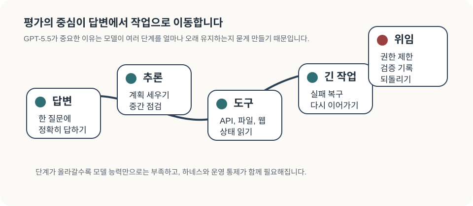
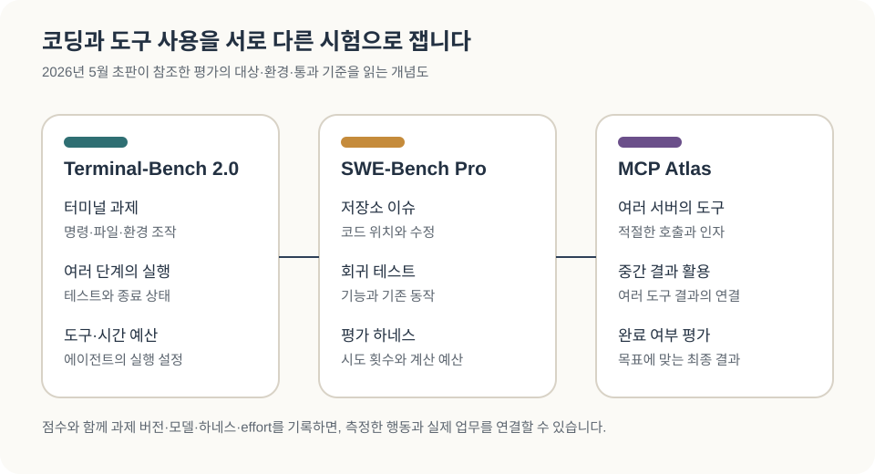
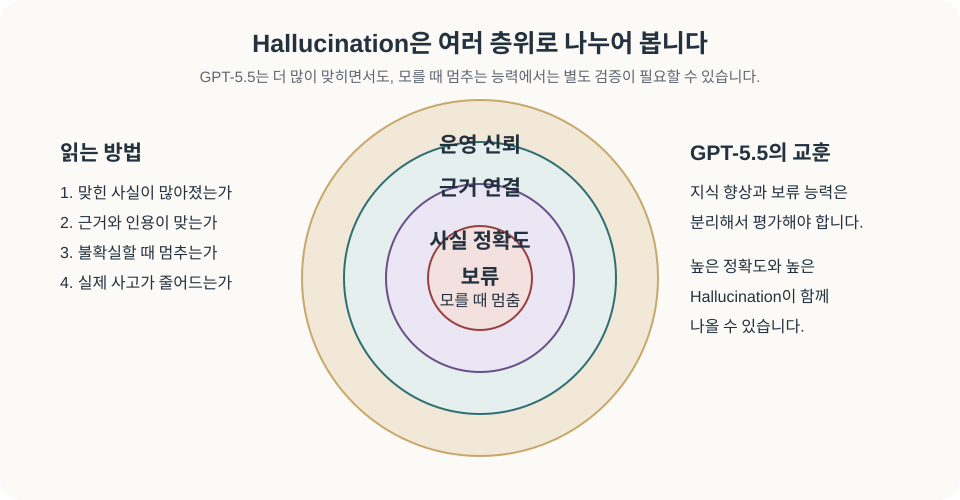
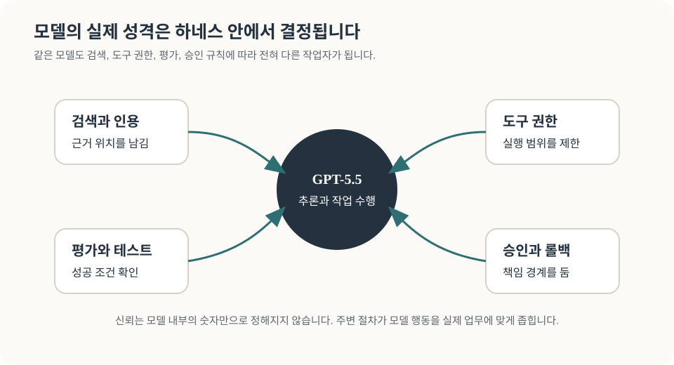
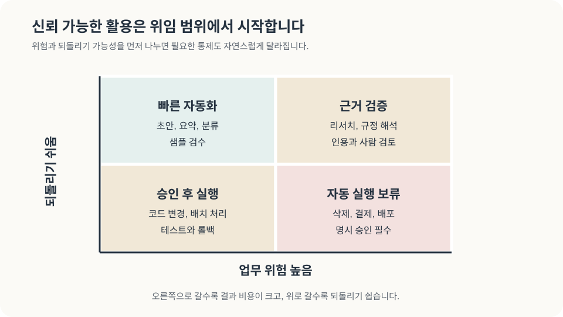

# 긴 작업을 맡기는 AI: GPT-5.5 이후의 모델과 검증

코드 수정을 맡겨두었다가 돌아오면 요청한 문제를 해결했는지, 테스트가 통과했는지, 다른 기능까지 건드리지는 않았는지 살펴보게 됩니다. 자료 조사에서도 비슷합니다. 읽기 좋은 보고서가 도착한 다음에는 인용한 논문이 실제 주장을 뒷받침하는지 확인해야 합니다. AI가 여러 단계를 이어서 수행할수록 작업을 맡기는 사람의 판단도 그 과정 전체를 향합니다.

2026년 5월 GPT-5.5를 검토할 때 주목했던 변화가 바로 이 작업 지속성이었습니다. 10월에는 GPT-6 Astra와 GPT-6.1 Sol, Claude Opus·Sonnet 5.5, Gemini 4 Argon과 3.8 Flash까지 선택지가 넓어졌습니다. 새 모델의 점수와 가격을 읽다 보면, 어떤 일을 더 맡길 수 있게 되었는지와 그 일을 어떤 조건에서 끝내는지를 함께 묻게 됩니다.

<figure class="article-hero-figure">
  
  <figcaption>그림 1. 초판의 AI 작업대 개념 일러스트레이션. 모델이 읽을 자료, 사용할 도구, 남길 검증 기록과 되돌리기 절차가 하나의 작업 환경을 이룹니다. 새 모델을 도입할 때도 이 관계를 함께 살펴봅니다.</figcaption>
</figure>

::: highlight 이번 개정의 범위
원 발행일은 2026년 5월 10일입니다. 당시 GPT-5.5 평가와 근거를 구별해 남기고, 2026년 10월 28일 확인한 최근 모델의 공식 문서·평가 자료를 추가한 문헌 기반 리뷰입니다.
:::

## 5월의 GPT-5.5 평가에서 남은 질문

GPT-5.5 출시 발표는 코드 작성, 온라인 조사, 데이터 분석과 문서 작업을 여러 도구에 걸쳐 이어 가는 능력을 강조했습니다. <a class="citation" href="#ref-1">[1]</a> 시스템 카드는 GPT-5.5 Pro를 같은 기반 모델에 병렬 test-time compute를 더하는 실행 방식으로 설명했습니다. <a class="citation" href="#ref-2">[2]</a> 같은 이름 아래서도 모델과 계산 예산, 제품의 사용 방식이 서로 다른 평가 대상을 만들었습니다.

5월 5일 발표된 GPT-5.5 Instant는 ChatGPT의 기본 대화 경험과 사실성 개선을 다뤘습니다. <a class="citation" href="#ref-3">[3]</a> 긴 저장소 작업을 수행하는 설정, 어려운 문제에 계산을 더 쓰는 Pro, 일상 대화를 위한 Instant를 구별하면 각 발표가 개선했다고 말하는 대상도 분명해집니다. 당시 발표에 실린 표준 API 입력·출력 단가는 GPT-5.5가 100만 토큰당 5·30달러, Pro가 30·180달러였습니다. <a class="citation" href="#ref-1">[1]</a> 이 가격은 초판의 도입 판단을 읽기 위한 당시 정보입니다.

OpenAI의 GPT-5.5 발표에 실린 비교표에서는 터미널 과제와 저장소 이슈의 결과가 엇갈렸습니다. 아래는 그 발표가 보고한 비교값입니다. <a class="citation" href="#ref-1">[1]</a>

| 5월 초판이 인용한 평가 | GPT-5.5 | Claude Opus 4.7 | 평가에서 읽을 대상 |
|---|---:|---:|---|
| Terminal-Bench 2.0 | 82.7% | 69.4% | 터미널 환경에서 과제를 수행하는 능력 |
| BrowseComp | 84.4% | 79.3% | 웹에서 단서를 찾고 답을 구성하는 능력 |
| SWE-Bench Pro | 58.6% | 64.3% | 저장소 이슈에 맞는 코드 변경을 만드는 능력 |

표의 GPT-5.5 값은 xhigh 설정의 연구 환경 보고치입니다. 시스템 지시와 도구 구성은 생산 제품과 다를 수 있으며, 비교 열도 발표가 설명한 각 평가의 조건에 따라 읽어야 합니다. <a class="citation" href="#ref-1">[1]</a>

이 결과를 읽으며 초판에서 중요하게 본 것은 작업별 차이였습니다. Anthropic의 Opus 4.7 발표도 소프트웨어 작업과 문서 추론, 지시를 유지하는 사용 사례를 소개했습니다. <a class="citation" href="#ref-4">[4]</a> 터미널에서 빠르게 수정하고 시험하는 일과 큰 저장소의 이슈를 추적하는 일은 관련되어 있지만, 평가가 요구하는 행동과 완료 조건은 다릅니다.

<figure class="figure-panel">
  
  <figcaption>그림 2. 초판의 평가 관점 개념도. 작업을 오래 이어 가는 능력을 볼 때에는 답변 품질과 함께 도구 사용, 결과 검증과 위임 범위를 확인하게 됩니다.</figcaption>
</figure>

SWE-Bench Pro는 실제 저장소의 장기 소프트웨어 과제를 다루며, MCP Atlas는 여러 서버의 도구를 사용해 목표를 수행하는 과제를 다룹니다. <a class="citation" href="#ref-5">[5]</a> <a class="citation" href="#ref-6">[6]</a> 같은 ‘코딩’이나 ‘도구 사용’이라는 이름 안에도 이슈 이해, 도구 선택, 인자 작성, 중간 결과 활용과 검증이 서로 다른 비중으로 들어갑니다.

<figure class="figure-panel">
  
  <figcaption>그림 3. 5월 초판에서 참조한 평가의 대상을 설명하도록 개편한 도식. 터미널 과제, 저장소 이슈, 여러 서버의 도구 호출은 서로 다른 행동을 요구합니다. 최초 발표와 평가 원문·설명을 바탕으로 재구성했습니다. <a class="citation" href="#ref-1">[1]</a> <a class="citation" href="#ref-5">[5]</a> <a class="citation" href="#ref-6">[6]</a></figcaption>
</figure>

## 사실을 맞히는 능력과 모를 때의 행동

초판에서 독자의 판단에 특히 중요했던 대목은 서로 달라 보이는 사실성 평가였습니다. OpenAI는 GPT-5.5 Instant가 GPT-5.3 Instant보다 특정 고위험 문항의 허위 주장을 52.5%, 사용자가 오류를 신고했던 어려운 대화의 부정확한 주장을 37.3% 줄였다고 보고했습니다. 이는 각각의 내부 평가 표본에서 이전 Instant와 비교한 상대 감소율입니다. <a class="citation" href="#ref-3">[3]</a>

Artificial Analysis의 4월 23일 GPT-5.5 분석은 AA-Omniscience에서 정확도 57%와 hallucination 지표 86%를 함께 제시했습니다. <a class="citation" href="#ref-7">[7]</a> 여기서 **86%의 분모는 전체 응답이 아닙니다.** AA-Omniscience v1의 정의에서 정답을 C, 부분정답을 P, 오답을 I, 답변 보류를 A라 하면 정확도는 C/(C+P+I+A), hallucination 지표는 I/(P+I+A)입니다. <a class="citation" href="#ref-8">[8]</a> 정답을 제외한 나머지 문항에서 얼마나 자주 오답을 내는지를 보는 값이므로, 이를 ‘답변 열 개 중 여덟 개 이상이 틀린다’는 뜻으로 읽으면 평가를 잘못 이해하게 됩니다.

이 지식 평가에는 도구나 추가 문맥 없이 답하는 조건과 보류 지시가 들어갑니다. 검색된 문서를 충실하게 인용하는 능력, 코드를 실행해 결과를 검증하는 능력은 다시 살펴야 할 대상입니다. <a class="citation" href="#ref-8">[8]</a> 최신 Opus 5.5 시스템 카드도 AA-Omniscience의 closed-book 평가에서 정답·오답·보류를 나누어 보고합니다. <a class="citation" href="#ref-9">[9]</a> 모델이 아는 지식, 모르는 상황의 행동, 근거를 찾는 과정과 실제 실행의 신뢰성을 구별하는 초판의 관점은 최근 모델을 읽을 때도 유효합니다.

<figure class="figure-panel">
  
  <figcaption>그림 4. 사실을 맞히는 능력, 출처와 주장을 연결하는 능력, 모를 때 답을 보류하는 행동, 실행 사고를 줄이는 운영 조건은 각각 확인할 대상입니다. 초판의 개념도를 유지했습니다.</figcaption>
</figure>

## 10월 28일에 다시 고르는 모델

이번에 살펴본 대표 모델은 아래 여섯 가지입니다. OpenAI의 출시 이력과 모델 문서, Anthropic의 출시 발표·API 문서, Google의 모델카드·API 문서에서 식별자와 제공 상태를 확인했습니다. <a class="citation" href="#ref-10">[10]</a> <a class="citation" href="#ref-11">[11]</a> <a class="citation" href="#ref-12">[12]</a> 전체 모델을 나열하거나 용도별 우승자를 정하기보다, 긴 작업을 맡길 때 실제로 달라지는 선택을 살펴보기 위한 범위입니다.

| 모델·공개일 | 확인한 API 모델 ID | 작업을 맡길 때 읽을 조건 |
|---|---|---|
| GPT-6 Astra · 9월 3일 | `gpt-6-astra` | 복잡한 추론·코딩·컴퓨터 조작을 이어 가는 작업. 도구 호출은 Responses API 조건을 확인 |
| GPT-6.1 Sol · 9월 29일 | `gpt-6.1-sol` | 복잡한 코딩·업무의 비용을 함께 고려하는 선택. 같은 작업에서 effort와 검토 부담을 확인 |
| Claude Opus 5.5 · 9월 22일 | `claude-opus-5-5` | adaptive thinking과 장기 작업. 모델·제품의 안전장치 및 fallback 조건을 확인 |
| Claude Sonnet 5.5 · 9월 28일 | `claude-sonnet-5-5` | 반복 소프트웨어 업무와 비용을 함께 검토. API 기본 effort와 앱·Code 기본값을 구별 |
| Gemini 4 Argon · 10월 13일 | `gemini-4-argon` | 복잡한 코딩·다단계 작업. 공유 문맥 예산과 긴 생성의 continuation을 확인 |
| Gemini 3.8 Flash · 9월 2일 | `gemini-3.8-flash` | 효율 계열의 장기 소프트웨어·도구 작업. 반복 검증에 쓰는 추론·출력량을 함께 확인 |

비교 시점은 2026년 10월 28일이고, 표의 날짜는 각 제공자의 공개 이력입니다. 제공 상태는 공식 API 문서를 기준으로 읽었습니다. <a class="citation" href="#ref-10">[10]</a> <a class="citation" href="#ref-11">[11]</a> <a class="citation" href="#ref-12">[12]</a>

평가표도 새로 읽어야 합니다. GPT-6 Astra 발표는 Terminal-Bench 4.0에서 57.9%를 보고하며, 표의 점수는 여러 effort 중 최대값이라고 밝힙니다. <a class="citation" href="#ref-13">[13]</a> 이 값을 앞의 GPT-5.5 2.0 점수 82.7%와 이어 붙이면 시험이 바뀐 사실이 사라집니다. Google의 Argon 평가 방법론도 기본 pass@1·최고 thinking 설정을 설명하면서, 다른 회사의 비교값은 대체로 각사 보고나 공개 리더보드에서 가져왔다고 명시합니다. <a class="citation" href="#ref-14">[14]</a> 한 표에 들어 있는 값들의 하네스와 계산 예산까지 같아지는 것은 아닙니다.

Opus 5.5의 Terminal-Bench 4.0 평가에는 Claude Code `--bare`, xhigh effort, 과제당 다섯 번 실행이라는 조건이 있습니다. 일부 실행에는 서버의 안전 fallback도 개입했습니다. <a class="citation" href="#ref-9">[9]</a> 비교할 때에는 모델 이름 다음에 이런 설정을 붙여 읽어야 합니다. 모델과 에이전트 제품, 서버의 실행 정책이 함께 만든 결과를 확인하는 일입니다.

## 긴 문맥과 긴 작업 사이의 상태 관리

최근 모델의 문맥 창은 큰 저장소와 여러 문서를 함께 다루기 쉽게 만듭니다. GPT-6 Astra와 Sol 문서는 1,050,000 토큰의 문맥 창과 최대 입력 922,000, 최대 출력 128,000을 구별합니다. <a class="citation" href="#ref-10">[10]</a> Claude Opus·Sonnet 5.5의 1M 창에도 입력뿐 아니라 새 출력과 추론이 들어갑니다. <a class="citation" href="#ref-15">[15]</a> ‘1M’이라는 숫자를 입력 문서의 분량과 그대로 같게 두기보다 지시·도구 정의·도구 결과·추론·최종 답변이 그 안에서 차지하는 자리를 살펴야 합니다.

Gemini 4 Argon은 입력·thinking·출력이 공유하는 1,048,576 토큰 창을 설명합니다. 긴 생성은 지원되는 최신 SDK가 여러 요청을 continuation으로 이어 붙이는 방식과 연결됩니다. <a class="citation" href="#ref-16">[16]</a> 단일 요청의 출력 예산과 SDK의 이어 쓰기, 실제 업무의 종료 조건은 각각의 역할을 갖습니다. 앞 단계에서 찾은 논문의 판본, 수정한 파일과 실패한 테스트를 다음 단계에서도 정확하게 이어받을 수 있어야 긴 작업이 하나의 결과로 남습니다.

OpenAI의 현재 가이드는 비동기 도구 호출과 작업 도중의 지시 변경을 설명합니다. 도구가 실행되는 동안 다른 일을 진행할 수 있어도, 애플리케이션이 도구를 실행하고 대기 중인 결과를 관리하는 역할은 남습니다. <a class="citation" href="#ref-17">[17]</a> 여기에는 모델의 추론과 별개로 설계해야 할 실행 상태가 있습니다. 도구 결과의 순서, 재시도와 중복 실행, 실패 뒤 재개 위치를 정하는 하네스가 그 상태를 다룹니다.

<figure class="figure-panel">
  
  <figcaption>그림 5. 초판에서 제시한 하네스 개념도. 최근 모델의 긴 문맥과 비동기 실행도 검색, 도구 권한, 상태 관리, 검증과 복구가 갖춰진 환경에서 사용하게 됩니다.</figcaption>
</figure>

## 더 많이 생각한 결과도 검토해야 합니다

높은 effort가 어떤 행동으로 이어지는지 보여주는 구체적인 사례가 있습니다. Sonnet 5.5 발표의 각주 2는 FrontierCode에서 Max 점수가 Xhigh보다 낮았던 이유를 설명합니다. Max 설정에서 코드 리뷰 스킬과 여러 하위 에이전트를 더 자주 사용했고, Cognition이 살핀 두 사례에서는 시간 초과 또는 요청 범위를 넘는 추가 수정으로 감점됐다고 합니다. <a class="citation" href="#ref-11">[11]</a>

이 평가는 사람의 추가 수정 없이 병합할 수 있는 변경을 봅니다. 다른 기능까지 손보는 일이 유용해 보이더라도, 맡긴 과제의 범위를 넘어가면 검토할 내용과 위험이 함께 늘어납니다. 두 사례는 추론 예산과 에이전트 수를 늘릴 때 완료 시간과 범위 준수를 함께 살펴야 하는 상황을 보여줍니다.

실행 설정의 기본값도 제품에 따라 다릅니다. Sonnet 5.5는 API 기본 effort가 high인 반면 출시 발표의 앱·Claude Code 기본값은 medium입니다. <a class="citation" href="#ref-11">[11]</a> 같은 이름의 모델을 썼다는 기록만으로 두 실행의 차이를 설명하기 어렵습니다. 모델 ID와 실행일, effort, 도구와 지시, 남긴 결과를 함께 기록하면 어떤 변경이 실제로 도움이 되었는지 다시 확인할 수 있습니다.

## 성공한 작업 한 건의 비용

긴 작업에서는 토큰 단가가 중요하고, 작업을 마치는 데 소비한 양도 중요합니다. 아래는 10월 28일 확인한 표준 유료 API의 비캐시 입력·출력 단가입니다. ChatGPT·Claude·Gemini 앱의 구독료와 구별합니다. <a class="citation" href="#ref-10">[10]</a> <a class="citation" href="#ref-18">[18]</a> <a class="citation" href="#ref-19">[19]</a>

| 모델 | 입력 / 출력: USD·100만 토큰 | 입력 2만 + 과금 출력 5천 토큰의 단가 산술 |
|---|---:|---:|
| GPT-6 Astra | 10 / 50 | $0.45000 |
| GPT-6.1 Sol | 2 / 10 | $0.09000 |
| Claude Opus 5.5 | 4 / 20 | $0.18000 |
| Claude Sonnet 5.5 | 2 / 10 | $0.09000 |
| Gemini 4 Argon | 2 / 10 | $0.09000 |
| Gemini 3.8 Flash | 0.75 / 3.75 | $0.03375 |

오른쪽은 입력 단가×0.02 + 출력 단가×0.005를 계산한 가상의 과금 예제입니다. 가정한 과금 출력 5천 토큰에는 추론도 포함합니다. 각 모델에서 같은 토큰 수가 발생한다고 가정한 단가 산술이며, 같은 문서의 실제 토큰 수나 작업 성공 비용을 측정한 결과는 아닙니다. 실제 업무에서는 과금 대상 추론·출력량으로 다시 계산하고 도구 요금, 캐시, 재시도와 사람 검토를 반영해야 합니다.

가격의 조건도 함께 남겨야 합니다. Astra와 Sol은 입력이 272K 토큰을 넘으면 해당 요청 전체에 입력·캐시 2배, 출력 1.5배 단가를 적용합니다. <a class="citation" href="#ref-10">[10]</a> Opus·Sonnet 5.5는 전체 1M 문맥에 표준 단가를 적용합니다. <a class="citation" href="#ref-18">[18]</a> 표의 Argon 가격은 11월 30일까지의 프로모션이며 이후 4·20달러, Flash는 12월 31일까지이며 이후 1.50·7.50달러로 안내돼 있습니다. Google의 출력 과금에는 thinking이 포함됩니다. <a class="citation" href="#ref-19">[19]</a>

프로젝트에서는 성공한 작업 한 건에 든 총비용을 따로 계산하는 편이 유용합니다. 낮은 단가로 여러 번 다시 시도한 결과와 한 번에 검토 가능한 결과를 받았을 때의 차이는 과금표만으로 알 수 없습니다. 코드 변경의 테스트와 되돌리기, 보고서의 출처 대조에 걸린 시간을 함께 기록하면, 모델을 바꿔 줄어든 일과 새로 생긴 일을 구별할 수 있습니다.

## 위임을 넓히는 순서

초판은 GPT-5.5의 긴 작업 능력을 도입하면서 검증과 권한 설계를 함께 보아야 한다고 판단했습니다. 당시 시스템 카드의 생물·화학 및 사이버보안 능력 분류도 모델이 수행할 수 있는 일과 조직이 허용할 일을 구별할 필요를 보여주었습니다. <a class="citation" href="#ref-2">[2]</a> 최근 모델의 성적과 새로운 실행 기능은 그 판단을 더 구체적인 업무 조건으로 옮기게 합니다.

회의록 초안을 쓰는 일과 원자료를 바꾸는 일, 코드 수정안을 만드는 일과 운영 서비스를 배포하는 일에는 서로 다른 검토가 필요합니다. 결과를 확인할 수 있고 실패를 되돌릴 수 있는 범위부터 맡긴 뒤, 그 작업에서 빠뜨린 근거와 잘못된 호출, 재시도와 검토 부담을 살펴볼 수 있습니다.

<figure class="figure-panel">
  
  <figcaption>그림 6. 초판의 위임 설계 개념도. 위험과 되돌리기 가능성에 따라 필요한 승인, 검토와 복구 경로를 정합니다.</figcaption>
</figure>

초판에서 제안한 대표 업무 20개 안팎의 내부 평가 세트도 이런 용도로 사용할 수 있습니다. 이 리뷰에서 그 평가를 실행한 것은 아닙니다. 실제로 구성한다면 업무의 완료 기준을 먼저 정하고 모델·effort·도구·검색 방식·권한을 기록합니다. 정답률에 더해 출처 오류, 범위 밖 변경, 잘못된 호출과 사람의 수정 시간을 함께 남겨야 도입 판단으로 이어집니다.

모델 선택은 그 결과를 보고 바꿀 수 있습니다. 반복 작업은 비용과 지연을 관리하기 쉬운 설정에서 시작하고, 어려운 판단이 남는 과제에는 더 큰 계산 예산을 검토할 수 있습니다. 배포·고객 발송·권한 변경처럼 결과가 외부로 이어지는 단계에는 검토와 승인 경계를 둡니다. 긴 작업을 끝낸다는 것은 생성이 멈췄다는 뜻을 넘어, 요청한 결과를 확인 가능한 상태로 넘긴다는 뜻이어야 합니다.

## 작성·개정과 검증 정보

- 책임 편집자: 김현중. 원 발행 2026-05-10, 이번 개정 2026-10-28. 초판의 5월 근거와 이번 최근 모델 조사 기준일을 구별했습니다.
- 이번 AI 보조: OpenAI Codex. 원 작성의 Codex Agent 표기는 보존하되 원 세션의 정확한 모델·개별 에이전트 구성은 미보존입니다. 이번 통합·단가 산술·출력은 `root`, 역사적 근거와 문체 대조는 `gpt55_historical_audit`, Claude 조사는 `models_claude_20261028`, Gemini 조사는 `models_gemini_20261028`이 맡았습니다.
- AI Tech Review Editorial Harness 2026.08과 현행 과학 설명·문체·APS 감사 기준을 적용했습니다. 모델 직접 비교, 유료 API 호출, 벤치마크 재현과 사람 독자 평가는 수행하지 않았습니다.
- 원 시스템 카드의 관련 절과 공식 발표·API·가격·평가 방법을 대조했습니다. Claude Opus 5.5 카드 전체나 Google 모델카드 전체 PDF를 검수한 것으로 표시하지 않습니다. 공개 웹·일부 카드/방법론의 실제 읽은 범위로 검증을 제한합니다.
- 이번 수정에서는 AA-Omniscience 지표의 분모를 명시했습니다. 초판 MCP Atlas의 5월 10일 조회 판본이 보존되지 않아 두 모델의 당시 점수는 역사표에서 덜어냈으며, 현재 표를 과거 확인 자료로 소급하지 않았습니다. 기존 비교 그림은 평가 대상 설명으로 개편했습니다.
- 기존 글 ID·URL, 원 발행일과 표지를 유지했습니다. 이번 확장에 맞춰 제목·부제·소개와 본문을 개정했으며 새 표지·영문판·PDF·영상은 일괄 제작하지 않았습니다.

## 참고문헌

[1] OpenAI, [Introducing GPT-5.5](https://openai.com/index/introducing-gpt-5-5/) (23 April 2026; updated 24 April 2026).

[2] OpenAI, [GPT-5.5 System Card](https://deploymentsafety.openai.com/gpt-5-5/gpt-5-5.pdf) (23 April 2026; updated 24 April 2026).

[3] OpenAI, [GPT-5.5 Instant: Smarter, clearer, and more personalized](https://openai.com/index/gpt-5-5-instant/) (5 May 2026).

[4] Anthropic, [Introducing Claude Opus 4.7](https://www.anthropic.com/news/claude-opus-4-7) (16 April 2026).

[5] X. Deng et al., [SWE-Bench Pro: Can AI agents solve long-horizon software engineering tasks?](https://arxiv.org/abs/2509.16941v2), arXiv:2509.16941v2 (2025).

[6] Scale AI, [MCP Atlas](https://labs.scale.com/leaderboard/mcp_atlas) (accessed 28 October 2026).

[7] Artificial Analysis, [OpenAI’s GPT-5.5 is the new leading AI model](https://artificialanalysis.ai/articles/openai-gpt5-5-is-the-new-leading-AI-model/) (23 April 2026).

[8] D. Jackson, W. Keating, G. Cameron, and M. Hill-Smith, [AA-Omniscience: Evaluating cross-domain knowledge reliability in large language models](https://arxiv.org/abs/2511.13029v1), arXiv:2511.13029v1 (2025).

[9] Anthropic, [System Card: Claude Opus 5.5](https://anthropic.com/claude-opus-5-5-system-card) (22 September 2026).

[10] OpenAI, [Changelog](https://developers.openai.com/api/docs/changelog) (accessed 28 October 2026); OpenAI, [GPT-6 Astra](https://developers.openai.com/api/docs/models/gpt-6-astra) (accessed 28 October 2026); OpenAI, [GPT-6.1 Sol](https://developers.openai.com/api/docs/models/gpt-6.1-sol) (accessed 28 October 2026).

[11] Anthropic, [Introducing Claude Opus 5.5](https://www.anthropic.com/claude-opus-5-5) (22 September 2026); Anthropic, [Introducing Claude Sonnet 5.5](https://www.anthropic.com/claude-sonnet-5-5) (28 September 2026); Anthropic, [Claude Opus 5.5](https://platform.claude.com/docs/en/models/opus-5-5/overview) (accessed 28 October 2026); Anthropic, [Claude Sonnet 5.5](https://platform.claude.com/docs/en/models/sonnet-5-5/overview) (accessed 28 October 2026).

[12] Google DeepMind, [Gemini 4 Argon model card](https://deepmind.google/models/model-cards/gemini-4-argon/) (October 2026); Google DeepMind, [Gemini 3.8 Flash model card](https://deepmind.google/models/model-cards/gemini-3-8-flash/) (September 2026); Google AI for Developers, [Gemini 4 Argon](https://ai.google.dev/gemini-api/docs/models/gemini-4-argon) (accessed 28 October 2026); Google AI for Developers, [Gemini 3.8 Flash](https://ai.google.dev/gemini-api/docs/models/gemini-3.8-flash) (accessed 28 October 2026).

[13] OpenAI, [GPT-6 Astra: A new generation of intelligence](https://openai.com/index/gpt-6-astra/) (3 September 2026).

[14] Google DeepMind, [Gemini 4 Argon model evaluation: Approach, methodology & results](https://deepmind.google/models/evals-methodology/gemini-4-argon) (accessed 28 October 2026).

[15] Anthropic, [Context windows](https://platform.claude.com/docs/en/build-with-claude/context-windows) (accessed 28 October 2026).

[16] Google AI for Developers, [What's new in Gemini 4 Argon](https://ai.google.dev/gemini-api/docs/generate-content/latest-model) (accessed 28 October 2026).

[17] OpenAI, [Using GPT-6](https://developers.openai.com/api/docs/guides/latest-model) (accessed 28 October 2026).

[18] Anthropic, [Pricing](https://platform.claude.com/docs/en/about-claude/pricing) (accessed 28 October 2026).

[19] Google AI for Developers, [Gemini Developer API pricing](https://ai.google.dev/gemini-api/docs/pricing) (accessed 28 October 2026).
