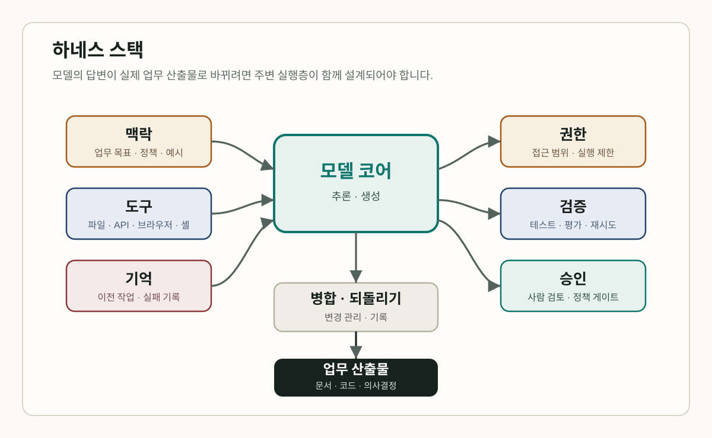
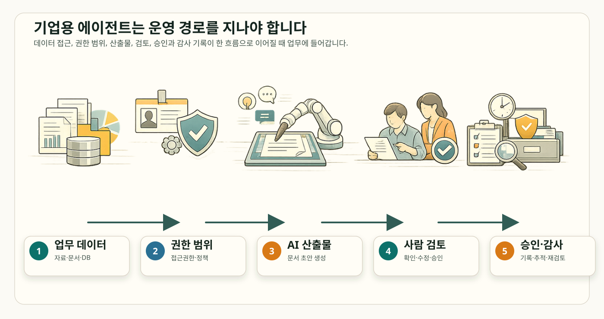
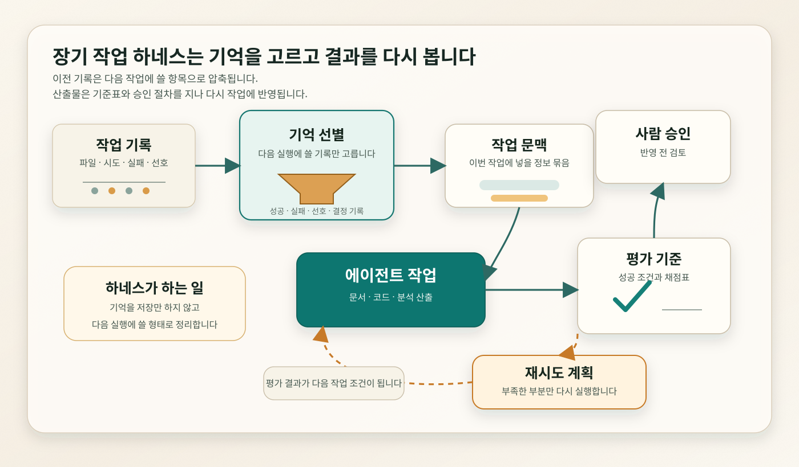
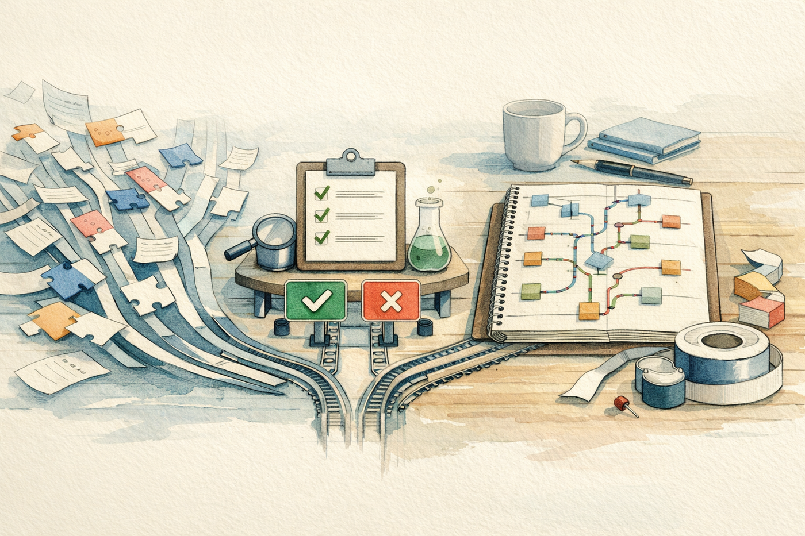
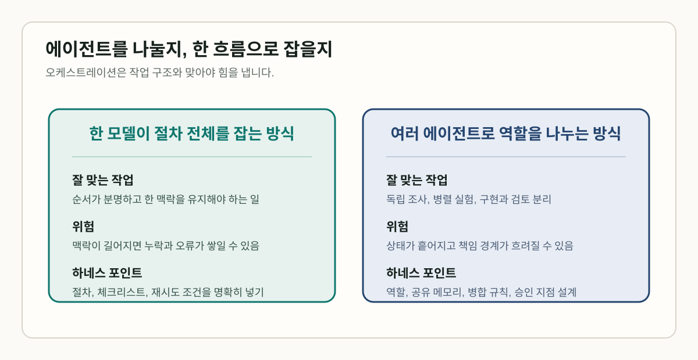
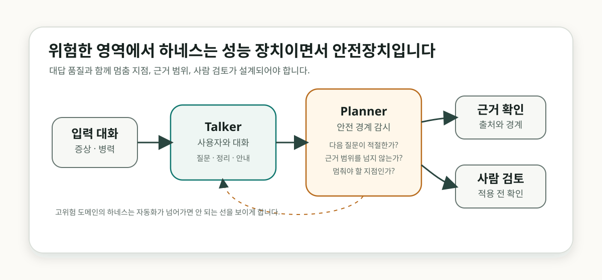

# AI 에이전트를 일하게 하는 기술: 하네스 엔지니어링

<figure class="article-hero-figure">
  
  <figcaption><strong>그림 1.</strong> 에이전트가 실제 업무 도구가 되는 순간, 문서, 도구 연결, 체크리스트, 권한 장치가 모델 주변에 함께 놓입니다.</figcaption>
</figure>

## 똑똑한 에이전트를 위한 업무 단도리: 하네스 구축

AI에게 코드 수정을 맡기면 일은 답변이 나온 뒤에도 이어집니다. 어떤 파일을 고쳤는지 읽고, 테스트 결과를 확인하고, 잘못 바뀐 부분은 되돌려야 합니다. 여러 에이전트가 같은 저장소에서 일하면 각각 통과한 수정끼리도 충돌할 수 있습니다.

모델을 고르는 일과 함께 업무의 단도리가 필요해지는 순간입니다. 읽어도 되는 파일과 실행할 수 있는 명령을 정하고, 테스트가 실패했을 때 다시 시도할 범위를 마련해야 합니다. 결과를 확인할 사람과 변경을 반영하는 절차도 있어야 합니다. 이 조건들은 에이전트가 제안한 코드를 팀이 받아들일 수 있는 작업으로 바꿉니다.

에이전트 작업을 실행하고 검증하고 제어하는 체계를 **하네스**라고 부릅니다. 소프트웨어 테스트의 test harness <a class="citation" href="#ref-1">[1]</a>는 테스트 모음을 실행하는 데 필요한 driver와 test double 같은 보조 구성요소를 모아 놓은 것을 뜻합니다. LLM 평가에서도 EleutherAI Language Model Evaluation Harness <a class="citation" href="#ref-2">[2]</a>처럼 모델을 같은 기준으로 시험하기 위한 실행 환경이라는 의미로 쓰여 왔습니다.

최근 에이전트 연구에서는 하네스 자체를 성능에 영향을 주는 설계 대상으로 다루기 시작했습니다. Natural-Language Agent Harnesses <a class="citation" href="#ref-3">[3]</a>는 에이전트 성능이 하네스 엔지니어링에 점점 더 의존한다고 설명합니다. Meta-Harness <a class="citation" href="#ref-4">[4]</a>는 하네스를 모델에 어떤 정보를 저장하고, 검색하고, 제시할지 정하는 코드로 설명합니다. 에이전트 문맥에서 하네스는 테스트 환경의 의미를 넘어 권한, 도구, 기억, 검증, 승인, 되돌리기 절차까지 포함하는 운영 체계로 다뤄집니다.

기업 업무에서는 이 실행 구조가 권한과 책임의 문제로 이어집니다. 에이전트가 실패했을 때 남기는 기록, 다시 시도할 범위, 사람에게 판단을 넘기는 지점까지 설계해야 하기 때문입니다. 논문과 제품 사례를 함께 읽으면 모델을 잘 쓰기 위한 기술과 조직의 운영 절차가 만나는 지점이 보입니다.

## 하네스는 모델 주변의 운영 조건을 정합니다

회의 자료를 정리하는 에이전트라면 메일과 문서를 찾은 뒤 필요한 내용을 골라 보고서를 만들어야 합니다. 코드 수정 에이전트라면 파일을 읽고 고친 뒤 테스트를 실행해야 합니다. 하네스는 이 과정에서 모델에 줄 문맥과 도구, 결과를 검사하는 방법, 다음 실행으로 넘어갈 조건을 정합니다. 조직이 정한 권한과 승인 절차도 이 실행 과정에 반영됩니다.

<figure class="figure-panel">
  
  <figcaption><strong>그림 2.</strong> 하네스는 모델 주변의 실행층입니다. 맥락, 도구, 기억, 권한, 평가, 승인, 병합과 되돌리기가 맞물려야 모델 출력이 실제 업무 산출물로 넘어갑니다.</figcaption>
</figure>

그림의 가운데에는 모델이 있고, 주변에는 맥락·도구·기억과 실행을 통제하는 절차가 있습니다. 같은 모델에도 서로 다른 자료를 읽히거나 재시도 조건을 주면 작업 경로가 바뀝니다. 도구 호출 결과를 남기는 기록은 다음 실행의 근거이자 사람이 변경을 검토할 자료가 됩니다.

| 용어 | 쉽게 말하면 |
|---|---|
| 하네스 | 모델을 실제 업무 안에서 쓰기 위해 마련하는 실행·검증·제어 체계입니다. 똑똑한 동료에게 책상, 출입증, 체크리스트, 검토 절차를 마련해주는 일로 생각하면 이해하기 쉽습니다. |
| connector | Gmail, Drive, Calendar, GitHub처럼 외부 업무 도구와 AI를 연결하는 통로입니다. |
| memory | 에이전트가 이전 작업, 선호, 실패 기록을 다시 활용하도록 저장하는 기억 구조입니다. |
| evaluation loop | 결과를 기준에 맞춰 평가하고, 부족하면 다시 시도하게 하는 루프입니다. |
| orchestration | 여러 에이전트나 작업 단계를 나눠 순서와 역할을 조정하는 방식입니다. |
| semantic merge | 줄 단위 병합을 넘어 함수, 클래스, 문법 구조 같은 의미 단위로 변경을 병합하려는 접근입니다. |

예를 들어 보고서를 작성하는 업무에서 connector는 검색 도구가 문서에 접근하는 통로가 됩니다. 이어서 검색한 자료를 읽는 순서, 근거를 남기는 방법, 최종 문서를 확인하는 절차가 필요합니다. 표의 구성요소들은 이처럼 실제 작업 안에서 서로 연결됩니다.

## 하네스 설계에서 만나는 연구와 업무 도구

하네스 연구, 기업용 제품, 개발 도구는 서로 다른 부분의 실행 조건을 다룹니다. 연구 논문은 정보를 제시하는 방식과 절차가 평가 결과에 주는 영향을 비교합니다. 업무 제품은 데이터 연결과 산출물 검토를 묶고, 개발 도구는 변경 이력과 병합을 다룹니다. 그림 3과 아래 표는 이 글에서 살펴볼 설계 문제의 관계를 정리한 것입니다.

<figure class="figure-panel">
  
  <figcaption><strong>그림 3.</strong> 하네스 설계에는 기준 자료, 작업 절차, 업무 앱 연결, 오픈소스 도구, 개발자 워크플로, 거버넌스가 모두 들어갑니다.</figcaption>
</figure>

| 검토한 지점 | 주요 참고자료 | 읽어볼 대목 |
|---|---|---|
| 하네스 연구 | Natural-Language Agent Harnesses <a class="citation" href="#ref-3">[3]</a>, Meta-Harness <a class="citation" href="#ref-4">[4]</a> | 하네스가 에이전트 성능과 연결되고, 하네스 자체가 최적화 대상으로 다뤄집니다. |
| 오케스트레이션의 적정선 | In-Context Prompting Obsoletes Agent Orchestration for Procedural Tasks <a class="citation" href="#ref-5">[5]</a> | 전체 절차를 한 문맥에 주는 설정과 외부 오케스트레이터가 단계별로 제어하는 설정을 비교합니다. |
| 기업용 작업면 | Anthropic 금융 서비스 에이전트 <a class="citation" href="#ref-6">[6]</a>, Claude Code Security <a class="citation" href="#ref-7">[7]</a> | 업무 문서와 보안 검토를 데이터 연결·검토·승인 절차와 함께 다룹니다. |
| 업무 데이터 연결 | xAI Grok connectors <a class="citation" href="#ref-8">[8]</a> | connector가 비기술 사용자에게 가장 먼저 체감되는 하네스 구성요소가 됩니다. |
| 오픈소스 실행 환경 | DeepSeek-TUI <a class="citation" href="#ref-9">[9]</a>, Hermes Agent <a class="citation" href="#ref-10">[10]</a>, OpenSwarm <a class="citation" href="#ref-11">[11]</a>, InsForge <a class="citation" href="#ref-12">[12]</a> | 파일 수정, 명령 실행, 세션 재개, 산출물 생성, 백엔드 작업면이 전면에 나옵니다. |
| AI 코딩 병목 | Zed AI overview <a class="citation" href="#ref-13">[13]</a>, Jujutsu <a class="citation" href="#ref-14">[14]</a>, Mergiraf <a class="citation" href="#ref-15">[15]</a>, Weave <a class="citation" href="#ref-16">[16]</a> | 생성 이후의 테스트, 병합, 되돌리기, 협업 제어가 새로운 병목으로 남습니다. |

## 같은 모델도 절차가 바뀌면 결과가 달라집니다

Natural-Language Agent Harnesses <a class="citation" href="#ref-3">[3]</a>는 하네스를 자연어로 표현하고 이식할 수 있는 실행 지식으로 설명합니다. 예를 들어 “수정 전에는 관련 테스트를 찾는다”, “실패한 테스트만 다시 돌린다”, “불확실하면 사용자에게 계획을 보여준다” 같은 규칙이 하네스의 일부가 됩니다.

특정 모델에 맞춰 만든 작업 구조나 워크플로는 모델이 바뀌는 순간 비용, 속도, 품질, 사용성에 영향을 받을 수 있습니다. 그래서 하네스를 설계할 때는 모델을 바꾸지 않고 조정할 수 있는 지점과, 모델 변경에 취약한 지점을 구분해두는 일이 중요합니다. 같은 모델을 유지한 채 읽는 자료, 재시도 방식, 검증 절차, 승인 지점을 따로 비교할 수 있어야 합니다.

Meta-Harness <a class="citation" href="#ref-4">[4]</a>는 이 생각을 하네스 최적화 문제로 바라봅니다. 이전 하네스 후보의 코드, 점수, 실행 기록을 다시 읽고, 같은 모델에서 더 나은 절차를 찾는 문제로 말입니다. 모델 자체를 바꾸기보다 일을 맡기는 조건을 조정해 성능을 개선하려는 접근입니다.

팀의 반복 업무에서도 이 비교 방법을 활용할 수 있습니다. 같은 모델과 과제를 두고 읽힐 자료, 재시도 조건, 결과 확인 절차를 바꾸어 보는 것입니다. 코드 리뷰나 문서 요약의 품질이 어떻게 달라지는지, 다시 작업하는 시간과 비용이 얼마나 드는지 함께 기록하면 어느 조건을 고쳐야 할지 판단할 수 있습니다.

## 회사 업무에는 권한 범위와 승인 기록이 따라옵니다

회사에서 만든 문서에는 내용과 함께 책임이 남습니다. 어떤 데이터에 접근했는지, 누가 검토했는지, 최종 반영을 승인한 사람이 누구인지 확인할 수 있어야 합니다. 에이전트에게 문서 생성을 맡겨도 이 책임은 이어집니다.

Anthropic의 금융 서비스 에이전트 발표 <a class="citation" href="#ref-6">[6]</a>는 투자제안서 작성, KYC 고객확인 심사, 월말 결산 같은 업무 템플릿을 제시했습니다. 민감한 데이터에 접근해 문서를 만들고 검토하는 일을 하나의 흐름으로 다루려는 제품입니다. Excel·PowerPoint·Word와 금융 데이터 connector, Moody's MCP app을 함께 제시했으며, Outlook 추가 기능은 발표 당시 출시 예정으로 안내했습니다. 에이전트가 일할 자리가 채팅창에서 업무 문서를 작성하는 환경으로 넓어지고 있습니다.

<figure class="figure-panel">
  
  <figcaption><strong>그림 4.</strong> 기업용 에이전트가 업무에 활용되려면 데이터 접근, 권한 범위, 산출물, 사람 검토, 승인과 감사 기록이 하나의 운영 체계 안에 녹아들어야 합니다.</figcaption>
</figure>

Claude Code Security 발표 <a class="citation" href="#ref-7">[7]</a>에서는 저장소를 읽고 데이터 흐름을 추적해 취약점과 수정안을 제안하는 과정에 사람의 검토를 둡니다. 취약점 탐지와 수정안 작성 뒤에 실제 반영을 결정하는 단계가 이어집니다. 이런 작업에서는 에이전트가 찾은 근거와 제안한 변경을 함께 남겨야 사람이 수정의 타당성을 검토할 수 있습니다.

**기업용 에이전트의 권한과 산출물, 승인 지점은 업무 절차 안에서 함께 설계해야 합니다.**

## 장기 작업 에이전트에는 기억을 고르는 하네스가 필요합니다

긴 작업을 다시 시작할 때는 어디까지 했고 무엇이 실패했는지부터 알아야 합니다. 전에 읽은 파일, 사용자의 선택, 평가에서 탈락한 결과를 모두 다시 읽으면 문맥이 커지고 같은 시도를 되풀이하기도 쉽습니다. 다음 실행에 필요한 기록을 골라 전달하고, 새 결과를 같은 기준으로 확인하는 절차가 장기 작업의 일부가 됩니다.

<figure class="figure-panel">
  
  <figcaption><strong>그림 5.</strong> 장기 작업 하네스는 다음 작업에 쓸 기억을 선별하고, 결과를 기준에 맞춰 평가한 뒤, 부족한 부분만 다시 시도하게 만듭니다.</figcaption>
</figure>

주제 탐색에 사용한 5월 8일 AI Updates Weekly 발표 <a class="citation" href="#ref-17">[17]</a>에서는 과거 세션에서 반복되는 패턴과 선호, 실패 기록을 추려내는 기억 정리와, 성공 기준표에 따라 결과를 평가하고 다시 시도하는 과정을 함께 소개했습니다. 여기서는 이 발표가 제시한 두 설계를 장기 작업의 관점에서 살펴봅니다.

가령 보고서가 같은 검토 기준에서 여러 번 탈락했다면, 다음 실행에는 실패한 초안 전체보다 탈락 이유와 아직 충족하지 못한 조건이 필요할 수 있습니다. 무엇을 보존하고 어떤 형태로 다시 읽힐지에 따라 기억이 다음 행동을 돕기도 하고 반복을 늘리기도 합니다. 기억 선별과 결과 평가는 이 지점에서 연결됩니다.

장기 작업에서는 계산 자원도 고려해야 합니다. Anthropic의 SpaceX compute deal 발표 <a class="citation" href="#ref-18">[18]</a>에 따르면 Anthropic은 SpaceX Colossus 1 데이터센터의 계산 자원을 활용해 Claude Code의 5시간 사용량 한도를 늘리고, Pro·Max 요금제의 피크 시간 추가 제한을 제거한다고 설명했습니다. 에이전트에게 긴 작업을 맡기려면 기억과 평가 루프뿐 아니라, 그 작업을 충분히 오래 실행할 수 있는 계산 여력도 필요합니다.

## 업무 도구를 열어주는 문: Connector와 권한 설계

비기술 사용자에게 하네스가 가장 먼저 보이는 지점은 connector일 가능성이 큽니다. 5월 8일 발표자료가 소개한 xAI Grok connectors <a class="citation" href="#ref-8">[8]</a>의 연결 대상에는 **Gmail**, **Google Calendar**, **Google Drive**, **OneDrive**, **SharePoint**가 있었습니다. 발표자료는 OAuth로 연결해 Grok이 대화 안에서 메일, 파일, 일정 정보를 활용하는 방식을 설명했습니다. <a class="citation" href="#ref-17">[17]</a>

<figure class="figure-panel">
  
  <figcaption><strong>그림 6.</strong> Connector는 사용자에게는 업무 데이터로 들어가는 손잡이입니다. 동시에 관리자에게는 읽기 범위, 민감 정보 정책, 감사 로그를 정해야 하는 제어 지점입니다.</figcaption>
</figure>

“지난주 미팅 자료와 메일을 보고 다음 행동을 정리해줘”라는 요청에는 문서 검색과 메일 열람이 함께 들어갑니다. connector는 이런 요청을 실제 자료와 연결합니다. 동시에 같은 메일함 안에서도 업무와 무관한 내용을 제외하고, 필요한 문서만 읽도록 범위를 정해야 합니다. 허용한 읽기 범위와 실제 호출 기록이 있어야 편리한 연결을 조직이 관리할 수 있는 접근으로 만들 수 있습니다.

## 파일과 명령을 다루는 오픈소스 에이전트

터미널 에이전트가 코드를 고치려면 파일과 셸 명령에 접근해야 합니다. 세션이 끊기면 작업을 재개할 기록도 필요합니다. DeepSeek-TUI, Hermes Agent, OpenSwarm, InsForge의 문서는 이 실행 환경을 서로 다른 도구와 산출물로 구성하는 사례를 보여줍니다.

| 프로젝트 | 하네스 관점에서 읽을 대목 |
|---|---|
| DeepSeek-TUI <a class="citation" href="#ref-9">[9]</a> | 터미널 코딩 에이전트로 파일 수정, 셸 명령, Git 작업, 웹 검색, MCP, 하위 에이전트, 세션 재개를 제시합니다. |
| Hermes Agent <a class="citation" href="#ref-10">[10]</a> | 터미널 화면과 메시징 게이트웨이를 제공하고, Hermes Curator <a class="citation" href="#ref-10">[10]</a>는 스킬을 `active`, `stale`, `archived`로 관리합니다. |
| OpenSwarm <a class="citation" href="#ref-11">[11]</a> | 슬라이드, 리서치 보고서, 데이터 시각화, 문서, 이미지, 영상 같은 산출물을 하나의 프롬프트에서 만드는 다중 에이전트 시스템을 지향합니다. |
| InsForge <a class="citation" href="#ref-12">[12]</a> | 코딩 에이전트가 데이터베이스, 인증, 저장소, 계산 자원, 호스팅, AI 게이트웨이를 다룰 수 있게 하는 백엔드 작업면을 표방합니다. |

Hermes Curator의 상태 구분은 도구를 만든 뒤의 관리 문제를 드러냅니다. 한 번 유용했던 스킬도 프로젝트가 바뀌면 낡을 수 있고, 비슷한 스킬이 겹치면 무엇을 선택할지 모호해집니다. 스킬을 추가하는 방법과 함께 사용 기록, 정리 기준, 보관 상태를 다루어야 다음 작업에서 다시 활용할 수 있습니다.

## 바이브코딩 Audit을 위한 하네스

AI 코딩 에이전트가 많은 변경을 빠르게 제안하더라도, 바이브코딩 결과를 팀 코드베이스에 넣기까지는 다음 절차가 필요합니다. 테스트는 통과했는지, 어떤 파일이 바뀌었는지, 여러 에이전트가 만든 수정안을 어떻게 병합할지, 문제가 생기면 어디까지 되돌릴지를 확인하는 Audit, 즉 AI가 만든 변경을 팀 작업으로 받아들이기 위한 검토와 기록 절차가 있어야 합니다.

<figure class="figure-panel">
  
  <figcaption><strong>그림 7.</strong> 바이브코딩 결과를 팀 코드베이스에 넣으려면 테스트, 리뷰, 병합, 되돌리기와 변경 기록을 확인하는 Audit 절차가 필요합니다.</figcaption>
</figure>

Zed AI overview <a class="citation" href="#ref-13">[13]</a>는 Zed를 오픈소스 AI 코드 편집기로 설명합니다. 에이전트, 인라인 변환, 자동완성, 모델 대화를 GPU 가속 Rust 앱 안에서 제공합니다. 편집기는 이제 텍스트를 고치는 창을 넘어, 에이전트와 함께 일하는 작업 공간이 되고 있습니다.

Jujutsu <a class="citation" href="#ref-14">[14]</a>는 Git 호환 버전관리 시스템입니다. Git 저장소를 저장 계층으로 쓰지만, 스테이징 영역 없는 작업 방식, 익명 브랜치, 이력 재작성 중심의 모델을 제시합니다. AI 에이전트가 여러 변경을 실험하고 되돌리는 환경에서는 이런 버전관리 모델이 더 자연스럽게 맞을 수 있습니다.

Mergiraf <a class="citation" href="#ref-15">[15]</a>는 구문 트리를 이해하는 병합을 제공합니다. 줄 단위 대신 코드 구조를 보고 병합하려는 접근입니다. Weave <a class="citation" href="#ref-16">[16]</a>는 함수나 클래스 같은 코드 단위를 기준으로 변경을 합치는 entity-level merge를 구현합니다.

**바이브코딩 Audit 하네스는 생성한 변경을 검토하고 병합하며, 문제가 생기면 되돌릴 수 있게 해야 합니다.** 병합 도구가 충돌을 줄여도 변경한 코드의 동작은 테스트와 리뷰로 확인해야 합니다. 변경 이력은 검토 결과와 실제 반영한 코드를 연결하는 기록입니다.

## 작업 분배와 R&R 조정: 오케스트레이션의 역할

계획·조사·구현·검토를 여러 에이전트에 나누면 독립적인 작업을 동시에 진행할 수 있습니다. 조직에서 말하는 R&R, 즉 역할과 책임의 범위를 정하는 일을 에이전트에게 적용하는 방식입니다. 다만 이전 단계의 판단을 계속 이어받아야 하는 업무에서는 역할을 넘기는 과정도 설계해야 합니다.

In-Context Prompting Obsoletes Agent Orchestration for Procedural Tasks <a class="citation" href="#ref-5">[5]</a>는 여행 예약, Zoom 기술 지원, 보험 청구 처리처럼 순서가 중요한 작업을 비교했습니다. 합성 절차와 모의 사용자 대화를 LLM으로 채점한 이 평가에서는, 전체 절차를 시스템 프롬프트에 넣어 한 모델이 처리하게 한 설정이 같은 모델을 사용하는 LangGraph 기반 외부 오케스트레이션보다 더 높은 점수와 낮은 실패율을 보였습니다.

<figure class="figure-panel">
  
  <figcaption><strong>그림 8.</strong> 오케스트레이션은 작업 성격에 맞게 R&R을 조정하는 설계입니다. 순서가 중요한 작업은 한 흐름으로 유지하고, 독립적인 조사와 검토는 역할을 나누는 편이 유리할 수 있습니다.</figcaption>
</figure>

이 비교의 대상은 절차가 정의된 다중 턴 업무입니다. 전체 흐름을 한 문맥에서 유지하는 방식과 단계마다 제어를 넘기는 방식의 차이를 살펴볼 근거가 됩니다. 독립적인 자료 조사나 병렬 실험, 권한 분리와 구현·검토의 분리에는 또 다른 역할 설계가 필요합니다. 하네스에서 나눌 단위는 에이전트의 수보다 업무가 이어지는 방식에 맞춰 정해야 합니다.

## 고위험 영역에서는 멈춤 지점도 설계 대상입니다

의료에서는 잘못된 응답의 결과가 환자에게 돌아갈 수 있습니다. Google DeepMind의 AI co-clinician <a class="citation" href="#ref-19">[19]</a> 연구는 임상 대화를 진행하는 에이전트와 그 과정을 감시하는 모듈의 역할을 나누어 이 문제에 접근합니다.

<figure class="figure-panel">
  
  <figcaption><strong>그림 9.</strong> 고위험 도메인의 하네스는 성능과 안전을 동시에 다룹니다. 모델이 멈춰야 할 지점, 근거를 확인할 절차, 사람이 검토할 구간을 구조 안에 둡니다.</figcaption>
</figure>

DeepMind는 AI co-clinician을 환자 병력 수집, 진단 추론, 진찰 안내를 보조하는 연구 프로젝트로 설명합니다. 특히 임상 대화 시뮬레이션에서 Planner 모듈이 Talker 에이전트가 안전한 임상 경계 안에 머무는지 감시하는 구조를 언급합니다.

여기서 검토하는 것은 연구 단계의 임상 대화 시뮬레이션과 그 제어 구조입니다. 실제 진료의 진단·치료·질병 예방이나 의료 조언에 적용하려면 그 환경에서 별도의 검증이 필요합니다. 하네스 설계에서는 어떤 응답을 멈추고, 어떤 근거와 상태를 사람에게 넘길지 구체적으로 정해야 합니다.

## 효과적인 하네스 구축을 위한 질문

하네스를 설계하는 출발점은 실제로 맡길 업무입니다. 코드 수정을 맡긴다면 읽을 저장소와 실행할 테스트, 검토할 변경 단위가 필요합니다. 문서 작성을 맡긴다면 접근할 자료와 근거를 남기는 방법, 반영을 승인할 사람이 정해져야 합니다. 중간에 실패하거나 세션이 끊겼을 때 어느 기록으로 다시 시작할지도 업무의 일부입니다.

반복해서 실패하는 지점과 사람이 다시 확인하는 일을 기록하면 먼저 설계할 부분이 드러납니다. 테스트 실패를 제대로 읽지 못하는 에이전트에는 재시도 규칙이, 관련 자료를 놓치는 에이전트에는 검색과 문맥 구성이, 변경을 합치기 어려운 팀에는 검토·병합·복구 절차가 우선일 수 있습니다. 바꾼 조건이 품질과 전체 작업 시간에 어떤 영향을 주는지 비교하면서 운영 구조를 다듬어 갈 수 있습니다.

모델 선택과 함께 남는 질문은 구체적입니다.

> 이 모델을 우리 업무의 어떤 규칙과 권한, 검증 절차 안에서 일하게 할 것인가?

## 작성 정보

- 작성자: 김현중, AI Governance 팀
- 작성 보조 및 퇴고: Codex 기반 GPT-5 계열 에이전트 하네스
- 작성일: 2026-05-09
- 발행 라벨: AI Tech Review Letters: Week 19 (2026-05-10)
- 기존 바이브퇴고: 2026-05-13
- 문체·인용 개정: 2026-10-27. 원 발행일과 근거 기준일 2026-05-13은 유지하며, 이번 개정은 OpenAI Codex의 root·legacy_harness_prose·legacy_harness_sources가 본문·서지·출력을 나누어 검토했습니다. 원 작성 세션의 개별 에이전트 명단과 이번 실행의 정확한 모델 식별자는 미보존입니다. 원 논문 벤치마크 재현이나 사람의 문장별 검토는 수행하지 않았습니다.
- 판본 대조: 이번에 선택한 저장소 커밋은 5월 13일까지 존재한 문서를 재검토하기 위한 판본이며, 원 작성자가 당시 사용한 정확한 커밋으로 소급하지 않습니다. 기억·평가 예시는 날짜가 충돌하는 현행 제품 문서 대신 당시 5월 8일 발표자료에 귀속했습니다.
- 문체·시각 참고: [고등과학원 HORIZON](https://horizon.kias.re.kr/), [최종현학술원 Science Note](https://www.chey.org/Kor/ScienceNote/ScienceNoteList.aspx), [Quanta Magazine](https://www.quantamagazine.org/).
- 주제 탐색 참고자료: AI Updates Weekly - May 8, 2026 <a class="citation" href="#ref-17">[17]</a>와 원본 슬라이드 <a class="citation" href="#ref-17">[17]</a>를 참고했습니다. 본문 결론은 논문, 공식 발표, 공식 문서, 저장소 문서를 다시 확인해 정리했습니다.
- 주요 검증 참고자료: arXiv 논문 3건, Anthropic 공식 발표, xAI 공식 문서, Google DeepMind 공식 블로그, GitHub 저장소 문서.
- 작성 및 검토 방식: 도입부, 섹션 제목, 캡션, 결론 문단에 대해 AI식 관용 표현, 번역체, 과한 대비 구조, 모호한 주어를 점검했고, 문체 기준은 [writing-style-audit-harness](writing-style-audit-harness.md), [writing-harness](writing-harness.md), [horizon-style-patterns](horizon-style-patterns.md), [editorial-reference-pool](editorial-reference-pool.md)를 참고했습니다.
- 시각 자료 작성 방식: 그래픽 배치는 [editorial-graphics-audit-harness](editorial-graphics-audit-harness.md)와 [visuals-and-image-generation](visuals-and-image-generation.md)를 기준으로 점검했습니다. Skywork Image와 imagegen으로 생성한 기사형 인포그래픽 후보를 사용했고, 정확한 한국어 라벨과 화살표가 필요한 그림은 SVG로 보정했습니다.
- 배포 패키지 작성 방식: [html_to_dist.py](html_to_dist.py)로 HTML, 이미지, SVG, 로컬 참고 문서를 `dist` 폴더에 모으고, 같은 폴더 기준으로 로컬 참조를 검증했습니다.

## References

[1] A. S. Gillis, [test harness](https://www.techtarget.com/it-infrastructure/definition/test-harness), TechTarget (7 February 2019); International Software Testing Qualifications Board, [test harness](https://glossary.istqb.org/en_US/term/test-harness), ISTQB Glossary, Version 2 (accessed 27 October 2026).

[2] L. Gao et al., [A framework for few-shot language model evaluation](https://doi.org/10.5281/zenodo.10256836), v0.4.0, Zenodo (2023); EleutherAI, [Language Model Evaluation Harness](https://github.com/EleutherAI/lm-evaluation-harness/tree/95d580638385578c1c07fa554cf16ad7f5b5f460), commit 95d580638385578c1c07fa554cf16ad7f5b5f460.

[3] L. Pan, L. Zou, S. Guo, J. Ni, and H.-T. Zheng, Natural-language agent harnesses, [arXiv:2603.25723v1](https://arxiv.org/abs/2603.25723v1).

[4] Y. Lee, R. Nair, Q. Zhang, K. Lee, O. Khattab, and C. Finn, Meta-Harness: End-to-end optimization of model harnesses, [arXiv:2603.28052v1](https://arxiv.org/abs/2603.28052v1).

[5] S. Dennis, M. Diamond, R. Patil, K. Shabahang, and H. Guo, In-context prompting obsoletes agent orchestration for procedural tasks, [arXiv:2604.27891v2](https://arxiv.org/abs/2604.27891v2).

[6] Anthropic, [Agents for financial services](https://www.anthropic.com/news/finance-agents) (5 May 2026).

[7] Anthropic, [Making frontier cybersecurity capabilities available to defenders](https://www.anthropic.com/news/claude-code-security) (20 February 2026).

[8] xAI, [Connectors](https://docs.x.ai/grok/connectors) (accessed 27 October 2026).

[9] DeepSeek-TUI contributors, [DeepSeek TUI](https://github.com/Hmbown/DeepSeek-TUI/tree/6b5011a7228371543456d11c7f217ff0d28f4ce4), commit 6b5011a7228371543456d11c7f217ff0d28f4ce4.

[10] Nous Research, [Hermes Agent](https://github.com/nousresearch/hermes-agent/tree/9d42c2c2869e5be531b6302bdc8ea6c6269a9604), commit 9d42c2c2869e5be531b6302bdc8ea6c6269a9604; Nous Research, [Curator](https://github.com/nousresearch/hermes-agent/blob/9d42c2c2869e5be531b6302bdc8ea6c6269a9604/website/docs/user-guide/features/curator.md), commit 9d42c2c2869e5be531b6302bdc8ea6c6269a9604.

[11] VRSEN and OpenSwarm contributors, [OpenSwarm](https://github.com/VRSEN/OpenSwarm/tree/d20c60e1212301ed9b4f11702f51e8a06c86413b), commit d20c60e1212301ed9b4f11702f51e8a06c86413b.

[12] InsForge, [InsForge](https://github.com/InsForge/InsForge/tree/c91ae4352f258b6a83d1adb90c361d842396a21a), commit c91ae4352f258b6a83d1adb90c361d842396a21a.

[13] Zed Industries, [AI Code Editor Documentation - Zed](https://github.com/zed-industries/zed/blob/3a8d012d1a846272c2ba019176352bbd1befa6cf/docs/src/ai/overview.md), commit 3a8d012d1a846272c2ba019176352bbd1befa6cf.

[14] Jujutsu contributors, [Jujutsu](https://github.com/jj-vcs/jj/tree/2144f50a5836822f4b1b5a5b3bae1c280e4ef3f3), commit 2144f50a5836822f4b1b5a5b3bae1c280e4ef3f3.

[15] Mergiraf contributors, [Introduction](https://mergiraf.org/) (accessed 27 October 2026).

[16] Ataraxy Labs, [Weave](https://github.com/ataraxy-labs/weave/tree/a278d32138f94ecdb6c2313883c8fbeeb2d31fb1), commit a278d32138f94ecdb6c2313883c8fbeeb2d31fb1.

[17] L. Selector, [Exciting AI Updates Weekly - May 8, 2026](https://www.youtube.com/watch?v=yDfupTHYshQ), YouTube (8 May 2026); L. Selector, [AI Updates - May 8, 2026](https://github.com/lselector/seminar/blob/3999fa63ba430df0e5cda476e31734bff707fc1d/2026/2026-05-08-AI-Updates.pptx), commit 3999fa63ba430df0e5cda476e31734bff707fc1d.

[18] Anthropic, [Higher usage limits for Claude and a compute deal with SpaceX](https://www.anthropic.com/news/higher-limits-spacex) (6 May 2026).

[19] A. Karthikesalingam, V. Natarajan, and P. Kohli, [Enabling a new model for healthcare with AI co-clinician](https://deepmind.google/blog/ai-co-clinician/), Google DeepMind (30 April 2026).
