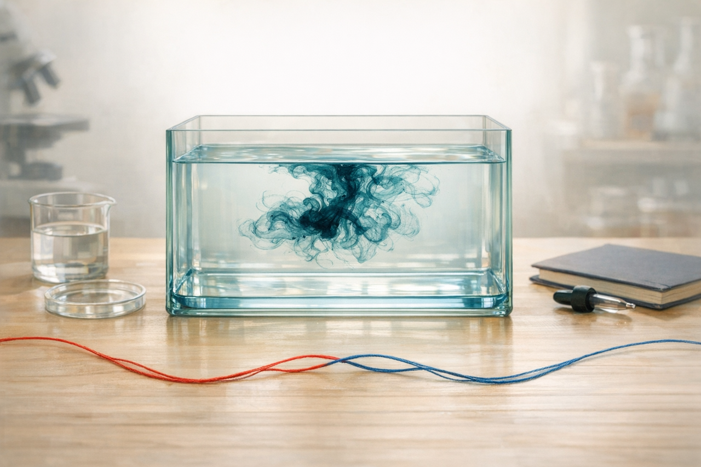
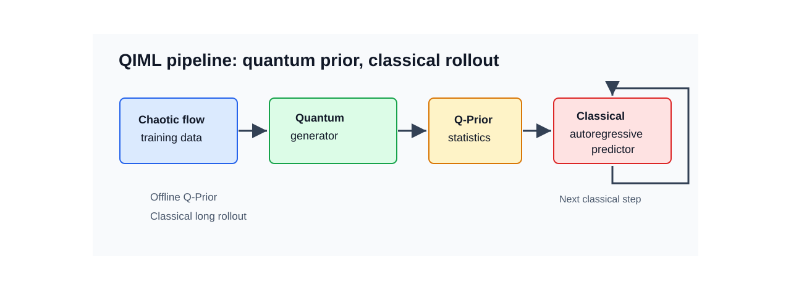
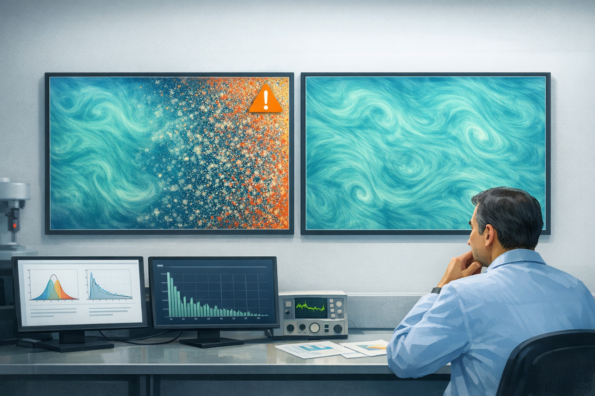
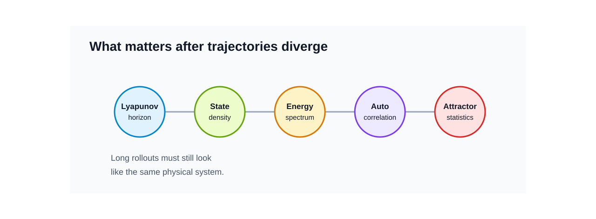
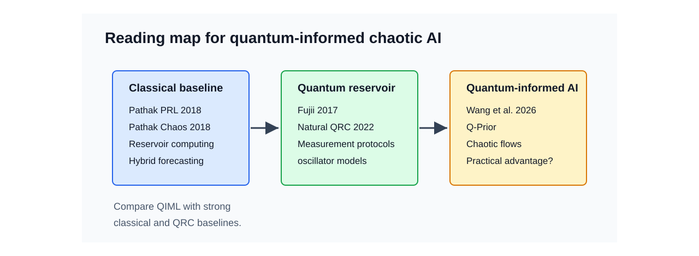
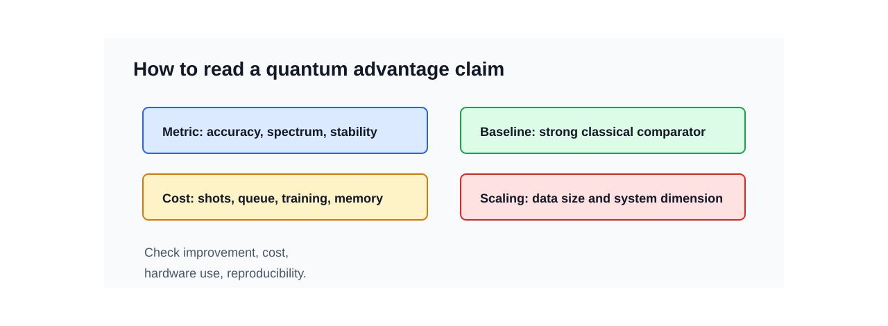

# 혼돈계 예측에 양자 prior를 더하면 무엇이 달라질까

<figure class="article-hero-figure">
  
  <figcaption><strong>그림 1.</strong> QIML이 다루는 장면을 한 화면에 묶었습니다. 왼쪽의 난류는 작은 오차가 커지는 혼돈계를, 가운데의 Q-Prior 토큰은 학습한 통계분포를, 오른쪽 대시보드는 긴 예측의 평가를 나타냅니다. 원 논문<a href="#ref-1">[1]</a>의 역할 분담을 해석한 AI 생성 개념 그림입니다.</figcaption>
</figure>

먼저 아주 작은 실험을 떠올려보겠습니다. 물이 소용돌이치는 투명한 물통에 잉크 한 방울을 떨어뜨리면 처음에는 어디서 시작했는지 보입니다. 몇 초가 지나면 잉크는 가느다란 실처럼 휘고, 갈라지고, 서로 말려 들어갑니다. 처음 위치가 아주 조금 달랐다면 나중의 무늬도 달라집니다. 그런데 멀리서 보면 여전히 비슷한 점도 있습니다. 잉크가 퍼지는 속도, 소용돌이의 크기, 진해지는 구역과 옅어지는 구역의 분포는 완전히 아무렇게나 움직이지 않습니다.

혼돈계 예측도 이 장면과 닮았습니다. 혼돈계에서는 같은 규칙을 따르더라도 시작점의 작은 차이가 시간이 지나며 크게 벌어집니다. 그래서 모델이 처음 몇 step을 맞히는 것과, 긴 시간이 지난 뒤에도 그 시스템다운 분포와 물리량을 유지하는 것은 서로 다른 능력입니다.

<figure class="figure-panel">
  
  <figcaption><strong>그림 2.</strong> 흐르는 물속의 잉크를 빌려 초기 조건에 대한 민감도를 표현한 AI 생성 개념 그림입니다. 두 색 실의 벌어짐과 남아 있는 소용돌이를 통해 개별 무늬와 통계적 특징을 구별합니다.</figcaption>
</figure>

난류, 유체 흐름, 플라즈마, 일부 화학 반응을 예측할 때도 같은 문제가 나타납니다. 처음에는 그럴듯한 예측이 나옵니다. 하지만 예측을 길게 굴리면 에너지 분포가 흐려지고, 작은 스케일의 움직임이 사라지거나 과장되고, 결국 실제 시스템과 다른 상태로 갑니다. 이때 연구자가 묻는 질문은 단순한 정확도 하나로 끝나지 않습니다. "얼마나 오래 비슷한 장면을 따라갔는가"와 함께 "나중에도 같은 물리계처럼 보이는가"를 봐야 합니다.

Lev Selector의 2026년 5월 29일 AI Updates Weekly에서 눈에 들어온 대목도 여기에 있습니다<a href="#ref-2">[2]</a>. 영상이 소개한 중심 연구는 Wang, Xue, Gao, Coveney가 Science Advances에 발표한 Quantum-informed machine learning for predicting spatiotemporal chaos with practical quantum advantage입니다<a href="#ref-1">[1]</a>. 연구진은 긴 예측에서 잃기 쉬운 통계분포를 양자 생성 모델로 학습하고, 그 분포를 고전 예측기의 학습에 보탭니다.

::: highlight
**QIML은 양자 생성 모델이 배운 통계분포를 고전 예측기의 학습 기준으로 사용합니다.** 같은 초기 상태를 한동안 잘 따라가는 능력과, 긴 시간이 지나도 그 유동의 통계적 특징을 유지하는 능력을 함께 살피는 설계입니다.
:::

## Q-Prior가 맡는 일

`prior`라는 말부터 풀어보겠습니다. prior는 모델이 예측을 시작하기 전에 가지고 들어가는 배경 지식입니다. 숙련된 연구자가 난류 화면을 볼 때 모든 픽셀을 외우지는 않습니다. 대신 "이 정도 스케일의 소용돌이가 생긴다", "에너지가 이런 식으로 분포한다", "시간 상관은 이 정도로 줄어든다" 같은 감각을 가지고 봅니다. QIML 논문은 이런 감각의 일부를 양자 생성 모델로 배워보려 합니다.

논문이 설계한 QIML은 유동 데이터의 속도값 분포를 양자 생성 모델로 학습합니다. 이 통계적 기준이 **Q-Prior**입니다. 고전 예측기가 내놓은 유동장도 미분 가능한 히스토그램으로 바꾸고, 그 분포가 Q-Prior와 얼마나 다른지를 KL 발산이나 최대 평균 차이(MMD)로 계산해 학습 손실에 더합니다. 데이터의 장면을 맞추는 손실에 통계분포를 맞추는 기준을 함께 주는 것입니다<a href="#ref-1">[1]</a>.

<figure class="figure-panel">
  
  <figcaption><strong>그림 3.</strong> 복잡한 유동에서 학습한 통계분포를 고전 예측기의 학습에 전달하는 역할을 토큰으로 표현했습니다<a href="#ref-1">[1]</a>. 토큰과 작업대는 이 전달 관계를 표현한 AI 생성 개념 그림입니다.</figcaption>
</figure>

<figure class="figure-panel">
  

  
  

  <figcaption><strong>그림 4.</strong> 원 논문<a href="#ref-1">[1]</a>의 역할 분담을 재구성한 리뷰 제작 SVG입니다. 오프라인으로 학습한 Q-Prior를 고전 예측기의 학습에 사용하고, 예측 단계에서는 고전 모델이 자신의 출력을 다음 입력으로 받아 긴 rollout을 만듭니다. 오른쪽의 자체 루프가 이 자기회귀를 뜻합니다.</figcaption>
</figure>

이 설계에서는 양자 생성 모델을 오프라인으로 학습한 뒤 그 분포를 고정합니다. 이후 고전 모델의 학습과 예측 단계에서는 양자 회로를 다시 호출하지 않습니다. 잡음·샷 수·보정과 장치 대기시간의 부담을 prior를 만드는 단계에 모아 두는 구조입니다. 논문의 KS·Kolmogorov flow 결과는 고전 양자회로 모사에서 얻었고, 채널 유동 사례에서는 초전도 양자 프로세서 IQM Garnet을 사용한 오프라인 학습도 보고했습니다<a href="#ref-1">[1]</a>.

논문이 직접 평가한 대상은 Kuramoto–Sivashinsky(KS) 방정식, 2차원 Kolmogorov flow, 3차원 난류 채널 유동의 2차원 단면을 이용한 유입 조건 생성입니다. 동일한 Koopman 계열 예측기에서 Q-Prior를 뺀 구성과 비교하면, KS의 첫 100 step에서 예측장 평균제곱오차(MSE)는 17.25±5.25% 감소했습니다. 에너지 스펙트럼 MSE의 감소는 29.36±9.01%로 보고했습니다<a href="#ref-1">[1]</a>. 이 수치는 세 시스템 전체나 모든 고전 예측기에 대한 공통 우위가 아니라, 해당 KS 비교에서 얻은 상대 감소율입니다. 영상에서 언급한 날씨·질병 확산은 응용 가능성에 대한 소개로 구분합니다<a href="#ref-2">[2]</a>.

## 긴 예측에서 남아야 할 물리량

혼돈계 예측을 평가할 때 one-step MSE만 보면 놓치는 부분이 많습니다. 한 장면의 픽셀이나 상태 벡터가 잠깐 맞는 것과, 긴 rollout 뒤에도 실제 시스템의 분포와 스펙트럼을 유지하는 것은 다른 문제입니다. 쉽게 말하면, "다음 사진 한 장"을 맞히는 시험과 "오래 지나도 같은 종류의 물리 현상을 만들고 있는지"를 보는 시험은 다릅니다.

<figure class="figure-panel">
  
  <figcaption><strong>그림 5.</strong> 긴 예측에서 분포와 에너지 스펙트럼이 달라지는 상황을 보여주는 AI 생성 개념 그림입니다. 대시보드의 두 화면은 예측의 통계적 특징이 유지되거나 흐트러지는 상황을 나타내는 은유입니다.</figcaption>
</figure>

<figure class="figure-panel">
  

  
  

  <figcaption><strong>그림 6.</strong> 혼돈계 예측 전반에서 사용할 평가 관점을 정리한 리뷰 제작 SVG입니다. 단기 궤적 오차와 장기 통계가 각각 어떤 질문에 답하는지 보여줍니다.</figcaption>
</figure>

| 평가 관점 | 확인할 질문 |
|---|---|
| Lyapunov-time horizon | 개별 궤적을 몇 Lyapunov time 동안 따라가는가 |
| Probability density | 상태 분포의 중심과 tail이 유지되는가 |
| Energy spectrum | 큰 scale과 작은 scale의 에너지 분포가 보존되는가 |
| Autocorrelation | 시간 상관이 실제 시스템과 비슷하게 줄어드는가 |
| Attractor statistics | Lyapunov exponent, correlation dimension 같은 장기 구조를 재현하는가 |

채널 유동의 유입 조건을 생성한 사례에서 이 구별이 중요해집니다. 저자들은 Q-Prior를 뺀 예측이 불안정해지는 동안, Q-Prior를 포함한 모델은 긴 예측에서도 더 일관된 분포와 스펙트럼을 유지했다고 보고했습니다<a href="#ref-1">[1]</a>. 한 순간의 오차뿐 아니라 생성한 유동이 장기적으로 어떤 상태를 만드는지를 평가한 결과입니다.

이 지점은 제조, 소재, 공정 데이터에서도 의미가 있습니다. 많은 공정 데이터와 물리 시뮬레이션은 시간이 길어질수록 분포가 무너지는 문제를 겪습니다. OLED 소재 계산, 열 공정, plasma, chemical kinetics, biofluid, 일부 이상징후 예측도 모두 "긴 시간 뒤의 평균적인 모양"이 중요해지는 순간을 가질 수 있습니다. 이런 용도로 Q-Prior를 활용하려면 실제 공정의 관측 변수와 시간척도에 맞춰 분포가 유지되는지 시험해야 합니다. 이 논문이 OLED나 공정 데이터를 평가한 것은 아니며, 여기의 연결은 그 평가에서 이어 생각해 볼 연구 방향입니다.

## 같이 읽어야 하는 세 갈래

긴 예측의 통계를 다루는 일에는 고전 reservoir computing, 양자 reservoir computing(QRC), QIML처럼 양자 prior를 쓰는 설계가 서로 다른 해법을 제공합니다. 무엇을 학습하고 어디에서 양자 동역학을 쓰는지 비교하면 QIML의 위치도 구체적으로 보입니다.

<figure class="figure-panel">
  

  
  

  <figcaption><strong>그림 7.</strong> 고전 reservoir computing, QRC와 QIML을 연결한 리뷰 제작 문헌 지도입니다. 화살표는 함께 읽을 논의를 연결합니다.</figcaption>
</figure>

첫째, 고전 reservoir computing입니다. Pathak 등의 연구는 공간적으로 큰 혼돈계의 데이터를 병렬 reservoir로 예측하는 방법을 보여줬습니다<a href="#ref-3">[3]</a>. 물리 기반 모형과 reservoir 학습을 결합한 후속 연구는 불완전한 물리 모형의 정보를 활용하는 방법을 제시했습니다<a href="#ref-4">[4]</a>. QIML과 같은 문제를 바라보되, 어떤 물리적 기준을 학습기에 제공할지 다른 선택을 한 사례들입니다.

둘째, 양자 동역학을 reservoir로 쓰는 QRC입니다. Fujii와 Nakajima는 고정된 양자계의 동역학과 학습하는 readout을 결합하는 틀을 제안했습니다<a href="#ref-5">[5]</a>. Suzuki 등의 natural QRC는 IBM 초전도 장치에서 시간 정보 처리와 분류를 시험했습니다<a href="#ref-6">[6]</a>. Mujal 등의 약한 측정·사영 측정 연구는 측정이 메모리와 자원에 미치는 영향을 수치적으로 분석했고<a href="#ref-7">[7]</a>, Dudas 등의 결합 진동자 연구는 실험으로 뒷받침된 모형을 이용해 양자 reservoir를 모사했습니다<a href="#ref-8">[8]</a>. 실제 장치 실험과 구현을 위한 모형 연구가 각기 다른 질문을 다룹니다.

셋째, 혼돈계 예측에 QRC를 적용한 연구입니다. Ahmed, Tennie, Magri의 recurrence-free QRC는 Lorenz-63·Lorenz-96와 저차 난류 전단 유동 모형의 극단 사건을 고전 양자회로 모사로 평가했습니다<a href="#ref-9">[9]</a>. Steinegger와 Räth도 네 큐비트 reservoir를 수치 모사해 3차원 혼돈계의 단기 예측과 장기 통계를 살폈습니다<a href="#ref-10">[10]</a>. Kobayashi와 Motome는 다체 양자계가 적분 가능성과 혼돈 사이에서 보이는 동역학을 QRC의 설계 원리와 연결했습니다<a href="#ref-11">[11]</a>. 이 결과들을 QIML과 읽으면, 매 예측 단계에서 양자 reservoir를 사용하는 방식과 오프라인에서 배운 prior를 고전 모델에 제공하는 방식의 차이가 드러납니다.

## 정확도와 계산비용을 함께 읽기

QIML의 제목에 쓰인 practical quantum advantage를 평가하려면 정확도의 개선과 계산에 든 자원을 함께 읽어야 합니다. 같은 예측기에서 prior를 제거한 비교는 그 기준이 결과에 보탠 효과를 보여줍니다. 논문은 같은 채널 유동 데이터로 약 300개와 124,418개 파라미터를 가진 고전 VAE prior도 비교했습니다. 큰 VAE는 큰 스케일의 구조를 근사했지만 유동의 시간 변화가 줄어 거의 정지한 무늬에 머무는 locking 현상과 고파수 영역의 편차가 남았다고 보고했습니다<a href="#ref-1">[1]</a>. 이 비교를 같은 학습 예산의 다른 생성 모델과 전체 계산비용으로 넓히는 일은 계속 남아 있습니다.

<figure class="figure-panel">
  

  
  

  <figcaption><strong>그림 8.</strong> 정확도·기준법·자원·확장성을 함께 읽기 위한 리뷰 제작 SVG입니다. practical quantum advantage 주장을 검토하는 항목을 정리한 개념 도식입니다.</figcaption>
</figure>

| 주장 | 확인할 것 |
|---|---|
| 더 정확하다 | 어떤 metric에서, 어떤 baseline 대비, 어떤 데이터셋에서 좋아졌는가 |
| 더 작다 | parameter 수인지, 저장공간인지, 학습 데이터인지, QPU shot 비용까지 포함한 것인지 |
| 더 안정적이다 | long rollout에서 PDF, spectrum, autocorrelation이 유지되는가 |
| 양자 하드웨어를 썼다 | emulator인지 실제 QPU인지, qubit 수와 shot 수, error mitigation 방식은 무엇인지 |
| practical quantum advantage | classical prior와 비용 포함 비교, 독립 재현, scaling test가 있는지 |

저장공간의 주장도 그 대상을 확인해야 합니다. 논문의 압축 비교는 학습 데이터를 표현하는 양자 회로 파라미터의 checkpoint 크기를 다룹니다. 원래의 모든 유동장을 손실 없이 되살리는 압축이나 고전 예측기 전체의 메모리 감소와는 구별됩니다<a href="#ref-1">[1]</a>. 학습한 속도 분포가 긴 예측에서 어떤 물리량을 지키는지와, 그 분포를 얻는 데 든 자원을 함께 볼 필요가 있습니다.

정식 코드 보관본<a href="#ref-12">[12]</a>과 데이터<a href="#ref-13">[13]</a>는 그 비교를 확인할 자료를 제공합니다. 다만 선택한 TCF 학습 스크립트에는 원문의 설계 설명과 맞춰 볼 부분이 있습니다. 예측 속도를 펼쳐 softmax 분포로 만드는 경로는 보충자료가 설명한 속도값 히스토그램과 다르고, 그 앞에서 적용한 detach()는 prior 손실의 기울기가 예측기 파라미터로 전달되는 연결을 끊습니다<a href="#ref-12">[12]</a>. 이 정적 대조를 바탕으로, 보고된 결과가 어느 코드·설정에서 나왔는지 확인할 필요가 있습니다. 이번 개편에서는 학습과 QPU 실행을 재현하지 않았습니다.

## 용어 정리

| 용어 | 짧은 설명 | 이 글에서의 의미 |
|---|---|---|
| Chaotic process | 초기 조건의 작은 차이가 시간이 지나며 크게 벌어지는 동역학계입니다. | 단기 궤적의 정확도와 장기 통계를 함께 평가합니다. |
| Q-Prior | QIML 논문에서 양자 생성 모델이 학습한 통계적 prior입니다. | 예측장이 만드는 속도 분포와의 차이를 학습 손실에 더해 장기 통계를 제약합니다. |
| Koopman-style predictor | 비선형 동역학을 더 다루기 쉬운 표현 공간에서 예측하려는 계열의 모델입니다. | QIML에서는 고전 예측기의 골격이며, 자신의 예측을 다음 입력으로 쓰는 자기회귀를 수행합니다. |
| Reservoir computing | 고정된 동역학 reservoir와 학습 가능한 readout을 이용하는 시계열 예측 접근입니다. | chaotic forecasting의 강한 classical baseline입니다. |
| Quantum reservoir computing | 양자계의 동역학을 reservoir로 활용하는 QML 접근입니다. | QIML과 직접 같은 구조는 아니지만 비교해야 할 인접 계열입니다. |
| Energy-spectrum MSE | 파수별 에너지 스펙트럼의 예측값과 기준값 차이를 제곱해 평균한 오차입니다. | 본문의 29.36% 감소가 가리키는 지표로, 양자 상태의 fidelity와 구별합니다. |

## 리뷰 결론

QIML은 고전 예측기가 다음 장면을 만들도록 두면서, 양자 생성 모델이 배운 분포를 학습의 기준으로 보탰습니다. 혼돈 때문에 개별 궤적이 갈라진 뒤에도 그 유동다운 통계가 남도록 하려는 설계입니다. KS에서의 오차 감소와 채널 유동의 장기 안정성은 이 역할 분담을 구체적인 비교로 보여줍니다<a href="#ref-1">[1]</a>.

이 설계를 다른 문제에 활용할 때에는 세 질문이 남습니다.

1. 논문이 시험한 VAE에 이어 diffusion·tensor-network prior와도 학습 예산을 맞추면 Q-Prior의 이점은 어떻게 달라집니까?
2. QPU shot 수, calibration, queue, 데이터 전처리 비용을 포함해도 memory/accuracy 이득이 유지됩니까?
3. noisy measurement와 partial observation이 있는 실제 공정 데이터에서도 invariant measure를 배울 수 있습니까?

처음의 잉크 무늬로 돌아가 보면, 모든 선을 끝까지 같은 자리로 보내는 예측과 소용돌이의 통계적 특징을 유지하는 예측 사이에는 넓은 공간이 있습니다. QIML은 그 공간에서 양자 생성 모델의 역할을 찾습니다. 그 역할의 효용은 예측 품질과 prior를 만드는 비용, 고전 대안과의 비교를 함께 쌓아 가며 판단할 수 있습니다.

## 참고문헌

<ol class="references">
<li id="ref-1" value="1"><a href="https://doi.org/10.1126/sciadv.aec5049" target="_blank" rel="noopener">M. Wang, X. Xue, M. Gao, and P. V. Coveney, Quantum-informed machine learning for predicting spatiotemporal chaos with practical quantum advantage, Sci. Adv. 12, eaec5049 (2026).</a></li>
<li id="ref-2" value="2"><a href="https://www.youtube.com/watch?v=na-sQ-g2MAc" target="_blank" rel="noopener">L. Selector, Exciting AI Updates Weekly - May 29, 2026 (2026), https://www.youtube.com/watch?v=na-sQ-g2MAc.</a></li>
<li id="ref-3" value="3"><a href="https://doi.org/10.1103/PhysRevLett.120.024102" target="_blank" rel="noopener">J. Pathak, B. Hunt, M. Girvan, Z. Lu, and E. Ott, Model-free prediction of large spatiotemporally chaotic systems from data: A reservoir computing approach, Phys. Rev. Lett. 120, 024102 (2018).</a></li>
<li id="ref-4" value="4"><a href="https://doi.org/10.1063/1.5028373" target="_blank" rel="noopener">J. Pathak, A. Wikner, R. Fussell, S. Chandra, B. R. Hunt, M. Girvan, and E. Ott, Hybrid forecasting of chaotic processes: Using machine learning in conjunction with a knowledge-based model, Chaos 28, 041101 (2018).</a></li>
<li id="ref-5" value="5"><a href="https://doi.org/10.1103/PhysRevApplied.8.024030" target="_blank" rel="noopener">K. Fujii and K. Nakajima, Harnessing disordered-ensemble quantum dynamics for machine learning, Phys. Rev. Applied 8, 024030 (2017).</a></li>
<li id="ref-6" value="6"><a href="https://doi.org/10.1038/s41598-022-05061-w" target="_blank" rel="noopener">Y. Suzuki, Q. Gao, K. C. Pradel, K. Yasuoka, and N. Yamamoto, Natural quantum reservoir computing for temporal information processing, Sci. Rep. 12, 1353 (2022).</a></li>
<li id="ref-7" value="7"><a href="https://doi.org/10.1038/s41534-023-00682-z" target="_blank" rel="noopener">P. Mujal, R. Martínez-Peña, G. L. Giorgi, M. C. Soriano, and R. Zambrini, Time-series quantum reservoir computing with weak and projective measurements, npj Quantum Inf. 9, 16 (2023).</a></li>
<li id="ref-8" value="8"><a href="https://doi.org/10.1038/s41534-023-00734-4" target="_blank" rel="noopener">J. Dudas, B. Carles, E. Plouet, F. A. Mizrahi, J. Grollier, and D. Marković, Quantum reservoir computing implementation on coherently coupled quantum oscillators, npj Quantum Inf. 9, 64 (2023).</a></li>
<li id="ref-9" value="9"><a href="https://doi.org/10.1103/PhysRevResearch.6.043082" target="_blank" rel="noopener">O. Ahmed, F. Tennie, and L. Magri, Prediction of chaotic dynamics and extreme events: A recurrence-free quantum reservoir computing approach, Phys. Rev. Research 6, 043082 (2024).</a></li>
<li id="ref-10" value="10"><a href="https://doi.org/10.1038/s41598-025-87768-0" target="_blank" rel="noopener">J. Steinegger and C. Räth, Predicting three-dimensional chaotic systems with four qubit quantum systems, Sci. Rep. 15, 6201 (2025).</a></li>
<li id="ref-11" value="11"><a href="https://doi.org/10.1103/j2qj-vwcl" target="_blank" rel="noopener">K. Kobayashi and Y. Motome, Edge of many-body quantum chaos in quantum reservoir computing, Phys. Rev. Lett. 136, 040602 (2026).</a></li>
<li id="ref-12" value="12"><a href="https://doi.org/10.5281/zenodo.19069313" target="_blank" rel="noopener">M. Wang, Quantum_Informed_Machine_Learning_for_Chaotic_Systems_with_Practical_Advantage_Code (Zenodo, 2026), doi:10.5281/zenodo.19069313.</a></li>
<li id="ref-13" value="13"><a href="https://doi.org/10.5281/zenodo.16994052" target="_blank" rel="noopener">X. Xue, Quantum_Informed_Machine_Learning_for_Chaotic_Systems_Datasets (Zenodo, 2025), doi:10.5281/zenodo.16994052.</a></li>
</ol>

## 작성·검증 정보

- 책임 편집: 김현중. 원 작성·발행일과 근거 기준일은 2026-05-30이며, 이번 편집·원문 대조 수정일은 2026-10-31입니다.
- 원 작성 보조는 보존된 기록의 Codex Agent입니다. 정확한 실행 모델과 원 작성 세션의 개별 에이전트 구성·검수 범위는 미보존입니다.
- 이번 개편은 OpenAI Codex의 root(통합·퇴고·출력·게시), legacy1031_qiml_science(QIML 원문·통합 SI·코드 선택 대조), legacy1031_refs(인접 문헌 원저자·서지·근거), legacy1031_prose(독립 문체·설명 감수)가 맡았습니다. 정확한 실행 모델 식별자는 미보존입니다.
- 현행 AI Tech Review Editorial Harness 2026.08과 10월 보완 문체·과학 설명·APS 기준을 적용했습니다. QIML 전체 논문·통합 SI와 인접 문헌의 실제 열람 범위는 개정 기록에 구분합니다. 코드의 정적 대조는 학습·유체 계산·QPU 실험의 재현과 다릅니다. 실제 공정·OLED 성능과 사람 독자 평가는 수행하지 않았습니다.
- 그림 1·2·3·5는 기존 OpenAI imagegen 개념 그림이며, 제작 기록의 모델은 gpt-image-1.5입니다. 그림 4·6·7·8은 리뷰 제작 SVG입니다. 원 논문 도판과 실험 자료를 재배포하지 않으며 각 원 자료의 권리는 원저자·권리자에게 있습니다.
- 이번에는 성능 지표의 비교 대상·오차 종류, 원저자 크레딧과 QRC의 실행 수준을 정정하고 공개 코드와 원문의 차이를 보완했습니다. 또한 그림 4의 자기회귀 화살표·그림 7의 진동자 라벨을 맞췄습니다. 원 발행일·제목·ID·표지와 여덟 그림을 유지했습니다.
