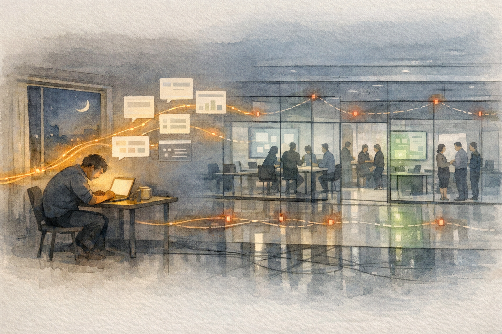
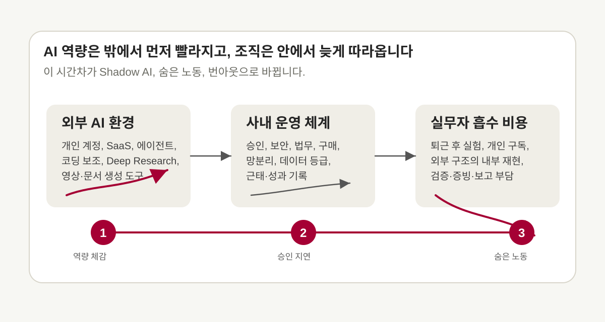
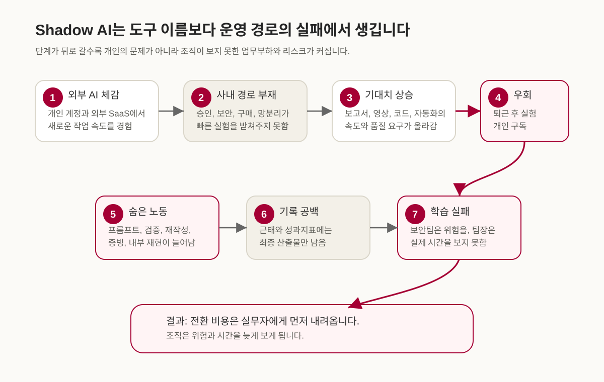
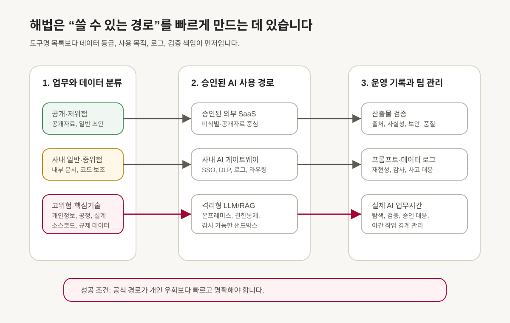
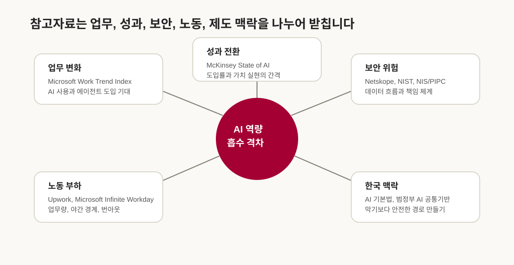

# AI Native 시대의 일하는 방식: Shadow AI와 우리

<figure class="article-hero-figure">
  
  <figcaption><strong>그림 1.</strong> 밤의 책상에서 출발한 AI 산출물은 회사 안의 유리벽 사이를 지나며 속도를 잃습니다. 잘 이어진 듯한 선 아래에는 아직 기록되지 않은 노력이 남아 있습니다. AI 생성 개념 일러스트레이션.</figcaption>
</figure>

최근 팀 안에서 이런 장면을 자주 보게 됩니다. 누군가는 외부 AI 도구로 보고서 초안, 코드, 영상 콘셉트, 자동화 스크립트를 빠르게 만들어 봅니다. 그런데 회사 안으로 들어오면 같은 일을 그대로 할 수 없습니다. 외부 SaaS 접속이 막혀 있거나, 민감 데이터를 넣을 수 없거나, 사용 승인을 어디서 받아야 하는지 불명확합니다. 그 사이 경영진과 팀장은 이미 “AI로 더 빠르게, 더 잘할 수 있지 않느냐”는 기대를 갖고 있습니다.

이 간격에서 Shadow AI가 생깁니다. 겉으로는 승인받지 않은 외부 도구 사용처럼 보이지만, 배경에는 공식 도구와 승인 경로가 실제 업무 속도를 따라오지 못하는 운영 공백이 있습니다. 직원은 외부에서 먼저 배운 AI 역량을 개인 시간, 개인 계정, 개인 판단으로 흡수합니다. 보안민감 조직에서는 이 문제가 더 날카롭습니다. 국가핵심기술, 개인정보, 코드 자산, 공정정보, 고객정보가 얽힌 업무에서는 외부 AI 사용을 쉽게 열 수 없습니다. 그렇지만 사용 경로를 만들지 않고 금지만 강화하면, AI 사용이 더 안 보이는 곳으로 이동할 수 있습니다.

::: highlight
보안민감 조직의 AI 병목에는 기술 부족보다 더 깊은 운영 문제가 놓여 있습니다. 빠르게 변하는 AI 역량을 느리게 움직이는 승인·보안·운영 체계가 흡수하지 못하면, 그 비용은 실무자의 hidden work와 번아웃으로 내려옵니다.
:::

<figure class="figure-panel">
  

    
  

  <figcaption><strong>그림 2.</strong> 외부 AI 도구의 체감 속도와 사내 승인·보안·운영 체계의 속도 차이가 커질수록, 실무자는 개인 시간과 개인 책임으로 그 간격을 메우게 됩니다. 리뷰 제작 개념도.</figcaption>
</figure>

## AI 사용은 이미 조직 안에 들어와 있습니다

- 직원들은 이미 AI를 씁니다. Microsoft 2024 Work Trend Index [[1]](#ref-1)는 31개 시장 지식근로자 설문에서 75%가 업무에 AI를 사용하고, AI 사용자 중 78%가 회사가 제공하지 않은 도구를 가져와 쓴다고 보고했습니다. 이 78%는 도구를 누가 제공했는지에 따른 분류이며, 사용 승인 여부를 가른 수치는 아닙니다.
- 경영진도 AI를 원합니다. Microsoft 2025 Work Trend Index [[2]](#ref-2)는 리더 82%가 2025년을 전략과 운영을 다시 생각해야 하는 해로 보며, 81%가 12–18개월 안에 에이전트를 회사 AI 전략에 중간 수준 이상으로 통합할 것이라고 답했다고 설명합니다.
- 조직 성과는 자동으로 따라오지 않습니다. McKinsey 2025 State of AI [[3]](#ref-3)는 2025년 조사 응답자의 88%가 소속 조직에서 최소 한 업무 기능에 AI를 정기적으로 쓴다고 답했다고 보고했습니다. AI가 EBIT의 5% 이상에 기여하고 그 가치가 유의미하다고 답한 고성과 집단은 응답자의 약 6%였습니다.
- 보안 리스크는 실제입니다. Netskope 2026 Cloud and Threat Report [[4]](#ref-4)는 고객사의 익명 사용 기록에서 생성형 AI 데이터 정책 위반 탐지가 전년 대비 두 배로 늘었고, 조직당 월평균 223건의 관련 위반을 탐지했다고 보고했습니다. 정책 위반 탐지 건수는 유출이 확정된 사고 건수와 구별해야 합니다.
- 번아웃도 실제입니다. Upwork 2024 연구 [[5]](#ref-5)는 C-level 리더 96%가 AI 생산성 향상을 기대하지만, AI 사용 직원 77%는 오히려 업무량이 늘었다고 답했다고 밝혔습니다. Upwork 2025 연구 [[6]](#ref-6)에서는 자기보고 생산성 향상폭이 상위 사분위에 속한 직원의 번아웃 응답 비율이 88%였습니다.

## Shadow AI는 막힌 경로의 증상입니다

회사 안에서 Shadow AI를 이야기할 때, 논의가 빨리 “허용할 것인가, 금지할 것인가”로 좁아지는 경우가 많습니다. 하지만 현장의 순서는 조금 다릅니다. 먼저 직원이 외부 AI의 효용을 체감합니다. 문서 초안이 빨라지고, 코드 탐색이 쉬워지고, 회의록과 발표 자료의 구조가 잡히고, 반복 업무 자동화의 가능성이 보입니다. 다음으로 회사 내부 경로가 그 속도를 받쳐주지 못한다는 사실을 만납니다.

이때 직원이 먼저 만나는 것은 규정 문구보다 작업의 막힘입니다. 어떤 데이터는 외부 모델에 넣을 수 없습니다. 어떤 도구는 계정 구매가 안 됩니다. 내부망에서는 최신 기능을 쓸 수 없습니다. 보안 검토가 필요하지만 절차와 소요시간이 분명하지 않습니다. 팀장은 결과를 요구하지만 승인권한, 예산권한, 예외처리 권한은 갖고 있지 않습니다. 그래서 실무자는 퇴근 후 공개자료만 가지고 구조를 실험하거나, 개인 구독으로 도구를 익히거나, 외부에서 만든 아이디어를 회사 안에서 다시 손으로 재현합니다.

<figure class="figure-panel">
  

    
  

  <figcaption><strong>그림 3.</strong> Shadow AI는 보통 한 번의 규정 위반으로 시작되지 않습니다. 외부 AI 체감, 사내 경로 부재, 기대치 상승, 우회, 숨은 노동, 기록 공백이 차례로 겹치며 만들어집니다. 리뷰 제작 개념도.</figcaption>
</figure>

KPMG와 University of Melbourne의 2025 글로벌 연구 [[7]](#ref-7)를 보면 이 흐름이 이미 넓게 퍼져 있습니다. 직원 32,352명 중 58%가 업무에서 AI를 정기·준정기적으로 쓴다고 답했으며, 여기에는 매월 또는 수개월에 한 번 쓰는 경우도 포함됩니다. AI를 쓰는 직원들은 회사 제공 도구보다 무료 공개 도구를 더 많이 선택했습니다. 같은 보고서는 많은 직원이 회사 정책에 어긋나는 방식으로 AI를 쓰거나 민감한 회사 정보를 공개 AI 도구에 올린다고 설명합니다. 더 어려운 지점은 투명성입니다. 보고서는 절반이 넘는 직원이 AI로 일을 했다는 사실을 드러내지 않거나, AI 산출물을 자신이 만든 것처럼 제시한다고 지적합니다.

이 수치는 개인의 부주의만 말하지 않습니다. 직원이 숨긴다는 것은 조직이 실제 사용량, 실제 병목, 실제 위험을 배우지 못한다는 뜻입니다. 보안팀은 어떤 데이터가 어디로 흘러가는지 보지 못하고, 팀장은 AI 작업에 실제로 얼마의 시간이 들어갔는지 모릅니다. 경영진은 인프라 투자가 필요한지 판단하기 어렵고, 승인권자는 사고 책임만 크게 보게 됩니다.

## 한국 보안민감 조직의 제약은 실제입니다

한국의 반도체, 디스플레이, 배터리, 방산, 에너지, 공공 인프라 조직에서는 외부 생성형 AI 사용을 쉽게 열 수 없습니다. 여기에는 문화적 보수성만 있는 것이 아닙니다. 국가핵심기술, 산업기술 유출, 개인정보 국외 이전, 내부망 분리, 협력사·고객 데이터, 코드 자산, 공정 recipe가 얽혀 있습니다. 외부 AI 서비스에 무엇을 넣는지에 따라 기술유출, 개인정보보호, 계약 위반, 수출통제 이슈가 한꺼번에 생길 수 있습니다.

2023년 삼성전자가 직원의 생성형 AI 사용을 제한한 사례는 이 문제를 상징합니다. CNBC 보도 [[8]](#ref-8)에 따르면 삼성전자는 직원이 ChatGPT 등 생성형 AI 서비스를 오용한 뒤 회사 PC를 통한 생성형 AI 사용을 임시 제한했고, 직원에게 회사 관련 정보나 개인정보를 입력하지 말라고 안내했습니다. 보안민감 대기업의 외부 AI 통제에는 추상적 우려를 넘어 실제 사고 대응의 기억이 깔려 있습니다.

2025년 DeepSeek 대응도 같은 맥락입니다. 국가정보원은 2025년 2월 10일 보도자료 [[9]](#ref-9)에서 DeepSeek에 대해 과도한 개인정보 수집, 모든 입력 데이터의 학습데이터 활용, 광고주 등과의 제한 없는 정보 공유, 국외 서버 저장 등 보안 유의사항을 확인했다고 밝혔습니다. 개인정보보호위원회는 2025년 2월 17일 안내 [[10]](#ref-10)에서 2월 15일 오후 6시부터 국내 앱마켓의 DeepSeek 신규 다운로드를 잠정 중단했다고 설명했습니다. 기존 사용자의 이용은 가능했으며, 개인정보보호법에 따른 개선과 보완 후 신규 다운로드를 재개할 예정이라는 조치였습니다.

이런 자료를 보면 보안부서의 보수성을 단순히 낡은 관성으로만 볼 수 없습니다. 보안이 필요하다는 점은 분명합니다. 부족한 것은 보안을 만족하면서도 실무자가 빠르게 실험할 수 있는 경로입니다. 흥미롭게도 정부도 이 방향으로 움직이고 있습니다. 2025년 11월 24일 정책브리핑 [[11]](#ref-11)은 행정 내부망에서 민간 AI 챗서비스 등을 활용하기 위한 범정부 AI 공통기반 서비스의 시작을 알렸습니다. 2026년 2월 말까지 시범 운영한 뒤 확대한다는 계획으로, 보안을 갖춘 내부 사용 경로를 마련하려는 시도였습니다.

## AI FOMO는 계층을 따라 내려옵니다

AI에 뒤처질지 모른다는 불안, 즉 FOMO는 조직의 각 층에서 다르게 나타납니다. 이 글의 AI FOMO Cascade는 그 불안과 업무 부담이 계층을 따라 전달되는 관계를 설명하는 모형입니다. 경영진은 경쟁사가 AI로 생산성을 끌어올릴까 불안합니다. 팀장은 위에서 내려오는 성과 요구를 맞추지 못할까 불안합니다. 승인권자는 허용했다가 사고가 나면 책임을 질까 불안합니다. 실무자는 외부에서는 가능한 일이 회사 안에서는 안 되는 상황에서 자신의 역량과 커리어가 뒤처질까 불안합니다.

각 집단이 떠안는 책임과 권한도 다릅니다. 경영진은 AI 투자를 하고 싶어도 비용, ROI, 보안 사고, 책임 소재를 고민합니다. 팀장은 결과를 내야 하지만 보안정책, 구매, 법무, 망분리 예외를 바꿀 권한이 없습니다. 승인권자는 허용의 성과보다 사고의 책임을 더 크게 떠안습니다. 실무자는 AI를 쓰면 일이 빨라지는 것을 알지만, 공식 경로가 없으니 자신의 시간으로 먼저 배웁니다.

투자와 승인이 늦어지는 동안 성과 기대는 실무자의 일정에 먼저 반영될 수 있습니다. 정식 절차를 지켜야 하는 팀장은 AI 수준의 결과물을 요구하고, 실무자는 공식 경로에서 해결하지 못한 일을 개인 시간으로 떠안습니다. 각자의 위험을 줄이려는 선택이 겹치면서 조직 전체가 치르는 학습 비용은 보이지 않게 됩니다.

숨은 노동을 드러내려면 탐색·실험·검증·승인 대응을 공식 업무로 인정해야 합니다. 근태 기록만 요구하면서 이런 일을 일정 밖에 남겨두면, 승인 대기를 메우는 개인의 노력은 계속 조직의 눈에 보이지 않습니다.

<figure class="figure-panel">
  
  <figcaption><strong>그림 4.</strong> 숨은 노동은 한 사람의 야근 장면으로만 보이지 않습니다. 경영진 기대, 승인 지연, 검증 문서, 개인 학습 시간이 겹치면 AI 활용 비용은 공식 일정 밖으로 밀려납니다. AI 생성 개념 일러스트레이션.</figcaption>
</figure>

## 숨은 노동은 생산성 수치 밖에 있습니다

AI는 문서 초안과 코드 탐색, 자료 검토에 드는 시간을 줄일 수 있습니다. 초안을 만들면 검증해야 합니다. 외부 자료를 요약하면 출처를 다시 확인해야 합니다. 코드 제안을 받으면 테스트와 보안 점검이 필요합니다. 영상이나 발표 자료를 만들면 사실성, 저작권, 내부 표현, 브랜드 기준을 다시 봐야 합니다.

Microsoft의 2025 Infinite Workday 분석 [[12]](#ref-12)은 이미 업무시간의 경계가 흐려진 상황을 다룹니다. 익명·집계한 Microsoft 365 사용 신호에서 사용자당 하루 이메일은 평균 117개, 평일 Teams 메시지는 평균 153개였으며, 한국은 Teams 메시지 증가율이 15%를 넘는 국가군으로 언급됩니다. 오전 6시에 이메일을 확인하고, 핵심 업무시간은 회의와 알림으로 쪼개지고, 저녁과 주말에도 업무 신호가 반복됩니다.

AI가 이런 환경에 들어오면 두 가지 길이 가능합니다. 하나는 반복 업무를 줄이고 집중 시간을 회복하는 길입니다. 다른 하나는 더 빠른 응답, 더 많은 산출물, 더 복잡한 검증 요구를 만들어 이미 망가진 리듬을 더 빠르게 돌리는 길입니다. Microsoft도 같은 글에서 AI가 일의 리듬을 다시 설계할 때 도움이 될 수 있지만, 그렇지 않으면 고장난 시스템을 가속할 위험이 있다고 설명합니다.

Upwork의 2024년과 2025년 조사는 미국·영국·호주·캐나다에서 각 2,500명의 경영진·정규직·프리랜서에게 물었습니다. 2024년 조사에서는 C-level 리더 96%가 AI가 생산성을 높일 것으로 기대했지만, AI를 쓰는 직원 77%는 업무량이 늘었다고 답했습니다. 71%의 정규직 직원은 번아웃을 호소했습니다. 2025년 조사에서 직원이 자기보고한 평균 생산성 향상은 40%였고, 향상폭 상위 사분위 직원의 번아웃 응답 비율은 88%였습니다.

이 조사들은 AI 활용과 업무 부담이 함께 늘어날 수 있음을 보여줍니다. 한국 보안민감 조직에서 늘어난 숨은 노동의 시간을 직접 측정한 수치는 아니므로, 여기서는 업무가 일정 밖으로 밀리는 과정을 검토할 단서로 읽습니다. 공식 경로가 느린 상태에서 AI 수준의 산출물을 요구하면 탐색, 학습, 외부 실험, 내부 재현, 검증, 승인 문서화가 개인 시간으로 넘어갈 수 있습니다. 그 시간을 기록해야 AI 도입에 실제로 들어간 비용도 계산할 수 있습니다.

## 공식 사용 경로가 Shadow AI를 줄입니다

중요한 데이터와 업무를 보호하면서 AI를 쓰려면, 도구 이름만으로 허용 여부를 정하기는 어렵습니다. “ChatGPT 허용”, “Claude 금지”, “Gemini 검토”, “Cursor 보류” 같은 방식은 AI 생태계의 변화 속도를 따라가기 어렵습니다. 모델 버전, 데이터 정책, API 기능, 에이전트 기능, 요금제, 확장 기능이 계속 바뀌기 때문입니다.

정책은 어떤 데이터로 무슨 일을 할지부터 구분해야 합니다. 공개자료 요약인지, 비식별 내부자료의 초안 작성인지, 코드 보조인지, 개인정보가 포함된 고객 분석인지, 국가핵심기술 관련 공정자료인지에 따라 필요한 통제가 달라집니다. 이 글에서는 사용 경로를 세 갈래로 설계하는 방안을 제안합니다. 공개·저위험 업무에는 승인된 외부 SaaS를, 사내 일반자료와 중위험 업무에는 통합 로그인(SSO), 데이터 손실 방지(DLP), 프롬프트 기록, 모델 라우팅을 갖춘 사내 AI 게이트웨이를 둘 수 있습니다. 고위험·핵심기술 업무에는 격리형 LLM, 사내 검색증강생성(RAG), 온프레미스 에이전트 샌드박스를 검토할 수 있습니다.

<figure class="figure-panel">
  
  <figcaption><strong>그림 5.</strong> 안전한 AI 활용 경로는 금지 표지판만 늘리는 방식과 다릅니다. 공개자료 실험, 사내 AI 도구, 민감자료 분석이 서로 다른 길로 움직이면서도 승인, 검증, 감사 기록의 자리에서 만날 수 있어야 합니다. AI 생성 개념 일러스트레이션.</figcaption>
</figure>

<figure class="figure-panel">
  

    
  

  <figcaption><strong>그림 6.</strong> 보안민감 조직의 AI 정책은 데이터 등급, 사용 경로, 검증, 로그, 실제 업무시간 기록을 함께 설계해야 합니다. 공식 경로가 개인 우회보다 빠르고 명확해야 Shadow AI가 줄어듭니다. 리뷰의 운영 제안을 그린 개념도.</figcaption>
</figure>

NIST AI Risk Management Framework [[13]](#ref-13)는 AI 제품과 시스템의 설계, 개발, 사용, 평가 과정에서 신뢰성 요소를 통합하도록 돕는 자발적 프레임워크로 제시됩니다. 2024년 7월에는 생성형 AI에 특화된 NIST AI 600-1 Generative AI Profile [[14]](#ref-14)도 나왔습니다. 두 자료를 참고하면 AI를 도입할 때 위험을 식별하고 측정하는 일, 관리 절차와 책임을 정하는 일을 함께 설계할 수 있습니다.

한국도 AI 법제와 공공 인프라의 방향이 바뀌고 있습니다. Korea.net은 2026년 1월 22일 AI 기본법 시행 [[15]](#ref-15)을 소개하며, AI 정책과 행정체계의 법적 기반을 마련한 포괄 법률이라고 설명했습니다. 이 변화는 기업의 실무 도입에도 영향을 줍니다. AI 활용은 이제 IT 부서의 선택을 넘어 신뢰, 투명성, 안전, 개인정보, 고영향 AI 판단, 내부 책임체계와 연결되는 의사결정입니다.

## 팀장은 결과 요구권만으로는 부족합니다

중간관리자의 역할도 바뀌어야 합니다. 지금 많은 팀장은 결과 요구와 절차 준수 사이에 끼어 있습니다. “보안 위반하지 말라”, “승인받고 하라”, “근태를 기록하라”, “결과물은 빨리 달라”는 말은 각각 맞지만, 한 문장으로 묶이면 실무자에게 풀기 어려운 문제를 줍니다. 팀장이 AI를 활용하라고 말하려면, AI를 활용할 수 있는 환경을 조직에 요청할 권한도 있어야 합니다.

팀장은 필요한 AI 도구를 공식 요청하고, 지연된 승인을 상위 책임자에게 올리며, 샌드박스의 사용 우선순위를 협의할 수 있어야 합니다. AI 실험을 업무시간으로 인정하고 비긴급 야간 작업을 멈출 권한도 필요합니다. 실제 작업시간을 파악하려면 로그인 시간과 최종 산출물 사이에 있었던 일을 보아야 합니다. 프롬프트 설계, 외부 자료 검증, 결과 수정, 보안 검토 대응, 내부 재현, 승인 문서화가 얼마를 차지했는지 태깅해야 합니다.

실무자가 기록을 감시 수단으로 받아들이면 실제 사용과 부담을 드러내기 어렵습니다. 운영 개선 자료가 되려면 어떤 업무를 해결하려 했는지, 왜 내부 도구로 어려웠는지, 외부 도구에서 어떤 기능이 유효했는지, 어떤 데이터는 사용하지 않았는지, 내부화하려면 무엇이 필요한지를 기록해야 합니다. 그래야 hidden work가 조직 지표로 바뀝니다.

::: operator
팀에서 시험할 기록 항목으로 `업무명`, `사용한 AI 경로`, `사용한 데이터 등급`, `검증에 쓴 시간`, `내부 도구로 막힌 이유`를 제안합니다. 예를 들어 4주 동안 기록한 뒤, 어디서 대기와 재작업이 생겼는지 검토할 수 있습니다. 기록 항목과 기간은 업무 특성에 맞춰 조정하면 됩니다.
:::

## 승인체계는 정적 목록에서 동적 가드레일로 바뀌어야 합니다

전통적인 승인체계는 정적 목록처럼 움직입니다. 이 도구는 허용, 저 도구는 금지, 이 사이트는 차단, 저 사이트는 예외 승인입니다. 이 방식은 변화가 느린 업무 도구에는 어느 정도 작동합니다. 그러나 생성형 AI와 에이전트 도구는 기능, 모델, 데이터 정책, API, 확장 프로그램, 가격, 배포 형태가 빠르게 바뀝니다. 승인받은 도구가 몇 달 뒤에는 더 이상 최적이 아닐 수 있고, 금지된 도구의 기능이 승인된 도구 안으로 들어올 수도 있습니다.

승인체계는 데이터 등급, 사용 목적, 출력 위험, 기록 조건, 검증 책임, 사람이 승인할 시점을 기준으로 설계할 수 있습니다. 처리 목표 시간도 함께 정해야 실무자가 기다릴지 다른 방법을 찾을지 판단할 수 있습니다. 초기 운영안으로 저위험 공개자료 요약은 1–3일, 사내 일반자료 보고서나 코드 보조는 1–2주 안에 승인 여부를 알리는 방안을 제안합니다. 이 기간은 검증된 보편 기준이 아니라 조직의 위험도와 심사 역량에 맞춰 시험할 목표입니다. 개인정보, 고객정보, 제한 기술자료는 더 긴 검토가 필요하더라도 심사 기준과 목표 시간을 알려야 합니다. 국가핵심기술과 핵심 공정·설계·코드는 별도로 심의하고, 민감정보를 쓰지 않는 샌드박스 개념검증(PoC)은 가능한 범위를 함께 검토할 수 있습니다.

승인 대기, 증빙, 보안 검토, 계정 발급에 막힌 AI 업무가 쌓이면 지연 비용도 커집니다. 이 글에서 승인 부채(Approval Debt)로 설명하는 비용입니다. 기술 부채가 코드를 느리게 만들듯, 승인 부채는 조직의 AI 학습 속도를 느리게 만듭니다. 이 부채가 쌓이면 실무자는 더 많은 일을 밖에서 해결하고, 조직은 더 적게 배웁니다.

## 실행 순서

이 운영안을 실행하려면 우선 실제로 쓸 수 있는 경로를 정해야 합니다. 공개자료 기반 업무, 사내 일반자료 기반 업무, 고위험 민감자료 업무를 나누고 각 경로에서 쓸 수 있는 AI 환경을 정해야 합니다. 이때 보안팀, IT, 법무, HR, 현업 PMO가 같이 들어와야 합니다. 한 부서가 혼자 만들면 사용성과 책임이 어긋납니다.

두 번째 단계는 사내 AI 게이트웨이입니다. 업무별로 허용된 모델과 배포 환경을 연결하고, 사용자의 권한과 데이터 이동을 관리하는 역할을 맡깁니다. SSO, 데이터 손실 방지, 프롬프트 로그, PII 마스킹, 모델 라우팅, 사용 권한, 결과 검증 체크리스트, 감사 추적을 함께 둡니다.

세 번째 단계는 고위험 샌드박스입니다. 반도체 공정, 디스플레이 recipe, 방산 설계, 고객 데이터, 핵심 코드는 공개형 AI로 다루기 어렵습니다. 이 영역에는 격리형 LLM, 사내 RAG, 내부 GPU 또는 프라이빗 클라우드, 권한통제형 문서 DB, 폐쇄형 평가환경이 필요합니다. 비용이 크더라도, 이 기반이 없으면 실무자는 계속 민감하지 않은 조각만 밖에서 실험하고 회사 안에서 다시 만드는 이중노동을 하게 됩니다.

네 번째 단계는 팀 운영 규칙입니다. AI 작업은 속도를 올리지만, 빠른 반응을 의무화하면 번아웃을 키웁니다. 팀장은 무회의 집중시간, 야간·주말 비긴급 AI 요청 제한, AI 산출물 검증 책임표, 외부 실험의 내부화 절차, 승인 지연을 상위 책임자에게 알리는 경로를 정해야 합니다. AI 사용이 늘수록 사람의 집중시간과 회복시간을 더 명확히 지켜야 합니다.

다섯 번째 단계는 측정입니다. 승인 도구 커버리지, 미승인 AI 접속 건수, 데이터 정책 위반 건수, 고위험 유스케이스 승인 리드타임, 재작업률, AI 관련 야간·주말 업무시간, 번아웃 체감 지표를 함께 봐야 합니다. 생산성만 보면 보안이 빠지고, 보안만 보면 업무 현실이 빠지고, 웰빙만 보면 AI 투자 판단이 흐려집니다. 세 지표를 한 화면에서 봐야 조직이 실제 비용과 효과를 배웁니다.

## 해결해야 할 숙제

모델과 구독권을 확보한 뒤에도 조직이 정할 일은 남습니다. 어떤 데이터를 어떤 경로로 넣을지, 누가 검증할지, 어떤 기록을 남길지, 실패했을 때 누가 멈출지, 그 과정에 들어간 시간을 어떻게 인정할지입니다.

직원들이 외부 AI의 속도를 알고 경영진과 팀장도 그 속도를 기대할 때, 공식 경로의 공백은 개인 시간과 개인 책임으로 메워질 수 있습니다. 안전한 사용 경로를 빠르고 명확하게 제공하면 실무자가 사용과 어려움을 드러내기 쉬워집니다. 보안팀은 데이터 이동을, 팀장은 실제 작업시간을, 경영진은 투자 비용과 책임을 함께 판단할 수 있게 됩니다.

직원이 새 도구를 시험하고 싶다고 말했을 때, 누가 데이터 위험을 판단하고 언제까지 답할 수 있는지부터 확인할 수 있습니다. 그 답이 분명해질 때, 집에서 개인 계정으로 하던 실험을 회사 안의 업무와 학습으로 옮길 여지도 생깁니다.

<figure class="figure-panel">
  

    
  

  <figcaption><strong>그림 7.</strong> 이번 리뷰의 참고자료는 한 종류의 자료에 기대지 않습니다. 업무 변화, 성과 전환, 보안 위험, 노동 부하, 한국 제도 맥락을 나누어 읽으면 Shadow AI가 운영 설계 문제로 드러납니다. 리뷰 제작 개념도.</figcaption>
</figure>

## 개정 이력

2026년 5월 30일 작성하고 5월 31일 발행한 글입니다. 당시의 근거 범위와 제목·글 주소를 유지했습니다. 도입부·제목·그림 1은 원 발행 전 공동 재작성한 판본입니다.

2026년 11월 1일, 해외 조사 통계의 분모·자기보고 조건, DeepSeek 조치의 적용 범위와 정부 AI 공통기반의 시범운영 계획을 명료화했습니다. McKinsey의 당시 보고서 링크와 참고문헌의 원제·저자·발행 정보를 바로잡고 APS 최초 인용순으로 정리했습니다. FOMO와 승인 부채를 설명하는 저자의 관점은 유지하며 반복적인 방어·작업 메타 문장과 연결을 다듬었습니다.

## 작성 정보

- 책임 편집: 김현중. 원 작성은 Codex 기반 GPT-5 계열 에이전트 하네스의 보조로 기록돼 있으며, 정확한 모델 식별자·에이전트 구성과 세부 사람 검토 수준은 미보존입니다.
- 이번 개편: OpenAI Codex. `root`는 통합·인용·출력·게시 확인, `legacy_shadow_sources`는 조사 통계·분모·판본·크레딧 감수, `legacy_shadow_governance`는 공식 정책·NIST 관련 원문과 서지·도식 범위 감수, `legacy_shadow_prose`는 국문 퇴고와 논지 연결, `legacy_shadow_output_audit`는 별도 로컬 320/1440px의 인용·날짜·그림 키보드 이동과 출력을 담당했습니다.
- 확인 범위: 공식 조사 웹의 해당 수치·방법, KPMG 보고서의 선택 18쪽, Upwork 공식 발표 PDF의 전체 텍스트, 한국 정책 발표와 CNBC 기사 본문, NIST 두 보고서의 관련 구간과 공식 서지를 대조했습니다. 원 설문·미시자료 분석이나 조직 개입 실험·사람 독자 평가는 수행하지 않았습니다.
- 그림: 기존 7개 파일을 유지했습니다. 1·4·5는 AI 생성 개념 그림, 2·3·6·7은 리뷰 제작 SVG 개념도입니다. 도식의 관계는 저자의 해석·운영 제안을 나타내며 측정된 인과 효과를 표시하지 않습니다.
- 하네스: [공개 작성·검증 원칙](https://infant83.io/AI_Tech_Review/methods/)과 현행 문체·과학 설명·APS 인용 기준. 원 제작·검수 이력을 이번 개편의 결과로 소급하지 않습니다.

## References

[1] <a href="https://www.microsoft.com/en-us/worklab/work-trend-index/ai-at-work-is-here-now-comes-the-hard-part/">Microsoft and LinkedIn, AI at work is here. Now comes the hard part, 2024 Work Trend Index Annual Report (May 8, 2024).</a>

[2] <a href="https://www.microsoft.com/en-us/worklab/work-trend-index/2025-the-year-the-frontier-firm-is-born">Microsoft, 2025: The year the Frontier Firm is born, Work Trend Index Annual Report (April 23, 2025).</a>

[3] <a href="https://www.mckinsey.com/capabilities/quantumblack/our-insights/the-state-of-ai-2025">A. Singla, A. Sukharevsky, B. Hall, L. Yee, M. Chui, and T. Balakrishnan, The state of AI in 2025: Agents, innovation, and transformation, McKinsey &amp; Company (November 5, 2025).</a>

[4] <a href="https://threatlabs.netskope.com/reports/2026/cloud-and-threat-report-2026">Netskope Threat Labs, Cloud and threat report: 2026 (January 5, 2026).</a>

[5] <a href="https://www.upwork.com/press/releases/upwork-study-finds-employee-workloads-rising-despite-increased-c-suite-investment-in-artificial-intelligence">Upwork, Upwork study finds employee workloads rising despite increased C-suite investment in artificial intelligence (July 23, 2024).</a>

[6] <a href="https://www.upwork.com/press/releases/upwork-research-reveals-new-insights-into-the-ai-human-work-dynamic">Upwork, Upwork research reveals new insights into the AI-human work dynamic (July 9, 2025).</a>

[7] <a href="https://doi.org/10.26188/28822919">N. Gillespie, S. Lockey, T. Ward, A. Macdade, and G. Hassed, Trust, attitudes and use of artificial intelligence: A global study 2025 (The University of Melbourne and KPMG, 2025), doi:10.26188/28822919.</a>

[8] <a href="https://www.cnbc.com/2023/05/02/samsung-bans-use-of-ai-like-chatgpt-for-staff-after-misuse-of-chatbot.html">A. Kharpal, Samsung bans use of A.I. like ChatGPT for employees after misuse of the chatbot, CNBC (May 2, 2023).</a>

[9] <a href="https://www.nis.go.kr/CM/1_4/view.do?seq=334">국가정보원, 국정원, 「딥시크」 서비스 활용시 보안유의 강조 (2025년 2월 10일).</a>

[10] <a href="https://www.korea.kr/news/policyNewsView.do?newsId=148939691">개인정보보호위원회, &#x27;딥시크 앱&#x27; 국내 서비스 잠정 중단…개선·보완 후 재개, 대한민국 정책브리핑 (2025년 2월 17일).</a>

[11] <a href="https://www.korea.kr/news/policyNewsView.do?newsId=148955271">과학기술정보통신부, 정부 행정망에서도 &#x27;AI 챗서비스&#x27; 사용 가능해진다, 대한민국 정책브리핑 (2025년 11월 24일).</a>

[12] <a href="https://www.microsoft.com/en-us/worklab/work-trend-index/breaking-down-infinite-workday/">Microsoft, Breaking down the infinite workday, Work Trend Index Special Report (June 17, 2025).</a>

[13] <a href="https://doi.org/10.6028/NIST.AI.100-1">E. Tabassi, Artificial intelligence risk management framework (AI RMF 1.0), NIST AI 100-1 (National Institute of Standards and Technology, Gaithersburg, MD, 2023).</a>

[14] <a href="https://doi.org/10.6028/NIST.AI.600-1">C. Autio, R. Schwartz, J. Dunietz, S. Jain, M. Stanley, E. Tabassi, P. Hall, and K. Roberts, Artificial intelligence risk management framework: Generative artificial intelligence profile, NIST AI 600-1 (National Institute of Standards and Technology, Gaithersburg, MD, 2024).</a>

[15] <a href="https://www.korea.net/NewsFocus/policies/view?articleId=286183&amp;pageIndex=1">M. Theresia, AI Basic Act takes effect as world&#x27;s first set of laws for AI, Korea.net (January 22, 2026).</a>

