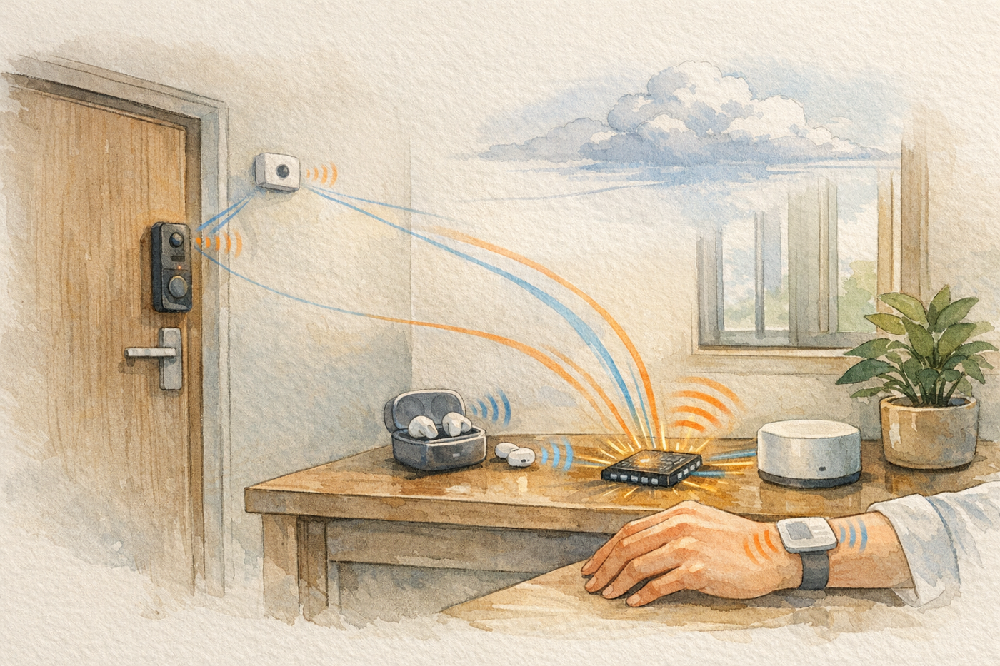
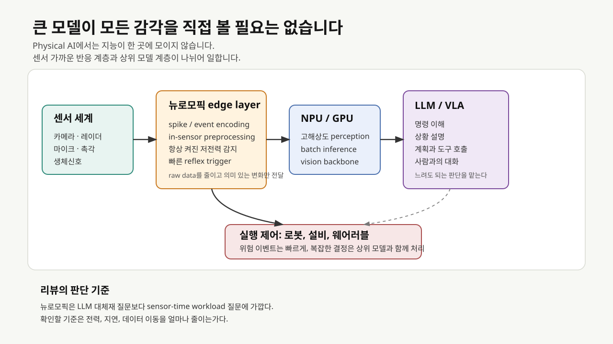
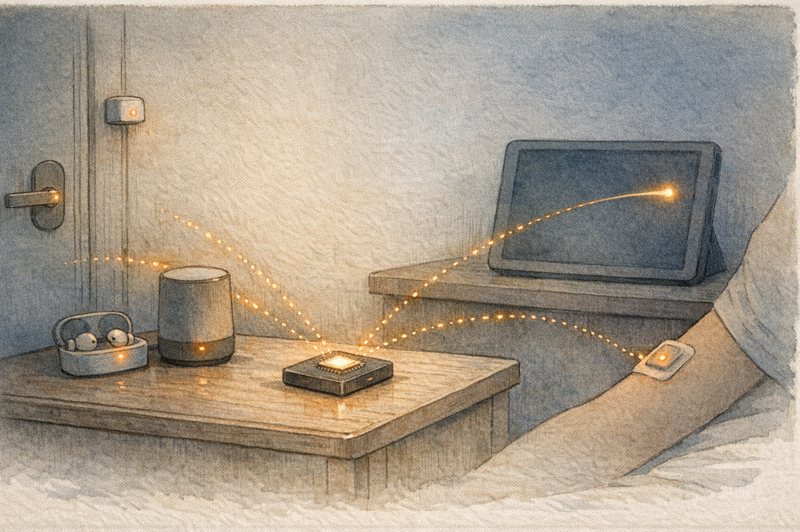
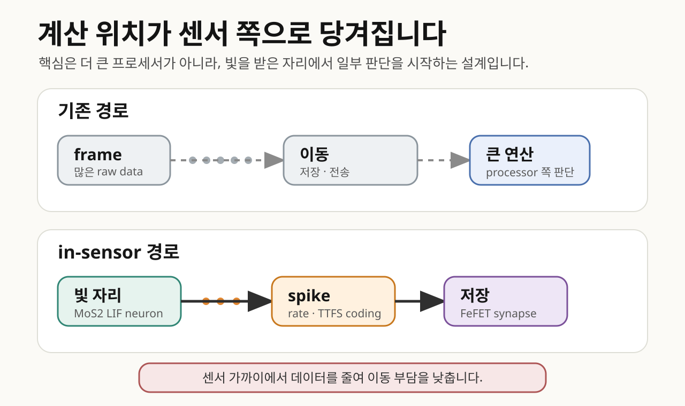
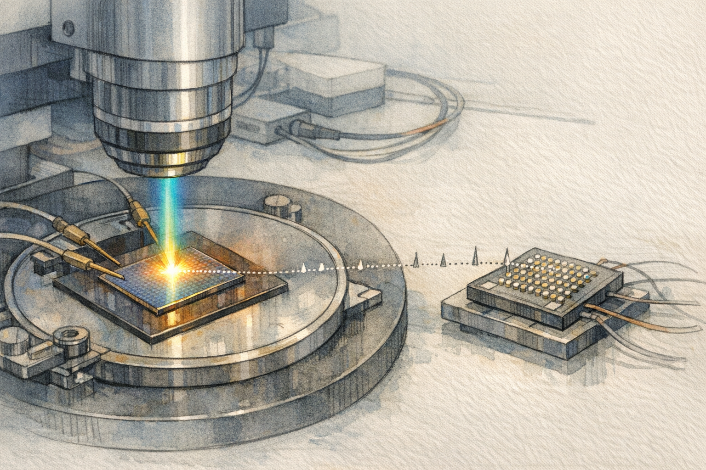
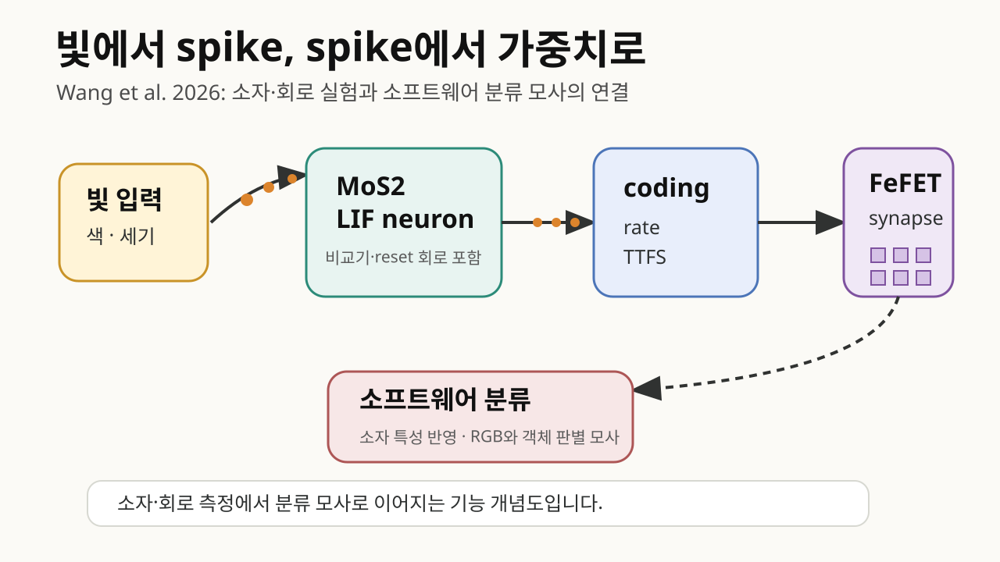
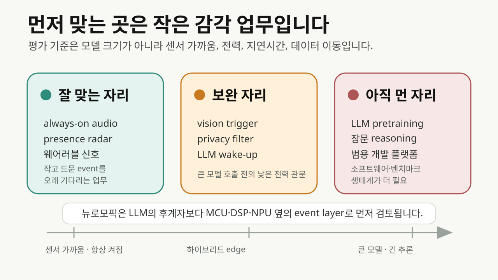
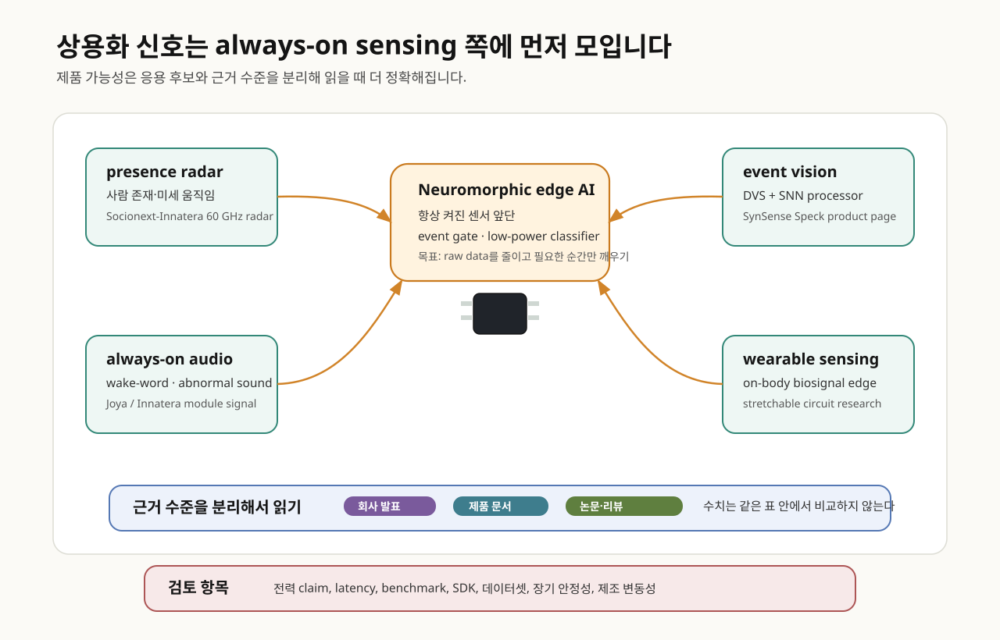
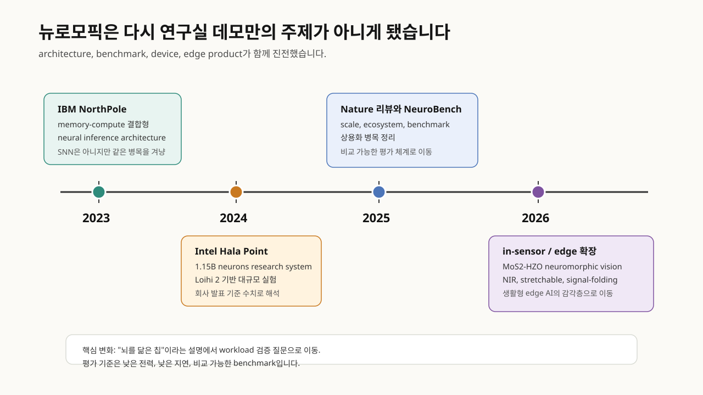

# 뉴로모픽, 항상 켜진 AI의 감각층

<figure class="article-hero-figure">
  
  <figcaption><strong>그림 1.</strong> 현관 센서, 스마트 카메라, earbuds, 웨어러블 패치의 이벤트를 local edge chip에서 먼저 거르는 장면을 그린 AI 생성 개념 일러스트입니다. 칩은 event gate 또는 wake-up layer처럼 작동해 의미 있는 신호만 상위 시스템으로 보냅니다.</figcaption>
</figure>

::: highlight
현관 카메라와 호출어를 기다리는 earbuds는 하루 대부분을 다음 사건을 기다리며 보냅니다. 기다리는 동안의 전력과 센서가 보내는 데이터를 줄일 수 있다면, 작은 배터리로도 AI를 더 오래 곁에 둘 수 있습니다. 뉴로모픽 컴퓨팅이 생활형 AI에서 주목받는 이유입니다.
:::

방 안에 사람이 있는지 판단하는 radar sensor, 심박·움직임 변화를 지켜보는 wearable, 아기 울음을 듣는 오디오 모듈도 비슷한 일을 합니다. 사건이 없는 긴 시간의 대기 전력을 줄이면서, 변화가 생기면 빠르게 알아차리고 필요한 경우에만 메인 프로세서를 깨워야 합니다. 이런 제품의 설계에서는 센서 데이터의 이동과 메모리 접근, 배터리 수명, 프라이버시와 반응 시간이 서로 얽힙니다.

뉴로모픽은 뇌의 신경세포와 시냅스가 신호를 다루는 방식을 참고해, 사건에 반응해 계산하고 메모리와 연산을 가까이 두려는 하드웨어·알고리즘 접근입니다. 센서 가까운 곳에서 변화 신호를 먼저 처리하면, 고해상도 데이터를 계속 저장하고 전송하는 부담을 줄일 수 있습니다.

사이언스타임즈가 2026년 3월 소개한 기사 <a class="citation" href="#ref-1" aria-label="참고문헌 1">[1]</a>의 제목은 "로봇의 눈이 스스로 생각도 하는 뉴로모픽 비전"입니다. 빛이 들어온 자리에서 감지와 계산의 일부를 시작한다는 발상이 담겨 있습니다. 카메라와 프로세서 사이의 일을 어떻게 나누느냐가 데이터 이동 비용을 바꿀 수 있습니다.

<figure class="figure-panel">
  

  
  

  <figcaption><strong>그림 2.</strong> 감각 계층과 큰 모델 계층의 역할을 나눈 리뷰의 개념도입니다. 생활형 센서 AI에서는 뉴로모픽 edge layer는 raw data 전체를 올리기 전에 작은 event를 먼저 고르고, NPU·GPU·LLM은 그다음 판단과 설명을 맡습니다.</figcaption>
</figure>

<figure class="figure-panel">
  
  <figcaption><strong>그림 3.</strong> 밤 시간의 생활 공간에서 작은 센서와 edge chip이 변화를 기다리다가 의미 있는 event만 상위 시스템으로 보내는 장면입니다. 긴 대기 시간과 짧은 반응의 관계를 표현한 AI 생성 개념 일러스트입니다.</figcaption>
</figure>

## MoS2 시각 소자

기사에 연결된 논문은 Wang et al.의 Nature Communications 2026 논문 <a class="citation" href="#ref-2" aria-label="참고문헌 2">[2]</a>입니다. 연구진은 이황화몰리브덴(MoS2) 기반 광트랜지스터를 optoelectronic LIF neuron으로 사용하고, HZO(hafnium-zirconium oxide) 강유전층을 포함한 MoS2 FeFET를 인공 시냅스로 사용했습니다. LIF neuron은 leaky integrate-and-fire neuron의 줄임말입니다. 신호를 조금씩 쌓다가 기준값을 넘으면 spike를 내고 다시 초기화되는 간단한 신경세포 모델입니다.

연구진은 빛 감지, spike 변환, 가중치 저장을 연결하는 구조를 제안하고 그 기능 단위의 특성을 측정했습니다. 기존 카메라는 빛을 전기 신호로 바꾼 뒤 데이터를 별도 프로세서로 보냅니다. 연구 구상에서는 빛의 세기와 파장을 spike train으로 바꾸고, 그 신호를 강유전 시냅스의 가중합 연산으로 이어 줍니다. 센서와 연산의 거리를 줄이려는 방향을 소자·회로에서 시험한 것입니다.

<figure class="figure-panel">
  

  
  

  <figcaption><strong>그림 4.</strong> 기존 카메라 경로는 빛을 frame으로 만든 뒤 raw data를 메모리와 외부 프로세서로 보냅니다. Wang et al. 논문이 보여주는 방향은 빛을 받은 자리에서 spike 변환과 시냅스 저장 일부를 시작해, 센서와 연산 사이의 거리를 줄이는 것입니다. <a class="citation" href="#ref-2" aria-label="참고문헌 2">[2]</a></figcaption>
</figure>

<figure class="figure-panel">
  
  <figcaption><strong>그림 5.</strong> 박막 소자가 빛을 받고 spike-like signal을 시냅스 array로 전달하는 구상을 표현한 AI 생성 개념 일러스트입니다. 현미경 아래 소자와 빛의 접점을 보여줍니다.</figcaption>
</figure>

<figure class="figure-panel">
  

  
  

  <figcaption><strong>그림 6.</strong> Wang et al.의 소자·회로 측정과 분류 모사를 연결한 리뷰의 기능 개념도입니다. 광트랜지스터와 주변 회로에서 얻은 spike, FeFET의 가중치 특성을 소프트웨어 분류에 반영합니다. 아래로 향하는 점선은 분류 모사로의 연결입니다. <a class="citation" href="#ref-2" aria-label="참고문헌 2">[2]</a></figcaption>
</figure>

논문은 두 가지 encoding을 같이 씁니다. 하나는 rate coding입니다. 빛이 강할수록 일정 시간 안에 spike가 더 많이 나옵니다. 다른 하나는 TTFS(time-to-first-spike)입니다. 자극이 강할수록 첫 spike가 더 빨리 나옵니다. 현관 앞 움직임, 야간 돌봄 카메라, wearable 이상 신호처럼 갑작스러운 변화를 빨리 잡아야 하는 장면에서는 첫 반응 시간이 설계 변수로 떠오릅니다. 반대로 색상과 패턴을 더 안정적으로 구분하려면 spike 빈도도 쓸 만한 정보가 됩니다.

Spike는 짧은 사건 신호입니다. SNN(spiking neural network)은 이런 사건 신호의 시간 패턴을 다루는 신경망입니다. FeFET(ferroelectric field-effect transistor)는 강유전 물질의 분극 상태를 이용해 전도 상태, 즉 가중치에 해당하는 값을 오래 보존할 수 있는 트랜지스터입니다. 이 소자들은 빛의 세기를 시간 신호로 바꾸고, 그 신호에 가중치를 적용하는 일을 센서 가까이에서 맡습니다.

연구진은 광트랜지스터 4개와 4×4 FeFET array를 제작하고, 별도 PCB의 비교기·초기화 회로로 뉴런의 발화 동작을 구성했습니다. 빛에 따른 spike와 시냅스의 가중합 연산을 측정한 뒤, 이 소자 특성을 소프트웨어 분류 모사에 반영했습니다.

RGB 모사는 숫자 0·1·4·7을 빨강·초록·파랑으로 표현한 12개의 4×4 패턴을 16입력·3출력 SNN에 넣어 91.7%의 정확도를 보고했습니다. 객체 판별 모사는 Karlsruhe Dataset A의 1,930개 영상 중 1,575개를 학습에, 355개를 시험에 사용했습니다. 차량과 보행자가 각각 존재하는지를 두 출력으로 판정한 평균 label accuracy가 93.5%였습니다. <a class="citation" href="#ref-2" aria-label="참고문헌 2">[2]</a> 서로 다른 과제와 평가 집합에서 얻은 두 결과를 통해, 소자에서 측정한 시간 신호와 가중치가 분류에 어떻게 사용되는지 살필 수 있습니다.

센서와 계산의 경계를 얼마나 가까이 둘 수 있을지, 소자 규모가 커져도 이 경로를 유지할 수 있을지가 다음 과제입니다.

## 항상 켜진 AI의 시간

생활형 AI 관점에서 뉴로모픽이 가장 자연스럽게 들어가는 자리는 "오래 기다리는 센서"입니다. Nature Communications의 2025년 상용화 전망 논문 <a class="citation" href="#ref-3" aria-label="참고문헌 3">[3]</a>은 초기 시장을 battery-powered system, local compute for IoT, consumer wearable, audio/visual wake phrase, gesture interaction, condition and anomaly detection으로 잡습니다. 이 목록의 공통점은 거대한 추론보다 작은 이벤트를 오래 기다리는 일입니다.

npj Unconventional Computing의 2025년 AIoT 리뷰 <a class="citation" href="#ref-4" aria-label="참고문헌 4">[4]</a>도 같은 문제를 더 넓게 설명합니다. AIoT, 즉 artificial intelligence of things에서는 sensor node가 단순 수집기 역할을 넘어 일부 계산을 맡는 node가 됩니다. in-sensor computing은 센서 안에서 feature를 만들고, near-sensor computing은 센서 바로 옆에서 데이터를 줄입니다. dynamic vision camera와 silicon cochlea처럼 빛과 소리를 event stream으로 바꾸는 인터페이스도 이 흐름 안에 있습니다.

저는 이를 "잠복하는 AI"의 설계로 이해합니다. 센서 가까이의 작은 회로가 변화를 지켜보고, 의미 있는 사건일 때 더 큰 모델이나 네트워크를 호출하는 방식입니다. 재실 감지, 호출어 인식, 심박 리듬 감지는 그런 역할을 시험해 볼 수 있는 구체적인 일들입니다.

## 생활형 AI 활용 가능성

첫째는 스마트홈 presence sensing입니다. 방 안에 사람이 있는지, 움직임이 미세하게 남아 있는지, 넘어짐이나 비정상 움직임이 있었는지를 계속 보는 센서는 배터리와 프라이버시 압박이 큽니다. Socionext-Innatera의 2026년 60 GHz FMCW radar 발표 <a class="citation" href="#ref-5" aria-label="참고문헌 5">[5]</a>에서 회사는 뉴로모픽 처리기의 sub-milliwatt 동작과, 카메라·무선 장치를 필요한 때 깨우는 설계를 통한 배터리 수명 3–6배 연장을 제시합니다. 이 발표는 카메라 없이 존재와 움직임을 낮은 전력으로 감지하려는 제품 방향을 보여줍니다.

둘째는 항상 듣는 오디오입니다. wake-word, baby cry, abnormal sound, hearing assistance는 오디오 전체를 계속 저장하거나 클라우드로 보내기 어려운 영역입니다. Baek and Lee의 2024년 SNN sound 리뷰 <a class="citation" href="#ref-6" aria-label="참고문헌 6">[6]</a>는 sound recognition에서 SNN이 low power와 low latency를 요구하는 embedded real-time application에 맞는 후보라고 정리합니다. Joya Design의 Pulsar 기반 consumer audio module 발표 <a class="citation" href="#ref-7" aria-label="참고문헌 7">[7]</a>는 evaluation board 단계를 넘어 실제 consumer audio product 쪽으로 뉴로모픽 칩이 들어가는 신호로 읽힙니다. 오디오 SNN을 제품에 적용할 때는 대기 전력과 감지 정확도를 함께 평가하고, 개발 도구와 데이터셋이 해당 소리 환경을 다루는지 확인해야 합니다.

셋째는 웨어러블과 on-body computing입니다. 웨어러블 AI는 피부와 손목 위에서 오래 작동해야 합니다. Nature Electronics의 2026년 stretchable neuromorphic circuit 논문 <a class="citation" href="#ref-8" aria-label="참고문헌 8">[8]</a>은 on-body edge computing을 위한 stretchable neuromorphic circuit을 제안했습니다. 아직 연구 단계이지만, 생체신호를 센서 가까이에서 전처리하고 분류하려는 흐름은 스마트워치, 패치형 센서, 재활·돌봄 기기와 직접 닿아 있습니다.

넷째는 smart camera와 in-sensor vision입니다. 현관 카메라, 공용공간 모니터링, 저조도 보안 센서, XR 기기의 안쪽 카메라는 모든 frame을 계속 보낼수록 전력과 프라이버시 부담이 커집니다. SynSense Speck <a class="citation" href="#ref-9" aria-label="참고문헌 9">[9]</a>처럼 Dynamic Vision Sensor와 SNN processor를 single chip으로 묶는 제품 신호가 나오는 이유도 여기에 있습니다. Wang et al.의 MoS2/HZO 논문은 같은 방향의 더 앞단, 즉 빛을 받은 자리에서 spike와 synapse 계산을 시작할 수 있는지 묻는 재료·소자 연구입니다.

이 네 장면을 따라가면 "언제 큰 AI를 깨울 것인가"라는 설계 문제가 드러납니다. 센서 가까이에서 필요한 사건을 고를 수 있을 때, 저장하고 보내야 할 데이터와 상위 시스템의 작동 시간을 함께 줄일 수 있습니다.

## 초기 상용화 전망

Edge sensing과 always-on inference는 뉴로모픽의 초기 상용화 후보로 거론됩니다.

Nature Communications의 2025년 상용화 전망 논문 <a class="citation" href="#ref-3" aria-label="참고문헌 3">[3]</a>은 뉴로모픽을 단일 killer app 탐색으로 좁히지 않고, 어떤 기존 processor와 application을 보강할 수 있는지 살펴보자고 제안합니다. 생활형 AI 제품에서는 MCU·DSP·NPU 옆에서 늘 켜진 event gate, wake-up layer, 저전력 분류기를 맡는 구성을 생각할 수 있습니다.

<figure class="figure-panel">
  

  
  

  <figcaption><strong>그림 7.</strong> 활용 후보를 업무의 성격에 따라 배치한 리뷰의 개념도입니다. 뉴로모픽의 가까운 자리는 MCU, DSP, NPU, low-power accelerator 주변의 event layer입니다. 항상 켜진 audio, radar, wearable sensing은 먼저 맞고, 큰 모델 학습과 장문 추론은 아직 다른 계층의 강점으로 남습니다.</figcaption>
</figure>

상용화 논문이 강조하는 또 다른 조건은 programming model입니다. 과거의 SNN application 개발은 뉴로모픽 hardware를 잘 아는 전문가가 직접 network를 설계하는 방식에 가까웠습니다. 이제 surrogate gradient와 gradient-based training, deep learning toolchain과 연결되는 open-source framework가 나오면서, 개발자가 기존 ML workflow에 가깝게 SNN을 만들 수 있는 길이 생기고 있습니다. 제품화 논의에서는 소자의 물리적 효율만큼이나 software API와 benchmark가 중요해집니다.

Nature의 "Neuromorphic computing at scale" <a class="citation" href="#ref-10" aria-label="참고문헌 10">[10]</a>도 같은 문제를 봅니다. 대규모 neuromorphic system은 hardware architecture, algorithm, software ecosystem, benchmark, community readiness가 동시에 성숙해야 합니다. NeuroBench <a class="citation" href="#ref-11" aria-label="참고문헌 11">[11]</a>가 등장한 이유도 여기에 있습니다. 같은 task에서 기존 방법과 정확도·전력·지연을 공정하게 비교할 수 있어야, 소자의 장점이 시스템의 효율로 이어지는지 알 수 있습니다.

Frontiers in Neuroscience의 2025년 비교 리뷰 <a class="citation" href="#ref-12" aria-label="참고문헌 12">[12]</a>는 edge AI 관점에서 DNN과 SNN을 비교합니다. DNN은 정확도와 개발 도구가 강하지만 계산량과 전력 부담이 큽니다. SNN은 event-driven 방식 덕분에 에너지 효율을 기대할 수 있지만, 학습 도구와 benchmark, 집적 기술은 더 성숙해야 합니다. 정확도와 에너지 효율의 교환관계를 개발 도구·집적 기술과 함께 다뤄야 제품화 조건이 구체화됩니다.

2026년의 edge-oriented SNN hardware review <a class="citation" href="#ref-13" aria-label="참고문헌 13">[13]</a>는 논의를 더 제품 가까운 쪽으로 좁힙니다. 큰 brain-simulation 플랫폼은 작은 edge workload에는 과한 경우가 많고, 실제 제품에 들어갈 small-scale neuromorphic SoC는 아직 희소합니다. 이 리뷰가 SoC integration과 Network-on-Chip communication을 강조하는 배경도 여기에 있습니다. 이 리뷰는 전력 범위를 100 mW 이하의 extreme edge와 200 mW–2 W의 embedded edge 등으로 나누어 논의합니다. 이런 작은 장치에서 반복 가능한 inference를 구현하려면 소자 효율과 함께 칩의 통합·통신 비용을 살펴야 합니다.

## 2026년의 연구 방향

Wang et al.의 MoS2/HZO 논문은 in-sensor neuromorphic vision을 다룹니다. 2026년 6월까지 검토한 문헌에서는 센서 안의 계산, 시스템 통합, 재료와 소자, 다양한 감각 신호가 함께 연구되고 있습니다.

첫째, 센서 안쪽으로 계산이 들어갑니다. AI-native robotic vision 리뷰 <a class="citation" href="#ref-14" aria-label="참고문헌 14">[14]</a>는 in-sensor computing을 synaptic, neuronal, hierarchical motif로 나눠 정리합니다. 여기서 중요한 부분은 특정 응용명보다 계산 위치입니다. Synaptic vision은 의미 있는 feature를 강화하고 noise를 줄입니다. Neuronal vision은 analog stimulus를 spike train으로 바꿉니다. Hierarchical vision은 망막처럼 공간 feature를 줄이고 downstream compute 부담을 낮춥니다.

둘째, near-sensor와 in-sensor computing이 AIoT의 기본 설계 과제로 자리 잡고 있습니다. npj Unconventional Computing의 2025년 리뷰 <a class="citation" href="#ref-4" aria-label="참고문헌 4">[4]</a>는 memory와 logic을 물리적으로 결합하는 in-memory computing, 이벤트 기반 neuromorphic architecture, dynamic vision camera와 silicon cochlea 같은 센서 인터페이스를 같이 다룹니다. 이 문헌에서 뉴로모픽은 단일 칩 이름보다 넓은 edge intelligence 설계 묶음으로 다뤄집니다.

셋째, 재료와 소자 연구가 계속 확장되고 있습니다. Nature Reviews Materials의 2026년 회고 <a class="citation" href="#ref-15" aria-label="참고문헌 15">[15]</a>는 analogue in-memory computing, physical neural networks, memristor 기반 edge learning을 나란히 언급합니다. 2D material artificial neuron/synapse review <a class="citation" href="#ref-16" aria-label="참고문헌 16">[16]</a>와 multisensory neuromorphic devices review <a class="citation" href="#ref-17" aria-label="참고문헌 17">[17]</a>는 시각, 촉각, 열, 화학 신호를 하나의 하드웨어가 어떻게 받아들이고 융합할 수 있는지 묻습니다. 스마트홈, 웨어러블, 설비 센서, XR interface로 AI가 내려갈수록 이 논점은 더 자주 돌아옵니다.

넷째, 감지할 파장과 신호, 회로의 형태가 다양해집니다. Retinocortical in-sensor neuromorphic vision platform 논문 <a class="citation" href="#ref-18" aria-label="참고문헌 18">[18]</a>은 NIR, 즉 near-infrared 감도를 갖는 in-sensor neuromorphic vision platform을 제안합니다. Nature Electronics의 signal-folding 논문 <a class="citation" href="#ref-19" aria-label="참고문헌 19">[19]</a>은 MoS2 기반 compute-in-memory hardware에서 weight precision과 energy efficiency 사이의 trade-off를 줄이려 합니다. Stretchable neuromorphic circuit 논문 <a class="citation" href="#ref-8" aria-label="참고문헌 8">[8]</a>은 on-body edge computing을 위해 stretchable neuromorphic circuit을 제안합니다.

이 문헌들이 다루는 뉴로모픽은 여러 종류의 소자와 시스템을 포함합니다. SNN processor, memristor/FeFET compute-in-memory, optoelectronic in-sensor computing, event camera, stretchable OECT array, spintronic neuron이 서로 다른 방향에서 같은 제약을 다룹니다. 공통 제약은 데이터 이동, 전력, 지연, 항상 켜진 sensing, 그리고 physical world와 digital model 사이의 변환 비용입니다.

## 재료·변동성·데이터 이동

이런 연구에는 오래된 과제들이 남아 있습니다. 재료가 신호를 기억하고 변환하는 과정, 소자마다 다른 특성을 학습과 보정으로 다루는 방법, 메모리와 프로세서 사이의 데이터 이동 비용입니다. Quanta Magazine이 2017–2022년에 다룬 세 기사는 이 과제들이 어떻게 이어졌는지 보여줍니다.

첫째는 재료가 계산에 참여하는 방식입니다. 2017년 Quanta Magazine의 atomic-switch mesh 기사 <a class="citation" href="#ref-20" aria-label="참고문헌 20">[20]</a>는 UCLA 연구진의 silver nanowire mesh를 소개했습니다. 작은 self-organized network가 artificial synapse처럼 동작하고, 간단한 학습·논리·noise cleanup을 수행한다는 내용입니다. 이 사례는 physical network가 신호의 상태를 보존하고 변환할 수 있다는 재료·소자 논의로 읽힙니다. 신호를 받아 상태가 바뀌고 그 상태가 다음 반응에 영향을 주는 재료의 성질이 계산에 참여합니다.

둘째는 analog hardware의 변동성입니다. 2022년 BrainScaleS-2 관련 Quanta 기사 <a class="citation" href="#ref-21" aria-label="참고문헌 21">[21]</a>가 다룬 device mismatch가 대표적입니다. 실제 칩의 미세한 소자는 제조 공정 때문에 조금씩 다르고, 이 차이는 디지털 환경에서 학습한 SNN을 하드웨어로 옮길 때 성능을 흔들 수 있습니다. 기사에서 소개한 연구는 SNN이 그 mismatch를 보정하도록 학습해 analog hardware 위에서도 작동할 수 있음을 보였습니다. Wang et al.의 MoS2/HZO 소자도 규모를 키우려면 이 문제를 다뤄야 합니다. 소자의 변동성을 측정하고, 보정과 학습이 그 차이를 얼마나 흡수하는지 시스템 수준에서 평가해야 합니다.

셋째는 데이터 이동 비용입니다. 2022년 NeuRRAM을 다룬 Quanta 기사 <a class="citation" href="#ref-22" aria-label="참고문헌 22">[22]</a>는 RRAM 기반 analog in-memory chip을 소개하며, NeuRRAM이 3 million memory cells와 hardware neuron을 포함하고 image·speech recognition에서 디지털 컴퓨터와 비슷한 정확도를 내면서 에너지 효율을 높였다는 연구진의 주장을 전했습니다. NeuRRAM은 compute-in-memory와 analog AI accelerator가 데이터 이동을 줄이는 방법을 보여주는 사례입니다. 센서 데이터가 저장되고, 메모리에서 다시 읽히고, processor와 memory 사이를 오가는 과정도 edge AI의 전력과 지연을 결정합니다.

세 기사에서 강조하는 대상도 다릅니다. 2017년 기사에서는 brain-like material network를, 2022년 두 기사에서는 analog neuromorphic chip과 RRAM in-memory AI를 보았습니다. 앞서 살핀 2025–2026년 문헌은 이를 edge AI, event-based vision, in-sensor computing과 저전력 센서의 응용으로 이어 생각하게 합니다. 제품을 검토할 때는 전력과 지연을 얼마나 줄였는지, 소자 변동성을 어떻게 다루는지, 개발자가 쓸 소프트웨어와 공정한 benchmark가 있는지를 함께 물을 수 있습니다.

이 사례들은 각각 재료의 기억·소자 보정·메모리 내 연산을 다룹니다. Wang et al.의 MoS2/HZO 논문과 연결해 볼 부분은 sensing, memory, compute를 가까이 묶을 때 생기는 이득과 비용입니다. 센서 앞단에서 줄인 전력과 지연이 보정·학습·데이터 변환·소프트웨어의 비용까지 포함해도 유지되는지 물어야 합니다.

## 디스플레이와 감각·연산의 결합

뉴로모픽과 차세대 디스플레이를 연결하던 논의는 어떻게 이어지고 있을까요. 여기서 검토한 2025–2026년 문헌은 in-sensor computing, near-sensor computing, edge AI, wearable interface와 AR/VR의 응용을 함께 다룹니다. 저는 이 자료들을 통해 센서와 표시 장치, 메모리와 연산을 한 기판이나 한 device stack 안에서 얼마나 가까이 배치할 수 있을지 다시 생각하게 됩니다.

Advanced Materials의 2024년 intelligent display 리뷰 <a class="citation" href="#ref-23" aria-label="참고문헌 23">[23]</a>는 storage, processing, light-emitting 기능을 통합하는 neuromorphic display를 차세대 display 병목을 푸는 방향으로 정리했습니다. 당시에는 display가 사람과 기계가 만나는 면이고, 동시에 대면적 박막전자·광전자 소자 플랫폼이라는 점이 강조되었습니다. 기존 display 산업이 가진 TFT backplane, 산화물/유기 반도체, 광검출·발광 소재, 대면적 array 공정 경험이 AI hardware와 만날 수 있다는 기대도 있었습니다.

National Science Review의 2025년 EP-IDNC 논문 <a class="citation" href="#ref-24" aria-label="참고문헌 24">[24]</a>은 electrically programmable in-display neuromorphic computing을 제안했습니다. 이 장치는 organic electrochromic platform 안에서 memory, processing, display 기능을 동시에 다루고, noise reduction과 motion object perception을 작은 prototype array로 보였습니다. 같은 저널의 해설 <a class="citation" href="#ref-25" aria-label="참고문헌 25">[25]</a>은 이 연구가 AR과 wearable electronics로 확장될 수 있다고 보면서도 cycling endurance와 switching speed는 더 개선되어야 한다고 짚었습니다.

이 문헌들을 함께 읽으면 display를 센서·기억·연산이 만나는 interface로 볼 수 있습니다. 제품화에는 화소 균일도, 수명, 색 안정성, switching speed, backplane 통합과 대면적 수율이 동시에 걸립니다. 뉴로모픽 display의 가능성을 검토할 때도 어떤 감각 신호를 처리하고, 그 기능을 기존 공정에 어떻게 통합할지부터 구체화해야 합니다.

디스플레이 관점은 여전히 의미가 있습니다. 앞으로의 smart display는 단순히 이미지를 보여주는 면을 넘어, 주변 빛과 움직임을 감지하고, 일부 신호를 저장하고, 사람에게 필요한 변화만 낮은 전력으로 보여주는 interface가 될 수 있습니다. 여기서 뉴로모픽의 기술적 자리는 pixel·sensor plane이 더 똑똑한 front-end가 되는 데 있습니다. Wang et al.의 MoS2/HZO 논문도 이 넓은 연구 방향 안에 놓을 수 있습니다. display 산업의 언어로 보면 photodetector, 2D material, ferroelectric layer, array integration이 AI sensing 쪽으로 넘어오는 사례입니다.

## 움직이는 산업 신호

연구 플랫폼에서는 큰 규모의 회로와 소프트웨어를 시험하고, edge 제품에서는 제한된 센서 과제에 필요한 기능을 묶고 있습니다.

Intel은 2024년 Hala Point <a class="citation" href="#ref-26" aria-label="참고문헌 26">[26]</a>를 발표했습니다. Intel 발표 기준으로 Hala Point는 1.15 billion neurons, 128 billion synapses, 1,152 Loihi 2 processors를 포함한 research prototype입니다. 최대 전력은 2,600 W로 제시되었습니다. Hala Point는 대규모 뉴로모픽 연구 시스템입니다. billion-neuron scale에서 software와 workload를 실험할 수 있는 플랫폼이라는 의미가 있습니다.

IBM NorthPole <a class="citation" href="#ref-27" aria-label="참고문헌 27">[27]</a>은 조금 다른 계열입니다. 기술적 초점은 off-chip memory를 없애고 compute와 memory를 chip 내부에서 엮은 neural inference architecture에 있습니다. IBM은 ResNet50 기준 comparable 12 nm GPU 대비 25배 높은 FPS/W, 5배 높은 FPS/transistor, 22배 낮은 latency를 보고했습니다. 이 결과는 뉴로모픽과 인메모리 AI 하드웨어가 데이터 이동 비용을 줄이려는 같은 문제의식과 닿아 있음을 보여 줍니다.

상용 edge 쪽에서는 Innatera Pulsar <a class="citation" href="#ref-28" aria-label="참고문헌 28">[28]</a>가 SNN, RISC-V CPU, CNN/DSP accelerator를 결합한 neuromorphic microcontroller를 내세웁니다. SynSense Speck <a class="citation" href="#ref-9" aria-label="참고문헌 9">[9]</a>은 Dynamic Vision Sensor와 SNN processor를 single chip으로 결합한 event-driven vision SoC입니다. BrainChip의 radar reference platform <a class="citation" href="#ref-29" aria-label="참고문헌 29">[29]</a>은 Akida neuromorphic intelligence를 radar data classification at the edge에 적용한다고 발표했습니다.

앞서 본 presence radar와 consumer audio module은 이런 조합을 개별 제품에 적용한 사례입니다. 그 과정을 뒷받침하는 설계 도구도 필요합니다. Innatera-Synopsys 발표 <a class="citation" href="#ref-30" aria-label="참고문헌 30">[30]</a>는 뉴로모픽 프로세서의 설계 자동화, 회로 검증과 시뮬레이션을 다룹니다.

<figure class="figure-panel">
  

  
  

  <figcaption><strong>그림 8.</strong> 논문·제품 문서·회사 발표의 관계를 정리한 리뷰의 개념도입니다. 상용화 후보는 radar, audio, event vision, wearable sensing처럼 항상 켜진 edge sensing workload에 모입니다. 다만 회사 발표, 제품 문서, peer-reviewed 논문·리뷰는 근거 수준이 다르므로 전력 claim, latency, benchmark, SDK, 장기 안정성을 분리해서 확인해야 합니다.</figcaption>
</figure>

스마트홈, industrial IoT, radar, audio, gesture, wearable에서는 제한된 전력으로 특정 사건을 오래 감지하는 기능이 제품의 가치를 만듭니다.

<figure class="figure-panel">
  

  
  

  <figcaption><strong>그림 9.</strong> 2023–2026년 6월까지의 소자 시연, 대형 research platform, benchmark와 상용 edge 제품 발표를 잇는 타임라인입니다. 서로 다른 규모에서 진행되는 연구와 제품 개발을 함께 보여줍니다.</figcaption>
</figure>

## LLM 다음인가, LLM 아래인가

뉴로모픽을 LLM과 함께 생각할 때 저는 두 기술이 어떤 시간 규모의 일을 맡을지에 주목합니다. 짧은 센서 이벤트를 계속 지켜보는 일과, 사용자의 요청을 해석해 긴 작업을 계획하는 일은 요구하는 계산과 작동 시간이 다릅니다.

자연어 추론, 긴 문맥, 도구 계획과 지식 합성은 transformer 계열 모델과 agentic software stack이 다루는 일입니다. 센서 가까이의 뉴로모픽 회로에는 이벤트를 빠르게 가려내고, 상위 모델을 깨울지 결정하며, 네트워크 없이 현장에서 반응하는 역할을 기대할 수 있습니다.

앞으로의 edge AI stack은 여러 시간 규모의 일을 나누는 구조로 발전할 가능성이 큽니다.

- LLM/agent는 명령 이해, 상황 설명, 계획, 사람과의 대화를 맡습니다.
- NPU/GPU는 고해상도 perception과 큰 모델 inference를 맡습니다.
- 뉴로모픽 edge layer는 항상 켜진 센서 감지, spike/event stream 처리, 빠른 reflex, privacy-preserving preprocessing을 맡습니다.
- 기존 MCU/DSP는 제어, 통신, 시스템 관리를 계속 맡습니다.

이 구도에서 뉴로모픽은 큰 모델 아래의 감각층을 맡습니다. 센서 신호를 먼저 줄여 상위 모델과 통신이 필요한 순간을 고르면, 그 위에서 수행하는 판단의 작동 시간과 비용도 달라집니다.

::: highlight
뉴로모픽은 생활형 AI가 항상 켜져 있으면서도 배터리와 프라이버시를 덜 소모하도록 돕는 저전력 감각층으로 먼저 읽힙니다. 이 계층의 성숙도는 큰 모델이 모든 센서 신호를 직접 받아야 하는지, 아니면 의미 있는 이벤트만 넘겨받아도 되는지를 가르는 기준이 됩니다.
:::

## 양자 AI와 다른 시계

양자 AI와 뉴로모픽은 다른 시간표를 갖습니다. 양자 컴퓨팅은 특정 최적화, sampling, materials simulation에서 장기적으로 중요한 가능성을 갖습니다. 가까운 제품화 경로는 아직 제한적이고, AI 서비스의 일반적인 edge workload와 바로 맞물리지는 않습니다.

뉴로모픽은 조금 더 가까운 문제를 다룹니다. 이미 event camera, audio wake-word, radar classification, wearable biosignal, industrial anomaly detection 같은 구체적인 workload가 있습니다. Intel, IBM, Innatera, SynSense, BrainChip 같은 회사가 각자 다른 방식으로 산업 신호를 내고 있습니다. Nature 계열 리뷰도 상용화의 가까운 시장을 edge/wearable/IoT로 봅니다. 양자 AI보다 빠른 시점에 edge AI 대안 또는 보조 계층으로 자리 잡을 가능성을 검토할 근거가 있습니다.

저는 하이브리드 쪽에 더 무게를 둡니다. Sensor-near neuromorphic layer, on-device NPU, cloud/fleet-scale model과 agentic software harness가 전력·지연·데이터의 성격에 맞춰 일을 나누는 구성입니다. 그런 분업이 실제 제품에서 유지되는지는 각 계층의 효율뿐 아니라 변환과 통신을 포함한 전체 비용으로 확인해야 합니다.

## 우리에게 남는 검토 항목

뉴로모픽은 논문 주제에 머물지 않고 제품과 공정 검토로 들어옵니다. 디스플레이, 센서, 소재, 제조 장비, 품질 시스템을 가진 조직이라면 제품과 공정 양쪽에서 검토할 지점이 생깁니다.

첫째, 스마트홈, XR, 웨어러블, 저조도 시각, 생체신호, 환경 센서에서는 in-sensor preprocessing이 필요한지 확인해야 합니다. raw data를 모두 보내는 방식이 병목이라면 뉴로모픽 방식을 검토할 이유가 생깁니다.

둘째, 소재와 소자 자산을 살펴볼 필요가 있습니다. MoS2, HZO, IGZO, ferroelectric, memristive device, OECT, stretchable electronics는 서로 다른 기술이지만, AI hardware 관점에서는 memory, sensing, switching, analog state를 다룹니다. 기존 display/sensor 제조 역량이 edge AI hardware와 만나는 지점이 생길 수 있습니다.

셋째, everyday edge intelligence를 LLM 중심 AI 전략과 함께 설계할 필요가 있습니다. LLM이 공정 문서, 실험 기록, 분석 코드와 작업 계획을 돕는 동안, 센서와 설비의 시간 신호를 어떤 회로가 얼마나 오래 감시할지도 정해야 합니다.

**우리 제품과 공정에서 너무 늦고, 너무 많이 보내고, 너무 오래 켜져 있어야 해서 생기는 제약은 어디인가.** 저는 뉴로모픽을 검토할 때 이 질문부터 던지고 싶습니다. 센서와 시간 신호가 그 제약을 만든다면, 어떤 사건을 현장에서 고르고 무엇을 상위 시스템으로 넘길지부터 시험해 볼 수 있습니다.

## 작성 정보

- 책임 편집: 김현중
- AI 보조: 원 작성 Codex Agent, 2026-11-02 개정 OpenAI Codex. 정확한 모델 식별자와 원 작성 세션 역할 명단은 미보존.
- 작성일: 2026-06-05
- 업데이트: 2026-06-16
- 추가 업데이트: 2026-06-17
- 생활형 edge AI 재작성: 2026-06-21
- 시각자료 재설계: 2026-06-23
- 근거 기준일: 2026-06-23
- 문체·인용 개편: 2026-11-02. 원 발행일과 기존 근거 시점을 유지하고 본문·캡션을 재검토했습니다.
- 작성 형식: AI Tech Review Letters
- 검토 범위: ScienceTimes 기사, Nature Communications 대상 논문, 2017-2022년 과학 저널리즘의 뉴로모픽 장기 관찰 자료, 2025-2026년 뉴로모픽 리뷰/벤치마크/상용화 자료, 2026년 edge-oriented SNN 및 multisensory neuromorphic review, 2026년 6월 스마트홈·오디오·웨어러블·smart camera edge neuromorphic 산업 신호, intelligent display 및 in-display neuromorphic computing 문헌
- 이미지: OpenAI `imagegen` illustration 3장, deterministic SVG 설명도 6장
- 이번 개정: 2026-11-02. 본문의 근거 범위는 2026-06-23까지 유지하며 문체·원제·원저자·APS 인용과 수치 조건을 다시 대조했습니다. MoS₂ 소자·회로 측정과 분류 모사를 구별하고 그림 6을 정정했습니다. 서지의 정식 권·쪽과 현재 정상 출처 주소는 이번 확인 정보입니다.
- 이번 감수: root의 통합·출력·게시 확인, neuro_core_sources의 MoS₂ 원문·보충자료·선택 코드와 핵심 연구 대조, neuro_bibliography의 서지·산업 발표 확인, neuro_prose의 국문 문맥·문체 감수, neuro_output_design의 독립 화면·가독성·인용 연결 점검. 원 소자 실험·학습·성능 비교나 사람 독자 평가를 재현하지 않았습니다.

## References

<ol class="references">
<li id="ref-1">정회빈, 로봇의 눈이 스스로 생각도 하는 뉴로모픽 비전, 사이언스타임즈 (2026-03-04), <a href="https://www.sciencetimes.co.kr/nscvrg/view/menu/250?nscvrgSn=261508&amp;searchCategory=222">https://www.sciencetimes.co.kr/nscvrg/view/menu/250?nscvrgSn=261508&amp;searchCategory=222</a> (accessed November 2, 2026).</li>
<li id="ref-2">J. Wang, K. Liu, P. J. Tiw, D. He, L. Yu, B. Wang, J. Bai, T. Zhang, X. Shan, Y. Yang, Y. Wang, Y. Wang, Y. Tao, X. Zhang, and Y. Yang, Homogeneous integration of two-dimensional material-based optoelectronic neurons and ferroelectric synapses for neuromorphic vision, Nat. Commun. <strong>17</strong>, 2538 (2026), <a href="https://doi.org/10.1038/s41467-026-68905-3">doi:10.1038/s41467-026-68905-3</a>.</li>
<li id="ref-3">D. R. Muir and S. Sheik, The road to commercial success for neuromorphic technologies, Nat. Commun. <strong>16</strong>, 3586 (2025), <a href="https://doi.org/10.1038/s41467-025-57352-1">doi:10.1038/s41467-025-57352-1</a>.</li>
<li id="ref-4">Y. Baek, B. Bae, H. Shin, C. Sonnadara, H. Cho, C.-Y. Lin, Y. Mu, C. Shen, S. Shah, G. Wang, and K. Lee, Edge intelligence through in-sensor and near-sensor computing for the artificial intelligence of things, npj Unconv. Comput. <strong>2</strong>, 25 (2025), <a href="https://doi.org/10.1038/s44335-025-00040-6">doi:10.1038/s44335-025-00040-6</a>.</li>
<li id="ref-5">C. Balan, Socionext and Innatera introduce integrated 60 GHz FMCW radar and neuromorphic edge AI for human presence detection, Innatera (2026-02-23), <a href="https://www.innatera.com/newsroom/socionext-and-innatera-introduce-integrated-60-ghz-fmcw-radar-and-neuromorphic-edge-ai-for-human-presence-detection/">https://www.innatera.com/newsroom/socionext-and-innatera-introduce-integrated-60-ghz-fmcw-radar-and-neuromorphic-edge-ai-for-human-presence-detection/</a> (accessed November 2, 2026).</li>
<li id="ref-6">S. Baek and J. Lee, SNN and sound: a comprehensive review of spiking neural networks in sound, Biomed. Eng. Lett. <strong>14</strong>, 981 (2024), <a href="https://doi.org/10.1007/s13534-024-00406-y">doi:10.1007/s13534-024-00406-y</a>.</li>
<li id="ref-7">C. Balan, Joya Design takes neuromorphic chip from design to device with first Innatera-powered consumer audio product at AWE China, Innatera (2026), <a href="https://www.innatera.com/newsroom/joya-design-takes-neuromorphic-chip-from-design-to-device-with-first-innatera-powered-consumer-audio-product-at-awe-china/">https://www.innatera.com/newsroom/joya-design-takes-neuromorphic-chip-from-design-to-device-with-first-innatera-powered-consumer-audio-product-at-awe-china/</a> (accessed November 2, 2026).</li>
<li id="ref-8">S. Li <em>et al.</em>, A large-scale stretchable neuromorphic circuit for on-body edge computing, Nat. Electron. <strong>9</strong>, 906 (2026), <a href="https://doi.org/10.1038/s41928-026-01639-8">doi:10.1038/s41928-026-01639-8</a>.</li>
<li id="ref-9">SynSense, Speck™: Event-driven neuromorphic vision SoC, SynSense, <a href="https://www.synsense.ai/products/speck-2/">https://www.synsense.ai/products/speck-2/</a> (accessed November 2, 2026).</li>
<li id="ref-10">D. Kudithipudi <em>et al.</em>, Neuromorphic computing at scale, Nature <strong>637</strong>, 801 (2025), <a href="https://doi.org/10.1038/s41586-024-08253-8">doi:10.1038/s41586-024-08253-8</a>.</li>
<li id="ref-11">J. Yik <em>et al.</em>, The NeuroBench framework for benchmarking neuromorphic computing algorithms and systems, Nat. Commun. <strong>16</strong>, 1545 (2025), <a href="https://doi.org/10.1038/s41467-025-56739-4">doi:10.1038/s41467-025-56739-4</a>.</li>
<li id="ref-12">P. M. Ferreira, S. Wang, Y. Gao, and A. Benlarbi-Delai, A comparative review of deep and spiking neural networks for edge AI neuromorphic circuits, Front. Neurosci. <strong>19</strong>, 1676570 (2025), <a href="https://doi.org/10.3389/fnins.2025.1676570">doi:10.3389/fnins.2025.1676570</a>.</li>
<li id="ref-13">K. Gunawardana, S. Peeris, K. Rambukwella, R. Ragel, and I. Nawinne, Neuromorphic architectures for edge-oriented spiking neural networks: A review, J. Syst. Archit. <strong>177</strong>, 103869 (2026), <a href="https://doi.org/10.1016/j.sysarc.2026.103869">doi:10.1016/j.sysarc.2026.103869</a>.</li>
<li id="ref-14">D. Kim, J. I. Kwon, Y. Kim, D.-H. Kim, and C. Choi, AI-native robotic vision systems enabled by in-sensor computing, npj Unconv. Comput. <strong>3</strong>, 2 (2026), <a href="https://doi.org/10.1038/s44335-025-00047-z">doi:10.1038/s44335-025-00047-z</a>.</li>
<li id="ref-15">S. Goswami, Reflections on the past decade of neuromorphic computing, Nat. Rev. Mater. <strong>11</strong>, 431 (2026), <a href="https://doi.org/10.1038/s41578-026-00924-4">doi:10.1038/s41578-026-00924-4</a>.</li>
<li id="ref-16">D. Chen, P. Yu, Y. Li, J. Shang, H. Wu, X. Yao, X. Tang, C. Li, M. Zhu, C. Gao, J. Sun, H. Tian, and T. Deng, Dedicated and reconfigurable artificial neurons and synapses based on two-dimensional materials for efficient neuromorphic application, Nano-Micro Lett. <strong>18</strong>, 310 (2026), <a href="https://doi.org/10.1007/s40820-026-02139-2">doi:10.1007/s40820-026-02139-2</a>.</li>
<li id="ref-17">A. Gui, H. Mu, R. Yang, G. Zhang, and S. Lin, Multisensory neuromorphic devices: From physics to integration, Nano-Micro Lett. <strong>18</strong>, 113 (2026), <a href="https://doi.org/10.1007/s40820-025-01940-9">doi:10.1007/s40820-025-01940-9</a>.</li>
<li id="ref-18">J. B. An, K. Park, I. S. Lee, S. Lu, H. G. Park, N. S. Heo, Y. S. Hwang, K. Kwak, K. Park, S. H. Park, J. M. Lee, J. Hong, S. K. Park, and H. J. Kim, Retinocortical in-sensor neuromorphic vision platform for NIR-augmented artificial vision, Nat. Commun. <strong>17</strong>, 4957 (2026), <a href="https://doi.org/10.1038/s41467-026-71678-4">doi:10.1038/s41467-026-71678-4</a>.</li>
<li id="ref-19">L. Tong, L. Xu, X. Huang, X. Yu, Z. Peng, W. Shi, Z. Li, X. He, X. Meng, S. Lv, G. Yang, G. Liu, C. Ma, C. P. Wong, Y. Zhou, X. Miao, J. Xu, and L. Ye, Signal-folding-based neuromorphic hardware for energy-efficient computing, Nat. Electron. <strong>9</strong>, 665 (2026), <a href="https://doi.org/10.1038/s41928-026-01626-z">doi:10.1038/s41928-026-01626-z</a>.</li>
<li id="ref-20">A. von Bubnoff, A brain built from atomic switches can learn, Quanta Magazine (2017-09-20), <a href="https://www.quantamagazine.org/a-brain-built-from-atomic-switches-can-learn-20170920/">https://www.quantamagazine.org/a-brain-built-from-atomic-switches-can-learn-20170920/</a> (accessed November 2, 2026).</li>
<li id="ref-21">A. Whitten, AI overcomes stumbling block on brain-inspired hardware, Quanta Magazine (2022-02-17), <a href="https://www.quantamagazine.org/ai-overcomes-stumbling-block-on-brain-inspired-hardware-20220217/">https://www.quantamagazine.org/ai-overcomes-stumbling-block-on-brain-inspired-hardware-20220217/</a> (accessed November 2, 2026).</li>
<li id="ref-22">A. Whitten, New chip expands the possibilities for AI, Quanta Magazine (2022-11-10), <a href="https://www.quantamagazine.org/a-brain-inspired-chip-can-run-ai-with-far-less-energy-20221110/">https://www.quantamagazine.org/a-brain-inspired-chip-can-run-ai-with-far-less-energy-20221110/</a> (accessed November 2, 2026).</li>
<li id="ref-23">X. Zhang, D. Liu, S. Liu, Y. Cai, L. Shan, C. Chen, H. Chen, Y. Liu, T. Guo, and H. Chen, Toward intelligent display with neuromorphic technology, Adv. Mater. <strong>36</strong>, 2401821 (2024), <a href="https://doi.org/10.1002/adma.202401821">doi:10.1002/adma.202401821</a>.</li>
<li id="ref-24">S. Dai, D. Wang, X. Liu, B. Cui, X. Tian, D. Liu, H. Hu, P. Guo, T. Sun, J. Zhang, J. Huang, S. Zhang, and Z. Wang, Electrically programmable organic in-display neuromorphic computing, Natl. Sci. Rev. <strong>12</strong>, nwaf224 (2025), <a href="https://doi.org/10.1093/nsr/nwaf224">doi:10.1093/nsr/nwaf224</a>.</li>
<li id="ref-25">W. Ma, An all-in-one electrochromic neuromorphic display, Natl. Sci. Rev. <strong>12</strong>, nwaf515 (2025), <a href="https://doi.org/10.1093/nsr/nwaf515">doi:10.1093/nsr/nwaf515</a>.</li>
<li id="ref-26">Intel, Intel builds world’s largest neuromorphic system to enable more sustainable AI, Intel (2024-04-17), <a href="https://www.intc.com/news-events/press-releases/detail/1691/intel-builds-worlds-largest-neuromorphic-system-to">https://www.intc.com/news-events/press-releases/detail/1691/intel-builds-worlds-largest-neuromorphic-system-to</a> (accessed November 2, 2026).</li>
<li id="ref-27">D. S. Modha <em>et al.</em>, Neural inference at the frontier of energy, space, and time, Science <strong>382</strong>, 329 (2023), <a href="https://doi.org/10.1126/science.adh1174">doi:10.1126/science.adh1174</a>.</li>
<li id="ref-28">Innatera, Redefining the cutting edge: Innatera debuts real-world neuromorphic edge AI at CES 2026, Innatera (2025-12-10), <a href="https://innatera.com/press-releases/redefining-the-cutting-edge-innatera-debuts-real-world-neuromorphic-edge-ai-at-ces-2026">https://innatera.com/press-releases/redefining-the-cutting-edge-innatera-debuts-real-world-neuromorphic-edge-ai-at-ces-2026</a> (accessed November 2, 2026).</li>
<li id="ref-29">BrainChip, BrainChip unveils radar reference platform to bridge the ‘identification gap’ in edge AI, BrainChip (2026-04-06), <a href="https://investor.brainchip.com/newsfeed/brainchip-unveils-radar-reference-platform-to-bridge-the-identification-gap-in-edge-ai/">https://investor.brainchip.com/newsfeed/brainchip-unveils-radar-reference-platform-to-bridge-the-identification-gap-in-edge-ai/</a> (accessed November 2, 2026).</li>
<li id="ref-30">Synopsys, Innatera selects Synopsys simulation to scale brain-inspired processors for edge devices, Synopsys (2026-03-02), <a href="https://news.synopsys.com/2026-03-02-Innatera-Selects-Synopsys-Simulation-to-Scale-Brain-Inspired-Processors-for-Edge-Devices">https://news.synopsys.com/2026-03-02-Innatera-Selects-Synopsys-Simulation-to-Scale-Brain-Inspired-Processors-for-Edge-Devices</a> (accessed November 2, 2026).</li>
</ol>
