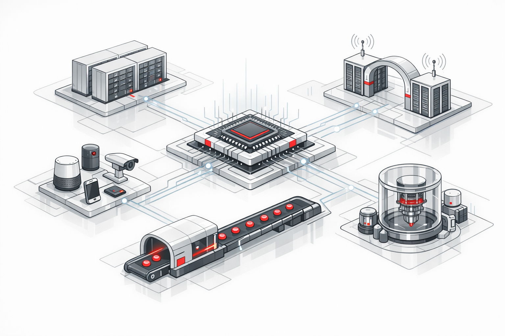
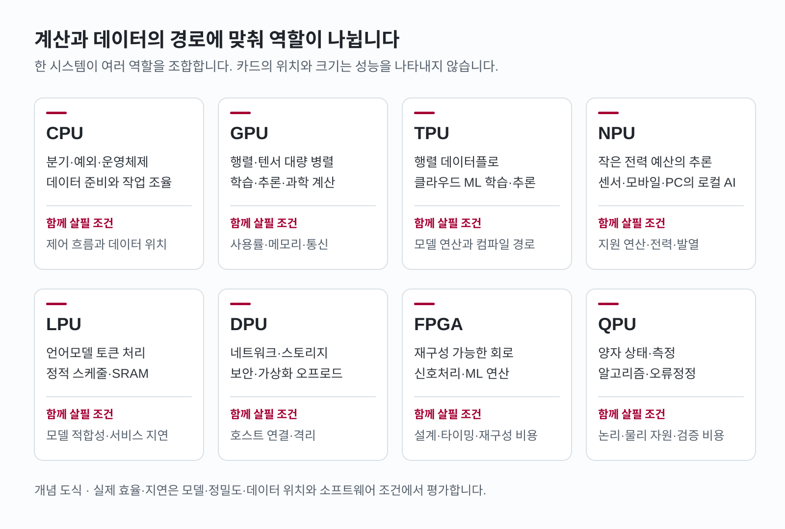
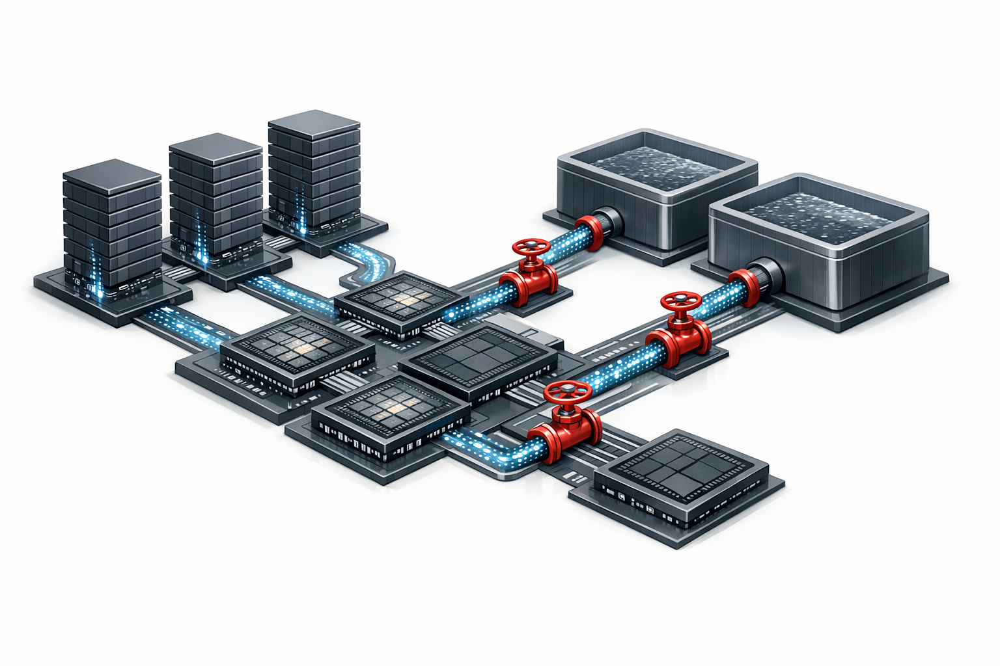
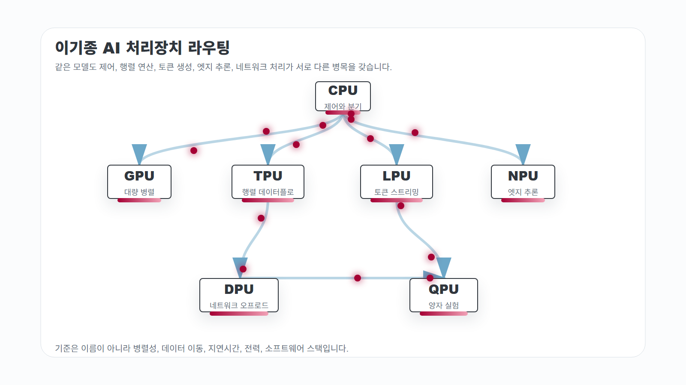
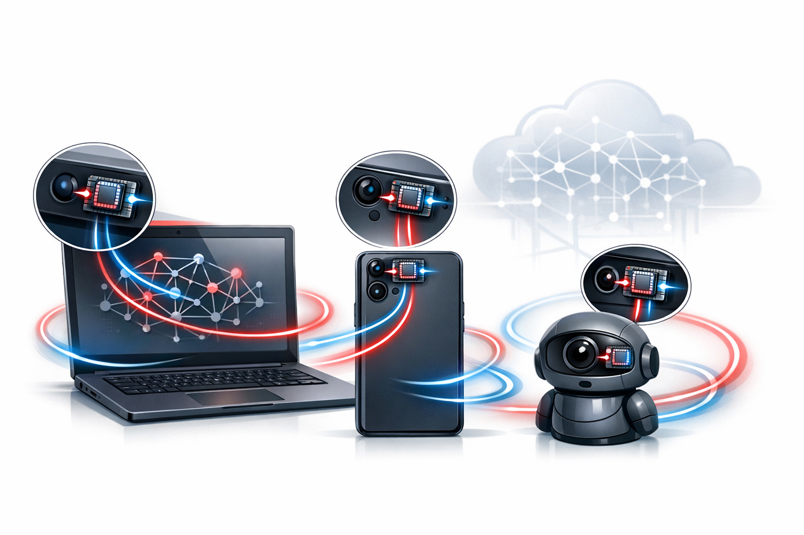
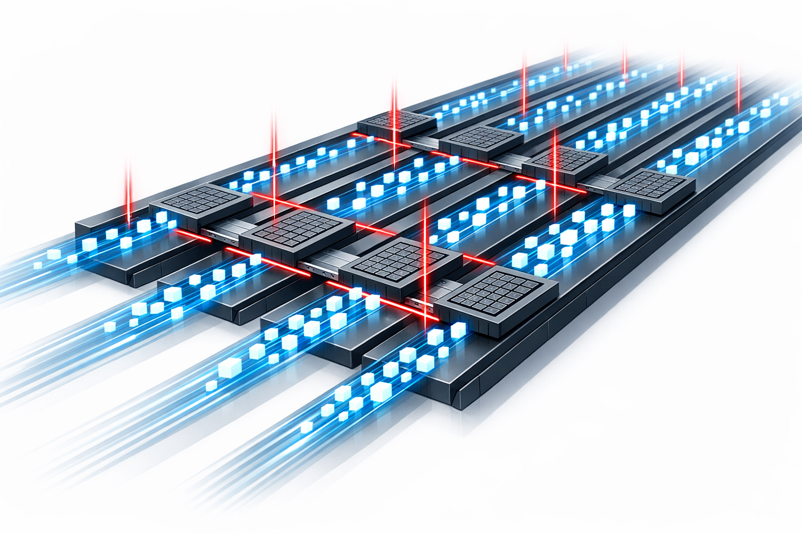
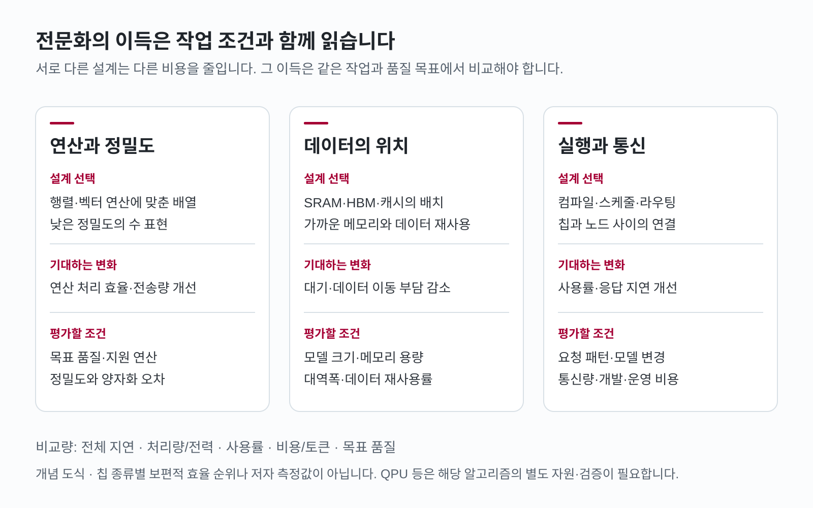

# AI 처리장치 스택: CPU, GPU, TPU, NPU, LPU는 왜 나뉘는가

AI 모델을 실행하는 동안 연산기는 종종 데이터를 기다립니다. 행렬을 곱하는 속도가 빨라도 가중치를 메모리에서 제때 가져오지 못하면 그 속도를 활용할 수 없습니다. 많은 요청을 한꺼번에 처리하는 서버와 배터리로 움직이는 스마트폰은 허용할 수 있는 지연시간과 전력도 다릅니다. GPU, TPU, NPU, LPU라는 이름의 배경에는 이처럼 서로 다른 계산 조건이 있습니다.

CPU가 맡는 분기와 시스템 제어, 가속기가 반복하는 행렬 연산, 데이터센터의 네트워크·스토리지 처리는 각기 다른 경로에서 시간을 씁니다. 언어모델 서비스에서는 다음 토큰을 내놓기까지의 지연도 중요합니다. 각 처리장치가 이 경로의 어디를 줄이려 하는지 따라가면, 칩의 분화와 여러 칩을 다시 묶는 시스템 설계를 함께 이해할 수 있습니다.

<figure class="article-hero-figure">
  
  <figcaption><strong>그림 1.</strong> AI 생성 개념 일러스트. 중앙의 제어 칩, 대형 연산 영역, 엣지 장치, 토큰 스트리밍 레인, 인프라 게이트, 양자 실험 장치를 한 작업 공간에 배치했습니다. 서로 다른 계산 경로를 맡는 처리장치들의 관계를 표현했습니다.</figcaption>
</figure>

::: highlight
**한 줄 결론**  
처리장치의 선택은 계산의 병렬성, 데이터의 위치, 허용 지연과 전력에서 시작됩니다. 이 조건에 맞게 작업을 배치하고 compiler·runtime·메모리·네트워크를 연결해야 칩의 성능이 실제 서비스 성능으로 이어집니다.
:::

## 계산의 모양이 칩을 가릅니다

처리장치의 설계는 계산을 나누는 방식과 데이터를 움직이는 방식에서 갈라집니다.

**병렬성의 모양**부터 보겠습니다. CPU는 분기와 예외 처리, 운영체제, 작은 작업의 조율에 적합합니다. GPU는 같은 형태의 연산을 많은 데이터에 적용하는 대량 병렬 처리를 발전시켜 왔습니다. TPU는 신경망의 행렬 연산과 데이터플로에 더 특화하고, NPU는 제한된 전력 안에서 이미지·음성·언어 모델의 추론을 장치 내부에서 수행하는 데 맞춥니다.

이 병렬성을 채우려면 **데이터가 어디에 있는지**도 알아야 합니다. HBM, DRAM, SRAM, 캐시, 네트워크, 스토리지 사이의 이동에 시간과 전력이 듭니다. Google Cloud TPU 아키텍처 문서 [<a href="#ref-1">1</a>]가 설명하는 MXU의 systolic array는 데이터를 연산기 배열 안에서 규칙적으로 전달하며 행렬 연산을 수행합니다. 연산기의 수와 데이터 경로를 함께 설계하는 방식입니다.

**숫자의 정밀도**는 이 경로를 오가는 데이터의 크기와 연산 비용을 바꿉니다. FP32가 필요한 작업도 있고, BF16, FP16, FP8, FP4, INT8, W4A8 등을 조합하는 학습·추론도 있습니다. NVIDIA Blackwell 문서 [<a href="#ref-2">2</a>]는 FP4 연산을 위한 미세 스케일링을 설명하고, Google TPU 8t/8i 발표 [<a href="#ref-3">3</a>]는 FP4와 on-chip SRAM, collective acceleration을 함께 다룹니다. 낮은 정밀도를 쓸 수 있는 범위는 모델의 정확도와 해당 연산의 지원 조건에 따라 정해집니다.

이 설계를 실제 모델에 연결하는 것이 **소프트웨어 스택**입니다. Compiler, runtime, kernel library, framework와 scheduling 도구가 하드웨어 자원을 배정합니다. GPU의 CUDA·cuDNN·TensorRT·NCCL, TPU의 XLA·JAX·Pathways, Trainium의 Neuron SDK는 각각 이 연결을 담당합니다. Groq가 설명하는 static scheduling과 deterministic execution [<a href="#ref-4">4</a>]도 compiler와 실행 구조를 함께 설계하는 접근입니다.

<figure class="figure-panel">
  

    
  

  
그림 안에서 가로로 이동할 수 있습니다.

  <figcaption><strong>그림 2.</strong> 리뷰가 정리한 역할과 검토 조건의 개념 도식입니다. 같은 크기의 카드는 서로 다른 계산 경로를 나란히 보여줍니다. 위치와 크기는 성능을 나타내지 않으며, 실제 시스템은 여러 역할을 조합합니다.</figcaption>
</figure>

## 왜 새 칩이 계속 나오는가

Hennessy와 Patterson의 “A New Golden Age for Computer Architecture” [<a href="#ref-5">5</a>]는 공정 미세화와 클럭 증가에 기대던 성능 향상이 둔화하면서 도메인 특화 구조의 중요성이 커졌다고 설명합니다. AI에서는 커지는 모델과 긴 sequence, MoE의 칩 간 통신이 연산량·메모리·연결망을 함께 압박합니다.

전문화는 이 비용을 줄일 지점을 고르는 일입니다. GPU와 TPU는 반복되는 연산을 병렬화하고, NPU는 배터리와 발열 한도 안에서 로컬 추론을 지속하도록 설계합니다. DPU는 모델 계산으로 들어가기 전의 네트워크·스토리지 경로를 맡습니다. 같은 AI 시스템 안에서도 최적화할 대상이 나뉩니다.

<figure class="figure-panel">
  
  <figcaption><strong>그림 3.</strong> AI 생성 개념 일러스트. 메모리와 연산 타일 사이의 좁은 경로, 기다리는 타일로 데이터 이동의 병목을 표현했습니다. 메모리 대역폭과 on-chip SRAM, HBM, interconnect는 연산기에 데이터를 공급하는 서로 다른 구간을 담당합니다.</figcaption>
</figure>

NVIDIA Blackwell [<a href="#ref-2">2</a>]이 NVLink와 NVLink Switch를 함께 내세우는 것도 이 때문입니다. 여러 GPU에 나눈 모델을 실행할 때는 칩 사이의 통신이 전체 처리시간에 들어갑니다. AWS Trainium3 [<a href="#ref-6">6</a>, <a href="#ref-7">7</a>] 역시 연산 엔진, HBM3e, collective cores, NeuronLink/NeuronSwitch와 Neuron SDK를 한 묶음으로 제시합니다. 제품의 설계 단위가 칩 내부에서 시스템의 데이터 경로로 넓어집니다.

## 역할별로 다시 읽기

아래 표는 각 처리장치가 주로 맡는 역할을 모은 것입니다. 실제 시스템에서는 여러 역할과 소프트웨어 계층이 함께 작동합니다. 여기서 IPU는 인프라 처리를 맡는 Infrastructure Processing Unit [<a href="#ref-8">8</a>]을 가리킵니다.

| 처리장치 | 가장 잘 맞는 일 | 설계 원리 | 강점 | 한계 |
|---|---|---|---|---|
| CPU | OS, 분기, control plane, 데이터 전처리, 작은 batch 추론 | 범용 core, branch prediction, cache hierarchy, vector/matrix extension | 개발 편의, 폭넓은 소프트웨어, orchestration | 대규모 dense tensor 처리에는 전용 가속기와의 효율 비교 필요 |
| GPU | 학습, 대규모 추론, simulation, dense tensor 병렬 처리 | SIMT/SIMD, Tensor Core, HBM, 고속 interconnect | 생태계와 범용성, 높은 throughput, 모델·프레임워크 지원 | utilization, memory bandwidth, 전력, 공급망, 비용이 큰 변수 |
| TPU | 클라우드 ML 학습·추론, 행렬 중심 workload | systolic array, MXU, XLA/JAX/Pathways, cloud-scale fabric | 특정 ML workload에서 효율과 규모 확장 | 플랫폼 의존성, workload portability, 커스텀 kernel 진입장벽 |
| NPU | 모바일·PC·엣지 inference, always-on AI | 저전력 neural accelerator, INT8/low precision, SoC 통합 | 배터리, 개인정보, 낮은 latency, 로컬 실행 | 메모리·모델 크기 제약, 학습보다는 추론 중심 |
| LPU | LLM token serving, 낮은 tail latency | static scheduling, deterministic dataflow, SRAM 중심 weight/data 흐름 | 예측 가능한 지연시간, token throughput, serving 비용 최적화 가능성 | 벤더 정의가 강하고 범용 표준 범주는 아님 |
| DPU/IPU | 네트워크, 스토리지, 보안, virtualization offload | programmable SmartNIC, packet processing, crypto/storage acceleration | CPU/GPU가 모델 계산에 집중하도록 인프라 부담 제거 | 모델 연산 자체를 대체하지 않음 |
| QPU | 양자 샘플링, 최적화 연구, 물질·화학 simulation 후보 | qubit, superposition, entanglement, error correction | 특정 문제에서 장기적 가능성 | 현재는 일반 AI 학습·추론 대체재가 아님 |

<figure class="figure-panel">
  

    
  

  
그림 안에서 가로로 이동할 수 있습니다.

  <figcaption><strong>그림 4.</strong> Remotion으로 렌더링한 작업 배치 개념도입니다. CPU의 조율과 각 처리장치의 역할을 연결한 그림으로, 선의 이어짐은 장치 간 직렬 실행 순서나 실제 버스 구성을 뜻하지 않습니다.</figcaption>
</figure>

### CPU: AI 시스템의 조율자로 남는 칩

데이터 로딩과 전처리, 운영체제, scheduling, 예외 처리와 서비스 조율에는 CPU가 필요합니다. 행렬 연산을 가속기에 보내는 시스템에서도 이 제어 경로는 남습니다. 동시에 CPU 내부에도 AI 연산을 위한 확장이 들어옵니다.

Intel AMX [<a href="#ref-9">9</a>]는 Xeon core에 행렬 연산 블록을 넣어 BF16·INT8 연산을 지원합니다. Arm SME와 SME2 [<a href="#ref-10">10</a>]도 CPU 명령어 체계에 행렬 중심 AI/ML 연산을 위한 확장을 더합니다. 작은 모델이나 작은 batch, 데이터가 이미 CPU 메모리에 있는 작업에서는 이 자원을 활용하는 추론도 검토할 수 있습니다.

### GPU: 범용 병렬 처리의 표준 플랫폼

큰 행렬과 tensor 연산을 반복하는 딥러닝은 GPU의 대량 병렬 처리와 잘 맞습니다. 여기에 CUDA와 라이브러리 생태계가 결합하면서 모델 개발부터 대규모 실행까지 폭넓게 지원하는 플랫폼이 형성됐습니다.

Blackwell 계열에서는 낮은 정밀도, Transformer Engine, GPU 간 통신 fabric과 rack-scale architecture를 함께 설계합니다. 모델을 여러 GPU에 나누면 collective communication과 KV cache 이동, 메모리 계층의 비용도 커집니다. GPU를 선택한 뒤에도 batch 크기와 모델 배치, 메모리 사용과 통신을 조정해야 연산 자원을 충분히 활용할 수 있습니다.

### TPU: 행렬 데이터플로와 클라우드 스택의 결합

TPU는 행렬 데이터플로를 하드웨어 배열에 맞추는 도메인 특화 설계입니다. 초기 TPU 논문 [<a href="#ref-11">11</a>]은 2015년의 Haswell CPU·K80 GPU와 8비트 TPU를 여섯 데이터센터 추론 작업의 응답시간 조건에서 비교했습니다. Systolic array 안에서는 데이터가 규칙적으로 전달되면서 multiply-accumulate 연산이 이어집니다.

2026년 TPU 8t/8i 발표 [<a href="#ref-3">3</a>]에서는 같은 세대 안에서도 역할을 나눴습니다. Google은 8t를 대규모 pre-training과 embedding-heavy workload, SparseCore와 torus 기반 확장에 맞추고, 8i는 sampling·serving·reasoning의 KV cache, collective acceleration과 낮은 통신 지연에 초점을 둡니다. 두 시스템 모두 AI 작업 전반을 지원하면서 강조점을 달리합니다. 이 발표의 native PyTorch 지원은 preview로 소개됐습니다. 학습과 추론이 요구하는 메모리·통신 패턴의 차이를 제품 구조에 반영한 사례입니다.

### NPU: AI를 클라우드에서 손 안으로 가져오는 장치

NPU는 AI PC, 스마트폰, 카메라, 자동차, IoT 장치에서 중요해지고 있습니다. Microsoft Copilot+ PC 개발자 가이드 [<a href="#ref-12">12</a>]는 40+ TOPS NPU와 이를 사용하도록 작성된 소프트웨어를 설명합니다. 모델이 실행되는 장치는 지원 API와 runtime의 경로에 따라 정해집니다. Apple M4 발표 [<a href="#ref-13">13</a>]는 Neural Engine의 38 TOPS를 제시합니다.

이 수치를 실제 추론 시간으로 옮기려면 지원하는 모델과 연산 정밀도, runtime, 메모리와 발열 조건을 함께 봐야 합니다. NPU를 쓰는 이유도 장치 안에서 필요한 추론을 낮은 전력과 짧은 응답시간으로 지속하기 위해서입니다. 카메라나 마이크의 신호를 로컬에서 처리할 수 있으면 네트워크 전송을 줄일 수 있습니다.

<figure class="figure-panel">
  
  <figcaption><strong>그림 5.</strong> AI 생성 개념 일러스트. 노트북·스마트폰·카메라 가까이에 NPU를 배치해 장치 내부의 반복 추론을 표현했습니다. 로컬 신호를 외부로 전송하지 않고 처리할 수 있는 범위가 지연시간·전력·개인정보 측면의 이점과 연결됩니다.</figcaption>
</figure>

### LPU: 언어모델 serving 병목을 드러내는 이름

Groq는 자사의 언어모델 추론 아키텍처를 LPU라고 부릅니다. 언어모델 서비스에서는 많은 요청을 처리하는 능력과 함께 토큰의 지연시간, 요청이 몰릴 때의 tail latency, serving 비용이 중요합니다. LPU라는 제품 명칭은 이 추론 경로를 전용 설계의 대상으로 드러냅니다.

Groq의 LPU 설명 [<a href="#ref-4">4</a>]은 SRAM을 사용하는 구조와 compiler의 static scheduling, deterministic execution을 강조합니다. 연산과 네트워크의 타이밍을 clock cycle 수준에서 미리 정해 자원 경합을 줄이려는 방향입니다.

그림 6의 “토큰이 규칙적으로 지나가는 공장”은 이 접근의 비유입니다. 연산과 데이터 도착 시점을 미리 정해 대기를 줄이려는 설계입니다. 모델 구조가 바뀌거나 multimodal·tool-use·retrieval 작업이 결합할 때는 새 연산과 데이터 경로를 얼마나 잘 지원하는지가 도입 조건이 됩니다.

<figure class="figure-panel">
  
  <figcaption><strong>그림 6.</strong> AI 생성 개념 일러스트. 정해진 리듬으로 compute tile과 SRAM을 통과하는 토큰 패킷을 그렸습니다. Static scheduling과 예측 가능한 dataflow라는 설계 의도를 표현한 비유입니다.</figcaption>
</figure>

### DPU/IPU: AI 데이터센터의 인프라 병목을 맡는 칩

DPU/IPU는 데이터센터의 네트워크·스토리지·보안·가상화 경로를 다룹니다. GPU cluster에서 이 처리가 CPU 시간과 데이터 공급 경로를 차지하면 모델 연산에도 대기가 생길 수 있습니다. Packet processing, storage path, encryption, isolation과 observability를 전용 장치로 옮겨 인프라 부담을 줄이는 접근입니다.

NVIDIA BlueField [<a href="#ref-14">14</a>, <a href="#ref-15">15</a>, <a href="#ref-16">16</a>]는 BlueField-3 DPU를 400Gb/s infrastructure compute platform으로 설명하고, BlueField-4는 800Gb/s 사양과 2026년 하반기 파트너 스토리지 플랫폼의 공급 계획을 발표했습니다. 이 대역폭이 실제 시스템에 주는 효과는 데이터 공급과 CPU 오프로드 정도에 달려 있습니다. 6월 시점의 BlueField-4는 이 계획과 공개 설계를 기준으로 검토할 제품입니다.

### QPU: 다른 시간표 위의 가속기

QPU는 양자상태의 중첩과 얽힘을 계산에 이용합니다. Google Willow 발표 [<a href="#ref-17">17</a>]는 quantum error correction의 진전과 이후의 유용한 계산이라는 과제를 설명합니다. 여기서 평가한 오류정정 성과와 AI 모델을 학습·서비스하는 성능은 서로 다른 계산 대상입니다.

AI와 연결하는 연구는 최적화, 샘플링, 확률 모델, 물질·화학 simulation에서 진행됩니다. 2026년 6월의 QPU는 이런 연구 경로에서 검토할 장치입니다. GPU cluster의 학습 처리량이나 NPU의 로컬 추론 속도와 비교하려면 먼저 같은 계산 문제와 출력 조건을 정해야 합니다.

## 놓치기 쉬운 추가 전략

처리장치의 분화는 회로를 다시 구성하거나, 메모리의 위치와 연결 매체를 바꾸는 방향으로도 이어집니다.

**FPGA와 adaptive compute**는 회로를 재구성할 수 있는 선택지입니다. AMD Versal SoC [<a href="#ref-18">18</a>]는 AI Engine의 VLIW/SIMD vector processor tile을 programmable logic, Arm core와 network-on-chip에 결합해 DSP와 ML inference를 처리합니다. 무선, radar, 산업 vision, medical imaging처럼 신호처리와 ML이 연결되는 분야에서는 요구에 맞게 데이터 경로를 구성하는 유연성이 중요합니다.

**클라우드 custom ASIC**은 hyperscaler의 비용 구조에서 나옵니다. AWS Trainium3 [<a href="#ref-6">6</a>, <a href="#ref-7">7</a>]는 PyTorch, vLLM, Hugging Face, Neuron SDK, collective cores, HBM3e를 함께 내세웁니다. Google TPU와 AWS Trainium은 클라우드 운영자가 workload와 software stack을 함께 통제할 수 있을 때 힘을 냅니다.

**wafer-scale**은 메모리와 연산기를 한 웨이퍼 위에 크게 배치합니다. Cerebras WSE-3 [<a href="#ref-19">19</a>]는 대규모 on-chip memory와 대역폭을 이용해 장치 내부의 계산을 묶습니다. 이 큰 장치를 활용하려면 생산 수율, 가격과 냉각뿐 아니라 모델을 배열에 배치하는 software mapping과 메모리 요구도 함께 맞춰야 합니다.

**near-memory와 compute-in-memory**는 데이터를 연산기까지 가져오는 비용을 줄이려는 시도입니다. Qualcomm은 AI200/AI250 발표 [<a href="#ref-20">20</a>]에서 AI200의 2026년, AI250의 2027년 상용화 계획을 제시했습니다. AI250의 near-memory computing과 effective memory bandwidth 개선은 이 발표의 설계 목표입니다. Analog compute-in-memory나 SRAM/DRAM 가까운 연산도 데이터 이동 비용을 줄이려는 같은 문제의식에서 나옵니다.

**photonic interconnect**는 칩 사이의 통신 매체를 바꿉니다. Lightmatter의 Passage는 광 연결 플랫폼이며, Guide 발표 [<a href="#ref-21">21</a>]는 이 연결에 빛을 공급하는 light engine과 파트너 평가용 샘플을 설명합니다. 여러 장치에 걸친 데이터 교환이 병목인 작업에서는 광 연결의 대역폭과 전력, 시스템 통합 비용이 중요한 평가 대상입니다.

**neuromorphic computing**은 사건이 있을 때 계산하는 경로를 탐색합니다. Intel의 Loihi 2 기술 자료 [<a href="#ref-22">22</a>]는 Loihi 2의 sparse event-driven computation, asynchronous spiking neural networks, 메모리·연산 통합을 설명합니다. 센서 이벤트, 로보틱스, 항상 켜진 저전력 지능은 이런 실행 방식의 활용을 검토할 분야입니다.

## 성능 수치를 실제 시스템에 연결하는 조건

**TOPS와 FLOPS의 비교 조건**부터 맞춰야 합니다. NPU의 40 TOPS, Apple Neural Engine의 38 TOPS, 데이터센터 가속기의 PFLOPS를 읽을 때는 연산 정밀도와 sparsity, 무엇을 한 번의 연산으로 세었는지 확인해야 합니다. 실제 실행시간에는 batch와 sequence length, 메모리 대역폭, kernel 지원과 발열 한도도 작용합니다.

**사용률**은 연산기가 실제로 일한 시간을 드러냅니다. TPU 8t의 TPUDirect Storage, TPU 8i의 on-chip SRAM과 CAE, NVIDIA NVLink, Trainium collective cores, DPU offload는 서로 다른 구간의 데이터 공급과 통신을 다룹니다. 어느 구간의 대기가 줄었는지 확인해야 그 기능이 전체 실행에 기여한 정도를 알 수 있습니다.

**프로그래밍 모델**은 지원하는 작업과 이식 비용을 정합니다. GPU의 라이브러리, Google Cloud의 TPU 스택, Trainium의 Neuron SDK에서 필요한 연산을 어떻게 구현하는지 살펴야 합니다. 모델 구조와 runtime이 자주 바뀌는 팀이라면 추론 ASIC의 현재 처리량과 함께 새 연산 지원, 변환·검증에 드는 시간도 평가해야 합니다.

**공급망과 운영**도 도입 비용에 들어갑니다. 데이터센터에서는 HBM 공급, rack power와 냉각, network fabric, software licensing, 관측 도구, driver version과 보안 격리를 함께 관리해야 합니다. 엣지 NPU에서는 모델 변환과 quantization, vendor SDK와 운영체제 API의 지원 범위가 실행 가능한 모델을 정합니다.

<figure class="figure-panel">
  

    
  

  
그림 안에서 가로로 이동할 수 있습니다.

  <figcaption><strong>그림 7.</strong> 전문화의 설계 선택과 평가 조건을 나란히 정리한 리뷰 개념 도식입니다. 낮은 정밀도와 연산 배열, 가까운 데이터, 정적 스케줄과 연결망은 각각 다른 비용을 겨냥합니다. 같은 모델·품질 목표에서 전체 지연, 전력과 사용률을 평가해야 실제 이득을 비교할 수 있습니다.</figcaption>
</figure>

## 미래 경쟁은 workload 라우팅에서 갈립니다

2026년 6월의 제품과 연구를 함께 보면 이기종 조합이 자연스러운 설계 방향으로 보입니다. 데이터센터에서는 연산 가속기와 DPU/IPU, 고속 fabric을 묶고, PC와 모바일에서는 CPU·GPU·NPU가 SoC 안의 자원을 나눕니다. QPU, neuromorphic, analog/near-memory, photonic interconnect는 각자의 계산 원리와 적용 단계에서 다른 경로를 탐색합니다.

이때 workload의 배치는 단순한 장치 선택을 넘어섭니다. 긴 문맥 LLM serving에서는 KV cache와 interconnect를, 이미지·음성의 always-on inference에서는 전력과 로컬 데이터 처리를 봐야 합니다. 학습 cluster에서는 collective communication과 reliability가, 에이전트 시스템에서는 CPU의 조율부터 도구 실행·스토리지·네트워크·보안까지 이어지는 경로가 중요해집니다.

실무에서는 이 경로를 측정 가능한 요구로 옮겨야 합니다.

1. 모델의 병목이 compute인지 memory bandwidth인지, network인지, tail latency인지 먼저 측정합니다.
2. 목표가 training인지 fine-tuning인지 batch inference인지 real-time serving인지 분리합니다.
3. precision과 quantization 허용 범위를 정합니다. FP4/INT8/W4A8을 쓸 수 있는지에 따라 경제성이 크게 달라집니다.
4. software stack을 봅니다. framework, compiler, runtime, kernel, monitoring, deployment tool이 실제 팀 역량과 맞아야 합니다.
5. 하드웨어 숫자보다 end-to-end latency, throughput per watt, utilization, cost per token, operational reliability를 봅니다.

## 우리에게 남는 판단

처리장치의 분화는 모델이 요구하는 시간과 데이터 경로의 차이를 하드웨어에 새긴 결과입니다. 그 설계를 활용하는 일은 다시 시스템 전체로 돌아옵니다. 새 칩을 넣었을 때 데이터가 어디에서 기다리게 되는지, 모델과 compiler·runtime이 그 경로를 얼마나 활용하는지 확인해야 합니다. 칩의 peak 성능과 실제 서비스 사이의 간격을 줄이는 데 앞으로의 시스템 경쟁이 걸려 있습니다.

## 개정 기록

2026-11-03 문체·서지 개정. 원 발행일과 근거 범위는 2026-06-17이다. 반복되는 설명과 결론을 정리하고 제품의 발표·공급 계획, NPU 실행 조건과 원저자 크레딧을 보완했다. 그림 2·7의 근거 없는 공통 좌표·효율 순위는 역할과 설계 조건의 개념 도식으로 바로잡았다. 참고문헌의 정식 서지·정상 주소와 현재 열람 범위는 이번 확인 정보다.

<h2 id="references">References</h2>
<ol class="references">
<li id="ref-1">Google Cloud, TPU architecture (accessed 3 November 2026). <a href="https://docs.cloud.google.com/tpu/docs/system-architecture-tpu-vm">https://docs.cloud.google.com/tpu/docs/system-architecture-tpu-vm</a></li>
<li id="ref-2">NVIDIA, The NVIDIA Grace Blackwell Superchip, NVIDIA GB200 NVL Multi-Node Tuning Guide (21 April 2025; accessed 3 November 2026). <a href="https://docs.nvidia.com/multi-node-nvlink-systems/multi-node-tuning-guide/overview.html">https://docs.nvidia.com/multi-node-nvlink-systems/multi-node-tuning-guide/overview.html</a></li>
<li id="ref-3">D. Gupta and S. Mugazambi, Inside the eighth-generation TPU: An architecture deep dive, Google Cloud Blog (22 April 2026). <a href="https://cloud.google.com/blog/products/compute/tpu-8t-and-tpu-8i-technical-deep-dive">https://cloud.google.com/blog/products/compute/tpu-8t-and-tpu-8i-technical-deep-dive</a></li>
<li id="ref-4">Groq, What is a Language Processing Unit? (March 7, 2025). <a href="https://groq.com/blog/the-groq-lpu-explained">https://groq.com/blog/the-groq-lpu-explained</a></li>
<li id="ref-5">J. L. Hennessy and D. A. Patterson, A new golden age for computer architecture, Commun. ACM 62, 48 (2019). <a href="https://doi.org/10.1145/3282307">doi:10.1145/3282307</a></li>
<li id="ref-6">Amazon Web Services, AWS Trainium (accessed 3 November 2026). <a href="https://aws.amazon.com/ai/machine-learning/trainium/">https://aws.amazon.com/ai/machine-learning/trainium/</a></li>
<li id="ref-7">Amazon Web Services, Announcing Amazon EC2 Trn3 UltraServers for faster, lower-cost generative AI training (2 December 2025). <a href="https://aws.amazon.com/about-aws/whats-new/2025/12/amazon-ec2-trn3-ultraservers/">https://aws.amazon.com/about-aws/whats-new/2025/12/amazon-ec2-trn3-ultraservers/</a></li>
<li id="ref-8">Intel, Intel unveils infrastructure processing unit (June 14, 2021). <a href="https://download.intel.com/newsroom/archive/2025/en-us-2021-06-14-intel-unveils-infrastructure-processing-unit.pdf">https://download.intel.com/newsroom/archive/2025/en-us-2021-06-14-intel-unveils-infrastructure-processing-unit.pdf</a></li>
<li id="ref-9">Intel, What is Intel® Advanced Matrix Extensions (Intel® AMX)? (accessed November 3, 2026). <a href="https://www.intel.com/content/www/us/en/products/docs/accelerator-engines/what-is-intel-amx.html">https://www.intel.com/content/www/us/en/products/docs/accelerator-engines/what-is-intel-amx.html</a></li>
<li id="ref-10">Arm Editorial Team, Scalable Matrix Extension (SME) for Armv9 architecture enables AI innovation on the Arm CPU (May 23, 2024). <a href="https://newsroom.arm.com/blog/scalable-matrix-extension">https://newsroom.arm.com/blog/scalable-matrix-extension</a></li>
<li id="ref-11">N. P. Jouppi <em>et al.</em>, In-datacenter performance analysis of a tensor processing unit, in Proceedings of the 44th Annual International Symposium on Computer Architecture (ACM, New York, 2017), pp. 1-12. <a href="https://doi.org/10.1145/3079856.3080246">doi:10.1145/3079856.3080246</a></li>
<li id="ref-12">Microsoft, Develop AI applications for Copilot+ PCs (accessed November 3, 2026). <a href="https://learn.microsoft.com/en-us/windows/ai/npu-devices/">https://learn.microsoft.com/en-us/windows/ai/npu-devices/</a></li>
<li id="ref-13">Apple, Apple introduces M4 chip (May 7, 2024). <a href="https://www.apple.com/newsroom/2024/05/apple-introduces-m4-chip/">https://www.apple.com/newsroom/2024/05/apple-introduces-m4-chip/</a></li>
<li id="ref-14">NVIDIA, NVIDIA extends data center infrastructure processing roadmap with BlueField-3 (April 12, 2021). <a href="https://nvidianews.nvidia.com/news/nvidia-extends-data-center-infrastructure-processing-roadmap-with-bluefield-3">https://nvidianews.nvidia.com/news/nvidia-extends-data-center-infrastructure-processing-roadmap-with-bluefield-3</a></li>
<li id="ref-15">I. Ozery, NVIDIA launches BlueField-4: The processor powering the operating system of AI factories (October 28, 2025). <a href="https://blogs.nvidia.com/blog/bluefield-4-ai-factory/">https://blogs.nvidia.com/blog/bluefield-4-ai-factory/</a></li>
<li id="ref-16">NVIDIA, NVIDIA BlueField-4 powers new class of AI-native storage infrastructure for the next frontier of AI (January 5, 2026). <a href="https://nvidianews.nvidia.com/news/nvidia-bluefield-4-powers-new-class-of-ai-native-storage-infrastructure-for-the-next-frontier-of-ai">https://nvidianews.nvidia.com/news/nvidia-bluefield-4-powers-new-class-of-ai-native-storage-infrastructure-for-the-next-frontier-of-ai</a></li>
<li id="ref-17">H. Neven, Meet Willow, our state-of-the-art quantum chip (December 9, 2024). <a href="https://blog.google/innovation-and-ai/technology/research/google-willow-quantum-chip/">https://blog.google/innovation-and-ai/technology/research/google-willow-quantum-chip/</a></li>
<li id="ref-18">AMD, AI Engine technology (accessed November 3, 2026). <a href="https://www.amd.com/en/products/adaptive-socs-and-fpgas/technologies/ai-engine.html">https://www.amd.com/en/products/adaptive-socs-and-fpgas/technologies/ai-engine.html</a></li>
<li id="ref-19">J. Choi, Cerebras Systems unveils world’s fastest AI chip with whopping 4 trillion transistors (Cerebras Systems, 2024). <a href="https://www.cerebras.ai/press-release/cerebras-announces-third-generation-wafer-scale-engine">https://www.cerebras.ai/press-release/cerebras-announces-third-generation-wafer-scale-engine</a></li>
<li id="ref-20">Qualcomm Technologies, Qualcomm unveils AI200 and AI250—Redefining rack-scale data center inference performance for the AI era (October 28, 2025). <a href="https://www.qualcomm.com/news/releases/2025/10/qualcomm-unveils-ai200-and-ai250-redefining-rack-scale-data-cent">https://www.qualcomm.com/news/releases/2025/10/qualcomm-unveils-ai200-and-ai250-redefining-rack-scale-data-cent</a></li>
<li id="ref-21">Lightmatter, Lightmatter introduces Guide light engine for AI, featuring VLSP technology (January 26, 2026). <a href="https://lightmatter.co/press-release/lightmatter-introduces-guide-light-engine-for-ai-featuring-vlsp-technology/">https://lightmatter.co/press-release/lightmatter-introduces-guide-light-engine-for-ai-featuring-vlsp-technology/</a></li>
<li id="ref-22">Intel Labs, Taking neuromorphic computing to the next level with Loihi 2 (2021). <a href="https://download.intel.com/newsroom/2021/new-technologies/neuromorphic-computing-loihi-2-brief.pdf">https://download.intel.com/newsroom/2021/new-technologies/neuromorphic-computing-loihi-2-brief.pdf</a></li>
</ol>
