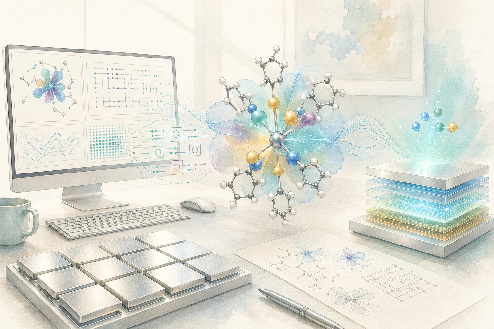
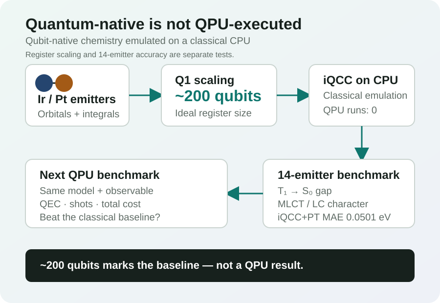
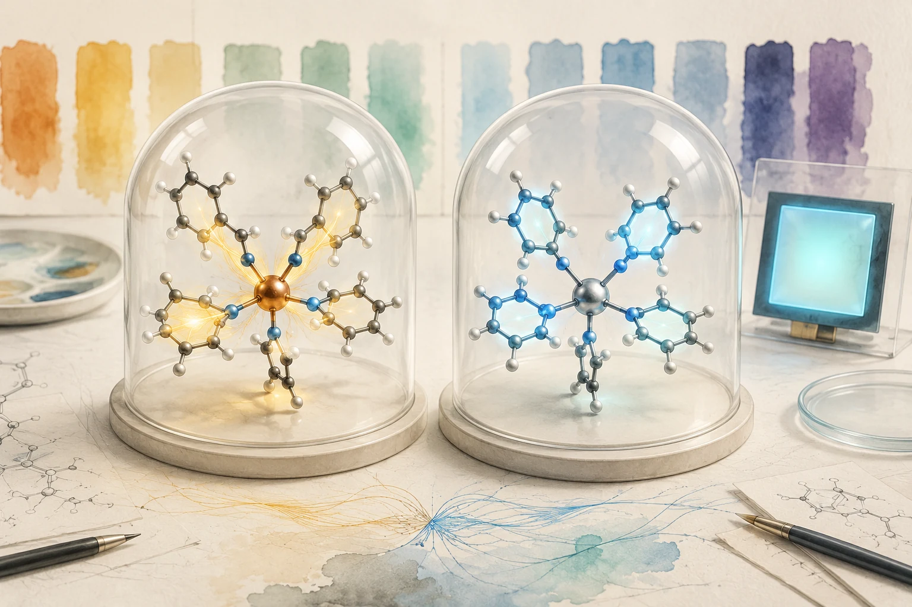

AI Tech Review Letters · 2026-08-24 · 편집 개정 2026-11-05<a href="https://infant83.github.io/AI_Tech_Review/">리뷰 허브로 돌아가기</a>

  <header class="hero">

    <section>
      
Materials AI · Quantum Chemistry

      <h1>200 논리 큐비트 OLED 계산, 양자컴퓨터였나?</h1>
      
고전 iQCC 에뮬레이션으로 계산한 Ir·Pt 인광체의 삼중항 에너지와 여기 성격

    </section>
    <figure class="hero-figure"><figcaption>그림 1. 생성 개념 일러스트. Quantum-native iQCC로 구성된 Ir·Pt 인광체의 전자구조 문제를 고전 CPU에서 에뮬레이션하고 OLED 방출과 연결하는 장면이다. 실제 QPU 실행이나 특정 분자의 계산 오비탈을 재현한 그림은 아니다.</figcaption></figure>
  
</header>

  <main class="content-grid">
    <article>
      
이 연구에서 OLED 발광분자의 전자상태를 계산한 장치는 고전 CPU였습니다. OTI Lumionics와 Samsung Advanced Institute of Technology(SAIT, 삼성종합기술원)는 양자회로에 맞춰 설계한 iQCC 알고리즘을 에뮬레이션해 큰 활성공간의 분자를 계산했습니다. 결과는 2026년 8월 13일 JACS에 공개됐습니다.<a class="citation" href="#ref-1">[1]</a>

      
연구진은 Q1 분자의 활성공간을 약 200개 스핀 오비탈까지 확장했습니다. 별도로 Ir(III)·Pt(II) 인광체 14종에서 에너지 차이를 실험과 비교하고, 대표 착물의 여기 성격을 분석했습니다. 처리할 수 있는 문제의 크기와 화학적 정확도를 각각 살펴볼 수 있는 결과입니다.

      

        
<strong>계산 방법</strong>Hamiltonian의 Pauli 연산자 구조를 이용한 고전 iQCC 에뮬레이션

        
<strong>규모 평가</strong>Q1 활성공간의 최대 약 200개 스핀 오비탈

        
<strong>정확도 평가</strong>별도의 인광체 14종에서 iQCC+PT의 실험 대비 MAE 0.0501 eV

      

      <figure class="figure-panel"><figcaption>그림 2. 계산 경계. 양자-native 알고리즘은 고전 CPU에서 에뮬레이션됐다. 약 200 logical qubits는 Q1 최대 규모 사례의 spin-orbital 수에 대응하는 이상적 register 규모이고, 1천만 two-qubit gates는 QEC overhead를 제외한 logical-level ansatz count다. <a class="figure-open" href="oti_iqcc_oled_boundary.svg" target="_blank" rel="noreferrer">도식 크게 보기 ↗</a></figcaption></figure>

      <h2>Ir·Pt 인광체의 T1 상태가 어려운 이유</h2>
      
OLED 인광체의 색과 에너지 전달을 이해하려면 가장 낮은 삼중항 상태 T1과 단일항 바닥상태 S0 사이의 에너지 차를 안정적으로 계산해야 합니다. Cyclometalated Ir(III)와 Pt(II) 착물에서는 ligand-centered(LC) π→π* 여기와 metal-to-ligand charge transfer(MLCT)가 섞이고, 금속 중심의 큰 상대론 효과와 spin-orbit coupling이 발광·광물리 특성을 좌우합니다.

      
문제는 T1이 하나의 Slater determinant로 잘 표현되지 않는 경우가 많다는 점입니다. 단일 reference에 강하게 의존하는 projective coupled-cluster 계산은 spin contamination과 다중참조 성격 때문에 상태를 잘못 식별하거나 방출 갭을 지나치게 낮게 예측할 수 있습니다. 반면 범함수 선택에 민감한 DFT·TDDFT는 후보군에 따라 오차와 순위가 달라집니다.

      

        
<strong>분자·궤도</strong> 고전 전처리

<strong>Q1 active space</strong> 최대 약 200 qubits

<strong>iQCC</strong> 고전 에뮬레이션

<strong>T1−S0</strong> MLCT/LC 분석

<strong>실험 비교</strong> 미래 QPU 기준선

      

      <h2>iQCC가 계산한 대상과 범위</h2>
      
Iterative Qubit Coupled Cluster(iQCC)는 전자 Hamiltonian을 qubit Pauli operator의 합으로 바꾸고, 선택된 entangler를 순차적으로 적용하는 unitary ansatz로 상관 에너지를 낮춥니다. 양자회로에서는 Pauli rotation과 entangling gate로 구현할 수 있으므로 VQE 계열의 quantum-native solver입니다.

      
고전 에뮬레이션은 iQCC에 특유한 Hamiltonian dressing과 Pauli 연산자 구조를 이용합니다. 전체 상태벡터를 직접 전개하는 대신 이 구조 안에서 entangler를 고르고 매개변수를 최적화합니다. Q1의 활성공간을 최대 약 200개의 스핀 오비탈까지 확장한 사례에서는 최대 약 150만 개 매개변수와 1천만 개 이상의 논리 수준 two-qubit gate에 해당하는 ansatz를 다뤘습니다.<a class="citation" href="#ref-1">[1]</a>

      

논리 큐비트와 게이트 수의 뜻

논문에서 말하는 약 <strong>200 logical qubits</strong>는 활성공간의 스핀 오비탈에 대응하는 이상적 레지스터 크기입니다. 실제 오류정정 장치의 큐비트 수와는 구별됩니다. <strong>1천만 개 이상의 two-qubit gates</strong>는 완전 연결을 가정한 ansatz의 CNOT 추정량입니다. QEC encoding, Clifford+T 컴파일, 라우팅과 SWAP의 추가 비용을 포함한 내결함성 자원 추정은 별도로 필요합니다.

      <h2>정확도 개선은 iQCC보다 iQCC+PT에서 크게 나타났다</h2>
      
논문의 14개 인광체 비교에서 순수 iQCC는 MAE 0.1180 eV를 기록했습니다. 표에 제시된 DFT/TDDFT 두 방법과 MAE가 비슷했고, 결정계수 R²는 PT를 쓰지 않은 비교군 중 가장 높았습니다. R²는 선형 적합의 결정계수입니다. 비변분적 고전 보정인 Epstein-Nesbet perturbation theory를 더한 <strong>iQCC+PT</strong>는 MAE 0.0501 eV와 R² 0.9411을 얻었습니다.

      

계산·실험 조건

iQCC의 에너지 차이는 B3LYP로 최적화한 T1 구조에서 구한 수직 방출 에너지입니다. 표의 TDDFT 비교값은 S0 구조에서 계산했으므로, 방법마다 구조 조건이 다릅니다. Ir/Pt에는 LANL2DZ ECP, 나머지 원자에는 6-31G**를 썼고 spin–orbit coupling과 zero-point energy는 포함하지 않았습니다. 14종의 정확도 평가에서는 대체로 CAS(70전자, 70공간 궤도)를, Q2·Q4에는 CAS(100전자, 100공간 궤도)를 사용했습니다. Q1의 최대 200큐비트 스케일링은 이 정확도 평가와 별도입니다. 실험 PL은 77 K 저유전 용매 조건이며, 12종은 본 연구 측정값, Q12·Q14는 문헌값입니다.<a class="citation" href="#ref-1">[1]</a>

      
<table>
        <caption>14개 Ir(III)·Pt(II) 인광체의 계산 방법별 실험 비교</caption>
        <thead><tr><th scope="col">방법</th><th scope="col">R²</th><th scope="col">MAE (eV)</th><th scope="col">해석</th></tr></thead>
        <tbody>
          <tr><td>RO-CAM-B3LYP</td><td>0.6085</td><td>0.1161</td><td>비교군에서 낮은 DFT MAE</td></tr>
          <tr><td>TD-B3LYP</td><td>0.6638</td><td>0.1209</td><td>순수 iQCC와 유사한 MAE</td></tr>
          <tr><td>CCSD</td><td>0.8070</td><td>0.2200</td><td>단일-reference 한계가 드러남</td></tr>
          <tr><td>CR-CC(2,3)</td><td>0.7791</td><td>0.2912</td><td>triplet 상태의 spin contamination 영향</td></tr>
          <tr><td>iQCC</td><td>0.8786</td><td>0.1180</td><td>더 높은 선형 적합도, MAE는 DFT와 비슷</td></tr>
          <tr class="highlight"><td>iQCC+PT</td><td>0.9411</td><td>0.0501</td><td>이번 비교의 최상 결과</td></tr>
        </tbody>
      </table>

      
실험과 비교한 오차에는 iQCC 계산뿐 아니라 기저, 활성공간, 상대론 처리와 환경 근사의 오차도 함께 반영됩니다. 서로 다른 오차가 상쇄될 수 있어, 실험 PL과의 일치와 같은 Hamiltonian에서의 solver 정확도는 구별해 읽어야 합니다. 저자들은 같은 모델에서 variational energy를 CISD와 비교해 iQCC가 더 낮은 에너지를 준다는 결과를 별도 근거로 제시했습니다.

      

검증의 두 층

<strong>Solver accuracy</strong>는 동일 Hamiltonian·active space에서 FCI, DMRG, selected CI 또는 엄밀한 variational bound와 비교해야 합니다. <strong>Model-to-experiment accuracy</strong>는 geometry, basis, 상대론 처리, spin-orbit coupling, 환경과 진동 효과까지 합친 결과입니다. 두 오차를 섞으면 알고리즘의 실제 기여를 과대평가할 수 있습니다.

      <h2>MLCT와 LC 성격까지 읽은 분석</h2>
      
저자들은 에너지와 함께 금속에 할당된 전자수의 변화도 살폈습니다. 같은 T1 구조에서 두 전자상태를 비교하자, T1의 금속 전자수는 S0보다 Ir 착물 Q1·Q6에서 각각 약 0.358·0.462개 줄었습니다. Pt 착물 Q9·Q14의 감소량은 약 0.102·0.112개였습니다. 연구진은 Ir 착물의 큰 감소를 MLCT 성격과, Pt 착물의 작은 변화를 LC 전이가 우세한 상태와 연결했습니다. 이 값은 NAO에 투영한 전자 점유수로 추정했으며 1전자 밀도행렬의 비대각 성분은 생략했습니다.<a class="citation" href="#ref-1">[1]</a>

      <figure class="figure-panel"><figcaption>그림 3. 생성 개념 일러스트. 왼쪽은 금속 중심에서 리간드로 여기 성격이 퍼지는 MLCT를, 오른쪽은 리간드 π계에 더 국소화된 LC를 대비한다. 특정 Q1·Q6·Q9·Q14 구조나 실제 계산된 전이밀도를 재현한 그림은 아니다.</figcaption></figure>
      
이 전자수 분석은 T1 에너지와 함께 여기의 성격을 구별하게 합니다. OLED 후보를 고를 때는 에너지 차이뿐 아니라 금속이 얼마나 관여하는지, 전하이동과 리간드 국소 여기의 비중이 어떠한지도 살펴볼 수 있습니다. 상태 성격과 전이 특성을 함께 검토하는 것은 후속 치환기 설계와 열화 메커니즘을 조사할 때 참고할 수 있는 방향입니다.

      

        
<strong>14</strong>Ir/Pt phosphor 비교

<strong>~200</strong>Q1 스케일링 규모

<strong>0.0501 eV</strong>iQCC+PT MAE

<strong>0</strong>실제 QPU 실행 횟수

      

      <h2>200큐비트라는 발표를 읽는 맥락</h2>
      
Scott Genin의 8월 19일 게시물은 약 200 logical qubits, 1천만 개 이상의 two-qubit gates, 150만 개 매개변수와 single chip을 강조했습니다.<a class="citation" href="#ref-2">[2]</a> 게시물도 고전 에뮬레이션을 설명하며 이를 미래 물리 하드웨어의 비교 기준으로 제시합니다. 이 숫자는 위에서 살핀 이상적 레지스터와 ansatz의 규모를 가리킵니다. 보충자료는 OLED 계산에 AMD EPYC 7702 64코어 프로세서 두 개를 갖춘 계산 노드와 64개 프로세스를 사용했다고 명시합니다. 발표의 간결한 문구와 계산 조건을 함께 읽을 필요가 있습니다.<a class="citation" href="#ref-1">[1]</a>

      <h2>OLED·DFT·ML 역설계 업무에서의 활용</h2>
      
OLED inverse-design pipeline에서는 iQCC 계열 계산을 <strong>고가치 후보의 고정밀 전자구조 재판정층</strong>에 둘 수 있습니다. GNN·surrogate와 DFT/TDDFT로 넓은 chemical space를 먼저 줄인 뒤, spin contamination·다중참조·상태 ordering이 의심되는 소수 Ir/Pt 착물을 다시 계산하는 방식입니다.

      <ol>
        <li>TDDFT와 orbital 분석으로 불확실성이 큰 후보와 CT/LC character가 뒤집히는 후보를 고릅니다.</li>
        <li>Geometry, basis, relativistic treatment와 active space를 고정합니다.</li>
        <li>iQCC·iQCC+PT를 DMRG, selected CI, CASSCF/NEVPT2 같은 강한 기준선과 같은 Hamiltonian에서 비교합니다.</li>
        <li>T1 갭 외에 metal charge, natural occupation, transition density와 spin purity를 함께 기록합니다.</li>
        <li>미공개 후보의 spectroscopy 또는 device 결과로 blind test를 수행합니다.</li>
      </ol>
      
이 절차는 본 리뷰가 제안하는 후보 재판정 방식입니다. 원 논문의 계산·측정 결과와 구분해 후속 연구에서 시험할 수 있습니다.

      <h2>미래 QPU가 넘어야 할 체크리스트</h2>
      <ul>
        <li><strong>같은 문제인가:</strong> geometry, basis, active space, Hamiltonian과 상대론 처리가 동일해야 합니다.</li>
        <li><strong>같은 출력인가:</strong> ground-state energy, T1 갭, MLCT/LC 같은 관측량을 함께 비교해야 합니다.</li>
        <li><strong>같은 정확도인가:</strong> 실험 오차와 solver 오차를 분리하고 variational 기준을 제시해야 합니다.</li>
        <li><strong>총비용인가:</strong> logical-qubit overhead, state preparation, T/Toffoli count, shots, queue, decoding과 고전 전후처리를 포함해야 합니다.</li>
        <li><strong>강한 고전 상대인가:</strong> iQCC emulation, DMRG, selected CI, tensor network와 최신 multireference 방법을 포함해야 합니다.</li>
      </ul>

      <h2>결론</h2>
      
Q1의 큰 활성공간을 고전적으로 처리한 사례와 14종 인광체에서 얻은 에너지 비교는 계산 규모와 화학적 정확도를 각각 살펴볼 자료를 남겼습니다. iQCC+PT의 좋은 실험 일치는 고전 보정의 기여와 분자 모형의 조건을 함께 읽을 때 의미가 분명해집니다.

      
앞으로 양자장치를 이 OLED 문제에 적용할 때에는 같은 분자 모형과 목표 정확도에서 관측량, 계산 시간과 필요한 자원을 함께 비교할 수 있습니다. 분자 설계에 쓸 답을 얼마나 잘 구하는지가 그 비교의 중심에 있습니다.

      <h2 id="references">참고문헌</h2>
      <ol class="refs">
        <li id="ref-1">[1] S. N. Genin, O. Kwon, S. M. Hosseini Jenab, S.-J. Lim, T. Kim, T.-G. Kim, R. Gherib, A. F. Harper, I. G. Ryabinkin, and M. G. Helander, Large-scale quantum computing emulation for accurate triplet states of Ir(III) and Pt(II) phosphorescent emitters, J. Am. Chem. Soc. 148, 35239 (2026), <a href="https://doi.org/10.1021/jacs.6c04752" target="_blank" rel="noreferrer">doi:10.1021/jacs.6c04752</a>.</li>
        <li id="ref-2">[2] S. Genin, <a href="https://www.linkedin.com/posts/scott-genin-943a9118_large-scale-quantum-computing-emulation-for-activity-7495917046858276864-yjOW" target="_blank" rel="noreferrer">Quantum emulators simulate OLED materials at 200 logical qubits</a>, LinkedIn (August 19, 2026).</li>
      </ol>
    </article>

    <aside class="sidebar">
      <section class="side-section"><h2>분류</h2>Materials AIQuantum ChemistryOLEDiQCCClassical Emulation</section>
      <section class="side-section"><h2>논문 상태</h2>
JACS Communication Published online: 2026-08-13 Open access DOI 10.1021/jacs.6c04752
</section>
      <section class="side-section"><h2>계산 경계</h2><ul><li>플랫폼: 고전 CPU 기반 에뮬레이션</li><li>실제 QPU: 사용하지 않음</li><li>문제: T1−S0 및 상태 성격</li><li>분자: Ir(III)/Pt(II) phosphors</li><li>최대 규모: Q1 약 200 spin-orbital qubits</li></ul></section>
      <section class="side-section"><h2>연구자가 볼 포인트</h2><ul><li>iQCC와 iQCC+PT를 분리</li><li>실험 오차와 solver 오차 분리</li><li>logical-qubit 표현과 실제 QPU 구분</li><li>DFT/DMRG/selected-CI 기준선</li><li>MLCT·LC 관측량의 설계 가치</li></ul></section>
    </aside>
  </main>

  <section class="public-note">
<strong>작성정보.</strong> 김현중 · 원 발행 및 근거 기준일 2026-08-24 · 편집 개정 2026-11-05. 이번 개정은 8월 13일 공개된 논문 본문과 보충자료, 8월 19일 연구자 게시물을 대조해 문체·APS 인용·계산 구조와 전자수 변화의 뜻을 보완했습니다. 원 작성 세션의 모델·개별 에이전트 구성은 미보존이며, 이번 AI 보조는 OpenAI Codex입니다. 원 연구의 iQCC·DFT·QPU 계산이나 소자 실험을 재현하거나 사람 독자 평가를 수행하지 않았습니다.

공개 조회수와 평균 읽은 시간은 개인 식별 정보 없이 페이지 경로 단위로만 집계합니다.
</section>
