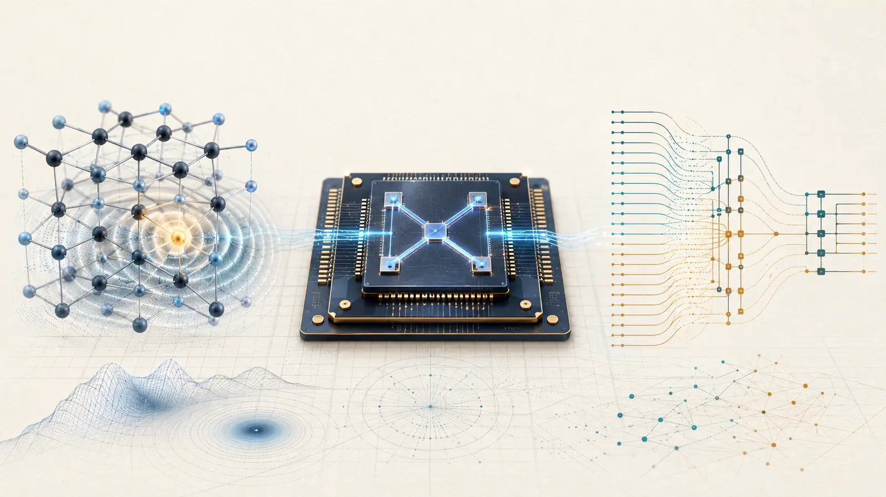
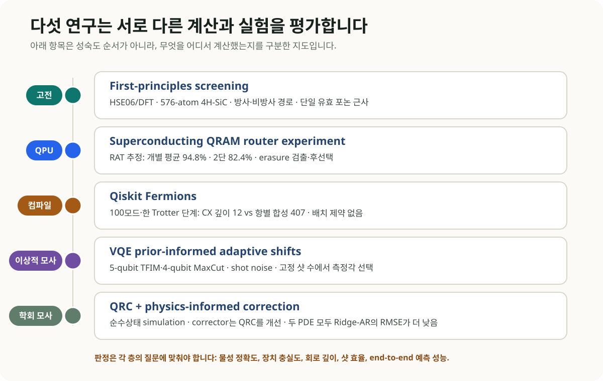
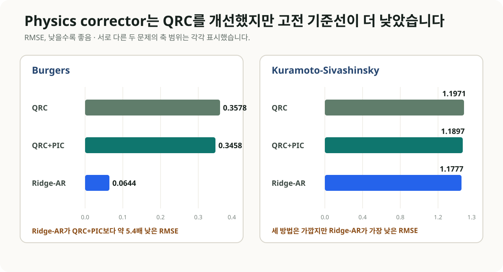

# 재료 계산에서 QRAM까지: 양자 연구를 계산 계층으로 읽는 법

양자컴퓨팅 연구에서 새 재료를 고르는 계산과 양자정보를 전달하는 장치 실험은 서로 다른 질문을 풉니다. 4H-SiC의 결함 후보를 평가한 연구는 빛을 내는 경로와 비방사 손실을 계산했고, 초전도 QRAM 라우터 연구는 주소 상태에 따라 양자정보가 전달되는 과정을 시험했습니다. 회로 합성·VQE 측정·PDE 예측 연구도 각자 바꾼 계산 단계와 얻은 결과를 따라가면, 다음 연구에서 비교할 지표를 구체적으로 읽을 수 있습니다.

*그림 1. AI 생성 개념 일러스트. 왼쪽은 고전 DFT로 평가한 SiC 결함과 광학 경로, 가운데는 초전도 QRAM 라우터, 오른쪽은 페르미온 회로의 합성을 표현합니다. 각각 다른 연구를 나타내며 실제 결함 구조·장치 배치·계산 데이터를 재현한 그림은 아닙니다.*

## 다섯 연구의 대상과 평가 조건

| 연구 | 실행 대상 | 주요 결과 | 해석에 필요한 조건 |
| --- | --- | --- | --- |
| 4H-SiC 결함 선별 <a href="#ref-1">[1]</a> | 고전 HSE06/DFT | 방사·비방사 경로를 함께 평가하고 네 후보 제시 | 저온·단일 유효 포논 모형의 광학 지표 |
| QRAM 라우터 <a href="#ref-2">[2]</a> | 초전도 QPU | 개별 라우터 평균 94.8%, 두 단계 82.4%의 RAT 추정 라우팅 충실도 | erasure 검출·후선택 표본의 감쇠 fit |
| Qiskit Fermions <a href="#ref-3">[3]</a>, <a href="#ref-4">[4]</a> | 컴파일·고전 소프트웨어 | 100모드 예제에서 합성된 CX 깊이 12 | 한 Trotter 단계·장치 배치 제약 없는 비교 |
| VQE PAS <a href="#ref-5">[5]</a> | 이상적 고전 시뮬레이션 | 사전정보로 세 에너지 측정 위치를 선택 | TFIM·MaxCut 모형·샷 잡음만 포함 |
| QRC+PIC <a href="#ref-6">[6]</a> | 순수상태 고전 시뮬레이션 | 물리 보정기가 QRC 자체의 예측 오차를 소폭 감소 | 별도 궤적·5개 seed 평가에서 Ridge-AR의 RMSE가 더 낮음 |

*그림 2. 이 도식은 성숙도 순서를 표시하지 않습니다. 물성 정확도, 장치 충실도, 회로 깊이, 샷 효율, 예측 성능처럼 서로 다른 증거 유형을 각자 맞는 기준으로 평가해야 합니다.*

## 1. SiC 결함 계산: 방사·비방사 경로로 후보를 고른다

2026년 8월 25일 *npj Computational Materials*에 공개된 Iwamoto와 공동연구진의 연구는 4H-SiC에서 빛으로 주소 지정할 스핀 큐비트 결함을 고르는 제일원리 계산 체계를 제시했습니다 <a href="#ref-1">[1]</a>. VASP와 HSE06을 이용한 고전 DFT의 576원자 초격자 계산에서 방사 전이, 포논 곁띠와 비방사 전이를 함께 평가했습니다.

연구진은 NCVSi-1, OCVSi0, FCVSi+1, ClCVSi+1를 유망 후보로 제시했습니다. zero-phonon-line 효율은 각각 8.7%, 11%, 7.9%, 3.4%였습니다. OCVSi0와 ClCVSi+1의 Debye-Waller factor는 10.1%와 3.0%였고, 기존 multimode 계산값 13.4%와 2.12%에 비교했습니다.

제로포논선 효율은 포논을 동반하지 않는 방사율을 총 방사율과 비방사율의 합으로 나눈 값입니다. 비방사 손실을 포함하므로, 격자 변형의 Huang–Rhys 인자 S에서 exp(−S)로 평가한 Debye–Waller 인자와 구별해야 합니다. 이 계산의 효율에는 계간전이·광이온화 같은 추가 완화 경로가 포함되지 않았습니다.

후보 선별에는 저온의 단일 유효 포논 모형과 세 배치의 에너지를 이용하는 근사를 썼습니다. 전자–포논 행렬원소는 배치 좌표를 따라 일정하다고 두되, 네 후보의 값은 각각 계산했습니다. 상세 포논 선모양을 구할 때에는 다중 모드의 기여를, 밴드 가장자리 전이를 다룰 때에는 유한 크기 보정을 별도로 평가해야 합니다.

### OLED 연구에 바로 가져올 부분

인광·TADF 후보도 수직 여기 에너지에 더해 방사율, 비방사 경로와 진동–전자 결합을 살펴야 합니다. 이 지표들이 서로 다른 방향으로 움직일 수 있기 때문입니다. 넓은 화학 공간에서 저비용 근사로 광학 경로를 함께 선별한 뒤 소수 후보를 다중 모드·고정밀 계산과 분광 측정으로 확인하는 설계를 생각할 수 있습니다. 이는 SiC의 결과를 OLED 성능값으로 옮기는 대신 후보 선별 절차에 적용해 보는 리뷰의 제안입니다.

## 2. QRAM 라우터: 초전도 칩에서 시험한 두 단계 라우팅

같은 날 *Physical Review X*에 공개된 Zhang과 공동연구진의 연구는 초전도 프로세서에서 버킷 브리게이드 QRAM의 결맞는 라우터를 구현했습니다 <a href="#ref-2">[2]</a>. 보조 큐트릿 준위를 쓰는 복합 게이트를 설계하고, 주소를 |0⟩·|2⟩ 상태에 부호화했습니다. 라우팅 뒤 주소를 측정해 |1⟩이 검출된 샷을 제외해 일부 오류를 erasure로 표시하고 후선택할 수 있습니다.

무작위 주소 접근 시험(RAT)은 여러 주소·반복 깊이에서 단일 여기 정보를 보낸 뒤 도착 상태의 점유확률이 이상적인 값과 얼마나 일치하는지 측정합니다. 그 일치도의 감쇠를 fit해 추정한 라우팅 충실도는 개별 라우터 세 개의 평균이 94.8%, 두 단계 erasure 구성은 82.4% ± 0.91%였습니다. 같은 시험에서 non-erasure 구성은 81.1% ± 0.30%였습니다. 이 수치는 임의 입력 상태의 과정 충실도나 단일 상태 토모그래피 값과 구별됩니다.

이 실험은 HHL·QML에서 가정하는 결맞는 데이터 라우팅의 작은 하드웨어 구성요소를 시험했습니다. 두 단계의 조건부 충실도와 함께 채택률을 읽어야 하며, 채택률은 반복 깊이에 따라 달라집니다. 더 많은 주소와 메모리 셀을 연결하는 연구에서는 데이터 적재, 오류 검출·정정, 채택 표본을 얻는 반복 비용과 전체 실행시간을 함께 평가해야 합니다.

## 3. Qiskit Fermions: 도메인 구조를 compiler 후단까지 보존한다

IBM이 8월 24일 소개한 Qiskit Fermions는 페르미온 연산자와 회로, 사용자 정의 페르미온–큐비트 매핑과 Qiskit transpiler 연동을 제공하는 오픈소스 도구입니다 <a href="#ref-3">[3]</a>. 페르미온의 국소성과 패리티 구조를 회로 합성 단계까지 유지합니다. ffsim 고전 시뮬레이터와 SQD addon도 연동합니다.

8월 26일까지 공개된 1D Fermi–Hubbard 예제에서는 보조 큐비트 한 개의 flow-set 인코딩으로 4·10·20·50·100개의 페르미온 모드를 다뤘습니다 <a href="#ref-3">[3]</a>. 한 Trotter 단계의 구조를 이용해 합성한 CX 깊이는 12였고, 같은 100모드 예제의 항별 Lie–Trotter 합성은 407이었습니다. 두 경로는 같은 사용자 정의 인코딩을 사용하므로, 이 비율을 서로 다른 인코딩의 일반적인 우열로 해석해서는 안 됩니다. U·CX 게이트 기준이며 물리 장치의 배치·연결 제약을 넣기 전의 깊이입니다.

flow-set의 국소 인코딩 원리는 페르미온 동역학 합성 연구와 연결됩니다 <a href="#ref-4">[4]</a>. 구조를 입력에 남기는 데 더해 합성기가 연산자 그룹의 교환성을 활용해야 일정한 깊이를 얻습니다. CX 개수는 두 방식 모두 모드 수에 따라 증가하며, 전체 시간 발전에 필요한 Trotter 단계 수와 정확도도 별도로 정해야 합니다. Classiq 같은 합성 플랫폼을 평가할 때에도 최종 게이트 수와 함께 어떤 구조 정보가 입력에 남았고 합성기가 그것을 어떻게 이용했는지 확인할 필요가 있습니다.

## 4. VQE 최적화: 사전정보로 에너지 측정 위치를 고른다

8월 21일 제출된 PAS(prior-informed adaptive shifts) 프리프린트는 Rotosolve/NFT 계열의 세 에너지 측정 위치를 조절합니다 <a href="#ref-5">[5]</a>. 최솟값의 위치에 대한 von Mises 사전분포가 약할 때 각도 간격을 2π/3 부근에 두고, 확신이 커질수록 π/2 쪽으로 이동시킵니다. 한 파라미터에 대한 에너지 곡선을 세 점으로 추정할 때, 같은 측정 횟수로 어떤 각도를 고르는 것이 유리한지 묻는 방식입니다.

검증은 샷 잡음만 포함한 Qiskit의 이상적 시뮬레이션에서 수행했습니다. 5큐비트 횡자기장 Ising 모형의 3층 EfficientSU2 ansatz는 파라미터 40개, 4큐비트 MaxCut의 5층 hardware-efficient ansatz는 20개였습니다. 각 에너지 관측의 샷 수를 고정하고 파라미터 갱신마다 새로 세 번 측정하므로, PAS가 조절하는 것은 측정 각도입니다. 파라미터별 샷 수 배분이나 장치 잡음·드리프트의 최적화와는 다른 문제입니다.

## 5. QML에서 간단한 고전 기준선이 결론을 바꾼 사례

QNRL@WCCI 2026 채택 논문으로 소개된 프리프린트는 양자 리저버 컴퓨팅(QRC)으로 축소된 PDE 모형의 적합직교분해(POD) 계수를 예측하고, 물리 기반 보정기(PIC)로 후처리했습니다 <a href="#ref-6">[6]</a>. 순수상태 QRC를 고전적으로 모사한 결과입니다.

Kuramoto–Sivashinsky 문제에서 QRC의 RMSE는 1.1971, QRC+PIC는 1.1897로 개선됐습니다. Ridge-AR는 1.1777로 더 낮았습니다. Burgers 문제에서는 QRC 0.3578, QRC+PIC 0.3458, Ridge-AR 0.0644였습니다. 다섯 seed로 학습에서 제외한 별도 궤적을 평가한 결과이며, POD·정규화는 훈련 자료로 정하고 모형 선택에는 검증 자료를 썼습니다.

*그림 3. PIC는 QRC 자체를 개선했지만 두 문제 모두 Ridge-AR가 더 낮은 RMSE를 기록했습니다. 두 패널은 문제별 값의 차이를 보이기 위해 서로 다른 축 범위를 사용합니다.*

이 비교에서는 PIC의 보정 효과와 QRC 자체의 예측력을 나누어 볼 수 있습니다. 산업 CFD에 적용해 볼 부분은 물리 기반 보정을 독립 모듈로 두는 구조입니다. 이를 발전시키려면 같은 데이터 분할과 계산 예산에서 Ridge/AR와 operator learning, 신경망 PDE 해법을 함께 비교하는 것이 좋겠습니다.

## DFT·ML·OLED 업무에서 남길 평가 원장

오늘의 결과를 실제 연구 workflow에 넣으려면 각 계산층의 지표를 분리해 기록해야 합니다.

1. **재료 screening:** 에너지 오차와 함께 방사율, 비방사율, vibronic coupling, 실험 spectrum·lifetime을 기록합니다.
2. **양자화학 회로:** active space, mapping, compiled two-qubit depth, routing, fidelity, shots, total wall-clock을 함께 남깁니다.
3. **VQE:** 측정 각도와 갱신 수, 각 에너지 관측의 shots, drift, error mitigation과 고전 최적화 비용을 함께 기록합니다. PAS의 각도 선택과 일반적인 샷 수 배분을 구별합니다.
4. **QML·PDE:** 간단한 Ridge/AR부터 강한 operator-learning baseline까지 동일한 split과 compute budget으로 비교합니다.
5. **주장의 층:** 실제 QPU, noisy/ideal simulator, 고전 emulation, quantum-inspired 방법, compiler-only 결과를 표의 별도 열로 둡니다.

## 결론

OLED·재료 연구에 먼저 옮겨 볼 것은 방사·비방사 경로를 함께 선별하는 절차와 페르미온 구조를 합성기가 활용하도록 유지하는 설계입니다. 필요한 광학 물성과 회로 정확도를 정한 뒤, 그 계산에서 줄인 비용과 다음 단계에 남는 비용을 이어서 평가할 수 있습니다. 라우터의 조건부 충실도, 에너지 측정 각도와 PDE 예측 오차도 각각의 표본·측정·계산 예산과 함께 읽을 때 연구 과정의 어느 부분이 달라졌는지 드러납니다.

## 수정 이력과 작성·검증

원 발행일과 근거 기준일은 2026-08-26입니다. 2026-11-06에는 같은 연구의 원문과 당시 공개 소프트웨어 자료를 대조해 문체·인용·평가 조건을 개편했습니다. QRAM의 non-erasure 값을 원문에 따라 81.9%에서 81.1% ± 0.30%로 정정하고 RAT 추정량을 밝혔습니다. 회로 깊이 12·407은 같은 인코딩의 한 Trotter 단계 합성 비교로, PAS는 고정 샷 수에서 측정각을 고르는 방법으로 설명을 좁혔습니다. SiC 효율의 정의와 근사, QRC의 평가 조건을 보완했습니다.

원 작성 보조는 Codex 기반 GPT-5 계열 하네스였으며 정확한 모델·개별 역할·세부 검증 기록은 보존되지 않았습니다. 이번 개정은 OpenAI Codex가 보조했습니다. root는 전체 원고·APS 통합과 빌드·게시 확인, legacy1106_materials_router는 SiC·QRAM 원문과 지표 대조, legacy1106_algorithms는 회로 합성·PAS·QRC의 판본·방법·서지 대조, legacy1106_prose_output은 독립 문체·공개 PDF와 최종 출력 감수를 맡았습니다. 공통 편집 하네스 2026.08과 현행 문체·과학 설명·APS 기준을 적용했습니다. 원 논문 계산·장치 실험·모형 학습의 독립 재현이나 사람 독자 평가는 수행하지 않았습니다.

연결된 8월 26일 DQB 4쪽은 발행 당시의 과학 기록입니다. 이번 공개 사본에서는 수집·소셜 경위와 내부 메모·Author 정보를 정리하고 과학 본문·수치·원문 링크를 보존했습니다. 이 웹 리뷰의 정정은 위 수정 이력에 기록했습니다.

## 참고문헌

<ol class="references" style="list-style:none;padding-left:0">
<li id="ref-1">[1] <a href="https://doi.org/10.1038/s41524-026-02267-8">S. Iwamoto, M. Hara, H. Watanabe, and T. Kobayashi, Unified first-principles framework for predicting radiative and non-radiative processes in color centers, npj Comput. Mater. 12, 263 (2026).</a></li>
<li id="ref-2">[2] <a href="https://doi.org/10.1103/h5m3-qrn9">S. Zhang et al., Demonstrating coherent quantum routers for bucket-brigade quantum random access memory on a superconducting processor, Phys. Rev. X 16, 031051 (2026).</a></li>
<li id="ref-3">[3] <a href="https://www.ibm.com/quantum/blog/qiskit-fermions">M. Rossmannek, J. Glick, and R. Davis, Qiskit Fermions: a modular toolbox for fermionic systems, IBM Quantum Computing Blog (August 24, 2026)</a>; <a href="https://github.com/Qiskit/qiskit-fermions/tree/cd27fcf1e73c0606ef81d11ee3428f8658a06c9d">M. Rossmannek, Qiskit Fermions (2026), commit cd27fcf1e73c0606ef81d11ee3428f8658a06c9d.</a></li>
<li id="ref-4">[4] <a href="https://arxiv.org/abs/2512.11418v2">A. Gandon, S. Piccinelli, M. Rossmannek, F. Tacchino, A. Baiardi, J. Nys, and I. Tavernelli, Stabilizer-based quantum simulation of fermion dynamics with local qubit encodings, arXiv:2512.11418v2 (2026).</a></li>
<li id="ref-5">[5] <a href="https://arxiv.org/abs/2608.21616v1">F. Stalschus, S. Pedrielli, S. Kühn, K. Jansen, K. A. Nicoli, and S. Nakajima, Prior-informed adaptive shifts for sequential minimal optimization in variational quantum eigensolvers, arXiv:2608.21616v1 (2026).</a></li>
<li id="ref-6">[6] <a href="https://arxiv.org/abs/2608.23119v1">K. Bhatia, Harsh, and S. Devendrababu, Quantum reservoir computing with physics-informed correction for reduced-order PDE forecasting, arXiv:2608.23119v1 (2026).</a></li>
</ol>
