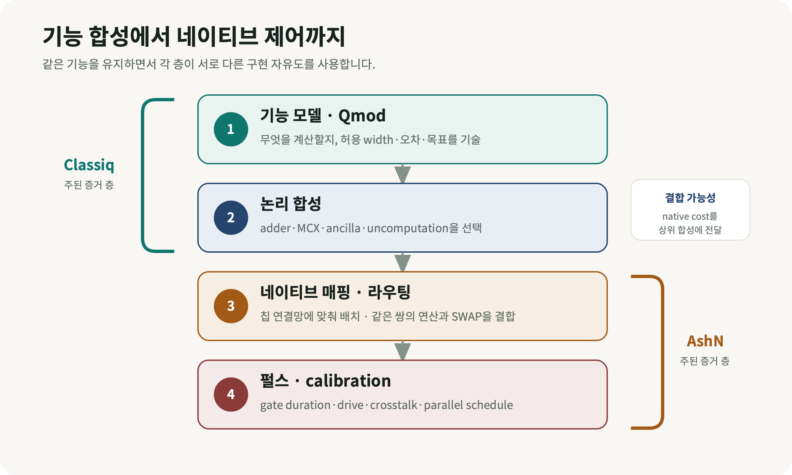
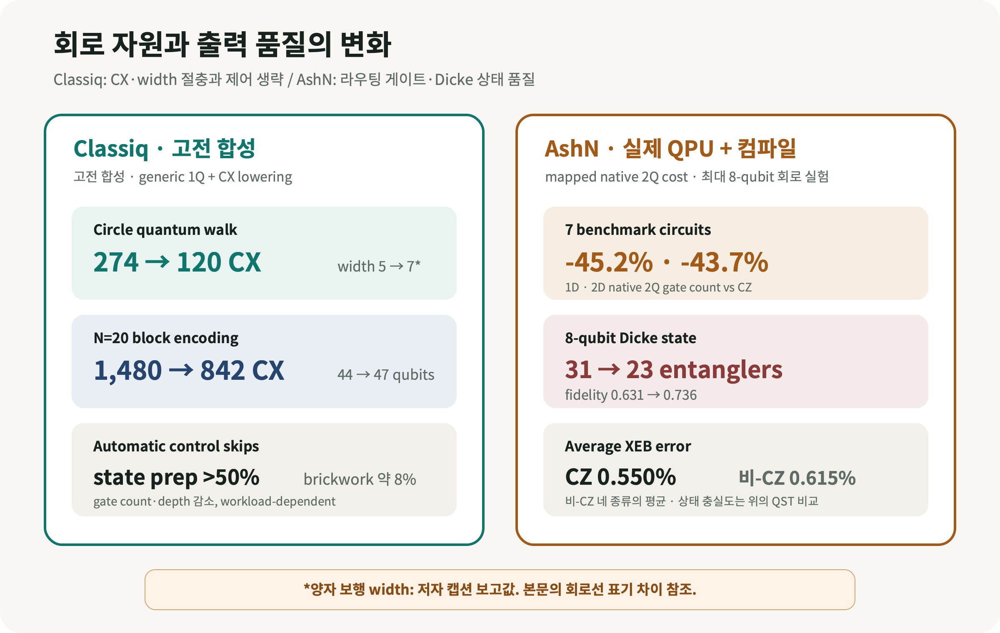

# 양자 회로 최적화는 왜 필요한가: Classiq와 AshN을 대표 사례로

양자 알고리즘의 회로도에서는 두 큐비트를 선 하나로 연결하면 됩니다. 실제 초전도 칩에서 멀리 떨어진 두 큐비트를 연산에 참여시키려면 상태를 옮기는 게이트가 더 필요합니다. 이 이동도 시간을 쓰고 오류를 더합니다. 회로를 짧게 만드는 일에는 계산을 구현하는 방법과 칩 위에서 실행하는 방법이 함께 들어 있습니다.

Classiq의 고수준 합성은 보조 큐비트를 얼마나 쓰고 함수를 어떤 회로로 구현할지 선택합니다.<a href="#ref-1">[1]</a> AshN 연구는 초전도 장치가 직접 실행하는 2-큐비트 연산을 풍부하게 만들어, 계산과 상태 이동을 한 동작에 담습니다.<a href="#ref-2">[2]</a> 같은 계산에 남아 있는 구현의 자유를 서로 다른 위치에서 사용하는 셈입니다.

두 사례를 따라가면 회로 비용을 줄이는 선택이 구체적으로 보입니다. Classiq의 양자 보행 사례에서는 보조 큐비트를 더 허용할 때 CX 게이트가 274개에서 120개로 줄었습니다. AshN에서는 라우팅에 필요한 연산을 흡수한 회로를 실제 QPU에서 실행해 상태 충실도가 개선됐습니다. 큐비트 수, 게이트 수, 실행시간과 출력 정확도 사이에서 무엇을 얻고 무엇을 더 써야 하는지 살펴보겠습니다.

*그림 1. AI 생성 개념 일러스트. 왼쪽의 기능 모델과 회로 후보가 가운데의 합성·라우팅을 거쳐 오른쪽 초전도 프로세서의 네이티브 제어로 이어집니다.*

## 먼저 큰 그림: 양자 회로 최적화는 여러 층에서 일어난다

- **문제 표현·알고리즘 설계:** encoding, ansatz, block encoding과 state preparation 구조를 바꿔 필요한 logical qubit·query·iteration을 줄입니다.
- **고수준 합성:** 같은 함수를 구현하는 회로 후보와 ancilla·uncomputation 전략을 전역 자원 제약 아래 선택합니다.
- **논리 게이트 재작성:** cancellation, commutation, template rewriting과 control simplification으로 동일 unitary의 gate count·depth를 줄입니다.
- **배치·라우팅:** logical-to-physical mapping과 SWAP network를 hardware topology에 맞게 최적화합니다.
- **네이티브 게이트·펄스:** backend가 직접 실행할 gate family, decomposition, pulse fusion·scheduling과 calibration cost를 함께 고려합니다.
- **fault-tolerant 논리 자원:** 오류보정 단계에서는 logical T/Toffoli count·depth와 전체 시공간 자원이 주요 목적함수가 됩니다.

Classiq은 주로 고수준 합성과 제어 패턴을, AshN은 네이티브 게이트와 라우팅을 다룹니다. 두 연구에서 평가한 대상과 지표를 나누어 보면 각 결과가 답하는 질문을 이해하기 쉽습니다.

| 항목 | Classiq 계열 연구 | AshN 연구 |
| --- | --- | --- |
| 분류 | [프리프린트] 고전 컴파일·회로 합성 | [프리프린트] 실제 QPU 실험 + 고전 컴파일 확장 연구 |
| 줄이는 위치 | 기능 모델, 함수 구현, 제어 패턴, ancilla 배치 | 네이티브 2-큐비트 게이트, topology-aware routing |
| 대표 지표 | CX **개수**·qubit width, 일부 연구의 gate count·depth | mapped native 2Q gate count, 2Q depth overhead, 실제 state fidelity |
| 실제 QPU | 대표 합성·control-skip 결과에는 없음 | 최대 8-qubit 회로 실험, 12-qubit chain·3×3 array에서 gate calibration |
| 설계의 선택 | 함수 구현과 보조 큐비트 배분 | 계산 게이트와 상태 이동의 결합 |

Classiq 합성 사례의 274→120과 1,480→842는 **CX 개수**이며, 함께 늘어난 qubit width는 회로가 사용하는 큐비트 수입니다. 별도의 automatic control-skip 연구는 게이트 개수와 깊이를 평가합니다. AshN의 45.2%·43.7%는 칩 연결망에 맞춰 변환한 **네이티브 2-큐비트 게이트 개수**의 감소율입니다. 각 지표가 계산의 어느 비용을 세는지 구별하는 것이 비교의 출발점입니다.

## 1. 연구 배경: 왜 양자 회로 최적화가 필요한가

양자 알고리즘 책에서는 멀리 떨어진 두 논리 큐비트도 선 하나로 연결해 gate를 그릴 수 있습니다. 실제 초전도 칩은 대개 평면 위의 이웃한 물리 큐비트끼리만 직접 상호작용합니다. 논리 큐비트 A와 B가 서로 만나야 하는데 칩에서 떨어져 있다면, compiler는 SWAP을 넣어 상태의 위치를 옮깁니다. SWAP 자체도 여러 entangling gate로 분해되므로 gate count, mapped depth와 누적 오류가 늘어납니다.

이때 최종 자원량은 알고리즘을 구현하고 장치에 배치하는 여러 선택을 거쳐 정해집니다.

1. 덧셈·MCX·state preparation을 어떤 회로로 구현했는가
2. ancilla qubit를 더 써서 gate를 줄일 것인가, qubit를 아끼고 gate를 늘릴 것인가
3. 칩의 coupling graph에서 논리 qubit를 어디에 배치하고 어떻게 옮길 것인가
4. CZ·iSWAP·AshN처럼 어떤 동작을 native gate로 직접 실행할 수 있는가
5. 각 gate의 pulse duration, calibration error와 병렬 실행 가능성이 어떠한가

*그림 2. 기능 모델에서 펄스 제어까지 내려가는 최적화의 네 층을 리뷰에서 재구성했습니다. 왼쪽 괄호는 Classiq의 기능·논리 합성, 오른쪽은 AshN의 네이티브 라우팅·제어 범위를 표시합니다.<a href="#ref-1">[1]</a>, <a href="#ref-2">[2]</a>*

### ‘회로 깊이’도 세 종류로 나눠야 한다

**Logical depth**는 칩의 연결망을 적용하기 전 병렬 gate layer의 수입니다. **Mapped 또는 transpiled depth**는 native decomposition과 SWAP routing을 넣은 뒤의 layer 수입니다. **실제 실행시간**은 각 pulse의 길이, 동시에 실행할 수 없는 gate, 제어 지연, reset·measurement까지 포함합니다.

같은 2-큐비트 게이트 한 개라도 펄스 길이는 다를 수 있습니다. 게이트가 더 많은 회로도 병렬 실행이 잘 되면 빨리 끝납니다. Tremba 등은 장치별 게이트 시간으로 추정한 회로 실행시간을 비교했습니다. 이 비교에서는 단순 깊이보다 장치의 평균 게이트 시간을 반영한 gate-aware depth가 더 나은 예측을 주었습니다.<a href="#ref-3">[3]</a> AshN의 게이트 개수 감소를 실제 시간 절약으로 연결하려면, 네이티브 게이트의 길이와 병렬 실행 제약을 더 살펴야 합니다.<a href="#ref-2">[2]</a>

## 2. Classiq은 위쪽에서 구현을 고른다

### Qmod와 EDA식 합성: 먼저 기능을 쓰고 나중에 회로를 정한다

전통적인 transpiler는 이미 gate circuit으로 구체화된 입력을 받아 gate를 취소하고, qubit를 배치하고, backend gate set으로 분해합니다. 이 단계에 오면 “QFT adder와 ripple-carry adder 중 어느 것을 쓸까”, “MCX에 ancilla를 몇 개 줄까” 같은 큰 설계 결정은 대부분 끝난 상태입니다.

Classiq의 Qmod는 사용자가 “이 숫자를 증가시켜라”, “이 함수를 제어하라”, “최대 width는 얼마다”, “CX를 줄여라”처럼 기능과 제약을 기술하도록 합니다.<a href="#ref-4">[4]</a> 합성 엔진은 함수마다 가능한 구현, ancilla allocation·reuse, uncomputation과 전역 자원 제약을 함께 탐색합니다. 고전 반도체 설계에서 RTL·logic·physical implementation을 차례로 정하는 EDA와 닮은 접근입니다.

Goldfriend 등의 *Design and synthesis of scalable quantum programs* v2(2025년 1월 22일)는 구현 선택이 자원을 어떻게 바꾸는지 두 예로 보여줍니다.<a href="#ref-1">[1]</a>

- 원 논문 그림 1의 원형 양자 보행(circular quantum walk) 사례에서, 저자가 보고한 width 최소화 결과는 **5 qubits·274 CX**, CX를 줄이도록 합성한 결과는 **7 qubits·120 CX**였습니다. qubit 두 개를 더 써 CX를 56.2% 줄인 절충입니다.
- N=20 block-encoding에서는 QFT-adder 계열이 **44 qubits·1,480 CX**, ripple-carry 계열이 **47 qubits·842 CX**였습니다. qubit 세 개를 더 써 CX를 43.1% 줄였습니다.

큐비트를 더 쓰는 대신 CX를 줄이는 선택입니다. 이처럼 한 비용을 낮추려면 다른 자원이 더 필요한 관계를 **Pareto 절충**으로 표현합니다. 실험에는 Classiq 0.60.0, Qiskit 1.2.4, PyTKET 1.34.0, PennyLane 0.39.0과 Catalyst 0.9.0이 사용됐고, 모두 1-qubit gate와 CX로 낮춰 비교했습니다. 컴파일은 Apple M1 Pro 한 대에서 실행됐으며, 비교 대상은 이 고전 합성에서 얻은 회로 자원입니다. 실제 장치의 잡음·펄스 시간·출력 충실도 평가는 별도 실험으로 이어집니다.

원 논문 그림 1의 캡션은 width를 5·7로 보고하지만, 회로도에는 위치 레지스터와 coin을 합쳐 6개, 보조 큐비트까지 합쳐 8개 선이 그려져 있습니다. 여기서는 캡션의 보고값을 유지했습니다. 전체 큐비트 예산을 다시 산정할 때에는 이 표기 차이를 확인해야 합니다.<a href="#ref-1">[1]</a>

논문 v2는 Qiskit과 PennyLane의 가파른 곡선 일부가 controlled-MCX를 더 큰 MCX로 인식하지 못한 baseline 구현에서 비롯됐을 수 있다고 스스로 설명합니다. 각 도구에 더 효율적인 ad hoc MCX 구현이 있다는 점도 적었습니다. 비교 도구의 구현 선택도 결과를 바꾸는 조건입니다. 이 사례의 설계상 이점은 **보조 큐비트와 함수 구현을 함께 선택할 수 있다는 것**이며, 같은 아이디어를 다른 합성기와 비교할 때에도 각 도구에서 어떤 구현을 허용했는지 확인해야 합니다.

### Automatic control skips: 제어하지 않아도 되는 부분을 찾는다

2025년 5월 23일 공개된 Emanuel 등의 *Efficient Quantum Control via Automatic Control Skips*는 함수 바깥의 제어 조건에서 비용을 줄입니다.<a href="#ref-5">[5]</a> 양자 프로그램에서 `if`와 비슷한 coherent control은 비쌉니다. single-qubit gate에 control 하나가 붙으면 2-qubit gate가 되고, multi-control은 더 많은 native gate로 분해됩니다.

하지만 계산과 uncomputation이 한 쌍으로 감싸는 구조에서는 모든 gate에 control을 붙일 필요가 없습니다. $U,V$가 작용하는 레지스터 바깥에 제어 큐비트를 두면 다음 관계가 성립합니다.

$$\mathrm{ctrl}(U^\dagger VU)=U^\dagger\,\mathrm{ctrl}(V)\,U$$

쉬운 비유로 말하면, 작업대를 준비하는 단계 $U$와 치우는 단계 $U^\dagger$는 control branch가 어느 쪽이든 실행해도 최종 효과가 상쇄됩니다. 실제로 조건을 걸어야 하는 중심 작업 $V$에만 control을 남길 수 있습니다. Classiq 연구진은 이런 conjugation pair 가운데 동시에 건너뛰어도 안전하고 비용 절감이 큰 조합을 찾는 문제를 Max Conjugation Pairs로 만들었습니다. 최적해 탐색은 일반적으로 NP-hard이지만, 비가환 관계의 구조를 이용한 동적 계획법으로 다항시간 근사 알고리즘을 구성했습니다.

Qiskit 1.2.4 basis로 transpile한 고전 회로 실험에서 state-preparation 사례는 gate count와 depth가 **50% 넘게** 줄 수 있었고, random brickwork circuit은 약 **8%** 감소했습니다. 제어를 생략할 수 있는 쌍이 얼마나 있는지에 따라 절감 폭이 달라집니다. 저자들은 알고리즘별로 세심하게 만든 구현 위에 이 일반적인 패스를 더하는 활용을 제안합니다. 이 수치 역시 고전 컴파일 평가에서 얻었습니다.<a href="#ref-5">[5]</a>

## 3. AshN은 아래쪽에서 ‘이동과 계산’을 합친다

2026년 8월 25일 공개된 Wang 등의 프리프린트는 상태 이동의 비용을 물리 게이트에서 줄입니다.<a href="#ref-2">[2]</a> 기존 CZ 중심 gate set에서는 멀리 떨어진 논리 qubit를 만나게 하려고 SWAP을 넣고, 그 SWAP을 여러 native entangler로 분해합니다. 연구진은 “물리 coupler를 더 만들지 않고, 기존 edge 하나가 할 수 있는 일을 늘리면 어떨까”라고 묻습니다.

임의의 2-qubit unitary는 전역 위상을 제외하면 KAK 분해를 통해 앞뒤의 single-qubit rotation과 다음 비국소 핵심으로 나눌 수 있습니다. $X,Y,Z$는 각 큐비트의 Pauli 연산자이고, $a,b,c$는 두 큐비트 사이 상호작용의 세 성분을 정합니다.

$$U=(O_1\otimes O_2)\,e^{i(aXX+bYY+cZZ)}\,(O'_1\otimes O'_2)$$

AshN 제어의 이론은 Chen 등이 제시했습니다.<a href="#ref-6">[6]</a> 조절 가능한 교환 상호작용과 두 큐비트의 동시 마이크로파 구동을 이용합니다. 두 큐비트 연산의 비국소 성분을 모아 놓은 Weyl chamber에서, 구동 세기와 시간 등을 바꾸어 원하는 게이트를 만듭니다.

이 자유를 라우팅에 쓰는 대수적 이유는 간단합니다. 같은 물리 큐비트 쌍에서 논리 연산 $U$를 실행한 뒤 SWAP으로 상태를 바꾼다면, 합성된 연산 $\mathrm{SWAP}\,U$도 하나의 2-큐비트 유니터리입니다. 이를 앞뒤의 단일 큐비트 회전과 AshN 동작 한 번으로 실행한 뒤 논리–물리 큐비트의 대응을 갱신하면, 별도로 실행할 SWAP과 그에 필요한 게이트 층을 흡수할 수 있습니다.

연구진은 SABRE를 gate-set-aware하게 확장한 MirrorSABRE로 앞으로 필요한 qubit 거리와 SWAP 흡수 가능성을 함께 평가했습니다.<a href="#ref-2">[2]</a> 실제 장치에서는 12-qubit chain과 3×3 array에 필요한 AshN gate를 병렬 calibration했고, 회로 실험은 현재 CZ 회로가 너무 깊어지는 한계 때문에 최대 7-qubit benchmark와 8-qubit Dicke-state preparation에 집중했습니다.

### 실제 QPU에서 확인된 숫자

- 일곱 benchmark circuit에서 CZ compilation 대비 mapped 2-qubit gate count의 geometric-mean 감소는 **1D 45.2%, 2D 43.7%**였습니다.
- defect-free 2×4 topology의 8-qubit two-excitation Dicke state는 AshN이 **23 entangling gates**, CZ가 **31 gates**를 사용했습니다.
- 읽기 오류를 보정한 양자 상태 토모그래피(QST)에서 Dicke-state fidelity는 AshN **0.736±0.001**, CZ **0.631±0.001**였습니다.
- fully PPT entanglement witness는 AshN 상태에서 **−0.0344±0.0008**로 genuine multipartite entanglement를 인증했지만, CZ 상태의 **0.0593±0.0008**에서는 같은 인증에 실패했습니다.
- CZ의 평균 XEB error는 **0.550%**, iSWAP·√iSWAP·SWAP·B-like AshN gate의 평균은 **0.615%**였습니다. 0.615%는 비-CZ 네 종류의 평균이며, CZ도 이 실험의 AshN 게이트 집합에 포함됩니다. 이 평균 비교에서는 비-CZ 게이트의 오류가 약간 높았지만, entangler를 적게 쓰는 회로의 최종 상태 품질이 더 좋았습니다.

*그림 3. 원 논문의 보고값을 리뷰에서 재도표했습니다. 왼쪽은 고전 합성에서 얻은 CX 개수·width 절충과 control-skip의 절감률, 오른쪽은 CZ 기준 AshN의 네이티브 2-큐비트 게이트 감소율, 결함 없는 2×4 배치에서 판독 오류를 보정한 Dicke 상태 충실도, CZ와 비-CZ 네 종류의 평균 XEB 오류입니다. 양자 보행의 width는 원 논문 캡션의 5·7을 따릅니다.<a href="#ref-1">[1]</a>, <a href="#ref-2">[2]</a>, <a href="#ref-5">[5]</a>*

더 큰 수십-qubit·수천 2-qubit-gate 사례는 **고전 compilation-only** 연구입니다. 2D에서 각 게이트 집합의 all-to-all reference 대비 routing overhead의 geometric mean이 CZ의 gate count 1.65×·2Q depth 1.86×에서 AshN의 1.13×·1.24×로 낮아졌습니다. 여기서 all-to-all 기준 회로는 모든 큐비트 쌍의 직접 연결을 허용해 컴파일한 참조입니다. 제한된 연결망에서 추가된 게이트와 깊이를 그 참조로 나눈 값입니다.<a href="#ref-2">[2]</a>

### 흡수 기회를 정하는 회로 구조

SWAP 흡수는 회로 구조에 의존합니다. 같은 물리 큐비트 쌍의 연산 $U$와 SWAP이 연달아 만나는 구조에는 기회가 많지만, 상호작용 파트너가 매 층 빠르게 바뀌는 quantum-volume 회로에서는 흡수할 게이트가 적었습니다. calibration을 시험한 12-qubit chain과 3×3 array를 넘어 칩을 키우려면, 동시 구동의 crosstalk, 시간에 따른 drift와 보정 시간을 함께 평가해야 합니다. 오류보정된 연산으로 확장할 때에는 이 제어 방식이 논리 오류율과 자원에 미치는 영향도 새로운 평가 대상입니다.<a href="#ref-2">[2]</a>

## 4. 두 대표 사례는 왜 닮았고, 어디가 다른가

두 접근의 공통 철학은 **동일 기능의 구현 자유도를 너무 일찍 버리지 않는다**는 것입니다.

- Classiq은 “adder는 이 회로”, “MCX는 이 decomposition”이라고 미리 고정하지 않고 함수 구현과 ancilla를 전역 제약 아래 선택합니다.
- control-skip compiler는 모든 subcircuit에 control을 기계적으로 붙이지 않고, 같은 unitary를 만드는 더 싼 표현을 찾습니다.
- AshN은 “2-qubit operation은 CZ의 반복”, “routing은 별도 SWAP”이라고 고정하지 않고 $\mathrm{SWAP}\,U$를 native control 한 번으로 합칩니다.

차이는 최적화 레버입니다. Classiq의 대표 증거는 generic 1Q+CX로 낮춘 **고전 합성 결과**이고, AshN의 중심 증거는 특정 superconducting hardware의 gate family·topology·calibration까지 포함한 **제한된 QPU 실험**입니다. Classiq 논문은 connectivity가 구현 선택에 중요하다고 논의하지만 대표 수치에서 physical coupling graph의 routing 비용을 검증하지 않았습니다. AshN 논문은 그 routing 비용 자체를 중심 문제로 삼았습니다.

## 5. 발전 방향: 개별 최적화에서 교차 계층 공동 최적화로

두 사례를 연결하는 다음 설계 과제는 합성기, 게이트 재작성 패스, 라우터와 펄스 최적화기가 같은 하드웨어·응용 비용 모형을 공유하도록 하는 것입니다. 아래 흐름은 Classiq과 AshN을 사용한 하나의 대표적 결합 예이며, 실제 stack에는 다른 synthesizer·mapper·native gate와 fault-tolerant compiler가 들어갈 수 있습니다.

1. Qmod 같은 functional model에서 필요한 계산과 허용 오차를 기술합니다.
2. high-level synthesis가 QFT/ripple-carry, MCX, ancilla·uncomputation 전략을 고릅니다.
3. backend cost model이 단순한 ‘CX 한 개=1’ 대신 실제 topology, AshN gate duration·error, calibration availability를 반영합니다.
4. native-gate-aware router가 남은 $U+$SWAP을 흡수합니다.
5. pulse scheduler가 crosstalk과 병렬 실행을 포함한 실제 시간을 계산합니다.

이 흐름은 두 논문의 개별 결과를 바탕으로 제안하는 결합 실험입니다. 상위 합성에서 선택한 보조 큐비트가 라우팅을 얼마나 늘리는지, 라우팅에서 절약한 게이트가 긴 펄스를 얼마나 상쇄하는지를 전체 실행으로 확인할 수 있습니다.

## 6. QAOA·양자화학·재료 계산에서 어떻게 시험할까

양자화학·재료 계산에서는 에너지 오차나 상태 준비 품질을 유지하면서 회로 비용을 줄이는지가 중요합니다. 같은 기능을 각 최적화 층에 통과시켜 보면 어느 단계의 절감이 최종 결과에 남는지 확인할 수 있습니다.

| 연구 회로 | Classiq 계열에서 볼 것 | AshN 계열에서 볼 것 | 반드시 함께 볼 고전·실험 지표 |
| --- | --- | --- | --- |
| QAOA MaxCut·QUBO | mixer·cost implementation, ancilla, logical CX count | problem graph와 chip graph 불일치, SWAP absorption | approximation ratio, shots, compile time, scheduled duration |
| UCC·ADAPT-VQE | excitation·control·uncomputation 합성 | fermionic routing과 반복 interaction 구조 | energy error, 2Q count/depth, measurement cost, wall-clock |
| QPE·block encoding | arithmetic·MCX·state preparation의 width–CX 절충 | controlled unitary의 physical routing | logical error budget, T/Clifford cost, success probability |
| Dicke·correlated state | state-preparation 회로 후보 | entangler 수와 topology defect 내성 | tomography fidelity, witness, calibration drift |

가장 공정한 실험은 동일한 logical workload를 고정하고 세 경로를 비교하는 것입니다. (A) CZ baseline compiler, (B) Classiq식 high-level synthesis 후 같은 CZ backend, (C) 같은 functional model을 AshN-aware backend까지 내린 경로입니다. 각 경로에서 logical 2Q count/depth, mapped native count/depth, SWAP 수, scheduled pulse duration, per-gate error, output fidelity·energy error, compile·calibration time과 전체 shot wall-clock을 모두 기록해야 합니다.

QAOA에서는 상호작용을 어떤 순서로 배치하느냐와 칩의 연결망이 중요합니다. AshN 보충자료의 조밀한 Sherrington–Kirkpatrick 모형에서는 1D의 상호작용–SWAP 순서가 잘 맞아 높은 흡수율을 얻었습니다. 반면 파트너가 매 층 빠르게 바뀌는 무작위 회로에서는 흡수 기회가 적었습니다. 조밀함 자체보다 연산 순서·연결망·라우터의 탐색이 함께 결과를 정합니다.<a href="#ref-2">[2]</a>

양자화학에는 Jordan–Wigner의 parity chain이나 fermionic-swap network처럼 반복되는 구조가 있습니다. AshN 보충자료에는 H₂ 화학 회로의 고전 컴파일 평가도 포함됩니다. 이를 출발점으로 OLED 활성공간 회로를 시험한다면, 실제 장치에서의 에너지 오차와 측정 비용까지 연결해 어느 구조에서 이득이 남는지 살펴볼 수 있습니다.

## 7. 최적화의 효과는 다음 층에서 다시 평가된다

Classiq의 보조 큐비트 선택은 논리 CX를 줄이고, control skips는 제어가 필요한 부분을 좁힙니다. AshN은 상태 이동을 계산과 묶어 실제 초전도 회로의 entangler 수와 출력 품질을 개선했습니다. 구현을 결정하는 시점과 선택지를 달리하면, 같은 계산도 다른 자원 요구량을 갖게 됩니다.

이때 앞 단계의 절감이 다음 단계에서 그대로 남는지 확인해야 합니다. 보조 큐비트는 칩 위에서 자리를 차지하고, 짧아진 게이트 목록은 펄스 길이·병렬성·보정 비용에 따라 다른 실행시간을 갖습니다. 그래서 알고리즘의 출력 오차와 자원 비용을 함께 두고, 합성에서 펄스까지 같은 계산을 추적하는 평가가 필요합니다.

## 결론: 최적화는 연결된 설계 문제다

Classiq과 AshN을 함께 읽으며 흥미로운 점은 회로도 바깥의 선택이 회로의 크기를 정한다는 것입니다. 어떤 함수를 보조 큐비트와 함께 구현할지, 칩의 두 큐비트가 한 번에 어떤 연산을 할 수 있을지가 게이트 수와 연결됩니다. 양자 회로 최적화는 이 선택들을 이어 주는 설계 문제입니다.

가까운 시기의 검증에서는 동일한 계산에 대해 네이티브 2-큐비트 개수와 mapped depth, 펄스 실행시간, 출력 오차, 컴파일·보정·측정 시간을 함께 비교할 수 있습니다. 오류보정 단계에서는 논리 T/Toffoli 비용과 시공간 자원으로 평가가 이어집니다. 연구자가 원하는 정확도 안에서 한 번의 계산을 마치는 데 무엇이 얼마나 드는지까지 따라갈 때, 각 층의 최적화가 응용에 주는 가치를 판단할 수 있을 것입니다.

## 수정 이력과 작성·검증

원 발행일과 근거 기준일은 2026-08-27입니다. 2026-11-07에는 당시 공개된 원문과 보충자료를 대조해 문체·캡션·APS 인용을 개편했습니다. 양자 보행의 width를 저자 보고값으로 명시하고 원문 회로선 표기와의 차이를 남겼습니다. AshN 상태 토모그래피의 판독 오류 보정, SWAP 연산 순서, QAOA의 상호작용 순서·연결망 조건을 보완했습니다. 원 발행 이후 산업 동향이나 새 성능 결과를 이번 개정에 추가하지 않았습니다.

책임 편집자는 김현중입니다. 원 작성 보조는 Codex 기반 GPT-5 계열 하네스로 기록돼 있으며 정확한 모델·개별 역할과 세부 검수 기록은 미보존입니다. 이번 개정은 OpenAI Codex가 보조했습니다. root는 원고·인용 통합과 빌드·게시 검사를, classiq_source_audit는 합성·control skips·Qmod·깊이 지표의 원문과 정식 서지를, ashn_source_audit는 AshN 본문·보충자료와 지표·수식·서지를 대조했습니다. classiq_renderer는 기존 레이아웃을 사용하는 원고 빌더·게시 어댑터를 복원하고 원고 문맥과 최종 도표를 독립 감수했습니다. 공통 편집 하네스 2026.08과 현행 문체·과학 설명·APS 기준을 적용했습니다. 원 논문의 컴파일·QPU 실험을 독립 재실행하거나 사람 독자 평가를 수행하지 않았습니다.

## 참고문헌

<ol class="references" style="list-style:none;padding-left:0">
<li id="ref-1">[1] <a href="https://arxiv.org/abs/2412.07372v2">T. Goldfriend et al., Design and synthesis of scalable quantum programs, arXiv:2412.07372v2 (2025).</a></li>
<li id="ref-2">[2] <a href="https://arxiv.org/abs/2608.24084v1">H. Wang, J. Guo, L. Sun, Z. Yang, W. Tao, X. Yuan, Q. Wang, B. Guo, C. Liu, R. Yang, Y. Li, Y. Fan, J. Hu, J. Wang, S. Zheng, S. Wang, X. Zhang, F. Wu, H. Sun, and J. Chen, Lifting connectivity bottlenecks in superconducting quantum processors via enriched native two-qubit gates, arXiv:2608.24084v1 (2026).</a></li>
<li id="ref-3">[3] <a href="https://doi.org/10.1109/QCE65121.2025.00049">M. Tremba, P. Hovland, and J. Liu, Is circuit depth accurate for comparing quantum circuit runtimes?, in Proceedings of the 2025 IEEE International Conference on Quantum Computing and Engineering (QCE) (IEEE, 2025), pp. 368–374.</a></li>
<li id="ref-4">[4] <a href="https://doi.org/10.1109/QSW67625.2025.00026">M. Vax, P. Emanuel, E. Cornfeld, I. Reichental, O. Opher, O. Roth, T. Michaeli, L. Preminger, L. Gazit, A. Naveh, and Y. Naveh, Qmod: Expressive high-level quantum programming, in Proceedings of the 2025 IEEE International Conference on Quantum Software (QSW) (IEEE, 2025), pp. 141–150.</a></li>
<li id="ref-5">[5] <a href="https://arxiv.org/abs/2505.18256v1">P. Emanuel, E. Cornfeld, R. Alon, S. Ur, and I. Reichental, Efficient quantum control via automatic control skips, arXiv:2505.18256v1 (2025).</a></li>
<li id="ref-6">[6] <a href="https://doi.org/10.1145/3620665.3640386">J. Chen, D. Ding, W. Gong, C. Huang, and Q. Ye, One gate scheme to rule them all: Introducing a complex yet reduced instruction set for quantum computing, in Proceedings of the 29th ACM International Conference on Architectural Support for Programming Languages and Operating Systems, Vol. 2 (ACM, 2024), pp. 779–796.</a></li>
</ol>
