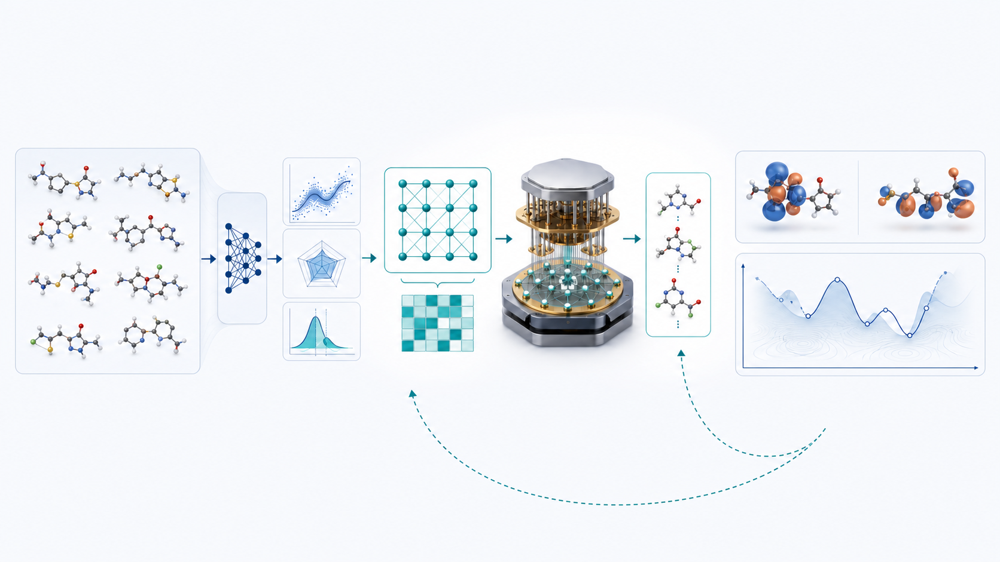
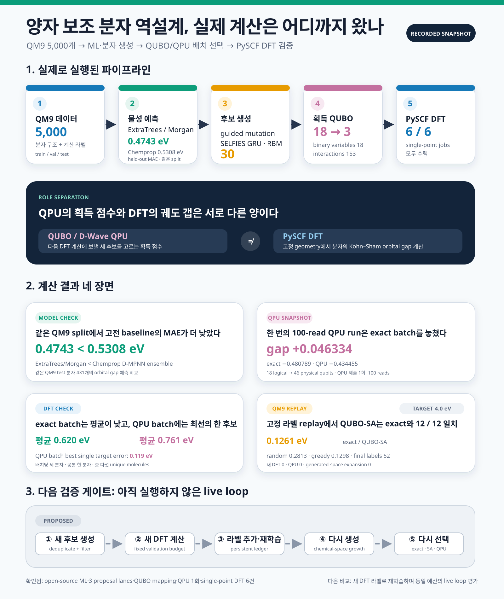
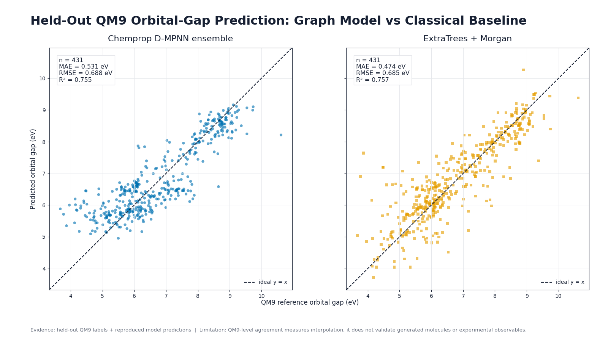
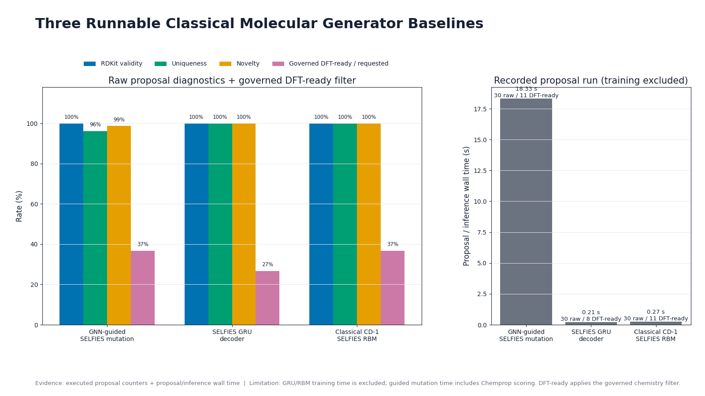
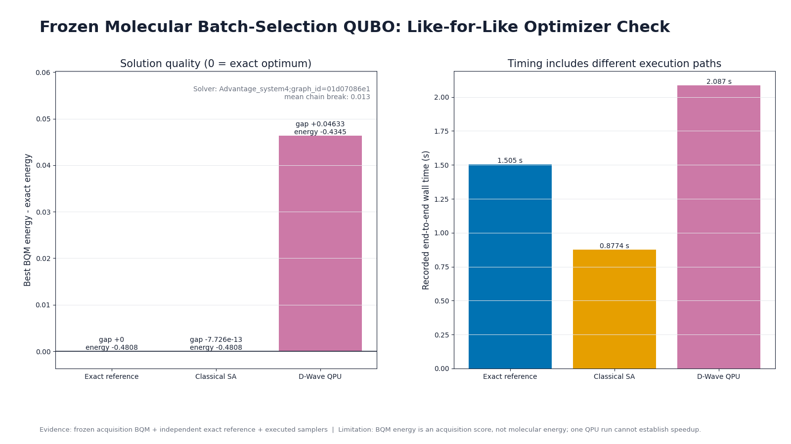
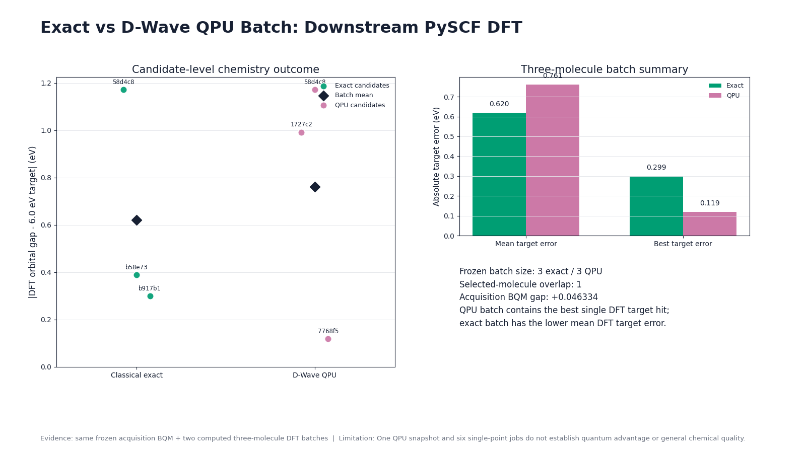
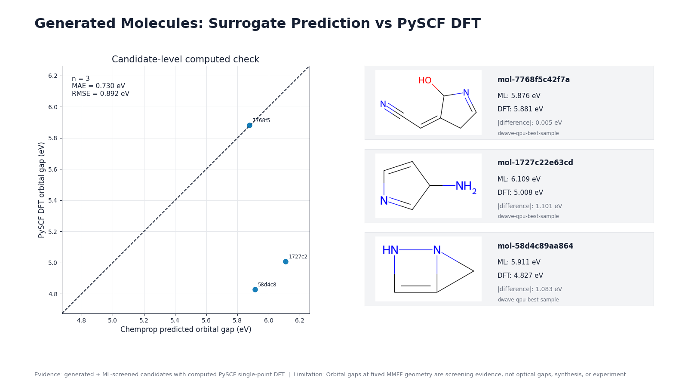
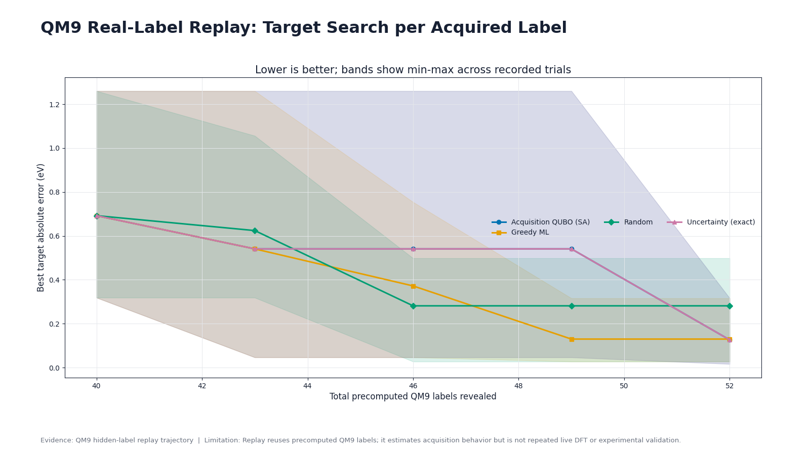

# D-Wave 분자 역설계 실험: QPU가 고른 후보를 DFT까지 확인해 보니

후보 분자 18개 가운데 다음 계산에 보낼 세 개를 골라야 한다고 해보겠습니다. 예측값이 목표에 가까운 후보를 우선하되, 서로 지나치게 닮은 분자만 한꺼번에 뽑히지 않도록 배치 전체를 판단해야 합니다. 이번 실험에서는 이 선택 문제를 QUBO로 만들고, 독립적인 exact search와 classical simulated annealing, D-Wave QPU에 같은 문제를 넣었습니다. 선택된 분자는 PySCF로 다시 계산했습니다.

실험 범위는 작지만 계산 단계는 실제로 이어졌습니다. QM9에서 추린 5,000개 분자로 예측 모델을 학습했고, 세 가지 생성 경로를 실행했으며, 공통 화학 필터를 통과한 30개 후보를 만들었습니다. 여기서 18개를 고정한 뒤 세 분자 배치를 선택했고, QPU 배치와 exact 배치에 대해 모두 여섯 건의 single-point DFT 계산을 완료했습니다.



*그림 1. 후보군의 ML 예측에서 QUBO에 의한 세 후보 선택, 전자구조 계산으로 이어지는 순서를 표현한 AI 생성 개념 일러스트입니다. 중앙 장치는 양자 어닐링을 통한 배치 선택을 상징합니다.*

::: highlight 이 실험에서 D-Wave가 맡은 일
D-Wave QPU는 다음 PySCF 계산에 보낼 **세 후보의 배치를 고르는 획득 최적화**를 수행했습니다. QUBO energy는 선택 점수이고, PySCF가 계산한 DFT orbital gap은 분자의 전자구조에서 얻은 값입니다.
:::



*그림 2. 위쪽과 가운데는 실행된 계산을, 아래 점선은 다음 검증 단계로 제안한 live active-learning loop를 나타냅니다. 수치는 [공개 계산 결과표](https://github.com/Infant83/AI_Tech_Review/blob/6add022d87564623dcb41d11b511015e23ba6311/2026-08-27_dwave-molecular-inverse-design-benchmark/artifacts/final_review/data/benchmark_results.csv)와 동일합니다.*

[상세 인포그래픽을 전체 크기 PNG로 보기](../artifacts/final_review/figures/molecular_inverse_design_infographic.png)

## 계산한 범위부터 확인해 보자

이번 파이프라인은 서로 다른 의미를 가진 여섯 층으로 구성됩니다.

| 계산 층 | 실행한 작업 | 이번 결과가 말해주는 범위 |
| --- | --- | --- |
| 데이터 | QM9 기반 5,000개 분자, train/validation/test 분리 | 같은 분자군 안에서 모델을 비교할 수 있는 기준 데이터 |
| 예측 | Chemprop D-MPNN ensemble, ExtraTrees/Morgan | held-out QM9 orbital-gap 예측 성능 |
| 생성 | Chemprop-guided SELFIES mutation, SELFIES GRU, classical SELFIES RBM | 세 proposal mechanism이 실제로 후보를 반환하고 필터를 통과함 |
| 획득 최적화 | 독립 exact, Ocean ExactSolver, classical SA, D-Wave QPU | 같은 18-variable BQM에서 세 후보 배치를 선택함 |
| 계산 검증 | PySCF B3LYP/6-31G(2df,p) single point | 고정 force-field geometry의 Kohn–Sham HOMO–LUMO gap |
| 반복 정책 | 고정 QM9 pool의 hidden-label replay | precomputed label을 공개하며 획득 정책을 비교한 고전 proxy |

마지막 행의 replay는 이미 계산된 QM9 라벨을 차례로 공개하며 획득 정책을 비교합니다. 새 생성 후보의 DFT 라벨로 재학습하는 후속 단계는 뒤에서 구체화합니다.

## 예측 모델에서는 ExtraTrees의 MAE가 더 낮았다

QM9 derived dataset 5,000개를 train 4,058개, validation 511개, test 431개로 나눴습니다. 목표값은 eV 단위의 QM9 HOMO–LUMO orbital gap입니다. QM9는 약 13만 개 분자의 양자화학 구조와 물성을 제공하며, 이번 실험은 그중 화학 규칙을 통과한 결정론적 subset을 사용했습니다. <a class="citation" href="#ref-1">[1]</a> PyTorch Geometric의 QM9 문서는 이 데이터의 물성 항목과 단위를 설명합니다. <a class="citation" href="#ref-2">[2]</a>

같은 split에서 Chemprop D-MPNN ensemble <a class="citation" href="#ref-3">[3]</a>과 Morgan fingerprint 기반 ExtraTrees <a class="citation" href="#ref-4">[4]</a>를 비교했습니다.

| Model | MAE (eV) | RMSE (eV) | $R^2$ |
| --- | ---: | ---: | ---: |
| Chemprop D-MPNN ensemble | 0.5308 | 0.6882 | 0.7547 |
| ExtraTrees / Morgan | **0.4743** | 0.6854 | 0.7567 |



*그림 3. 같은 QM9 시험 분자 431개의 참조 orbital gap(가로축)과 모델 예측(세로축)을 비교했습니다. 점선은 두 값이 같은 위치이며, ExtraTrees의 MAE는 0.4743 eV, Chemprop은 0.5308 eV입니다.*

생성 후보를 점수화할 때는 분자 그래프를 입력받는 Chemprop을 사용했습니다. 같은 QM9 test split의 MAE는 ExtraTrees가 더 낮았습니다. QUBO에 들어간 18개 shortlist에서 두 Chemprop model의 prediction spread도 약 $9\times10^{-6}$–0.00275 eV로 매우 작고 calibration을 하지 않았습니다. 따라서 아래 QUBO의 uncertainty term은 탐색용 proxy로 다뤘습니다.

## 세 생성 경로에 같은 화학 규칙을 적용했다

후보 생성은 세 경로로 나눴습니다.

1. Chemprop 점수로 SELFIES mutation을 고르는 guided path
2. autoregressive SELFIES GRU decoder
3. contrastive divergence와 Gibbs sampling을 사용하는 classical SELFIES RBM

SELFIES는 생성 모델이 다룰 분자를 문자열로 표현하는 방법입니다. <a class="citation" href="#ref-5">[5]</a> 생성된 문자열은 다음의 화학 규칙으로 다시 걸렀습니다.

각 경로는 30개씩, 모두 90개를 반환했습니다. 여기에 RDKit parsing과 canonicalization, CHONF 원소 제한, 최대 9개 heavy atom, neutral closed shell, 중복 제거를 공통으로 적용했습니다. 최종 union에 기여한 수는 11개, 8개, 11개로 전체 unique candidate는 30개였습니다. 반환된 90개 중 radical 41개, 크기 제한 초과 15개, 지원하지 않는 원소 3개, non-neutral 1개가 제외됐습니다. 그림의 raw proposal 진단은 각 생성기 내부의 decode·중복·novelty 계수로, 이 90개에 적용한 공통 필터의 분모와 구별합니다.



*그림 4. 세 경로의 raw proposal 진단과 공통 필터 통과량입니다. 오른쪽 시간은 guided 경로에서 Chemprop scoring을 포함하며, GRU/RBM에서는 저장된 모델의 proposal 생성 시간을 잰 값입니다.*

`GNN-guided`는 Chemprop으로 SELFIES mutation을 점수화한 경로입니다. RBM은 contrastive divergence와 Gibbs sampling을 쓰는 고전 모델로 실행했습니다.

## QUBO는 목표 적합성과 배치 다양성을 함께 계산한다

후보 $i$를 선택하면 $x_i=1$, 선택하지 않으면 $x_i=0$으로 둡니다. 목표 6.0 eV에 가까운 후보를 우선하고, novelty와 model spread에 보상을 주며, 서로 닮은 후보가 한 배치에 몰리면 penalty를 더했습니다. 선택 수가 세 개에서 벗어날수록 cardinality penalty가 커지도록 했습니다.

읽기 쉬운 구현형 식은 다음과 같습니다.

```text
target_loss = sum_i target_weight
                    * ((predicted_gap_i - target_gap) / gap_scale)^2
                    * x_i

uncertainty_reward = sum_i uncertainty_weight
                           * (predicted_std_i / gap_scale)
                           * x_i

novelty_reward = sum_i novelty_weight * novelty_i * x_i

similarity_penalty = sum_(i < j) similarity_weight
                                  * tanimoto_i_j
                                  * x_i * x_j

cardinality_penalty = cardinality_weight
                      * (sum_i x_i - batch_size)^2

acquisition_score = target_loss
                  - uncertainty_reward
                  - novelty_reward
                  + similarity_penalty
                  + cardinality_penalty
```

같은 획득 점수를 식으로 쓰면 다음과 같습니다.

$$
\begin{aligned}
A(x) ={}& \sum_i w_t
\left(\frac{\hat g_i-g^*}{s_g}\right)^2 x_i
- \sum_i w_u\frac{\hat\sigma_i}{s_g}x_i
- \sum_i w_n n_i x_i \\
&+ \sum_{i<j}w_s T_{ij}x_ix_j
+ w_c\left(\sum_i x_i-k\right)^2.
\end{aligned}
$$

여기서 $\hat g_i$는 예측 갭, $g^*=6.0$ eV는 목표, $s_g$는 갭을 정규화하는 eV 단위의 척도입니다. $\hat\sigma_i$는 두 모델의 prediction spread, $n_i$는 novelty, $T_{ij}$는 두 후보의 Tanimoto 유사도이며 $w_t,w_u,w_n,w_s,w_c$는 각 항의 가중치입니다. 원하는 배치 크기는 $k=3$입니다. D-Wave의 QUBO 설명처럼 binary quadratic model은 0/1 변수의 linear term과 quadratic interaction을 최소화하는 형태로 표현됩니다. <a class="citation" href="#ref-6">[6]</a> 이번 frozen problem에는 variable 18개와 pair interaction 153개가 있었습니다.

독립 combination search, Ocean ExactSolver, 2,000-read classical simulated annealing은 모두 같은 세 후보와 acquisition energy `-0.480789`를 찾았습니다. readable objective와 `bqm.energy(sample)`도 일치했습니다. 이 검증이 끝난 뒤 같은 BQM을 QPU에 제출했습니다.

## 한 번의 QPU 실행은 exact optimum을 재현하지 못했다

D-Wave QPU에는 frozen BQM을 100 reads로 한 번 제출했습니다. 18개 logical variable은 Pegasus topology의 46개 physical qubit으로 embedding됐습니다. EmbeddingComposite는 logical variable을 QPU topology에 맞게 chain으로 embedding하고 chain-break 정보를 반환할 수 있습니다. <a class="citation" href="#ref-7">[7]</a> 세 개 선택은 soft penalty로 유도한 조건입니다. 보존된 100개 occurrence를 이번 감수에서 다시 세면 48개가 세 후보를 골랐고, 최저 획득 점수도 그중에서 나왔습니다.

| Optimizer | Best acquisition energy | Exact gap | Selected batch |
| --- | ---: | ---: | --- |
| independent exact | -0.480789 | 0 | `58d4, b58e, b917` |
| classical simulated annealing | -0.480789 | 약 0 | exact와 동일 |
| D-Wave QPU | -0.434455 | **+0.046334** | `1727, 58d4, 7768` |



*그림 5. 왼쪽은 각 해의 획득 점수와 exact 최적값의 차이입니다. 오른쪽은 각 실행 경로에서 기록한 wall time으로, 고전 탐색과 QPU 제출 경로는 포함하는 단계가 다릅니다.*

기록된 occurrence-weighted mean chain-break fraction은 0.01333, client wall time은 2.087초였습니다.

당시 QPU 제출 기록에는 실행 timestamp, 제출 시점의 Python/Ocean version, project source hash, solver timing field의 단위를 함께 보존한 별도 configuration record가 없습니다. D-Wave의 solver properties는 장치·시간 속성의 해석 기준을 제공합니다. <a class="citation" href="#ref-8">[8]</a> 다음 QPU campaign에서는 제출 전에 실제 실행 설정과 timing 단위를 함께 보존해야 합니다.

## PySCF 계산에서 exact batch는 평균이 낮았고, QPU batch에는 가장 가까운 한 후보가 있었다

QPU가 고른 세 분자와 independent exact가 고른 세 분자를 PySCF DFT로 계산했습니다. <a class="citation" href="#ref-9">[9]</a> 두 배치에 공통으로 들어간 한 분자는 각각 실행했으므로 총 여섯 job, 다섯 unique molecule입니다. 모든 job이 수렴했습니다.

계산 조건은 다음과 같습니다.

```text
geometry = RDKit ETKDGv3 embedding + MMFF94s optimization
calculation = single point
functional = B3LYP
basis = 6-31G(2df,p)
grid level = 3
SCF convergence tolerance = 1e-8
maximum SCF cycles = 100
```

| Selection batch | Converged | Mean target error | ML–DFT MAE | Container wall time |
| --- | ---: | ---: | ---: | ---: |
| independent exact | 3 / 3 | **0.620 eV** | 0.580 eV | 92.592 s |
| D-Wave QPU | 3 / 3 | 0.761 eV | 0.730 eV | 177.258 s |



*그림 6. 왼쪽 점은 분자별 6.0 eV 목표 오차, 마름모는 배치 평균입니다. 오른쪽은 평균과 최선 후보의 오차를 비교합니다. 배치당 세 분자이며 한 분자는 두 배치에 공통입니다.*

QPU batch의 `N#CC=C1CC=NC1O`는 ML 5.8763 eV, PySCF 5.8808 eV를 기록했습니다. 6.0 eV target과의 차이는 0.1192 eV로, 이번 계산에서 가장 가까운 값입니다. exact batch의 best target error는 0.2994 eV였습니다.



*그림 7. QPU가 선택한 세 후보의 ML 예측과 PySCF 결과입니다. 첫 후보는 0.005 eV 차이로 일치했지만 나머지 두 후보에서는 약 1.1 eV 차이가 나타났습니다.*

이 값은 ETKDGv3와 MMFF94s로 얻은 geometry에서 계산한 Kohn–Sham HOMO–LUMO orbital gap입니다. optical excitation은 TDDFT 같은 excited-state method로 계산하는 별도의 물리량입니다. <a class="citation" href="#ref-10">[10]</a>

## 반복 정책은 고정 QM9 라벨 replay로 점검했다

재료 active learning의 리뷰는 surrogate와 uncertainty, utility, 고비용 oracle을 반복적으로 연결하는 구조를 설명합니다. <a class="citation" href="#ref-11">[11]</a> 이번 프로젝트에서는 먼저 고정된 QM9 pool에서 precomputed label을 숨겼다가 공개하는 replay를 만들었습니다.

이 replay는 앞 절의 6.0 eV 분자 배치 선택과 별개로, **4.0 eV target**에서 획득 정책을 비교한 benchmark입니다.

세 paired seed에서 40개 label로 시작해 batch size 3으로 네 번 갱신했습니다. 52개 label budget에서 best target error 평균은 다음과 같습니다.

| Policy | Mean best target error at 52 labels |
| --- | ---: |
| random | 0.2813 eV |
| greedy ExtraTrees | 0.1298 eV |
| uncertainty-aware exact | **0.1261 eV** |
| uncertainty-aware QUBO / classical SA | **0.1261 eV** |



*그림 8. 4.0 eV target의 고정 QM9 replay에서 QUBO simulated annealing은 기록된 12번의 acquisition 모두 exact batch와 일치했습니다. 음영은 세 seed의 min–max 범위입니다.*

매 round에서 새로 계산한 값 대신 고정 QM9 pool의 라벨을 공개했습니다. 이 재학습에는 앞 절의 여섯 DFT 라벨을 넣지 않았으며, 새 DFT 계산·QPU 제출·생성 후보의 추가 없이 같은 pool 안에서 라벨 예산을 쓰는 방법을 비교했습니다.

## 확인된 증거와 남은 판단

| 상태 | 2026-08-27 계산 기록 |
| --- | --- |
| 원 실행 기록 | 두 surrogate, 세 proposal mechanism, 공통 화학 filter, objective–BQM mapping, exact와 classical SA, QPU 1회, PySCF single-point DFT 6건 |
| 고전 proxy | 고정 QM9 pool과 precomputed labels를 사용한 3-seed replay |

downstream DFT에서는 exact batch의 평균 목표 오차가 낮았고, QPU batch는 목표에 가장 가까운 한 후보를 포함했습니다. 획득 점수의 최저점은 예측값과 배치 다양성을 함께 평가한 결과이고, DFT의 평균·최선 오차는 선택 뒤 계산한 값입니다. 두 지표의 차이를 따라가야 다음 선택에서 예측 모델과 획득 정책 중 무엇을 개선할지 판단할 수 있습니다.

다음 비교에서는 후보군·DFT 예산과 실행 기록을 함께 고정해야 합니다.

1. 후보와 계산 이력을 보존하는 persistent ledger
2. 동일한 candidate pool, batch size, DFT label budget
3. greedy ML, independent exact, classical SA, QPU의 matched comparison
4. surrogate fit, QUBO build, queue, sampling, DFT를 분리한 시간·비용 기록
5. 사전에 정한 go / scale / stop 기준

새 DFT 라벨을 데이터에 추가하고 surrogate를 재학습한 뒤 다시 생성·선택하는 과정을 여러 round 반복해야 active learning의 실제 효율을 논의할 수 있습니다. 같은 예산에서 강한 classical champion을 넘지 못하면 QPU campaign을 멈추는 기준도 필요합니다.

::: evidence 이번 스냅샷에서 다음 비교로
획득 점수를 최소화한 배치와 DFT에서 가장 목표에 가까운 후보가 속한 배치는 달랐습니다. 다음 단계에서는 새 DFT 라벨로 예측 모델을 갱신하는 과정을 반복하며, 같은 계산 예산이 얼마나 좋은 분자를 찾아내는지 비교할 필요가 있습니다.
:::

## 작성 정보

- 원 발행·계산 checkpoint: 2026-08-27
- 편집·근거 대조: 2026-11-08. 당시 계산의 수치와 범위를 대조했으며 최신 장치 성능을 소급하지 않았습니다.
- 원 작성 보조: Codex 기반 GPT-5 계열 에이전트 하네스. 정확한 모델 식별자와 원 세션의 개별 역할 명단은 미보존입니다.
- 이번 감수: Codex root(편집·통합), dwave_science(보존된 계산 기록·수치·피규어 대조), dwave_references(APS·원저자·공식 문서), dwave_prose(한영 문맥·캡션 독립 감수). 정확한 모델 식별자는 미보존입니다.
- 이번 계산 확인: 보존된 BQM의 $2^{18}$개 상태 전수 열거, QPU 100 occurrences와 보존된 SA 100개 행의 점수 재계산, DFT 6개 job의 gap·배치 평균 및 replay 최종 집계를 대조했습니다. 당시 QPU·DFT·모델 학습을 재실행하거나 원 raw QM9·좌표·전체 replay batch를 복원한 것은 아닙니다.
- 공통 문체 하네스: 2026-11-06 개정판. 원 발행본의 작성·검증 이력과 이번 감수 범위를 구별합니다.

## References

<ol class="reference-list">
<li id="ref-1" value="1">R. Ramakrishnan, P. O. Dral, M. Rupp, and O. A. von Lilienfeld, Quantum chemistry structures and properties of 134 kilo molecules, <a href="https://doi.org/10.1038/sdata.2014.22">Sci. Data 1, 140022 (2014)</a>; R. Ramakrishnan, P. Dral, M. Rupp, and O. A. von Lilienfeld, Quantum chemistry structures and properties of 134 kilo molecules, version 5 (Figshare, 2019), <a href="https://doi.org/10.6084/m9.figshare.c.978904.v5">doi:10.6084/m9.figshare.c.978904.v5</a>.</li>
<li id="ref-2" value="2">PyG Team, torch_geometric.datasets.QM9, PyTorch Geometric documentation, <a href="https://pytorch-geometric.readthedocs.io/en/latest/generated/torch_geometric.datasets.QM9.html">https://pytorch-geometric.readthedocs.io/en/latest/generated/torch_geometric.datasets.QM9.html</a> (accessed November 8, 2026).</li>
<li id="ref-3" value="3">K. Yang, K. Swanson, W. Jin, C. Coley, P. Eiden, H. Gao, A. Guzman-Perez, T. Hopper, B. Kelley, M. Mathea, A. Palmer, V. Settels, T. Jaakkola, K. Jensen, and R. Barzilay, Analyzing learned molecular representations for property prediction, <a href="https://doi.org/10.1021/acs.jcim.9b00237">J. Chem. Inf. Model. 59, 3370 (2019)</a>; E. Heid, K. P. Greenman, Y. Chung, S.-C. Li, D. E. Graff, F. H. Vermeire, H. Wu, W. H. Green, and C. J. McGill, Chemprop: A machine learning package for chemical property prediction, <a href="https://doi.org/10.1021/acs.jcim.3c01250">J. Chem. Inf. Model. 64, 9 (2024)</a>; D. E. Graff, N. K. Morgan, J. W. Burns, A. C. Doner, B. Li, S.-C. Li, J. Manu, A. Menon, H.-W. Pang, H. Wu, A. S. Zalte, J. W. Zheng, C. W. Coley, W. H. Green, and K. P. Greenman, Chemprop v2: An efficient, modular machine learning package for chemical property prediction, <a href="https://doi.org/10.1021/acs.jcim.5c02332">J. Chem. Inf. Model. 66, 28 (2026)</a>.</li>
<li id="ref-4" value="4">P. Geurts, D. Ernst, and L. Wehenkel, Extremely randomized trees, <a href="https://doi.org/10.1007/s10994-006-6226-1">Mach. Learn. 63, 3 (2006)</a>; D. Rogers and M. Hahn, Extended-connectivity fingerprints, <a href="https://doi.org/10.1021/ci100050t">J. Chem. Inf. Model. 50, 742 (2010)</a>.</li>
<li id="ref-5" value="5">M. Krenn, F. Häse, A. Nigam, P. Friederich, and A. Aspuru-Guzik, Self-referencing embedded strings (SELFIES): A 100% robust molecular string representation, <a href="https://doi.org/10.1088/2632-2153/aba947">Mach. Learn.: Sci. Technol. 1, 045024 (2020)</a>; A. Lo, R. Pollice, A. Nigam, A. D. White, M. Krenn, and A. Aspuru-Guzik, Recent advances in the self-referencing embedded strings (SELFIES) library, <a href="https://doi.org/10.1039/D3DD00044C">Digital Discovery 2, 897 (2023)</a>.</li>
<li id="ref-6" value="6">D-Wave, QUBOs and Ising Models, D-Wave Quantum Computing Products documentation, <a href="https://docs.dwavequantum.com/en/latest/quantum_research/qubo_ising.html">https://docs.dwavequantum.com/en/latest/quantum_research/qubo_ising.html</a> (accessed November 8, 2026).</li>
<li id="ref-7" value="7">D-Wave, dwave.system.composites.EmbeddingComposite.sample, D-Wave Quantum Computing Products documentation, <a href="https://docs.dwavequantum.com/en/latest/ocean/api_ref_system/generated/dwave.system.composites.EmbeddingComposite.sample.html">https://docs.dwavequantum.com/en/latest/ocean/api_ref_system/generated/dwave.system.composites.EmbeddingComposite.sample.html</a> (accessed November 8, 2026).</li>
<li id="ref-8" value="8">D-Wave, General QPU Solver Properties, D-Wave Quantum Computing Products documentation, <a href="https://docs.dwavequantum.com/en/latest/quantum_research/solver_properties_all.html">https://docs.dwavequantum.com/en/latest/quantum_research/solver_properties_all.html</a> (accessed November 8, 2026).</li>
<li id="ref-9" value="9">Q. Sun, T. C. Berkelbach, N. S. Blunt, G. H. Booth, S. Guo, Z. Li, J. Liu, J. D. McClain, E. R. Sayfutyarova, S. Sharma, S. Wouters, and G. K.-L. Chan, PySCF: The Python-based simulations of chemistry framework, <a href="https://doi.org/10.1002/wcms.1340">WIREs Comput. Mol. Sci. 8, e1340 (2018)</a>; The PySCF Developers, Density functional theory (DFT), <a href="https://pyscf.org/user/dft.html">https://pyscf.org/user/dft.html</a> (accessed November 8, 2026).</li>
<li id="ref-10" value="10">The PySCF Developers, Time-dependent Hartree-Fock and density functional theory, <a href="https://pyscf.org/user/tddft.html">https://pyscf.org/user/tddft.html</a> (accessed November 8, 2026).</li>
<li id="ref-11" value="11">T. Lookman, P. V. Balachandran, D. Xue, and R. Yuan, Active learning in materials science with emphasis on adaptive sampling using uncertainties for targeted design, <a href="https://doi.org/10.1038/s41524-019-0153-8">npj Comput. Mater. 5, 21 (2019)</a>.</li>
</ol>

<small>수치의 출처는 2026-08-27 프로젝트 계산 기록과 <a href="https://github.com/Infant83/AI_Tech_Review/blob/6add022d87564623dcb41d11b511015e23ba6311/2026-08-27_dwave-molecular-inverse-design-benchmark/artifacts/final_review/data/benchmark_results.csv">공개 결과표</a>입니다. 원 실행의 세부 자료 중 보존된 항목을 이번 감수에서 대조했으며, CSV의 evidence_state는 당시 기록의 표기입니다.</small>
