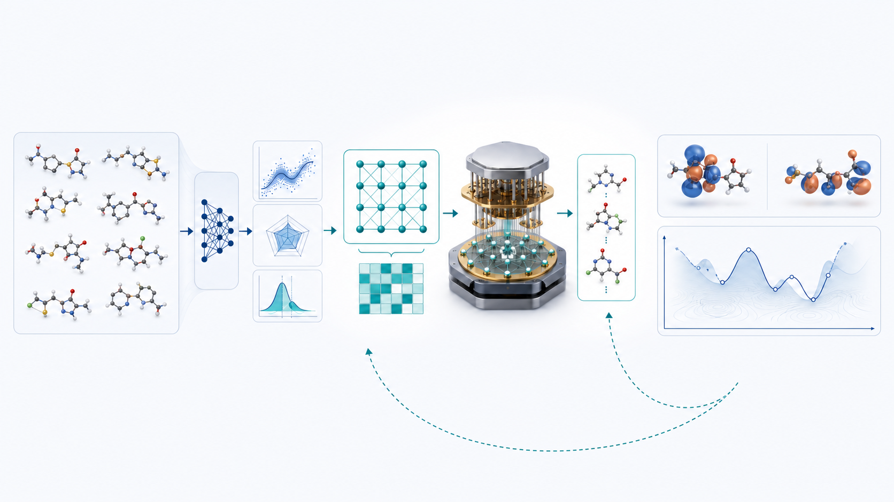
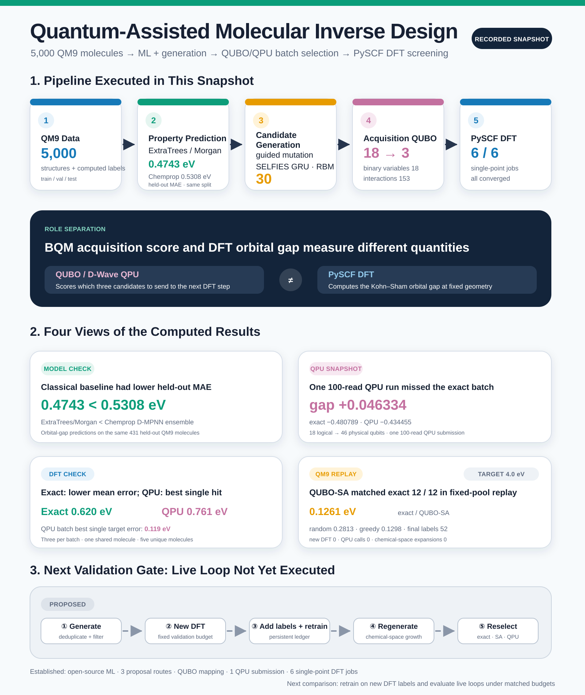
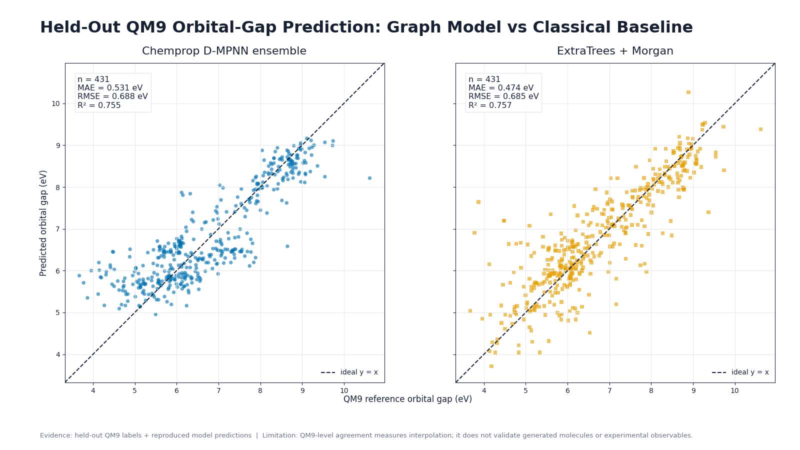
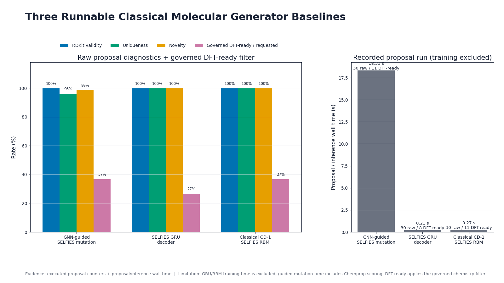
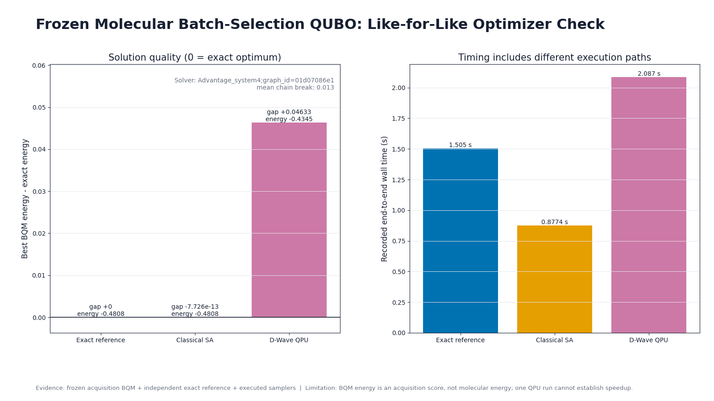
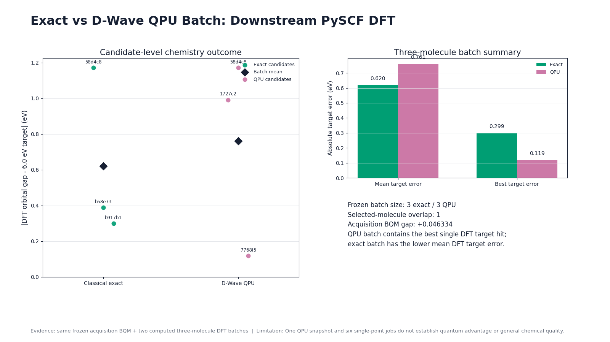
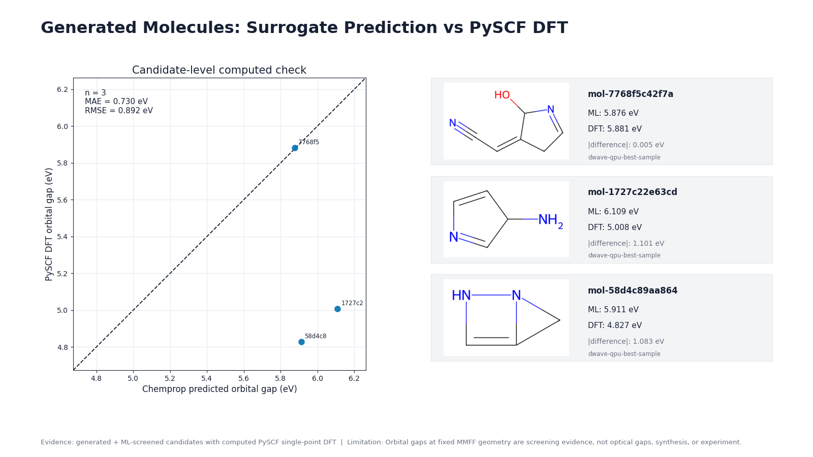
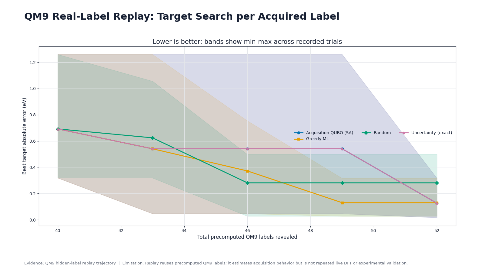

# A D-Wave Molecular Inverse-Design Experiment: Checking QPU-Selected Candidates with Single-Point DFT

Suppose we have 18 candidate molecules and must choose three for the next round of calculations. Candidates with predictions close to the target should receive priority, but the batch should not be crowded with nearly identical molecules. In this experiment, we formulated that selection task as a QUBO and sent the same problem to an independent exact search, classical simulated annealing, and a D-Wave QPU. We then recalculated the selected molecules with PySCF.

The experiment was small, but the computational stages were connected end to end. We trained prediction models on a deterministic 5,000-molecule subset derived from QM9, ran three proposal mechanisms, and produced 30 candidates that passed a shared chemistry filter. We froze a shortlist of 18, selected batches of three, and completed six single-point DFT calculations across the QPU-selected and exact-selected batches.



*Figure 1. An AI-generated conceptual illustration of ML predictions, QUBO selection of a three-candidate batch and subsequent electronic-structure calculations. The central device represents the quantum-annealing selection stage.*

::: highlight D-Wave's role in this experiment
The D-Wave QPU performed **batch acquisition optimization to select three candidates** for the next PySCF calculations. Molecular electronic structure was calculated with PySCF. BQM energy is the acquisition-objective value; the DFT orbital gap is the result of a molecular calculation.
:::



*Figure 2. The top and middle sections show computations that were executed. The dashed path at the bottom shows the live active-learning loop proposed for the next validation stage. The values match the [public computation results table](https://github.com/Infant83/AI_Tech_Review/blob/6add022d87564623dcb41d11b511015e23ba6311/2026-08-27_dwave-molecular-inverse-design-benchmark/artifacts/final_review/data/benchmark_results.csv).*

[View the detailed infographic as a full-size PNG](../artifacts/final_review/figures/molecular_inverse_design_infographic_en.png)

## What the pipeline actually computed

The pipeline consists of six layers with distinct meanings.

| Computational layer | Work executed | Scope supported by this result |
| --- | --- | --- |
| Data | 5,000 QM9-based molecules with train/validation/test splits | A reference dataset for comparing models within the same molecular family |
| Prediction | Chemprop D-MPNN ensemble, ExtraTrees/Morgan | Held-out QM9 orbital-gap prediction performance |
| Generation | Chemprop-guided SELFIES mutation, SELFIES GRU, classical SELFIES RBM | Three proposal mechanisms returned candidates that passed the filters |
| Acquisition optimization | Independent exact search, Ocean ExactSolver, classical SA, D-Wave QPU | Selection of a three-candidate batch from the same 18-variable BQM |
| Computational validation | PySCF B3LYP/6-31G(2df,p) single point | Kohn-Sham HOMO-LUMO gap at a fixed force-field geometry |
| Iteration policy | Hidden-label replay on a fixed QM9 pool | A classical proxy comparing acquisition policies as precomputed labels are revealed |

The replay in the last row compares acquisition policies by revealing existing QM9 labels. The later section sets out the next step of retraining on new DFT labels for generated candidates.

## ExtraTrees achieved the lower prediction MAE

We divided the 5,000-molecule QM9-derived dataset into 4,058 training, 511 validation, and 431 test molecules. The target was the QM9 HOMO–LUMO orbital gap in eV. QM9 provides quantum-chemical structures and properties for approximately 134,000 molecules; this experiment used a deterministic subset that passed the chemistry rules. <a class="citation" href="#ref-1">[1]</a> PyTorch Geometric's QM9 documentation describes the property fields and units. <a class="citation" href="#ref-2">[2]</a>

On the same split, we compared a Chemprop D-MPNN ensemble <a class="citation" href="#ref-3">[3]</a> with ExtraTrees using Morgan fingerprints. <a class="citation" href="#ref-4">[4]</a>

| Model | MAE (eV) | RMSE (eV) | $R^2$ |
| --- | ---: | ---: | ---: |
| Chemprop D-MPNN ensemble | 0.5308 | 0.6882 | 0.7547 |
| ExtraTrees / Morgan | **0.4743** | 0.6854 | 0.7567 |



*Figure 3. Predicted orbital gaps versus QM9 reference gaps for the same 431 held-out molecules. The dashed line marks equality; the MAEs are 0.4743 eV for ExtraTrees and 0.5308 eV for Chemprop.*

Chemprop supplied the structure-aware scores used for generated candidates; ExtraTrees had the lower MAE on the same held-out QM9 split. Across the 18-candidate shortlist used in the QUBO, the prediction spread between the two Chemprop models was also very small, approximately $9\times10^{-6}$ to 0.00275 eV, and was not calibrated. The QUBO uncertainty term below was therefore treated as an exploratory proxy.

## The same chemistry rules were applied to all three proposal mechanisms

Candidate generation used three routes:

1. A guided path that selects SELFIES mutations by Chemprop score
2. An autoregressive SELFIES GRU decoder
3. A classical SELFIES RBM using contrastive divergence and Gibbs sampling

SELFIES represents molecules as strings for use in generative models. <a class="citation" href="#ref-5">[5]</a> We then screened the generated strings with the chemistry rules below.

Each route returned 30 candidates, for 90 in total. RDKit parsing and canonicalization, a CHONF element restriction, a maximum of nine heavy atoms, a neutral closed-shell requirement, and deduplication were applied to those 90. The final union received 11 candidates from the guided path, 8 from the GRU, and 11 from the RBM, giving 30 unique candidates. The filter excluded 41 radicals, 15 candidates over the size limit, 3 with unsupported elements, and 1 non-neutral candidate. The raw-proposal diagnostics in the figure use each generator's internal decode, duplicate and novelty counters; their denominators differ from those of this shared filter.



*Figure 4. Raw-proposal diagnostics and the number of candidates passing the shared filter for each route. The guided-path time includes Chemprop scoring; GRU and RBM times cover proposal generation from saved models.*

`GNN-guided` denotes SELFIES mutations scored by Chemprop. The RBM was a classical model trained by contrastive divergence and sampled by Gibbs sampling.

## The QUBO scores target fit and batch diversity together

For candidate $i$, let $x_i=1$ when it is selected and $x_i=0$ otherwise. Candidates close to the 6.0 eV target received priority. Novelty and model spread earned rewards, while high pairwise similarity incurred a penalty. A cardinality penalty grew with departures from a three-candidate batch.

The implementation-oriented expression is:

```text
target_loss = sum_i target_weight
                    * ((predicted_gap_i - target_gap) / gap_scale)^2
                    * x_i

uncertainty_reward = sum_i uncertainty_weight
                           * (predicted_std_i / gap_scale)
                           * x_i

novelty_reward = sum_i novelty_weight * novelty_i * x_i

similarity_penalty = sum_(i < j) similarity_weight
                                  * tanimoto_i_j
                                  * x_i * x_j

cardinality_penalty = cardinality_weight
                      * (sum_i x_i - batch_size)^2

acquisition_score = target_loss
                  - uncertainty_reward
                  - novelty_reward
                  + similarity_penalty
                  + cardinality_penalty
```

The same objective in compact notation is:

$$
\begin{aligned}
A(x) ={}& \sum_i w_t
\left(\frac{\hat g_i-g^*}{s_g}\right)^2 x_i
- \sum_i w_u\frac{\hat\sigma_i}{s_g}x_i
- \sum_i w_n n_i x_i \\
&+ \sum_{i<j}w_s T_{ij}x_ix_j
+ w_c\left(\sum_i x_i-k\right)^2.
\end{aligned}
$$

Here $\hat g_i$ is the predicted gap, $g^*=6.0$ eV the target, and $s_g$ an eV-valued normalization scale. $\hat\sigma_i$ is the spread between the two model predictions, $n_i$ novelty, and $T_{ij}$ the Tanimoto similarity; $w_t,w_u,w_n,w_s,w_c$ weight the terms, and $k=3$ is the desired batch size. D-Wave's QUBO introduction describes binary quadratic models as minimizing linear terms and quadratic interactions over 0/1 variables. <a class="citation" href="#ref-6">[6]</a> The frozen problem had 18 variables and 153 pairwise interactions.

The independent combination search, Ocean ExactSolver, and classical simulated annealing with 2,000 reads all found the same three candidates at an acquisition energy of `-0.480789`. The readable objective also matched `bqm.energy(sample)`. We submitted the same BQM to the QPU after completing these checks.

## One 100-read QPU submission missed the exact optimum

We submitted the frozen BQM to the D-Wave QPU once with 100 reads. The 18 logical variables were embedded into 46 physical qubits on the Pegasus topology. EmbeddingComposite maps logical variables to chains on the QPU topology and can return chain-break information. <a class="citation" href="#ref-7">[7]</a> The three-candidate condition was a soft penalty. Recounting the 100 preserved occurrences in this audit finds 48 that select three candidates; the lowest acquisition score was among them.

| Optimizer | Best acquisition energy | Exact gap | Selected batch |
| --- | ---: | ---: | --- |
| independent exact | -0.480789 | 0 | `58d4, b58e, b917` |
| classical simulated annealing | -0.480789 | zero to the reported precision | same as exact |
| D-Wave QPU | -0.434455 | **+0.046334** | `1727, 58d4, 7768` |



*Figure 5. The left panel shows each acquisition score relative to the exact optimum. The right panel records wall time for each execution path; the classical searches and QPU submission include different stages.*

The recorded occurrence-weighted mean chain-break fraction was 0.01333, and client wall time was 2.087 seconds.

The QPU submission record lacks a separate configuration file combining its execution timestamp, Python and Ocean versions at submission, project source hash, and explicit units for the solver timing fields. D-Wave's solver-properties documentation provides the interpretation of device and timing fields. <a class="citation" href="#ref-8">[8]</a> The next campaign should preserve the actual configuration and timing units before submission.

## The exact batch had the lower mean DFT error; the QPU batch contained the closest individual candidate

We evaluated the three QPU-selected molecules and the three independently exact-selected molecules with PySCF DFT. <a class="citation" href="#ref-9">[9]</a> One molecule appeared in both batches and was run separately in each, yielding six jobs over five unique molecules. All jobs converged.

The calculation settings were:

```text
geometry = RDKit ETKDGv3 embedding + MMFF94s optimization
calculation = single point
functional = B3LYP
basis = 6-31G(2df,p)
grid level = 3
SCF convergence tolerance = 1e-8
maximum SCF cycles = 100
```

| Selection batch | Converged | Mean target error | ML–DFT MAE | Container wall time |
| --- | ---: | ---: | ---: | ---: |
| independent exact | 3 / 3 | **0.620 eV** | 0.580 eV | 92.592 s |
| D-Wave QPU | 3 / 3 | 0.761 eV | 0.730 eV | 177.258 s |



*Figure 6. Points show each molecule's error from the 6.0 eV target and diamonds mark batch means. The right panel compares the mean and best-candidate errors. Each batch contains three molecules, with one shared between the batches.*

The QPU-selected `N#CC=C1CC=NC1O` had an ML prediction of 5.8763 eV and a PySCF value of 5.8808 eV. Its error relative to the 6.0 eV target was 0.1192 eV, the smallest in this set of calculations. The best target error in the exact batch was 0.2994 eV.



*Figure 7. ML predictions and PySCF results for the three QPU-selected candidates. The first candidate differed by about 0.005 eV, while the other two differed by approximately 1.1 eV.*

These values are Kohn–Sham HOMO–LUMO orbital gaps at geometries obtained using ETKDGv3 and MMFF94s. Optical excitation is a different quantity, calculated with an excited-state method such as TDDFT. <a class="citation" href="#ref-10">[10]</a>

## A fixed-label QM9 replay tested the iteration policy

A review of active learning in materials science describes an iterative structure linking a surrogate, uncertainty, utility, and an expensive oracle. <a class="citation" href="#ref-11">[11]</a> This project first created a replay that hid and then revealed precomputed labels from a fixed QM9 pool.

This replay was separate from the 6.0 eV molecular batch-selection task above. It compared acquisition policies at a **4.0 eV target**.

Across three paired seeds, each run began with 40 labels and performed four updates with a batch size of 3. At a budget of 52 labels, the mean best target errors were:

| Policy | Mean best target error at 52 labels |
| --- | ---: |
| random | 0.2813 eV |
| greedy ExtraTrees | 0.1298 eV |
| uncertainty-aware exact | **0.1261 eV** |
| uncertainty-aware QUBO / classical SA | **0.1261 eV** |



*Figure 8. In the fixed QM9 replay at a 4.0 eV target, QUBO simulated annealing matched the exact batch in all 12 recorded acquisitions. Shading shows the minimum-to-maximum range across three seeds.*

Each round revealed three precomputed QM9 labels from the fixed pool. The retraining did not use the six DFT labels from the earlier experiment. It compared how the policies spent a label budget within that pool, without new DFT calculations, QPU submissions or generated candidates.

## What the evidence establishes, and what remains open

| Status | Computation recorded on 2026-08-27 |
| --- | --- |
| Recorded execution | Two surrogate models, three proposal mechanisms, a shared chemistry filter, objective-to-BQM mapping, exact search and classical SA, one 100-read QPU submission, and six PySCF single-point DFT calculations |
| Classical proxy | Three-seed replay using a fixed QM9 pool and precomputed labels |

In downstream DFT, the exact batch had the lower mean target error, while the QPU batch contained the closest individual candidate. The acquisition minimum scores predictions and batch diversity; the DFT mean and best-candidate errors are calculated after selection. Following the difference between these quantities helps determine whether to improve the surrogate or the acquisition policy in the next selection round.

The next comparison should fix the candidate pool, DFT budget and execution record together:

1. A persistent ledger preserving candidates and calculation history
2. The same candidate pool, batch size, and DFT label budget
3. A matched comparison among greedy ML, independent exact search, classical SA, and the QPU
4. Separate time and cost records for surrogate fitting, QUBO construction, queueing, sampling, and DFT
5. Predefined go / scale / stop criteria

Assessing the practical efficiency of active learning will require several rounds in which new DFT labels are added to the data, the surrogate is retrained, and generation and selection run again. The campaign also needs a stop rule if the QPU fails to beat a strong classical champion under the same budget.

::: evidence From this snapshot to the next comparison
The batch minimizing the predicted acquisition score differed from the batch containing the closest candidate in DFT. The next step is to repeat the cycle of updating the surrogate with new DFT labels and compare how well the same calculation budget finds molecules near the target.
:::

## Publication information

- Original publication and computation checkpoint: 2026-08-27.
- Editorial revision and source comparison: 2026-11-08. The original numerical record and scope were checked; current device performance was not substituted for the historical result.
- Original writing assistance: Codex-based GPT-5-family agent harness; the exact model identifier and original individual role roster were not retained.
- This revision: Codex root (editing and integration), dwave_science (preserved computation, numbers and figures), dwave_references (APS, original authors and official documentation), and dwave_prose (independent bilingual argument and caption review). Exact model identifiers were not retained.
- This audit re-enumerated $2^{18}$ BQM states, rescored 100 QPU occurrences and 100 preserved SA rows, and checked the gaps and batch means of six DFT jobs plus final replay aggregates. It did not rerun the QPU, DFT or model training, or recover the raw QM9 data, Cartesian inputs or all replay batches.
- Common prose audit harness: revision 2026-11-06. The original publication record and this audit are identified separately.

## References

<ol class="reference-list">
<li id="ref-1" value="1">R. Ramakrishnan, P. O. Dral, M. Rupp, and O. A. von Lilienfeld, Quantum chemistry structures and properties of 134 kilo molecules, <a href="https://doi.org/10.1038/sdata.2014.22">Sci. Data 1, 140022 (2014)</a>; R. Ramakrishnan, P. Dral, M. Rupp, and O. A. von Lilienfeld, Quantum chemistry structures and properties of 134 kilo molecules, version 5 (Figshare, 2019), <a href="https://doi.org/10.6084/m9.figshare.c.978904.v5">doi:10.6084/m9.figshare.c.978904.v5</a>.</li>
<li id="ref-2" value="2">PyG Team, torch_geometric.datasets.QM9, PyTorch Geometric documentation, <a href="https://pytorch-geometric.readthedocs.io/en/latest/generated/torch_geometric.datasets.QM9.html">https://pytorch-geometric.readthedocs.io/en/latest/generated/torch_geometric.datasets.QM9.html</a> (accessed November 8, 2026).</li>
<li id="ref-3" value="3">K. Yang, K. Swanson, W. Jin, C. Coley, P. Eiden, H. Gao, A. Guzman-Perez, T. Hopper, B. Kelley, M. Mathea, A. Palmer, V. Settels, T. Jaakkola, K. Jensen, and R. Barzilay, Analyzing learned molecular representations for property prediction, <a href="https://doi.org/10.1021/acs.jcim.9b00237">J. Chem. Inf. Model. 59, 3370 (2019)</a>; E. Heid, K. P. Greenman, Y. Chung, S.-C. Li, D. E. Graff, F. H. Vermeire, H. Wu, W. H. Green, and C. J. McGill, Chemprop: A machine learning package for chemical property prediction, <a href="https://doi.org/10.1021/acs.jcim.3c01250">J. Chem. Inf. Model. 64, 9 (2024)</a>; D. E. Graff, N. K. Morgan, J. W. Burns, A. C. Doner, B. Li, S.-C. Li, J. Manu, A. Menon, H.-W. Pang, H. Wu, A. S. Zalte, J. W. Zheng, C. W. Coley, W. H. Green, and K. P. Greenman, Chemprop v2: An efficient, modular machine learning package for chemical property prediction, <a href="https://doi.org/10.1021/acs.jcim.5c02332">J. Chem. Inf. Model. 66, 28 (2026)</a>.</li>
<li id="ref-4" value="4">P. Geurts, D. Ernst, and L. Wehenkel, Extremely randomized trees, <a href="https://doi.org/10.1007/s10994-006-6226-1">Mach. Learn. 63, 3 (2006)</a>; D. Rogers and M. Hahn, Extended-connectivity fingerprints, <a href="https://doi.org/10.1021/ci100050t">J. Chem. Inf. Model. 50, 742 (2010)</a>.</li>
<li id="ref-5" value="5">M. Krenn, F. Häse, A. Nigam, P. Friederich, and A. Aspuru-Guzik, Self-referencing embedded strings (SELFIES): A 100% robust molecular string representation, <a href="https://doi.org/10.1088/2632-2153/aba947">Mach. Learn.: Sci. Technol. 1, 045024 (2020)</a>; A. Lo, R. Pollice, A. Nigam, A. D. White, M. Krenn, and A. Aspuru-Guzik, Recent advances in the self-referencing embedded strings (SELFIES) library, <a href="https://doi.org/10.1039/D3DD00044C">Digital Discovery 2, 897 (2023)</a>.</li>
<li id="ref-6" value="6">D-Wave, QUBOs and Ising Models, D-Wave Quantum Computing Products documentation, <a href="https://docs.dwavequantum.com/en/latest/quantum_research/qubo_ising.html">https://docs.dwavequantum.com/en/latest/quantum_research/qubo_ising.html</a> (accessed November 8, 2026).</li>
<li id="ref-7" value="7">D-Wave, dwave.system.composites.EmbeddingComposite.sample, D-Wave Quantum Computing Products documentation, <a href="https://docs.dwavequantum.com/en/latest/ocean/api_ref_system/generated/dwave.system.composites.EmbeddingComposite.sample.html">https://docs.dwavequantum.com/en/latest/ocean/api_ref_system/generated/dwave.system.composites.EmbeddingComposite.sample.html</a> (accessed November 8, 2026).</li>
<li id="ref-8" value="8">D-Wave, General QPU Solver Properties, D-Wave Quantum Computing Products documentation, <a href="https://docs.dwavequantum.com/en/latest/quantum_research/solver_properties_all.html">https://docs.dwavequantum.com/en/latest/quantum_research/solver_properties_all.html</a> (accessed November 8, 2026).</li>
<li id="ref-9" value="9">Q. Sun, T. C. Berkelbach, N. S. Blunt, G. H. Booth, S. Guo, Z. Li, J. Liu, J. D. McClain, E. R. Sayfutyarova, S. Sharma, S. Wouters, and G. K.-L. Chan, PySCF: The Python-based simulations of chemistry framework, <a href="https://doi.org/10.1002/wcms.1340">WIREs Comput. Mol. Sci. 8, e1340 (2018)</a>; The PySCF Developers, Density functional theory (DFT), <a href="https://pyscf.org/user/dft.html">https://pyscf.org/user/dft.html</a> (accessed November 8, 2026).</li>
<li id="ref-10" value="10">The PySCF Developers, Time-dependent Hartree-Fock and density functional theory, <a href="https://pyscf.org/user/tddft.html">https://pyscf.org/user/tddft.html</a> (accessed November 8, 2026).</li>
<li id="ref-11" value="11">T. Lookman, P. V. Balachandran, D. Xue, and R. Yuan, Active learning in materials science with emphasis on adaptive sampling using uncertainties for targeted design, <a href="https://doi.org/10.1038/s41524-019-0153-8">npj Comput. Mater. 5, 21 (2019)</a>.</li>
</ol>

<small>The numerical results come from the project record of 2026-08-27 and the <a href="https://github.com/Infant83/AI_Tech_Review/blob/6add022d87564623dcb41d11b511015e23ba6311/2026-08-27_dwave-molecular-inverse-design-benchmark/artifacts/final_review/data/benchmark_results.csv">public results table</a>. This audit checked the preserved portions of that record; evidence_state in the CSV is the original record's label.</small>
