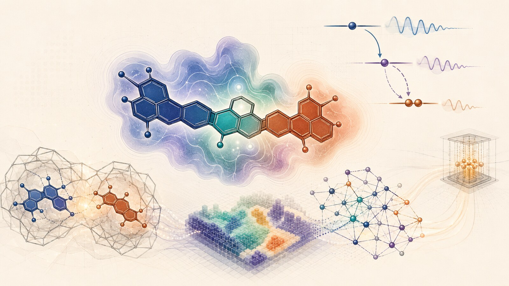
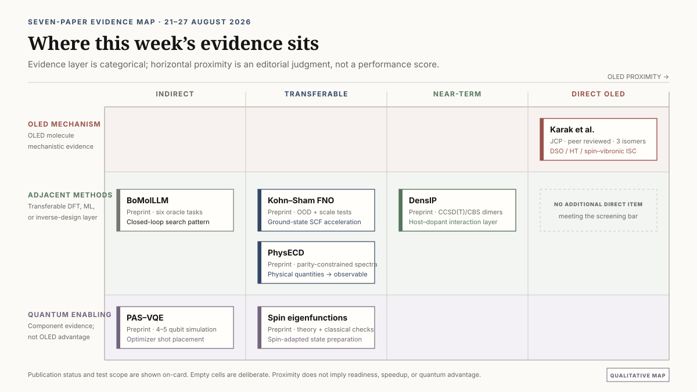
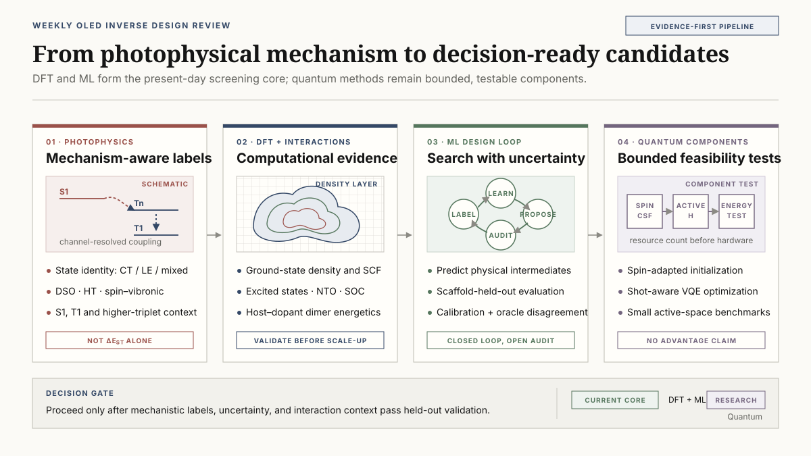

# OLED 분자 역설계를 위한 기작 중심 물성 라벨: 이성질체 ISC에서 확장형 DFT·ML까지

치환기의 위치만 바꾼 세 분자가 비슷한 속도로 전자상태를 바꾼다. 속도만 보면 서로 닮았지만, 전이를 만드는 통로는 다르다. Karak 등의 carbazole-benzoate 위치 이성질체 연구에서는 ortho와 para의 항간전이(ISC)에 직접 스핀–궤도 결합과 핵운동이, meta에는 핵운동과 고차 triplet 상태를 거치는 경로가 크게 기여했다. <a class="citation" href="#ref-1">[1]</a>

이 차이는 OLED 분자 역설계에서 무엇을 학습시킬지 다시 묻게 한다. 흔히 쓰는 지표인 singlet–triplet 에너지 차이 ΔEST는 열활성화 지연형광(TADF)의 역항간전이(RISC)에 유리한 에너지 조건을 가려낸다. 전이 속도를 이해하려면 여기에 상태의 전하이동·국소여기 성격, 스핀–궤도 결합(SOC), 진동이 상태를 섞는 방식을 더해야 한다. 총속도 하나로 압축한 라벨은 구조를 바꿨을 때 어느 통로가 달라졌는지 감춘다.

2026년 8월 21–27일 문헌에서 읽은 설계 과제는 이 기작 정보를 데이터에 남기는 일이다. 먼저 작은 이성질체 집합에서 추가 라벨의 가치를 확인하고, 고립 분자의 광물리에서 host–dopant 상호작용과 계산 비용으로 논의를 넓혀 보자.

*그림 1. AI 생성 개념 일러스트. 중앙의 분자와 전자밀도, 오른쪽 위의 에너지 준위와 진동은 기작 중심 물성 라벨을, 왼쪽 아래의 분자쌍은 host–dopant 상호작용을 나타낸다. 하단의 격자·신경망과 오른쪽의 작은 회로는 DFT·ML 계산과 양자 구성요소 연구를 잇는다.*

2026-08-28에 작성한 [원자료 브리프(영문, 8쪽)](../artifacts/oled_inverse_design_weekly_brief_2026-08-28.pdf)도 함께 읽을 수 있다.

## 이번 주 연구를 읽는 기준

이번 리뷰는 2026년 8월 21일부터 27일까지의 공개 자료를 대상으로 하며, 직전 주간 브리프에 포함된 논문은 제외했다. 총 7편을 선정했다. 이 가운데 OLED 광물리를 직접 다룬 논문은 동료평가를 거쳐 *Journal of Chemical Physics*에 게재된 Karak 등의 연구 한 편이다. 나머지 6편은 arXiv v1 프리프린트이며, OLED 데이터셋이나 소자 검증을 수행한 연구가 아니다.

*그림 2. 선정한 7편을 OLED 연구와의 거리와 검증 층에 배치한 리뷰의 정성적 지도. 가로축의 OLED 근접성은 성능 점수가 아니라 적용 대상에 대한 편집적 판단이다. Karak 등의 논문은 세 이성질체의 광물리를 직접 다룬다.*

아래의 수치는 해당 논문의 보고값이다. 이를 OLED 계산에 연결하는 12–24개 분자 감사와 후속 벤치마크는 이 리뷰의 제안이다.

## 1. 위치 이성질체는 비슷한 ISC 속도를 서로 다른 방법으로 만든다

Karak, Basu, Ghosh, Chakrabarti는 이 연구에서 methyl 2-, 3-, 4-(9H-carbazol-9-yl)benzoate, 즉 o-, m-, p-MCBA를 비교했다. 논문은 2026년 8월 24일 *Journal of Chemical Physics* 165, 084303으로 출판됐다.

### DSO, HT, SV로 전이 경로를 나누다

저자들은 여기상태를 charge-transfer(CT), locally excited(LE), CT+LE 혼합 상태로 분류하고, 시간 의존 상관함수 방법으로 ISC 속도를 계산했다. 계산된 속도는 direct spin-orbit(DSO), Herzberg-Teller(HT), spin-vibronic(SV) 기여로 나뉜다.

가장 낮은 singlet에서 시작하는 경로에 대해 논문이 보고한 DSO/HT 속도는 다음과 같다.

| 이성질체 | DSO rate (s⁻¹) | HT rate (s⁻¹) | 추가 SV 경로 |
|---|---:|---:|---:|
| ortho-MCBA | 0.87×10⁶ | 4.16×10⁶ | 지배적 경로로 보고되지 않음 |
| para-MCBA | 1.18×10⁶ | 2.24×10⁶ | 지배적 경로로 보고되지 않음 |
| meta-MCBA | 5.67×10³ | 4.02×10⁶ | kISC = 5.45×10⁶ s⁻¹ |

ortho와 para에서는 DSO+HT가 주된 경로였지만, meta에서는 직접 SOC 기여가 작고 HT+SV가 중심이 됐다. 논문의 해석에 따르면 ortho와 para에서 S1-higher-T 및 higher-T-T1 에너지 간격이 더 커지면서 higher-triplet을 경유하는 SV 경로가 억제된다. 표의 항들은 경로별 보고값이며, 단순히 더해 하나의 총속도로 읽는 값은 아니다.

이 결과는 “SOC를 포함해야 한다”는 일반론보다 구체적이다. 같은 분자 골격에서 치환 위치만 달라져도 직접 SOC, 핵운동에 의한 SOC 변화, higher-triplet mediation의 상대적 역할이 바뀐다. 비슷한 크기의 총 ISC 속도가 같은 전자구조 기작을 뜻하지 않는다.

### DSO, HT와 SV는 어떤 정보를 담는가

DSO는 특정 핵배치에서 계산한 전자상태 사이의 정적 SOC에 해당한다. HT 항은 핵좌표가 변할 때 SOC가 어떻게 변하는지를 포함한다. 정적 평형구조에서 작았던 결합도 특정 진동 모드를 따라 커질 수 있다. SV 경로에서는 vibronic coupling과 SOC가 higher triplet 또는 다른 전자상태를 매개로 결합된다. 따라서 S1-T1 에너지 차이만으로는 이 경로의 유무를 알 수 없다.

TADF 역설계에서 ΔEST는 여전히 유용하다. 다만 이는 에너지 조건을 나타내는 한 좌표이지, 전이 행렬원소와 진동 매개의 정보를 모두 대체하는 충분통계량은 아니다. 위치 또는 비틀림 이성질체처럼 에너지는 비슷하지만 state character가 달라지는 화학계에서는 이 한계가 더 크게 나타날 수 있다.

### RISC를 설계할 때 이어받을 질문

세 MCBA 이성질체의 ISC에서 확인한 차이는 RISC 설계에서도 상태와 결합을 따로 살펴볼 이유를 준다. RISC 속도와 발광 효율을 평가할 때에는 역방향 전이의 상태 배치, 방사·비방사 소멸과 host 환경을 함께 계산해야 한다. 특히 rigid MR-TADF와 heavy-atom PhOLED는 이 세 분자와 다른 결합·진동 조건을 갖는다.

속도의 정량 정확도도 전자구조 방법, vibronic treatment와 line-broadening 근사에 의존한다. 이 연구가 강하게 뒷받침하는 범위는 세 위치 이성질체 안에서 DSO, HT와 SV 기여가 서로 다르다는 점이다. 다른 OLED 화학계로의 전이는 검증할 연구가설이다.

## 2. ΔEST 중심 데이터셋을 기작 중심 라벨로 확장하는 방법

### 총속도와 함께 원인 변수를 기록한다

많은 역설계 workflow는 S1, T1, ΔEST, oscillator strength와 계산된 kRISC를 하나의 property table에 넣는다. 이 구조는 대규모 screening에 실용적이지만, kRISC가 동일한 계산식에서 만들어진 파생값이라면 모델은 그 식을 재현할 뿐 실제 화학적 기작을 구분하지 못할 수 있다.

기작 중심 데이터셋은 라벨을 네 층으로 나눌 수 있다.

| 라벨 층 | 기록할 항목 | 설계 질문 |
|---|---|---|
| 에너지 | S1, T1, T2 및 필요 시 T3, ΔEST, S1-Tn gap | 전이가 열역학적으로 접근 가능한가 |
| 상태 성격 | NTO 기반 CT/LE descriptor, CT+LE mixing, orbital localization, oscillator strength | 어느 상태가 어떤 전자구조 성격을 갖는가 |
| 결합 | S1-Tn SOC, 선택된 normal-mode SOC derivative 또는 spin-vibronic proxy | 전자상태가 실제로 어떻게 연결되는가 |
| 복합 결과 | 계산·측정 kISC, kRISC, 방사·비방사 속도 | 개별 원인이 합쳐져 어떤 관측량을 만드는가 |

마지막 층의 총속도는 최종 평가에 필요하지만, 유일한 학습 라벨로 두지 않는 편이 좋다. 에너지, 상태 성격과 결합 정보를 multi-task target으로 학습하면 모델이 잘못 예측한 이유도 추적할 수 있다. 예를 들어 ΔEST는 정확하지만 T2의 LE 성격이나 S1-T2 SOC를 놓친 후보를 별도 failure class로 분류할 수 있다.

## 3. 이번 주 실행안: 12-24개 분자의 기작 라벨 감사

대규모 데이터셋 전체에 vibronic 계산을 추가하기 전에 작은 감사(audit) 세트로 정보 이득을 확인할 수 있다. 목적은 복잡한 descriptor를 많이 만드는 것이 아니라, ΔEST만 사용했을 때 발생하는 이성질체 오순위가 state character와 coupling label을 넣었을 때 실제로 줄어드는지 검증하는 것이다.

### 3.1 분자 선정

전체 규모는 12-24개로 제한한다. positional 또는 torsional isomer를 포함하는 3-4개 scaffold family를 고르고, 각 family에는 알려진 fast-RISC 후보와 weak 또는 negative control을 최소 한 개씩 넣는다. 한 family 안에서 구조 변화가 충분히 작아야 에너지 차이와 기작 차이를 분리해 볼 수 있지만, 모든 family를 donor-acceptor형 하나로만 채우면 scaffold-held-out 검증의 의미가 약해진다.

선정 시 다음 provenance를 함께 기록한다.

- 분자 구조와 이성질체 관계
- 실험 kRISC의 측정 조건 또는 고수준 계산 rate의 방법
- 용매, host, 온도와 상태 배정
- geometry optimization method와 conformer 선택
- fast, weak, negative control을 정한 근거

실험값과 계산값을 같은 종류의 정답처럼 섞지 않는다. 측정 조건이 다른 문헌값도 그대로 한 순위표에 놓지 말고 조건별로 구분한다.

### 3.2 공통 계산

기존 최적화 구조에서 S1, T1, T2 에너지, NTO 기반 CT/LE descriptor, oscillator strength와 S1-Tn SOC를 추출한다. T3가 경로 해석에 필요하고 상태 추적이 안정적인 계열에서는 함께 보존한다. 서로 다른 geometry, functional 또는 basis의 결과를 한 라벨 열에 혼합하지 않는다.

전체 12-24개 중 4-6개 대표 분자에는 선택된 normal mode를 따라 SOC derivative를 계산하거나 검증된 spin-vibronic proxy를 추가한다. 이 부분은 비용이 큰 calibration tier다. 모든 normal mode를 무차별 계산하기보다 fast-RISC, weak control과 이성질체 오순위가 예상되는 사례를 우선한다.

### 3.3 세 개의 맞춤 모델

동일한 분할과 동일한 학습 조건에서 다음 세 모델을 비교한다.

- **Model A:** ΔEST만 사용
- **Model B:** ΔEST + 정적 SOC + CT/LE 상태 성격
- **Model C:** Model B + promoting-mode 또는 spin-vibronic descriptor

표본이 12–24개이므로 모델 복잡도도 작게 유지한다. 규제된 선형모델, Gaussian process, 작은 tree ensemble처럼 데이터 크기에 맞는 모델을 사용하고, descriptor 증가가 단순 과적합으로 이어지는지 확인하는 편이 적절하다.

Model A와 B는 전체 집합에서 같은 분할로 비교한다. 진동 라벨을 계산한 4–6개 부분집합에서는 세 모델을 같은 분자·표적으로 비교하되, 이를 탐색적 사례 분석으로 둔다. Model C의 scaffold-held-out 성능을 판정하려면 family별 학습·평가 표본을 확보하도록 진동 계산 집합을 확장해야 한다. 결측 descriptor 처리와 분자 선정은 평가 전에 정한다.

### 3.4 검증과 판정

평가는 leave-one-scaffold-out 방식으로 수행한다. 목표는 measured kRISC 또는 독립적인 고수준 계산 rate의 순위다. 평균 오차만 보지 않고 다음 항목을 함께 기록한다.

- scaffold-held-out ranking
- 예측 불확실성의 calibration
- positional/torsional isomer pair의 순위 역전
- fast-RISC와 weak control의 분리
- 상태 assignment가 바뀌는 후보의 failure rate
- Model B/C가 catastrophic isomer misranking을 줄이는지 여부

진행 조건도 사전에 고정해야 한다. 전체 집합의 Model B, 또는 진동 라벨과 family별 표본을 확충한 Model C가 held-out scaffold의 순위를 개선하고, 그 개선이 검증 target을 만든 동일한 rate formula의 입력값을 되풀이해서 얻은 것이 아닐 때 다음 규모로 확장한다. 같은 SOC·energy 식으로 계산한 kRISC를 target으로 두고 그 식의 입력을 feature로 넣으면 성능이 높아도 독립적인 기작 검증이 아니다.

이 작은 감사의 목적은 추가 라벨이 주는 정보에 계산비용을 지불할 가치가 있는지 판단하는 것이다. 3–4개 family의 결과를 출발점으로 삼고, 불확실성이 큰 경우에는 화학계와 표본을 늘려 확인한다.

## 4. 고립 분자에서 host-dopant 상호작용으로: DensIP

Wing 등의 DensIP는 ML 전자밀도와 물리 기반 상호작용 모형을 결합한다. <a class="citation" href="#ref-2">[2]</a> OLED를 직접 다룬 논문은 아니지만, isolated-molecule property와 amorphous-film morphology 사이에 놓인 dimer interaction 층과 관련이 있다.

DensIP는 DenSNet이 예측한 전자밀도에 electrostatics, exchange repulsion, induction, many-body dispersion을 포함한 four-parameter physics model을 결합한다. DenSNet 학습에는 20,000건의 DFT 계산이 사용됐다. 네 개의 보편 매개변수는 DES15K 최적화 부분집합의 1,016개 training calculation에 맞춰졌고, 이 부분집합 전체는 1,016개 고유 dimer의 4,063개 configuration으로 구성된다. 작은 dimer fit에는 molecule-disjoint split과 5×5 cross-validation이 적용됐다.

CCSD(T)/CBS 기준 test RMSE는 평형 부근 0.7 kcal/mol, 중거리 0.2 kcal/mol, MD conformation 0.7 kcal/mol, 중성 PLF547 protein-ligand fragment 0.7 kcal/mol이었다. S66x8 상호작용 에너지 RMSE는 0.6 kcal/mol이다. 논문이 사용한 하드웨어에서 benzene dimer는 약 30 CPU-s, PBE는 약 2,000 CPU-s가 보고됐다. 이 값은 해당 구현과 하드웨어의 비교이며, 모든 분자나 DFT 설정에 적용되는 보편적 가속비가 아니다.

화학공간은 중성 closed-shell H/C/N/O 계열로 제한된다. repulsive-wall와 short-range test RMSE는 각각 3.8, 2.2 kcal/mol로 증가한다. nitrile과 carboxylic acid가 어려운 사례였고, induction과 exchange 항 사이의 error compensation도 보고됐다. 선도적인 ML force field보다 평형 부근 정확도가 낮은 경우가 있지만, 장거리 오차가 물리적으로 감쇠한다는 장점이 있다.

OLED blend, amorphous morphology, excited state 또는 force-field MD 검증은 수행되지 않았다. 따라서 DensIP의 수치를 host-dopant energetics 성능으로 직접 인용할 수 없다.

### 분자쌍 100–300개에서 상호작용을 검증한다

후속 검증은 host-host와 host-emitter pose 100-300개로 시작할 수 있다. stacked, T-shaped, charge-transfer contact와 분리된 geometry를 포함하고, DensIP형 density feature를 ωB97X-D/def2-TZVP 및 더 작은 DLPNO-CCSD(T) anchor set과 비교한다.

이 비교는 고립 분자의 여기상태 선별을 통과한 후보를 packing-aware interaction energy로 다시 정렬할 수 있는지 확인한다. ground-state dimer energy가 유망한 후보에 대해서만 excited-state cluster 또는 exciplex 계산을 수행하면 계산 예산의 배분 근거를 만들 수 있다.

## 5. SCF 병목을 줄일 수 있을까: Kohn-Sham neural operator

Khan 등의 Kohn-Sham neural operator는 <a class="citation" href="#ref-3">[3]</a> real-space grid의 Kohn-Sham potential을 output density로 직접 보내는 domain-invariant SE(3)-equivariant Fourier neural operator를 제안한다. 반복적인 orbital diagonalization을 SCF 내부에서 대체하며, 제시된 연산 복잡도는 O(Ng log Ng)다.

학습 데이터는 2,004개 분자와 6,500개 고체에서 얻은 59,500개의 일반 SCF potential-density label이다. 시험 대상은 QM9, 더 큰 QMugs 분자, 금속, 절연체와 Mg dislocation을 포함한다.

held-out QM9 density error는 0.625%였고 direct ground-state predictor의 0.662%와 비교됐다. out-of-distribution QMugs에서는 self-consistent FNO error가 2.23%, direct predictor가 9.97%였다. dipole error는 각각 0.026과 0.237 D/electron이다. Mg 364원자 이하의 cell로 추가 학습한 뒤, NVIDIA B300 GPU 한 개에서 최대 8,250 atoms와 82,500 valence electrons의 Mg dislocation을 수렴시킨 결과가 제시됐다. 독립 기준 계산과의 밀도 오차 비교는 중심부를 잘라낸 최대 528원자계에서 수행됐고, 전체 8,250원자계에는 기준 해가 없었다.

학습된 대상은 density component다. total energy와 spectrum을 얻으려면 fixed-density post-SCF diagonalization이 여전히 필요하다. excited state, hybrid 또는 range-separated functional, force, charged state와 organic-film conformer에 대한 성능은 확립되지 않았다. 큰 Mg dislocation 결과가 donor-acceptor OLED 분자에서도 같은 정확도와 가속을 보장하지 않는다.

### 후속 여기상태 계산까지 총시간을 잰다

OLED 적용성은 50-200개의 큰 donor-acceptor 분자와 dimer에서 SCF wall time, 실패율과 density error를 먼저 측정해야 한다. 이후 fixed-density orbital recovery를 수행하고 기존 TDA/TDDFT 계산을 변경하지 않은 채 연결한다.

채택 기준은 SCF 반복만 빨라졌는지가 아니다. post-SCF diagonalization까지 포함한 end-to-end 시간이 감소하는지, energy와 force drift가 허용되는지, conformer와 charge-transfer contact에서 안정적으로 수렴하는지를 함께 확인해야 한다. 검증을 통과하기 전에는 TDDFT solver나 excited-state surrogate로 부르기보다 바닥상태 SCF 가속 모듈 후보로 두는 편이 정확하다.

## 6. Closed-loop 생성에서 LLM이 맡아야 할 역할

Xu 등은 BoMolLLM이라는 반복형 분자 설계 구조를 제안한다. <a class="citation" href="#ref-4">[4]</a> graph-based generator인 Llamole과 LLM surrogate를 고정하고, LLM이 설계 지시, SMILES history와 oracle score를 읽어 다음 round의 top-k reference molecule을 선택한다. 선택적으로 한 문장의 search guide도 생성한다.

비교용 Gaussian process는 768차원 generator conditioning embedding을 truncated SVD로 압축하고, ARD가 적용된 Matérn-5/2 kernel과 LogEI acquisition을 사용했다. Llama-3.1-8B, Mistral-7B, Qwen2-7B 세 LLM backbone을 HIV, BBBP, BACE classifier와 CO₂, O₂, N₂ permeability를 포함한 여섯 MolQA task에 평가했다. oracle은 ECFP4 fingerprint를 입력으로 받는 random forest였다.

향상 폭은 task와 backbone에 따라 달랐다. 예를 들어 Mistral에서 BACE AUC는 one-shot 0.6209에서 0.6443으로 증가했고 O₂ log-MAE는 0.7621에서 0.7535로 감소했다. random search와 GP-BO가 근접한 경우가 많았으며, Qwen 기반 material task의 개선은 작았다.

생성 loop가 학습된 oracle을 최적화하고 유사한 task machinery로 평가하므로 oracle exploitation 위험이 있다. LLM surrogate는 calibrated probabilistic model이 아니다. 프롬프트가 유도한 “exploration”을 posterior uncertainty와 동일하게 해석할 수 없다. material task에서는 invalid SMILES를 MAE에서 제외하되 그 비율을 별도로 보고했다. 따라서 MAE와 유효 분자 비율을 함께 읽어야 한다.

합성 계획, DFT blind validation, excited-state property와 OLED 데이터셋은 포함되지 않았다.

### 예측과 해석의 역할을 나눈다

OLED closed-loop에서는 GNN ensemble 또는 GP가 S1, T1, ΔEST, oscillator strength와 수치적 불확실성을 담당하고, LLM은 실패 cluster를 요약하거나 해석 가능한 reference molecule을 선택하는 역할로 제한할 수 있다.

각 round에는 학습에 노출되지 않은 blinded DFT batch를 남기고 enrichment, uncertainty calibration error, scaffold diversity, synthetic accessibility 또는 retrosynthesis feasibility, oracle-disagreement rate를 기록해야 한다. 이 지표들이 reference 선택과 실패 해석이 실제 탐색을 얼마나 개선했는지 보여준다.

## 7. 스펙트럼 자체보다 물리적 생성량을 예측한다

Jiang 등의 PhysECD는 전자 원편광 이색성(ECD) 스펙트럼을 구성하는 물리량을 먼저 예측한다. <a class="citation" href="#ref-5">[5]</a> OLED surrogate에서도 최종 관측량을 만드는 과정을 모델 안에 둘 수 있을지 살펴볼 사례다.

parity-aware E(3)-equivariant network가 상태별 excitation energy와 electric·magnetic transition dipole을 예측한다. rotatory strength와 spectrum은 differentiable Gaussian broadening layer에서 조립된다. pseudoscalar parity constraint를 적용했기 때문에 mirror reflection은 예측 ECD spectrum의 부호를 정확히 반전시킨다. 대칭성을 data augmentation으로 암기하는 대신 representation에 포함한 것이다.

CMCDS에서 molecule별 spectral Pearson correlation은 평균 0.642, 중앙값 0.822였다. 저자들은 기존 learned predictor보다 높다고 보고했으며, 여러 backbone 시험을 통해 구조의 이식 가능성을 확인했다.

목표 물성은 fluorescence나 TADF가 아니라 ECD다. 결과는 conformer-specific이며 ensemble weighting과 solvent effect는 별도 문제다. Pearson correlation이 높아도 excitation energy 또는 intensity가 OLED 색좌표와 ΔEST에 필요한 정밀도로 맞는다는 뜻은 아니다. 검토한 v1에는 예측 불확실성의 calibration 평가가 없다.

### 물리량을 예측하고 관측량을 조립한다

OLED 모델도 전체 spectrum이나 kRISC를 직접 회귀하기 전에 state energy, transition dipole, transition-density descriptor와 SOC vector 같은 생성량을 예측하고, differentiable photophysics layer에서 broadened absorption·emission과 rate proxy를 조립할 수 있다.

이 구조는 최종 오차를 energy, transition property, broadening 또는 state assignment의 문제로 분해할 수 있다는 장점이 있다. 여기서 이어받을 것은 “물리적 생성량을 먼저 예측하고 관측량을 조립한다”는 설계 원리이며, OLED 대상의 정확도는 각 생성량과 최종 관측량에서 평가해야 한다.

## 8. 양자 계산의 두 구성요소: 측정 위치와 스핀 상태 준비

양자 계산 쪽에서는 에너지를 추정할 때 어느 회로 파라미터 위치를 측정할지, 어떤 스핀 상태에서 계산을 시작할지를 다룬 두 프리프린트가 나왔다. 앞의 계산층과 연결하려면 작은 분자 Hamiltonian에서 각각의 비용과 이득을 확인해야 한다.

### 8.1 PAS-VQE: 측정 위치를 바꾸는 최적화 기법

Stalschus 등의 PAS는 <a class="citation" href="#ref-6">[6]</a> one-parameter-at-a-time Rotosolve/NFT형 VQE를 다룬다.

논문에서 사용하는 단일 주파수의 파라미터 의존성에서는 세 번의 회로 에너지 추정으로 sinusoid를 복원할 수 있다. PAS는 minimizer에 von Mises prior를 두고, prior가 약할 때 measurement shift를 2π/3 부근에 두었다가 prior가 집중되면 π/2 방향으로 조정한다.

benchmark는 모두 시뮬레이션이다. 5-qubit transverse-field Ising model에는 3-layer efficient-SU(2) circuit과 40 parameters를, 4-qubit MaxCut에는 5-layer hardware-efficient circuit과 20 parameters를 사용했다. 각 문제에서 100 random starts를 평가했다. shot budget은 TFIM에서 evaluation당 1,000 또는 100 shots, MaxCut에서 200 또는 20 shots였다.

PAS는 각 noise regime에서 두 fixed shift 중 더 잘 작동하는 쪽을 회복했다. 논문은 보편적인 multiplicative speedup을 주장하지 않는다.

Hamiltonian은 generic Pauli form이며 second-quantized molecular Hamiltonian이 아니다. active space, fermion-to-qubit mapping과 excited-state objective도 시험하지 않았다. noise model은 ideal hardware에 constant-variance Gaussian shot noise를 더한 형태다. gate noise, drift, measurement grouping별 variance와 재사용 측정의 상관은 제외됐다.

각 parameter update에는 여전히 세 개의 새로운 energy estimate가 필요하다. 분자 Hamiltonian에서는 Pauli measurement group 수가 비용에 추가되고 shot noise는 O(1/√Nshots)로 남는다. 비교 대상도 fixed-shift Rotosolve이며 SPSA, gradient method, Bayesian optimizer 또는 chemistry-specific optimizer와의 비교는 없다.

4-8 orbital OLED fragment의 VQE를 시험한다면 PAS를 여러 optimizer arm 중 하나로 포함할 수 있다. 총실행 비용은 다음처럼 분해해 보고해야 한다.

<code>총 회로 실행 횟수 = parameter 수 × sweep 수 × 3개 위치 × commuting group 수 × 그룹당 shots</code>

여기서는 한 sweep이 모든 parameter를 한 번씩 갱신하고 각 에너지 추정에 같은 group·shot 예산을 쓰는 경우를 센다.

동일 active-space Hamiltonian에서 exact diagonalization 또는 CASCI, 표준 VQE optimizer와 energy error 및 wall time을 비교해야 한다.

### 8.2 임의 spin eigenfunction의 결정론적 준비

Tao, Wang, Zuo는 <a class="citation" href="#ref-7">[7]</a> sequential branching path 또는 binary spin-coupling tree로 표현된 total-spin eigenfunction을 결정론적으로 준비하는 회로를 제시한다.

branching-path SCS-CG 회로는 O(n) depth로 병렬화할 수 있다. 제시된 spin-tree WDB-CG 구현은 보조 큐비트 한 개와 O(n²) 깊이를 사용한다. 이 구현의 비용이며, 더 얕은 회로를 만드는 문제는 열려 있다. Clebsch-Gordan 구조를 이용해 Dicke-state circuit을 일반화한다.

저자들은 classical amplitude reconstruction으로 여러 small-qubit instance를 검증했다. 실제 하드웨어 실행, molecular Hamiltonian energy, noise study와 chemistry-adapted state-preparation 방식과의 비교는 없다.

spin-pure configuration state function은 open-shell, diradical 또는 strongly correlated active space의 초기 overlap을 개선할 가능성이 있다. TADF의 singlet-triplet manifold와 연결해 연구할 수 있는 지점이다. 그러나 n-spin eigenfunction 자체가 분자 전자파동함수는 아니다. orbital occupation, fermionic antisymmetry mapping, active-space Hamiltonian과 이후 correlation ansatz가 추가로 필요하다.

O(n²) logical depth도 NISQ 장치에는 부담이 크다. controlled rotation을 native noisy two-qubit gate로 분해하면 실제 depth와 error cost는 더 증가할 수 있다.

먼저 classical reconstruction으로 spin-adapted CSF를 만들고 donor-acceptor radical pair에서 Hartree-Fock 및 small-CAS reference와 overlap·energy를 비교한다. overlap 이점이 남을 때만 양자회로를 compile한다. 보고 항목은 logical qubit, ancilla, native two-qubit count와 depth, state fidelity다. 이 단계의 결과는 state-preparation study이며 OLED 물성 계산으로 부르지 않는다.

## 9. 당시 검색에서 남겨 둔 질문

2026년 8월 21–27일의 선정 범위에서는 PhOLED host의 소자·수명 검증, 열화 기작, 합성 제약을 포함한 생성, CRBM·양자 최적화, OLED 규모 VQE와 GW-BSE에 관해 새로 상세 검토할 primary record를 확보하지 못했다. 이는 이번 검색의 결과이며 분야 전체의 연구 유무를 판단한 것은 아니다.

8월 27일 온라인 공개된 B/N-doped hetero[8]helicene의 장파장 초협대역 발광 연구는 후속 검토 대상으로 남겼다. <a class="citation" href="#ref-8">[8]</a> 당시 screening 시점에는 정량 내용을 충분히 확인하지 못했으므로 이 글의 7편 분석에는 포함하지 않았다.

## 10. 확장형 OLED 역설계 workflow

### 계산층마다 필요한 검증을 연결한다

이번 주 연구를 하나의 pipeline으로 연결하면 다음 구조가 된다.

1. **분자 생성과 초기 선별**  
   SELFIES, graph generator 또는 reaction-aware generator로 후보를 만들고 validity, novelty, scaffold diversity와 합성 가능성을 검사한다. LLM은 reference 선택과 failure summary를 보조할 수 있지만 수치적 uncertainty를 대체하지 않는다.

2. **에너지와 상태 성격 계산**  
   DFT·TDA/TDDFT로 S1, T1, higher triplet, oscillator strength와 NTO 기반 CT/LE character를 계산한다. ΔEST는 첫 번째 filter이지만 단독 판정 기준으로 쓰지 않는다.

3. **기작 라벨 감사**  
   소수 calibration set에서 S1-Tn SOC, promoting-mode derivative와 spin-vibronic proxy를 계산한다. Model A/B/C 비교로 추가 라벨이 이성질체 오순위를 실제로 줄이는지 판단한다.

4. **packing-aware 재정렬**  
   host-host와 host-emitter dimer interaction을 계산해 isolated-molecule property가 좋아도 packing에서 불리한 후보를 걸러낸다. DensIP형 모델은 이 단계의 연구 후보이며 OLED benchmark를 먼저 통과해야 한다.

5. **SCF 가속 검증**  
   Kohn-Sham neural operator를 바닥상태 SCF 가속 모듈로 시험한다. SCF 반복뿐 아니라 fixed-density diagonalization과 후속 TDA/TDDFT를 포함한 총시간, 실패율과 property drift를 평가한다.

6. **고정밀 재판정**  
   다중참조 성격, state ordering 또는 spin contamination이 의심되는 소수 후보는 CASSCF/NEVPT2, selected CI, DMRG 또는 검증된 고정밀 solver로 재계산한다. 전체 chemical space에 동일한 고비용 방법을 적용하지 않는다.

7. **선택적 양자 benchmark**  
   4-8 orbital fragment처럼 고전 exact reference가 가능한 문제에서 optimizer와 state preparation을 구성요소별로 시험한다. 실제 QPU를 사용할 때는 shots, commuting groups, native gate depth, queue와 classical preprocessing을 포함한 end-to-end 비용을 기록한다.

*그림 3. 리뷰에서 제안한 OLED 역설계 흐름. 기작 라벨, 분자간 상호작용·SCF 계산, 반복 설계와 양자 구성요소를 연결한다. 아래의 검증 항목은 각 계산층을 OLED 문제에 적용할 때 확인할 물성과 비용이다. 리뷰 제작 도식.*

각 모듈의 벤치마크는 그 모듈이 들어갈 위치의 질문에 답해야 한다. 분자쌍 에너지의 오차, 여기상태 계산까지 포함한 총시간, 작은 active space에서 얻은 화학적 정확도를 각각 측정하면 어느 층부터 확장할지 결정할 수 있다.

## 결론

이번 주의 직접 OLED 연구가 수정한 것은 특정 계산법보다 데이터셋의 관점이다. o-, m-, p-MCBA는 비슷한 크기의 ISC 속도를 서로 다른 DSO, HT와 SV 조합으로 만들었다. ΔEST와 정적 SOC만 학습한 모델은 총속도를 맞히면서도 구조 변화의 기작을 잘못 배울 수 있다.

가장 현실적인 다음 단계는 12-24개 분자의 기작 라벨 감사다. positional·torsional isomer와 fast·weak control을 포함하고, ΔEST only 모델을 state character, S1-Tn SOC와 spin-vibronic descriptor가 포함된 모델과 비교한다. leave-one-scaffold-out 순위와 불확실성을 기준으로 추가 계산의 가치를 판단해야 한다.

그 바깥의 workflow도 층별로 확장할 수 있다. DensIP는 host-dopant 상호작용, Kohn-Sham neural operator는 SCF 병목, BoMolLLM은 반복 설계의 orchestration, PhysECD는 물리적 생성량을 먼저 예측하는 구조를 제공한다. 양자 논문은 작은 active space에서 비교할 optimizer와 스핀 상태 준비 방법을 더했다.

분자 역설계의 성능은 더 많은 후보를 생성하는 능력만으로 결정되지 않는다. 구조 변화가 어떤 상태를 만들고, 그 상태가 어떤 coupling channel을 통해 전이하며, host 환경에서 그 관계가 유지되는지를 학습 가능한 라벨로 보존해야 한다. 이번 주의 읽을거리는 그 출발점을 ΔEST 하나에서 기작을 분해한 데이터 구조로 옮긴다.

## 작성 정보와 개정 이력

- 원 발행일·문헌 검증 기준일: 2026-08-28. 대상 문헌은 2026-08-21–27 공개분이며 당시 검색 마감은 약 08:58 KST였다.
- 편집·원문 대조: 2026-11-09. 원래의 수치·문헌 범위를 유지하고 한영 문맥·캡션·인용을 정리했다. WDB-CG의 깊이를 일반적인 하한이 아닌 제시된 구현의 비용으로 명료화하고, 최대 크기 SCF 수렴과 독립 기준 계산의 크기를 구별했다. 제안한 감사의 부분집합 비교와 회로 비용식의 sweep 단위도 명시했다.
- 원 작성 보조: Codex 기반 GPT-5 계열 에이전트 하네스. 정확한 모델 식별자와 원 세션의 역할 명단은 미보존이다.
- 이번 감수: 편집부(AEDAUT)의 Codex root(편집·통합), oled_science(6편 v1 원문과 Karak 출판 메타데이터·초록의 주장·수치 대조), oled_refs_pdf(APS·판본·원자료 PDF), oled_prose(한영 문맥·캡션·세 그림의 독립 감수). 정확한 모델 식별자는 미보존이다. 사람 독자 평가를 수행한 것으로 표시하지 않는다.
- 수치는 원저자 보고값이며 이번에 새 DFT·ML·양자 실험을 실행하지 않았다. 12–24개 분자 감사와 OLED 적용 벤치마크는 미실행 연구 제안이다. 연결된 8쪽 영문 PDF는 원 발행 당시의 별도 브리프로 보존한다.
- 공통 문체 하네스: 2026-11-06 개정판. 현재 제호는 Agentic Tech Review Letters(ATRL)이다.

## References

<ol class="reference-list">
<li id="ref-1" value="1">P. Karak, K. Basu, A. Ghosh, and S. Chakrabarti, <a href="https://doi.org/10.1063/5.0343043">Role of spin–orbit and nuclear motion assisted spin–orbit coupling on the structural isomerism dependent intersystem crossing mechanism, J. Chem. Phys. <b>165</b>, 084303 (2026)</a>.</li>
<li id="ref-2" value="2">D. Wing, M. Bogojeski, S. Goger, K.-R. Müller, and A. Tkatchenko, <a href="https://arxiv.org/abs/2608.20753v1">Accurate and transferable intermolecular potential based on machine-learned molecular electron density, arXiv:2608.20753v1 (2026)</a>.</li>
<li id="ref-3" value="3">D. Khan, M. D. Hanisch, N. Argatoff, E. Xie, S. Sharma, and A. Anandkumar, <a href="https://arxiv.org/abs/2608.23895v1">Learning the Kohn-Sham map with neural operators for quasi-linear scaling density functional theory, arXiv:2608.23895v1 (2026)</a>.</li>
<li id="ref-4" value="4">Y. Xu, X. Zhao, X. Song, L. Bai, and T. Yu, <a href="https://arxiv.org/abs/2608.22967v1">Closed-loop Bayesian molecular inverse design with semantic LLM surrogates, arXiv:2608.22967v1 (2026)</a>.</li>
<li id="ref-5" value="5">Y. Jiang, L. Chen, R. Shi, L. Han, T. Zhu, and Y. Yang, <a href="https://arxiv.org/abs/2608.21892v1">PhysECD: A physics-constrained E(3)-equivariant framework for electronic circular dichroism spectrum prediction, arXiv:2608.21892v1 (2026)</a>.</li>
<li id="ref-6" value="6">F. Stalschus, S. Pedrielli, S. Kühn, K. Jansen, K. A. Nicoli, and S. Nakajima, <a href="https://arxiv.org/abs/2608.21616v1">Prior-informed adaptive shifts for sequential minimal optimization in variational quantum eigensolvers, arXiv:2608.21616v1 (2026)</a>.</li>
<li id="ref-7" value="7">W. Tao, J. Wang, and F. Zuo, <a href="https://arxiv.org/abs/2608.22892v1">Deterministic preparation of arbitrary spin eigenfunctions, arXiv:2608.22892v1 (2026)</a>.</li>
<li id="ref-8" value="8">N. Mou, Z.-G. Wu, Z. Zhang, J. Ni, C. Lu, Q. Zhao, T. Chen, X.-F. Luo, H. Dai, and M. Li, <a href="https://doi.org/10.1021/acs.orglett.6c03273">Integration of multiresonance heterocyclic aromatic hydrocarbons for fully resonant B/N-doped hetero[8]helicenes with long-wavelength ultra-narrow-band emission, Org. Lett. <b>28</b>, 11333–11338 (2026)</a>.</li>
</ol>
