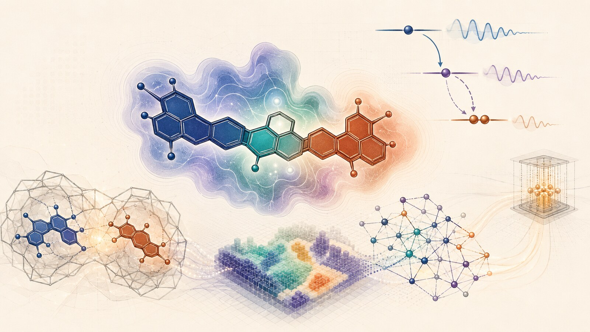
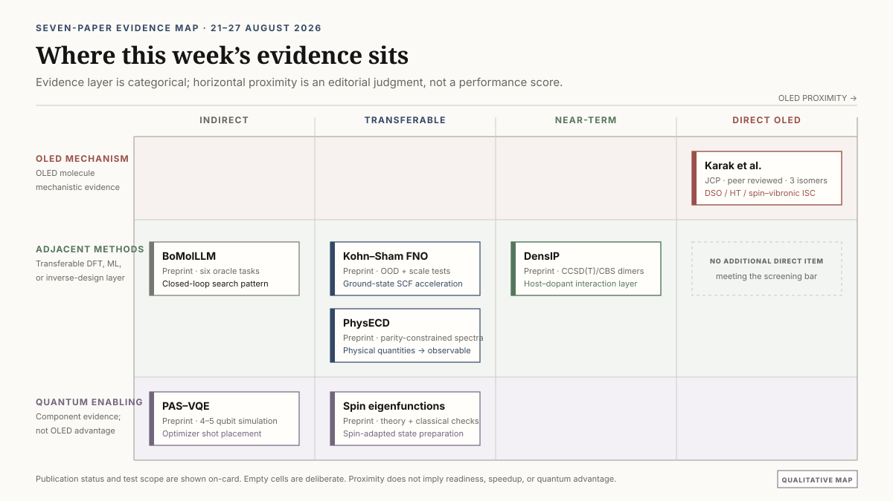
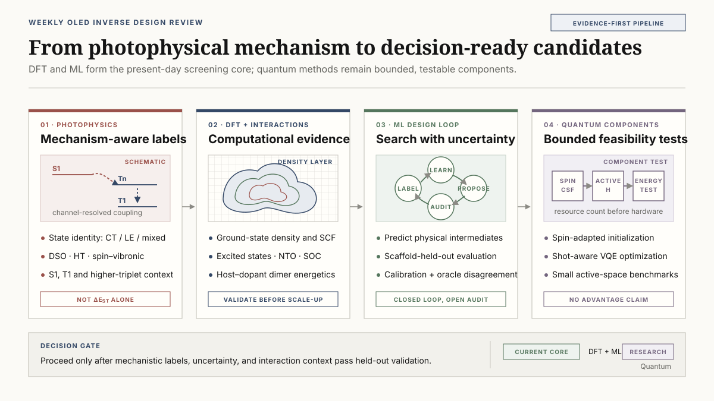

# Mechanism-Aware Property Labels for OLED Molecular Inverse Design: From Isomer-Dependent ISC to Scalable DFT and ML

Moving a substituent changes the route between electronic states even when the overall transition rates remain similar. In Karak and co-workers’ study of three carbazole–benzoate positional isomers, direct spin–orbit coupling and nuclear motion contribute strongly to the ortho and para pathways, while nuclear motion and higher-triplet mediation shape the meta pathway. <a class="citation" href="#ref-1">[1]</a>

For OLED inverse design, this raises a question about what a model should learn. The singlet–triplet gap, $\Delta E_{\mathrm{ST}}$, identifies an energy condition favorable to thermally activated delayed fluorescence (TADF). Understanding the rate also requires state character, spin–orbit coupling (SOC), and the vibrations that mix electronic states. A single rate label hides which pathway changes when the structure changes.

The literature screened from 21 to 27 August 2026 suggests starting with a small mechanistic-label audit, then extending the calculation from isolated molecules to host–dopant interactions and computational cost.

*Figure 1. AI-generated concept illustration. The central molecule and electron density, with energy levels and vibrations at upper right, represent mechanistic property labels. The lower-left molecular pair represents host–dopant interactions; the lattice, neural network, and small circuit below connect DFT/ML calculations with quantum-component research.*

The [source brief prepared on 28 August 2026 (English, eight pages)](../artifacts/oled_inverse_design_weekly_brief_2026-08-28.pdf) is also available.

## Evidence map: one direct OLED paper, six enabling preprints

Seven papers were selected after excluding records already covered in the preceding weekly brief. Karak et al. is the directly relevant, peer-reviewed photophysics study; the other six are first-version arXiv preprints on adjacent methods.

*Figure 2. Review-produced qualitative map of the seven papers by proximity to OLED research and validation layer. The horizontal positions express editorial judgments about application scope, rather than performance scores. Karak et al. directly studies the photophysics of three isomers.*

The workflow recommendations below are review inferences. They were not executed or validated by the source papers unless stated otherwise.

## 1. Similar rates do not imply the same photophysical mechanism

Karak and co-workers studied methyl 2-, 3-, and 4-(9H-carbazol-9-yl)benzoate, denoted o-, m-, and p-MCBA. They classified excited states as charge-transfer (CT), locally excited (LE), or mixed CT+LE and calculated intersystem-crossing contributions using a time-dependent correlation-function framework.

For the lowest-singlet pathway, the reported direct spin–orbit/Herzberg–Teller rates were:

| Isomer | Direct SOC rate | Herzberg–Teller rate |
| --- | ---: | ---: |
| ortho | $0.87\times10^6\ \mathrm{s^{-1}}$ | $4.16\times10^6\ \mathrm{s^{-1}}$ |
| para | $1.18\times10^6\ \mathrm{s^{-1}}$ | $2.24\times10^6\ \mathrm{s^{-1}}$ |
| meta | $5.67\times10^3\ \mathrm{s^{-1}}$ | $4.02\times10^6\ \mathrm{s^{-1}}$ |

The separately reported rate components should not simply be added to obtain a total rate. The meta isomer additionally exhibited a spin-vibronic-assisted $k_{\mathrm{ISC}}$ of $5.45\times10^6\ \mathrm{s^{-1}}$. Direct SOC plus Herzberg–Teller coupling dominated the ortho and para pathways, whereas Herzberg–Teller plus spin-vibronic coupling dominated the meta pathway. Larger $S_1$–higher-triplet and higher-triplet–$T_1$ energy separations suppressed the spin-vibronic route in the ortho and para structures.

The three positional isomers can reach ISC rates of a similar order through different combinations of electronic SOC, nuclear-motion-assisted SOC, and higher-triplet mediation.

A model trained only on $\Delta E_{\mathrm{ST}}$ and one static $S_1$–$T_1$ SOC value can rank the observed rate without learning the correct pathway. A more auditable label vector would retain at least $S_1$, $T_1$, $T_2$, and $T_3$ energies; CT/LE state character; oscillator strength; relevant $S_1$–$T_n$ SOC matrix elements; and a descriptor for promoting-mode or spin-vibronic activity.

The three-isomer ISC comparison motivates tracking states and couplings in RISC design. Evaluating RISC and emission efficiency requires the reverse-transition state arrangement, radiative and nonradiative losses, and the host environment. Rigid multiresonance TADF and heavy-atom phosphorescent emitters have different coupling and vibrational conditions. Quantitative rates also depend on the electronic-structure, vibronic, and line-broadening approximations.

## 2. Intermolecular energetics is the missing bridge to the OLED film

An isolated-molecule model does not determine how a candidate behaves in an amorphous film. Host–dopant and host–host contacts alter electrostatics, dispersion, induction, orbital overlap, CT-state formation, and conformational distributions.

Wing and co-workers’ DensIP <a class="citation" href="#ref-2">[2]</a> combines electron densities predicted by DenSNet with a four-parameter physical model containing electrostatics, exchange repulsion, induction, and many-body dispersion. DenSNet uses 20,000 DFT calculations. The four universal parameters are fitted with 1,016 training calculations from the optimized DES15K subset, which contains 4,063 configurations from 1,016 unique dimers; molecule-disjoint splits and $5\times5$ cross-validation are used for the small-dimer fit.

Reported test RMSEs against CCSD(T)/CBS are 0.7 kcal/mol near equilibrium, 0.2 kcal/mol at medium range, 0.7 kcal/mol for molecular-dynamics conformations, and 0.7 kcal/mol for neutral PLF547 protein–ligand fragments. The S66x8 interaction-energy RMSE is 0.6 kcal/mol. On the authors’ hardware, a benzene dimer required approximately 30 CPU-s with DensIP versus approximately 2,000 CPU-s with PBE.

The limitations are substantial for OLED use. Training chemistry is restricted to neutral, closed-shell H/C/N/O systems. Repulsive-wall and short-range RMSEs rise to 3.8 and 2.2 kcal/mol, respectively. Nitriles and carboxylic acids are difficult, and compensation between induction and exchange errors is reported. No OLED blend, amorphous morphology, excited state, or force-field molecular-dynamics validation is included.

A useful next benchmark would contain 100–300 host–host and host–emitter geometries spanning stacked, T-shaped, CT-contact, and separated configurations. A DensIP-like model could be compared with $\omega$B97X-D/def2-TZVP and a smaller DLPNO-CCSD(T) anchor set. Its role would be to re-rank packing-aware candidates before expensive excited-state cluster calculations, not to replace those calculations.

## 3. A neural Kohn–Sham map could accelerate SCF, but not the whole OLED calculation

Khan and co-workers <a class="citation" href="#ref-3">[3]</a> learn a map from a Kohn–Sham potential on a real-space grid to the corresponding electron density. Their domain-invariant, SE(3)-equivariant Fourier neural operator replaces repeated orbital diagonalizations during SCF and has reported cost scaling of $O(N_g\log N_g)$.

Training combines 2,004 molecules and 6,500 solids, using 59,500 ordinary SCF potential–density labels. The tests include QM9, larger QMugs molecules, metals, insulators, and magnesium dislocations. For held-out QM9 systems, the density error is 0.625%, compared with 0.662% for a direct ground-state predictor. On out-of-distribution QMugs molecules, the self-consistent neural-operator error is 2.23% versus 9.97%; the dipole error is 0.026 versus 0.237 D/electron. The method converges magnesium dislocations containing up to 8,250 atoms and 82,500 valence electrons on one NVIDIA B300 GPU after fine-tuning on cells no larger than 364 atoms. Independent density-error comparisons use central cropped systems containing up to 528 atoms; a reference solution is unavailable for the full 8,250-atom system.

The learned density map supports stable SCF iterations across unusually different chemical and solid-state domains, including a large out-of-distribution metallic defect calculation.

For OLED calculations, this should initially be tested as a ground-state SCF acceleration module. A controlled benchmark would measure SCF wall time and failure rate for 50–200 large donor–acceptor molecules and dimers, recover orbitals through fixed-density post-SCF diagonalization, and then run the unchanged TDA/TDDFT layer.

Only the density component is learned in this preprint. Total energies and spectra still require post-SCF orbital recovery. Excited states, hybrid and range-separated functionals, forces, charged species, and organic-film conformers are not established. If the fixed-density diagonalization consumes most of the original cost, the end-to-end acceleration may be much smaller than the SCF scaling result suggests.

## 4. Closed-loop generation still needs a trustworthy oracle

Xu and co-workers’ BoMolLLM <a class="citation" href="#ref-4">[4]</a> freezes both a graph-based Llamole generator and an LLM surrogate. The surrogate reads the design instruction, previous SMILES, and oracle scores, then selects top-$k$ reference molecules and may provide a one-sentence search guide. Its classical comparison is a Matérn-5/2 Gaussian process with automatic relevance determination on 768-dimensional generator embeddings compressed by truncated SVD, using LogEI acquisition.

The study tests Llama-3.1-8B, Mistral-7B, and Qwen2-7B on six MolQA tasks: HIV, BBBP, and BACE classification plus CO2, O2, and N2 permeability. The oracles are random forests trained on ECFP4 fingerprints. Improvements are heterogeneous. With Mistral, BACE AUC rises from 0.6209 in one-shot generation to 0.6443, while O2 log-MAE changes from 0.7621 to 0.7535. Random search and GP Bayesian optimization are often close, and the material-task improvements with Qwen are small.

The loop optimizes learned oracles and evaluates with closely related machinery, so oracle exploitation is unresolved. Prompted “exploration” is not calibrated posterior uncertainty. The invalid-SMILES ratio is reported separately for material tasks, and those molecules are excluded from MAE. The MAE should therefore be read alongside the fraction of valid molecules. The study contains no excited-state OLED data, DFT validation, synthesis planning, or retrosynthesis constraint.

For an OLED loop, the LLM is better assigned to summarizing failure clusters and choosing interpretable references. Numerical predictions and uncertainty should remain with a calibrated GNN ensemble or GP. Each iteration should reserve a blinded DFT batch and report enrichment, calibration error, scaffold diversity, synthetic feasibility, and oracle disagreement.

Jiang and co-workers’ PhysECD <a class="citation" href="#ref-5">[5]</a> supplies a complementary modeling pattern. Its parity-aware E(3)-equivariant network predicts per-state excitation energies and electric and magnetic transition dipoles, then reconstructs rotatory strengths and spectra with differentiable Gaussian broadening. Mirror reflection exactly reverses the predicted ECD spectrum by construction. On CMCDS, the reported per-molecule spectral Pearson correlation is 0.642 mean and 0.822 median.

The ECD results are conformer-specific; ensemble weighting and solvent effects need separate treatment. For OLED applications, excitation energies, intensities, and final spectra would each need evaluation. The transferable design principle is to predict physical generators, then assemble the observable. An OLED model could predict state energies, transition dipoles, transition-density descriptors, and SOC-related quantities before a differentiable photophysics layer constructs spectra or rate proxies.

## 5. Two quantum components: measurement shifts and spin-state preparation

Stalschus and co-workers’ PAS <a class="citation" href="#ref-6">[6]</a> modifies one-parameter-at-a-time Rotosolve/NFT-style optimization. For the single-frequency parameter dependence used in the paper, three circuit-energy evaluations reconstruct a sinusoid. A von Mises prior is placed over the minimizer, and the measurement shift adapts from $2\pi/3$ for a weak prior toward $\pi/2$ for a concentrated prior.

All reported benchmarks are simulations: a 5-qubit transverse-field Ising model with a three-layer efficient-SU(2) circuit and 40 parameters, and 4-qubit MaxCut with a five-layer hardware-efficient circuit and 20 parameters. The study uses 100 random starts. Shot budgets are 1,000 or 100 shots per evaluation for the Ising model and 200 or 20 for MaxCut. PAS recovers whichever of two fixed shifts performs better in each regime; it does not claim a universal multiplicative speedup.

No molecular Hamiltonian, active space, fermion-to-qubit mapping, excited-state objective, hardware noise, or chemistry optimizer baseline is tested. For a full sweep through all parameters, a uniform-budget molecular test would count parameters × sweeps × three shifts × Pauli measurement groups × shots per group. This distinguishes a full sweep from one parameter update. The familiar $O(1/\sqrt{N_{\mathrm{shots}}})$ shot-noise scaling remains.

Tao, Wang, and Zuo <a class="citation" href="#ref-7">[7]</a> deterministically prepare total-spin eigenfunctions using sequential branching paths or binary spin-coupling trees. Branching-path SCS-CG circuits can reach $O(n)$ depth. The presented WDB-CG implementation uses one auxiliary qubit and $O(n^2)$ depth. This describes that implementation; finding a shallower construction remains open. Small-qubit instances are checked with classical amplitude reconstruction; there is no QPU run, molecular energy calculation, or noise study.

Spin-pure configuration state functions could improve initial overlap for open-shell or strongly correlated active spaces. However, an $n$-spin eigenfunction is not yet a molecular electronic wavefunction. Orbital occupations, antisymmetry mapping, the active-space Hamiltonian, and a correlation ansatz remain necessary.

## 6. Proposed experiment: a 12–24-molecule mechanistic label audit

The following experiment is a review proposal, not a completed result.

1. **Select the chemical set.** Choose three or four scaffold families containing positional or torsional isomers. Include at least one known fast-RISC example and one weak or negative control per family. The 12–24-molecule pilot is intended to assess the information gained from extra labels, with uncertainty determining whether the chemical set should be expanded.

2. **Freeze geometries and base labels.** At existing optimized geometries, extract $S_1$, $T_1$, and at least $T_2$ energies; use $T_3$ where state ordering requires it. Record oscillator strength, natural-transition-orbital CT/LE descriptors, and relevant $S_1$–$T_n$ SOC matrix elements.

3. **Add a limited vibronic tier.** For four to six representatives, calculate selected normal-mode SOC derivatives or a clearly defined spin-vibronic proxy. This tier should be reserved for molecules chosen before model evaluation, not only for cases that the simpler model already misranks.

4. **Fit matched models.** Compare A and B on the full set using the same split. Compare all three on the four-to-six-molecule vibronic subset using the same molecules and targets as an exploratory case analysis. Expand the vibronic set across families before judging Model C by scaffold-held-out performance; define molecule selection and missing-descriptor handling before evaluation.

   - Model A: $\Delta E_{\mathrm{ST}}$ only
   - Model B: $\Delta E_{\mathrm{ST}}$ + static SOC + state character
   - Model C: Model B + promoting-mode or spin-vibronic descriptors

5. **Use scaffold-held-out validation.** Compare leave-one-scaffold-out ranking of measured $k_{\mathrm{RISC}}$, or a higher-level computed rate when measurement is unavailable. Report uncertainty calibration and the frequency of catastrophic isomer inversions, not only aggregate MAE.

6. **Apply a circularity gate.** Continue only if Model B on the full set, or Model C after expanding the vibronic and family-specific sample, improves scaffold-held-out ranking without using the same computed rate formula both to construct the descriptors and to define the validation target.

A positive result would justify expanding mechanistic labels in the production dataset. A negative result would still be useful: it would show whether the extra computational cost adds information beyond geometry, energy gaps, and conventional SOC descriptors.

The audit can guide which computational layer to expand next: mechanistic labels, intermolecular energetics, ground-state SCF acceleration, or a small active-space comparison.

*Figure 3. Review-proposed OLED inverse-design workflow connecting mechanistic labels, intermolecular and SCF calculations, iterative design, and quantum components. The checks below each layer identify the properties and costs to evaluate when applying it to an OLED problem. Review-produced diagram.*

## 7. Questions retained from the original screening

Within the 21–27 August 2026 selection window, no new record was secured for detailed review on PhOLED host/device lifetime validation, degradation mechanisms, synthesis-constrained generation, CRBM or quantum optimization, OLED-scale VQE, or GW–BSE. This describes the screening result rather than the existence of research across those fields.

The B/N-doped hetero[8]helicene study published online on 27 August was retained for follow-up. <a class="citation" href="#ref-8">[8]</a> Quantitative content had not been checked sufficiently at the original cutoff, so it was excluded from the seven-paper analysis.

## Conclusion

This week’s papers reorganize the OLED inverse-design problem into three coupled layers.

The molecular layer needs labels that distinguish state character, SOC pathways, and vibronic mediation instead of compressing photophysics into $\Delta E_{\mathrm{ST}}$. The environmental layer needs intermolecular energetics that can evaluate host–host and host–emitter contacts. The computational layer needs faster ground-state calculations whose end-to-end benefit survives orbital recovery and subsequent excited-state work.

The proposed mechanistic-label audit would test which extra information justifies its calculation cost. Packing and SCF benchmarks can then ask whether that information remains useful in a molecular environment and whether faster density calculations reduce the complete workflow time. Small active-space comparisons would separately evaluate the chemical contribution and resource cost of the two quantum components.

## Publication information and revision history

- Original publication and literature-verification cutoff: 2026-08-28; coverage 2026-08-21–27, with screening closing at approximately 08:58 KST.
- Editorial and source check: 2026-11-09. The original numerical findings and coverage are retained. The revision clarifies WDB-CG implementation cost, the different sizes of maximum SCF convergence and independent reference comparisons, the audit’s subset comparison, and the sweep unit in circuit-cost accounting.
- Original assistance: a Codex-based GPT-5-family agent harness. The exact model identifier and original role roster were not retained.
- This revision: Codex root for editing and integration; oled_science for six first-version papers and Karak’s publisher metadata/abstract; oled_refs_pdf for APS references, versions, and the source PDF; oled_prose for independent bilingual prose, captions, and the three figures, within the editorial team (AEDAUT). The exact model identifier was not retained. No human-reader study is claimed.
- Numerical findings are author-reported. No new DFT, ML, or quantum experiment was run. The 12–24-molecule audit and OLED benchmarks are unexecuted review proposals. The eight-page English PDF remains a separate source brief from the original publication.
- Shared prose harness: revision of 2026-11-06. The current journal title is Agentic Tech Review Letters (ATRL).

## References

<ol class="reference-list">
<li id="ref-1" value="1">P. Karak, K. Basu, A. Ghosh, and S. Chakrabarti, <a href="https://doi.org/10.1063/5.0343043">Role of spin–orbit and nuclear motion assisted spin–orbit coupling on the structural isomerism dependent intersystem crossing mechanism, J. Chem. Phys. <b>165</b>, 084303 (2026)</a>.</li>
<li id="ref-2" value="2">D. Wing, M. Bogojeski, S. Goger, K.-R. Müller, and A. Tkatchenko, <a href="https://arxiv.org/abs/2608.20753v1">Accurate and transferable intermolecular potential based on machine-learned molecular electron density, arXiv:2608.20753v1 (2026)</a>.</li>
<li id="ref-3" value="3">D. Khan, M. D. Hanisch, N. Argatoff, E. Xie, S. Sharma, and A. Anandkumar, <a href="https://arxiv.org/abs/2608.23895v1">Learning the Kohn-Sham map with neural operators for quasi-linear scaling density functional theory, arXiv:2608.23895v1 (2026)</a>.</li>
<li id="ref-4" value="4">Y. Xu, X. Zhao, X. Song, L. Bai, and T. Yu, <a href="https://arxiv.org/abs/2608.22967v1">Closed-loop Bayesian molecular inverse design with semantic LLM surrogates, arXiv:2608.22967v1 (2026)</a>.</li>
<li id="ref-5" value="5">Y. Jiang, L. Chen, R. Shi, L. Han, T. Zhu, and Y. Yang, <a href="https://arxiv.org/abs/2608.21892v1">PhysECD: A physics-constrained E(3)-equivariant framework for electronic circular dichroism spectrum prediction, arXiv:2608.21892v1 (2026)</a>.</li>
<li id="ref-6" value="6">F. Stalschus, S. Pedrielli, S. Kühn, K. Jansen, K. A. Nicoli, and S. Nakajima, <a href="https://arxiv.org/abs/2608.21616v1">Prior-informed adaptive shifts for sequential minimal optimization in variational quantum eigensolvers, arXiv:2608.21616v1 (2026)</a>.</li>
<li id="ref-7" value="7">W. Tao, J. Wang, and F. Zuo, <a href="https://arxiv.org/abs/2608.22892v1">Deterministic preparation of arbitrary spin eigenfunctions, arXiv:2608.22892v1 (2026)</a>.</li>
<li id="ref-8" value="8">N. Mou, Z.-G. Wu, Z. Zhang, J. Ni, C. Lu, Q. Zhao, T. Chen, X.-F. Luo, H. Dai, and M. Li, <a href="https://doi.org/10.1021/acs.orglett.6c03273">Integration of multiresonance heterocyclic aromatic hydrocarbons for fully resonant B/N-doped hetero[8]helicenes with long-wavelength ultra-narrow-band emission, Org. Lett. <b>28</b>, 11333–11338 (2026)</a>.</li>
</ol>
