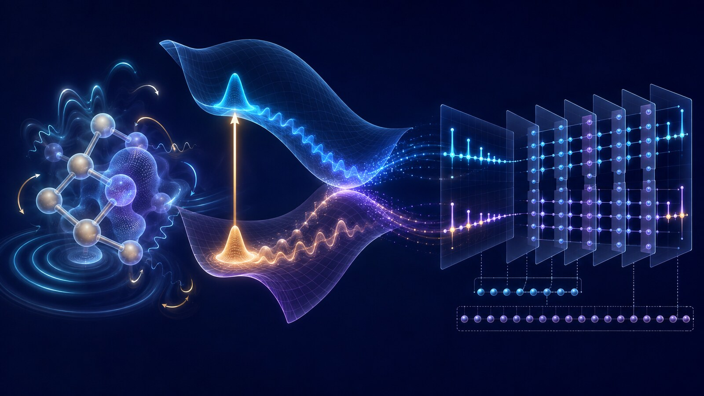
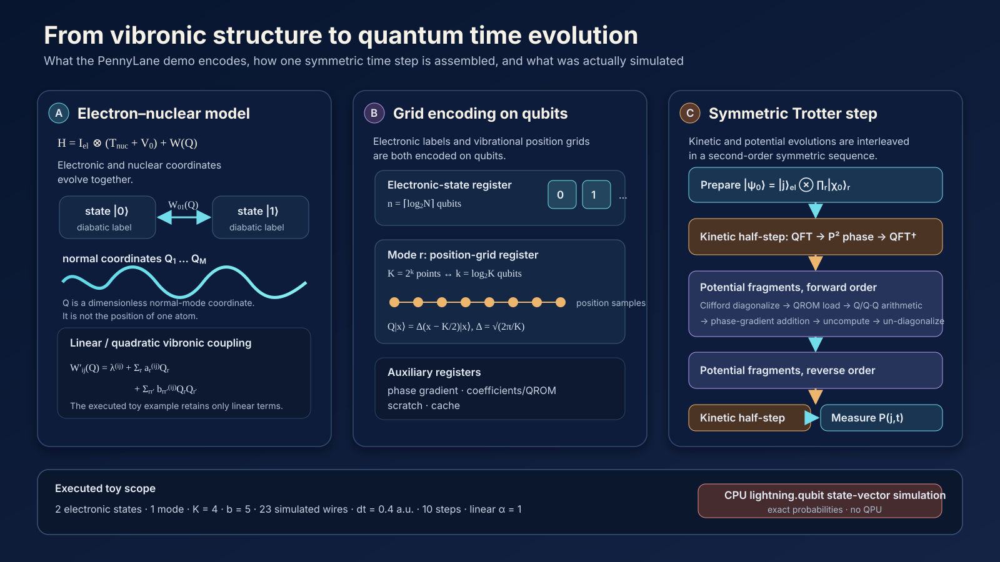

# 정적 에너지에서 광여기 동역학으로: PennyLane 진동-전자 양자 시뮬레이션의 원리와 연구 전망

분자가 빛을 받으면 전자상태가 바뀌며 핵의 운동도 달라진다. 결합이 늘어나거나 비틀릴 때 전자상태의 에너지와 성격도 달라진다. 이 결합된 움직임인 **진동–전자 동역학(vibronic dynamics)**을 따라가야, 들뜬 에너지가 어떤 상태와 경로를 거쳐 전달되는지 이해할 수 있다.

Emily Nobes가 2026년 8월 19일 공개한 PennyLane 데모 *A quantum algorithm for vibronic dynamics*는 그 움직임을 회로로 옮기는 과정을 보여준다. <a class="citation" href="#ref-1">[1]</a> 기반은 Motlagh 등의 동료평가 논문 *Quantum algorithm for vibronic dynamics: Case study on singlet fission solar cell design*이다. <a class="citation" href="#ref-2">[2]</a>

공개 코드는 두 전자상태와 진동모드 하나를 CPU 상태벡터 시뮬레이터 `lightning.qubit`으로 전파한다. <a class="citation" href="#ref-3">[3]</a> <a class="citation" href="#ref-4">[4]</a> 작은 모형 안에 격자 인코딩, 양자 푸리에 변환(QFT), 고정 계수 조회(QROM), 가역 산술과 위상 부여가 모두 들어 있다. 이 글은 각 구성요소가 분자의 운동에서 무엇을 담당하는지 읽고, 그 설명을 OLED 분자의 시간별 상태점유와 기작 중심 라벨로 이어 본다.

*그림 1. AI 생성 개념 일러스트. 왼쪽의 분자 진동, 가운데의 전자상태별 퍼텐셜 표면과 핵 파동묶음, 오른쪽의 격자 인코딩 시간진화를 연결한다.*

## 한눈에 보는 계산

| 구성 | 이 글에서 살펴볼 내용 |
|---|---|
| 물리 모형 | 두 전자상태·한 진동모드, 선형 진동–전자 결합 |
| 좌표 표현 | 모드당 네 격자점을 두 큐비트에 저장 |
| 회로 | 계수 조회·가역 산술·위상 부여를 결합한 실시간 전파 |
| 실행 | CPU `lightning.qubit`, 전체 23 wires |
| 관측량 | 상태벡터에서 구한 전자상태별 점유 확률 |
| 논문 자원 추정 | 화학적 동기를 가진 더 큰 모형의 알고리즘·논리 자원 |

작은 데모의 실행과 논문의 자원 추정은 규모와 검증 방법이 다르다. 먼저 회로가 하는 일을 이해한 뒤, 분자 정확도와 실제 장치 비용을 평가하는 데 필요한 조건을 살펴보자.

## 1. 여러 장의 지형도 위를 움직이는 파동묶음

Born–Oppenheimer(BO) 근사는 전자가 핵보다 훨씬 빠르게 움직인다는 차이를 이용한다. 각 핵 배치에서 전자상태를 먼저 계산하고, 핵은 그 상태가 만드는 잠재에너지표면(potential-energy surface, PES) 위를 움직인다고 본다. 평형 구조와 바닥상태 에너지를 계산할 때 매우 성공적인 접근이다.

빛을 받은 뒤에는 여러 전자상태의 표면이 가까워지거나 교차할 수 있다. 이를 **여러 장의 유연한 지형도**로 생각해 보자. 한 장은 한 전자상태이고, 지도 위 위치는 분자의 진동 좌표다. 핵의 파동묶음이 지형을 따라 움직이다 두 지도가 강하게 연결되는 구역을 만나면, 일부가 다른 지도에 해당하는 전자상태로 넘어갈 수 있다. 에너지 준위표는 몇 지점의 높이를 알려주지만, 어느 경로로 얼마나 빨리 이동하는지는 알려주지 않는다.

PennyLane 알고리즘은 이 움직임을 영화 프레임처럼 잘게 나눈다. 짧은 시간 $dt$마다 다음 두 일을 번갈아 수행한다.

1. 운동량에 따라 핵 파동묶음을 이동시킨다.
2. 핵의 위치와 전자상태에 따라 위상과 상태 간 결합을 갱신한다.

이 짧은 업데이트를 대칭 순서로 반복하는 것이 2차 Suzuki–Trotter product formula다.

PennyLane 소개문은 고전 계산이 동역학을 사실상 다룰 수 없다는 인상을 준다. 이는 범위가 너무 넓다. Surface hopping, Ehrenfest dynamics, multiconfiguration time-dependent Hartree(MCTDH), multilayer MCTDH와 tensor-network 등 여러 고전 방법이 이미 쓰인다. 더 정확한 문제 정의는 **많은 진동모드와 전자상태가 강하게 상관된 전체 양자 동역학을 체계적으로 정확하게 전파할 때 비용이 빠르게 증가한다**는 것이다.

## 2. 계산할 물리: KDC 진동-전자 해밀토니안

데모가 사용하는 Köppel–Domcke–Cederbaum(KDC) 해밀토니안은 전자상태와 핵 진동을 한 양자계로 적는다.

$$
H=\mathbb I_{\mathrm{el}}\otimes(T_{\mathrm{nuc}}+V_0)+\mathbf W(\mathbf Q).
$$

- $\mathbb I_{\mathrm{el}}$은 전자상태 공간의 항등연산자다.
- $T_{\mathrm{nuc}}$은 핵 진동의 운동에너지다.
- $V_0$는 기준 조화 퍼텐셜이다.
- $\mathbf W(\mathbf Q)$는 정상모드 좌표 $\mathbf Q$에 따라 변하는 전자상태 에너지와 상태 간 결합을 담은 diabatic potential matrix다.

두 전자상태 $i,j$ 사이의 퍼텐셜 블록은 기준 구조 주변에서 다음처럼 전개할 수 있다.

$$
W'_{ij}(\mathbf Q)=\lambda^{(i,j)}
+\sum_r a_r^{(i,j)}Q_r
+\sum_{r,r'}b_{rr'}^{(i,j)}Q_rQ_{r'}.
$$

$\lambda$는 좌표와 무관한 에너지 또는 결합, $a_rQ_r$은 선형 진동-전자 결합, $b_{rr'}Q_rQ_{r'}$은 이차 및 모드 간 결합을 나타낸다. 선형항까지 남기면 linear vibronic coupling(LVC), 이차항까지 포함하면 quadratic vibronic coupling(QVC) 모델이다. 여기서 $Q_r$은 원자 하나의 위치가 아니라 분자 전체가 함께 움직이는 **무차원 정상모드 좌표**다.

이 해밀토니안을 입력하려면 전자상태, 진동수, 정상모드와 결합계수를 DFT/TDDFT 또는 다중참조 전자구조 계산과 diabatization으로 먼저 얻어야 한다. [당시 공개된 arXiv v3](https://arxiv.org/html/2411.13669v3)도 해밀토니안 구성 자체는 양자 동역학 알고리즘의 범위 밖이라고 명시한다. <a class="citation" href="#ref-5">[5]</a>

## 3. 연속적인 핵 운동을 큐비트 격자에 넣는 법

각 진동모드를 $K=2^k$개의 위치 격자점으로 이산화하면 한 모드를 $k$개 큐비트에 저장할 수 있다. 계산기저 $|x\rangle$가 위치를 나타내며,

$$
Q|x\rangle=\Delta(x-K/2)|x\rangle,
\qquad \Delta=\sqrt{2\pi/K}
$$

로 좌표를 정의한다. 전자상태가 $N$개이고 진동모드가 $M$개라면 물리계를 나타내는 주 레지스터는

$$
M\log_2K+\lceil\log_2N\rceil
$$

개의 큐비트를 사용한다.

이 구현에서는 전자상태와 진동 좌표 모두 **큐비트 레지스터**에 부호화된다. 연속적인 정상좌표를 유한한 위치 격자로 바꾸는 방식이며, 광자 연속변수 qumode와는 구별된다. 코드의 `electrons` 변수는 diabatic 전자상태를 구별하는 레지스터를 가리킨다.

고전적인 primitive grid는 $N K^M$개의 복소 진폭을 명시적으로 저장해야 하므로 모드 수에 따라 메모리가 지수적으로 늘 수 있다. 양자상태는 이 진폭을 더 작은 큐비트 레지스터에 부호화할 수 있다. 하지만 이 압축이 곧 저비용 계산을 뜻하지는 않는다. 상태 준비, 계수 로딩, 양자 산술, Trotter 반복, 오류정정과 측정 비용이 남는다.

*그림 2. PennyLane 데모와 기반 논문을 따라 작성한 회로 구성도. KDC 해밀토니안에서 전자상태·진동 격자 레지스터로, 이어 대칭적인 Trotter 시간 단계로 읽는다. 아래 띠에는 데모에서 실행한 모형과 출력 조건을 적었다.*

## 4. 한 번의 시간 진화를 회로로 조립하는 방법

목표는 $|\psi(t)\rangle=e^{-iHt}|\psi(0)\rangle$를 계산하는 것이다. 운동에너지 $T$와 퍼텐셜 $V$는 일반적으로 서로 교환하지 않기 때문에 지수연산을 정확히 두 조각으로 분리할 수 없다. 데모는 운동에너지 절반 단계, 퍼텐셜 조각의 정방향·역방향 전개, 다시 운동에너지 절반 단계를 적용하는 2차 Trotter 공식을 사용한다.

### 운동에너지: QFT로 운동량 공간에 다녀온다

위치 $Q$는 격자 계산기저에서 대각형이지만 운동량 $P$는 그렇지 않다. 회로는 각 모드에 QFT를 적용하고 최상위 비트를 뒤집어 운동량 격자의 중심을 맞춘 뒤, `OutPoly`로 $(x-K/2)^2$을 보조 레지스터에 계산한다. 이 값과 운동에너지 계수로 위상을 누적한 뒤 중간 계산과 최상위 비트 반전을 되돌리고 역 QFT로 위치기저에 복귀한다.

### 퍼텐셜: 상태별 계수를 QROM으로 불러와 위상으로 바꾼다

퍼텐셜 계수는 전자상태에 따라 달라진다. `LoadCoeffsKDC`는 QROM을 사용해 현재 전자상태에 맞는 미리 계산된 비트열을 계수 레지스터로 적재한다. **고정된 coefficient table을 가역 회로로 조회하는 논리 연산**으로, 외부 메모리에 접근하는 하드웨어 QRAM과 구별된다.

선형항은 $Q_r$, 이차항은 $Q_rQ_{r'}$를 산술회로로 계산하고, 그 결과와 계수에 따른 제어 가산으로 위상을 부여한다. 공개 코드는 기울기 레지스터의 모든 큐비트를 $\lvert 1\rangle$로 만든 뒤 QFT를 적용하므로, 준비 상태는

$$
|R_b^-\rangle=2^{-b/2}\sum_{y=0}^{2^b-1}e^{-i2\pi y/2^b}|y\rangle.
$$

이다. <a class="citation" href="#ref-3">[3]</a> 가산 회로가 부여하는 위상의 부호는 이 푸리에 규약과 가산·역가산의 방향으로 정해진다. $b$는 회전의 고정소수점 정밀도를 정한다. 위상을 적용한 뒤 QROM과 산술 중간값을 되돌린다.

### 비대각 전자 결합: XOR fragment와 Clifford 대각화

전자상태 사이의 결합은 전자 부분에서 비대각 행렬을 만든다. 기반 알고리즘은 두 전자상태 인덱스의 XOR 차이가 같은 항을 하나의 fragment로 묶는다. 비트열이 한 자리에서 다르면 Hadamard로, 여러 자리에서 다르면 CNOT으로 차이를 한 자리에 모은 뒤 Hadamard로 block diagonalization한다. 이 과정은 Clifford gate만 사용한다. 각 fragment가 대각형이 된 뒤에야 위치별 퍼텐셜 위상을 효율적으로 적용할 수 있다.

## 5. 네 격자점과 두 상태로 보는 전파

실행된 예제의 설정은 다음과 같다.

| 변수 | 값 | 의미 |
|---|---:|---|
| electronic states | 2 | 1-qubit 전자상태 레지스터의 $\lvert 0\rangle$, $\lvert 1\rangle$ |
| vibrational modes | 1 | 정상모드 하나 |
| $k$ | 2 | 모드당 큐비트 수 |
| $K=2^k$ | 4 | 진동 좌표 격자점 수 |
| $b$ | 5 | 위상·계수 정밀도 비트; `delta=0.04`에서 계산 |
| $\omega$ | 1 | 예시 진동수 |
| $dt$ | 0.4 a.u. | 한 시간 단계 |
| steps | 10 | 총 4 a.u.까지 평가 |
| 퍼텐셜 차수 | $\alpha=1$ | 실제 실행은 선형 좌표항만 사용 |
| 계수 배열 | `[[1.0, 0.0], [-1.3, 1.3]]` | 실제 분자가 아닌 예시값 |

레지스터의 합은 23 wires다.

| 레지스터 | wires |
|---|---:|
| 전자상태 | 1 |
| 진동 격자 | 2 |
| phase gradient | 5 |
| coefficients | 5 |
| scratch | 6 |
| cache | 4 |
| **합계** | **23** |

전자상태 표지에 한 큐비트, 진동 좌표에 두 큐비트가 쓰이므로 물리 모형을 담는 레지스터는 3 wires다. 나머지 20개는 정밀도와 가역 산술을 위한 작업공간이다. 전체 회로 폭에서 산술 비용이 얼마나 큰 몫을 차지하는지 이 작은 예제에서도 드러난다.

초기 전자상태는 $\lvert 0\rangle$이며, 핵 상태는 네 격자점에 놓인 조화진동자 바닥상태 근사의 이산 Gaussian 파동묶음이다. 데모 앞부분의 상태 준비 설명 그림은 64점 격자의 진폭을 그린 것으로, 실제 전파에 쓰인 네 점 격자와 구별해야 한다. 프로그램은 각 단계 $n=0,\ldots,10$의 시간 $t=n\,dt$에서 회로를 처음부터 다시 상태벡터로 계산하고 전자 레지스터의 `qp.probs`를 반환한다. shots를 지정하지 않았으므로 유한 표본의 통계가 아니라 상태벡터에서 얻은 exact probabilities다. 페이지에 보고된 전체 스크립트 실행시간은 약 8분 9.7초다.

출력에서는 두 전자상태의 점유 확률이 진동하며, 전달은 완전하지 않다. 두 곡선의 합이 1인 것은 정규화된 전체상태에서 전자 레지스터의 두 확률을 모두 더했기 때문이다. 이 곡선은 회로의 기능을 보여주는 출발점이며, 정량적인 분자 동역학을 판단하려면 전파 오차와 해밀토니안의 적절성을 각각 검사해야 한다.

## 6. 분자 정확도를 얻으려면 무엇을 검증해야 하나

첫 기준은 같은 해밀토니안의 고전 전파다. exact grid나 MCTDH 기준선과 시간별 점유를 비교하면서 격자점 수 $K$와 좌표 범위, Trotter 간격 $dt$, 고정소수점 정밀도 $b$를 독립적으로 바꾸면 회로 근사의 기여를 분해할 수 있다. 원 데모에는 이런 수렴 비교가 포함되어 있지 않다.

수치적으로 수렴한 회로라도 입력 모형이 중요한 상태와 진동을 빠뜨리면 분자의 경로를 놓친다. 전자구조 계산과 diabatization, 포함할 상태·모드의 선택, LVC/QVC와 비조화 항의 절단을 별도로 검토해야 한다. 실험과 비교할 때에는 초기 상태와 열적 분포도 맞춰야 한다.

장치 실행으로 옮기면 유한-shot 관측량의 불확실성, native gate 컴파일, 하드웨어 잡음과 오류정정 비용이 더해진다. 논문의 알고리즘 자원 수치와 실제 장치의 처리시간을 연결하려면 이 단계까지 포함한 오차·비용 예산이 필요하다.

## 7. 분자 모형을 키울 때의 자원 비용

원 발행 당시 확인한 저널 논문과 arXiv v3는 모드당 $K=16$ 격자점과 2차 product formula를 사용해 다음 **algorithmic/logical** 자원을 추정한다. 표의 1%·10%는 축소 모형에서 계산해 모드 수에 따라 외삽한 **전자상태 점유확률의 Trotter 오차 목표**다. 전자구조 입력부터 모든 오차를 합한 분자 정확도는 아니다.

| 모형 | states · modes | 전파 조건 | qubits | Toffoli gates |
|---|---:|---:|---:|---:|
| $(\mathrm{NO})_4$-Anth | 5 · 19 | 100 fs, 10% | 146 | $5.47\times10^6$ |
| $(\mathrm{NO})_4$-Anth | 5 · 19 | 100 fs, 1% | 146 | $1.73\times10^7$ |
| $(\mathrm{NO})_4$-Anth dimer | 6 · 21 | 100 fs, 1% | 154 | $2.76\times10^6$ |
| $(\mathrm{NO})_4$-Anth dimer | 6 · 21 | 500 fs, 1% | 154 | $3.54\times10^7$ |
| anthracene/$\mathrm{C}_{60}$, reduced | 4 · 11 | 100 fs, 1% | 113 | $6.62\times10^5$ |
| anthracene/$\mathrm{C}_{60}$, full | 4 · 246 | 100 fs, 1% | 1,053 | $2.66\times10^7$ |

표의 dimer는 $(\mathrm{NO})_4$-Anth의 QVC 모형이다. 분자 사이 거리 $R$을 추가 동역학 좌표로 다루는 대신 $R=3.2$ Å에 고정한 퍼텐셜을 쓰므로, 분자 내 triplet 분리를 흉내 내기 위해 거리 좌표를 고정한 대리모형의 자원 추정으로 읽어야 한다.

표의 큐비트와 Toffoli 수는 논문이 산정한 알고리즘·논리 회로 비용이다. 물리 장치의 규모와 실행시간으로 바꾸려면 오류정정 code distance, magic-state factory, gate cycle time과 관측량 추출 비용을 더해야 한다.

판본 사이의 변화도 눈여겨볼 만하다. 2024년 11월 20일의 arXiv v1은 full 246-mode anthracene/$\mathrm{C}_{60}$에 1,065 qubits와 $2.7\times10^9$ Toffoli를 제시했지만, v3는 empirical error extrapolation을 사용해 1,053 qubits와 $2.66\times10^7$ Toffoli로 갱신했다. 2025년 10월 8일의 v3에서 줄어든 것은 **자원 산정법과 알고리즘 분석을 갱신해 얻은 추정치**다. <a class="citation" href="#ref-6">[6]</a>

별도 PennyLane [자원 추정 데모](https://pennylane.ai/demos/tutorial_resource_estimation_vibronic_dynamics)는 희소성을 활용하지 않는 dense $(\mathrm{NO})_4$-Anth 상한으로 146 wires, $6.082\times10^7$ Toffoli, 총 $5.21\times10^8$ gates를 보고한다. 이 데모의 기본 위상 정밀도는 $10^{-6}$, 전파는 500단계다. 구조·희소성·정밀도와 전파 조건을 맞춰 읽어야 두 산정치의 차이를 이해할 수 있다. <a class="citation" href="#ref-7">[7]</a>

논문은 강하게 상관된 고차 진동–전자 동역학을 고전 tensor 방법에 어려울 수 있는 영역으로 제시한다. 실제 이득을 판단하려면 같은 정확도에서 해밀토니안 구성, 전파 시간과 관측량 추출까지 포함한 전체 비교가 필요하다.

## 8. VQE와는 무엇이 다른가

| 구분 | VQE | 이번 알고리즘 |
|---|---|---|
| 질문 | 낮은 에너지 고유상태와 에너지는 무엇인가 | 광여기 뒤 상태 population은 시간에 따라 어디로 가는가 |
| 계산 | 매개변수화 상태의 에너지 최소화 | $e^{-iHt}$의 실시간 전파 |
| 출력 | 에너지와 정적 관측량 | $P_j(t)$, 전달 경로, 상관함수·스펙트럼 후보 |
| 회로 | ansatz, Pauli 측정, 고전 최적화 | QFT, QROM, 가역 산술, phase gradient, Trotter |
| 장치 지향 | NISQ 얕은 회로 연구가 많음 | 깊은 산술을 포함한 fault-tolerant 지향 |

VQE로 얻은 에너지는 동역학 해밀토니안의 입력 일부가 될 수 있다. 그러나 정적 에너지 하나가 진동이 유도하는 시간별 population transfer를 자동으로 주지는 않는다.

## 9. TADF·PhOLED 연구로 이어지는 질문

Thermally activated delayed fluorescence(TADF)의 reverse intersystem crossing(RISC)은 $\Delta E_{\mathrm{ST}}$ 하나로 결정되지 않는다. singlet와 triplet의 state character, higher triplet, 스핀–궤도 결합(SOC), 특정 promoting mode, 주변 유전환경과 구조 변동이 함께 관여할 수 있다. KDC 형식은 원리상 퍼텐셜 행렬에 SOC 해밀토니안을 더해

$$
\mathbf W'(\mathbf Q)=\mathbf W(\mathbf Q)+\mathbf H_{\mathrm{SO}}(\mathbf Q)
$$

와 같은 spin-vibronic 모형으로 확장할 수 있다. 기반 논문도 TADF를 잠재 응용으로 언급한다.

| OLED 물리 | 진동-전자 모형의 대응 요소 |
|---|---|
| $S_1$, $T_1$, $T_n$ 에너지·성격 | diabatic electronic-state manifold |
| SOC | $\mathbf H_{\mathrm{SO}}$와 상태 간 결합 |
| promoting vibration | $a_r^{(i,j)}$, $b_{rr'}^{(i,j)}$ |
| ISC/RISC 경로 | singlet–triplet population transfer |
| 시간별 상태점유 | $P_{S_1}(t)$, $P_{T_1}(t)$, $P_{T_n}(t)$ |
| 스펙트럼 | 시간 상관함수의 Fourier transform |

이 연결은 SOC와 triplet 상태를 추가하는 연구 제안이다. 실제 TADF·PhOLED 박막으로 확장할 때에는 열적 진동분포, dephasing, host polarization, disorder, 분자간 모드와 개방계 relaxation이 중요하다. 닫힌 계 toy model의 coherent oscillation을 비가역적인 ISC/RISC rate로 바로 읽을 수 없다.

이 글이 기대하는 활용은 미래 fault-tolerant 환경에서 소수의 고가치 후보를 정밀하게 살피는 **동역학 커널**이다. 후보 생성과 저비용 선별을 거친 뒤, 정적인 지표만으로 갈리지 않는 경로를 검증하는 데 계산을 집중할 수 있다.

## 10. OLED 역설계 안에서 검증을 시작하는 방법

현실적인 연결 순서는 다음과 같다.

1. 생성모델 또는 데이터베이스에서 후보를 만든다.
2. 합성가능성, 안정성, 기본 전자구조를 고전 방법으로 선별한다.
3. DFT/TDDFT·다중참조 계산으로 상태, Hessian, 정상모드와 SOC를 얻는다.
4. diabatization을 수행하고 작은 LVC/QVC spin-vibronic 해밀토니안을 만든다.
5. exact grid, MCTDH 또는 tensor-network 기준선으로 먼저 검증한다.
6. 동일 정확도 목표에서 Trotter·격자·정밀도 오차와 logical resource를 추정한다.
7. 고전 기준이 어려워지는 제한된 후보에서만 양자 전파를 고려한다.
8. population, mode sensitivity와 불확실성을 ML surrogate의 기작 중심 라벨로 되돌린다.

첫 PoC는 $S_1$, $T_1$과 한두 개 higher triplet, 5–10개 promoting mode 정도의 공개 해밀토니안으로 시작하는 편이 낫다. 모든 trajectory를 exact 또는 MCTDH 기준과 비교하고, $K$, $dt$, $b$를 독립적으로 변화시켜 오차를 분해해야 한다. 이 검증을 통과한 뒤에야 larger-state 또는 open-system 확장을 논의할 수 있다.

## 정적 준위에서 시간별 경로로

PennyLane 데모의 장점은 물리와 회로 사이를 따라 읽을 수 있다는 데 있다. QFT는 운동에너지를, QROM과 가역 산술은 상태·좌표 의존 퍼텐셜을, phase-gradient state는 시간진화 위상을 맡는다. 작은 모형에서 이 역할을 이해하면 더 큰 동역학 계산의 비용이 어디서 생기는지도 보인다.

OLED 분자설계에서 얻고 싶은 것은 상태별 점유, higher-state mediation, SOC와 promoting mode가 만드는 경로다. 신뢰할 수 있는 해밀토니안과 고전 기준선 위에서 이런 시간 정보를 검증해야, 정적 $\Delta E_{\mathrm{ST}}$와 oscillator strength에 동역학적 의미를 보탤 수 있다. 회로는 그 연결의 한 구성요소이며, 이 데모는 구성요소를 직접 살펴볼 수 있는 출발점이다.

## 작성 정보와 개정 이력

- 원 발행일·문헌 기준일: 2026-08-29. 당시 데모와 논문 판본의 결과를 유지한다.
- 편집 개정·원문 대조: 2026-11-10. 한영 설명의 반복과 캡션을 다듬고, dimer 자원 표의 분자명·거리 고정 조건을 보완했다. 상태 준비 설명용 64점 그림과 실제 네 점 전파를 구별하고 단계 번호와 물리 시간을 명료화했다. 기존 여섯 자원 수치는 유지한다.
- 원 작성 보조와 2026-08-29 공개본 복구: OpenAI Codex Work Mode. 원 세션의 정확한 모델·역할 명단은 미보존이며, 당시 복구에서 확인한 Volta·Feynman·Carson·Kierkegaard의 역할 기록은 유지한다. 당시 편집 하네스 명칭은 AI Tech Review Editorial Harness v2026.08이다.
- 이번 감수: 편집부(AEDAUT)의 Codex root(편집·통합), vibronic_science(논문·v1/v3·자원 조건), vibronic_code_refs(고정 커밋의 두 데모·공식 문서·APS 서지), vibronic_prose(한영 문맥과 두 그림·캡션의 독립 감수). 정확한 모델 식별자는 미보존이다.
- 실행시간과 자원 수치는 원저자 보고값이다. 이번에 23-wire 스크립트나 QPU·분자 계산을 새로 실행하지 않았으며 OLED 검증 workflow는 연구 제안이다. 사람의 문장별 감수나 독자 평가를 수행한 것으로 표시하지 않는다.
- 현재 제호: Agentic Tech Review Letters(ATRL). 공통 문체 감사 하네스의 2026-11-06 개정 기준을 적용했다. 과학 본문은 arXiv v3 전체와 v1 선택 구간을 대조하고 정식 저널 서지는 Crossref로 확인했다. 출판사 최종판 PDF는 접근 확인 화면으로 확보하지 못했다.

## References

<ol class="reference-list">
<li id="ref-1" value="1">E. Nobes, <a href="https://pennylane.ai/demos/simulating_vibronic_dynamics">A quantum algorithm for vibronic dynamics, PennyLane Demos (19 August 2026)</a>.</li>
<li id="ref-2" value="2">D. Motlagh, R. A. Lang, P. Jain, J. A. Campos-Gonzalez-Angulo, W. Maxwell, T. Zeng, A. Aspuru-Guzik, and J. M. Arrazola, <a href="https://doi.org/10.1088/2058-9565/ae0828">Quantum algorithm for vibronic dynamics: Case study on singlet fission solar cell design, Quantum Sci. Technol. <b>10</b>, 045048 (2025)</a>.</li>
<li id="ref-3" value="3">PennyLaneAI, <a href="https://github.com/PennyLaneAI/demos/blob/4e1b6f0c2501ff79fb6addbaf9323a9399e3f824/demonstrations_v2/simulating_vibronic_dynamics/demo.py">Simulating Vibronic Dynamics, demonstrations_v2/simulating_vibronic_dynamics/demo.py, demos repository, commit 4e1b6f0c2501ff79fb6addbaf9323a9399e3f824 (19 August 2026)</a>.</li>
<li id="ref-4" value="4">PennyLane, <a href="https://docs.pennylane.ai/projects/lightning/en/stable/lightning_qubit/device.html">Lightning Qubit device, Lightning 0.45.0 documentation (accessed 10 November 2026)</a>.</li>
<li id="ref-5" value="5">D. Motlagh, R. A. Lang, P. Jain, J. A. Campos-Gonzalez-Angulo, W. Maxwell, T. Zeng, A. Aspuru-Guzik, and J. M. Arrazola, <a href="https://arxiv.org/abs/2411.13669v3">Quantum algorithm for vibronic dynamics: Case study on singlet fission solar cell design, arXiv:2411.13669v3 (2025)</a>.</li>
<li id="ref-6" value="6">D. Motlagh, R. A. Lang, J. A. Campos-Gonzalez-Angulo, T. Zeng, A. Aspuru-Guzik, and J. M. Arrazola, <a href="https://arxiv.org/abs/2411.13669v1">Quantum algorithm for vibronic dynamics: Case study on singlet fission solar cell design, arXiv:2411.13669v1 (2024)</a>.</li>
<li id="ref-7" value="7">D. Dhawan, <a href="https://pennylane.ai/demos/tutorial_resource_estimation_vibronic_dynamics">Quantifying resource requirements for vibronic dynamics simulation, PennyLane Demos (16 March 2026; updated 27 May 2026)</a>.</li>
</ol>
