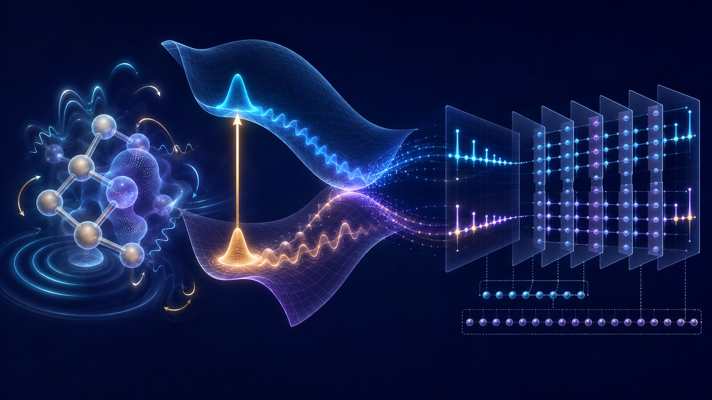
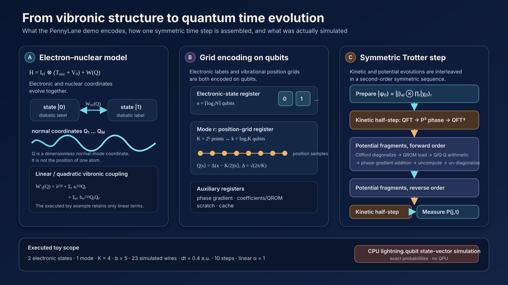

# From Static Energies to Photoexcited Dynamics: Vibronic Quantum Simulation in PennyLane

Absorbing light changes a molecule’s electronic state and alters its nuclear motion. Stretching and twisting bonds alter the energies and characters of the electronic states in turn. Following this coupled **vibronic dynamics** reveals the pathways through which excitation is redistributed.

Emily Nobes’s PennyLane demo *A quantum algorithm for vibronic dynamics*, published on 19 August 2026, makes those motions inspectable as circuit operations. <a class="citation" href="#ref-1">[1]</a> It implements the peer-reviewed algorithm of Motlagh and co-workers, *Quantum algorithm for vibronic dynamics: Case study on singlet fission solar cell design*. <a class="citation" href="#ref-2">[2]</a>

The public code propagates two electronic states and one vibrational mode with the CPU-based `lightning.qubit` state-vector simulator. <a class="citation" href="#ref-3">[3]</a> <a class="citation" href="#ref-4">[4]</a> This small model contains the real-space grid, Quantum Fourier Transform (QFT), fixed-table lookup (QROM), reversible arithmetic, and phase operations needed to assemble the evolution. We follow their physical roles, then consider how time-resolved populations could inform mechanism-aware OLED design.

*Figure 1. AI-generated concept illustration. Molecular vibration at left connects through electronic-state potential surfaces and a nuclear wavepacket in the centre to grid-encoded time evolution at right.*

## The calculation at a glance

| Component | What this review examines |
|---|---|
| Physical model | Two electronic states, one vibrational mode, linear vibronic coupling |
| Coordinates | Four grid points stored in two qubits per mode |
| Circuit | Real-time propagation using coefficient lookup, arithmetic, and phases |
| Execution | CPU `lightning.qubit`, 23 wires in total |
| Observable | Electronic-state populations from the state vector |
| Paper estimates | Algorithmic/logical resources for larger chemically motivated models |

The demo execution and the paper’s resource estimates operate at different scales. Understanding the circuit comes first; molecular accuracy and physical-device costs require additional tests.

## 1. An intuitive picture: a wavepacket moving across several landscapes

The Born–Oppenheimer approximation uses the fact that electrons usually respond much faster than nuclei. One first solves the electronic problem at a chosen nuclear geometry, then treats the nuclei as moving on the resulting potential-energy surface. This picture is extraordinarily productive for equilibrium structures and ground-state energies.

After photoexcitation, however, several electronic surfaces can approach or intersect. Imagine them as flexible landscape sheets stacked above the same molecular coordinates. A nuclear wavepacket moves across a sheet. When it reaches a region where two sheets interact strongly, part of the wavepacket may transfer to the other electronic state, split between pathways, or retain coherence. A table of vertical excitation energies records selected heights; it does not propagate the moving wavepacket.

The algorithm divides this motion into short movie frames. During every small interval $dt$, it alternates between two updates:

1. move the nuclear wavepacket according to its momentum;
2. update phases and state couplings according to nuclear position and electronic label.

A symmetric sequence of those updates is a second-order Suzuki–Trotter product formula.

The introductory PennyLane prose is too broad when it suggests that classical computers simply cannot handle dynamics. Surface hopping, Ehrenfest dynamics, multiconfiguration time-dependent Hartree (MCTDH), multilayer MCTDH, and tensor-network methods all address parts of this problem. The narrower challenge is that systematically accurate, full-dimensional quantum propagation can become expensive when many modes and electronic states develop strong correlations.

## 2. The physical model: the KDC vibronic Hamiltonian

The Köppel–Domcke–Cederbaum (KDC) Hamiltonian treats electronic labels and nuclear vibrations as one quantum system:

$$
H=\mathbb I_{\mathrm{el}}\otimes(T_{\mathrm{nuc}}+V_0)+\mathbf W(\mathbf Q).
$$

$T_{\mathrm{nuc}}$ is nuclear vibrational kinetic energy, $V_0$ is a reference harmonic potential, and $\mathbf W(\mathbf Q)$ is a diabatic matrix of electronic energies and couplings that changes with the normal-mode coordinates $\mathbf Q$.

A matrix element can be truncated at quadratic order:

$$
W'_{ij}(\mathbf Q)=\lambda^{(i,j)}
+\sum_r a_r^{(i,j)}Q_r
+\sum_{r,r'}b_{rr'}^{(i,j)}Q_rQ_{r'}.
$$

The coordinate-independent $\lambda$ terms set energy offsets and couplings, $a_rQ_r$ gives linear vibronic coupling, and $b_{rr'}Q_rQ_{r'}$ introduces quadratic and mode–mode dependence. Keeping only the linear terms gives an LVC model; retaining the quadratic terms gives a QVC model. Each $Q_r$ is a dimensionless molecular normal coordinate, not the position of one atom.

Electronic states, frequencies, normal modes, and coupling coefficients for this input Hamiltonian must be obtained upstream from DFT/TDDFT or multireference calculations and a diabatization procedure. The [then-available arXiv v3](https://arxiv.org/html/2411.13669v3) explicitly leaves Hamiltonian construction outside the quantum-propagation algorithm. <a class="citation" href="#ref-5">[5]</a>

## 3. Encoding continuous nuclear motion on qubits

Each vibrational coordinate is discretized over $K=2^k$ real-space grid points and stored in a $k$-qubit register. The computational basis represents position:

$$
Q|x\rangle=\Delta(x-K/2)|x\rangle,
\qquad \Delta=\sqrt{2\pi/K}.
$$

With $M$ vibrational modes and $N$ electronic states, the main system register uses

$$
M\log_2K+\lceil\log_2N\rceil
$$

qubits before work and precision registers are added.

Both the electronic label and vibrational coordinates are encoded in **qubit registers**. A continuous normal coordinate is represented by a finite position grid, distinct from a photonic continuous-variable qumode. The code variable `electrons` labels the diabatic electronic-state register.

A primitive classical grid stores $N K^M$ complex amplitudes explicitly, so memory can grow exponentially with the number of modes. A quantum state can encode those amplitudes in a smaller register. That representational compression does not eliminate state preparation, coefficient loading, quantum arithmetic, circuit precision, error correction, or measurement costs.

*Figure 2. Circuit map drawn from the PennyLane demo and source paper. Read from the KDC Hamiltonian through electronic-state and vibrational grid registers to one symmetric Trotter step. The bottom strip records the executed model and output settings.*

## 4. How one time step is assembled

The target evolution is $|\psi(t)\rangle=e^{-iHt}|\psi(0)\rangle$. Kinetic and potential terms generally do not commute, so their exponentials cannot simply be separated without error. The demo uses a kinetic half-step, the potential fragments in forward and reverse order, and a final kinetic half-step.

### Kinetic energy: visit momentum space with a QFT

Position $Q$ is diagonal on the computational grid, whereas momentum $P$ is not. For each mode, the circuit applies a QFT and flips the most significant bit to centre the momentum grid, then uses `OutPoly` to compute $(x-K/2)^2$ in a work register, converts the kinetic contribution into phase, uncomputes the intermediate value, reverses the bit flip, and applies the inverse QFT.

### Potential energy: load state-specific coefficients and turn them into phase

Potential coefficients depend on the electronic state. `LoadCoeffsKDC` uses QROM to load a precomputed bit string conditioned on the electronic-state register. QROM here is a reversible lookup circuit for a fixed coefficient table; it is not a hardware QRAM that provides coherent access to an external database.

Reversible arithmetic evaluates $Q_r$ or $Q_rQ_{r'}$; controlled additions using the result and coefficients impart a phase. The public code sets every gradient qubit to $\lvert 1\rangle$ and applies QFT, preparing

$$
|R_b^-\rangle=2^{-b/2}\sum_{y=0}^{2^b-1}e^{-i2\pi y/2^b}|y\rangle.
$$

<a class="citation" href="#ref-3">[3]</a> The sign imparted by an adder depends on this Fourier convention and on whether addition or inverse addition is used. The register size $b$ sets fixed-point phase precision. The QROM and arithmetic work are uncomputed afterward.

### Off-diagonal electronic coupling: XOR fragments and Clifford diagonalization

Electronic-state couplings make the potential matrix off-diagonal. The source algorithm groups matrix elements whose electronic labels have the same bitwise XOR difference. A single differing bit can be diagonalized with a Hadamard; multiple differing bits are reduced with controlled-NOT operations before the Hadamard. This block-diagonalization uses Clifford gates, after which each fragment can receive a coordinate-dependent phase efficiently.

## 5. Propagation on four grid points and two states

| Setting | Value | Meaning |
|---|---:|---|
| electronic states | 2 | $\lvert 0\rangle$ and $\lvert 1\rangle$ in a one-qubit state register |
| vibrational modes | 1 | one normal coordinate |
| $k$ | 2 | two qubits for the mode |
| $K=2^k$ | 4 | four position-grid points |
| $b$ | 5 | phase/coefficient precision from `delta=0.04` |
| $\omega$ | 1 | illustrative frequency |
| $dt$ | 0.4 a.u. | duration of one step |
| steps | 10 | trajectories evaluated through 4 a.u. |
| potential order | $\alpha=1$ | the executed example uses linear coordinate dependence |
| coefficient array | `[[1.0, 0.0], [-1.3, 1.3]]` | illustrative rather than molecular parameters |

The registers total 23 simulated wires:

| Register | Wires |
|---|---:|
| electronic state | 1 |
| vibrational grid | 2 |
| phase gradient | 5 |
| coefficients | 5 |
| scratch | 6 |
| cache | 4 |
| **total** | **23** |

One qubit labels the electronic state and two encode the vibrational coordinate: three wires hold the physical model. The other 20 provide precision and reversible-arithmetic workspace. Even this small example shows how much circuit width is devoted to arithmetic.

The electronic register starts in $\lvert 0\rangle$, while the nuclear register holds a four-point discrete Gaussian approximation to a harmonic-oscillator ground wavepacket. The earlier state-preparation illustration plots amplitudes on a 64-point grid; the actual propagation uses four points. For each step $n=0,\ldots,10$ at time $t=n\,dt$, the program recomputes the state vector from the beginning and returns `qp.probs` on the electronic register. No shots are specified, so the curves are exact state-vector probabilities rather than finite-sampling estimates. The page reports approximately 8 minutes 9.7 seconds for the whole script.

The two electronic populations oscillate and transfer remains incomplete. Their sum is one because the two probabilities exhaust the electronic register of the normalized full state. The curves establish circuit functionality; quantitative molecular dynamics requires separate tests of propagation error and the physical Hamiltonian.

## 6. From a working circuit to molecular accuracy

The first reference is classical propagation of the same Hamiltonian. Comparing populations with an exact grid or MCTDH calculation while independently varying grid size $K$ and coordinate range, Trotter step $dt$, and fixed-point precision $b$ separates the circuit approximations. The demo does not include this convergence study.

A converged circuit can still miss a pathway if its input omits important states or modes. Electronic-structure parameterization, diabatization, state/mode selection, and truncation at LVC or QVC order need their own validation. Comparisons with experiment also require appropriate initial states and thermal populations.

Device execution adds finite-shot uncertainty, native-gate compilation, hardware noise, and error-correction overhead. An error and cost budget covering those stages is needed to translate algorithmic resource counts into physical-device runtime.

## 7. Source-paper resource estimates at chemically motivated scale

The journal/arXiv v3 analysis available at the original evidence cutoff uses $K=16$ grid points per mode and a second-order product formula. Selected **algorithmic/logical** estimates are listed below. The 1% and 10% targets concern **Trotter error in electronic populations**, estimated in reduced models and extrapolated with mode count. They do not combine all errors from electronic-structure inputs onward:

| Model | States · modes | Propagation target | Qubits | Toffoli gates |
|---|---:|---:|---:|---:|
| $(\mathrm{NO})_4$-Anth | 5 · 19 | 100 fs, 10% | 146 | $5.47\times10^6$ |
| $(\mathrm{NO})_4$-Anth | 5 · 19 | 100 fs, 1% | 146 | $1.73\times10^7$ |
| $(\mathrm{NO})_4$-Anth dimer | 6 · 21 | 100 fs, 1% | 154 | $2.76\times10^6$ |
| $(\mathrm{NO})_4$-Anth dimer | 6 · 21 | 500 fs, 1% | 154 | $3.54\times10^7$ |
| anthracene/$\mathrm{C}_{60}$, reduced | 4 · 11 | 100 fs, 1% | 113 | $6.62\times10^5$ |
| anthracene/$\mathrm{C}_{60}$, full | 4 · 246 | 100 fs, 1% | 1,053 | $2.66\times10^7$ |

The dimer rows refer to the QVC model of $(\mathrm{NO})_4$-Anth. Its potential is fixed at intermolecular separation $R=3.2$ Å rather than propagating an additional separation coordinate. It is a fixed-separation proxy for intramolecular triplet-separation dynamics.

The table counts algorithmic/logical circuit resources. Physical-device size and runtime additionally depend on error-correction code distance, magic-state factories, gate cycle time, and observable extraction.

The change between versions is instructive. The v1 preprint of 20 November 2024 reported 1,065 qubits and $2.7\times10^9$ Toffolis for the full 246-mode anthracene/$\mathrm{C}_{60}$ model. Version 3 reports 1,053 qubits and $2.66\times10^7$ Toffolis after changing the resource and empirical-error analysis. The smaller estimate in v3, dated 8 October 2025, follows a revision of the resource and algorithm analysis. <a class="citation" href="#ref-6">[6]</a>

A separate PennyLane [resource-estimation demo](https://pennylane.ai/demos/tutorial_resource_estimation_vibronic_dynamics) gives a dense upper bound of 146 wires, $6.082\times10^7$ Toffolis, and $5.21\times10^8$ total gates for a $(\mathrm{NO})_4$-Anth model. This demo uses default phase precision $10^{-6}$ and 500 propagation steps. Structure, sparsity, precision, and propagation settings must be aligned when comparing the estimates. <a class="citation" href="#ref-7">[7]</a>

The peer-reviewed work identifies strongly correlated, higher-order vibronic dynamics as a plausible difficult regime for classical tensor methods, but a matched end-to-end comparison in accuracy, runtime, Hamiltonian construction, and observable extraction remains undone.

## 8. How this differs from VQE

| Question | VQE | Vibronic dynamics algorithm |
|---|---|---|
| Primary task | Find a low-energy eigenstate and its energy | Propagate state populations after excitation |
| Computation | Minimize the energy of a parameterized state | Apply real-time $e^{-iHt}$ evolution |
| Typical output | Energies and static observables | $P_j(t)$, pathways, correlation functions, spectra candidates |
| Main circuit elements | ansatz, Pauli measurements, classical optimizer | QFT, QROM, arithmetic, phase gradient, Trotter steps |
| Hardware orientation | Often NISQ-motivated shallow circuits | Deep arithmetic aimed at fault-tolerant devices |

Static energies from VQE could help parameterize a dynamics model. They do not by themselves produce vibrationally mediated population transfer in time.

## 9. Questions for TADF and PhOLED research

Reverse intersystem crossing (RISC) in thermally activated delayed fluorescence (TADF) is not determined by a single $\Delta E_{\mathrm{ST}}$. Singlet and triplet state character, higher triplets, spin–orbit coupling (SOC), promoting modes, dielectric surroundings, and structural disorder can all alter the pathway.

The KDC framework can in principle be extended with a spin–orbit Hamiltonian,

$$
\mathbf W'(\mathbf Q)=\mathbf W(\mathbf Q)+\mathbf H_{\mathrm{SO}}(\mathbf Q),
$$

and the source paper identifies TADF as a possible application.

| OLED physics | Vibronic-model element |
|---|---|
| $S_1$, $T_1$, and $T_n$ energies and characters | diabatic electronic-state manifold |
| SOC | $\mathbf H_{\mathrm{SO}}$ and inter-state couplings |
| promoting vibrations | $a_r^{(i,j)}$ and $b_{rr'}^{(i,j)}$ |
| ISC/RISC pathway | singlet–triplet population transfer |
| time-resolved occupation | $P_{S_1}(t)$, $P_{T_1}(t)$, $P_{T_n}(t)$ |
| spectra | Fourier transform of a time-correlation function |

This extension is a research proposal requiring SOC and triplet states to be added. Modelling a TADF or PhOLED film also requires thermal mode populations, dephasing, host polarization, disorder, intermolecular modes, and open-system relaxation. Coherent oscillations in a closed two-state toy model cannot be read directly as irreversible ISC or RISC rates.

The role envisaged here is a future high-fidelity dynamics kernel for a small number of valuable candidates. Following generation and inexpensive screening, computation could concentrate on pathways that static descriptors leave unresolved.

## 10. A bounded validation workflow for OLED inverse design

A defensible research sequence would be:

1. generate or retrieve molecular candidates;
2. screen synthesizability, stability, and inexpensive electronic descriptors classically;
3. obtain states, Hessians, normal modes, and SOC with DFT/TDDFT or multireference methods;
4. perform diabatization and construct a compact LVC/QVC spin-vibronic Hamiltonian;
5. validate it first with exact grids, MCTDH, or an appropriate tensor-network baseline;
6. separate grid, Trotter, and fixed-point errors under the same accuracy target and estimate logical resources;
7. consider quantum propagation only where the controlled classical baseline becomes limiting;
8. feed populations, pathway sensitivities, and uncertainty back into a mechanism-aware ML surrogate.

A useful first proof of concept would contain $S_1$, $T_1$, one or two higher triplets, and 5–10 selected promoting modes from a published model. Every trajectory should be compared with an exact or MCTDH reference while $K$, $dt$, and $b$ are varied independently. Larger state spaces or open-system models should come only after that validation ladder is passed.

## From static levels to time-resolved pathways

The strength of the PennyLane demo is the traceable connection between physics and circuits. QFT handles kinetic energy; QROM and reversible arithmetic handle state- and coordinate-dependent potentials; the phase-gradient state carries the evolution phase. Understanding these roles in a small model also shows where the cost of a larger calculation arises.

For OLED design, the desired information concerns populations, higher-state mediation, SOC, and promoting-mode pathways. Validating those time-dependent quantities with a credible Hamiltonian and a controlled classical reference can add mechanistic meaning to static $\Delta E_{\mathrm{ST}}$ and oscillator strength. The circuit is one component of that connection, and this tutorial makes the component accessible.

## Publication information and revision history

- Original publication and evidence cutoff: 29 August 2026. The original demo and paper versions remain the evidence base.
- Editorial revision and source comparison: 10 November 2026. Repetition and captions were edited in both languages. The dimer name and fixed-separation condition were added; the 64-point state-preparation illustration was distinguished from the four-point propagation, and step number was distinguished from physical time. The six resource figures were retained.
- Original assistance and public-edition repair on 29 August 2026: OpenAI Codex Work Mode. The exact original model identifier and session roster were not retained. The recorded repair roles of Volta, Feynman, Carson, and Kierkegaard are preserved, as is the historical harness name AI Tech Review Editorial Harness v2026.08.
- This revision: the editorial team (AEDAUT), with Codex root editing and integrating; vibronic_science checking the paper, v1/v3, and resource conditions; vibronic_code_refs checking both fixed-commit demos, official documentation, and APS references; and vibronic_prose independently reviewing both editions and the figures/captions. Exact model identifiers were not retained.
- Runtime and resource figures are source-reported. No new execution of the 23-wire script, QPU experiment, or molecular calculation was performed. The OLED validation workflow remains a research proposal. Line-by-line human review and reader testing are not claimed.
- Current journal: Agentic Tech Review Letters (ATRL). The common prose audit harness revised on 6 November 2026 was applied. Scientific text was checked against the full arXiv v3 and selected v1 passages; the journal record was checked through Crossref. The publisher’s version-of-record PDF was unavailable behind an access verification page.

## References

<ol class="reference-list">
<li id="ref-1" value="1">E. Nobes, <a href="https://pennylane.ai/demos/simulating_vibronic_dynamics">A quantum algorithm for vibronic dynamics, PennyLane Demos (19 August 2026)</a>.</li>
<li id="ref-2" value="2">D. Motlagh, R. A. Lang, P. Jain, J. A. Campos-Gonzalez-Angulo, W. Maxwell, T. Zeng, A. Aspuru-Guzik, and J. M. Arrazola, <a href="https://doi.org/10.1088/2058-9565/ae0828">Quantum algorithm for vibronic dynamics: Case study on singlet fission solar cell design, Quantum Sci. Technol. <b>10</b>, 045048 (2025)</a>.</li>
<li id="ref-3" value="3">PennyLaneAI, <a href="https://github.com/PennyLaneAI/demos/blob/4e1b6f0c2501ff79fb6addbaf9323a9399e3f824/demonstrations_v2/simulating_vibronic_dynamics/demo.py">Simulating Vibronic Dynamics, demonstrations_v2/simulating_vibronic_dynamics/demo.py, demos repository, commit 4e1b6f0c2501ff79fb6addbaf9323a9399e3f824 (19 August 2026)</a>.</li>
<li id="ref-4" value="4">PennyLane, <a href="https://docs.pennylane.ai/projects/lightning/en/stable/lightning_qubit/device.html">Lightning Qubit device, Lightning 0.45.0 documentation (accessed 10 November 2026)</a>.</li>
<li id="ref-5" value="5">D. Motlagh, R. A. Lang, P. Jain, J. A. Campos-Gonzalez-Angulo, W. Maxwell, T. Zeng, A. Aspuru-Guzik, and J. M. Arrazola, <a href="https://arxiv.org/abs/2411.13669v3">Quantum algorithm for vibronic dynamics: Case study on singlet fission solar cell design, arXiv:2411.13669v3 (2025)</a>.</li>
<li id="ref-6" value="6">D. Motlagh, R. A. Lang, J. A. Campos-Gonzalez-Angulo, T. Zeng, A. Aspuru-Guzik, and J. M. Arrazola, <a href="https://arxiv.org/abs/2411.13669v1">Quantum algorithm for vibronic dynamics: Case study on singlet fission solar cell design, arXiv:2411.13669v1 (2024)</a>.</li>
<li id="ref-7" value="7">D. Dhawan, <a href="https://pennylane.ai/demos/tutorial_resource_estimation_vibronic_dynamics">Quantifying resource requirements for vibronic dynamics simulation, PennyLane Demos (16 March 2026; updated 27 May 2026)</a>.</li>
</ol>
