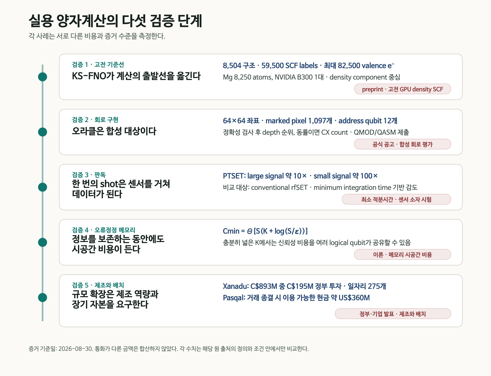
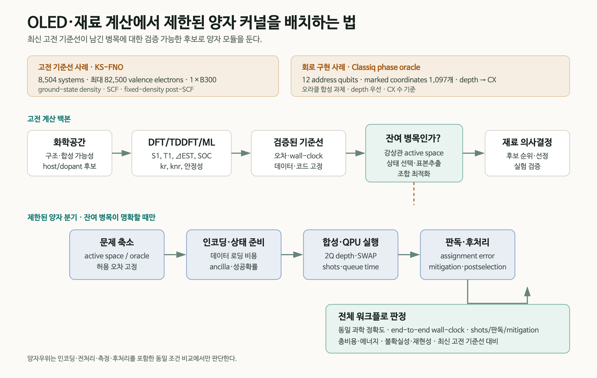

# 양자컴퓨터가 계산 시스템이 되기까지

양자컴퓨터의 실용성을 큐비트 수나 회로 깊이 하나로 판단하면 병목의 위치를 놓친다. 먼저 같은 문제를 푸는 최신 고전 계산을 기준선으로 고정해야 한다. 남은 문제는 실행 가능한 회로로 구현되어야 하고, 반복 측정은 센서에서 신뢰할 수 있는 데이터로 바뀌어야 한다. 긴 계산 동안 논리 정보를 보존하는 오류정정 자원과 장치를 반복 생산할 제조 기반도 필요하다.

2026년 8월 말에 공개된 다섯 소식은 이 경로의 서로 다른 지점을 비춘다. Classiq는 조건을 만족하는 상태의 부호를 뒤집는 위상 오라클(phase oracle)의 회로 깊이를 줄이는 공개 챌린지를 시작했다.[<a href="#ref-1">1</a>] Caltech 연구진의 Kohn–Sham Fourier neural operator(KS-FNO)는 고전 GPU에서 반복적인 궤도 대각화를 전자밀도 예측으로 바꾸었다.[<a href="#ref-2">2</a>] Quantum Motion 연구진은 반도체 스핀 큐비트용 전하 센서의 감도를 높이는 PTSET을 시연했다.[<a href="#ref-3">3</a>] 별도의 이론 연구는 양자 메모리의 누적 시공간 비용에 피할 수 없는 로그 항이 있음을 보였다.[<a href="#ref-4">4</a>] 캐나다의 Xanadu 제조 투자와 Pasqal의 기업결합은 연구장비를 생산·배치하는 산업 기반에도 긴 시간과 자본이 필요하다는 점을 보여준다.[<a href="#ref-5">5</a>, <a href="#ref-6">6</a>]

재료 연구자가 계산을 맡기는 순서대로 놓으면 **고전 기준선 → 회로 구현 → 판독 → 오류정정 메모리 → 제조·배치**가 된다. 각 소식에서 얻은 단서를 따라가면 OLED·재료 계산의 어느 부분을 양자컴퓨터로 시험할지, 그 선택에 어떤 비교가 필요한지 구체적으로 물을 수 있다. 아래 사례와 공고의 기준 시점은 원 발행일인 2026년 8월 30일이다.

<figure class="article-hero-figure">
  
  <figcaption>그림 1. 전자밀도와 회로, 극저온 장치와 판독 신호, 오류정정 격자와 제조 공정을 연결한 AI 생성 개념 일러스트.</figcaption>
</figure>

## 다섯 사례가 다루는 계산의 조건

| 계산 단계 | 이번 사례 | 확인된 결과 | 비교·해석 조건 |
|---|---|---|---|
| 고전 기준선 | KS-FNO, 프리프린트 | 8,504개 분자·고체로 기본 학습. Mg 8,250원자·82,500가전자계의 밀도 SCF를 B300 한 대에서 수렴 | 최대 Mg계는 추가 미세조정 사용. 밀도 계산과 에너지·여기상태 계산의 범위 구별 |
| 회로 구현 | Classiq 공식 챌린지 | 64×64 이미지의 표시된 픽셀 1,097개를 x·y 각 6큐비트 레지스터의 위상 오라클로 구현하는 과제 | 정답성 검사 후 깊이 우선, 동률이면 CX 수. 보조 큐비트는 주소 12개와 별도 |
| 판독 | PTSET, 프리프린트 | 기존 rfSET 대비 큰 신호에서 약 10배, 작은 신호에서 약 100배 감도 개선 | 전하 사건을 게이트 전압으로 모사한 소자 시험. 감도는 최소 적분시간으로 평가 |
| 오류정정 메모리 | FTQC 이론, 프리프린트 | 메모리의 누적 시공간 비용에 로그 항이 포함되는 상·하한 | 위치가 알려진 독립 소실 잡음과 이상적 복구 가정. 폭 K에 따른 상대 비용 |
| 제조·배치 | 캐나다·Xanadu, Pasqal | CAD 893M 프로젝트에 CAD 195M 정부 투자; Pasqal 거래 종결 시 약 USD 360M 현금 이용 가능 | 시설·제조 역량과 자본에 관한 발표. 서로 다른 통화와 거래 구조 |

<figure class="figure-panel figure-panel-fit">
  
  <figcaption>그림 2. 고전 계산부터 제조까지, 각 단계에 관련된 연구·공고와 보고 수치를 배치한 리뷰 도식.[<a href="#ref-1">1</a>, <a href="#ref-2">2</a>, <a href="#ref-3">3</a>, <a href="#ref-4">4</a>, <a href="#ref-5">5</a>, <a href="#ref-6">6</a>] 세로선은 이 글의 설명 순서를 나타낸다. <a href="practical_quantum_validation_gates_ko.svg">확대 가능한 SVG</a></figcaption>
</figure>

## 1. 최신 고전 기준선이 출발점을 바꾼다

Kohn–Sham DFT의 자기일관장(self-consistent field, SCF) 계산은 전자밀도에서 퍼텐셜을 만들고, 그 퍼텐셜을 따르는 해밀토니안을 대각화해 새 궤도와 전자밀도를 얻는다. 입력과 출력 밀도가 일치할 때까지 이 과정을 반복한다. 계가 커지면 매번 궤도를 구하는 데 드는 비용이 대략 크기의 세제곱으로 늘어난다. 궤도 계산을 생략하는 orbital-free DFT도 연구되어 왔지만, 다양한 계에서 쓸 수 있는 운동에너지 범함수를 찾는 데 어려움이 있었다.

Danish Khan 등은 SCF의 한 반복에서 퍼텐셜을 다음 전자밀도로 바꾸는 **순방향 Kohn–Sham 사상**을 학습했다.[<a href="#ref-2">2</a>]

$$
v_{\mathrm{KS}}(\mathbf r)\longmapsto n^{\mathrm{out}}(\mathbf r)
$$

위 식은 학습할 대응 관계를 나타낸다. 구현에서는 실공간 격자의 Kohn–Sham 퍼텐셜과 국소 외부 이온 퍼텐셜을 두 입력 채널로 받는다. 회전·이동에 따른 밀도의 변환을 지키는 SE(3)-equivariant Fourier neural operator가 다음 밀도를 예측하며, Hartree·교환상관 퍼텐셜 구성과 밀도 혼합은 기존 SCF 구조에 남는다. 매 반복의 일전자 고유값 문제를 학습한 연산자로 바꾸는 것이 계산 절감의 중심이다.

### 학습 집합과 최대 계산 집합을 구분해야 한다

기본 모델은 QM9 molecule 2,004개와 MC3D solid 6,500개, 합계 **8,504 systems**에서 얻은 **59,500 ordinary SCF labels**로 학습됐다. 저자들은 molecule, insulator, metal의 density self-consistency를 한 모델 계열에서 다루고, 고정 density의 post-SCF diagonalization으로 spectrum과 구조 관측량을 평가했다.

82,500-electron Mg dislocation 결과는 이 기본 모델을 그대로 extrapolate한 것이 아니다. 기본 모델은 모든 tested dislocation cell에서 발산했다. 연구진은 bulk, strain, surface, stacking fault와 dislocation-core environment를 포함한 **Mg 구조 1,203개, 20–364 atoms**로 추가 미세조정했다. 그 뒤 최대 **8,250 Mg atoms, 82,500 valence electrons**의 density를 **NVIDIA B300 한 대**에서 relative-\(L^1\) fixed-point threshold \(10^{-3}\)까지 수렴시켰다.

격자점 수에 따른 **SCF 한 번의 update 시간**을 거듭제곱으로 맞춘 지수는 KS-FNO \(p=1.03\), Quantum ESPRESSO \(p=3.37\)이었다. B300 한 대의 FNO 시간과 192-core AMD EPYC 9655 node로 선형 환산한 Quantum ESPRESSO 시간을 비교한 값이므로, 절대 시간의 하드웨어 조건은 다르다. PBE와 대조한 밀도 오차 **0.33–0.35%**는 최대 528원자의 결함 중심부 crop에서 확인됐다. 8,250원자계에는 PBE 기준 밀도가 없어, 그 계에서 확인한 것은 학습한 사상의 자기일관 수렴이다.

### 아직 남은 계산

현재 모델은 joint Kohn–Sham operator 가운데 density component만 학습한다. Total energy와 orbital-resolved spectrum에는 한 번의 fixed-density post-SCF orbital calculation이 남는다. 이를 없애려면 forward kinetic-energy model과 추가 검증이 필요하다. 논문에서 사용하는 “quantum calculation”은 electronic-structure calculation을 뜻한다.

OLED 연구에는 바닥상태 밀도와 대규모 구조 계산의 고전 기준선이 강해졌다는 의미가 있다. 발광을 다루려면 여전히 단일항·삼중항 여기 에너지 \(S_1\), \(T_1\)과 그 차이 \(\Delta E_{\mathrm{ST}}\), 진동자 세기, 스핀–궤도 결합(SOC), 복사·비복사 전이율 \(k_r\), \(k_{nr}\)를 구해야 한다. 양자 계산의 유용성도 이 물성들을 계산할 때 남는 강상관·여기상태·표본추출 비용과 연결해 비교할 수 있다.

## 2. 오라클 구현도 계산 비용이다

양자 알고리즘 설명에서 oracle은 종종 “조건을 만족하는 상태에 표시를 한다”는 한 줄 상자로 그려진다. 하드웨어는 그 상자를 분해한 gate sequence를 실행한다. Boolean 식의 구조, ancilla 사용, uncomputation, 다중제어 gate의 분해와 target topology에 따른 routing이 depth와 2-qubit gate 수를 결정한다.

Classiq Quantum Circuit Challenge는 이 간극을 하나의 구체적인 문제로 만들었다.[<a href="#ref-1">1</a>] 과제는 64×64 이진 이미지에 표시된 **1,097개 픽셀**을 위상으로 표시하는 것이다. x와 y 좌표를 각각 6큐비트 레지스터로 나타내고, 다음 위상 오라클을 구현한다.

$$
U_f\lvert x,y\rangle=(-1)^{f(x,y)}\lvert x,y\rangle,\qquad
f(x,y)=
\begin{cases}
1,&(x,y)\text{가 marked pixel}\\
0,&\text{그 밖의 좌표.}
\end{cases}
$$

주소를 담는 두 레지스터는 합계 12큐비트이며, 구현에 쓰는 보조 큐비트(ancilla)는 별도로 더해진다. 제출 회로는 오라클 정답성 검사를 통과한 뒤 **회로 깊이**로 순위가 정해지고, 동률일 때 **CX 게이트 수**를 비교한다. 참가자는 Classiq <code>.qmod</code> 소스와 동일 구현의 OpenQASM <code>.qasm</code>을 함께 제출한다.

8월 30일 당시 공식 안내는 시작일을 8월 28일, 제출 마감을 9월 30일로 두었으며 기준 구현과 기술 명세를 제공한다고 알렸다. 이번에 재확인한 공고에서 읽을 수 있는 내용은 문제·제출 형식·순위 절차다. 기준 회로의 depth/CX 수치나 허용 ancilla, 평가 gate basis·connectivity·depth 산정의 세부 규칙은 확보하지 못했다. 이 절은 그때 공고된 합성 과제를 다루며 이후의 우승 결과나 장치 실행 결과를 반영한 갱신은 아니다.

이 과제의 흥미는 같은 진리표를 만족해도 회로 비용이 달라진다는 데 있다. Boolean 식의 인수분해, 고수준 합성, 논리 회로 재작성, 큐비트 배치·라우팅과 네이티브 게이트 선택은 서로 다른 수준에서 비용을 바꾼다. Classiq 챌린지는 그중 **고수준 모델과 합성 탐색**을 비교할 공통 과제를 제시했다. 각 수준의 관계는 앞선 리뷰 「양자 회로 최적화는 왜 필요한가」에서 이어 읽을 수 있다.[<a href="#ref-7">7</a>]

## 3. 한 번의 shot은 판독을 거쳐야 데이터가 된다

반도체 spin qubit는 spin state를 곧바로 전압계로 읽지 않는다. 일반적으로 spin-dependent tunnelling 또는 Pauli blockade를 이용해 spin information을 charge configuration으로 바꾸고, 근처 charge sensor의 radio-frequency response를 측정한다. 센서 감도와 bandwidth가 부족하면 더 긴 integration time이 필요하고, 그 사이 relaxation과 noise가 readout fidelity를 제한한다.

PTSET 연구는 고주파 단전자 트랜지스터(rfSET)의 임피던스 정합 회로에 낮은 임계전류와 높은 운동 인덕턴스를 갖는 TiN 소자를 직렬로 넣었다.[<a href="#ref-3">3</a>] SET 전류가 임계값을 넘으면 TiN이 초전도 상태에서 정상 상태로 전이하면서 회로 임피던스와 반사 RF 신호가 급격히 변한다. 작은 저항 변화를 큰 판독 신호로 바꾸는 데 이 상전이를 이용한다.

실험 소자는 GlobalFoundries **22-nm FD-SOI CMOS**에서 제작됐다. 0.6 T out-of-plane field에서 switching current는 약 **33 nA**, resonance는 334 MHz였다. 연구진은 charge event를 실제 인접 spin qubit가 아니라 gate-bias shift로 모사했다. conventional rfSET mode와 비교해 minimum integration time으로 정의한 감도는 large-signal regime에서 거의 **한 order**, 실제 spin readout에 더 가까운 small-signal regime에서 **두 orders** 개선됐다.

측정한 동상·직교상(IQ) 신호에는 **637 μs의 적분시간**을 썼다. 여기서 얻은 전력 신호대잡음비 SNR로 최소 적분시간 \(t_{\min}=t_{\mathrm{int}}/\mathrm{SNR}\)를 추론해 감도를 비교했다. 실제 스핀 상태를 읽어 얻는 판독 충실도는 별도의 측정량이다. switching과 recovery dynamics는 장비가 직접 분해하지 못했으며, **10–100 ns의 회복시간**은 TiN 특성에 근거한 추정이다. 강한 overcoupling 조건의 **350배 초과 SNR**도 회로 모형의 예측으로 제시됐다. 이 센서를 배열로 확장할 때에는 수율, 다중화 간섭과 극저온 배선·열부하가 함께 검증되어야 한다.

## 4. 오류정정은 기억에도 비용을 요구한다

Fault-tolerance threshold theorem은 physical error rate가 임계값 아래라면 추가 물리 큐비트와 circuit depth를 사용해 계산을 임의로 신뢰성 있게 만들 수 있다고 말한다. 여기서 남는 질문은 누적된 공간×시간 비용을 유용 계산 대비 일정한 비율로 유지할 수 있는가다.

Bharti, Haug, Tanggara는 양자 메모리의 비용부터 분석했다.[<a href="#ref-4">4</a>] 각 물리 큐비트가 독립적으로 소실되고 그 위치는 알려진다고 가정한다. 소실 확률은 \(0<p<\delta_{\mathrm{GV}}\simeq0.1100\)이며, 측정 결과에 따른 적응적 프로토콜과 이상적 복구까지 허용한다. \(K\)개의 논리 큐비트를 \(S\)번의 시간 단계 동안 저장할 때 오차 \(\varepsilon\)은 복호화한 전체 메모리 채널과 항등 채널 사이의 diamond-norm 거리로 정의한다. 이 거리는 다른 계와의 얽힘까지 포함해 정보가 얼마나 잘 보존되는지 평가한다. 고정된 \(0<\varepsilon_0<1\)에 대해 \(0<\varepsilon\leq\varepsilon_0\)인 범위에서, 실현 가능한 측정 이력에 따른 최악 경우의 최소 물리 저장 위치 비용은

$$
C_{\min}(K,S,\varepsilon)
=\Theta\!\left[S\left(K+\log\frac{S}{\varepsilon}\right)\right]
$$

로 주어진다. Relative overhead는

$$
\Theta\!\left(1+\frac{\log(S/\varepsilon)}{K}\right)
$$

이다. 소수 logical qubit를 아주 오래 보존하면 logarithmic 항을 피할 수 없다. 반대로 \(K=\Omega(\log(S/\varepsilon))\)인 충분히 넓은 메모리는 신뢰성 비용을 여러 논리 큐비트가 공유해 상대 오버헤드를 일정 범위로 유지할 수 있다.

\(\Theta\) 표기는 같은 크기 의존성을 갖는 상한과 하한이 모두 있다는 뜻이다. 저자들은 양의 부호율을 갖는 CSS 부호의 존재와 이상적 복구를 이용해 이 메모리 비용을 달성하는 상한도 보였다. 실제로 효율적인 복구 회로를 구성하는 문제는 남는다. 일반 내결함 회로로 넓히는 결과에는 부호와 논리 연산 층을 구현하는 gadget의 폭·깊이·오류 감소에 관한 충분조건이 필요하다. 따라서 특정 surface-code 장치의 물리 큐비트 수와 총시간을 견적하려면 해당 장치의 잡음과 복구·게이트 조건을 추가해야 한다.

## 5. 규모는 제조와 자본의 문제이기도 하다

알고리즘과 소자의 충실도가 개선되면, 그 장치를 반복 제작하고 설치할 수 있는지가 다음 과제가 된다. 8월 28일 캐나다 정부는 Xanadu의 CAD 893M 프로젝트에 Strategic Response Fund를 통해 CAD 195M을 투자한다고 발표했다.[<a href="#ref-5">5</a>] 연구개발 시설 확장과 광자·반도체 부품의 집적, 패키징, 시험·조립 역량 구축이 포함되며, **275개 고급 일자리** 창출을 예상했다.

투자의 대상은 제조 시설과 미래 내결함성 양자계산에 맞는 공정의 적격성 확보다. 발표에는 시설과 공정이 앞으로 갖춰야 할 역량이 적혀 있다. CAD 195M은 정부가 사용한 표현대로 투자액이며, 공개 페이지는 보조금·상환·지분 조건을 세분하지 않았다.

Pasqal은 8월 27일 Bleichroeder Acquisition Corp. II와의 기업결합 완료를 발표했다.[<a href="#ref-6">6</a>] 존속회사 Pasqal Holding SA는 보통주 <code>PSQL</code>과 워런트 <code>PSQLW</code>의 Nasdaq 거래를 8월 28일 시작할 예정이라고 알렸으며, 거래 종결 시점에 **약 USD 360M의 현금을 이용할 수 있다**고 밝혔다. 이 수치는 종결 시점의 가용 현금이다. 회사는 이를 QPU 제조·배치, 내결함성 기술 로드맵, 클라우드·소프트웨어, HPC 통합과 상업 운영에 사용할 계획이라고 설명했다.

두 발표를 함께 읽으면 양자 산업이 알고리즘과 소자 개발에 더해 제조·장기 자본을 확보하는 과정을 볼 수 있다. 투입할 자금, 구축할 공정, 공급할 장치가 연결되어야 연구실의 성과가 반복 가능한 서비스로 이어진다.

## 6. OLED·재료 PoC에는 어디에 양자 커널을 둘 것인가

OLED 분자 역설계의 목적은 합성할 host·dopant 후보의 순위를 바꾸고, 발광 효율·안정성·수명에 관한 의사결정을 개선하는 데 있다. 이 목적에 맞춰 **최신 고전 방법을 적용하고도 남는 병목**을 찾으면, 양자컴퓨터에 맡길 작은 계산 단위인 양자 커널의 후보도 분명해진다.

현실적인 bounded workflow는 다음 순서를 따른다.

1. 고전 생성모델과 chemical rule로 화학공간을 줄인다.
2. DFT/TDDFT, 다중참조 계산과 검증된 ML surrogate로 \(S_1\), \(T_1\), \(\Delta E_{\mathrm{ST}}\), SOC, rate와 stability의 기준선을 고정한다.
3. 오차, 데이터 split, 하드웨어, wall-clock과 불확실성을 함께 기록한다.
4. 강상관 active space, excited-state manifold, state selection, 표본추출 또는 조합 최적화처럼 남은 병목을 하나 선택한다.
5. encoding, state preparation, oracle·Hamiltonian construction과 성공확률을 포함해 작은 양자 커널을 정의한다.
6. logical circuit뿐 아니라 target backend에 mapping한 2Q depth, CX/SWAP, ancilla, shots와 queue time을 기록한다.
7. assignment error, mitigation, postselection과 고전 후처리를 포함한 end-to-end 결과를 같은 과학 정확도의 고전 기준선과 비교한다.

<figure class="figure-panel figure-panel-fit">
  
  <figcaption>그림 3. 고전 계산으로 후보를 좁히는 주 경로와, 남은 병목을 시험하는 양자 분기를 나타낸 리뷰의 제안 도식. 분기 결과는 같은 과학적 정확도와 전체 작업시간으로 평가한다. 위쪽 KS-FNO·Classiq 상자는 각각 밀도 계산과 오라클 합성의 사례다.[<a href="#ref-1">1</a>, <a href="#ref-2">2</a>] <a href="bounded_quantum_materials_workflow_ko.svg">확대 가능한 SVG</a></figcaption>
</figure>

이 구성에서 양자 분기는 인코딩·상태 준비와 합성, 실행, 판독·후처리를 거쳐 다시 재료의 의사결정으로 돌아온다. 분기 안의 계산이 빨라져도 입력 준비나 실패한 표본의 비용이 크면 전체 이득은 작아질 수 있다. 그러므로 후보 순위나 물성 오차가 얼마나 달라졌는지와 그 결과를 얻는 데 든 시간을 함께 기록해야 한다.

## 7. PoC 증거 원장에 남겨야 할 항목

| 영역 | 최소 기록 항목 | 판단 질문 |
|---|---|---|
| 과학적 목표 | 대상 물성, 허용 오차, 실험 의사결정 | 결과가 어떤 후보의 순위를 실제로 바꾸는가 |
| 고전 기준선 | method·version, 데이터, 하드웨어, wall-clock, uncertainty | 같은 정확도에서 현재 가장 강한 기준선인가 |
| 문제 축소 | active space, state manifold, QUBO/oracle 정의 | 양자 커널의 입력을 만드는 비용을 포함했는가 |
| 회로 | logical/compiled 2Q depth, CX/SWAP, ancilla, native gate, topology | 회로를 실제 backend 조건으로 비교했는가 |
| 측정 | shots, assignment error, sensitivity, mitigation, postselection | 감도와 최종 readout fidelity를 구분했는가 |
| 오류정정 | logical/physical qubits, T count/depth, code distance, memory spacetime | algorithmic resource와 device resource를 분리했는가 |
| 전체 비용 | queue·runtime, 전처리·후처리, 총비용·에너지 | 동일 문제·정확도에서 end-to-end 이득이 있는가 |
| 재현성 | code, seed, calibration date, 실패 사례, provenance | QPU·simulator·고전 emulation을 다시 구분할 수 있는가 |

이 기록은 회로 안의 절감이 전체 계산에서도 남는지 확인하는 데 쓰인다. 예를 들어 보조 큐비트를 늘려 깊이를 줄였을 때 장치 배치와 측정 횟수가 어떻게 바뀌었는지, 더 민감한 센서가 실제 판독 오류와 총시간을 얼마나 줄였는지를 같은 문제·허용 오차에서 비교할 수 있다.

## 최종 평가

실용 양자계산의 역할은 고전 계산의 발전과 함께 구체화된다. KS-FNO가 반복적인 밀도 계산의 비용을 낮추면, 양자 커널은 그 다음에 남는 상관·상태 선택·측정 문제에서 가치를 보여야 한다. 그 커널을 실행할 때에는 오라클 합성의 비용, 센서가 결과를 구별하는 시간, 메모리가 정보를 지키는 비용이 다시 등장한다.

재료 연구에서 중요한 성과는 같은 자원으로 더 믿을 만한 후보를 고르거나, 필요한 정확도에 더 낮은 총비용으로 도달하는 것이다. 이 변화를 확인한 작은 계산을 반복 생산·공급할 장치와 연결할 때, 양자컴퓨터는 연구 도구를 넘어 계산 시스템으로 자리 잡을 수 있다.

## References

<ol class="reference-list">
<li id="ref-1">Classiq Technologies, Classiq Quantum Circuit Challenge (2026). <code>https://get.classiq.io/quantum-circuit-challenge/</code></li>
<li id="ref-2"><a href="https://arxiv.org/abs/2608.23895v1">D. Khan, M. D. Hanisch, N. Argatoff, E. Xie, S. Sharma, and A. Anandkumar, Learning the Kohn-Sham map with neural operators for quasi-linear scaling density functional theory, arXiv:2608.23895v1 (2026).</a></li>
<li id="ref-3"><a href="https://arxiv.org/abs/2608.27045v1">G. Aizpurua-Iraola, T. H. Swift, F.-E. von Horstig, D. Prete, J. Kirkman, G. M. Noah, F. Olivieri, A. Gomez-Saiz, and M. F. Gonzalez-Zalba, A superconducting phase transition single-electron transistor, arXiv:2608.27045v1 (2026).</a></li>
<li id="ref-4"><a href="https://arxiv.org/abs/2608.26272v1">K. Bharti, T. Haug, and A. Tanggara, Fault-tolerant quantum computation cannot be achieved with constant spacetime overhead, arXiv:2608.26272v1 (2026).</a></li>
<li id="ref-5"><a href="https://www.canada.ca/en/innovation-science-economic-development/news/2026/08/government-of-canada-invests-in-xanadu-to-build-up-advanced-quantum-manufacturing-in-canada.html">Innovation, Science and Economic Development Canada, Government of Canada invests in Xanadu to build up advanced quantum manufacturing in Canada (28 August 2026).</a></li>
<li id="ref-6"><a href="https://www.pasqal.com/newsroom/pasqal-and-bleichroeder-acquisition-corp-ii-complete-business-combination/">Pasqal Holding SA and Bleichroeder Acquisition Corp. II, Pasqal and Bleichroeder Acquisition Corp. II complete business combination (27 August 2026)</a>; <a href="https://www.sec.gov/Archives/edgar/data/2119292/000121390026094393/ea0303667-6k_pasqal.htm">Pasqal Holding SA, Report of foreign private issuer, Form 6-K (27 August 2026).</a></li>
<li id="ref-7"><a href="https://infant83.io/AI_Tech_Review/reviews/2026-08-27_classiq-ashn-circuit-compression/">H.-J. Kim, Why quantum circuit optimization matters, Agentic Tech Review Letters (27 August 2026).</a></li>
</ol>

[2026년 8월 30일 발행 호 · 공개용 5쪽 PDF 내려받기](daily_quantum_brief_2026-08-30.pdf)

## 작성과 수정 이력

원 발행일·근거 기준일은 2026년 8월 30일이다. 2026년 11월 11일에는 한영 설명과 캡션·도식 문구, APS 인용과 자료의 시간 기준을 정리했다. KS-FNO의 두 입력 채널·SCF 한 회의 시간 지수, PTSET의 최소 적분시간, 메모리 정리의 오차·최악 경우 비용 정의를 명료화했다. 주요 수치·수식·표지는 유지했다. 연결된 당시 DQB는 과학 본문·5쪽·원 출처 링크를 유지하며 수집·수신 정보와 내부 메모를 공개 사본에서 정리했다.

이번 원문 대조에서 KS-FNO v1 19쪽, PTSET v1의 통합 부록을 포함한 9쪽, 메모리 비용 v1의 Methods·통합 보충자료를 포함한 40쪽을 읽었다. KS-FNO의 별도 보충자료·코드는 확보하지 못했다. Classiq의 당시 공식 안내는 재확인했으나 원 공개 페이지는 404여서 기준 구현·평가 backend를 검증하지 못했다. 정부·기업 발표와 SEC 공시는 원문으로 대조했다. 원 논문 실험·모델·회로와 증명을 독립 재현한 작업은 아니다.
