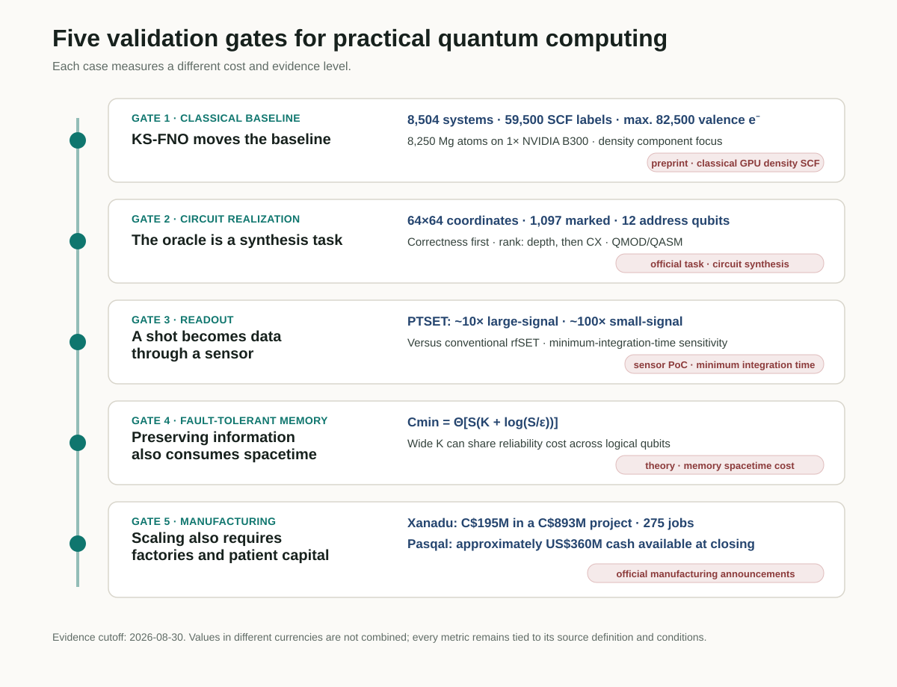
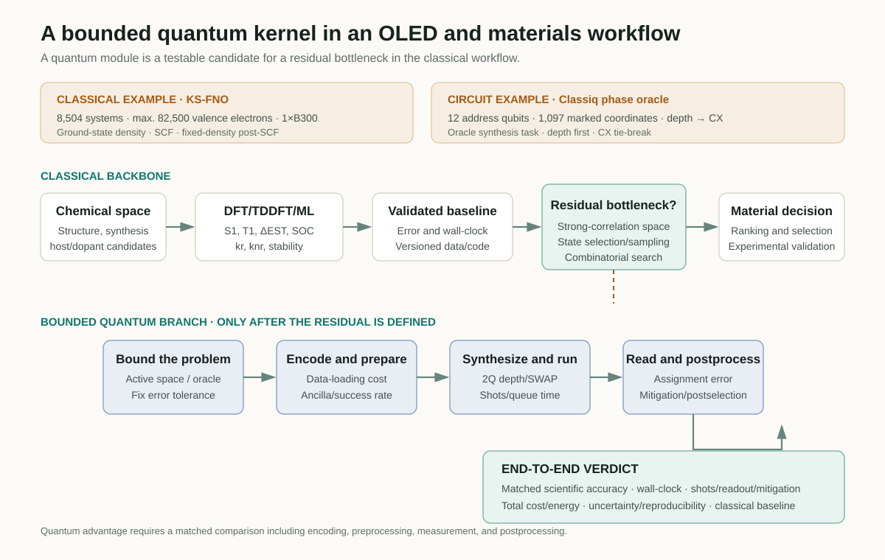

# What It Takes for a Quantum Computer to Become a Computing System

Judging the practical value of a quantum computer by qubit count or a single circuit-depth metric obscures where the bottlenecks actually arise. The strongest classical method for the same problem must first be fixed as the baseline. The remaining task must then be realized as an executable circuit, and repeated measurements must become trustworthy data at the sensor. Long computations also require error-correction resources that preserve logical information, while deployment depends on a manufacturing base capable of producing devices repeatedly.

Five developments reported in late August 2026 illuminate different points along this path. Classiq launched an open challenge to reduce the depth of a phase oracle, which reverses the sign of states satisfying a condition.[<a href="#ref-1">1</a>] A Kohn–Sham Fourier neural operator (KS-FNO) from Caltech researchers replaced repeated orbital diagonalization with density prediction on a classical GPU.[<a href="#ref-2">2</a>] Researchers at Quantum Motion demonstrated PTSET, a more sensitive charge sensor for semiconductor spin qubits.[<a href="#ref-3">3</a>] A separate theoretical study established an unavoidable logarithmic term in the cumulative spacetime cost of quantum memory.[<a href="#ref-4">4</a>] Canadian investment in Xanadu’s manufacturing project and Pasqal’s business combination show that producing and deploying research hardware also requires sustained time and capital.[<a href="#ref-5">5</a>, <a href="#ref-6">6</a>]

In the order a materials researcher encounters these requirements, the path is **classical baseline → circuit realization → readout → fault-tolerant memory → manufacturing and deployment**. Following the cases makes it possible to ask which part of an OLED or materials calculation is worth testing on a quantum computer, and what comparisons that choice requires. The cases and announcements below retain the original evidence date of 30 August 2026.

<figure class="article-hero-figure">
  
  <figcaption>Figure 1. An AI-generated concept illustration connecting electron density and circuits, a cryogenic device and readout signals, an error-correction lattice, and manufacturing processes.</figcaption>
</figure>

## What the five cases establish

| Computational stage | Case | Reported result or task | Conditions for interpretation |
|---|---|---|---|
| Classical baseline | KS-FNO, preprint | Base training on 8,504 molecules and solids. Density SCF convergence for 8,250 Mg atoms and 82,500 valence electrons on one B300 | The largest Mg system uses additional fine-tuning. Density, energy and excited-state calculations have different scopes |
| Circuit realization | Official Classiq challenge | Implement a phase oracle for 1,097 marked pixels in a 64×64 image, using separate 6-qubit x and y registers | Correctness precedes depth ranking, with CX count the tie-breaker. Ancillas are additional to the twelve address qubits |
| Readout | PTSET, preprint | Approximately 10-fold large-signal and 100-fold small-signal sensitivity gains over a conventional rfSET | Device test with a gate-voltage shift emulating a charge event; sensitivity evaluated through minimum integration time |
| Fault-tolerant memory | FTQC theory, preprint | Matching upper and lower bounds with a logarithmic term in cumulative memory cost | Independent known-location erasure noise and ideal recovery; relative cost depends on width K |
| Manufacturing and deployment | Canada–Xanadu and Pasqal | A CAD 195M government investment in a CAD 893M project; approximately USD 360M in cash available to Pasqal at closing | Announcements about facilities, manufacturing capacity and capital, with different currencies and transaction structures |

<figure class="figure-panel figure-panel-fit">
  
  <figcaption>Figure 2. A review diagram placing the studies, announcements and reported values at the relevant stages, from classical calculation to manufacturing.[<a href="#ref-1">1</a>, <a href="#ref-2">2</a>, <a href="#ref-3">3</a>, <a href="#ref-4">4</a>, <a href="#ref-5">5</a>, <a href="#ref-6">6</a>] The vertical line follows the order of the discussion.</figcaption>
</figure>

## 1. An advancing classical baseline changes the starting point

A Kohn–Sham DFT self-consistent field (SCF) calculation constructs a Kohn–Sham potential from an input density, diagonalizes the Hamiltonian to obtain new orbitals and a new density, and repeats the cycle to convergence. As the system grows, orbital diagonalization at every iteration becomes a bottleneck with roughly cubic scaling. Orbital-free DFT has long sought to avoid this step, but a transferable kinetic-energy functional has proved difficult to construct.

Danish Khan and colleagues learned the **forward Kohn–Sham map**, which takes a potential to the next electron density within an SCF iteration:[<a href="#ref-2">2</a>]

$$
v_{\mathrm{KS}}(\mathbf r)\longmapsto n^{\mathrm{out}}(\mathbf r).
$$

The equation expresses the mapping to be learned. In the implementation, the Kohn–Sham potential and the local external ionic potential on a real-space grid form two input channels. The SE(3)-equivariant Fourier neural operator respects how density transforms under rotations and translations, and predicts the next density. Construction of the Hartree and exchange-correlation potentials, together with density mixing, remains within the conventional SCF structure. Replacing the repeated one-particle eigensolve with this learned operator provides the central computational saving.

### The training domain and the maximum-scale calculation are different sets

The base model was trained from **59,500 ordinary SCF labels** obtained for **8,504 systems**: 2,004 QM9 molecules and 6,500 MC3D solids. The authors treated density self-consistency for molecules, insulators, and metals within one model family, then evaluated spectra and structural observables using a fixed-density post-SCF diagonalization.

The 82,500-electron Mg dislocation result was not a direct extrapolation of the base model. That model diverged for every tested dislocation cell. The researchers therefore fine-tuned it on **1,203 Mg structures containing 20–364 atoms**, spanning bulk, strain, surface, stacking-fault, and dislocation-core environments. They then converged the density of a system with as many as **8,250 Mg atoms and 82,500 valence electrons** on **one NVIDIA B300** to a relative-\(L^1\) fixed-point threshold of \(10^{-3}\).

A power-law fit of the time for **one complete SCF update against grid-point count** gave \(p=1.03\) for KS-FNO and \(p=3.37\) for Quantum ESPRESSO. Absolute timings use different hardware: FNO ran on one B300, while Quantum ESPRESSO timings were linearly rescaled to a 192-core AMD EPYC 9655 node. Density errors of **0.33–0.35%** against PBE were checked on dislocation-core crops containing at most 528 atoms. The 8,250-atom system has no PBE reference density, so the result established there is self-consistent convergence of the learned map.

### What remains to be calculated

The present model learns only the density component of the joint Kohn–Sham operator. Total energies and orbital-resolved spectra still require one fixed-density post-SCF orbital calculation. Removing that step would require a forward kinetic-energy model and additional validation. The paper’s references to “quantum calculations” mean electronic-structure calculations, not computation on a quantum computer.

For OLED research, the significance is a stronger classical baseline for ground-state density and large structures. Emission still requires singlet and triplet excitation energies \(S_1\) and \(T_1\), their difference \(\Delta E_{\mathrm{ST}}\), oscillator strengths, spin–orbit coupling (SOC), and radiative and nonradiative rates \(k_r\) and \(k_{nr}\). The value of a quantum calculation can be assessed against the strong-correlation, excited-state and sampling costs that remain in obtaining these properties.

## 2. An oracle must be implemented, not merely assumed

Descriptions of quantum algorithms often draw an oracle as a one-line box that “marks every state satisfying the condition.” Hardware does not execute that box; it executes the decomposed gate sequence. The structure of the Boolean expression, the use of ancillas, uncomputation, decomposition of multi-controlled gates, and routing for the target topology all affect circuit depth and the number of two-qubit gates.

The Classiq Quantum Circuit Challenge turns this gap into a concrete problem.[<a href="#ref-1">1</a>] The target consists of **1,097 marked pixels** in a 64×64 binary image. The x and y coordinates are represented by separate 6-qubit registers, and the task is to implement the phase oracle

$$
U_f\lvert x,y\rangle=(-1)^{f(x,y)}\lvert x,y\rangle,\qquad
f(x,y)=
\begin{cases}
1,&(x,y)\text{ is a marked pixel},\\
0,&\text{otherwise.}
\end{cases}
$$

The two address registers contain twelve qubits in total, with any implementation ancillas counted separately. A submitted circuit must first pass the oracle-correctness test; valid entries are then ranked by **circuit depth**, with **CX count** used to break ties. Participants submit both a Classiq <code>.qmod</code> source file and an OpenQASM <code>.qasm</code> file implementing the same circuit.

As of 30 August, the official announcement gave 28 August as the opening date and 30 September as the submission deadline, and advertised a baseline implementation and technical specification. The announcement rechecked for this revision establishes the problem, submission format and ranking procedure. Baseline depth/CX values, the permitted ancilla count, evaluation gate basis, connectivity and detailed depth-counting rules were not obtained. This section concerns the synthesis task announced at the time; it has not been expanded with later winning entries or device-execution results.

The interesting point is that circuits implementing the same truth table can have different costs. Boolean factorization, high-level synthesis, logical rewriting, qubit mapping and routing, and native-gate choices change costs at different levels. The Classiq challenge supplies a common task for comparing **high-level modeling and synthesis search**. The relationship between these levels is developed in the earlier review, *Why Quantum Circuit Optimization Matters*.[<a href="#ref-7">7</a>]

## 3. A shot becomes data only after readout

A semiconductor spin qubit is not read directly with a voltmeter. Spin-dependent tunnelling or Pauli blockade generally converts spin information into a charge configuration, after which the radio-frequency response of a nearby charge sensor is measured. Insufficient sensor sensitivity or bandwidth lengthens the required integration time, allowing relaxation and noise to limit readout fidelity.

The PTSET study placed a TiN element with low critical current and high kinetic inductance in series with the matching network of a radio-frequency single-electron transistor (rfSET).[<a href="#ref-3">3</a>] When the SET current exceeds a threshold, the TiN switches from the superconducting to the normal state, abruptly changing the circuit impedance and reflected RF signal. The architecture uses this phase transition to turn a small resistance change into a large readout signal.

The experimental device was fabricated in GlobalFoundries **22-nm FD-SOI CMOS**. At an out-of-plane field of 0.6 T, the switching current was approximately **33 nA** and the resonance frequency was 334 MHz. Rather than using an adjacent spin qubit, the researchers emulated a charge event through a gate-bias shift. Relative to the conventional rfSET mode, sensitivity defined through the minimum integration time improved by nearly **one order of magnitude** in the large-signal regime and by **two orders of magnitude** in the small-signal regime, which more closely resembles spin readout.

The measured in-phase and quadrature (IQ) traces used an integration time of **637 μs**. The authors inferred a minimum integration time, \(t_{\min}=t_{\mathrm{int}}/\mathrm{SNR}\), from the power signal-to-noise ratio and used it to compare sensitivity. The fidelity obtained by reading actual spin states is a separate measurement. The apparatus could not directly resolve switching and recovery dynamics; the reported **10–100 ns recovery time** is an estimate based on TiN properties. **More than 350-fold SNR** under well-overcoupled conditions is a circuit-model prediction. Extending the sensor to arrays requires joint validation of yield, multiplexing crosstalk, cryogenic wiring and thermal load.

## 4. Error correction also incurs a cost for memory

The fault-tolerance threshold theorem states that, below a threshold physical error rate, arbitrarily reliable computation can be achieved by adding physical qubits and circuit depth. The remaining question is whether the cumulative space×time cost can stay at a constant ratio to the useful computation.

Bharti, Haug, and Tanggara begin by analyzing quantum memory.[<a href="#ref-4">4</a>] Physical qubits are independently erased, with the erased locations known and \(0<p<\delta_{\mathrm{GV}}\simeq0.1100\). Adaptive protocols conditioned on measurement outcomes and ideal recovery are allowed. For retaining \(K\) logical qubits over \(S\) time steps, the error \(\varepsilon\) is the diamond-norm distance between the decoded memory channel and the identity channel. This assesses preservation of information including entanglement with another system. For fixed \(0<\varepsilon_0<1\) and \(0<\varepsilon\leq\varepsilon_0\), the minimum physical storage-location cost in the worst case over realizable measurement histories is

$$
C_{\min}(K,S,\varepsilon)
=\Theta\!\left[S\left(K+\log\frac{S}{\varepsilon}\right)\right].
$$

The relative overhead is

$$
\Theta\!\left(1+\frac{\log(S/\varepsilon)}{K}\right).
$$

The logarithmic term cannot be avoided when a small number of logical qubits must be preserved for a very long time. Conversely, a sufficiently wide memory with \(K=\Omega(\log(S/\varepsilon))\) can share the reliability cost across many logical qubits and maintain bounded relative overhead.

The \(\Theta\) notation means that upper and lower bounds have the same dependence on size. The authors also establish a matching memory upper bound using the existence of positive-rate CSS codes and ideal recovery. Constructing an efficient recovery circuit remains a separate task. Extension to general fault-tolerant circuits requires sufficient conditions on the width, depth and error suppression of codes and logical-layer gadgets. Applying the expression to estimate the physical-qubit count and total time of a particular surface-code machine therefore requires its noise, recovery and gate conditions as well.

## 5. Scale is also a manufacturing and capital problem

As algorithms and device fidelity improve, manufacturing and installing the devices repeatedly becomes the next task. On 28 August, the Canadian government announced a CAD 195M Strategic Response Fund investment in Xanadu’s CAD 893M project.[<a href="#ref-5">5</a>] The scope includes expanding R&D facilities and building capabilities for integrating, packaging, testing and assembling photonic and semiconductor components. The project was expected to create **275 highly skilled jobs**.

The investment targets manufacturing facilities and qualification of processes compatible with future fault-tolerant quantum computing. The announcement describes capabilities that the facilities and processes are intended to develop. CAD 195M is the investment figure used by the government; its public release does not break down grant, repayment or equity terms.

On 27 August, Pasqal announced completion of its business combination with Bleichroeder Acquisition Corp. II.[<a href="#ref-6">6</a>] The surviving company, Pasqal Holding SA, said that ordinary shares <code>PSQL</code> and warrants <code>PSQLW</code> were expected to begin Nasdaq trading on 28 August, and reported **approximately USD 360M in cash available at closing**. The figure describes available closing cash. The company planned to use it for QPU manufacturing and deployment, its fault-tolerant roadmap, cloud and software, HPC integration and commercial operations.

Read together, the announcements show a quantum industry securing manufacturing capacity and long-term capital alongside algorithm and device development. Capital, qualified processes and a supply of devices must connect before laboratory results can become a repeatable service.

## 6. Where should a quantum kernel enter an OLED or materials PoC?

Inverse molecular design for OLEDs aims to change the ranking of synthesizable host and dopant candidates and improve decisions about emission efficiency, stability and lifetime. Identifying **the bottleneck that remains after the best available classical methods** clarifies which small computational task—a quantum kernel—is worth testing on a quantum computer.

A defensible bounded workflow proceeds as follows.

1. Reduce chemical space with classical generative models and chemical rules.
2. Fix baselines for \(S_1\), \(T_1\), \(\Delta E_{\mathrm{ST}}\), SOC, rates, and stability using DFT/TDDFT, multireference calculations, and validated ML surrogates.
3. Record errors, data splits, hardware, wall-clock time, and uncertainty together.
4. Select one residual bottleneck, such as a strongly correlated active space, an excited-state manifold, state selection, sampling, or combinatorial optimization.
5. Define a small quantum kernel that includes encoding, state preparation, oracle or Hamiltonian construction, and success probability.
6. Record the logical circuit together with mapped two-qubit depth, CX/SWAP count, ancillas, shots, and queue time on the target backend.
7. Compare the end-to-end result—including assignment error, mitigation, postselection, and classical post-processing—with a classical baseline at the same scientific accuracy.

<figure class="figure-panel figure-panel-fit">
  
  <figcaption>Figure 3. The review’s proposed workflow, with a main classical route for narrowing candidates and a quantum branch for testing a residual bottleneck. The branch is assessed at matched scientific accuracy using total workflow time. The upper KS-FNO and Classiq boxes illustrate density calculation and oracle synthesis, respectively.[<a href="#ref-1">1</a>, <a href="#ref-2">2</a>]</figcaption>
</figure>

The quantum branch passes through encoding, state preparation, synthesis, execution, readout and post-processing before returning to the materials decision. A faster calculation inside that branch can deliver little overall benefit when input preparation or failed samples are costly. Changes in candidate rankings or property errors should therefore be recorded together with the time required to obtain them.

## 7. What an evidence ledger for a PoC should record

| Area | Minimum record | Decision question |
|---|---|---|
| Scientific objective | Target property, acceptable error, experimental decision | Would the result change the ranking of any candidate? |
| Classical baseline | Method and version, data, hardware, wall-clock time, uncertainty | Is this the strongest current baseline at matched accuracy? |
| Problem reduction | Active space, state manifold, QUBO or oracle definition | Does the accounting include the cost of constructing the quantum-kernel input? |
| Circuit | Logical and compiled two-qubit depth, CX/SWAP, ancillas, native gates, topology | Has the circuit been compared under the conditions of an actual backend? |
| Measurement | Shots, assignment error, sensitivity, mitigation, postselection | Are sensor sensitivity and final readout fidelity kept distinct? |
| Error correction | Logical and physical qubits, T count and depth, code distance, memory spacetime | Are algorithmic resources separated from device resources? |
| Total cost | Queue and runtime, preprocessing and post-processing, total cost and energy | Is there an end-to-end gain at the same problem and accuracy? |
| Reproducibility | Code, seed, calibration date, failed cases, provenance | Can a reader still distinguish QPU, simulator, and classical emulation? |

These records help determine whether savings inside the circuit survive in the full calculation. For example, reducing depth by adding ancillas may change placement and measurement costs; a more sensitive sensor must ultimately reduce actual assignment errors or total time. Each comparison needs the same problem and acceptable error.

## Final assessment

The role of practical quantum computing becomes more specific as classical computing advances. If KS-FNO lowers the cost of repeated density calculations, a quantum kernel must demonstrate value in the correlation, state-selection or measurement tasks that follow. Executing that kernel brings oracle-synthesis cost, the time needed to distinguish sensor signals, and the cost of preserving information in memory into the same calculation.

For materials research, a meaningful gain is selecting more reliable candidates with the same resources, or reaching the required accuracy at lower total cost. Connecting a small calculation that demonstrates such a gain to devices that can be manufactured and supplied repeatedly is how a quantum computer can become a computing system.

## References

<ol class="reference-list">
<li id="ref-1">Classiq Technologies, Classiq Quantum Circuit Challenge (2026). <code>https://get.classiq.io/quantum-circuit-challenge/</code></li>
<li id="ref-2"><a href="https://arxiv.org/abs/2608.23895v1">D. Khan, M. D. Hanisch, N. Argatoff, E. Xie, S. Sharma, and A. Anandkumar, Learning the Kohn-Sham map with neural operators for quasi-linear scaling density functional theory, arXiv:2608.23895v1 (2026).</a></li>
<li id="ref-3"><a href="https://arxiv.org/abs/2608.27045v1">G. Aizpurua-Iraola, T. H. Swift, F.-E. von Horstig, D. Prete, J. Kirkman, G. M. Noah, F. Olivieri, A. Gomez-Saiz, and M. F. Gonzalez-Zalba, A superconducting phase transition single-electron transistor, arXiv:2608.27045v1 (2026).</a></li>
<li id="ref-4"><a href="https://arxiv.org/abs/2608.26272v1">K. Bharti, T. Haug, and A. Tanggara, Fault-tolerant quantum computation cannot be achieved with constant spacetime overhead, arXiv:2608.26272v1 (2026).</a></li>
<li id="ref-5"><a href="https://www.canada.ca/en/innovation-science-economic-development/news/2026/08/government-of-canada-invests-in-xanadu-to-build-up-advanced-quantum-manufacturing-in-canada.html">Innovation, Science and Economic Development Canada, Government of Canada invests in Xanadu to build up advanced quantum manufacturing in Canada (28 August 2026).</a></li>
<li id="ref-6"><a href="https://www.pasqal.com/newsroom/pasqal-and-bleichroeder-acquisition-corp-ii-complete-business-combination/">Pasqal Holding SA and Bleichroeder Acquisition Corp. II, Pasqal and Bleichroeder Acquisition Corp. II complete business combination (27 August 2026)</a>; <a href="https://www.sec.gov/Archives/edgar/data/2119292/000121390026094393/ea0303667-6k_pasqal.htm">Pasqal Holding SA, Report of foreign private issuer, Form 6-K (27 August 2026).</a></li>
<li id="ref-7"><a href="https://infant83.io/AI_Tech_Review/reviews/2026-08-27_classiq-ashn-circuit-compression/">H.-J. Kim, Why quantum circuit optimization matters, Agentic Tech Review Letters (27 August 2026).</a></li>
</ol>

[Download the public five-page edition of the 30 August 2026 briefing](../artifacts/daily_quantum_brief_2026-08-30.pdf)

## Writing and revision history

The original publication and evidence date is 30 August 2026. The 11 November 2026 revision edits the bilingual explanation, captions and diagram wording, APS citations and historical time references. It clarifies the two KS-FNO input channels and single-update timing exponent, PTSET minimum integration time, and the memory theorem’s error and worst-case cost definitions. The principal values, formulas and cover are retained. The linked historical DQB keeps its scientific text, five pages and original source links; collection and receipt details and internal notes were removed from its public copy.

This audit read all 19 pages of KS-FNO v1, all 9 pages of PTSET v1 including its integrated appendices, and all 40 pages of the memory-cost v1 including Methods and integrated supplementary material. Separate KS-FNO supplements and code were not obtained. Historical official Classiq announcements were rechecked, but the original public entry returned 404, so its baseline implementation and evaluation backend were not verified. Government and company releases and the SEC filing were read directly. This work did not independently reproduce the papers’ experiments, model, circuit or proofs.
