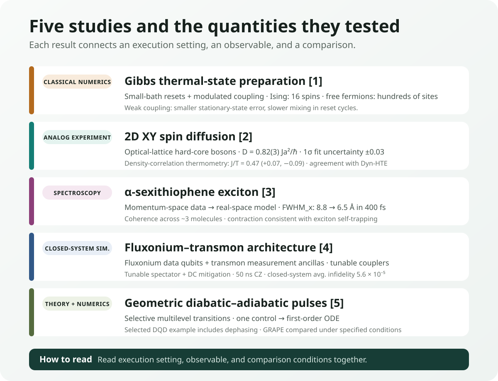
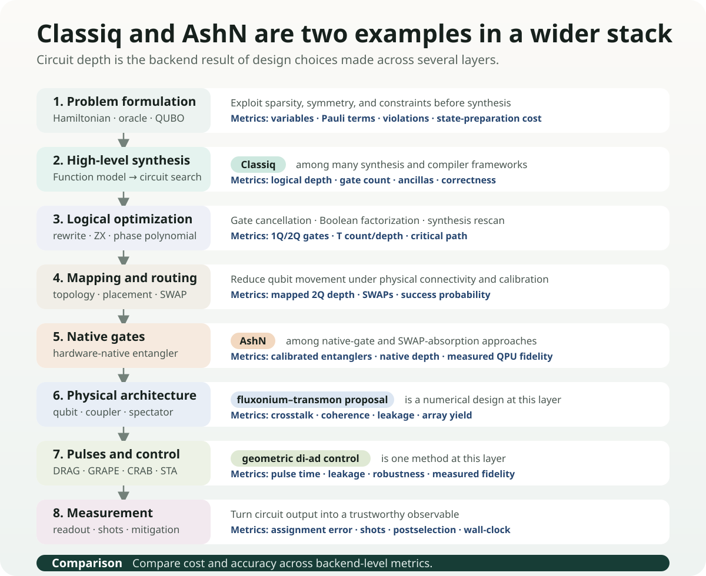

# Preparing Hot Quantum States and Tracking an Exciton

Explanations of quantum computing often begin with the lowest-energy ground state. It is a conceptually natural reference point for electronic structure and material properties. Real materials and devices, however, are not at 0 K, and an organic semiconductor that has absorbed light does not remain in its equilibrium ground state. Heat mixes multiple energy states, while an exciton formed by an electron and a hole spreads across molecules and then changes shape as it interacts with lattice vibrations.

Practical quantum simulation therefore raises two questions. **How can a desired finite-temperature state be prepared on a computing device?** And **which observables can verify that the prepared or simulated state correctly represents the real material?** Studies published on August 28, 2026, address different parts of these questions.

One study proposed an algorithm that produces Gibbs thermal states using a resettable auxiliary bath, while another compared spin diffusion in the two-dimensional XY model between an optical-lattice analog quantum simulator and classical calculations. An organic-semiconductor study tracked excitons in an α-sexithiophene thin film with femtosecond spectroscopy and reconstructed their real-space wave functions. Fluxonium–transmon architecture and geometric pulse control, reported on the same day, address lower layers of computation: device layout and physical control.

Read together, these studies make the grounds for trusting a calculation more concrete. Thermal-state accuracy, diffusion coefficients, and exciton spatial widths give calculations more precise targets and comparison criteria. We can then follow the state-preparation, circuit, and measurement costs required to obtain those observables.

<figure class="article-hero-figure">
  
  <figcaption>Figure 1. The left side depicts energy exchange between a thermal reservoir and a quantum lattice; the right side depicts the contraction of an exciton spread across several molecules. AI-generated concept illustration.</figcaption>
</figure>

## What the five studies actually did

| Study | Calculation or measurement | Representative result | Conditions |
|---|---|---|---|
| Gibbs-state preparation [<a href="#ref-1">1</a>] | Classical numerics: 2D Ising and free fermions | Up to 16 Ising spins; hundreds of fermion sites | Stationary-state error and mixing cycles analyzed together |
| 2D XY diffusion [<a href="#ref-2">2</a>] | Optical-lattice hard-core-boson experiment and Dyn-HTE | \(D=0.82(3)Ja^2/\hbar\) | 1σ diffusion-fit error; temperature from density correlations |
| α-sexithiophene exciton [<a href="#ref-3">3</a>] | Momentum spectroscopy and model-based real-space reconstruction | \(\mathrm{FWHM}_x:8.8\to6.5\) Å over 400 fs | Four-layer film at 24 K; width of a Gaussian amplitude envelope |
| Fluxonium–transmon [<a href="#ref-4">4</a>] | Hamiltonian-based numerical gate design | Two-tone closed-system error improvement; 50 ns example \(5.6\times10^{-5}\) | The 50 ns case uses DC mitigation with one tunable transmon spectator |
| Geometric di-ad control [<a href="#ref-5">5</a>] | Metric construction, ODE, numerical time evolution | Approximately 99% or higher in selected DQD initialization and shuttling examples | Transition/time search; separate noise and GRAPE comparisons |

<figure class="figure-panel figure-panel-fit">
  
  <figcaption>Figure 2. Calculation and measurement paths across the five studies, from thermal stationary-state accuracy to diffusion, exciton spatial width, and control fidelity.</figcaption>
</figure>

## 1. Why the ground state is not enough

Given a Hamiltonian \(H\), the ground state is the pure state with the lowest eigenenergy. As temperature rises, the system no longer remains in a single eigenstate. The probability of observing a state with energy \(E_i\) is weighted by the Boltzmann factor \(e^{-\beta E_i}\), and the equilibrium state is expressed by the Gibbs density matrix

$$
\rho_\beta=\frac{e^{-\beta H}}{Z},\qquad Z=\mathrm{Tr}\left(e^{-\beta H}\right)
$$

where \(\beta=1/(k_{\mathrm B}T)\). At higher temperatures, more states are mixed, and near phase transitions and in strongly correlated systems, the cost of classically computing and sampling \(e^{-\beta H}\) can grow rapidly.

One direct route to finite-temperature correlations, transport, magnetic response, or thermal optimization distributions is to prepare this mixed state on a quantum processor. The system–environment interaction must make energy-exchange rates satisfy detailed balance for the target Hamiltonian and temperature.

### What a resettable bath does

The study by Lloyd and Abanin[<a href="#ref-1">1</a>] repeatedly couples the system under study to a small auxiliary bath for a short time and then resets the bath. A modulated system–bath coupling adjusts the ratio of transitions that absorb or release energy to the target temperature. Each cycle also adds evolution under the system Hamiltonian for a short random time, suppressing unwanted coherences and resonances in the energy basis. The result of each cycle is a quantum channel acting on the density matrix, designed so that its fixed point after repeated application approaches the Gibbs state.

As the coupling strength \(\theta\) decreases, the repeated channel's stationary state approaches the Gibbs state. The authors discuss a perturbative \(\theta^2\) scaling of the trace-norm error, whose estimate also depends on system/bath size and intrinsic mixing time. This is a scaling argument with numerical support rather than a rigorous error bound for all systems. Weaker coupling also makes each cycle's change smaller: the number of cycles to mix grows approximately as \(1/\theta^2\). Accuracy and preparation time are linked.

Energy and heat capacity in the 2D quantum Ising model were computed for up to \(4\times4=16\) spins. The trace-distance scaling test used \(3\times3\) spins and compared with the Gibbs state of a first-order Floquet Hamiltonian to separate Trotter error. Free-fermion calculations reached hundreds of sites. Transferring this classical numerical validation and mixing analysis to a device requires accounting for bath resets, control noise, and total execution time.

### From thermal equilibrium to photoexcited dynamics

Gibbs-state preparation provides a starting point for equilibrium calculations at finite temperature. Following a photoexcited organic semiconductor adds an electron–hole Hamiltonian, exciton–phonon coupling, and real-time or open-system evolution. Validation starts with concrete observables across different physical systems. We next consider diffusion in an XY system and spatial widths in a photoexcited exciton.

## 2. How can a quantum simulator be trusted?

Instead of executing universal gate circuits, analog quantum simulators tune the physical interactions of atoms, ions, or photons to resemble a target Hamiltonian. They can explore regimes that are classically difficult to calculate in large systems, but precisely for that reason, comparison with a known correct answer is difficult. Validation requires an **overlap regime in which both experiment and classical computation are feasible**.

The 2D XY spin-diffusion study[<a href="#ref-2">2</a>] implemented the square-lattice spin-1/2 XY model using hard-core bosons in an optical lattice. The experiment measured how a domain wall spread over time, while the theory used a dynamical high-temperature expansion (Dyn-HTE) to calculate the long-time, long-distance hydrodynamic regime.

The measured spin-diffusion constant was \(D=0.82(3)Ja^2/\hbar\), where \(J\) is the exchange energy, \(a\) the lattice spacing, and the parenthetical 3 denotes the 1σ diffusion-fit error of 0.03. The paper uses units \(a=\hbar=k_{\mathrm B}=1\). Comparing nearest-neighbor density correlations from the same images with high-temperature expansions gave \(J/T=0.47^{+0.07}_{-0.09}\). Dyn-HTE at this temperature agrees with the measured diffusion coefficient; its infinite-temperature value is approximately \(0.72Ja^2/\hbar\).

This agreement supplies a benchmark for transport on the analog device. Temperature was inferred from a separate observable—density correlations—rather than fitted to the diffusion coefficient itself. Quantitative agreement in this overlap regime provides a foundation for extending the calculation to lower temperatures or longer times.

## 3. What exactly does it mean to “see” an exciton?

An exciton is a quasiparticle formed when a photoexcited electron and hole bind through the Coulomb interaction. In an organic semiconductor, it may be localized within a molecule or coherently spread across several molecules. Its spatial extent and phase, as well as self-trapping induced by lattice vibrations, affect energy transfer, light emission, and nonradiative loss.

Conventional optical spectra reveal exciton energy and lifetime, but do not simultaneously and directly provide the spatial distribution and internal phase of the wave function. The α-sexithiophene study[<a href="#ref-3">3</a>] used femtosecond time-resolved photoemission orbital tomography (trPOT). A pump pulse creates the exciton, and a high-harmonic probe records the energy and momentum distribution of photoelectrons over time.

The direct observable is photoelectron intensity resolved in energy, momentum, and time. The sample was an oriented four-layer α-sexithiophene film on oxygen-passivated Cu(110), at 24 K, probed at 21.7 eV. The authors connected this distribution to molecular orbitals and a Gaussian envelope/relative-phase model, then compared with GW/BSE to interpret the exciton's spatial structure.

The lateral amplitude-envelope width indicates coherent delocalization over roughly three neighboring molecules. As the momentum peak broadens, the real-space envelope narrows. Their Gaussian widths obey \(\mathrm{FWHM}_k\mathrm{FWHM}_x=8\ln2\). At \(t=0\) and 400 fs, \(\mathrm{FWHM}_x\) was \((8.8\pm1.0)\) Å and \((6.5\pm1.0)\) Å, respectively. **The approximately 25% contraction refers to this Gaussian amplitude width**, giving a definition that calculations must match for a quantitative comparison.

Contraction together with a small exciton-energy shift supports an exciton–phonon self-trapping interpretation. The paper does not calculate a microscopic phonon theory for this process. GW/BSE explains the intermolecular phase relation and double-peak structure, while the monolayer calculation's approximately 16 Å envelope remains wider than the experimental approximately 9 Å. Bringing the calculated system closer to the four-layer film is a concrete next test.

### What OLED calculations can now compare with experiment

OLED and organic-semiconductor calculations commonly compare \(S_1\), \(T_1\), \(\Delta E_{\mathrm{ST}}\), oscillator strength, and SOC. This experiment adds a test case for **a defined spatial width, intermolecular phase relations, and width changes over hundreds of femtoseconds**. Comparing GW/BSE, TDDFT, multireference electronic structure, and nonadiabatic dynamics at matched film structure and temperature can distinguish models that predict similar energies but different spatial or temporal behavior.

Which phonon modes drive localization, and how that process connects to nonradiative loss, are questions for subsequent mechanism studies. Using spatial width, phase proxies, and contraction times to validate OLED candidates or as ML labels is this review's proposal, to be tested separately from the measurements on the 6T film.

## 4. Architecture and pulses are separate optimization layers

Two Physical Review Research papers published on the same day address different layers in the process of translating quantum computation to a physical device.

The fluxonium–transmon architecture[<a href="#ref-4">4</a>] alternates fluxonium qubits, which have long coherence and large anharmonicity, as data qubits with fixed-frequency transmons, which have mature readout technology, as measurement ancillas. The two qubit types are connected by tunable transmon couplers. Alternating distinct spectra is intended to reduce level crowding and engineer idle ZZ crosstalk to be near zero.

In Hamiltonian-based simulations, adding a small correction tone reduced the closed-system average gate infidelity by up to four orders of magnitude relative to a single tone. Suppression of leading leakage components was separately examined in a 30 ns example. A 50 ns CZ example with one flux-tunable transmon spectator and additional DC pulses on the coupler and spectator has a published closed-system error of \(5.6\times10^{-5}\). The value applies to that spectator arrangement and DC-mitigation setting.

The authors separately estimated decoherence errors and simulated sensitivity to fabrication variations and recalibration. The design identifies a concrete route to reducing leakage and spectator phase errors together. Fidelity and yield in fabricated arrays, followed by repeated error correction, are experimental measures of that route.

Geometric diabatic–adiabatic control[<a href="#ref-5">5</a>] specifies desired transitions and unwanted leakage in a multilevel spectrum, then constructs a phenomenological metric from Hamiltonian derivatives and energy gaps. With one control variable, generating a pulse for a chosen metric reduces to a first-order ODE. Spectrum calculation, transition selection, and searches over time and metric parameters precede that step.

Selected double-quantum-dot initialization examples exceed 99% target-state fidelity, while orbital/valley shuttling examples reach approximately 99%. The supplement includes Lindblad calculations with charge, local-spin, and correlated-spin dephasing, plus comparisons of pulse-generation time against GRAPE under specified conditions including a 99% target and \(t_ft_c=50\). These numerical comparisons support fast candidate-pulse generation; implementing a candidate on control hardware adds bandwidth and calibration constraints.

## 5. Costs move from problem formulation to pulses

Classiq is **one example of a synthesis framework** that searches for feasible circuit implementations from a high-level functional model. AshN is **a recent example at the native-gate layer** that uses the native two-qubit interaction of superconducting devices to absorb some logical gates and routing SWAPs.

Between and beneath them are distinct optimization families, including Boolean factorization, peephole rewrites, ZX-calculus, phase-polynomial synthesis, qubit placement, routing, calibration-aware compilation, pulse shaping, optimal control, and error-aware scheduling. The geometric di-ad control reported here sits at the **pulse and physical-control layer** of this landscape. The fluxonium–transmon study sits one level above, at the **device-architecture layer**.

### Fewer entangling operations, more measurements

Qubit count is not the only reason quantum optimization runs into current hardware limits. Encoding the requirement “select exactly \(k\) out of \(n\) candidates” as a quadratic QAOA penalty produces \(O(n^2)\) pairwise \(R_{ZZ}\) gates and effectively requires all-to-all connectivity. On a superconducting chip with limited connections, additional SWAP operations are needed to bring distant qubits together. The circuit used to express the constraint can become harder to execute than the optimization task itself.

The IBM Research Fourier-LCU preprint[<a href="#ref-6">6</a>] changes how a cardinality penalty is implemented. The Fourier expansion itself is an exact identity that expresses this penalty unitary as a weighted sum of \(n+1\) unitaries. In each term, the penalty part is one parallel layer of single-qubit \(R_Z\) gates. The Fourier transform supplies the decomposition coefficients; it is not a quantum Fourier transform circuit.

The exact channel-QPD construction in the paper uses an ancilla and controlled branch operations. The ancilla-free version removes them and runs the branch circuits separately before combining their outputs classically, but it does not reproduce the full output distribution of the coherent circuit. Instead, it guarantees \(\widetilde p_x\ge p_x/\Gamma\) for every bitstring \(x\), so obtaining a particular bitstring may require roughly \(\Gamma\) times as many samples in the worst case. Decomposing several QAOA layers can multiply the \(\Gamma\) factors.

After exact 12-qubit statevector studies, the authors ran an \(n=106\), \(k=35\), depth-\(p=1\) densest-\(k\)-subgraph circuit on 106 physical qubits of the `ibm_boston` system. The objective \(H_1\) and SWAP portion common to every branch used 886 CZ gates and had a two-qubit depth of 25. In each repetition of Experiment 1, the authors evaluated all 107 penalty-LCU branches, for which \(\Gamma=104.1328\), with 32,768 shots per circuit. Because the complete three-experiment series was repeated ten times, Experiment 1 alone used 3,506,176 shots per repetition and 35,061,760 across ten repetitions. These totals are derived from the reported settings and exclude the additional executions used to optimize the single-branch circuits in Experiments 2 and 3.

CPLEX found an optimum of 98 edges. Across ten hardware repetitions, the maximum best-solution values were 60 for the ancilla-free Fourier-LCU aggregation, 80 for a single penalty-basis circuit, and 81 for a single XY-mixer-basis circuit; the corresponding averages were 57.4, 72.3, and 76.8. The latter two came from optimizing one LCU basis circuit as a separate variational ansatz with the nonlinear \(\mathrm{CVaR}_{1/\Gamma}\) objective. The single-branch guarantee in Sec. V assumes a linear sample-based objective, global optimization, and infinitely many shots, so it does not apply to these two CVaR results; the paper treats this use as heuristic. The hardware experiment showed that the all-to-all interactions of the cardinality penalty can be exchanged for simpler branches and more measurements, but the objective-and-SWAP portion of every branch still used 886 CZ gates. Comparing solution quality and total time against CPLEX remains necessary for this case. The evidence considered here is preprint v1, available before August 31.

<figure class="figure-panel figure-panel-fit">
  
  <figcaption>Figure 3. Optimization layers and their metrics, from problem formulation to measurement. Classiq illustrates high-level synthesis, AshN native gates, and the two studies architecture and pulse control.</figcaption>
</figure>

Each layer also changes a different cost. Problem representation and algorithmic decomposition can exchange entangling gates for branches, shots, and classical aggregation. High-level synthesis changes logical depth and ancilla requirements; routing changes SWAP count and mapped depth; native gates change the number of calibrated entanglers actually used; and pulse control changes gate time, leakage, and robustness. Whether an improved figure at one stage leads to better end-to-end fidelity or wall-clock time must be measured again on the target backend.

At minimum, comparisons of circuit optimization should record the following cost and accuracy measures together:

- logical depth and logical 2Q gate count
- 2Q depth after mapping, SWAP count, and ancilla count
- native gates and calibration date, with expected and measured fidelity
- pulse length, leakage, crosstalk, and spectator effects
- LCU branch count, sampling overhead \(\Gamma\), shots, and classical aggregation cost
- readout error and mitigation and postselection success rates
- compile time, queue time, QPU runtime, and classical pre- and postprocessing

The background to this full landscape and the quantitative boundaries of Classiq and AshN are discussed in detail in the earlier review, “Why quantum circuit optimization matters”[<a href="#ref-7">7</a>].

## 6. Record-keeping changes that OLED and materials research can make now

The evidence also suggests more concrete records for materials calculations. The following table is this review’s proposal for connecting the studies to validation in existing DFT, ML, and quantum-computation workflows.

| Research stage | Additional records | Decision question |
|---|---|---|
| Electronic structure | Envelope spatial width, phase proxy, and delocalization length in addition to \(S_1/T_1\) energies | Does the calculation reproduce the spatial structure reconstructed by experimental trPOT under the same thin-film conditions? |
| Dynamics | Wave-function contraction before and after 400 fs, phonon mode, and nonadiabatic population | Does it separately predict the timescale and cause of self-trapping? |
| Finite-temperature quantum simulation | Target \(T\), Gibbs error, bath size, number of resets, and mixing time | Is the cost of state preparation recorded separately from the calculation of observables? |
| Analog simulator | The same observable in an overlap regime that is classically solvable | Was quantitative agreement shown before extrapolating beyond the validation regime? |
| Circuit and hardware | Compiled 2Q depth, native gates, LCU branches and \(\Gamma\), pulses, spectators, shots, and wall-clock time | Were the improvements from Classiq, AshN, Fourier-LCU, and pulse control reduced to the same end-to-end metric? |

DFT, GW/BSE, and TDDFT remain strong classical baselines for ground-state and excited-state electronic structure. Rather than assuming that quantum computation will replace them wholesale, it should be deployed selectively at remaining bottlenecks such as strongly correlated active spaces, finite-temperature correlated states, real-time many-body dynamics, or sampling. The resulting calculations should then be compared not only through energy errors, but also against experimental observables such as exciton size, phase, and temporal evolution.

## Final assessment

The grounds for trusting a calculation become stronger as its target observable becomes more precise. Gibbs preparation links stationary-state accuracy to mixing time. The XY simulator uses density correlations to infer temperature and compares diffusion with classical theory. Exciton spectroscopy tests a model's spatial width, phase, and dynamics alongside energy. Points where different methods reach the same observable provide a foundation for extending the calculation.

The cost of obtaining that observable spans several layers. Architecture and pulse design change leakage and phase errors; Fourier-LCU divides strongly connected operations into simpler branches and additional measurements. Circuit savings must survive sampling and classical aggregation. Following both physical explanatory power and total cost is a useful way to select quantum computations for materials research.

## References

<ol class="reference-list">
<li id="ref-1"><a href="https://doi.org/10.1103/cbrd-ssnm">J. Lloyd and D. A. Abanin, Quantum thermal state preparation for near-term quantum processors, Phys. Rev. X <b>16</b>, 031053 (2026).</a></li>
<li id="ref-2"><a href="https://doi.org/10.1103/whhg-tfv4">E. Fitzner, B. Lee, J. Hur, M. Kim, B. Schneider, J.-y. Choi, and B. Sbierski, Finite-temperature spin diffusion in the two-dimensional XY model, Phys. Rev. B <b>114</b>, 094303 (2026).</a></li>
<li id="ref-3"><a href="https://doi.org/10.1103/3zmg-276c">M. Theilen, S. Kaidisch, M. Stettner, S. Zajusch, E. Fackelman, A. Adamkiewicz, R. Wallauer, A. Windischbacher, C. S. Kern, M. G. Ramsey, F. C. Bocquet, S. Soubatch, F. S. Tautz, U. Höfer, and P. Puschnig, Observing the spatial and temporal evolution of exciton wave functions in organic semiconductors, Phys. Rev. X <b>16</b>, 031054 (2026).</a></li>
<li id="ref-4"><a href="https://doi.org/10.1103/ts1j-nfg1">L. Heunisch, L. Huang, T. Eckstein, S. Tasler, J. Schirk, F. Wallner, V. Feulner, B. Sarma, K. Liegener, C. M. F. Schneider, S. Filipp, and M. J. Hartmann, Scalable fluxonium-transmon architecture for error-corrected quantum processors, Phys. Rev. Research <b>8</b>, 033245 (2026).</a></li>
<li id="ref-5"><a href="https://doi.org/10.1103/hfv7-3pxt">C. Ventura-Meinersen, E. Valvo, S. Bosco, and M. Rimbach-Russ, Multilevel spectral navigation with geometric diabatic-adiabatic control, Phys. Rev. Research <b>8</b>, L032034 (2026).</a></li>
<li id="ref-6"><a href="https://arxiv.org/abs/2605.18985v1">A. Carrera Vazquez, D. J. Egger, and S. Woerner, Efficient Fourier-based linear combination of unitaries and applications in quantum optimization, arXiv:2605.18985v1 (2026).</a></li>
<li id="ref-7"><a href="https://infant83.io/AI_Tech_Review/reviews/2026-08-27_classiq-ashn-circuit-compression/">H.-J. Kim, Why quantum circuit optimization matters, Agentic Tech Review Letters (27 August 2026).</a></li>
</ol>

[Download the public four-page Daily Quantum Brief originally issued on August 31, 2026](daily_quantum_brief_2026-08-31.pdf)

## Authoring and revision history

The original publication and evidence-cutoff date is August 31, 2026. The November 12, 2026 revision edits bilingual prose, captions, diagrams, and APS citations. It clarifies Gibbs stationary-state error and mixing analysis, XY units/uncertainty and temperature inference, and the exciton spatial-width definition. The 50 ns spectator error is corrected from the preprint’s 3.8×10⁻⁵ to the then-published 5.6×10⁻⁵; existing fabrication-variation, dephasing, and GRAPE analyses are acknowledged. No November research result is retroactively added. The original cover and authoring record are retained; the linked historical DQB receives corresponding definition corrections and removal of collection notes.

This source audit covers the Gibbs published paper with integrated appendices; the XY preprint v2 released on its publication date, including appendices; the exciton published main text and relevant methods/appendices; the architecture paper and integrated appendices; the di-ad paper and separate supplement; and Fourier-LCU v1’s decomposition, guarantees, and experiments. The XY publisher PDF could not be obtained. Selected official code/data were read statically. Experiments, numerical models, and optimizations were not rerun, and no human-reader evaluation was conducted.
