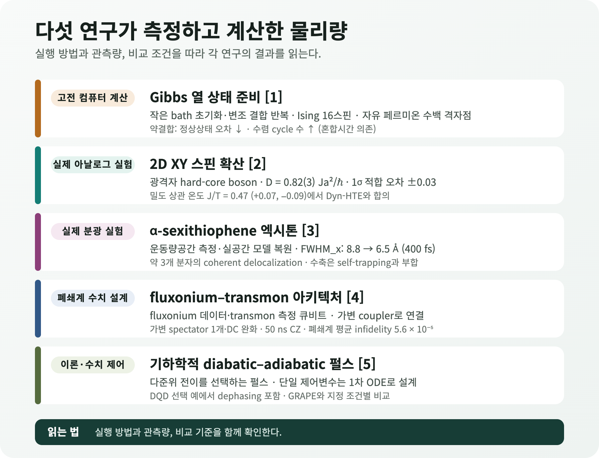
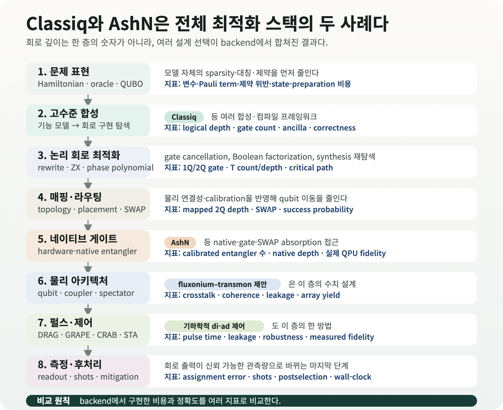

# 뜨거운 양자상태를 만들고, 엑시톤을 따라간다

양자계산 설명은 흔히 가장 낮은 에너지의 바닥상태에서 시작한다. 개념적으로 자연스럽고 전자구조와 물성의 기준이 되기 때문이다. 실제 물질과 소자는 온도가 0 K가 아니며, 빛을 흡수한 유기 반도체는 평형 바닥상태에 머물지도 않는다. 열에 의해 여러 에너지 상태가 섞이고, 전자와 정공이 만든 엑시톤은 분자 사이로 퍼졌다가 격자 진동과 상호작용하며 모양을 바꾼다.

따라서 실용적인 양자 시뮬레이션에는 두 질문이 따라온다. **원하는 유한온도 상태를 계산 장치에 어떻게 준비할 것인가?** 그리고 **준비하거나 모사한 상태가 실제 물질을 올바르게 나타낸다는 것을 어떤 관측량으로 확인할 것인가?** 2026년 8월 28일 발표된 연구들은 이 두 질문의 서로 다른 부분을 다룬다.

한 연구는 reset 가능한 보조 bath를 이용해 Gibbs 열 상태를 만드는 알고리즘을 제안했고, 다른 연구는 2차원 XY 모델의 스핀 확산을 광격자 아날로그 양자 시뮬레이터와 고전 계산에서 대조했다. 유기 반도체 연구는 α-sexithiophene 박막의 엑시톤을 femtosecond 분광으로 추적해 실공간 파동함수를 복원했다. 같은 날 발표된 fluxonium–transmon 아키텍처와 기하학적 펄스 제어는 계산의 더 아래쪽, 즉 소자 배치와 물리 제어 층을 다룬다.

이 연구들을 함께 읽으면 계산을 믿을 근거가 구체화된다. 열 상태의 정확도와 확산계수, 엑시톤의 공간폭을 통해 계산의 목표와 비교 기준이 선명해진다. 그 관측량을 얻기까지 필요한 상태 준비·회로·측정 비용도 함께 따라가 보자.

<figure class="article-hero-figure">
  
  <figcaption>그림 1. AI 생성 개념 일러스트. 왼쪽은 열 reservoir와 양자 격자의 에너지 교환, 오른쪽은 분자 여러 개에 퍼진 엑시톤의 수축을 나타낸다.</figcaption>
</figure>

## 다섯 연구에서 실제로 한 일

| 연구 | 계산·측정 경로 | 대표 결과 | 결과를 읽을 조건 |
|---|---|---|---|
| Gibbs 상태 준비 [<a href="#ref-1">1</a>] | 고전 수치: 2D Ising·자유 페르미온 | Ising 최대 16 spins; 자유 페르미온 수백 sites | 정상상태 오차와 혼합 cycle 수를 함께 분석 |
| 2D XY 확산 [<a href="#ref-2">2</a>] | 광격자 hard-core boson 실험과 Dyn-HTE | \(D=0.82(3)Ja^2/\hbar\) | 확산 적합의 1σ 오차; 밀도 상관으로 온도 추정 |
| α-sexithiophene 엑시톤 [<a href="#ref-3">3</a>] | 운동량 분광과 모델 기반 실공간 복원 | 400 fs 동안 \(\mathrm{FWHM}_x:8.8\to6.5\) Å | 4층 박막·24 K; 가우스 진폭 envelope의 폭 |
| fluxonium–transmon [<a href="#ref-4">4</a>] | Hamiltonian 기반 게이트 수치 설계 | two-tone의 폐쇄계 오차 개선; 50 ns 예 \(5.6\times10^{-5}\) | 50 ns는 tunable transmon spectator 하나에 DC 완화를 적용한 경우 |
| 기하학적 di-ad 제어 [<a href="#ref-5">5</a>] | metric 구성·ODE·수치 시간발전 | 선택한 DQD 초기화·셔틀 예에서 약 99% 이상 | 지정 전이와 제어시간을 탐색; 별도 잡음·GRAPE 비교 |

<figure class="figure-panel figure-panel-fit">
  
  <figcaption>그림 2. 다섯 연구의 계산·실험 경로와 대표 관측량. 열 상태의 정상상태 정확도에서 확산계수, 엑시톤의 공간폭과 제어 충실도로 이어진다. <a href="../artifacts/evidence_layers_ko.svg">확대 가능한 SVG</a></figcaption>
</figure>

## 1. 왜 바닥상태만으로는 부족한가

Hamiltonian \(H\)가 주어지면 바닥상태는 가장 낮은 고유에너지를 갖는 순수상태다. 온도가 올라가면 계는 하나의 고유상태에만 머물지 않는다. 에너지 \(E_i\)의 상태가 나타날 확률은 Boltzmann factor \(e^{-\beta E_i}\)로 가중되고, 평형 상태는 Gibbs density matrix

$$
\rho_\beta=\frac{e^{-\beta H}}{Z},\qquad Z=\mathrm{Tr}\left(e^{-\beta H}\right)
$$

로 표현된다. 여기서 \(\beta=1/(k_{\mathrm B}T)\)다. 온도가 높을수록 여러 상태가 섞이며, 상전이 부근과 강상관계에서는 고전적으로 \(e^{-\beta H}\)를 계산하고 표본화하는 비용이 빠르게 커질 수 있다.

Finite-temperature correlation, transport, magnetic response 또는 열적 최적화 분포를 계산하는 직접적인 경로 중 하나는 양자 프로세서에 이 mixed state를 준비하는 것이다. 이를 위해 에너지를 주고받는 전이의 비율이 목표 Hamiltonian과 온도의 detailed balance를 따르도록 계와 환경의 상호작용을 설계한다.

### reset 가능한 bath가 하는 일

Lloyd와 Abanin의 연구[<a href="#ref-1">1</a>]는 계산 대상 system을 작은 보조 bath와 잠시 결합하고, bath를 다시 초기화하는 과정을 반복한다. 변조된 system–bath coupling은 에너지를 흡수하거나 방출하는 전이의 비율이 목표 온도에 맞도록 조절한다. 각 cycle에는 짧은 무작위 시간의 계 Hamiltonian 진화도 더해, 에너지 고유기저의 불필요한 coherence와 공명을 억제한다. 매 cycle의 결과는 density matrix에 작용하는 quantum channel이며, 반복했을 때 그 고정점이 Gibbs 상태에 가까워지도록 설계된다.

약결합 세기 \(\theta\)가 작아지면 반복 채널의 정상상태가 Gibbs 상태에 가까워진다. 저자들은 그 trace-norm 오차가 \(\theta^2\)에 비례하는 섭동 스케일링을 논의했으며, 오차 추정에는 계·bath 크기와 intrinsic mixing time도 들어간다. 모든 계에 적용되는 엄밀한 오차 상한을 증명한 결과는 아니다. 결합을 약하게 하면 한 cycle의 변화도 작아져, 수렴에 필요한 cycle 수는 대략 \(1/\theta^2\)로 늘어난다. 정확도와 준비시간이 맞물리는 지점이다.

2D 양자 Ising 모델의 에너지·열용량은 최대 \(4\times4=16\) spins에서 계산했다. Trace-distance 스케일링 검사는 \(3\times3\) spins에서 수행했으며, Trotter 오차를 분리하기 위해 1차 Floquet Hamiltonian의 Gibbs 상태와 비교했다. 자유 페르미온에서는 수백 sites까지 다뤘다. 이 고전 수치 검증과 혼합 시간 분석을 실제 장치에 옮길 때에는 bath reset·제어 잡음·총 실행시간을 함께 평가해야 한다.

### 평형 열 상태에서 광여기 동역학으로

Gibbs 상태 준비는 평형 유한온도 계산의 출발점이다. 빛을 흡수한 유기 반도체를 따라가려면 여기에 전자–정공 Hamiltonian과 exciton–phonon coupling, 실시간 또는 열린계 시간발전을 더한다. 서로 다른 물리계에서도 계산을 검증하는 방식은 구체적인 관측량에서 시작한다. XY 계의 확산과 광여기 엑시톤의 공간폭을 차례로 살펴보자.

## 2. 양자 시뮬레이터를 어떻게 믿을 것인가

아날로그 양자 시뮬레이터는 범용 gate circuit을 실행하는 대신, 원자·이온·광자의 물리적 상호작용을 목표 Hamiltonian과 닮도록 조정한다. 큰 계에서 고전 계산이 어려운 영역을 탐색할 수 있지만, 바로 그 이유 때문에 정답을 대조하기 어렵다. 검증에는 **실험과 고전 계산이 둘 다 가능한 겹치는 영역**이 필요하다.

2D XY spin diffusion 연구[<a href="#ref-2">2</a>]는 square-lattice spin-1/2 XY 모델을 광격자의 hard-core boson으로 구현했다. 실험에서는 domain wall이 시간에 따라 퍼지는 모습을 측정했고, 이론에서는 dynamical high-temperature expansion(Dyn-HTE)으로 긴 시간·긴 거리의 hydrodynamic regime을 계산했다.

실험의 spin diffusion constant는 \(D=0.82(3)Ja^2/\hbar\)였다. \(J\)는 교환 에너지, \(a\)는 격자 간격이며 괄호의 3은 확산 적합의 1σ 오차 0.03이다. 논문은 \(a=\hbar=k_{\mathrm B}=1\)인 단위를 쓴다. 같은 이미지 자료의 nearest-neighbor 밀도 상관을 고온 전개와 비교해 추정한 온도는 \(J/T=0.47^{+0.07}_{-0.09}\)였다. 이를 Dyn-HTE에 넣으면 측정한 확산계수와 합의하며, 무한온도의 계산값은 약 \(0.72Ja^2/\hbar\)다.

이 합의는 아날로그 장치의 수송을 검증하는 기준점이다. 온도를 확산계수 자체에 맞춰 정한 것이 아니라 별도 관측량인 밀도 상관에서 추정했다는 점도 중요하다. 더 낮은 온도나 더 긴 시간으로 확장할 때, 이렇게 확보한 겹침 영역에서의 정량 검증이 다음 예측을 지탱한다.

## 3. 엑시톤을 ‘본다’는 말의 정확한 뜻

엑시톤은 빛에 의해 생성된 전자와 정공이 Coulomb interaction으로 결합한 준입자다. 유기 반도체에서는 분자 안에 국소화될 수도 있고 여러 분자에 coherent하게 퍼질 수도 있다. 공간 크기와 위상, 격자 진동에 의한 self-trapping은 에너지 이동, 발광과 비방사 손실에 영향을 준다.

기존 optical spectrum은 exciton energy와 lifetime을 알려주지만, 파동함수의 공간 분포와 내부 위상을 동시에 직접 제공하지는 않는다. α-sexithiophene 연구[<a href="#ref-3">3</a>]는 femtosecond time-resolved photoemission orbital tomography(trPOT)를 사용했다. Pump pulse가 엑시톤을 만들고 high-harmonic probe가 시간별 photoelectron의 에너지와 운동량 분포를 기록한다.

직접 측정한 양은 시간에 따른 photoelectron의 에너지·운동량별 세기다. 시료는 산소로 passivation한 Cu(110) 위의 배향된 4층 α-sexithiophene 박막이며 온도는 24 K, probe 에너지는 21.7 eV였다. 연구진은 이 분포를 분자 궤도와 가우스 envelope·상대 위상 모델에 연결하고 GW/BSE 계산과 비교해 엑시톤의 공간 구조를 해석했다.

모델에서 얻은 가로 방향 진폭 envelope의 폭은 인접 분자 약 3개에 걸친 coherent delocalization을 가리킨다. 시간에 따라 운동량 peak가 넓어지면 실공간 envelope는 좁아진다. 두 폭은 \(\mathrm{FWHM}_k\mathrm{FWHM}_x=8\ln2\)로 연결되며, \(t=0\)과 400 fs에서 \(\mathrm{FWHM}_x\)는 각각 \((8.8\pm1.0)\) Å와 \((6.5\pm1.0)\) Å였다. **약 25% 수축은 이 가우스 진폭 공간폭의 변화**다. 이 정의를 계산에 똑같이 적용해야 공간 크기를 정량 비교할 수 있다.

수축과 작은 엑시톤 에너지 이동은 exciton–phonon 결합에 따른 self-trapping 해석을 뒷받침한다. 다만 이를 일으키는 phonon의 미시 이론은 이 논문에서 계산하지 않았다. GW/BSE는 분자 사이 위상 관계와 이중 peak의 특징을 설명하지만, 단층 계산의 envelope 폭 약 16 Å와 실험의 약 9 Å 사이에는 차이가 남는다. 실제 4층 구조와 계산계의 차이를 줄이는 일이 다음 검증 과제다.

### OLED 계산이 이제 실험과 맞춰볼 수 있는 것

OLED·유기반도체 계산은 흔히 \(S_1\), \(T_1\), \(\Delta E_{\mathrm{ST}}\), oscillator strength와 SOC를 비교한다. 이 연구는 여기에 **정의가 명확한 공간폭, 분자 사이 위상 관계, 수백 femtosecond의 폭 변화**를 더할 실험 사례를 제공한다. GW/BSE·TDDFT·다중참조 전자구조와 비단열 동역학을 같은 박막 구조·온도에서 비교하면, 비슷한 에너지를 내는 모델이 같은 공간·시간 거동도 예측하는지 물을 수 있다.

특정 phonon mode가 국소화를 촉진하는지, 그 과정이 비방사 손실과 어떻게 연결되는지는 후속 메커니즘 연구의 질문이다. 공간폭·위상 proxy·수축 시간을 OLED 후보의 계산 검증이나 ML label에 활용하는 것은 이 리뷰의 제안이며, 이번 6T 박막 실험의 측정 결과와 구별해 시험할 필요가 있다.

## 4. 아키텍처와 펄스도 별도의 최적화 층이다

같은 날의 두 Physical Review Research 논문은 양자계산을 실제 장치로 내리는 과정의 서로 다른 층을 다룬다.

fluxonium–transmon 아키텍처[<a href="#ref-4">4</a>]는 긴 coherence와 큰 anharmonicity를 갖는 fluxonium을 data qubit로, 성숙한 readout 기술이 있는 fixed-frequency transmon을 measurement ancilla로 번갈아 배치한다. 두 종류의 qubit는 tunable transmon coupler로 연결된다. 서로 다른 스펙트럼을 교대로 배치해 level crowding을 줄이고 idle ZZ crosstalk을 0에 가깝게 설계하려는 접근이다.

Hamiltonian 기반 수치 계산에서 작은 보정 tone을 추가하면 single-tone에 비해 폐쇄계 평균 gate infidelity가 최대 네 자릿수 감소했다. 30 ns 예의 주요 누설 성분 억제도 따로 분석했다. Spectator transmon 하나를 flux-tunable하게 두고 coupler와 spectator에 DC pulse를 더한 50 ns CZ 예의 폐쇄계 오차는 출판본에서 \(5.6\times10^{-5}\)다. 이 값은 지정한 spectator 배치와 DC 완화 조건에 대응한다.

저자들은 별도로 decoherence 오차를 추정하고 제작 편차·재보정의 수치 민감도도 분석했다. 따라서 이 설계의 의미는 누설과 spectator 위상을 함께 줄일 구체적인 제어 경로를 찾았다는 데 있다. 제작한 배열의 충실도·수율과 반복 오류정정 성능은 그 경로를 실험으로 평가할 지표다.

기하학적 diabatic–adiabatic 제어[<a href="#ref-5">5</a>]는 다준위 스펙트럼에서 원하는 전이와 억제할 누설을 지정하고, Hamiltonian의 미분과 에너지 간격으로 phenomenological metric을 만든다. 제어변수가 하나일 때 주어진 metric을 따르는 pulse 생성은 1차 ODE 풀이로 줄어든다. 스펙트럼 계산과 전이 선택, 제어시간·metric 매개변수 탐색은 그 앞에 남는다.

선택한 double quantum dot 초기화 예는 99% 초과, orbital·valley 모델의 상태 셔틀 예는 약 99%의 목표상태 충실도를 냈다. 보충자료는 전하·국소 spin·상관 spin dephasing을 넣은 Lindblad 계산과, 목표 99%·\(t_ft_c=50\) 등의 지정 조건에서 GRAPE와 pulse 생성시간을 비교한다. 이 수치 비교는 빠른 후보 pulse 생성의 가능성을 보여주며, 실제 제어 장치에 적용할 때에는 대역폭과 보정에 맞춰 후보를 다시 평가하게 된다.

## 5. 문제 표현에서 펄스까지 비용은 이동한다

Classiq는 고수준 기능 모델에서 가능한 회로 구현을 탐색하는 **합성 프레임워크의 한 사례**다. AshN은 초전도 장치의 네이티브 2-qubit interaction을 활용해 논리 gate와 routing SWAP 일부를 흡수하는 **네이티브 게이트 층의 최근 사례**다.

그 사이와 아래에는 Boolean factorization, peephole rewrite, ZX-calculus, phase-polynomial synthesis, qubit placement, routing, calibration-aware compilation, pulse shaping, optimal control, error-aware scheduling 등 서로 다른 최적화 계열이 있다. 오늘의 기하학적 di-ad 제어는 이 지형의 **펄스·물리 제어 층**에 놓인다. Fluxonium–transmon 연구는 한 단계 위의 **소자 아키텍처 층**이다.

### 얽힘 연산을 줄이는 대신 측정을 더 한다

양자 최적화가 현재 하드웨어에서 막히는 이유는 큐비트 수만이 아니다. “\(n\)개 후보 중 정확히 \(k\)개를 고른다”는 조건을 QAOA 회로에 이차 penalty로 그대로 옮기면 \(O(n^2)\)개의 pairwise \(R_{ZZ}\) gate와 사실상 all-to-all 연결이 필요하다. 연결이 제한된 초전도 칩에서는 멀리 떨어진 큐비트를 만나게 하는 SWAP까지 더해져, 풀고 싶은 문제보다 그 조건을 표현하는 회로가 먼저 감당하기 어려워진다.

IBM Research의 Fourier-LCU 프리프린트[<a href="#ref-6">6</a>]는 정확히 \(k\)개를 고르게 만드는 cardinality penalty의 구현을 바꾼다. Fourier 전개 자체는 이 penalty unitary를 \(n+1\)개 unitary의 가중합으로 정확히 나타낸다. 각 항에서 penalty 부분은 single-qubit \(R_Z\) gate를 병렬로 한 번 적용하면 된다. 여기서 Fourier transform은 분해계수를 계산하는 이산 푸리에 변환이며, quantum Fourier transform 회로를 뜻하지 않는다.

논문이 제시한 정확한 channel-QPD 구현은 ancilla와 controlled operation을 사용한다. Ancilla-free 방식은 이들을 없애고 branch 회로를 따로 실행한 뒤 결과를 고전적으로 합치지만, coherent circuit의 전체 출력분포를 재현하지는 않는다. 대신 모든 bitstring \(x\)에 대해 \(\widetilde p_x\ge p_x/\Gamma\)를 보장하므로, 특정 bitstring을 얻는 데 최악의 경우 약 \(\Gamma\)배의 측정이 필요할 수 있다. QAOA layer 여러 개를 이 방식으로 분해하면 \(\Gamma\) 인자가 곱해질 수 있다.

연구진은 12-qubit exact statevector 계산에 이어 \(n=106\), \(k=35\), \(p=1\)인 densest-\(k\)-subgraph 회로를 `ibm_boston`의 물리 큐비트 106개에서 실행했다. 모든 branch에 공통인 objective \(H_1\)와 SWAP 부분은 886 CZ gates, 2Q depth 25를 사용했다. 실험 1의 한 반복에서는 \(\Gamma=104.1328\)인 107개 penalty-LCU branch를 모두 실행하고 회로마다 32,768 shots를 사용했다. 세 실험 전체를 10회 반복했으므로, 실험 1만 계산해도 반복당 3,506,176 shots, 10회 합계 35,061,760 shots다. 이 합계는 논문의 설정에서 계산한 값이며, single-branch 회로를 최적화한 실험 2와 3의 추가 실행은 포함하지 않는다.

CPLEX가 구한 최적값은 98 edges였다. 10회 하드웨어 반복에서 각 방법이 기록한 best solution의 최댓값은 ancilla-free Fourier-LCU 결합 60, single penalty basis circuit 80, single XY-mixer basis circuit 81이었고, 반복 평균은 각각 57.4, 72.3, 76.8이었다. 뒤의 두 값은 LCU basis circuit 하나를 별도의 variational ansatz로 삼아 비선형 \(\mathrm{CVaR}_{1/\Gamma}\)를 최적화해 얻었다. Sec. V의 single-branch 보장은 선형 표본 목적함수와 전역 최적화·무한 shots 가정에 한정되므로, 이 두 CVaR 결과에는 적용되지 않는다. 저자들도 이 경우를 heuristic으로 구분한다. 실제 장치 실험은 cardinality penalty의 all-to-all 상호작용을 단순한 branch와 더 많은 측정으로 바꿀 수 있음을 보였지만, 모든 branch의 objective와 SWAP 부분에는 여전히 886 CZ gates가 들어갔다. 이 사례에서는 CPLEX의 해 품질과 전체 계산시간을 함께 비교하는 일이 남는다. 여기서 다루는 근거는 8월 31일 이전의 프리프린트 v1이다.

<figure class="figure-panel figure-panel-fit">
  
  <figcaption>그림 3. 문제 표현부터 측정까지 이어지는 최적화 층과 각 층의 지표. Classiq는 고수준 합성, AshN은 네이티브 게이트, 이번 두 연구는 아키텍처와 펄스 층의 사례다. <a href="../artifacts/quantum_optimization_stack_ko.svg">확대 가능한 SVG</a></figcaption>
</figure>

각 층이 줄이는 비용도 다르다. 문제 표현과 알고리즘 분해는 entangling gate를 branch·shots·고전 집계 비용과 맞바꿀 수 있다. 고수준 합성은 logical depth와 ancilla를, routing은 SWAP과 mapped depth를, native gate는 실제 calibrated entangler 수를, pulse 제어는 gate time·leakage·robustness를 바꾼다. 한 단계에서 좋아진 숫자가 end-to-end fidelity나 wall-clock 개선으로 이어지는지는 target backend에서 다시 측정해야 한다.

회로 최적화를 비교할 때는 최소한 다음 비용·정확도 항목을 함께 기록해야 한다.

- logical depth와 logical 2Q gate count
- mapping 이후 2Q depth, SWAP과 ancilla
- native gate와 calibration date, 예상·측정 fidelity
- pulse length, leakage, crosstalk과 spectator 영향
- LCU branch 수, sampling overhead \(\Gamma\), shots와 고전 집계 비용
- readout error, mitigation·postselection 성공률
- compile time, queue time, QPU runtime과 고전 전후처리

이 전체 지형의 배경과 Classiq·AshN의 정량 경계는 앞선 리뷰 「양자 회로 최적화는 왜 필요한가」[<a href="#ref-7">7</a>]에서 자세히 다뤘다.

## 6. OLED·재료 연구에서 바로 바꿀 기록 항목

이제 재료 계산의 기록도 결과에 맞춰 구체화할 수 있다. 다음 표는 각 연구를 기존 DFT·ML·양자 계산의 검증에 연결하는 이 리뷰의 제안이다.

| 연구 단계 | 추가할 기록 | 판단 질문 |
|---|---|---|
| 전자구조 | \(S_1/T_1\) 에너지뿐 아니라 envelope 공간폭·phase proxy·delocalization length | 실험 trPOT가 복원한 공간 구조를 같은 박막 조건에서 재현하는가 |
| 동역학 | 400 fs 전후 wavefunction contraction, phonon mode, nonadiabatic population | Self-trapping의 시간척도와 원인을 분리해 예측하는가 |
| 유한온도 양자 시뮬레이션 | target \(T\), Gibbs error, bath size, reset 횟수, mixing time | State-preparation 비용을 관측량 계산과 분리해 기록했는가 |
| 아날로그 시뮬레이터 | 고전적으로 풀리는 overlap regime와 동일 observable | 검증 영역 밖 extrapolation에 앞서 정량 합의를 보였는가 |
| 회로·하드웨어 | compiled 2Q depth, native gate, LCU branch·\(\Gamma\), pulse, spectators, shots, wall-clock | Classiq·AshN·Fourier-LCU·pulse 개선을 같은 end-to-end 지표로 내렸는가 |

DFT·GW/BSE·TDDFT는 ground state와 excited-state electronic structure의 강한 고전 기준선이다. 양자 계산은 이를 통째로 대체한다고 가정하기보다, 강상관 active space, 유한온도 correlated state, 실시간 다체동역학 또는 표본추출처럼 남은 병목에 제한적으로 배치해야 한다. 그 뒤 에너지 오차와 함께 엑시톤 공간폭·위상·시간 같은 관측량을 비교할 때 재료를 설명하는 모델을 더 세밀하게 고를 수 있다.

## 최종 평가

계산을 신뢰하는 근거는 목표 관측량이 구체적일수록 강해진다. Gibbs 상태 준비에서는 정상상태의 정확도와 거기까지의 혼합 시간이 함께 움직인다. XY 시뮬레이터는 밀도 상관으로 온도를 정하고 확산계수를 고전 이론과 대조한다. 엑시톤 분광은 모델의 에너지뿐 아니라 공간폭·위상·시간 변화를 시험한다. 서로 다른 방법이 같은 관측량에 도달하는 지점이 다음 계산을 확장할 발판이다.

그 관측량을 얻는 비용 역시 여러 층에 걸친다. 아키텍처와 pulse 설계는 누설·위상 오차를 바꾸고, Fourier-LCU는 강한 연결을 요구하는 연산을 더 단순한 branch와 측정으로 나눈다. 이때 회로의 절감이 shots와 고전 집계를 거쳐도 남는지 확인해야 한다. 재료 연구에서 유용한 양자계산을 고르는 기준은 이렇게 물리적 설명력과 전체 비용을 함께 따라가는 데 있다.

## References

<ol class="reference-list">
<li id="ref-1"><a href="https://doi.org/10.1103/cbrd-ssnm">J. Lloyd and D. A. Abanin, Quantum thermal state preparation for near-term quantum processors, Phys. Rev. X <b>16</b>, 031053 (2026).</a></li>
<li id="ref-2"><a href="https://doi.org/10.1103/whhg-tfv4">E. Fitzner, B. Lee, J. Hur, M. Kim, B. Schneider, J.-y. Choi, and B. Sbierski, Finite-temperature spin diffusion in the two-dimensional XY model, Phys. Rev. B <b>114</b>, 094303 (2026).</a></li>
<li id="ref-3"><a href="https://doi.org/10.1103/3zmg-276c">M. Theilen, S. Kaidisch, M. Stettner, S. Zajusch, E. Fackelman, A. Adamkiewicz, R. Wallauer, A. Windischbacher, C. S. Kern, M. G. Ramsey, F. C. Bocquet, S. Soubatch, F. S. Tautz, U. Höfer, and P. Puschnig, Observing the spatial and temporal evolution of exciton wave functions in organic semiconductors, Phys. Rev. X <b>16</b>, 031054 (2026).</a></li>
<li id="ref-4"><a href="https://doi.org/10.1103/ts1j-nfg1">L. Heunisch, L. Huang, T. Eckstein, S. Tasler, J. Schirk, F. Wallner, V. Feulner, B. Sarma, K. Liegener, C. M. F. Schneider, S. Filipp, and M. J. Hartmann, Scalable fluxonium-transmon architecture for error-corrected quantum processors, Phys. Rev. Research <b>8</b>, 033245 (2026).</a></li>
<li id="ref-5"><a href="https://doi.org/10.1103/hfv7-3pxt">C. Ventura-Meinersen, E. Valvo, S. Bosco, and M. Rimbach-Russ, Multilevel spectral navigation with geometric diabatic-adiabatic control, Phys. Rev. Research <b>8</b>, L032034 (2026).</a></li>
<li id="ref-6"><a href="https://arxiv.org/abs/2605.18985v1">A. Carrera Vazquez, D. J. Egger, and S. Woerner, Efficient Fourier-based linear combination of unitaries and applications in quantum optimization, arXiv:2605.18985v1 (2026).</a></li>
<li id="ref-7"><a href="https://infant83.io/AI_Tech_Review/reviews/2026-08-27_classiq-ashn-circuit-compression/">H.-J. Kim, Why quantum circuit optimization matters, Agentic Tech Review Letters (27 August 2026).</a></li>
</ol>

[2026년 8월 31일 발행 호 · 공개용 4쪽 Daily Quantum Brief PDF 내려받기](../artifacts/daily_quantum_brief_2026-08-31.pdf)

## 작성과 수정 이력

원 발행일·근거 기준일은 2026년 8월 31일이다. 2026년 11월 12일에는 한영 문장과 캡션·도식, APS 인용을 정리했다. Gibbs 정상상태 오차와 혼합 시간 분석, XY 확산계수의 단위·오차와 온도 추정, 엑시톤 공간폭의 정의를 명료화했다. 50 ns spectator 오차는 초고의 3.8×10⁻⁵에서 당시 출판본의 5.6×10⁻⁵로 바로잡고, 이미 수행된 제작 편차·dephasing·GRAPE 비교를 설명했다. 새 11월 결과를 과거 성과에 더한 개정은 아니다. 기존 표지·최초 작성 기록은 유지하며 연결된 당시 DQB도 수집 메모를 정리하고 같은 정의를 바로잡았다.

이번 원문 대조는 Gibbs 출판본·통합 부록, XY의 출판일과 같은 날 나온 프리프린트 v2·통합 부록, 엑시톤 출판본의 본문과 관련 방법·부록, 아키텍처 출판본·통합 부록과 di-ad 출판본·별도 보충자료, Fourier-LCU v1의 분해·보장·실험 절을 대상으로 했다. XY 출판본 PDF는 확보하지 못했다. 선택한 공식 코드·데이터는 정적으로 읽었으며 실험·수치 모델·최적화를 재실행하거나 사람 독자 평가를 수행한 작업은 아니다.
