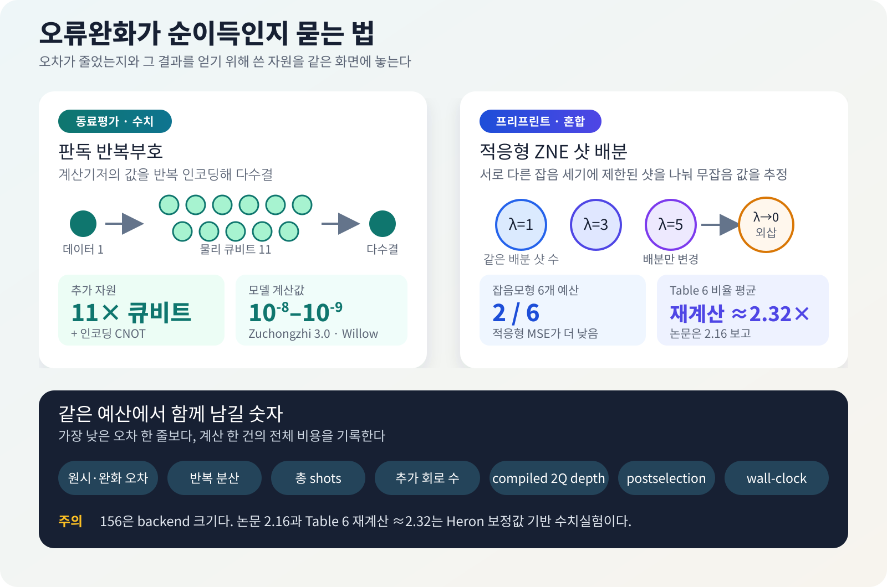

# 오류완화는 언제 순이득을 내는가

양자컴퓨터에서 오차가 줄었다는 말은 얼핏 충분해 보인다. 그러나 그 수치를 얻기 위해 큐비트를 열한 배 쓰고, 회로를 세 가지 잡음 세기에서 반복하고, 측정 샷을 몇 배 더 소모했다면 계산 전체가 좋아졌는지는 아직 알 수 없다. 같은 장비와 같은 시간으로 더 유용한 답을 얻었는지까지 봐야 한다.

이 문제가 가까운 시일 안에 사라지지는 않는다. 이 글이 다루는 2026년 9월의 장치에서는 게이트 오류, 판독 오류, decoherence가 계산 결과를 바꾼다. 오류완화는 물리 오류를 계속 검출하고 고치는 논리 큐비트를 만들기보다, 회로를 여러 번 실행하거나 측정값을 후처리해 기대값과 표본의 오차를 줄인다. 구현 문턱은 낮지만 그만큼 샷, 회로 수, 분산 또는 보조 큐비트로 비용을 치른다.

2026년 8월 말 공개된 두 연구는 이 비용을 서로 다른 곳에서 드러냈다. 한 동료평가 논문은 데이터 큐비트마다 최대 10개의 보조 큐비트를 더 붙이고 다수결로 판독해 측정 오류를 크게 낮출 수 있는지 계산했다. 다른 프리프린트는 IBM Heron 장치에서 작은 회로를 실행하고, 장치 보정값으로 만든 잡음모형에서 제한된 샷을 ZNE에 어떻게 나눌지 비교했다.[<a href="#ref-1">1</a>, <a href="#ref-2">2</a>]

판독 직전의 인코딩과 여러 실행 뒤의 외삽은 계산의 서로 다른 단계에 비용을 더한다. 나는 두 연구를 정확도와 자원이 어떻게 함께 바뀌는지 살피는 사례로 읽는다. 추가 큐비트와 CNOT, 회로 반복과 샷을 같은 계산의 비용으로 모아야 어떤 선택이 유리한지 알 수 있다.

<figure class="article-hero-figure">
  
  <figcaption>그림 1. AI 생성 개념 일러스트. 양팔저울의 왼쪽에는 정돈되는 측정 신호를, 오른쪽에는 그 신호를 얻는 데 더 쓰는 큐비트·회로 반복·측정 샷을 놓았다.</figcaption>
</figure>

## 판독과 외삽에서 늘어나는 자원

| 항목 | 판독 반복부호 | IBM Heron·적응형 ZNE |
|---|---|---|
| 연구 상태 | npj Unconventional Computing 동료평가 논문 | arXiv v1 프리프린트 |
| 줄이려는 문제 | 마지막 측정에서 0과 1을 잘못 읽는 판독 오류 | 여러 잡음 세기에서 얻은 기대값을 외삽할 때의 편향·분산 |
| 실제로 사용한 방법 | 독립 오류 해석모형과 공개 장치 오류율을 넣은 고전 수치계산 | 이상·잡음 수치계산과 ibm_marrakesh의 작은 회로 실행 |
| 추가 비용 | 데이터 큐비트당 최대 10개 보조 큐비트와 인코딩 CNOT | 여러 noise factor의 회로, pilot shots, 분산이 커질 수 있는 외삽 |
| 대표 결과 | 저오류 장치 profile 두 개에서 \(k=9,11\)일 때 \(10^{-8}\)–\(10^{-9}\) 판독 오류 예측 | 잡음모형의 6개 예산 중 2개에서만 적응형 MSE가 낮음; Table 6 비율 평균은 약 2.32(논문은 2.16 보고) |
| 결과를 읽는 조건 | 최종 비트 뒤집힘을 독립으로 취급한 모형의 예측; 인코딩 오류 전파와 실제 칩의 자원비용을 확인해야 함 | 여섯 예산은 보정값 기반 잡음모형에서 비교; 실제 장치는 한 calibration의 작은 회로를 실행 |

## 1. 판독 오류가 샘플 전체를 망치는 이유

기대값 하나를 추정할 때는 많은 샷을 평균내므로 일부 비트가 잘못 읽혀도 통계적으로 보정할 여지가 있다. 반면 random-circuit sampling이나 measurement-based quantum computing처럼 **비트열 자체가 답**인 작업은 모든 비트가 맞아야 온전한 표본 하나를 얻는다. 큐비트마다 판독 오류율이 \(e_m\)이고 오류가 독립이라면 \(n\)비트 표본이 모두 맞을 확률은 대략 \((1-e_m)^n\)으로 줄어든다.

[He-Liang Huang의 논문](https://www.nature.com/articles/s44335-026-00094-0)[<a href="#ref-1">1</a>]은 고전 통신에서 익숙한 반복부호를 판독 직전에 붙인다. 각 데이터 큐비트와 0으로 준비한 보조 큐비트에 CNOT을 적용해, 계산기저의 판독값이 홀수 \(k\)개의 물리 큐비트에 반복되도록 인코딩한다. 모두 측정한 뒤 과반수 값을 답으로 고른다. 뒤집힌 판독이 절반보다 적으면 다수결이 원래 값을 되살린다.

인코딩 게이트가 이상적이고 판독 오류가 독립이면 남는 오류의 주된 항은 \(e_m^{\lceil k/2\rceil}\)로 내려간다. 논문은 CNOT 뒤의 2큐비트 depolarizing error \(e_g\)를 유효 판독 오류율로 옮겨 계산하고, 최종 비트 뒤집힘을 독립으로 취급했다. 이때 필요한 자원은 명확하다. \(k=11\)이면 데이터 큐비트 하나를 읽기 위해 물리 큐비트 11개, 즉 보조 큐비트 10개와 추가 CNOT을 쓴다.

### 장치 오류율을 넣은 예측과 인코딩 중 오류 전파

논문이 사용한 Zuchongzhi 3.0 profile에서는 \(k=9\)일 때 \(4.11\times10^{-8}\), \(k=11\)일 때 \(1.91\times10^{-9}\)의 유효 판독 오류를 계산했다. Willow profile에서는 각각 \(3.65\times10^{-8}\), \(1.66\times10^{-9}\)였다. 이 수치는 기존 readout·2Q gate 오류율을 넣은 저자들의 유효 독립 오류모형 예측이다.

같은 식을 다른 profile에 넣으면 결과도 달라진다. Zuchongzhi 2.0과 Sycamore는 \(k=11\)에서도 각각 \(8.61\times10^{-6}\), \(3.64\times10^{-6}\)로 계산됐다. 보조 큐비트 수가 같아도 입력한 오류율에 따라 얻는 이득이 달라진다.

인코딩 게이트의 오류가 최종 측정까지 어떻게 퍼지는지도 확인해야 한다. 이번 원문 재검토에서 보충자료의 사슬 \(\mathrm{CNOT}_{1\to2}\), \(\mathrm{CNOT}_{2\to3}\)를 따라가 보았다. 입력이 000일 때 첫 게이트 직후 두 번째 비트에 X 오류 하나가 생기면 010이 되고, 다음 CNOT을 지나면 011이 된다. 다수결은 원래의 0 대신 1을 고른다. 독립적인 한 번의 게이트 고장도 최종 비트 사이의 상관 오류를 만들 수 있는 것이다. 이는 리뷰의 작은 오류 전파 점검이며, 전체 잡음모형의 재현은 아니다. 위 수치의 실제 순이득을 판단하려면 이 전파와 배선·상관 판독 오류를 포함한 회로를 확인하고, 필요한 shots와 실행시간을 더해야 한다.

## 2. ZNE는 편향을 줄이면서 분산을 키울 수 있다

Zero-noise extrapolation(ZNE)은 같은 회로를 원래 잡음 세기 \(\lambda=1\)뿐 아니라 인위적으로 키운 \(\lambda=3,5\)에서도 실행한 뒤, 측정값의 추세를 \(\lambda\to0\)으로 외삽한다. 잡음이 커질수록 관측량이 어떻게 변하는지 알면 잡음이 없을 때의 값을 역으로 추정할 수 있다는 생각이다.

문제는 외삽이 여러 noisy estimate를 큰 계수로 더하고 뺀다는 데 있다. 체계적 편향은 줄어들 수 있지만 표본 분산은 커질 수 있다. 총 샷 예산 \(B\)가 정해져 있으면 한 지점에 샷을 더 주는 만큼 다른 지점의 샷이 줄어든다. 따라서 이 논문은 절대오차 하나 대신

$$
\mathrm{MSE}=\mathrm{Bias}^2+\mathrm{Variance}
$$

를 비교한다.

[Sumit Chongder의 프리프린트](https://arxiv.org/abs/2608.28535v1)[<a href="#ref-2">2</a>]는 \(\lambda=1,3,5\)에 샷을 똑같이 나누는 방식과, 각 지점의 100-shot pilot으로 분산을 추정해 샷 배분을 바꾸는 ASB-ZNE를 비교했다. 원문은 외삽 계수의 절댓값과 지점별 표준편차를 곱한 값에 비례하는 Neyman 배분을 제안한다. 외삽 결과에 크게 기여하고 통계적으로 불안정한 지점에 더 많은 샷을 주려는 발상이다.

실제 MSE에는 외삽 편향과 유한한 pilot에서 추정한 분산의 오차가 함께 남는다. Heron 보정값 기반 잡음모형에서 보고한 적응형/균등 MSE 비율은 다음과 같았다.

| 최종 배분 샷 수 \(B\) | 900 | 1,500 | 3,000 | 6,000 | 12,000 | 21,000 |
|---|---:|---:|---:|---:|---:|---:|
| 적응형 / 균등 MSE | 5.96 | 0.998 | 1.47 | 0.988 | 2.08 | 2.43 |

1보다 작은 두 경우도 개선 폭은 약 0.2%와 1.2%였다. 논문은 여섯 예산의 평균 MSE 비율을 2.16으로 적었지만, Table 6에 실린 비율을 단순 평균하면 약 2.32다. 2.16은 표의 적응형 MSE 평균인 \(2.16\times10^{-3}\)과 일치해, 본문 수치에는 계산 또는 표기 오류가 있는 것으로 보인다. 어느 계산을 따르더라도 적응형 배분이 여섯 조건 중 네 조건에서 더 나빴다는 결론은 바뀌지 않는다. 표의 비교 대상은 **적응형 ZNE와 균등 ZNE**다. raw 측정과 완화 결과를 직접 비교한 비율로 읽으면 의미가 달라진다.

공개 코드의 모사 시험은 제안된 식과 구별해 읽어야 한다. 배분 규칙은 외삽 계수의 크기를 곱하지 않고 추정 표준편차의 비율을 사용한다. 표의 \(B\)는 최종 배분된 샷 수이며, 별도로 수행한 pilot까지 합친 총비용과는 구별한다. 따라서 이 표는 공개된 시험 규칙의 결과이며, pilot 비용까지 일치시킨 최적 Neyman 배분의 일반 성능을 판정한 것으로 읽기 어렵다.[<a href="#ref-2">2</a>]

### 실제 Heron 실행에서 확인한 것은 따로 있다

ibm_marrakesh는 156큐비트 Heron-family processor지만 연구진은 calibration snapshot으로 저오류 8큐비트 chain을 골랐다. 하드웨어 회로에는 2·4·6큐비트 GHZ, 최대 \(L=8\)인 repeated-layer circuit과 4-node \(p=1\) QAOA가 포함됐다. 전체 QPU allowance는 약 10분이었다.

실제 장치에서 가장 분명한 수치는 배치의 영향이다. 저오류 coupler \(\{33,39\}\)에서 측정한 \(ZZ\)는 0.909였고, 일부러 고른 고오류 coupler \(\{119,133\}\)에서는 0.751이었다. 같은 calibration snapshot에서도 어느 연결을 쓰느냐가 관측량을 약 0.16 바꿨다. 사후 완화법을 고르기 전에 qubit·coupler 배치를 바꾸는 일이 더 값쌀 수 있음을 보여주는 장치 측정이다.

논문의 초록과 결론은 2-of-6 결과를 “on our device”라는 표현 안에 묶는다. 그러나 본문 §5.5는 이 비교를 “simulation with a hardware-anchored noise model”이라고 명시한다. 재현과 후속 비교에는 후자의 방법 표기가 기준이 되어야 한다. 아직 동료평가 전 단일 저자 프리프린트라는 점도 함께 남겨야 한다.

<figure class="figure-panel figure-panel-fit">
  
  <figcaption>그림 2. 원문 [1, 2]의 수치와 자원 구성을 리뷰가 비교한 도식이다. 첫 연구는 큐비트와 CNOT을, 둘째 연구는 여러 회로와 샷을 더 쓴다. \(10^{-8}\)–\(10^{-9}\), 2-of-6와 Table 6 재계산값 약 2.32×는 모두 수치계산에서 나왔다. 논문 본문은 마지막 평균을 2.16으로 보고한다.</figcaption>
</figure>

## 3. 오류완화의 성적표에는 무엇을 적어야 하나

“완화 후 오차가 30% 감소했다”만으로는 방법을 선택할 수 없다. 세 배 많은 회로와 열 배 많은 샷을 쓴 결과라면, 같은 계산 시간을 raw 방식에 배분했을 때와 비교해야 한다. VQE, SQD와 최적화 회로의 실험 기록에는 다음 항목이 한 묶음으로 남아야 한다.

| 기록 항목 | 왜 필요한가 |
|---|---|
| raw·mitigated 오차 | 완화가 바꾼 절대오차와 방향을 직접 비교한다 |
| 반복 실행 분산·신뢰구간 | 한 번 잘 나온 결과와 안정적인 개선을 구분한다 |
| 총 shots | 통계오차 감소에 쓴 가장 직접적인 비용이다 |
| 추가 회로 수·noise factors | ZNE·PEC·twirling이 만든 실행 수를 드러낸다 |
| compiled 2Q depth·SWAP | 논리회로가 실제 backend에서 부담한 오류원을 기록한다 |
| postselection·폐기율 | 남은 표본의 정확도와 버린 표본의 비용을 함께 본다 |
| compile·queue·QPU·후처리 wall-clock | 연구자가 기다린 전체 시간을 비교한다 |

가장 공정한 질문은 “완화했을 때 더 정확했는가”보다 구체적이다. **같은 총예산으로 목표 오차에 더 빨리 도달했는가, 아니면 같은 시간에 더 작은 MSE를 얻었는가?** 문제, 관측량, backend와 calibration이 바뀌면 답도 다시 측정해야 한다.

## 4. 회로·데이터·재료에서도 비용과 기준선을 묻다

같은 날의 다른 연구에서는 무엇을 함께 최적화하고 어떤 기준선에 비출지가 달라진다. 광자회로의 소자 수와 성공확률, 에너지 전송 경로와 solver 시간, 누락된 측정 결과와 학습 분포, cavity 안의 층간 구조가 각각의 비교 대상이다.

### 광자회로는 게이트를 이어 붙일수록 성공확률이 줄어든다

선형광학 양자회로의 2큐비트 게이트는 postselection에 의존하는 경우가 많다. 완성된 논리회로를 CNOT 같은 부품으로 하나씩 치환하면 광학소자와 ancilla가 늘고, 각 단계의 성공확률이 곱해져 전체 성공률이 빠르게 낮아진다.

[Javier Osca와 Jiri Vala의 APS Open Science 논문](https://doi.org/10.1103/xjrz-csmx)[<a href="#ref-3">3</a>]은 7개 층, 층마다 3개의 beam splitter가 있는 넓은 optical ansatz에서 시작했다. 파라미터를 최적화한 뒤 없어도 되는 beam splitter와 phase shifter를 반복해 잘라냈다. SOQCS 수치설계에서 근사 CNOT은 beam splitter 6개, 최대 출력오차 0.6%, 성공확률 5.7%였다. 저자들이 “numerically exact”라고 부른 CNOT은 beam splitter 7개와 7.4% 성공확률을 보였다.

Grover 2큐비트 회로를 한 번에 설계한 결과는 beam splitter 8개와 성공확률 7.4%였다. 게이트별 단순 치환은 소자 18개이며 성공확률이 \((2/27)^2\)로 줄어든다. 물리 회로 전체를 함께 최적화하는 이유가 이 숫자에 있다.

SOQCS에서 정한 beam splitter·phase shifter·ancilla의 수치설계가 실제 칩으로 이어지려면 photon loss, 검출효율과 제작 편차를 포함해 성공확률을 다시 평가해야 한다.

### 같은 에너지 전송 경로에도 solver의 비용은 달랐다

[Energy Internet routing 프리프린트](https://arxiv.org/abs/2608.28401v1)[<a href="#ref-4">4</a>]는 에너지 router와 송전손실을 binary variable로 바꾸고 QUBO·Ising Hamiltonian을 구성했다. 9-node 사례에서 모든 방법은 1–3–7–8–9 경로와 74.687 W 손실을 찾았다.

해의 일치보다 runtime 차이가 더 분명하다. Dijkstra는 0.00002524 s, Qiskit Sampler+COBYLA는 539 s, D-Wave simulated annealing은 0.02229 s였다. 30-node 사례는 binary variable 112개가 필요했고 Dijkstra는 0.00005223 s, simulated annealing은 1.391 s였다. QAOA와 Ocean exact solver는 이 크기에서 실행하지 못했다.

모든 계산은 고전 하드웨어에서 수행했다. Qiskit Sampler·NumPyEigenSolver와 Ocean의 exact·Tabu·simulated annealing을 사용했으며, gate-model QPU나 양자 어닐러는 실행하지 않았다. 두 작은 사례에서 경로와 손실을 맞힌 QUBO 표현을 얻었지만, 그 해를 구하는 시간은 Dijkstra보다 길었다. 실규모 전력망에 적용하려면 네트워크의 제약과 종료조건을 맞춘 비교가 필요하다.

### M-Diffushadow는 양자데이터의 빈칸을 고전 AI로 메운다

한 양자상태를 X·Y·Z 같은 서로 다른 basis로 측정하면 각 기록은 상태의 다른 부분을 담는다. 상태를 정하는 매개변수와 측정축을 알고 있지만 일부 측정 결과가 가려졌을 때, 서로 연결된 분포를 학습한 생성모델이 그 결과를 복원할 수 있는지가 [M-Diffushadow 논문](https://doi.org/10.1103/4tft-d7gf)[<a href="#ref-5">5</a>]의 질문이다.

연구진은 10큐비트 주기 경계 transverse-field Ising model의 classical-shadow 기록과 nearest-neighbor spin-product 기록을 함께 학습했다. 8개 \(g\) 지점으로 학습하고 41개 지점에서 평가했다. 두 modality를 함께 생성했을 때 \(\langle Z_iZ_{i+1}\rangle\)의 평균 절대 차이는 \(2.92\times10^{-3}\) 미만이었다. 강자성 영역에서 기록의 80%를 가렸을 때 spin-product 복원 평균 정확도는 98.78%였고, 가장 낮은 두 지점은 90%였다.

고전 Transformer·discrete diffusion model을 수치로 생성한 다체 측정 데이터에 학습한 연구다. 80% masking은 주어진 매개변수·측정축을 유지한 채 spin 결과를 가린 것이며, 모든 측정축이 Z인 강자성 영역에서 평가했다. 실제 장치의 잡음과 다른 분포에서도 이 복원이 유지되는지 확인해야 한다. 당시 공식 저장소는 재현 package가 아직 불완전하다고 밝혔다.

### Cavity가 층간 결합을 바꿀 수 있다는 ab initio 예측

빛을 외부에서 주입하지 않아도 optical cavity에는 vacuum fluctuation이 남는다. 이 전자기장과 물질의 결합이 장거리 van der Waals interaction을 바꾸면 층상 재료의 거리와 진동도 달라질 수 있다. 분자에 쓰던 photon many-body dispersion을 주기적 고체로 확장한 것이 [pMBD–QEDFT 프리프린트](https://arxiv.org/abs/2608.28521v1)[<a href="#ref-6">6</a>]다.

연구진은 2 eV의 면밖 편광 단일 cavity mode를 두고 bilayer hBN과 graphene을 계산했다. hBN은 결합세기 \(\lambda=0.1\) a.u.에서 층간거리가 약 0.15 Å 늘고 layer-breathing frequency가 18% 낮아졌다. \(\lambda=0.2\) a.u.에서는 hBN의 거리 증가가 최대 약 0.8 Å였다. hBN은 계산상 \(\lambda=0.14\) a.u. 부근에서 선호 stacking이 AB에서 AA′로 바뀌었고, graphene은 같은 범위에서 바뀌지 않았다.

절대 stacking 예측은 조심해서 읽어야 한다. Cavity가 없는 hBN 계산부터 AB를 가장 안정하다고 냈지만 실험에서 알려진 선호 구조는 AA′다. 두 구조의 계산 에너지 차이가 0.5 meV/atom 미만이라 DFT 정확도 한계 안에 있다는 것이 저자들의 설명이다. 따라서 이 계산에서는 **stacking마다 cavity에 대한 상대 반응이 다르다**는 관찰에 무게를 두는 편이 타당하다.

hBN·graphene에 대한 고전 ab initio 예측은 단일 mode, long-wavelength와 \(\Gamma\)-point coupling 근사에서 얻었다. 실제 cavity 실험과의 대조가 다음 과제다. 나는 이 질문을 유기광전자 재료로도 이어 보고 싶다. OLED 재료의 계산에서 cavity 환경을 경계조건으로 다뤘을 때 어떤 구조·진동 관측량이 달라지는지 확인하는 후속 연구가 가능하다.

## 5. 연구와 PoC에서 바로 바꿀 판단 방식

오류완화 PoC의 목표는 “mitigation을 적용했다”가 아니라, 정해진 장치 사용량 안에서 더 신뢰할 수 있는 답을 얻는 것이다. 실험 전에는 raw 기준선과 목표 MSE, 최대 shots와 wall-clock을 고정한다. 실험 후에는 성공한 configuration만 남기지 말고, 도움을 주지 못한 depth·observable·calibration도 함께 기록한다.

OLED·재료 VQE나 SQD에서는 energy error만 보지 않는다. 반복 간 분산, postselection 이후 유효 표본 수, compiled 2Q depth와 전체 시간을 같이 저장해야 고전 solver·다른 ansatz·다른 backend와 비교할 수 있다. 한 calibration에서 좋아진 방법은 다음 calibration에서 자동으로 유지되지 않는다.

에너지망 사례도 같은 실무 습관을 요구한다. QUBO로 표현할 수 있다는 사실과 그 solver가 더 빠르다는 판단을 분리하고, Dijkstra·MILP·CP-SAT·metaheuristic을 동일 문제와 종료조건에서 먼저 고정한다. M-Diffushadow와 cavity pMBD–QEDFT에는 각각 실제 장치 데이터와 실험 구조가 다음 기준선이 된다.

## 최종 평가

반복부호 논문은 판독 오류를 줄이는 대가를 큐비트와 CNOT으로 명시했다. 저오류 장치 profile 두 개에서 \(10^{-8}\)–\(10^{-9}\)를 예측했지만 아직 실제 칩 결과는 아니다. IBM Heron 프리프린트는 작은 실제 회로에서 coupler 선택의 영향을 측정했고, 별도의 장치 보정값 기반 수치실험에서는 단순한 적응형 ZNE 샷 배분이 균등 배분을 꾸준히 이기지 못했다.

판독 반복부호에서는 인코딩 고장의 전파까지, ZNE에서는 구현한 샷 배분과 pilot 비용까지 따라가야 이득을 계산할 수 있다. 어떤 오류를 줄였고 큐비트·게이트·회로·샷·시간을 얼마나 더 썼는지를 같은 조건에서 비교하는 일이다. 내가 오류완화에서 찾는 성과는 **같은 총예산에서 더 좋은 계산**이다.

## References

<ol class="reference-list">
<li id="ref-1"><a href="https://doi.org/10.1038/s44335-026-00094-0">H.-L. Huang, Exponential measurement error mitigation in quantum sampling, npj Unconv. Comput. 3, 47 (2026).</a></li>
<li id="ref-2"><a href="https://arxiv.org/abs/2608.28535v1">S. Chongder, Hardware-efficient error mitigation and shot-efficient sampling on IBM Quantum hardware, arXiv:2608.28535v1 (2026)</a>; <a href="https://github.com/Sumitchongder/hardware-efficient-error-mitigation-ibm-quantum/tree/472b4454917491e2294daa867d5a822a95106d2a">S. T. Chongder and K. R. Hiremath, Hardware-aware error mitigation and shot-efficient sampling on IBM Quantum hardware, version 1.0.0 (2026), commit 472b4454917491e2294daa867d5a822a95106d2a.</a></li>
<li id="ref-3"><a href="https://doi.org/10.1103/xjrz-csmx">J. Osca and J. Vala, Automated design of photonic two-qubit quantum gates and circuits via optimization and pruning, APS Open Sci. 1, 000115 (2026).</a></li>
<li id="ref-4"><a href="https://arxiv.org/abs/2608.28401v1">A. A. Tehrani, M. Boroushaki, and A. Rajabi, Energy Internet routing using quantum optimization algorithms, arXiv:2608.28401v1 (2026).</a></li>
<li id="ref-5"><a href="https://doi.org/10.1103/4tft-d7gf">Y. Li and H.-K. Tang, Multimodal discrete diffusion for quantum measurement generation in the one-dimensional transverse-field Ising model, APS Open Sci. 1, 000116 (2026).</a></li>
<li id="ref-6"><a href="https://arxiv.org/abs/2608.28521v1">M. Hassan, C. Tasci, L. A. Cunha, and J. Flick, Modifying van der Waals materials via cavity vacuum fluctuations, arXiv:2608.28521v1 (2026).</a></li>
</ol>

[원문 조건과 수정 이력을 보완한 6쪽 Daily Quantum Brief PDF 내려받기](daily_quantum_brief_2026-09-01.pdf)

## 작성·검증과 수정 이력

원 발행일·근거 기준일은 2026-09-01이다. 원 발행본의 팀·하네스 기록은 유지하며, 문장 단위 사람 검토 여부는 당시 별도로 보존되지 않았다. 이 글의 원문 비교는 Huang 출판본과 보충자료, 나머지 출판본 두 편 및 arXiv v1 세 편을 따른다. Chongder의 arXiv 등록 제목과 PDF 표지 제목이 다르며, 참고문헌은 등록 제목을 사용한다.

2026-11-13 편집부(AEDAUT)는 도입·결과 설명의 중복과 캡션의 포괄적 부정 문구를 다듬고, APS 인용과 소프트웨어 제작자 크레딧을 맞췄다. 원문의 게이트 오류를 포함한 판독 예측에는 최종 독립 비트 오류 가정이 필요함을 명시하고, 보충자료의 CNOT 사슬에서 단일 오류 전파를 점검했다. ZNE의 제안식·공개 배분 규칙·별도 pilot 비용을 구별했으며, 측정 결과 masking과 hBN의 수치 적용 대상을 바로잡았다. 기존 수치들을 새 성능 측정값으로 바꾸지 않았다.

root가 한영 편집·통합을 맡고, legacy0901_mitigation은 핵심 두 원문·보충자료·선택 코드·CSV, legacy0901_adjacent는 인접 네 원문과 단일 오류 예시를 독립 대조했다. legacy0901_prose는 한영 문체·캡션·요약을 검토했다. 수행한 계산은 표 비율의 산술과 작은 CNOT 오류 전파 점검이다. 원 잡음모형·실험·QPU·학습·회귀 피팅은 재실행하지 않았고 사람 독자 평가는 하지 않았다. AI 보조는 OpenAI Codex이며 정확한 모델 식별자는 미보존이다.
