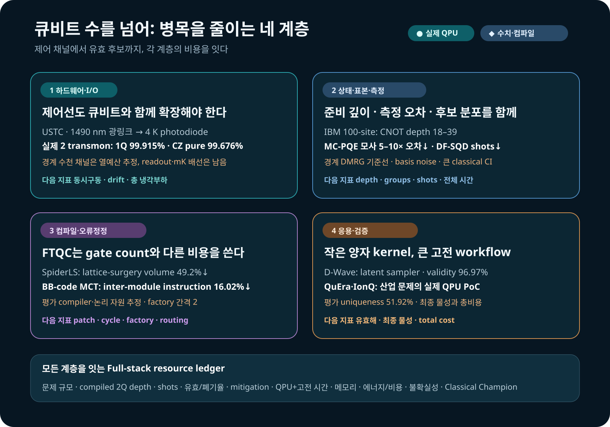

# 큐비트 수를 넘어: 양자컴퓨팅은 시스템 경쟁으로 간다

큐비트가 늘수록 그 주변의 일도 늘어난다. 상온에서 만든 제어신호를 냉동기 안의 칩까지 보내고, 회로가 준비한 상태를 반복 측정하며, 표본을 고전 계산으로 다듬어 답을 얻어야 한다. 칩에서 아낀 자원이 배선이나 측정, 후처리의 부담으로 되돌아올 수도 있다. 양자컴퓨터의 쓸모를 알려면 이 경로를 끝까지 따라가야 하는 이유다.

2026년 9월 2–3일에 검토한 연구들은 이 연결을 여러 방향에서 드러낸다. 광섬유로 트랜스몬을 제어하는 실험, D-Wave의 분자 생성, IBM 장치의 상태준비와 양자화학, 중성원자·이온트랩의 산업 응용, 오류정정 컴파일이 대상이다. 이 리뷰는 이들을 **칩에서 응용까지 이어지는 공동설계**라는 관점에서 읽는다. 각 연구가 줄인 비용과 다음 단계로 넘긴 부담을 함께 보면, 큐비트 수만으로는 보이지 않던 개발 과제가 선명해진다.

<figure class="article-hero-figure">

<figcaption>그림 1. 극저온 하드웨어에서 회로·샘플링을 거쳐 분자와 산업 네트워크로 이어지는 계산 경로. 양자컴퓨팅의 여러 설계 계층을 쌓아 표현한 AI 생성 개념 일러스트.</figcaption>
</figure>

## 1. 트랜스몬 제어선을 광섬유로 바꾸면 무엇이 달라지나

초전도 큐비트는 수십 mK에서 동작하지만 제어 전자장치는 보통 상온에 있다. 큐비트마다 동축선과 감쇠기, 필터를 내려보내면 열유입과 냉동기 공간, 케이블 조립과 교정이 함께 늘어난다. 큐비트의 성능과 별개로, 신호를 전달하는 일이 확장 문제의 일부가 된다.

중국과학기술대학(USTC) 등이 참여한 Yu-Huai Li·Daojin Fan 연구진은 상온의 임의파형발생기(AWG)가 만든 GHz 대역 XY 신호와 사각파 Z 신호로 1490 nm 레이저를 직접 변조했다. 광신호가 4 K 단계에 도착하면 역바이어스를 건 InGaAs PIN 포토다이오드가 전기신호로 바꾼다. 두 개의 주파수 가변 트랜스몬과 가변 결합기를 이 방식으로 제어했다.<a class="citation" href="#ref-1">[1]</a>

이 링크가 운반하는 것은 **고전 제어파형**이다. 광자 큐비트와 마이크로파 큐비트 사이의 양자 상태 변환과는 역할이 다르다. 포토다이오드 아래에서 mK 칩까지의 전기 배선과 기존 판독선은 유지하면서, 상온–4 K 구간의 전달 방식을 바꾼 실험이다.

| 항목 | 보고값 | 측정·운용 조건 |
|---|---:|---|
| $T_1$ | $58.58\pm3.39\ \mu s$ | 실험 장치의 대표 측정값 |
| $T_2^*$ | $2.40\pm0.23\ \mu s$ | sweet spot에서 409 MHz 벗어난 운용점 |
| 1Q X/2 게이트 | 50 ns | 광전송 제어파형 |
| Q1 1Q 충실도 | $99.915\pm0.005\%$ | 교차엔트로피 벤치마킹(XEB) |
| Q2 1Q 충실도 | $99.854\pm0.014\%$ | XEB |
| CZ 게이트 | 38 ns | 두 트랜스몬과 가변 결합기 |
| CZ pure 충실도 | $99.676\pm0.041\%$ | 원문의 pure 추정치 |
| CZ dressed 충실도 | $99.445\pm0.041\%$ | 원문의 dressed 추정치 |

연구진은 XEB와 Speckle Purity Benchmarking(SPB)을 함께 사용해 충실도와 순도를 평가했다. 표는 원문이 구분해 보고한 pure와 dressed 추정치를 따른다.

열모델은 포토다이오드의 바이어스와 변환효율을 넣고 **연속 구동**을 가정한다. 논문 Table I은 4 K 냉각능력 1.5 W, XY 채널당 능동 열부하 0.058 mW, XY+Z 채널당 0.752 mW를 제시하고 각각 25,816개와 1,996개 채널을 추정했다. 표시된 열부하는 반올림값이다. 이 계산이 다루는 범위는 4 K 단계의 광전 변환 열예산이므로, 판독과 하부 배선, 냉동기의 다른 부하를 합친 전체 규모는 따로 검증해야 한다.

광링크를 이용한 초전도 큐비트 제어의 선행 사례로는 Lecocq 등의 2021년 단일 큐비트 제어·판독 실험이 있다.<a class="citation" href="#ref-2">[2]</a> 이번 연구는 XY·Z·결합기 제어를 두 트랜스몬 게이트 시스템으로 묶고 충실도와 열비용을 함께 다뤘다. 다음 관심사는 여러 채널을 동시에 켰을 때의 위상·진폭 안정성과 재교정 주기다. 배선을 줄인 이득이 실제 운용에서도 유지되는지는 그 지점에서 드러난다.

## 2. D-Wave가 맡은 일은 분자 생성의 잠재변수 샘플링

Kunugi 등의 연구에서 Transformer 인코더·디코더는 분자를 나타내는 SMILES 문자열을 이산 잠재변수로 압축하고 다시 복원한다. D-Wave 어닐러는 그 가운데 **볼츠만 사전분포에서 이진 잠재벡터를 뽑는 단계**를 맡았다.<a class="citation" href="#ref-3">[3]</a> 이 역할을 알아야 생성 문자열의 지표가 분자의 전자구조나 약효와 어떻게 다른지 읽을 수 있다.

128개의 visible 변수와 128개의 hidden 변수를 `Advantage2_prototype2.6`의 Zephyr 토폴로지에 배치하는 데 물리 큐비트 1,215개를 썼다. 인코더·디코더 학습과 문자열 처리는 고전 계산이다. 비교한 고전 볼츠만 머신은 Metropolis–Hastings 갱신을 사용하는 시뮬레이티드 어닐링으로 표본을 얻었다.

함께 도입한 Neural Hash Function(NHF)은 연속 인코더 출력을 이진 코드로 바꾸면서 양자화·정규화 항을 학습손실에 넣는다. 따라서 비교에서는 샘플러를 바꾼 효과와 이 고전 학습목적함수의 효과를 나눠 살펴야 한다.

| 사전분포 샘플러 | 이진화 | validity | uniqueness | 10,000개 중 고유 유효분자 |
|---|---|---:|---:|---:|
| Classical BM | Gumbel-Softmax | 52.20% | 99.94% | 5,216 |
| Classical BM | NHF | 61.95% | 98.09% | 6,077 |
| Quantum BM | Gumbel-Softmax | 71.88% | 95.10% | 6,835 |
| Quantum BM | NHF | **96.97%** | **51.92%** | 5,035 |

표는 정식 게재본 Table 1을 따른다. validity는 RDKit이 분자 그래프로 해석한 문자열의 비율, uniqueness는 유효분자 중 고유한 분자의 비율이다. 가장 높은 validity는 가장 낮은 uniqueness와 함께 나왔다. QBM+NHF는 해석 가능한 문자열을 자주 만들었지만 반복도 늘어, 고유 유효분자 수는 classical BM+NHF의 6,077개보다 적은 5,035개였다. 논문 서술의 ‘97% 대 73%’와 달리 표에서 NHF끼리 대응하는 고전 값은 61.95%다.

고유 분자 중 QED가 0.7 이상인 비율은 학습자료 31.61%, classical/Gumbel 40.81%, classical/NHF 43.15%, QBM/Gumbel 52.60%, QBM/NHF 66.79%였다. QED는 분자량·지용성 등을 결합한 약물 유사성 지표다. 이 결과에서 읽을 수 있는 것은 후보분포의 변화이며, 표적 결합·독성·합성 가능성은 다음 평가 단계에 속한다.

모델 구조를 Transformer에서 MLP로 바꾸면 양자·고전 validity 차이는 Gumbel에서 0.8%포인트, NHF에서 1.6%포인트로 작아졌다. 장치만으로 성과가 정해지지 않고 학습모델과 목적함수의 조합에 민감하다는 대목이다. 반복 seed와 신뢰구간, 강한 고전 생성모델, 총시간·에너지의 비교가 보태져야 이 분포 변화의 재현성과 비용을 판단할 수 있다.

## 3. 상태준비·측정·표본 선택은 서로 다른 비용을 줄인다

### 100-site 상태를 가능하게 한 얕은 준비회로

Pennington 등은 100-site 교대 결합 Heisenberg 사슬의 대칭보호 위상 상태를 IBM `ibm_pittsburgh`에 준비했다.<a class="citation" href="#ref-4">[4]</a> DMRG로 만든 행렬곱상태(MPS)를 근사 양자 컴파일로 압축해 CNOT 깊이 18, 21, 21, 39의 네 회로를 얻었다. 실험에서는 길이 20까지의 string order, 얽힘 스펙트럼의 축퇴 패턴과 가장자리 모드를 읽었다. string order는 두 지점 사이 스핀들의 연산자 곱까지 포함해, 국소 상관만으로 드러나지 않는 질서를 읽는 양이다.

97.9–99.0%라는 충실도는 **고전적으로 계산한 회로상태와 DMRG 목표 상태의 겹침**이다. 실제 하드웨어의 전체 상태 충실도와 구별해야 한다. string order·가장자리 자화에는 Pauli twirling, TREX와 영잡음 외삽(ZNE)을, 얽힘 스펙트럼의 국소 토모그래피에는 twirling과 TREX를 사용했다. 길이에 따라 string order가 줄어든 원인이 판독오차 누적인지 상태의 질서 감소인지는 남은 질문이다. 이 1차원 계의 목표 상태는 DMRG로 구할 수 있다. 실험의 성과는 얕은 준비회로로 100-site 장치에 접근하고 여러 비국소 진단을 수행한 데 있다.

### MC-PQE: 같은 측정 예산을 더 효율적으로 배분하기

MC-PQE 연구는 비대칭 기대값을 측정할 때 서로 가환하는 Pauli 항을 묶고 그룹별 샷을 배분한다.<a class="citation" href="#ref-5">[5]</a> 최대 12큐비트의 분자 고전 모사에서 여러 개선을 결합했을 때 같은 총 측정 수에 대한 표준오차가 5–10배 줄었다. 이 비율은 모든 분자나 그룹화 하나의 보편적 효과가 아니다. 기저변환 게이트의 잡음과 실제 QPU 시간을 더하면 측정 절감이 어느 정도 남는지가 후속 검증의 핵심이다.

### DF-SQD: 고전 대각화에 보낼 후보를 고르기

DF-SQD는 얕은 입자수 보존 회로로 점유수 배치를 제안하고, 고전 selected configuration interaction(CI) 계산이 원래 활성공간 Hamiltonian을 평가한다.<a class="citation" href="#ref-6">[6]</a> IBM `ibm_kingston`에서 실행한 N₂ 32큐비트 사례는 12회로×8,192샷, 총 98,304샷과 QPU 시간 29초를 사용했다. 비교한 SQD-LUCJ 실행은 300,000샷과 85초였다. 회로·샷·배치가 다른 실행 비교이므로 이를 동일 조건의 알고리즘 속도비로 환산할 수는 없다.

철–황 사례의 대응 비교에서는 약 5,001만 determinant를 대각화했고, 에너지 오차는 79.7에서 60.2 mEh로 줄었다. 약 2억 2,100만 개는 configuration recovery 뒤 만들 수 있는 후보 조합 풀의 규모다. 전부를 대각화한 공간과 구별해야 한다. 이 실험들은 적은 QPU 표본으로 유용한 CI 후보를 모으는 경로를 보여주며, 최종 계산비용에는 복구·Hamiltonian 구성·대각화의 CPU/GPU 시간과 메모리가 들어간다. 보고된 하드웨어 결과는 선택 CI의 피드백을 반영하기 전 초기 회로 앙상블(`flip=0`)에서 얻었다.

세 연구의 절감 원리는 다르다. 얕은 상태준비는 잡음이 쌓일 회로 깊이를 줄이고, 측정 그룹화는 추정량의 분산을 낮추며, 제안분포의 변경은 고전 계산에 넘길 후보를 바꾼다. 어느 부담이 큰지에 따라 먼저 손댈 부분도 달라진다.

## 4. 오류정정 컴파일의 비용은 공간과 이동까지 포함한다

SpiderLS는 Clifford+T 회로를 ZX 축약으로 단순화한 뒤 다중 표적 연산·Pauli 곱 측정으로 내리고 lattice surgery의 패치와 경로를 배치한다.<a class="citation" href="#ref-7">[7]</a> 비교한 TopoLS 대비 평균 시공간 부피 49.2%, 컴파일 시간 99.8% 감소는 이 논리 회로 워크로드의 결과다. 현재 장치의 게이트 깊이와는 목적함수가 다르다.

BB-code 구조의 다중 제어 Toffoli 연구는 상호작용하는 부분트리를 같은 모듈에 배치한다.<a class="citation" href="#ref-8">[8]</a> factory 배치 간격이 2인 비교에서 모듈 간 명령의 평균 감소율은 최대 16.02%였다. 격자형 magic-state factory 배치의 23.7% 감소는 본문에서 모듈당 제어 큐비트 수 $k=5$ 조건에 대응한다. $k=3$에는 27.7%도 보고되어 있으므로 23.7%를 모든 경우의 최댓값으로 읽지 않는다. 이 수치는 배치·라우팅 설계평가이며 실물 논리 프로세서 측정과 구별된다.

논리 패치의 면적, syndrome 주기, magic-state factory의 생산 주기와 모듈 간 이동을 함께 최적화해야 한다는 점이 두 연구를 잇는다. ZX 축약은 Classiq 회로 전처리에도 시험해 볼 아이디어지만, 효과는 그 회로의 게이트·깊이 지표로 다시 평가해야 한다.

## 5. 산업 응용에서 양자장치는 어느 단계를 맡았나

### 중성원자 전력운영: 이산 이동과 유효해 복구

stochastic unit commitment 연구의 응용은 여섯 전해조 모듈의 운전 일정이다. 일정 주변의 이산 이동을 최대 가중 독립집합(MWIS)으로 바꿔 QuEra Aquila에 보내고, 연속 dispatch와 유효해 복구는 고전 계산으로 수행했다.<a class="citation" href="#ref-9">[9]</a> 15일간의 50-node 하드웨어 캠페인에서 후처리한 결과는 exact-MWIS 기반 dispatch margin과 맞거나 이를 넘었다. 이 캠페인의 내부 목적함수 비 평균이 0.940이다.

50–144 node 규모를 따로 비교한 sweep의 평균은 0.918이었다. 100-node에서 0.095라는 valid fraction은 **진화 전에 전체 원자 배열이 채워졌는지를 확인한 결과**, 200회 중 19회에 해당한다. 진화 뒤의 원자 생존율로 바꾸어 읽으면 병목의 위치가 달라진다. 이 사례가 보여준 것은 문제 분해에서 장치 실행과 복구까지의 연결이며, HiGHS 같은 고전 solver와의 총시간·비용 비교는 남아 있다.

### IonQ 가스망 QAOA: 물리 제약을 만족하는 표본

가스망 연구는 압력할당과 수리학적 제약을 QUBO로 만들고 Classiq로 QAOA 회로를 합성했다.<a class="citation" href="#ref-10">[10]</a> 시뮬레이터의 원래 모델에는 $p=30$을, IonQ Forte-1 실행의 축소 사례에는 $p=2$를 사용했다. 하드웨어 회로의 10큐비트는 의사결정 6개와 보조 4개로, 오류정정된 논리 큐비트를 뜻하지 않는다.

500샷 중 논문이 짚은 두 유효 상태는 각각 2.0%, 1.6%, 합계 18샷이었다. 이 작은 실행은 문제 정식화→합성→QPU→수리학적 검증의 경로를 연결했다. 다음에는 더 큰 원래 문제에서 유효 표본을 얼마나 자주 얻는지, 고전 탐색과 견줄 전체 비용이 얼마인지 평가해야 한다.

### QML: 회로 폭과 학습손실을 넘어 평가하기

IBM `ibm_fez`의 커널 실험은 angle encoding에 쓰는 회로 폭을 자료의 내재차원에 비해 늘릴 때 서로 다른 자료 사이의 커널 값이 거의 사라지는 현상을 다룬다. 붕괴가 시작되는 폭은 특징맵과 각도대역폭에 따라 달라진다.<a class="citation" href="#ref-11">[11]</a> breast-cancer PCA 자료 8개, 256샷의 비교에서 $q=3$인 한 층 ZZ 커널은 이상적 커널과 MAE 0.021로 맞았다. 같은 자료의 $q=7$에서는 하드웨어·이상적 계산 모두 비대각 성분이 거의 없어졌다. MAE만 작다고 유용한 자료 구분이 남는 것은 아니다. 분류기는 QPU에서 실행하지 않았다.

생성모델 비교는 최대 30큐비트 상태벡터 모사에서 작은 MMD 학습손실과 미관측 유효 표본의 coverage가 함께 좋아지지 않을 수 있음을 보였다.<a class="citation" href="#ref-12">[12]</a> likelihood로 학습한 Transformer·RNN·텐서네트워크 기준선과 비교해야 할 이유다. 커널은 자료 사이의 구분을, 생성기는 새로운 유효 후보의 분포를 평가해야 한다. 큐비트를 늘리는 선택은 이 목적에 비추어 판단할 일이다.

## 6. 계층을 연결하면 다음 실험이 보인다

<figure class="figure-panel figure-panel-fit">

<figcaption>그림 2. 제어 채널, 준비회로·측정, 논리 라우팅, 유효 후보로 이어지는 공동설계 지도. 실제 장치 결과와 수치·컴파일 평가를 구분하고 각 계층의 다음 검증 지표를 연결했다. 광제어 [1], 상태·표본·측정 [4–6], 컴파일 [7,8], 응용 [3,9,10]을 바탕으로 구성.</figcaption>
</figure>

| 연구 | 근거 형태 | 직접 다룬 비용·성과 | 다음에 잇는 평가 |
|---|---|---|---|
| USTC 광제어 | 프리프린트·실제 2Q | 1490 nm 링크, 1Q·CZ 제어 | 동시구동·장시간 안정성·전체 I/O |
| D-Wave 분자 생성 | 동료평가·실제 어닐러 | 이진 잠재변수 표본과 문자열 생성 | 다양성·목표 물성·반복통계·총비용 |
| 100-site SPT | 동료평가·실제 QPU | 얕은 상태준비·비국소 관측량 | 잡음 속 질서·상태 진단 |
| MC-PQE | 프리프린트·고전 모사 | 측정 예산에 대한 추정오차 감소 | 기저변환 잡음·QPU 시간 |
| DF-SQD | 프리프린트·QPU+고전 CI | CI 후보의 제안분포 | 복구·대각화 시간과 메모리 |
| SpiderLS·BB-code | 프리프린트·컴파일 평가 | 논리 시공간·모듈 간 이동 | 오류정정 주기·실제 논리 장치 |
| QuEra·IonQ | 프리프린트·QPU+고전 검증 | 산업 문제의 실행 경로 | 유효 표본·규모·강한 고전 기준선 |
| QML 커널·생성기 | 프리프린트·QPU/상태벡터 | 폭·대리 손실의 평가 한계 | 자료 구분·일반화·유효 후보 coverage |

관련 연구도 이 지도에 각기 다른 질문을 더한다. guiding state를 이용한 VQA 이론은 초기상태 접근과 작은 초기화, 커널 조건 아래 수렴·일반화를 분석한다. 상태를 준비하는 비용도 평가에 들어간다.<a class="citation" href="#ref-13">[13]</a> 약물–표적 친화도 pilot은 두 개의 6큐비트 모듈을 상태벡터로 모사했다. 10개 고정 분할 비교에서 Holm 보정 뒤 남은 신호는 DAVIS의 미관측 약물 분할(S2)에서 RMSE가 줄어든 한 경우였다. 고정 seed의 분할 간 비교라는 범위도 함께 읽어야 한다.<a class="citation" href="#ref-14">[14]</a> 통신 C-band 양자점은 150 mT의 펄스 광자 상관 측정에서 홀 스핀의 $T_2^*=15.9\pm1.7$ ns를 보고했다.<a class="citation" href="#ref-15">[15]</a> 이는 광자 인터페이스의 소자 지표로, 앞의 컴파일·최적화 결과와는 다른 검증 단계를 이룬다.

이들 사이에 공통의 개선율은 없다. 대신 **절감한 자원이 다음 단계에서도 이득으로 남는가**라는 질문을 공유한다. 광전송의 열절감은 판독·하부 배선까지, 얕은 회로의 이득은 측정과 후처리까지, 좋은 표본은 최종 문제의 유효해까지 이어져야 한다. 전체 자원표에는 문제 크기, 회로 깊이, 샷·폐기율, 오류 완화, QPU와 고전 계산의 시간·메모리·에너지를 함께 담을 필요가 있다.

## 7. OLED·재료 연구에서는 후보의 마지막 단계까지

분자 생성의 사례를 OLED에 적용하면 목표는 문자열의 수를 넘어선다. 새로운 유효분자를 얻는 단계와 $S_1$, $T_1$, $\Delta E_{ST}$, oscillator strength, SOC, 방사·비방사 속도, 전하 이동도와 안정성을 확인하는 단계가 연결되어야 한다. QED가 높아진 것만으로 이 물성들이 좋아졌다고 판단할 수는 없다.

실용적인 시험은 같은 학습자료와 총예산에서 고전 생성기·Bayesian optimization·유전 알고리즘을 기준선으로 놓고 시작할 수 있다. 어닐러는 이산 잠재변수 제안, 게이트 QPU는 제한된 활성공간의 에너지·관측량처럼 입출력을 검증할 수 있는 부분에 배치한다. 후보는 저비용 surrogate에서 DFT/TDDFT 또는 다중참조 계산, 합성 가능성과 실험으로 좁혀 간다. 이 경로를 통과한 후보의 수와 다양성, 전체 비용이 비교의 결과가 된다.

이런 평가에서 작은 양자 모듈도 탐색비용을 줄이거나 유용한 후보의 coverage를 넓힌다면 가치가 있다. 어느 단계에서 그 이득이 생겼는지 확인할 수 있도록 설계하는 일이 먼저다.

## 최종 평가

이번에 읽은 연구들은 양자컴퓨터의 개발 과제를 구체화한다. 제어선을 바꾸고, 준비회로를 얕게 만들고, 측정을 배분하고, 고전 계산에 보낼 표본을 고르는 작업이 실제 장치의 성능을 응용으로 연결한다. 오류정정 컴파일은 여기에 논리 공간과 이동의 비용을 더한다.

이 리뷰가 시스템 공동설계에 주목하는 이유도 여기에 있다. **한 계층에서 얻은 개선을 다음 계층까지 이어 가는 능력**이 유용한 계산을 결정한다. 큐비트 수와 충실도에 전체 자원표와 강한 고전 기준선을 더하면, 지금의 성과뿐 아니라 다음 실험이 풀어야 할 문제도 더 정확히 보인다.

## 참고문헌

<ol class="reference-list">
<li id="ref-1">Y.-H. Li, D. Fan, N. Li, F. Chen, S. Li, D.-D. Li, Y. Xu, J. Lin, M. Gong, H.-L. Huang, H. Deng, Y. Wu, H. Qian, S. Guo, F. Liang, X. Zhu, C.-Z. Peng, and J.-W. Pan, High fidelity control of superconducting qubits with optical transmitted signal, arXiv:2608.19602v1 (2026). <a href="https://arxiv.org/abs/2608.19602v1">https://arxiv.org/abs/2608.19602v1</a></li>
<li id="ref-2">F. Lecocq, F. Quinlan, K. Cicak, J. Aumentado, S. A. Diddams, and J. D. Teufel, Control and readout of a superconducting qubit using a photonic link, Nature 591, 575–579 (2021). <a href="https://doi.org/10.1038/s41586-021-03268-x">https://doi.org/10.1038/s41586-021-03268-x</a></li>
<li id="ref-3">H. Kunugi, M. Rahmani, Y. Iyama, Y. Hirono, A. Suma, M. Woolway, V. Vargas-Calderón, W. Kim, K. Chern, M. Amin, and M. Tateno, Molecular design beyond training data with novel extended objective functionals of generative AI models driven by quantum annealing computer, Sci. Rep. 16, 31767 (2026). <a href="https://doi.org/10.1038/s41598-026-49186-8">https://doi.org/10.1038/s41598-026-49186-8</a></li>
<li id="ref-4">G. Pennington, K. C. Smith, J. R. Garrison, L. P. Lindoy, J. Crain, and B. Jaderberg, Symmetry-protected topological order in a 100-site spin chain on a digital quantum computer, npj Quantum Inf. 12, 141 (2026). <a href="https://doi.org/10.1038/s41534-026-01334-8">https://doi.org/10.1038/s41534-026-01334-8</a></li>
<li id="ref-5">D. Baid and M.-A. Filip, Efficient measurement schemes for the Monte Carlo projective quantum eigensolver, arXiv:2608.30612v1 (2026). <a href="https://arxiv.org/abs/2608.30612v1">https://arxiv.org/abs/2608.30612v1</a></li>
<li id="ref-6">K. Agarwal and A. Ray, DF-SQD: Deterministic fields for sampling-based quantum diagonalization, arXiv:2609.01264v1 (2026). <a href="https://arxiv.org/abs/2609.01264v1">https://arxiv.org/abs/2609.01264v1</a></li>
<li id="ref-7">H. Kim, C. Lee, S. Kim, E. Jang, Y. Kim, S. Choi, H. Lee, S. Pyun, and W. W. Ro, SpiderLS: Leveraging full ZX reduction for lattice surgery compilation, arXiv:2608.30228v1 (2026). <a href="https://arxiv.org/abs/2608.30228v1">https://arxiv.org/abs/2608.30228v1</a></li>
<li id="ref-8">A. B. Bhaumik, S. Dutta, S. Wang, and A. Chattopadhyay, Structure-aware placement and routing of multi-controlled Toffoli on bivariate bicycle code architectures, arXiv:2609.00852v1 (2026). <a href="https://arxiv.org/abs/2609.00852v1">https://arxiv.org/abs/2609.00852v1</a></li>
<li id="ref-9">J. Chen, M. Lin, J. Wen, Z. Zhang, and C. Wu, A backend-agnostic MWIS kernel for stochastic unit commitment with neutral-atom hardware validation, arXiv:2609.01248v1 (2026). <a href="https://arxiv.org/abs/2609.01248v1">https://arxiv.org/abs/2609.01248v1</a></li>
<li id="ref-10">A. Ben-Ishay, Y. Eyal, Y. Cohen, and N. Erez, Quantum-based optimization of gas throughput in natural gas transmission networks under hydraulic constraints using QAOA, arXiv:2609.00825v1 (2026). <a href="https://arxiv.org/abs/2609.00825v1">https://arxiv.org/abs/2609.00825v1</a></li>
<li id="ref-11">A. P. Appel, Fractal dimension predicts quantum kernel collapse in angle-encoded data, arXiv:2609.00475v1 (2026). <a href="https://arxiv.org/abs/2609.00475v1">https://arxiv.org/abs/2609.00475v1</a></li>
<li id="ref-12">S. Raj, N. Mathur, and A. Perdomo-Ortiz, “Train classical, deploy quantum” requires rethinking generalization, arXiv:2608.31117v1 (2026). <a href="https://arxiv.org/abs/2608.31117v1">https://arxiv.org/abs/2608.31117v1</a></li>
<li id="ref-13">T. Nguyen and M. Kieferová, Theoretical guarantees of variational quantum algorithm with guiding states, npj Quantum Inf. (2026), doi:10.1038/s41534-026-01364-2. <a href="https://doi.org/10.1038/s41534-026-01364-2">https://doi.org/10.1038/s41534-026-01364-2</a></li>
<li id="ref-14">A. Salehi, G. Salehi, A. Heydarian, and H. R. Goudarzi, Comparative study of hybrid quantum-classical models for cold-start drug–target affinity prediction: a partial pilot analysis, Sci. Rep. (2026), doi:10.1038/s41598-026-69754-2. <a href="https://doi.org/10.1038/s41598-026-69754-2">https://doi.org/10.1038/s41598-026-69754-2</a></li>
<li id="ref-15">J. M. Michl, R. Hekmati, M. Helal, G. Peniakov, Y. Reum, J. Kaupp, Q. Buchinger, J. Kim, A. T. Pfenning, Y.-H. Cho, S. Höfling, and T. Huber-Loyola, A spin-photon interface in the telecom C-band with long hole spin dephasing time, Nat. Commun. 17, 10458 (2026). <a href="https://doi.org/10.1038/s41467-026-77282-w">https://doi.org/10.1038/s41467-026-77282-w</a></li>
</ol>

[9월 2일 Daily Quantum Brief PDF 내려받기](daily_quantum_brief_2026-09-02.pdf) · [9월 3일 Daily Quantum Brief PDF 내려받기](daily_quantum_brief_2026-09-03.pdf)

## 판본과 수정 이력

원 발행일과 근거 기준일은 2026-09-03이다. 기존 웹 갱신일 2026-09-04와 원 발행본 생성 기록을 보존한다. 2026-11-14 편집부(AEDAUT)는 당시 근거의 해당 판본을 대조하고 도입·연결·결론과 그림 캡션을 다듬었다. 광제어의 XEB/SPB와 열모델 조건, QuEra의 실험군·초기 원자 점유 검사, 가스망의 알고리즘 큐비트, DF-SQD 후보 풀과 대각화 공간을 정정했다. D-Wave 고유 유효분자 수는 프리프린트 v3의 5,126과 정식본 Table 1의 5,216 차이를 확인하여 정식본을 따랐다. Lecocq 등의 저자 크레딧과 guiding-state·친화도·양자점 논문의 원제·서지를 복원했다. 기존 DQB 첨부 두 편도 공개 감수판과 동기화했다.

이번 감수는 원 논문·공식 서지와 관련 방법·표·보충자료의 선택 대조 및 자동 파일 검사, 렌더 검수로 수행했다. 원 작성의 보조·검증 이력은 문서 메타데이터에 보존하며, 이번 원출처 대조와 독립 원고 감수는 AI 에이전트가 수행했다. 장치 실험·수치 재현이나 별도의 사람 독자 평가는 수행하지 않았다. 뒤에 나온 연구 결과를 9월 3일의 근거로 추가하지 않았다.
