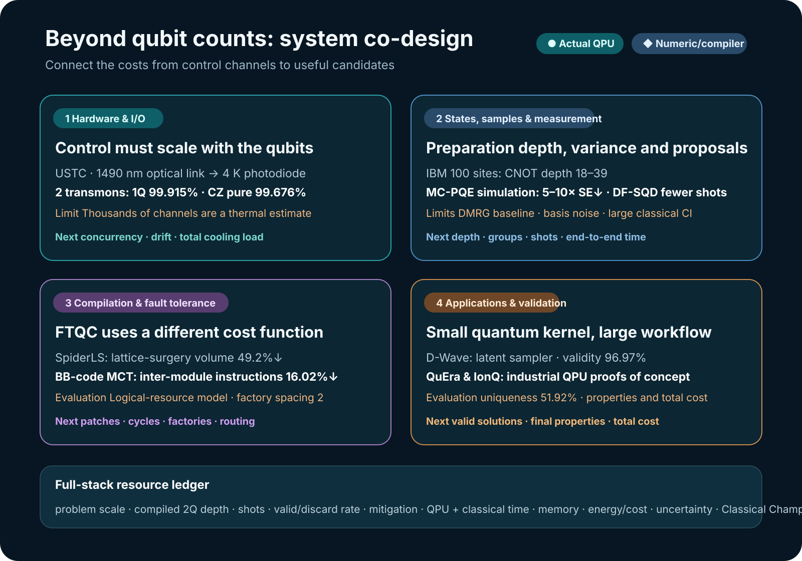

# Beyond Qubit Counts: Quantum Computing Is Becoming a Systems Race

More qubits bring more work around them. Control signals generated at room temperature must reach a chip inside a refrigerator; the states prepared by a circuit must be measured repeatedly; and classical processing must turn those samples into answers. Resources saved on the chip can return as a burden in wiring, measurement, or post-processing. To judge a quantum computer's usefulness, we need to follow that path to its end.

The studies reviewed on 2–3 September 2026 reveal these connections from several directions: fiber-delivered transmon control, D-Wave molecular generation, state preparation and quantum chemistry on IBM devices, industrial applications on neutral-atom and trapped-ion hardware, and fault-tolerant compilation. This review reads them through **co-design from the chip to the application**. Looking at both the cost each study reduces and the work it passes downstream makes development problems visible that qubit counts alone cannot show.

<figure class="article-hero-figure">

<figcaption>Figure 1. A computational path from cryogenic hardware through circuits and sampling to molecules and industrial networks. An AI-generated concept illustration layering several aspects of quantum-system design.</figcaption>
</figure>

## 1. What changes when optical fiber replaces transmon control lines?

Superconducting qubits operate at tens of millikelvin, while their control electronics usually remain at room temperature. Sending coaxial lines, attenuators, and filters down to each qubit increases heat inflow, consumes refrigerator space, and adds cable assembly and calibration. Independently of qubit performance, delivering signals becomes part of the scaling problem.

Yu-Huai Li, Daojin Fan, and colleagues, including researchers at the University of Science and Technology of China (USTC), directly modulated a 1490 nm laser with GHz-band XY signals and square-wave Z signals from a room-temperature arbitrary waveform generator (AWG). At the 4 K stage, a reverse-biased InGaAs PIN photodiode converted the light back into electrical signals. This arrangement controlled two frequency-tunable transmons and a tunable coupler.<a class="citation" href="#ref-1">[1]</a>

The link carries **classical control waveforms**. Its role differs from transferring a quantum state between photonic and microwave qubits. The experiment changed signal delivery between room temperature and 4 K, while retaining electrical wiring below the photodiode to the millikelvin chip and the existing readout lines.

| Item | Reported value | Measurement or operating condition |
|---|---:|---|
| $T_1$ | $58.58\pm3.39\ \mu s$ | Representative measurement on the experimental device |
| $T_2^*$ | $2.40\pm0.23\ \mu s$ | Operating point 409 MHz away from the sweet spot |
| 1Q X/2 gate | 50 ns | Optically delivered control waveform |
| Q1 1Q fidelity | $99.915\pm0.005\%$ | Cross-entropy benchmarking (XEB) |
| Q2 1Q fidelity | $99.854\pm0.014\%$ | XEB |
| CZ gate | 38 ns | Two transmons and a tunable coupler |
| CZ pure fidelity | $99.676\pm0.041\%$ | The paper's pure estimate |
| CZ dressed fidelity | $99.445\pm0.041\%$ | The paper's dressed estimate |

The researchers used XEB and Speckle Purity Benchmarking (SPB) to evaluate fidelity and purity. The table retains the paper's separate pure and dressed estimates.

The thermal model includes photodiode bias and conversion efficiency and assumes **continuous operation**. Table I gives a 4 K cooling capacity of 1.5 W, active heat loads of 0.058 mW per XY channel and 0.752 mW per XY+Z channel, and corresponding estimates of 25,816 and 1,996 channels. The displayed heat loads are rounded. This calculation concerns the photoconversion thermal budget at 4 K; the complete scale, including readout, lower-stage wiring, and the refrigerator's other loads, needs separate validation.

An earlier example is the 2021 single-qubit control and readout experiment by Lecocq and colleagues.<a class="citation" href="#ref-2">[2]</a> The present study combines XY, Z, and coupler control in a two-transmon gate system and considers both fidelity and thermal cost. The next questions concern phase and amplitude stability during simultaneous operation of many channels, and the recalibration interval. Those tests will show whether the wiring savings persist in operation.

## 2. D-Wave sampled the latent variables of a molecular generator

In the study by Kunugi and colleagues, a Transformer encoder-decoder compresses SMILES strings representing molecules into discrete latent variables and reconstructs them. The D-Wave annealer performs the intermediate step of **drawing binary latent vectors from a Boltzmann prior**.<a class="citation" href="#ref-3">[3]</a> Locating its role makes clear how the generated-string metrics relate to subsequent questions about molecular electronic structure or drug activity.

Embedding 128 visible and 128 hidden variables in the Zephyr topology of `Advantage2_prototype2.6` used 1,215 physical qubits. Encoder-decoder training and string processing were classical. The classical Boltzmann-machine comparator drew samples through simulated annealing with Metropolis–Hastings updates.

The accompanying Neural Hash Function (NHF) turns continuous encoder outputs into binary codes while adding quantization and regularization terms to the training loss. The comparison therefore needs to separate the effect of changing the sampler from the effect of this classical training objective.

| Prior sampler | Binarization | Validity | Uniqueness | Unique valid molecules among 10,000 |
|---|---|---:|---:|---:|
| Classical BM | Gumbel-Softmax | 52.20% | 99.94% | 5,216 |
| Classical BM | NHF | 61.95% | 98.09% | 6,077 |
| Quantum BM | Gumbel-Softmax | 71.88% | 95.10% | 6,835 |
| Quantum BM | NHF | **96.97%** | **51.92%** | 5,035 |

The table follows Table 1 of the published version. Validity is the fraction of strings that RDKit interprets as molecular graphs; uniqueness is the fraction of valid molecules that are distinct. The highest validity accompanied the lowest uniqueness. QBM+NHF produced interpretable strings frequently but repeated them more often, yielding 5,035 unique valid molecules against 6,077 for classical BM+NHF. Although the paper's prose describes “97% versus 73%,” the matched classical NHF value in the table is 61.95%.

The fractions of unique molecules with QED of at least 0.7 were 31.61% for the training data, 40.81% for classical/Gumbel, 43.15% for classical/NHF, 52.60% for QBM/Gumbel, and 66.79% for QBM/NHF. QED combines properties such as molecular weight and lipophilicity into a drug-likeness score. The result describes a change in the candidate distribution; target binding, toxicity, and synthesizability belong to later evaluation stages.

Changing the architecture from a Transformer to an MLP narrowed the quantum–classical validity gap to 0.8 percentage points with Gumbel and 1.6 points with NHF. Performance thus depends on the combination of learning model and objective as well as the device. Repeated seeds, confidence intervals, strong classical generators, and total time and energy comparisons are needed to assess the reproducibility and cost of the distributional change.

## 3. State preparation, measurement, and sample selection reduce different costs

### Shallow preparation circuits enabled the 100-site state

Pennington and colleagues prepared the symmetry-protected topological state of a 100-site bond-alternating Heisenberg chain on IBM's `ibm_pittsburgh`.<a class="citation" href="#ref-4">[4]</a> Approximate quantum compilation compressed a matrix-product state (MPS) obtained with DMRG into four circuits with CNOT depths of 18, 21, 21, and 39. The experiment read string order up to length 20, degeneracy patterns in the entanglement spectrum, and edge modes. String order includes a product of spin operators between two endpoints, revealing order that local correlations alone do not show.

The 97.9–99.0% fidelity is the **overlap between the classically calculated circuit state and the DMRG target state**. It must be distinguished from the full-state fidelity on the device. String order and edge magnetization used Pauli twirling, TREX, and zero-noise extrapolation (ZNE); local tomography of the entanglement spectrum used twirling and TREX. Whether string order decreases with length because of accumulated readout errors or reduced order in the state remains an open question. DMRG can obtain the target state of this one-dimensional system. The experiment's achievement is access to a 100-site device through shallow preparation and several nonlocal diagnostics.

### MC-PQE: allocating the same measurement budget more efficiently

The MC-PQE study groups mutually commuting Pauli terms when measuring asymmetric expectation values and allocates shots among the groups.<a class="citation" href="#ref-5">[5]</a> In classical molecular simulations of up to 12 qubits, combining several improvements reduced standard error by a factor of 5–10 at the same total measurement count. This ratio is not a universal effect of grouping alone or a result for every molecule. The next test is how much of the saving remains after basis-change gate noise and physical QPU time are included.

### DF-SQD: selecting candidates for classical diagonalization

DF-SQD uses shallow number-preserving circuits to propose occupation-number configurations, while classical selected configuration interaction (CI) evaluates the original active-space Hamiltonian.<a class="citation" href="#ref-6">[6]</a> The 32-qubit N₂ case on IBM's `ibm_kingston` used 12 circuits × 8,192 shots, totaling 98,304 shots and 29 seconds of QPU time. The compared SQD-LUCJ execution used 300,000 shots and 85 seconds. The circuits, shots, and batches differ, so these runs do not yield a matched algorithmic speed ratio.

The matched iron–sulfur comparison diagonalized approximately 50.01 million determinants and reduced the energy error from 79.7 to 60.2 mEh. Approximately 221 million refers to the pool of candidate combinations available after configuration recovery, which must be distinguished from the space actually diagonalized. These experiments show a way to gather useful CI candidates from fewer QPU samples; the final cost includes CPU/GPU time and memory for recovery, Hamiltonian construction, and diagonalization. The reported hardware results come from the initial circuit ensemble before selected-CI feedback (`flip=0`).

The three studies save resources in different ways. Shallow preparation reduces the depth over which noise accumulates; measurement grouping lowers estimator variance; and changing the proposal distribution changes the candidates passed to classical computation. The largest burden determines where to intervene first.

## 4. Fault-tolerant compilation includes the cost of space and movement

SpiderLS simplifies Clifford+T circuits through ZX reduction, lowers them to multi-target operations and Pauli-product measurements, and places the patches and routes for lattice surgery.<a class="citation" href="#ref-7">[7]</a> Its mean reductions of 49.2% in spacetime volume and 99.8% in compilation time relative to TopoLS concern these logical-circuit workloads. The objective differs from gate depth on present devices.

The multi-controlled Toffoli study for BB-code architectures places interacting subtrees in the same module.<a class="citation" href="#ref-8">[8]</a> With a factory-placement period of 2, the largest mean reduction in inter-module instructions was 16.02%. The 23.7% reduction for a grid-shaped magic-state-factory layout corresponds to $k=5$ controls per module in the main text. It also reports 27.7% at $k=3$, so 23.7% should not be read as the maximum across all cases. These figures evaluate placement and routing designs, separately from physical logical-processor measurements.

The connection between the studies is the need to optimize logical-patch area, syndrome cycles, magic-state-factory production cycles, and inter-module movement together. ZX reduction is also an idea worth testing in Classiq circuit preprocessing, with its effect evaluated again using that circuit's gate and depth metrics.

## 5. Which part of an industrial application did the quantum device perform?

### Neutral-atom scheduling: discrete moves and feasibility recovery

The stochastic unit commitment study concerns operating schedules for six electrolyser modules. It turns discrete moves around a schedule into a maximum-weight independent set (MWIS) problem for QuEra Aquila, with continuous dispatch and feasibility recovery performed classically.<a class="citation" href="#ref-9">[9]</a> In the 15-day, 50-node hardware campaign, classically refined results matched or exceeded the dispatch margin based on exact MWIS. The mean inner-objective ratio of 0.940 belongs to this campaign.

A separate sweep of 50–144 nodes had a mean ratio of 0.918. At 100 nodes, the valid fraction of 0.095 measures **whether the full array was occupied before evolution**: 19 of 200 shots passed. Reading it as post-evolution atom survival would locate the bottleneck differently. This case connects problem decomposition to hardware execution and recovery; an end-to-end comparison of time and cost against classical solvers such as HiGHS remains to be made.

### IonQ gas-network QAOA: samples that satisfy physical constraints

The gas-network study turns pressure assignments and hydraulic constraints into a QUBO and synthesizes QAOA circuits with Classiq.<a class="citation" href="#ref-10">[10]</a> It uses $p=30$ for the original simulated model and $p=2$ for the reduced IonQ Forte-1 instance. The hardware circuit's 10 qubits consist of six decision qubits and four auxiliaries; they do not denote error-corrected logical qubits.

Among 500 shots, the two valid states highlighted in the paper accounted for 2.0% and 1.6%, totaling 18 shots. This small execution connects formulation → synthesis → QPU → hydraulic validation. The next evaluations need to establish the frequency of useful samples for the larger original problem and the total cost compared with classical search.

### QML: evaluating beyond circuit width and training loss

The kernel experiment on IBM's `ibm_fez` examines the near-vanishing of kernel values between different data points as the angle-encoding circuit width increases relative to the intrinsic dimension of the data. The onset of collapse depends on the feature map and angular bandwidth.<a class="citation" href="#ref-11">[11]</a> For eight breast-cancer PCA data points and 256 shots, a one-layer ZZ kernel at $q=3$ agreed with the ideal kernel with MAE 0.021. At $q=7$ on the same data, off-diagonal entries nearly vanished in both hardware and ideal calculations. A small MAE alone does not mean useful discrimination between data points survives. The classifiers were not run on the QPU.

The generative-model comparison uses statevector simulations of up to 30 qubits to show that a small MMD training loss need not improve coverage of unseen valid samples.<a class="citation" href="#ref-12">[12]</a> This motivates comparisons with likelihood-trained Transformers, RNNs, and tensor-network baselines. A kernel must be assessed by how it distinguishes data; a generator by its distribution of new valid candidates. Adding qubits should be judged against those purposes.

## 6. Connecting the layers reveals the next experiments

<figure class="figure-panel figure-panel-fit">

<figcaption>Figure 2. A co-design map connecting control channels, preparation circuits and measurement, logical routing, and valid candidates. It distinguishes physical-device results from numerical and compiler evaluations and connects each layer to its next evaluation metrics. Based on optical control [1], states, samples, and measurement [4–6], compilation [7,8], and applications [3,9,10].</figcaption>
</figure>

| Study | Evidence form | Cost or outcome directly addressed | Next evaluation |
|---|---|---|---|
| USTC optical control | Preprint · physical 2Q | 1490 nm link, 1Q and CZ control | Simultaneous operation, long-term stability, complete I/O |
| D-Wave molecular generation | Peer-reviewed · physical annealer | Binary latent-variable samples and string generation | Diversity, target properties, repeated statistics, total cost |
| 100-site SPT | Peer-reviewed · physical QPU | Shallow state preparation, nonlocal observables | Order under noise, state diagnostics |
| MC-PQE | Preprint · classical simulation | Lower estimation error for a measurement budget | Basis-change noise, QPU time |
| DF-SQD | Preprint · QPU + classical CI | CI-candidate proposal distribution | Recovery and diagonalization time and memory |
| SpiderLS and BB-code | Preprint · compiler evaluation | Logical spacetime and inter-module movement | Error-correction cycles, physical logical devices |
| QuEra and IonQ | Preprint · QPU + classical validation | Execution paths for industrial problems | Valid samples, scale, strong classical baselines |
| QML kernels and generators | Preprint · QPU/statevector | Limits of width and proxy-loss evaluations | Data discrimination, generalization, valid-candidate coverage |

Related studies add different questions to this map. VQA theory with guiding states analyzes convergence and generalization under conditions on access to the initial state, small initialization, and the kernel; preparing the state is also a cost.<a class="citation" href="#ref-13">[13]</a> The drug–target affinity pilot simulated two six-qubit modules with statevectors. Across ten fixed splits, the signal remaining after Holm correction was a reduction in RMSE for the DAVIS unseen-drug split (S2). A fixed seed and comparisons across splits also delimit the result.<a class="citation" href="#ref-14">[14]</a> A telecom C-band quantum dot yielded a hole-spin $T_2^*=15.9\pm1.7$ ns in pulsed photon-correlation measurements at 150 mT.<a class="citation" href="#ref-15">[15]</a> This is a device metric for a photonic interface, at a different evaluation stage from the compilation and optimization results above.

These studies share no common improvement percentage. They do share a question: **does a resource saving remain a gain in the next stage?** The thermal saving from optical transmission must carry through to readout and lower-stage wiring; the gain from a shallow circuit must survive measurement and post-processing; and good samples must become feasible solutions to the final problem. A complete resource ledger needs problem size, circuit depth, shots and discard rates, error mitigation, and time, memory, and energy for both QPU and classical computation.

## 7. Following candidates through to OLED and materials properties

Applying the molecular-generation example to OLEDs takes the objective beyond the number of strings. Obtaining new valid molecules must connect to evaluating $S_1$, $T_1$, $\Delta E_{ST}$, oscillator strength, SOC, radiative and non-radiative rates, charge mobility, and stability. Higher QED alone does not establish improvement in these properties.

A practical test could begin with classical generators, Bayesian optimization, and genetic algorithms as baselines on the same training data and total budget. An annealer can propose discrete latent variables; a gate-model QPU can address a step whose input and output can be checked, such as a restricted active-space energy or observable. Candidates can be narrowed through low-cost surrogates, DFT/TDDFT or multireference calculations, synthesizability assessment, and experiment. The comparison then measures the number and diversity of candidates that pass this process and its total cost.

In this evaluation, a small quantum module can have value if it reduces search cost or extends the coverage of useful candidates. The first task is to design an evaluation that can identify where that gain arises.

## Final assessment

The studies reviewed here make the development tasks for quantum computing concrete. Changing control lines, preparing shallower circuits, allocating measurements, and selecting samples for classical computation connect physical-device performance to applications. Fault-tolerant compilation adds the costs of logical space and movement.

This is why the review focuses on system co-design. **The ability to carry an improvement from one layer into the next** determines useful computation. Adding a complete resource ledger and strong classical baselines to qubit counts and fidelities makes both current achievements and the questions for the next experiment easier to judge.

## References

<ol class="reference-list">
<li id="ref-1">Y.-H. Li, D. Fan, N. Li, F. Chen, S. Li, D.-D. Li, Y. Xu, J. Lin, M. Gong, H.-L. Huang, H. Deng, Y. Wu, H. Qian, S. Guo, F. Liang, X. Zhu, C.-Z. Peng, and J.-W. Pan, High fidelity control of superconducting qubits with optical transmitted signal, arXiv:2608.19602v1 (2026). <a href="https://arxiv.org/abs/2608.19602v1">https://arxiv.org/abs/2608.19602v1</a></li>
<li id="ref-2">F. Lecocq, F. Quinlan, K. Cicak, J. Aumentado, S. A. Diddams, and J. D. Teufel, Control and readout of a superconducting qubit using a photonic link, Nature 591, 575–579 (2021). <a href="https://doi.org/10.1038/s41586-021-03268-x">https://doi.org/10.1038/s41586-021-03268-x</a></li>
<li id="ref-3">H. Kunugi, M. Rahmani, Y. Iyama, Y. Hirono, A. Suma, M. Woolway, V. Vargas-Calderón, W. Kim, K. Chern, M. Amin, and M. Tateno, Molecular design beyond training data with novel extended objective functionals of generative AI models driven by quantum annealing computer, Sci. Rep. 16, 31767 (2026). <a href="https://doi.org/10.1038/s41598-026-49186-8">https://doi.org/10.1038/s41598-026-49186-8</a></li>
<li id="ref-4">G. Pennington, K. C. Smith, J. R. Garrison, L. P. Lindoy, J. Crain, and B. Jaderberg, Symmetry-protected topological order in a 100-site spin chain on a digital quantum computer, npj Quantum Inf. 12, 141 (2026). <a href="https://doi.org/10.1038/s41534-026-01334-8">https://doi.org/10.1038/s41534-026-01334-8</a></li>
<li id="ref-5">D. Baid and M.-A. Filip, Efficient measurement schemes for the Monte Carlo projective quantum eigensolver, arXiv:2608.30612v1 (2026). <a href="https://arxiv.org/abs/2608.30612v1">https://arxiv.org/abs/2608.30612v1</a></li>
<li id="ref-6">K. Agarwal and A. Ray, DF-SQD: Deterministic fields for sampling-based quantum diagonalization, arXiv:2609.01264v1 (2026). <a href="https://arxiv.org/abs/2609.01264v1">https://arxiv.org/abs/2609.01264v1</a></li>
<li id="ref-7">H. Kim, C. Lee, S. Kim, E. Jang, Y. Kim, S. Choi, H. Lee, S. Pyun, and W. W. Ro, SpiderLS: Leveraging full ZX reduction for lattice surgery compilation, arXiv:2608.30228v1 (2026). <a href="https://arxiv.org/abs/2608.30228v1">https://arxiv.org/abs/2608.30228v1</a></li>
<li id="ref-8">A. B. Bhaumik, S. Dutta, S. Wang, and A. Chattopadhyay, Structure-aware placement and routing of multi-controlled Toffoli on bivariate bicycle code architectures, arXiv:2609.00852v1 (2026). <a href="https://arxiv.org/abs/2609.00852v1">https://arxiv.org/abs/2609.00852v1</a></li>
<li id="ref-9">J. Chen, M. Lin, J. Wen, Z. Zhang, and C. Wu, A backend-agnostic MWIS kernel for stochastic unit commitment with neutral-atom hardware validation, arXiv:2609.01248v1 (2026). <a href="https://arxiv.org/abs/2609.01248v1">https://arxiv.org/abs/2609.01248v1</a></li>
<li id="ref-10">A. Ben-Ishay, Y. Eyal, Y. Cohen, and N. Erez, Quantum-based optimization of gas throughput in natural gas transmission networks under hydraulic constraints using QAOA, arXiv:2609.00825v1 (2026). <a href="https://arxiv.org/abs/2609.00825v1">https://arxiv.org/abs/2609.00825v1</a></li>
<li id="ref-11">A. P. Appel, Fractal dimension predicts quantum kernel collapse in angle-encoded data, arXiv:2609.00475v1 (2026). <a href="https://arxiv.org/abs/2609.00475v1">https://arxiv.org/abs/2609.00475v1</a></li>
<li id="ref-12">S. Raj, N. Mathur, and A. Perdomo-Ortiz, “Train classical, deploy quantum” requires rethinking generalization, arXiv:2608.31117v1 (2026). <a href="https://arxiv.org/abs/2608.31117v1">https://arxiv.org/abs/2608.31117v1</a></li>
<li id="ref-13">T. Nguyen and M. Kieferová, Theoretical guarantees of variational quantum algorithm with guiding states, npj Quantum Inf. (2026), doi:10.1038/s41534-026-01364-2. <a href="https://doi.org/10.1038/s41534-026-01364-2">https://doi.org/10.1038/s41534-026-01364-2</a></li>
<li id="ref-14">A. Salehi, G. Salehi, A. Heydarian, and H. R. Goudarzi, Comparative study of hybrid quantum-classical models for cold-start drug–target affinity prediction: a partial pilot analysis, Sci. Rep. (2026), doi:10.1038/s41598-026-69754-2. <a href="https://doi.org/10.1038/s41598-026-69754-2">https://doi.org/10.1038/s41598-026-69754-2</a></li>
<li id="ref-15">J. M. Michl, R. Hekmati, M. Helal, G. Peniakov, Y. Reum, J. Kaupp, Q. Buchinger, J. Kim, A. T. Pfenning, Y.-H. Cho, S. Höfling, and T. Huber-Loyola, A spin-photon interface in the telecom C-band with long hole spin dephasing time, Nat. Commun. 17, 10458 (2026). <a href="https://doi.org/10.1038/s41467-026-77282-w">https://doi.org/10.1038/s41467-026-77282-w</a></li>
</ol>

[Download the 2 September Daily Quantum Brief PDF](../artifacts/daily_quantum_brief_2026-09-02.pdf) · [Download the 3 September Daily Quantum Brief PDF](../artifacts/daily_quantum_brief_2026-09-03.pdf)

## Version and revision history

The original publication date and evidence cutoff are 3 September 2026. The previous web update of 4 September 2026 and the original publication-generation record are preserved. On 14 November 2026, the editorial team (AEDAUT) checked the relevant versions of the original sources and revised the introduction, transitions, conclusion, and figure captions. Corrections cover XEB/SPB and the optical-control thermal model, the QuEra cohorts and initial-occupancy check, algorithmic qubits in the gas-network experiment, and the DF-SQD candidate pool versus diagonalized space. For D-Wave's count of unique valid molecules, preprint v3 gives 5,126 while published Table 1 gives 5,216; this review follows the published table. The revision restores author credit for Lecocq and colleagues and the original titles and bibliographic records of the guiding-state, affinity, and quantum-dot papers. Both existing DQB attachments were also synchronized with their reviewed public editions.

This review used selective comparison of the original papers, official bibliographic records, and relevant methods, tables, and supplementary material, together with automated file checks and rendering review. The document metadata preserves the original assistance and verification history. AI agents performed the present source comparison and independent manuscript review. No device experiments, numerical reproduction, or separate human reader evaluation were performed. Later research results were not added as evidence available on 3 September.
