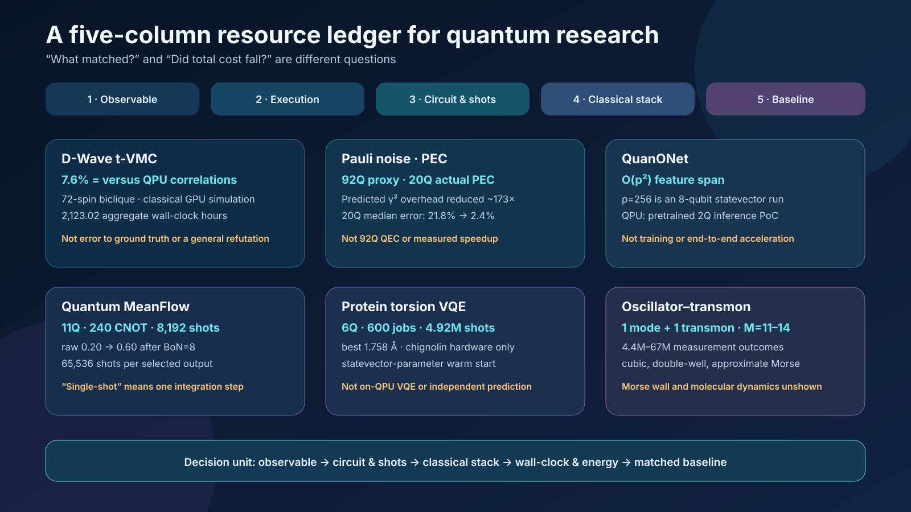

# The Boundary of Quantum Advantage Keeps Moving

On a problem involving 72 interacting spins, a classical simulation came close to D-Wave’s quantum-device result. Roeland Wiersema compared matrices describing how pairs of spins were correlated. The final matrix differed by about 7.6% from the QPU reference in relative error. The result specifies what information the classical calculation reproduced. [<a href="#ref-1">1</a>]

Obtaining that information took computation. Summing the reported experiments’ elapsed times, excluding initial exploration, gives 2,123.02 hours. How the quantum and classical costs grow as the target correlation error becomes smaller is the curve that defines the boundary of quantum advantage. Specifying the answer makes it possible to specify the cost of obtaining it.

I read six studies available by September 4, 2026 from this perspective. Their subjects range from spin correlations and noise learning to function approximation, generative models, molecular structures, and oscillator control. Across them, constructing a useful representation meets the work of extracting a useful answer. Following the measurements and classical processing that remain after a circuit becomes narrower or needs fewer sequential calls shows which part of the calculation to improve next.

<figure class="article-hero-figure"><figcaption>Figure 1. The transparent balance and panels between a quantum processor and GPUs symbolize accounting for observables, measurements, and classical processing together. The twisted molecular ribbon and potential motifs below refer to structure search and continuous-variable control. Conceptual illustration created with the OpenAI image-generation tool.</figcaption></figure>

The original issue’s technical brief is available as a [PDF](daily_quantum_brief_2026-09-04.pdf).

## The Cost of Reaching the Same Correlations

Wiersema simulated frustrated transverse-field Ising annealing studied on D-Wave Advantage2 using correlator-state-based time-dependent variational Monte Carlo (t-VMC). Classical GPUs calculate an approximate wavefunction’s evolution, and its pairwise spin correlations are compared with the QPU result. The September 1 preprint covers four graph families—2D cylinder, 3D dimer, diamond, and biclique—with anneal times of 7 ns and 20 ns. [<a href="#ref-1">1</a>]

Increasing the capacity of the approximate wavefunction brought the final two-point-correlation matrix closer to the QPU reference. The agreement described above was obtained even for a 72-spin biclique with 360 couplings and maximum degree 14. Its relative $L_2$ error includes all pairs $i>j$ and uses the QPU matrix as the reference. There is no converged MPS reference solution at this size. Thus, 7.6% describes the difference between the QPU and classical results; it does not determine full-wavefunction fidelity or the accuracy of higher-order correlations. The couplings take precision-256 values, distinct from the harder bimodal $J=\pm1$ instances.

The 2,123.02 hours sum the reported experiments’ elapsed times, excluding initial exploration and experimentation. Each run used either four A100 or eight H200 GPUs, so this is different from GPU-hours multiplied by device count. The most expensive single run took 109.25 hours on eight H200s. Comparing these costs with the QPU’s 7 or 20 ns anneal time requires matching where the two calculations start and finish. QPU programming, readout, repetitions, queues, and access costs fall within that interval, as do classical hyperparameter searches, failed runs, Markov-chain sampling, and numerical stabilization.

These procedures directly affected the success of the classical simulation. Inadequate movement between Markov-chain states and high variance in the local-energy estimator made time integration unstable. The authors mitigated these problems with parallel tempering, blurred sampling, and an importance-weighted differential-equation solver. Combining the wavefunction representation with tailored sampling and integration extended the range of correlations they could reproduce.

A subsequent comparison could measure time-to-target on the same instance at a fixed correlation error. Larger systems, harder $\pm1$ couplings, and higher-order correlations would reveal which costs grow first. For molecular selection or logistics encoded as an Ising/QUBO problem, strong applicable baselines from exact solvers, MILP/CP-SAT, simulated annealing, tensor networks, and Monte Carlo can serve the same purpose: measuring both the information added by a quantum calculation and its cost.

<figure class="figure-panel figure-panel-fit"><figcaption>Figure 2. Resource ledger constructed for this review. From spin correlations to function approximation and potential control, it compares the measured quantities and the computational stages used to obtain each result. Numbers and execution conditions follow the source papers. [<a href="#ref-1">1</a>, <a href="#ref-2">2</a>, <a href="#ref-3">3</a>, <a href="#ref-4">4</a>, <a href="#ref-5">5</a>, <a href="#ref-6">6</a>]</figcaption></figure>

The [September 3 full-stack co-design review](https://infant83.github.io/AI_Tech_Review/reviews/2026-09-03_quantum-full-stack-codesign/en/) asked where a bottleneck moves among state preparation, measurement, routing, and classical processing when one layer is optimized. Here the question is how to measure that bottleneck. Having considered the cost of reaching the same correlations, we can turn to noise models that change the cost of estimating the same observable.

## How a Noise Representation Changes Sampling Cost

How much of an observed error should be assigned to state preparation, gates, and measurement? Experimental statistics sometimes cannot determine this allocation uniquely. The freedom for different parameter sets to give the same statistics is called a gauge. Edward H. Chen and colleagues examined the relationship between this non-identifiability and error mitigation in a study published in *PRX Quantum* on September 3. [<a href="#ref-2">2</a>]

The authors jointly characterized the learnable parameters of state preparation, measurement, single-qubit gates, and multi-qubit entangling Clifford gates. In the resulting self-consistent Pauli-noise model, changing the unlearnable gauge freedom preserves both predictions of noisy dynamics and mitigated observables. The required observable can therefore be calculated without assigning one unique value to every error component.

The experiments played different roles at different scales. GHZ circuits with up to 21 qubits and a 92-qubit ring on `ibm_strasbourg` used prediction ratios on classically tractable Clifford circuits for proxy mitigation. The median error across 92 local $Z_i$ observables fell from 4.9% to 3.1%. Full probabilistic error cancellation (PEC) was performed on a 20-qubit non-Clifford circuit on `ibm_fez`. Each model ran 100,000 randomized circuit instances at one shot each; about 18% survived leakage postselection. The median absolute error was 21.8% without mitigation, 5.6% with inconsistent PEC, and 2.4% with gauge-optimized consistent PEC.

In the same experiment, the PEC norm $\gamma$ was 6.74 for the inconsistent model, 48.68 for the default-gauge consistent model, and 3.7 for the optimized consistent model. Predicted sampling cost is proportional to $\gamma^2$, giving an approximately 173-fold reduction from the default consistent gauge to the optimized gauge. This number describes the predicted overhead for reaching the same estimation precision, rather than a measured 173-fold reduction in runtime.

Although the observable stays fixed, the magnitudes of the decomposition coefficients used to implement PEC can change. Those coefficients affect the estimator’s variance and sampling cost, making the gauge an optimization variable. Establishing a self-consistent Pauli-noise model and choosing an inexpensive representation within it become connected tasks. This mitigation estimates observables under the stated noise model; its task differs from demonstrating logical qubits that detect and correct physical errors.

The same reasoning applies when a materials calculation reports a smaller energy error. Counting noise-characterization shots, PEC/ZNE variance amplification, samples surviving postselection, and drift between calibration times shows how much of the mitigation improvement remains in the complete calculation.

## Connecting Function Expressivity to Measurement Cost

QuanONet, published by Ruocheng Wang, Xiaoqiu Zhong, Zhuo Xia, and Junchi Yan in *Nature Machine Intelligence* on September 3, learns mappings from functions to functions. For example, it approximates the solution operator that takes the inputs of a differential equation to its solution function. [<a href="#ref-3">3</a>]

QuanONet’s density matrix creates an implicit quadratic frame containing products of input features. Under the stated comparison conditions, this provides an operator feature span of up to $O(p^2)$ against the $O(p)$ linear capacity of the classical model. Here, $p$ is the dimension of the trunk’s latent feature vector. The quadratic scaling is reached when the pair-product features are linearly independent; in a Sidon-spectrum example in the supplement, coverage is lower at $O(p^{3/2})$. The paper also extends a universal-approximation result for continuous nonlinear operators to the quantum setting.

A larger representable function space raises the possibility of approximating a problem with fewer parameters. Testing that possibility in an application also requires measuring useful density-matrix terms, encoding classical data, and optimizing parameters. The expressivity theorem does not directly determine the runtime or shots needed for those tasks.

On actual `ibm_fez` hardware, a pretrained two-qubit model inferred 100 output coordinates for an antiderivative problem. The public script sets the Estimator default to 10,000 shots. Training occurred outside the QPU, and this run was a qualitative proof of hardware feasibility for inference. In the separate scaling experiment, $p=256$ corresponds to an eight-qubit statevector simulation because the implementation uses $p=2^n$. The scaling experiment, the strict parameter-matched comparison, and the two-qubit hardware inference each supply a different result.

Classical polynomial-feature models, kernel methods, and DeepONet/FNO offer useful next comparisons. Holding the data split and seeds fixed while matching parameter counts, preprocessing, circuit depth, measurement settings, shots, and training time would show how the quadratic features affect approximation error and computational cost. Device runs across several calibrations would also expose the simulator-to-QPU gap and the burden of mitigation.

## The Many Measurements Within One Integration Step

Quantum MeanFlow (QMF) targets the burden of sequential calls in a quantum generative model. Flow matching learns a velocity field that transports a simple distribution to a target distribution, then integrates an ordinary differential equation (ODE) during inference. Quantum Flow Matching (QFM) repeats QPU submissions and input/output operations because its time steps depend on one another. The September 2 preprint by Ashish Joshi, Eshaan Mistry, and Takahiko Koyama learns an interval-averaged velocity in place of an instantaneous velocity, reducing this integration to one step. [<a href="#ref-4">4</a>]

Obtaining the output of that step required 4,096 shots in each of the X and Z measurement bases: 8,192 shots for one image, or 65,536 when best-of-$N$ (BoN) selection uses $N=8$. The paper’s “single-shot” therefore refers to an ODE integration step whose value is estimated through many physical measurements. The QMF circuit uses 11 qubits and 24 layers, with 10 CNOTs per layer, totaling 240 CNOTs and 792 trainable parameters.

Classical computation surrounds this generation step. An autoencoder with about $2.2\times10^5$ parameters compresses 16×16 MNIST images to a 32-dimensional latent representation. QMF and QFM parameters were trained with a statevector simulator; `ibm_pittsburgh` and `ibm_boston` performed inference with fixed parameters.

Reducing sequential calls traded off against generation quality. In statevector simulation, 60-step Heun QFM had an accuracy of 0.85, compared with 0.63 for one-step QMF. FID, calculated from 2,000 samples in the feature space of the authors’ trained classifier, was 10.62 and 28.26, respectively, indicating lower QMF quality. Raw accuracy on `ibm_boston` was 0.30 for QFM and 0.20 for QMF. Generating eight candidates with BoN=8 raised these to 0.80 and 0.60. A classical classifier with 98.2% test accuracy participated in both selection and evaluation, so the reported quality includes that selection procedure and differs from an independent downstream validation.

The interesting comparison is between the number of integration steps and the total cost of generation. Classical MeanFlow using the same latent representation, classifier, and acceptance rule could test how much a shorter sequential workflow saves after circuit execution, measurement, and candidate selection. Counting measurement bases, shots per basis, and candidates, then including circuit depth and device queue and input/output latency, would establish the cost of the one-step design.

## The Cost of Encoding Protein Angles in Fewer Qubits

The September 2 preprint by Fabio Cumbo and colleagues encodes a protein’s continuous torsional angles in the phase of a quantum state in simulation. The representation stores $N$ degrees of freedom in $O(\log_2N)$ qubits, while a classical algorithm reconstructs heavy-atom coordinates from the angles. It assigns six qubits to chignolin’s 44 torsions and seven to Trp-cage’s 88. [<a href="#ref-5">5</a>]

The rule for reading angles changes with the execution setting. Statevector simulation uses relative phase; hardware maps computational-basis probabilities through an empirical cumulative distribution function (CDF) to bounded angular variables. The workflow uses EfficientSU2 circuits and multistage structural relaxation, with custom molecular-mechanics, Rosetta, or OpenMM as energy functions inside QTF. Recovering probabilities, reconstructing coordinates, and evaluating energies remain after the circuit width is reduced. A matched noiseless CDF baseline would be needed to separate the effects of the changed decoder from those of hardware noise.

In classical statevector optimization, chignolin’s lowest retained-snapshot Cα RMSD was 0.623 Å and its final-model RMSD was 1.199 Å. The corresponding Trp-cage values were 2.501 Å and 3.512 Å. The 0.623 Å result was the lowest value selected retrospectively against a known PDB structure among 7.33 million retained snapshots across both proteins. Its role differs from an average result selected by the energy function; no Trp-cage snapshot fell below 2 Å.

Only the six-qubit chignolin circuit ran on hardware: `ibm_cleveland` (156-qubit Heron R2) and `ibm_miami` (120-qubit Nighthawk R1). Here, six qubits describe the width of the circuit executed on the devices. Each device ran 300 jobs at 8,192 shots per job, totaling 600 jobs and 4,915,200 shots. The lowest RMSD across repeats was 1.758 Å on Cleveland and 1.782 Å on Miami, with samples below 2 Å in 88/300 and 45/300 jobs. RMSD was measured over the structural core with terminal residues excluded. Cleveland’s median transpiled CZ count was 204 and its QPU time was about five seconds per job; Miami used 60 CZs and took about 35 seconds. Circuit width or gate count alone thus gave an incomplete account of processing time.

The hardware parameters were selected in classical simulation. For each of three energy functions, the authors chose 10 final chignolin models with low RMSD, giving 30 circuits, each repeated 10 times. The starting structures already had RMSDs of 1.199–2.270 Å, and most hardware repeats were worse. The experiment tested the recovery of device samples from these starting structures and transferred parameters. It differs from VQE optimization that repeatedly measures energies and updates parameters on hardware; its objective is also a hybrid torsional-conformer score, rather than the ground-state energy of an electronic Hamiltonian.

For materials, this encoding could first be tested on 6–12 important torsions in an OLED donor–acceptor molecule or a restricted family of polymer-backbone conformers. RDKit/CREST, molecular dynamics, basin hopping, and learned potentials could provide baselines using the same conformer family, energy function, and budget. Separating decoder error with an exact statevector, the additional error from a noisy distribution, and the ranking error from the energy function would clarify the role required of the quantum circuit.

## Controlling an Oscillator’s Potential

In their September 2 preprint, Clara Yun Fontaine and colleagues dispersively coupled a long-lived superconducting harmonic oscillator to a transmon qubit. A modular circuit derived from bosonic quantum signal processing creates a non-Gaussian phase gate $e^{-iV(\hat X)}$. Changing qubit-rotation angles between fixed calibrated control operations programs several potentials $V(X)$ on the same device. [<a href="#ref-6">6</a>]

Adding a nonlinear phase gate to the Gaussian operations readily available in a harmonic oscillator expands continuous-variable processing. The experiment implemented a cubic potential $V(X)=0.6X^3$, symmetric and asymmetric double wells, and an approximate Morse potential. Each elementary echoed conditional-displacement gate lasted about 520 ns, each qubit rotation 28 ns, and Fourier orders were approximately 11–14. For the cubic gate, the reconstructed coefficient was $c_3=0.68\pm0.10$, with a state-fidelity lower bound of 0.84 in the reconstructed $D=25$ truncated space and a Wigner-negativity lower bound of 0.11. Repeated application also showed an accumulating trend in non-Gaussianity.

A linear bias controlled double-well symmetry and the depth difference between the wells; reconstruction and bootstrap tests examined the topology. Measurement volume matters when reading these results. The cubic, symmetric-double-well, and broken-double-well cases each used about $4.4\times10^6$ measurement outcomes; the asymmetric double well used $5.3\times10^7$ and Morse $6.7\times10^7$.

The Morse gate approximates the exponential form of a molecular vibrational potential. Actual coherent probes reliably reconstructed only harmonics with $|n|\le2$, leaving the steep repulsive wall inadequately resolved. Recovering the wall through $|n|\le7$ with 10.9 dB squeezed probes was simulated; full $M=13$ reconstruction was estimated to require 16.3 dB squeezing and 29 probe positions. After data collection, the authors discovered a missing $\pi$ factor in constructing the complementary polynomial and re-evaluated results against the circuit that actually ran. Their analysis preserves the observed topology and asymmetry while documenting the difference between intended and executed potentials.

The experiment supplies control that applies a potential as an impulsive phase, together with a method for reconstructing pointwise forces. Developing it toward molecular calculations could combine that control with kinetic evolution to reproduce known spectra or wavepacket dynamics. Longer coherence, shorter modular sequences, and stable calibration offer ways to reduce accumulated error at higher Fourier orders. Low-lying Morse-oscillator levels, tunnelling splitting, and time-correlation functions compared with precise classical numerical solutions would provide concrete next tests.

## Starting the Next Comparison from the Same Observable

The six studies change different resources. QuanONet enlarges the feature space it can represent, while QMF reduces sequential integration. Protein encoding narrows a circuit; oscillator control expands the potentials available on one device. Measurement, sample selection, and classical reconstruction intervene as these changes become a computational benefit. The Pauli-noise study shows another possibility: preserving the observable while lowering sampling cost by choosing its representation.

For materials and OLED calculations, I would start the next comparisons with observables that have strong classical baselines: a small-active-space energy, a restricted conformer family, or a known vibrational level. They make it easier to identify what changes when the quantum component is replaced by classical features, a sampler, or a decoder. Holding candidate-selection rules fixed in generation, or energy functions fixed in conformer search, serves that purpose.

A calculation can be planned by setting the target error and success rate, then following the preparation, repetition, measurement, and post-processing required to obtain the answer. Circuit depth and shots will dominate some problems; CI, DFT, molecular dynamics, or a classifier will dominate others. Failed runs and variation across calibrations belong on the same cost curve. As the classical reconstruction of D-Wave’s correlations illustrates, strong comparators and specific observables continually redraw the boundary of quantum advantage.

## References

<ol class="reference-list">
<li id="ref-1"><a href="https://arxiv.org/abs/2609.01719v1">R. Wiersema, Numerical simulation of D-Wave&#x27;s quantum advantage experiment with time-dependent variational Monte Carlo, arXiv:2609.01719v1 (2026).</a>; <a href="https://github.com/therooler/dwave_vmc/tree/3456ea264fa409921367bd953d3d34372e5dd3e4">dwave_vmc project contributors, dwave_vmc, GitHub repository, commit 3456ea264fa409921367bd953d3d34372e5dd3e4 (3 September 2026).</a></li>
<li id="ref-2"><a href="https://doi.org/10.1103/69wc-gzl6">E. H. Chen, S. Chen, L. E. Fischer, A. Eddins, L. C. G. Govia, B. Mitchell, A. He, Y. Kim, L. Jiang, and A. Seif, Disambiguating Pauli noise in quantum computers, PRX Quantum 7, 033045 (2026).</a></li>
<li id="ref-3"><a href="https://doi.org/10.1038/s42256-026-01289-7">R. Wang, X. Zhong, Z. Xia, and J. Yan, Quantum neural operators with implicit quadratic frame and expressivity advantages, Nat. Mach. Intell. 8, 1371–1380 (2026).</a>; <a href="https://doi.org/10.5281/zenodo.21084057">R. Wang, Z. Xia, X. Zhong, and J. Yan, Quantum neural operators with implicit quadratic frame and expressivity advantages, version 1.0.0, Zenodo (2026), doi:10.5281/zenodo.21084057.</a>; <a href="https://github.com/Wang-Ruocheng/QuanONet/tree/2481511b131917fc91820b1486aa929c44938fad">QuanONet project contributors, QuanONet: Quantum Neural Operators with Adaptive Frequency Strategy, GitHub repository, commit 2481511b131917fc91820b1486aa929c44938fad (30 June 2026).</a>; <a href="https://doi.org/10.1038/s42256-026-01314-9">R. Wang, X. Zhong, Z. Xia, and J. Yan, Publisher Correction: Quantum neural operators with implicit quadratic frame and expressivity advantages, Nat. Mach. Intell. 8, 1506 (2026).</a></li>
<li id="ref-4"><a href="https://arxiv.org/abs/2609.02186v1">A. Joshi, E. Mistry, and T. Koyama, Quantum MeanFlow: single-shot generative sampling on NISQ hardware, arXiv:2609.02186v1 (2026).</a></li>
<li id="ref-5"><a href="https://arxiv.org/abs/2609.02113v1">F. Cumbo, B. Raubenolt, V. Puram, N. Katzenmeyer, J. Joshi, and D. Blankenberg, Logarithmic-scale variational quantum eigensolver for off-lattice protein structure prediction in continuous torsional angle space, arXiv:2609.02113v1 (2026).</a>; <a href="https://github.com/cumbof/qtf/tree/4f700c9f2bd278f7c469b6ccf7c641c0a2fa5006">QTF project contributors, QTF: Quantum Torsion Folder, GitHub repository, commit 4f700c9f2bd278f7c469b6ccf7c641c0a2fa5006 (28 August 2026).</a>; <a href="https://doi.org/10.5281/zenodo.22088098">F. Cumbo, B. Raubenolt, V. Puram, N. Katzenmeyer, J. Joshi, and D. Blankenberg, QTF Manuscript Results, version 1.0.0, Zenodo (2026), doi:10.5281/zenodo.22088098.</a></li>
<li id="ref-6"><a href="https://arxiv.org/abs/2609.02405v1">C. Y. Fontaine, M. Somani, K. Yu, M. C. Loke, J. Schwinger, P.-T. Fong, N.-N. Huang, A. Copetudo, M. Bakr, H.-K. Lau, T. Krisnanda, and Y. Y. Gao, Programming anharmonic potentials in a superconducting harmonic oscillator, arXiv:2609.02405v1 (2026).</a></li>
</ol>

---

Writing and verification history. The original publication date and evidence cutoff are September 4, 2026. At that time, `evidence_algorithms` checked t-VMC, Pauli-noise learning, and QuanONet; `evidence_applications` checked Quantum MeanFlow, torsion-space VQE, and oscillator–transmon control; and `draft_sep4_review` prepared the bilingual drafts. The responsible editor was Hyun-Jung Kim. AI assistance was OpenAI Codex Work Mode multi-agent workflow with AI Tech Review Editorial Harness v2026.08. The exact model identifier was not retained, and sentence-by-sentence human review was not separately recorded. Numbers are source-reported; the resource comparisons and materials/OLED applications are editorial interpretations and proposals.

Editorial revision on November 15, 2026. AEDAUT’s `legacy0904_prose` revised the openings, connections, repetition, and captions in both languages while retaining the original evidence cutoff and numerical conditions. This revision did not rerun the source experiments or conduct a human-reader evaluation. The actual scope of additional scientific and publication checks is recorded separately for this revision.

In this revision, root integrated the manuscripts, references, build and publication. `legacy0904_algorithms` checked the relevant t-VMC, Pauli-noise and QuanONet source passages, editions, public supplements and code; `legacy0904_applications` checked the QMF, protein and oscillator sources at recorded scopes. The full subscription QuanONet article was not obtained; its public abstract, figure captions, supplements and period code were used. The 14 September PDF-equation typesetting correction was checked separately without changing the original evidence cutoff.[<a href="#ref-3">3</a>] Reading and publication checks are detailed in the revision record.
