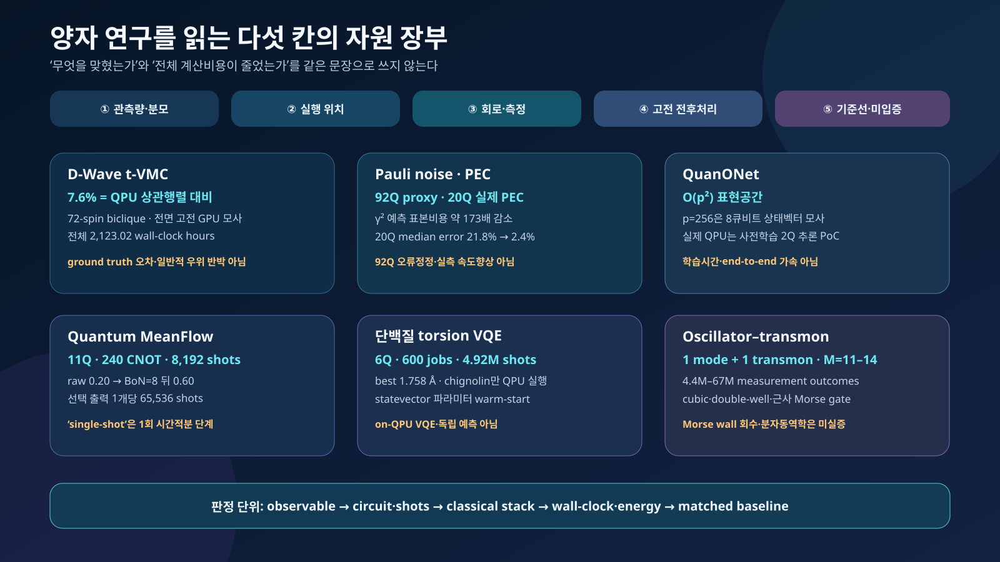

# 양자 우위의 경계는 계속 다시 그려진다

72개 스핀이 상호작용하는 문제에서 고전 시뮬레이션이 D-Wave 양자장치의 결과에 가까워졌다. Roeland Wiersema의 연구가 비교한 것은 스핀 두 개가 서로 어떻게 상관되는지를 모은 행렬이다. 최종 상관행렬의 상대 오차는 양자장치의 행렬을 기준으로 약 7.6%였다. 고전 계산이 어떤 정보를 재현했는지 구체적으로 보여 주는 결과다. [<a href="#ref-1">1</a>]

그 정보를 얻는 데는 계산비용이 들었다. 초기 탐색을 제외하고 논문에 보고한 실험의 경과시간을 더하면 2,123.02시간이다. 같은 상관관계를 더 작은 오차로 구하려 할 때 양자와 고전 계산의 비용이 어떻게 늘어나는지, 바로 그 곡선이 양자 우위의 경계를 정한다. 비교할 답을 정해야 비교할 비용도 정해진다.

2026년 9월 4일까지 공개된 여섯 연구를 이 관점에서 읽었다. 스핀 상관관계에서 잡음 학습, 함수 근사와 생성모델, 분자 구조와 진동자 제어로 대상은 바뀌지만, 좋은 표현을 만드는 일과 그 표현에서 쓸 만한 답을 꺼내는 일은 계속 만난다. 양자 회로의 폭이나 호출 횟수가 줄어든 자리에 측정과 고전 후처리가 얼마나 남는지 살펴보면, 다음에 개선할 계산 과정도 구체적으로 보인다.

<figure class="article-hero-figure"><figcaption>그림 1. 양자프로세서와 GPU 사이의 투명한 저울과 패널은 관측량·측정·고전 후처리를 함께 세는 계산을 상징한다. 아래의 비틀린 분자 리본과 퍼텐셜 모티프는 구조 탐색과 연속변수 제어를 가리킨다. OpenAI 이미지 생성 도구로 제작한 개념 일러스트다.</figcaption></figure>

원호의 기술 브리프는 [PDF로 읽을 수 있다](../artifacts/daily_quantum_brief_2026-09-04.pdf).

## 같은 상관관계에 도달하는 비용

Wiersema는 D-Wave Advantage2에서 다룬 frustrated transverse-field Ising annealing을 correlator-state 기반 time-dependent variational Monte Carlo(t-VMC)로 모사했다. 근사 파동함수의 시간 변화를 고전 GPU에서 계산하고, 그 상태에서 얻은 스핀 쌍의 상관관계를 QPU 결과와 비교한다. 9월 1일 공개된 프리프린트의 대상은 2D cylinder, 3D dimer, diamond, biclique 네 그래프 계열이며 anneal time은 7 ns와 20 ns다. [<a href="#ref-1">1</a>]

근사 파동함수의 표현을 키우자 최종 2점 상관행렬이 QPU 기준에 가까워졌다. 360개 결합과 최대 차수 14를 가진 72-spin biclique에서도 앞서 본 일치를 얻었다. 이때 상대 $L_2$ 오차는 모든 $i>j$의 상관관계에 대해 구했으며, 기준은 QPU가 낸 상관행렬이다. 이 규모에는 수렴한 MPS 참조해가 없다. 따라서 7.6%는 QPU와 고전 결과 사이의 차이를 나타내며, 전체 파동함수의 충실도나 고차 상관관계의 정확도까지 정하지는 않는다. 사용한 결합은 precision-256 값이고, 더 까다로운 이봉 분포 $J=\pm1$ 문제와도 구별된다.

2,123.02시간은 보고한 실험의 경과시간을 합한 값이며 초기 탐색과 시행착오는 제외한다. 각 실행이 A100 4개 또는 H200 8개를 사용했으므로 장치 수까지 곱한 GPU-hours와는 다르다. 가장 비싼 단일 실행은 H200 8개에서 109.25시간이 걸렸다. 양자장치의 7·20 ns anneal time과 비교하려면 양쪽 계산의 시작과 끝을 맞춰야 한다. QPU의 프로그래밍·판독·반복·대기와 접근 비용, 고전 계산의 초매개변수 탐색·실패한 실행·Markov-chain 표본화·수치 안정화가 그 사이에 들어간다.

고전 모사의 성패에는 이런 계산 절차가 직접 작용했다. Markov chain이 서로 다른 상태를 충분히 오가지 못하고 국소 에너지 추정량의 분산이 커지면 시간 적분이 불안정해졌다. 연구진은 parallel tempering, blurred sampling, 중요도 가중 미분방정식 솔버로 이를 완화했다. 특정 파동함수 표현뿐 아니라 표본화와 적분법을 함께 설계해 상관관계의 재현 범위를 넓힌 셈이다.

이후의 비교에서는 같은 문제와 목표 상관 오차에서 time-to-target을 구할 수 있다. 더 큰 규모, 어려운 $\pm1$ 결합, 고차 상관관계에서는 어느 단계의 비용이 먼저 커지는지도 볼 수 있다. 분자 선택이나 물류를 Ising/QUBO로 옮길 때도 exact solver, MILP/CP-SAT, simulated annealing, tensor network와 Monte Carlo 가운데 해당 문제에 강한 방법을 대조군으로 두면, 양자 계산이 보탠 정보와 그 비용을 함께 평가할 수 있다.

<figure class="figure-panel figure-panel-fit"><figcaption>그림 2. 리뷰가 구성한 자원 장부. 스핀 상관관계부터 함수 근사와 퍼텐셜 제어까지, 각 결과에서 측정한 대상과 답을 얻기 위해 거친 계산 과정을 대조한다. 수치와 실행 조건은 원 논문의 보고를 따른다. [<a href="#ref-1">1</a>, <a href="#ref-2">2</a>, <a href="#ref-3">3</a>, <a href="#ref-4">4</a>, <a href="#ref-5">5</a>, <a href="#ref-6">6</a>]</figcaption></figure>

[9월 3일의 full-stack co-design 리뷰](https://infant83.github.io/AI_Tech_Review/reviews/2026-09-03_quantum-full-stack-codesign/)는 한 계층을 최적화했을 때 상태준비·측정·라우팅·고전 처리 사이에서 병목이 어디로 이동하는지 물었다. 이번에는 그 병목을 무엇으로 측정할지 살펴본다. 같은 상관관계를 구하는 비용을 확인했으니, 다음에는 같은 관측량을 추정하는 비용을 바꾸는 잡음 모형을 볼 차례다.

## 잡음을 설명하는 방식이 표본비용을 바꾼다

양자장치에서 관측한 오류를 상태 준비, 게이트, 측정에 각각 얼마나 배분해야 할까. 실험 통계만으로는 이 배분을 유일하게 정할 수 없는 경우가 있다. 서로 다른 매개변수 집합이 같은 관측 통계를 주는 자유도를 gauge라고 부른다. Edward H. Chen 등은 9월 3일 *PRX Quantum*에 게재한 연구에서 이 식별 불가능성과 오류완화의 관계를 다뤘다. [<a href="#ref-2">2</a>]

연구진은 상태 준비와 측정, 1큐비트 게이트와 여러 큐비트를 얽는 Clifford 게이트의 학습 가능한 매개변수를 함께 특성화했다. 이렇게 구성한 self-consistent Pauli-noise 모형에서는 식별할 수 없는 gauge 자유도를 바꾸어도 잡음이 있는 동역학의 예측과 완화된 관측량이 유지된다. 모든 오류 성분에 하나의 고유한 값을 붙이지 않고도 필요한 관측량을 계산할 수 있다는 뜻이다.

실험은 규모에 따라 역할이 달랐다. `ibm_strasbourg`의 최대 21큐비트 GHZ와 92큐비트 ring에서는 고전적으로 계산 가능한 Clifford 회로의 prediction ratio로 proxy mitigation을 수행했다. 92개 국소 $Z_i$ 관측량의 오차 중앙값은 4.9%에서 3.1%로 줄었다. 실제 확률적 오류 상쇄(probabilistic error cancellation, PEC)를 끝까지 수행한 것은 `ibm_fez`의 20큐비트 non-Clifford 회로다. 모형마다 무작위 회로 100,000개를 한 shot씩 실행했고, leakage postselection 뒤 약 18%가 남았다. 완화 전 21.8%였던 절대 오차의 중앙값은 inconsistent PEC에서 5.6%, gauge를 최적화한 consistent PEC에서 2.4%가 됐다.

같은 실험에서 PEC norm $\gamma$는 inconsistent 모형에서 6.74, 기본 gauge의 consistent 모형에서 48.68, 최적화한 consistent 모형에서 3.7이었다. 필요한 표본비용의 예측치는 $\gamma^2$에 비례하므로, 기본 consistent gauge에서 최적화한 gauge로 바꾸면 약 173배 작아진다. 실험의 실행시간을 173배 줄였다는 측정값 대신, 같은 추정 정밀도를 얻는 데 필요한 sampling overhead의 예측치로 읽어야 하는 수치다.

관측량이 같아도 PEC를 구현하는 분해 계수의 크기는 달라질 수 있다. 그 계수가 추정량의 분산과 표본비용을 바꾸기 때문에 gauge가 최적화 변수가 된다. Pauli-noise 모형의 self-consistency를 확보하는 일과 그 안에서 싼 표현을 고르는 일이 서로 연결되는 것이다. 이 연구의 오류완화는 주어진 잡음 모형에서 관측량을 추정하는 절차이며, 물리 오류를 검출·수정하는 논리 큐비트의 실증과는 수행한 작업이 다르다.

재료 계산에서 에너지 오차가 작아졌을 때도 그 값을 얻기 위한 표본비용을 함께 볼 이유가 여기에 있다. 잡음 특성화에 쓴 shots, PEC/ZNE로 커진 분산, 후선택 뒤 남은 표본과 교정 시점의 drift를 포함하면, 오류완화의 개선이 전체 계산에서 어느 정도 남는지 알 수 있다.

## 함수의 표현력을 측정비용으로 잇기

Ruocheng Wang, Xiaoqiu Zhong, Zhuo Xia, Junchi Yan이 9월 3일 *Nature Machine Intelligence*에 발표한 QuanONet은 함수에서 함수로의 사상을 학습한다. 예컨대 미분방정식의 입력 조건을 받아 해가 되는 함수를 내놓는 solution operator를 근사한다. [<a href="#ref-3">3</a>]

QuanONet의 밀도행렬은 잠재 feature 쌍의 곱을 포함하는 implicit quadratic frame을 만든다. 그 결과 주어진 비교 조건에서 고전 모형의 $O(p)$ 선형 표현 용량에 비해 최대 $O(p^2)$의 operator feature span을 제공한다. 여기서 $p$는 trunk의 잠재 특징벡터 차원이다. feature 쌍의 곱이 선형독립일 때 이차 scaling에 도달하며, 보충자료의 Sidon-spectrum 예에서는 coverage가 $O(p^{3/2})$로 낮아진다. 논문은 연속 비선형 operator의 universal approximation 결과도 양자 영역으로 확장했다.

표현할 수 있는 함수 공간이 넓어지면 같은 문제를 더 적은 매개변수로 근사할 가능성이 생긴다. 그 가능성을 응용 성능으로 확인하려면 유용한 밀도행렬 항을 읽는 측정과 고전 데이터의 부호화, 매개변수 최적화까지 살펴야 한다. 표현 용량의 정리는 이런 작업의 실행시간이나 필요한 shots를 직접 정해 주지 않는다.

실제 `ibm_fez`에서는 미리 학습한 2큐비트 모형으로 부정적분 문제의 100개 출력 좌표를 추론했다. 공개 스크립트의 Estimator 기본값은 10,000 shots다. 학습은 QPU 밖에서 이뤄졌으며 이 실행은 장치에서 추론할 수 있는지 보는 정성적 PoC였다. 별도의 scaling 실험에서 사용한 $p=256$은 공개 구현의 $p=2^n$에 따라 8큐비트 상태벡터 모사에 해당한다. 이 수치 실험, 엄격한 매개변수 일치 비교, 2큐비트 하드웨어 추론의 결과를 각각 읽을 수 있다.

다음 비교로는 classical polynomial-feature 모형, kernel method, DeepONet/FNO를 생각할 수 있다. 같은 데이터 분할과 seed에서 매개변수 수뿐 아니라 전처리·회로 깊이·측정 설정·shots·학습시간을 맞추면, 이차 feature가 근사 오차와 실제 계산비용에 주는 이득을 구체적으로 볼 수 있다. 여러 교정 시점의 장치 결과는 simulator–QPU 간 차이와 오류완화 부담도 보여 줄 것이다.

## 한 번의 적분에 들어가는 여러 번의 측정

Quantum MeanFlow(QMF)는 양자 회로로 생성모델을 실행할 때 생기는 순차 호출의 부담을 줄이려 한다. Flow matching은 단순한 분포를 목표 분포로 옮기는 속도장을 학습하고, 추론할 때 미분방정식(ODE)을 적분한다. 여러 시간 단계가 서로 의존하는 Quantum Flow Matching(QFM)에서는 단계마다 QPU 제출과 입출력을 반복한다. Ashish Joshi, Eshaan Mistry, Takahiko Koyama의 9월 2일 프리프린트는 순간 속도 대신 구간 평균 속도를 학습해 이 적분을 한 단계로 바꿨다. [<a href="#ref-4">4</a>]

이 한 단계에서 출력을 구하려면 X·Z 두 측정 기저마다 4,096 shots가 필요했다. 이미지 한 장에 8,192 shots, best-of-$N$(BoN) 선택에서 $N=8$을 쓰면 65,536 shots다. 논문 제목의 “single-shot”은 이처럼 여러 물리적 측정으로 값을 구하는 한 번의 ODE 적분 단계를 가리킨다. QMF 회로는 11큐비트·24층이며 층당 10개의 CNOT, 전체 240 CNOT과 792개 학습 매개변수를 사용한다.

생성 과정의 앞뒤에는 고전 계산이 있다. 약 $2.2\times10^5$개 매개변수의 고전 autoencoder가 16×16 MNIST 이미지를 32차원 잠재 표현으로 압축한다. QMF·QFM의 매개변수는 상태벡터 시뮬레이터에서 학습하고, `ibm_pittsburgh`와 `ibm_boston`에서는 고정한 매개변수로 추론했다.

순차 호출을 줄이는 선택은 생성 품질과 맞바뀌었다. 상태벡터 모사에서 60-step Heun QFM의 정확도는 0.85, one-step QMF는 0.63이었다. 저자들이 학습한 classifier의 feature space에서 2,000개 표본으로 구한 FID는 각각 10.62와 28.26으로, QMF의 품질이 낮았다. `ibm_boston`의 raw accuracy도 QFM 0.30, QMF 0.20이었다. 후보 여덟 개를 만드는 BoN=8에서는 각각 0.80과 0.60으로 회복됐다. test accuracy 98.2%인 고전 classifier가 후보 선택과 평가에 함께 관여했으므로, 이 수치는 그 선택 절차를 포함한 품질이며 독립적인 downstream 검증과는 구별된다.

여기서 흥미로운 비교는 적분 단계 수와 전체 생성비용의 관계다. 짧아진 순차 작업이 회로 실행·측정·후보 선택의 부담을 얼마나 덜어 주는지 보려면, 같은 잠재 표현과 classifier·채택 규칙을 쓰는 고전 MeanFlow와 비교할 수 있다. 측정 기저 수, 기저별 shots, 후보 수를 세고, 각 회로의 깊이와 장치 대기·입출력 지연을 포함해 시간을 구하면 한 단계 구조의 이득을 시험할 수 있다.

## 단백질의 각도를 적은 큐비트에 담는 대가

Fabio Cumbo 등의 9월 2일 프리프린트는 단백질의 연속 비틀림 각도(torsion)를 모사 단계에서 양자상태의 위상에 부호화한다. 이 표현은 $N$개의 자유도를 $O(\log_2N)$ 큐비트에 담고, 고전 알고리즘이 각도로부터 heavy-atom 좌표를 복원한다. Chignolin의 44개 torsion에는 6큐비트, Trp-cage의 88개에는 7큐비트를 배정했다. [<a href="#ref-5">5</a>]

각도를 읽는 방법은 실행 환경에 따라 달랐다. 상태벡터 모사에서는 상대 위상을 사용하고, 장치에서는 계산 기저 확률의 경험적 누적분포함수(CDF)를 제한된 각도 변수로 매핑했다. EfficientSU2 회로와 여러 단계의 구조 이완을 사용하며, 구조를 평가하는 QTF 내부 에너지 함수로 custom molecular-mechanics, Rosetta 또는 OpenMM을 쓴다. 각도 부호화로 줄인 회로 폭 뒤에는 이런 확률 복원·좌표 계산·에너지 평가가 남는다. 같은 CDF를 쓰는 무잡음 대조가 있어야 읽기 규칙의 변화와 하드웨어 잡음의 영향을 나눌 수 있다.

고전 상태벡터 최적화에서 chignolin의 보존 snapshot Cα RMSD는 최저 0.623 Å, 최종 모형은 1.199 Å였다. Trp-cage에서는 각각 2.501 Å와 3.512 Å였다. 0.623 Å는 두 단백질에서 보존한 733만 snapshot 가운데 알려진 PDB 구조와 대조해 사후 선택한 최저값이다. 에너지 함수가 선택한 결과의 평균과는 역할이 다르며, Trp-cage에서는 2 Å 미만 snapshot이 없었다.

하드웨어에서는 chignolin의 6큐비트 회로만 `ibm_cleveland`(156큐비트 Heron R2)와 `ibm_miami`(120큐비트 Nighthawk R1)에서 실행했다. 여기서 6큐비트는 실제 장치에서 실행한 회로의 폭이다. 장치마다 300 jobs, job당 8,192 shots, 합계 600 jobs·4,915,200 shots를 사용했다. 반복 중 최저 RMSD는 Cleveland 1.758 Å, Miami 1.782 Å였고, 2 Å 미만 표본은 각각 88/300과 45/300 jobs에서 나왔다. RMSD는 말단 잔기를 제외한 구조 core를 기준으로 했다. Cleveland의 transpiled CZ 중앙값은 204개, job당 QPU 시간은 약 5초였다. Miami는 CZ 60개에서 약 35초가 걸렸다. 회로 폭이나 게이트 수만으로 처리시간을 예상하기 어려운 이유를 보여 준다.

장치에 보낸 매개변수는 고전 모사에서 고른 것이다. 세 에너지 함수마다 RMSD가 낮았던 chignolin 최종 모형 10개를 골라 총 30개 회로를 각각 10회 반복했다. 시작 구조의 RMSD는 이미 1.199–2.270 Å였고, 대다수 하드웨어 반복은 이보다 나빠졌다. 이 실험은 주어진 시작 구조와 전이한 매개변수에서 장치 표본을 회수하는 절차를 시험했다. 에너지 측정과 매개변수 갱신을 장치에서 반복한 VQE 최적화와 구별되며, 목적함수도 전자구조의 바닥상태 에너지 대신 비틀림 구조의 hybrid score다.

이 표현을 재료 계산에 가져온다면, OLED donor–acceptor 분자의 주요 torsion 6–12개나 고분자 backbone의 제한된 구조군부터 시험해 볼 만하다. 같은 구조군·에너지 함수·예산에서 RDKit/CREST, 분자동역학, basin hopping과 learned potential을 대조군으로 둘 수 있다. 정확한 상태벡터를 넣었을 때의 decoder 오차와 잡음이 있는 분포에서 추가된 오차, 에너지 함수의 순위 오차를 나누면 양자 회로에 요구할 역할도 분명해진다.

## 진동자의 퍼텐셜을 바꾸는 제어

Clara Yun Fontaine 등은 9월 2일 공개한 프리프린트에서 오래 상태를 유지하는 초전도 조화진동자와 transmon 큐비트를 분산 결합했다. Bosonic quantum signal processing에서 유도한 모듈 회로가 비가우스 위상 게이트 $e^{-iV(\hat X)}$를 만든다. 고정해 교정한 제어 연산 사이의 큐비트 회전각을 바꾸면 같은 장치에서 여러 퍼텐셜 $V(X)$를 프로그래밍할 수 있다. [<a href="#ref-6">6</a>]

조화진동자에서 만들기 쉬운 Gaussian 연산에 비선형 위상 게이트를 더하면 연속변수 계산의 표현을 확장할 수 있다. 실험은 cubic $V(X)=0.6X^3$, 대칭·비대칭 double-well, 근사 Morse 퍼텐셜을 구현했다. 기본 echoed conditional displacement 게이트는 약 520 ns, 큐비트 회전은 28 ns였고 Fourier order는 대략 11–14였다. Cubic 게이트에서 재구성한 계수는 $c_3=0.68\pm0.10$, 재구성한 $D=25$ 절단공간에서 상태 충실도의 하한은 0.84, Wigner negativity의 하한은 0.11이었다. 반복 적용에서 비가우스성이 누적되는 경향도 관찰했다.

Double-well은 선형 bias로 대칭성과 두 우물의 깊이 차이를 조절하고, 재구성과 bootstrap 검정으로 topology를 확인했다. 이 결과를 읽는 데 측정량도 중요하다. Cubic·대칭 double-well·broken double-well은 각각 약 $4.4\times10^6$개, 비대칭 double-well은 $5.3\times10^7$개, Morse는 $6.7\times10^7$개의 측정 outcome을 사용했다.

Morse 게이트는 분자 진동 퍼텐셜의 지수함수 형태를 근사하는 시도다. 실제 coherent probe는 $|n|\le2$ harmonic만 안정적으로 복원해 가파른 반발 벽을 충분히 드러내지 못했다. 10.9 dB squeezed probe로 $|n|\le7$까지 벽을 회수한 결과는 모사이며, 완전한 $M=13$ 복원에는 계산상 16.3 dB squeezing과 29개 probe 위치가 필요했다. 데이터 수집 뒤 complementary polynomial 구성에서 $\pi$ 인자 누락이 발견돼, 연구진은 실제 실행한 회로를 기준으로 결과를 다시 비교했다. 관측한 topology와 비대칭성을 살피되, 의도한 퍼텐셜과 실행된 퍼텐셜의 차이를 함께 남긴 결과다.

이 실험이 제공한 것은 퍼텐셜을 순간적인 위상으로 작용시키는 제어와 각 지점의 힘을 재구성하는 방법이다. 이를 분자 계산으로 발전시키려면 운동에너지에 따른 시간발전과 결합해 알려진 스펙트럼이나 파동묶음의 움직임을 재현할 수 있다. 긴 coherence, 짧은 모듈 시퀀스와 안정적인 교정은 높은 Fourier order의 누적오차를 줄이는 방향이다. 작은 Morse oscillator의 낮은 고유준위, tunnelling splitting, 시간 상관함수를 정밀한 고전 수치해와 비교하는 것이 구체적인 다음 시험이 될 것이다.

## 같은 물리량에서 시작하는 다음 비교

여섯 연구에서 줄인 자원은 서로 다르다. QuanONet은 표현할 feature 공간을 넓히고, QMF는 순차 적분을 줄였다. 단백질 부호화는 회로 폭을 줄였고, 진동자 제어는 같은 장치에서 고를 수 있는 퍼텐셜을 늘렸다. 이런 변화가 계산의 이득으로 이어지는 과정에는 측정·표본 선택·고전 복원이 개입한다. Pauli-noise 연구처럼 같은 관측량을 유지하면서 표현 선택으로 표본비용을 낮추는 경우도 있다.

나는 재료·OLED 계산의 다음 비교를 작은 활성공간 에너지, 제한된 구조군, 알려진 진동 준위처럼 고전 기준선이 강한 물리량에서 시작하고 싶다. 그래야 양자 부분을 고전 feature, 표본 생성기 또는 decoder로 교체했을 때 무엇이 바뀌는지 확인하기 쉽다. 생성모델에서는 같은 후보 선택 규칙을, 구조 탐색에서는 같은 에너지 함수를 유지하는 비교가 그 역할을 한다.

계산을 계획할 때에는 목표 오차와 성공률을 먼저 정한 뒤, 그 답을 얻기까지 필요한 준비·반복·측정·후처리를 따라가면 된다. 어떤 문제에서는 회로 깊이와 shots가, 다른 문제에서는 CI·DFT·분자동역학이나 classifier의 비용이 지배할 것이다. 실패한 실행과 교정 간 변동도 비용 곡선의 일부다. D-Wave의 상관관계를 다시 계산한 고전 연구가 보여 주듯, 양자 우위의 경계는 강한 대조군과 구체적인 관측량에서 다시 그려진다.

## References

<ol class="reference-list">
<li id="ref-1"><a href="https://arxiv.org/abs/2609.01719v1">R. Wiersema, Numerical simulation of D-Wave&#x27;s quantum advantage experiment with time-dependent variational Monte Carlo, arXiv:2609.01719v1 (2026).</a>; <a href="https://github.com/therooler/dwave_vmc/tree/3456ea264fa409921367bd953d3d34372e5dd3e4">dwave_vmc project contributors, dwave_vmc, GitHub repository, commit 3456ea264fa409921367bd953d3d34372e5dd3e4 (3 September 2026).</a></li>
<li id="ref-2"><a href="https://doi.org/10.1103/69wc-gzl6">E. H. Chen, S. Chen, L. E. Fischer, A. Eddins, L. C. G. Govia, B. Mitchell, A. He, Y. Kim, L. Jiang, and A. Seif, Disambiguating Pauli noise in quantum computers, PRX Quantum 7, 033045 (2026).</a></li>
<li id="ref-3"><a href="https://doi.org/10.1038/s42256-026-01289-7">R. Wang, X. Zhong, Z. Xia, and J. Yan, Quantum neural operators with implicit quadratic frame and expressivity advantages, Nat. Mach. Intell. 8, 1371–1380 (2026).</a>; <a href="https://doi.org/10.5281/zenodo.21084057">R. Wang, Z. Xia, X. Zhong, and J. Yan, Quantum neural operators with implicit quadratic frame and expressivity advantages, version 1.0.0, Zenodo (2026), doi:10.5281/zenodo.21084057.</a>; <a href="https://github.com/Wang-Ruocheng/QuanONet/tree/2481511b131917fc91820b1486aa929c44938fad">QuanONet project contributors, QuanONet: Quantum Neural Operators with Adaptive Frequency Strategy, GitHub repository, commit 2481511b131917fc91820b1486aa929c44938fad (30 June 2026).</a>; <a href="https://doi.org/10.1038/s42256-026-01314-9">R. Wang, X. Zhong, Z. Xia, and J. Yan, Publisher Correction: Quantum neural operators with implicit quadratic frame and expressivity advantages, Nat. Mach. Intell. 8, 1506 (2026).</a></li>
<li id="ref-4"><a href="https://arxiv.org/abs/2609.02186v1">A. Joshi, E. Mistry, and T. Koyama, Quantum MeanFlow: single-shot generative sampling on NISQ hardware, arXiv:2609.02186v1 (2026).</a></li>
<li id="ref-5"><a href="https://arxiv.org/abs/2609.02113v1">F. Cumbo, B. Raubenolt, V. Puram, N. Katzenmeyer, J. Joshi, and D. Blankenberg, Logarithmic-scale variational quantum eigensolver for off-lattice protein structure prediction in continuous torsional angle space, arXiv:2609.02113v1 (2026).</a>; <a href="https://github.com/cumbof/qtf/tree/4f700c9f2bd278f7c469b6ccf7c641c0a2fa5006">QTF project contributors, QTF: Quantum Torsion Folder, GitHub repository, commit 4f700c9f2bd278f7c469b6ccf7c641c0a2fa5006 (28 August 2026).</a>; <a href="https://doi.org/10.5281/zenodo.22088098">F. Cumbo, B. Raubenolt, V. Puram, N. Katzenmeyer, J. Joshi, and D. Blankenberg, QTF Manuscript Results, version 1.0.0, Zenodo (2026), doi:10.5281/zenodo.22088098.</a></li>
<li id="ref-6"><a href="https://arxiv.org/abs/2609.02405v1">C. Y. Fontaine, M. Somani, K. Yu, M. C. Loke, J. Schwinger, P.-T. Fong, N.-N. Huang, A. Copetudo, M. Bakr, H.-K. Lau, T. Krisnanda, and Y. Y. Gao, Programming anharmonic potentials in a superconducting harmonic oscillator, arXiv:2609.02405v1 (2026).</a></li>
</ol>

---

작성·검증 이력. 원 발행일과 근거 기준일은 2026년 9월 4일이다. 당시 `evidence_algorithms`가 t-VMC·Pauli-noise·QuanONet을, `evidence_applications`가 Quantum MeanFlow·torsion-space VQE·oscillator–transmon을 원 출처에서 점검했고 `draft_sep4_review`가 한영 원고를 구성했다. 당시 책임 편집은 김현중, AI 보조는 OpenAI Codex Work Mode multi-agent workflow와 AI Tech Review Editorial Harness v2026.08이었다. 정확한 모델 식별자는 미보존이며 문장 단위 사람 검토는 별도 기록되지 않았다. 수치는 원 논문의 보고값이고, 공통 자원 비교와 재료·OLED 적용은 리뷰의 해석·제안이다.

2026년 11월 15일 편집 개정. 편집부(AEDAUT)의 `legacy0904_prose`가 한영 도입·연결·중복·캡션을 다듬었다. 원 근거 기준일과 수치 조건을 유지하고 당시 논의를 설명하는 방식으로 개정했다. 새 원 연구 실험이나 사람 독자 평가를 수행한 개정이 아니다. 추가 과학 감수와 출판 검수의 실제 범위는 이번 개정 기록에 구분해 남긴다.

이번 감수에서 root는 원고·서지·빌드·게시를 통합했고, `legacy0904_algorithms`는 t-VMC·Pauli 잡음·QuanONet의 해당 원문·판본·공개 보충자료와 코드를, `legacy0904_applications`는 QMF·단백질·진동자 원문을 기록된 범위에서 대조했다. QuanONet의 구독 본문 전체를 확보하지는 않았으며 공개 초록·그림 설명·보충자료·당시 코드로 확인했다. 9월 14일의 PDF 수식 조판 정정은 이번에 별도 확인했으나 원 근거 기준일과 섞지 않았다.[<a href="#ref-3">3</a>] 실제 읽기 범위와 출력·공개 검증은 개정 기록을 따른다.
