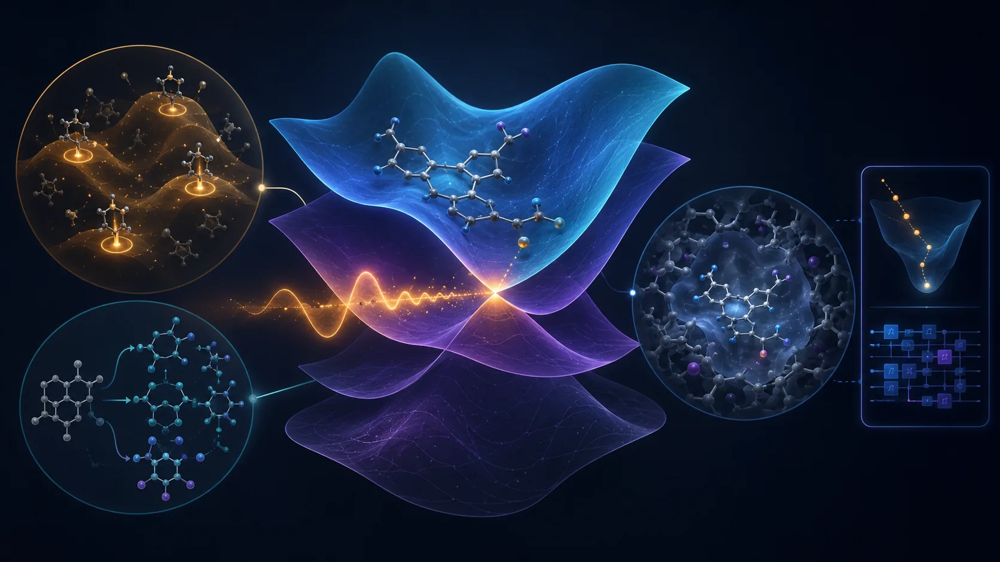
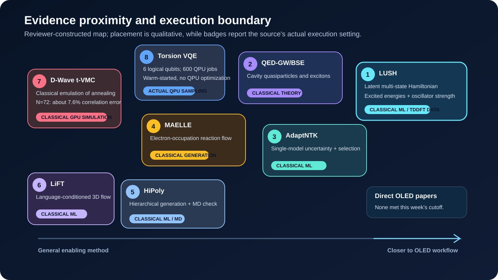
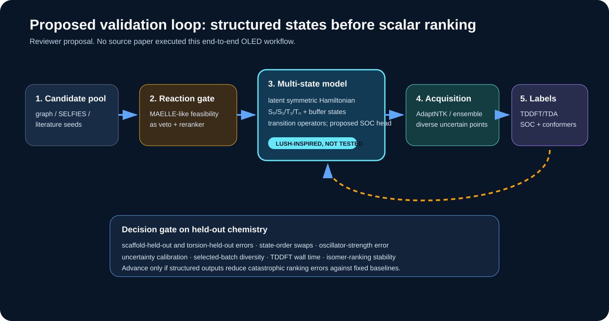

# 다중 여기상태를 매끄럽게 학습하는 법: OLED 분자 역설계의 물리 표현과 검증 경계

분자의 결합을 조금 비틀었을 뿐인데, 가까이 있던 두 여기상태가 섞이고 에너지 순서가 바뀐다. OLED 분자 후보를 고르는 모델은 이때 에너지 값만 잘 맞히면 충분할까. 상태마다 별도의 숫자를 예측하면, 분자의 변형을 따라 상태 사이의 관계가 어떻게 달라지는지 놓칠 수 있다.

Juergens 등의 LUSH는 이 문제를 학습된 해밀토니안으로 다룬다[1](#ref-1). 에너지를 각각 회귀하는 대신, 잠재공간에서 대칭 행렬을 예측하고 대각화해 여러 상태의 에너지를 함께 얻는다. 전이 쌍극자도 같은 기저의 연산자로 학습하고, 여기 에너지와 함께 진동자 세기(oscillator strength)를 계산한다. 이번 주 문헌에서 주목한 것은 이처럼 예측할 물리량 사이의 관계를 모델 안에 넣는 방법이다. 이어 살펴볼 불확실성 추정은 어느 구조를 추가 계산할지, 반응 생성과 환경 표현은 그렇게 고른 분자가 어떤 합성·조성 조건에서 쓰일지를 묻는다.

이 리뷰는 2026년 8월 28일-9월 3일의 새 공개 문헌 7편과 8월 28일 v2가 나온 MAELLE를 함께 다룬다. 선정 자료는 OLED 발광체·host의 직접 검증보다, 그 설계에 적용할 인접 방법론에 집중돼 있다. 문헌의 근거 기준일은 원 발행일인 9월 4일로 유지했다.

*그림 1. AI 생성 개념 일러스트. 중앙의 겹친 곡면과 빛은 서로 결합하는 여기상태를, 왼쪽의 분자와 화살표는 표본 선택과 반응 경로를 나타낸다. 오른쪽에는 분자를 둘러싼 host 환경과 양자 회로 모티프를 배치했다.*

::: highlight 이번 리뷰의 관점
LUSH의 잠재 해밀토니안은 여러 여기상태를 연결해 학습하는 출발점이다. OLED에 적용하려면 현재의 singlet 중심 실증에서 triplet·스핀–궤도 결합(SOC)과 host 환경으로 시험 범위를 넓혀야 한다. 작은 이성질체·conformer 세트에서 기존 scalar multitask 모델과 비교하면, 이 표현이 상태 순서와 분자 순위의 오류를 줄이는지부터 판단할 수 있다.
:::

영문 기술 브리프는 [PDF로 내려받을 수 있다](../artifacts/oled_inverse_design_weekly_brief_2026-09-04.pdf).

아래 그림은 8편이 설계 과정의 어느 부분과 이어지는지 보여준다. LUSH[1](#ref-1)와 QED-GW/BSE[2](#ref-2)는 여기상태와 환경을 표현하고, AdaptNTK[3](#ref-3)는 계산할 구조를 고른다. MAELLE[4](#ref-4)·HiPoly[5](#ref-5)·LiFT[6](#ref-6)는 반응과 생성 조건을 다루며, 마지막 두 양자 연구[7](#ref-7), [8](#ref-8)는 계산 자원을 비교할 기준을 제공한다.

*그림 2. 리뷰어가 구성한 정성적 근거 지도. 배치는 OLED 설계 과정과의 근접성을, badge는 각 논문이 사용한 계산 환경을 나타낸다. 위치는 성능 순위가 아니다. 그림의 “6 logical qubits”는 오류정정된 논리 자원이 아닌 회로의 6개 큐비트를 뜻한다.*

## 1. LUSH: 상태별 숫자를 연결하는 잠재 해밀토니안

David Juergens, Martin Stöhr, Andreas E. Hillers-Bendtsen, O. Jonathan Fajen, Todd J. Martínez의 *Latent unified smooth Hamiltonians for excited state chemistry*는 2026년 9월 1일 arXiv에 게시됐다[1](#ref-1).

LUSH는 원자번호와 Cartesian 좌표를 SE(3)-invariant message-passing network에 넣고, cross-attention으로 고정 크기의 잠재 표현에 압축한다. state pair마다 Pairformer 표현을 만든 뒤 대칭인 잠재 해밀토니안을 예측한다. 이 행렬을 대각화하면 adiabatic energy를 얻는다. 매끄럽게 학습하는 대상은 잠재 해밀토니안이며, 그 고유값으로 얻는 에너지 곡면은 원뿔 교차(conical intersection)의 구조를 나타낼 수 있다. 같은 잠재 기저에서 전이 쌍극자 연산자를 학습해, 에너지 차이와 함께 진동자 세기를 계산한다. 또한 선택한 부분공간의 기저가 구조에 의존하지 않을 때 Hellmann–Feynman 관계로 비단열 결합을 구한다.

기본적인 에너지 학습 능력은 QM9의 134,000개 분자와 B3LYP/6-31G(2df,p) 바닥상태 라벨로 시험했다. 약 5.95M parameter 모델이 Tesla V100 한 장으로 약 48시간 학습한 뒤 무작위로 고른 검증 분자 100개에서 대략 1 kcal/mol 수준에 접근했다. 보충자료의 약 7.05M parameter 설정은 energy MAE 0.059 eV, 즉 약 1.36 kcal/mol을 보고한다. 여러 여기상태를 다룬 QeMFi 실험에는 9개 분자의 CAM-B3LYP/def2-TZVP geometry 135,000개를, azobenzene 실험에는 FOMO-hh-TDA-BHLYP/def2-SVP single point 780,745개를 사용했다. 잘라 낸 상태공간의 경계가 관심 상태를 오염시키지 않도록, 관심 상태보다 최소 두 개 높은 상태를 buffer로 넣는다.

OLED 적용을 판단할 때 특히 읽어야 할 것은 데이터의 분할과 구성이다. QeMFi는 90/10 random split, azobenzene은 99/1 random split이며, azobenzene의 twisted·cis 영역에는 표본이 적고 오차도 크다. 따라서 새 scaffold나 torsion family에서 상태 관계를 유지하는지는 따로 시험할 문제로 남는다. 원고에는 동료평가 승인 뒤 코드를 공개할 계획이라고 적혀 있다.

이 리뷰가 제안하는 OLED 시험은 S0/S1/T1/Tn의 에너지와 전이 연산자를 함께 다루고, SOC용 연산자 head를 추가해 비교하는 것이다. 원 논문의 singlet 중심 실증에서 TADF의 역계간전이(RISC)로 나아가려면 triplet과 SOC가 필요하기 때문이다. 이때 singlet·triplet의 스핀 대칭성과 phase convention을 어떻게 보존할지도 정해야 한다. state-order swap과 이성질체 순위 오류를 scaffold-held-out·conformer-held-out에서 비교하면, 평균 에너지 오차의 개선이 실제 후보 선택으로 이어지는지 확인할 수 있다.

## 2. QED-GW/BSE: 환경이 바꾸는 에너지를 항별로 살핀다

Soohaeng Yoo Willow 등 9명의 *GW and Bethe-Salpeter Theory for Molecular Polaritons, Quasiparticles, and Excitons*는 2026년 9월 1일 게시됐다[2](#ref-2). 이 논문은 광공동(cavity)에 넣은 분자의 이온화 퍼텐셜(IP), 전자친화도(EA), 광학 여기와 엑시톤을 같은 이론적 출발점에서 다룬다.

저자들은 dipole-gauge Pauli–Fierz 해밀토니안과 coherent-state QED-HF reference로부터 QED-GW와 static Bethe–Salpeter equation을 구성한다. 공동 효과는 정적 dipole self-energy(DSE) shift, screened interaction의 DSE 보정, polariton pole로 들어간다. 네 hydride와 두 aromatic system을 비교했으며, 비교 가능한 cavity-induced shift에서는 QED-CCSD가 near-exact QED-DMRG와 1 meV 안에서 맞았다고 보고했다.

GW는 음이온이 비결합 상태인 closed-shell 분자의 cavity-induced IP redshift를 크게 예측하는 경향을 보였다. EA의 변화량은 거의 정량적으로 맞았고, 절대 EA 오차와는 구별해 읽어야 한다. 준입자 기여를 빼고 남은 BSE 커널 보정은 조사한 다섯 분자 가운데 ammonia에서 두드러졌다. 이는 공동이 만드는 전체 광학 갭 변화와 구별되는 항이다. unbound anion의 exciton binding energy는 basis에 민감했다. 환경에 의한 변화량과 계산법 자체의 오차를 나누어 기록해야 하는 이유다.

주요 계산의 λ=0.05 a.u.는 약 0.74 nm³, 한 변 약 0.9 nm의 mode volume에 해당한다. 이는 picocavity나 plasmonic nanogap에 가까운 조건이다. 저자들은 자유공간 파장 약 110 nm(11.31 eV)의 빛에 대한 diffraction-limited planar cavity에서 single-molecule coupling을 대략 10^-4 a.u.로 추산하고, λ=0.05의 집단 결합에는 약 2×10^5 molecules가 필요하다고 계산했다. 일반 OLED microcavity를 다루려면 이 결합 조건과 함께 분자 집단의 disorder와 loss를 포함해야 한다.

OLED 설계에서 가져올 만한 것은 IP·EA·optical gap·exciton binding을 각각 얼마나 바꾸는지 구분하는 계산 방식이다. 고립 분자에서 얻은 후보 순위가 환경 보정 뒤에도 유지되는지, 어느 항이 순서를 바꾸는지 살필 수 있다. OmegaQMC 예제와 MOLMPS 구현은 공개돼 있다.

## 3. AdaptNTK: 다음에 계산할 구조를 고른다

좋은 상태 표현을 골랐더라도, 모든 geometry에 비싼 라벨을 붙일 수는 없다. Prajwal Ananth와 Shuwen Yue의 *AdaptNTK: Adaptive Uncertainty Quantification and Active Learning for Neural Network Potentials*는 한 neural potential에서 불확실성을 추정하고 중복이 적은 표본을 고르는 방법을 제시한다. 2026년 8월 31일 게시된 논문이다[3](#ref-3).

AdaptNTK는 empirical neural tangent kernel의 feature 공간에서 regularized Mahalanobis distance를 uncertainty score로 쓴다. 표본 하나를 선택할 때마다 Sherman–Morrison 갱신으로 점수를 다시 계산한다. 이 과정에서는 모델을 매번 재학습하지 않아도 되며, 이미 선택한 표본과 비슷한 후보의 점수가 줄어든다. 한 batch의 계산량을 비슷한 구조들에 소모하는 일을 줄이려는 구성이다.

rMD17 held-out 실험에서 분자별 force error와 uncertainty의 상관을 평균했을 때, Spearman 상관은 0.683±0.018, Pearson은 0.706±0.021이었다. 불확실성 순서로 표본을 제외할 때의 오차를 평가하는 AURCn은 낮을수록 좋다. 3-model ensemble의 0.310±0.013과 비교해 AdaptNTK는 0.312±0.014였다. 불확실성과 관측 오차의 대응을 재는 ENCE는 two-fold cross-fitted post-hoc 재보정 뒤 0.0125±0.0018이었다. rMD17와 Transition-1X active learning에서 낮은 force error와 transition-state 표본 선택을 보였으며, Transition-1X에서는 pretraining·불확실성 구성·batch 선택의 합계 시간이 A100 한 장에서 2423.34 s로, ensemble의 6225.15 s보다 약 2.6배 짧았다. 이 시간은 reference 라벨 계산을 제외한 값이다. 같은 MACE architecture, loss, split와 seed 조건에서 비교한 결과다.

이 바닥상태 force potential의 선택 기준을 OLED 여기상태 모델에 옮길 때에는 target마다 calibration을 확인해야 한다. 에너지·진동자 세기·단일항–삼중항 에너지 차이(ΔEST)·SOC에서 불확실성과 실제 오차의 관계가 같으리라 기대할 수는 없기 때문이다. scalar multitask 모델과 잠재 해밀토니안 모델 양쪽에서 NTK score와 ensemble disagreement를 비교하고, 추가 TDDFT/TDA 계산점이 torsion·state-crossing·scaffold 공간을 얼마나 다양하게 채우는지 볼 수 있다.

## 4. MAELLE: 전자 점유의 변화로 반응 경로를 생성한다

여기상태 예측이 유망한 후보라도 합성 경로를 함께 생각해야 다음 계산의 가치가 생긴다. Xuan-Vu Nguyen, Octavian Susanu, Daniel Armstrong, Philippe Schwaller의 *Mechanistic Reaction Prediction via Discrete Flow Matching on Graph-Structured Electron Occupation*는 반응물을 생성물로 바꾸는 동안 전자 점유가 어떻게 변하는지 표현한다[4](#ref-4). 8월 27일 첫 게시 뒤 28일 v2에서 초록의 보간 경로·mechanism-like 표현을 다듬었다. 여기서는 이 판본의 기존 실험 결과를 검토한다.

MAELLE는 bond, nonbonding electron과 hydrogen site의 정수 점유를 graph state로 나타내고, continuous-time Markov chain 기반 discrete flow matching으로 바꾼다. edit-based mixture path와 optimal transport가 단계별 기작 라벨 없이 mechanism-like electron move를 만든다.

USPTO-480K에서 top-1 87.2%, top-3 93.0%, top-5 93.9%, top-10 94.6%를 보고했다. top-1은 Graph2SMILES의 90.3%, NERF의 90.7%보다 낮다. FlowER test의 bond-forming step 37,583개에서 64 trajectories를 합친 coverage는 63.0%였고, persistent edit coverage는 99.6%, transient edit coverage는 29.6%였다. 복원한 step의 directional agreement는 전체 trajectory에서 78.2%, 올바른 생성물 trajectory에서 84.6%, 최고 확신도 생성물의 trajectory에서 89.0%였다. LLM judge가 입력에 끼워 넣은 정답 생성물을 받아들인 비율은 약 81.1±0.1%로, judge 자체의 sanity check다.

지속되는 bond edit와 잠시 나타났다 사라지는 edit의 coverage 차이는 생성 경로를 읽는 데 중요하다. 단계별 기작 라벨 없이 얻은 이 경로는 후속 실험에서 확인할 반응 가설을 제공한다. 저자들은 mass/reaction-type OOD에서 transformation model이 de novo model보다 강하다고 보고했다.

OLED 설계에는 MAELLE형 점수를 반응 가능성에 따른 후보 제외·재정렬 신호로 넣는 방법을 제안한다. Buchwald–Hartwig, SNAr, borylation, ligand formation 등 실제 합성 family에서 route success와 비교하고, 시약의 commercial availability와 protecting-group·purification 비용도 함께 기록해야 후보를 고르는 기준으로 쓸 수 있다.

## 5. HiPoly와 LiFT: 생성기에 어떤 조건을 전달할 것인가

분자의 성질은 개별 구조뿐 아니라 조성과 주변 환경에도 달려 있다. Ge Sun 등의 *HiPoly: a hierarchical polymer-native AI framework for property prediction and generative design*는 이 문제를 고분자의 계층적 표현으로 다뤘다. 2026년 9월 2일 게시됐다[5](#ref-5). G2RINS는 monomer·motif·atom의 세 graph level에 stochastic inter-monomer connectivity, mole fraction, molecular weight를 함께 넣는다.

물성 예측의 fivefold CV에서 Tg R² 0.803±0.147, density R² 0.945±0.024를 보고했다. composition aggregation을 제거하면 Tg R²가 0.291로 떨어졌다. 조성을 모으는 단계가 예측에 기여했음을 보여주는 비교다. 별도의 PFAS interfacial-tension 설계 예제에서는 약 6,000개 고분자 reference pool과 약 600개 MD-labeled polymer를 사용해 공유 잠재공간을 학습했다. 25,000개 PFAS-free 후보를 생성하고 상위 후보를 OPLS 기반 분자동역학(MD)으로 다시 평가했다. 조건은 NVT 600 K, NPT 600→300 K 50 ns, NVT 300 K 20 ns였다.

학습 라벨과 후속 평가가 같은 force-field·simulation 수준에 놓인 고분자 연구다. OLED small-molecule glass나 host-dopant film으로 이어 가려면 분자·conformer·dimer·혼합물·morphology를 어떤 계층으로 표현하고 어떤 실험량과 대조할지 새로 정해야 한다. HiPoly의 조성 제거 실험은 이런 표현 선택을 비교하는 한 방법을 보여준다.

Tianyu Gao 등 8명의 *Language-Informed Flow Matching for Trend-Guided Structure-Based 3D Molecular Generation*는 생성 조건을 언어 모델에서 얻는다. 2026년 8월 31일 게시된 원고에는 Findings of EMNLP 2026 채택이 명시돼 있다[6](#ref-6). LiFT는 LLM agent가 target-aware SMILES 조건을 만들고, frozen chemical foundation model의 embedding을 3D ODE flow에 주입한다. CrossDocked2020의 Balanced-No-Reference 설정에서는 QED 0.757, SA score 2.659를, Vina-No-Reference 설정에서는 PoseBusters 73.56%를 보고했다. 각 no-reference 설정의 RDKit/REOS 통과율은 71% 이상이었다. 이 지표들은 서로 다른 prompt 조건에서 얻은 값이다.

이 단백질 pocket–ligand 생성 실험은 물성·구조·합성 용이성의 proxy를 함께 평가했다. OLED에 적용하는 후속 비교에서는 pocket 대신 host-dopant packing이나 aggregate context를 조건으로 삼을 수 있다. LLM 조건화, 단순 property token, latent control을 같은 scaffold-held-out DFT blind set에 적용하면 언어에서 얻은 prior가 후보 순위에 무엇을 더하는지 판단할 수 있다. 합성 여부는 앞 절의 실제 반응 검증과 연결할 문제다.

## 6. 양자 계산의 비용을 어디에서 셀 것인가

### 6.1 D-Wave annealing을 고전 t-VMC로 모사한 비용

Roeland Wiersema의 *Numerical simulation of D-Wave's quantum advantage experiment with time-dependent variational Monte Carlo*는 2026년 9월 1일 게시됐다[7](#ref-7). correlator state를 쓴 고전 time-dependent variational Monte Carlo(t-VMC)로 D-Wave Advantage2의 frustrated transverse-field Ising annealing을 모사한다. 대상은 2D cylinder, 3D dimer, diamond와 biclique geometry이며 anneal time은 7 ns와 20 ns다.

N=72 biclique의 final two-spin correlation은 QPU 결과와 약 7.6% 오차로 가까웠다. N=128 diamond의 적분된 TDVP projection error R²는 4.27×10^-3였지만, 이 크기에는 exact ground truth가 없다. N=72 biclique의 최종 correlation-error 추정에는 4,194,304 samples를 썼다. 저자는 고전 모사에 GPU 수백 시간이, QPU 실행에는 seconds가 들었다고 보고하며, 더 큰 계에서 sample과 sweep이 늘어나는 문제를 함께 설명한다. parallel tempering, blurred sampling, importance-weighted ODE solver를 사용한 코드는 공개돼 있다.

이 연구가 제공하는 것은 Ising annealing의 상관함수를 고전 계산으로 재현할 때 드는 비용이다. OLED 후보 선택을 chemistry-relevant QUBO로 만든다면, 같은 instance에서 exact solver, simulated annealing, tensor/network Monte Carlo와 QPU를 비교해야 한다. correlation error 또는 목적함수 값에 더해 total samples, GPU-hours, preprocessing, QPU access time을 함께 세면 정확도와 계산 자원의 교환을 읽을 수 있다.

### 6.2 torsion-space VQE: 6큐비트 회로와 600건의 QPU sampling

Fabio Cumbo 등의 *Logarithmic-scale variational quantum eigensolver for off-lattice protein structure prediction in continuous torsional angle space*는 2026년 9월 2일 게시됐다[8](#ref-8). 단백질의 torsional degree of freedom을 phase로 encoding해 qubit 수를 O(log2 N)으로 줄이고, EfficientSU2 ansatz와 multi-stage relaxation을 사용한다. statevector 계산에서는 phase를 읽지만, hardware에서는 computational-basis 확률의 empirical CDF로 구조를 복원한다.

고전 statevector optimization에서 chignolin의 retained snapshot Cα RMSD는 0.623 Å, final은 1.199 Å였고, Trp-cage는 각각 2.501 Å와 3.512 Å였다. chignolin만을 대상으로 한 hardware 실험은 고전 계산에서 고른 회로 30개를 장치마다 10회씩 실행했다. IBM Heron R2 156-qubit `ibm_cleveland`와 Nighthawk R1 120-qubit `ibm_miami`에서 각각 300 jobs, job당 8192 shots를 사용했다. 두 장치 모두 같은 6큐비트 회로를 돌렸고, `ibm_miami` 회로는 정확히 60 CZ였지만 분포는 더 나빴고 job runtime은 약 7배 길었다. best RMSD는 Cleveland 1.758 Å, Miami 1.782 Å였으며, 2 Å 아래 native-like sample은 각각 88/300과 45/300이었다.

이 QPU 결과는 simulation에서 최적화한 parameter를 가져와 sampling한 것이다. 최적화는 고전 계산, sampling은 QPU, 구조 복원은 확률 CDF를 이용한 고전 계산으로 나뉜다. 동일한 CDF decoder를 쓰는 noiseless 기준선이 없어, phase 기반 계산과의 차이에서 decoder와 noise의 영향을 따로 떼어 내기는 어렵다. on-QPU iterative VQE의 성능과 구별해야 하는 이유다. 저자들은 state space가 커질수록 decoder에 많은 shots가 필요하다고 설명한다. qubit 수와 함께 circuit depth·sampling·재구성 시간을 세어야 전체 계산량을 평가할 수 있다.

OLED에서는 6-12개의 torsion을 가진 donor–acceptor conformer 탐색에 이 표현을 시험하는 후속 연구를 생각할 수 있다. 이때 비교할 대상은 고전 conformer search이며, 측정할 양은 wall time과 conformer energy·ranking이다. 여기상태의 전자구조를 계산하는 VQE와는 목적이 다르다.

## 7. 작은 OLED 세트에서 상태 표현과 표본 선택을 함께 비교한다

*그림 3. 이번 문헌을 토대로 리뷰어가 제안한 OLED 검증 과정. 후보의 반응 가능성을 살피고, 여러 상태를 예측한 뒤 불확실성이 큰 구조에 TDDFT 라벨을 추가한다. SOC head를 포함한 LUSH의 OLED 확장은 후속 연구 가설이다.*

제안하는 첫 비교는 12-24개 분자 또는 이성질체 family에서 시작한다. 각 분자에서 여러 torsion geometry를 만들고 동일한 TDA/TDDFT 설정으로 S1, T1, T2/T3, 진동자 세기, 자연 전이 궤도(NTO) 기반 전하이동(CT)·국소여기(LE) descriptor를 계산한다. 소수 calibration geometry에는 S1-Tn SOC를 추가한다.

Model A는 각 target을 예측하는 scalar multitask GNN, Model B는 symmetric latent Hamiltonian과 transition-operator head를 갖춘 모델로 둔다. 각 비교에 넣을 관심 상태 2-4개에 buffer state 두 개를 더해 전체 모델 차원을 4-6 state로 맞춘다. spin block과 포함할 target을 먼저 고정하고, SOC head는 별도의 proposed ablation으로 비교한다. 평가는 leave-one-scaffold-out와 torsion-held-out을 함께 사용한다.

active-learning round마다 AdaptNTK와 3-model ensemble이 각각 고른 20-40개 geometry를 새로 계산한다. energy/gap MAE에 더해 state-order swap, 진동자 세기 오차, 이성질체 순위, uncertainty calibration, selected-batch diversity와 DFT wall time을 기록한다. 잠재 해밀토니안이 큰 순위 오류를 줄이고 그 개선이 새 scaffold에서도 유지된다면, 더 큰 분자 세트로 확장할 근거가 생긴다.

## 결론

이번 주 문헌에서 이어지는 질문은 여러 여기상태의 관계를 어떻게 학습하고, 그 모델에 필요한 계산을 어디에 쓸 것인가다. LUSH는 상태를 하나의 잠재 해밀토니안에 연결하고, AdaptNTK는 추가 라벨을 붙일 구조를 고르는 기준을 제공한다. 반응과 계층적 환경 표현은 그 예측을 합성 가능한 후보와 실제 조성으로 이어 가는 데 필요한 조건을 드러낸다.

작은 OLED 세트에서 scalar 모델과 연산자 표현을 같은 조건으로 비교하는 것이 구체적인 출발점이다. 평균 에너지 오차뿐 아니라 상태 순서와 이성질체 순위가 얼마나 안정해지는지 보면, 표현의 변화가 분자를 고르는 판단까지 개선하는지 알 수 있다.

## References

<ol class="reference-list">
<li id="ref-1">D. Juergens, M. Stöhr, A. E. Hillers-Bendtsen, O. J. Fajen, and T. J. Martínez, Latent unified smooth Hamiltonians for excited state chemistry, <a href="https://arxiv.org/abs/2609.01871v1">arXiv:2609.01871v1</a> (1 September 2026).</li>
<li id="ref-2">S. Y. Willow, G. B. Sim, T. H. Park, T. I. Kim, D. C. Yang, M. Matoušek, J. Brabec, L. Veis, and C. W. Myung, GW and Bethe-Salpeter theory for molecular polaritons, quasiparticles, and excitons, <a href="https://arxiv.org/abs/2609.00594v1">arXiv:2609.00594v1</a> (1 September 2026).</li>
<li id="ref-3">P. Ananth and S. Yue, AdaptNTK: Adaptive uncertainty quantification and active learning for neural network potentials, <a href="https://arxiv.org/abs/2609.00488v1">arXiv:2609.00488v1</a> (31 August 2026).</li>
<li id="ref-4">X.-V. Nguyen, O. Susanu, D. Armstrong, and P. Schwaller, Mechanistic reaction prediction via discrete flow matching on graph-structured electron occupation, <a href="https://arxiv.org/abs/2608.27429v2">arXiv:2608.27429v2</a> (28 August 2026).</li>
<li id="ref-5">G. Sun, G. Zaldivar, Y. Tian, G. Perez Lemus, J. Park, D. Safarian, M. Han, and J. J. de Pablo, HiPoly: A hierarchical polymer-native AI framework for property prediction and generative design, <a href="https://arxiv.org/abs/2609.02746v1">arXiv:2609.02746v1</a> (2 September 2026).</li>
<li id="ref-6">T. Gao, Z. Su, J. Li, W. Gao, Z. Ying, Z. Zhao, F. Zhang, and Y. Wei, Language-informed flow matching for trend-guided structure-based 3D molecular generation, <a href="https://arxiv.org/abs/2608.31009v1">arXiv:2608.31009v1</a> (31 August 2026).</li>
<li id="ref-7">R. Wiersema, Numerical simulation of D-Wave’s quantum advantage experiment with time-dependent variational Monte Carlo, <a href="https://arxiv.org/abs/2609.01719v1">arXiv:2609.01719v1</a> (1 September 2026).</li>
<li id="ref-8">F. Cumbo, B. Raubenolt, V. Puram, N. Katzenmeyer, J. Joshi, and D. Blankenberg, Logarithmic-scale variational quantum eigensolver for off-lattice protein structure prediction in continuous torsional angle space, <a href="https://arxiv.org/abs/2609.02113v1">arXiv:2609.02113v1</a> (2 September 2026).</li>
</ol>

---

작성정보. 작성자: 김현중. AI 보조: OpenAI Codex Work Mode. 검증 기준일: 2026년 9월 4일. 수치와 방법은 각 원문이 보고한 값이며, OLED workflow 번역, LUSH-inspired SOC head와 이번 주 실행안은 리뷰 제안이다. 선정된 8편은 모두 프리프린트다. 직접 OLED 논문이 없다는 판정과 양자 실행 위치를 원문 범위 안에서 분리해 기록했다.

개정 이력 · 2026년 11월 16일. Agentic Tech Review Letters(ATRL) 편집부(AEDAUT)가 원 발행일과 2026년 9월 4일의 근거 범위를 유지하며 한영 설명·캡션·인용을 다듬고, 원문 대조로 QM9 실험의 대상, 공동의 BSE 커널 보정, 계산 시간·반응 평가 지표와 QPU sampling의 조건을 바로잡았다. 원 제작·검증 기록은 위에 보존하며, 이번 개정은 새로운 OLED 계산이나 사람 독자 평가를 수행한 결과가 아니다.
