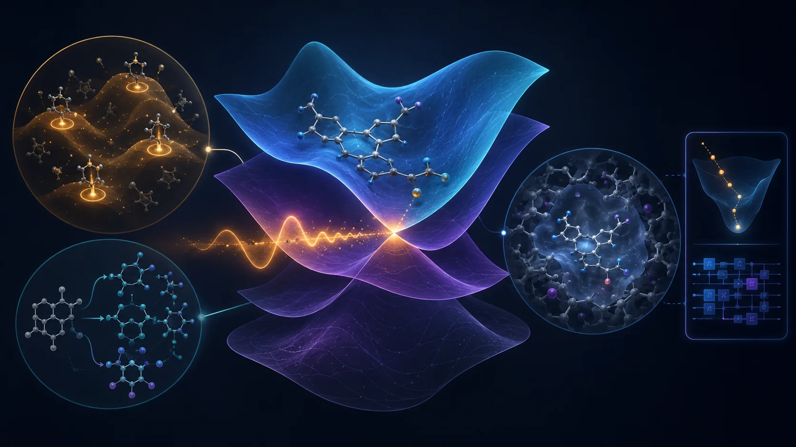
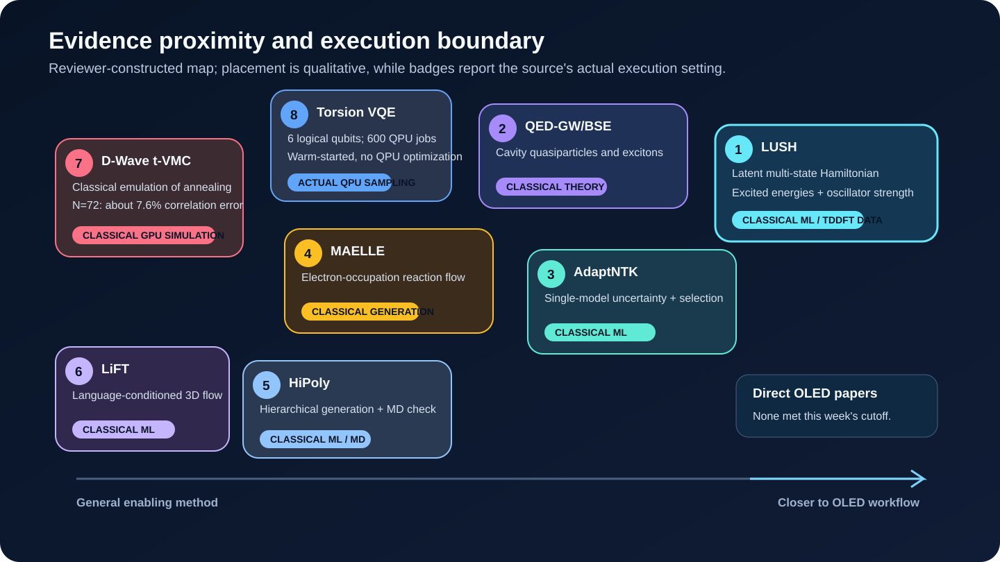
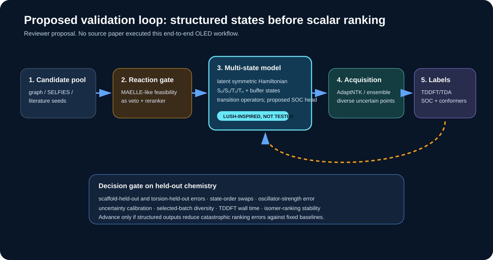

# Learning Coupled Excited-State Landscapes: Physical Representations and Validation Boundaries for OLED Inverse Design

A small twist of a molecular bond can mix two nearby excited states and reverse their energy order. A model used to rank OLED candidates therefore needs more than accurate values at isolated geometries. Predicting a separate number for each state can lose the relationship between states as the molecule changes shape.

Juergens and co-workers' LUSH model addresses this problem through a learned Hamiltonian [1](#ref-1). It predicts a symmetric matrix in latent space and diagonalizes it to obtain several state energies together. It also learns transition-dipole operators in the same basis and computes oscillator strengths from them and the excitation energies. The interesting development is a way to put relationships among physical quantities inside the model. The uncertainty methods discussed next ask which geometries deserve further calculations; reaction generation and environmental representations ask how the predicted molecule fits into synthesis and composition constraints.

This review covers seven papers newly posted from 28 August to 3 September 2026, together with the 28 August v2 of MAELLE. The selections concern enabling methods for OLED design rather than direct emitter or host validation. The literature cutoff remains the original publication date, 4 September.

*Figure 1. AI-generated concept illustration. Overlapping surfaces and light at the center represent coupled excited states; molecules and arrows at left represent configuration selection and reaction pathways. The right-hand elements depict a host environment around a molecule and a quantum-circuit motif.*

::: highlight Review perspective
A latent Hamiltonian offers a starting point for learning excited states as related objects. Taking LUSH from its singlet-centered demonstrations to OLED materials requires tests of triplets, spin–orbit coupling (SOC), and host effects. A small isomer and conformer set can first establish whether the representation reduces state-ordering and molecular-ranking errors relative to a scalar multitask model.
:::

The English technical brief is available as a [downloadable PDF](../artifacts/oled_inverse_design_weekly_brief_2026-09-04.pdf).

The map below places the eight papers alongside different parts of a design process. LUSH [1](#ref-1) and QED-GW/BSE [2](#ref-2) describe excited states and environmental effects; AdaptNTK [3](#ref-3) selects configurations for calculation. MAELLE [4](#ref-4), HiPoly [5](#ref-5), and LiFT [6](#ref-6) address reactions and generation conditions. The two quantum studies [7](#ref-7), [8](#ref-8) provide examples of how to account for computational resources.

*Figure 2. Reviewer-constructed qualitative evidence map. Position indicates proximity to an OLED design workflow, and badges identify the execution setting used in each paper. Position is not a performance ranking. “6 logical qubits” here denotes six circuit qubits rather than error-corrected logical resources.*

## 1. LUSH connects state energies through a latent Hamiltonian

David Juergens, Martin Stöhr, Andreas E. Hillers-Bendtsen, O. Jonathan Fajen, and Todd J. Martínez posted *Latent unified smooth Hamiltonians for excited state chemistry* on 1 September 2026 [1](#ref-1).

LUSH passes atomic numbers and Cartesian coordinates through an SE(3)-invariant message-passing network, compresses the representation into fixed trainable latents by cross-attention, forms state-pair features with a Pairformer, and predicts a symmetric latent Hamiltonian. Diagonalization yields adiabatic energies. The smoothly learned object is the latent Hamiltonian; its eigenvalues can describe the structure of a conical intersection. Transition-dipole operators learned in the same latent basis combine with energy differences to give oscillator strengths. A Hellmann–Feynman relation gives nonadiabatic couplings when the basis of the selected subspace is geometry independent.

The basic energy-learning test uses 134,000 QM9 molecules with B3LYP/6-31G(2df,p) ground-state labels. A roughly 5.95-million-parameter model approached 1 kcal/mol on 100 randomly selected validation molecules after about 48 hours on one Tesla V100. The supplement reports an energy MAE of 0.059 eV, about 1.36 kcal/mol, for a roughly 7.05-million-parameter configuration. The multi-state QeMFi experiments use 135,000 CAM-B3LYP/def2-TZVP geometries across nine molecules; the azobenzene experiment uses 780,745 FOMO-hh-TDA-BHLYP/def2-SVP single points. At least two states above those of interest serve as buffers, protecting the target manifold from the boundary of a truncated state space.

Data coverage and splitting matter when deciding how to test this representation for OLEDs. QeMFi uses a 90/10 random split and azobenzene a 99/1 random split. Twisted and cis azobenzene regions are underrepresented and have larger errors. Preserving state relationships for a new scaffold or torsion family therefore remains a separate test. The manuscript promises code after peer-reviewed acceptance.

The OLED experiment proposed here would learn S0/S1/T1/Tn energies and transition operators together, with an added SOC operator head evaluated separately. Triplets and SOC are needed to move from the paper's singlet-centered demonstrations toward reverse intersystem crossing (RISC) in TADF materials. Mixed spin symmetries and phase conventions also require an explicit design. State-order swaps and isomer-ranking errors under scaffold- and conformer-held-out splits would show whether improved energy predictions lead to better candidate selection.

## 2. QED-GW/BSE separates the energy changes caused by a cavity

Soohaeng Yoo Willow and eight co-authors posted *GW and Bethe-Salpeter Theory for Molecular Polaritons, Quasiparticles, and Excitons* on 1 September 2026 [2](#ref-2). The paper treats molecular ionization potentials (IPs), electron affinities (EAs), optical excitations, and excitons in a cavity from a common theoretical starting point.

A dipole-gauge Pauli–Fierz Hamiltonian and coherent-state QED-HF reference lead to QED-GW and a static Bethe–Salpeter equation. Cavity contributions enter through a static dipole-self-energy (DSE) shift, a DSE augmentation of the screened interaction, and a polaritonic pole. Benchmarks cover four hydrides and two aromatic systems. Where comparisons are available, QED-CCSD cavity-induced shifts agree with near-exact QED-DMRG within 1 meV.

GW tends to overestimate cavity-induced IP redshifts for closed-shell molecules with unbound anions. EA shifts are nearly quantitative and should be read separately from errors in absolute EAs. After removing the quasiparticle contribution, the residual BSE-kernel correction is appreciable only for ammonia among the five molecules tested in that analysis. This is a separate contribution from the total cavity-induced optical-gap shift. Exciton binding energies for unbound anions are basis sensitive. These comparisons distinguish an environmental shift from the underlying error of a computational method.

The principal coupling, λ=0.05 a.u., corresponds to a mode volume of about 0.74 nm³, roughly a 0.9-nm cube: a picocavity or plasmonic-nanogap scale. For a diffraction-limited planar cavity at a free-space wavelength of about 110 nm (11.31 eV), the authors estimate a single-molecule coupling around 10^-4 a.u. and roughly 2×10^5 molecules to reach a collective λ=0.05. Applying the method to an ordinary OLED microcavity requires treating that coupling regime along with ensemble disorder and loss.

OLED design can borrow the practice of tracking separate corrections to IP, EA, optical gap, and exciton binding. It could reveal whether a ranking based on isolated molecules survives environmental corrections and which contribution changes it. OmegaQMC examples and MOLMPS are public.

## 3. AdaptNTK selects the next configurations to calculate

Even with an appropriate state representation, expensive labels cannot be assigned to every geometry. Prajwal Ananth and Shuwen Yue's *AdaptNTK: Adaptive Uncertainty Quantification and Active Learning for Neural Network Potentials*, posted on 31 August 2026, derives uncertainty from one neural potential and uses it to select less redundant configurations [3](#ref-3).

AdaptNTK measures a regularized Mahalanobis distance in empirical neural-tangent-kernel feature space. A Sherman–Morrison update refreshes the scores after each selection without retraining the potential during batch construction. Candidates similar to configurations already selected lose value, reducing the chance of spending a batch of calculations on nearly identical structures.

On held-out rMD17 configurations, the molecule-averaged Spearman and Pearson correlations between uncertainty and force error are 0.683±0.018 and 0.706±0.021. AURCn measures errors as configurations are discarded in uncertainty order; lower is better. AdaptNTK obtains 0.312±0.014, versus 0.310±0.013 for a three-model ensemble. ENCE, which measures agreement between uncertainty and observed errors, is 0.0125±0.0018 after two-fold cross-fitted post-hoc recalibration. In rMD17 and Transition-1X active-learning tests it reports low force errors and selects transition-state configurations. For Transition-1X, pretraining, uncertainty construction, and batch selection together take 2423.34 s on one A100, versus 6225.15 s for the ensemble: about 2.6 times faster, excluding reference-label acquisition. The comparison matches MACE architecture, loss, splits, and seeds.

Transferring this acquisition rule from ground-state force potentials to OLED excited-state models requires calibration for each target. Uncertainty may relate differently to errors in energies, oscillator strengths, singlet–triplet gaps (ΔEST), and SOC. Both scalar multitask and latent-Hamiltonian models could be tested with NTK and ensemble scores, measuring whether added TDDFT/TDA configurations cover torsion, state-crossing, and scaffold space and whether uncertainty bins match observed errors.

## 4. MAELLE generates reaction pathways through electron-occupation changes

A candidate with promising excited-state predictions also needs a plausible synthesis route to justify further calculations. Xuan-Vu Nguyen, Octavian Susanu, Daniel Armstrong, and Philippe Schwaller's *Mechanistic Reaction Prediction via Discrete Flow Matching on Graph-Structured Electron Occupation* represents the electron-occupation changes that transform reactants into products [4](#ref-4). First posted on 27 August, its 28 August v2 clarifies the abstract wording about interpolation paths and mechanism-like behavior. The results examined here are the existing experiments in that edition.

MAELLE represents integer electron occupation at bonds, nonbonding sites, and hydrogen sites, then evolves that graph state with continuous-time Markov-chain discrete flow matching. An edit-based mixture path and optimal transport induce mechanism-like electron moves without elementary-step labels.

On USPTO-480K, top-1, top-3, top-5, and top-10 accuracies are 87.2%, 93.0%, 93.9%, and 94.6%. Top-1 is below Graph2SMILES at 90.3% and NERF at 90.7%. Across 37,583 bond-forming steps in the FlowER test set, 64 trajectories together cover 63.0%; persistent and transient edit coverage are 99.6% and 29.6%. Directional agreement for recovered steps is 78.2% across all trajectories, 84.6% for correct-product trajectories, and 89.0% for highest-confidence-product trajectories. The LLM judge accepts approximately 81.1±0.1% of injected ground-truth products, a sanity check of the judge itself.

The difference between persistent and transient edit coverage matters when reading a generated pathway. These trajectories, learned without elementary-step labels, offer reaction hypotheses to investigate experimentally. The authors also report that transformation models outperform de novo models under mass- and reaction-type OOD shifts.

For OLED design, a MAELLE-like score could help exclude or rerank candidates by reaction feasibility. To use it as a selection criterion, a study should compare it with route success for OLED reaction families such as Buchwald–Hartwig coupling, SNAr, borylation, and ligand formation, while tracking reagent availability, protecting-group, and purification costs.

## 5. HiPoly and LiFT ask what conditions a generator should receive

Molecular properties depend on composition and surroundings as well as individual structures. Ge Sun and co-workers' *HiPoly: a hierarchical polymer-native AI framework for property prediction and generative design*, posted on 2 September 2026, addresses this through a hierarchical polymer representation [5](#ref-5). G2RINS combines monomer, motif, and atom graph levels with stochastic inter-monomer connectivity, mole fraction, and molecular weight.

In property prediction, fivefold-CV R² is 0.803±0.147 for Tg and 0.945±0.024 for density; removing composition aggregation reduces Tg R² to 0.291. This ablation identifies a contribution from the composition representation. In a separate PFAS interfacial-tension design example, a shared latent space is trained using a reference pool of roughly 6,000 polymers and about 600 MD-labeled polymers. The authors generate 25,000 PFAS-free candidates and reassess top candidates with OPLS-based molecular dynamics (MD): NVT at 600 K, a 50-ns NPT ramp from 600 to 300 K, and 20-ns NVT at 300 K.

The training labels and follow-up assessment remain at the same force-field simulation level. Taking the idea to small-molecule OLED glasses or host-dopant films requires deciding how molecule, conformer, dimer, mixture, and morphology levels should connect, and which experimental quantities should test them. HiPoly's composition ablation illustrates how such representation choices can be compared.

Tianyu Gao and seven co-authors' *Language-Informed Flow Matching for Trend-Guided Structure-Based 3D Molecular Generation* obtains generation conditions from a language model. The manuscript, posted on 31 August 2026, states acceptance to Findings of EMNLP 2026 [6](#ref-6). LiFT has an LLM agent produce target-aware SMILES conditions, embeds them with a frozen chemical foundation model, and injects the prior into a 3D ODE flow. On CrossDocked2020, Balanced-No-Reference reports QED 0.757 and SA score 2.659, while Vina-No-Reference reports PoseBusters 73.56%. Each no-reference setting has an RDKit/REOS pass rate above 71%. These values come from different prompt conditions.

This protein-pocket ligand experiment evaluates proxies for properties, structure, and ease of synthesis together. A follow-up OLED comparison could condition on host-dopant packing or aggregate context in place of a pocket. Testing LLM conditioning, simple property tokens, and latent controls on the same scaffold-held-out DFT blind set would show what the language prior adds to candidate ranking. Synthesis would need the reaction-level validation discussed above.

## 6. Where to count the cost of quantum computation

### 6.1 The classical cost of reproducing D-Wave annealing with t-VMC

Roeland Wiersema posted *Numerical simulation of D-Wave's quantum advantage experiment with time-dependent variational Monte Carlo* on 1 September 2026 [7](#ref-7). A classical correlator-state time-dependent variational Monte Carlo (t-VMC) method simulates D-Wave Advantage2 frustrated transverse-field Ising anneals on 2D-cylinder, 3D-dimer, diamond, and biclique geometries at anneal times of 7 and 20 ns.

For an N=72 biclique, the final two-spin correlation is within about 7.6% of the QPU result. An N=128 diamond run has an integrated TDVP projection error R² of 4.27×10^-3 but lacks exact ground truth. The final correlation-error estimate for the N=72 biclique uses 4,194,304 samples. The author reports hundreds of GPU-hours for classical simulation, versus seconds of QPU execution. The author describes the growing sample and sweep requirements for larger systems. Parallel tempering, blurred sampling, and an importance-weighted ODE solver are implemented in public code.

The study measures the classical cost of reproducing correlations in Ising annealing. If OLED candidate selection is formulated as a chemistry-relevant QUBO, a useful comparison would run exact solvers, simulated annealing, appropriate tensor or Monte Carlo methods, and a QPU on matched instances. Counting total samples, GPU-hours, preprocessing, and QPU access time alongside correlation errors or objective values reveals the trade-off between accuracy and computational resources.

### 6.2 Torsion-space VQE: a six-qubit circuit and 600 QPU sampling jobs

Fabio Cumbo and co-workers posted *Logarithmic-scale variational quantum eigensolver for off-lattice protein structure prediction in continuous torsional angle space* on 2 September 2026 [8](#ref-8). Torsional degrees of freedom are phase encoded with O(log2 N) qubits, followed by EfficientSU2 and multi-stage relaxation. Statevector calculations access phase; hardware reconstruction instead uses the empirical CDF of computational-basis probabilities.

Classical statevector optimization gives a retained-snapshot Cα RMSD of 0.623 Å and final RMSD of 1.199 Å for chignolin; Trp-cage gives 2.501 and 3.512 Å. Hardware sampling is restricted to chignolin: 30 classically optimized circuits are each repeated ten times per device, totaling 300 jobs each on the 156-qubit Heron R2 `ibm_cleveland` and 120-qubit Nighthawk R1 `ibm_miami`, with 8192 shots per job. The same six-qubit circuit runs on both devices. Miami uses exactly 60 CZ gates but yields a poorer distribution and about seven times longer job runtime. Best RMSDs are 1.758 Å and 1.782 Å; native-like samples below 2 Å occur in 88/300 Cleveland and 45/300 Miami jobs.

These QPU runs sample parameters optimized in simulation. Optimization takes place in classical computation, sampling on the QPU, and structure reconstruction in a classical probability-CDF decoder. Without a matched noiseless CDF-decoder baseline, differences from phase-based calculations cannot be separated into decoder and noise contributions. That division matters when comparing the result with iterative on-QPU VQE. The authors describe the decoder's growing shot requirements as the state space expands. Circuit depth, sampling, and reconstruction time must therefore be counted alongside qubits.

An OLED follow-up could test this representation on donor–acceptor conformer searches with 6-12 torsions. The comparison would be with classical conformer search, measuring wall time, conformer energies, and ranking. Its objective differs from an electronic-structure VQE calculation of excited states.

## 7. Compare state representations and acquisition on a small OLED set

*Figure 3. OLED validation workflow proposed by the reviewer from this week's literature. Reaction-feasibility screening precedes multi-state prediction, followed by new TDDFT labels for uncertain configurations. The OLED extension of LUSH, including an SOC head, is a follow-up research hypothesis.*

The proposed first comparison starts with 12-24 molecules or isomer families and several torsional geometries per molecule. Under one TDA/TDDFT protocol, calculate S1, T1, T2/T3, oscillator strength, and natural-transition-orbital (NTO) descriptors of charge-transfer (CT) and local-excitation (LE) character. Add S1-Tn SOC for a smaller calibration tier.

Model A is a scalar multitask GNN. Model B predicts a symmetric latent Hamiltonian and transition operators. For each comparison, choose two to four states of interest and add two buffer states, giving a total model dimension of four to six states. Fix the spin blocks and target set before comparison, and treat an SOC head as a separate proposed ablation. Use both leave-one-scaffold-out and torsion-held-out evaluation.

At each active-learning round, compare 20-40 geometries selected by AdaptNTK with those selected by a three-model ensemble. Record energy and gap MAE, state-order swaps, oscillator-strength error, isomer ranking, uncertainty calibration, selected-batch diversity, and DFT wall time. A reduction in large ranking errors that survives a new scaffold would justify expanding the structured model to a larger molecular set.

## Conclusion

The connected question across this week's literature is how to learn relationships among excited states and where to spend the calculations needed by that model. LUSH connects states through a latent Hamiltonian, while AdaptNTK supplies a criterion for assigning additional labels. Reaction and hierarchical environmental representations identify conditions needed to connect those predictions to synthesizable candidates and real compositions.

A small OLED set provides a concrete starting point for comparing scalar models and operator representations under matched conditions. Measuring state-ordering stability and isomer rankings alongside average energy errors would establish whether the representation improves the decision of which molecules to pursue.

## References

<ol class="reference-list">
<li id="ref-1">D. Juergens, M. Stöhr, A. E. Hillers-Bendtsen, O. J. Fajen, and T. J. Martínez, Latent unified smooth Hamiltonians for excited state chemistry, <a href="https://arxiv.org/abs/2609.01871v1">arXiv:2609.01871v1</a> (1 September 2026).</li>
<li id="ref-2">S. Y. Willow, G. B. Sim, T. H. Park, T. I. Kim, D. C. Yang, M. Matoušek, J. Brabec, L. Veis, and C. W. Myung, GW and Bethe-Salpeter theory for molecular polaritons, quasiparticles, and excitons, <a href="https://arxiv.org/abs/2609.00594v1">arXiv:2609.00594v1</a> (1 September 2026).</li>
<li id="ref-3">P. Ananth and S. Yue, AdaptNTK: Adaptive uncertainty quantification and active learning for neural network potentials, <a href="https://arxiv.org/abs/2609.00488v1">arXiv:2609.00488v1</a> (31 August 2026).</li>
<li id="ref-4">X.-V. Nguyen, O. Susanu, D. Armstrong, and P. Schwaller, Mechanistic reaction prediction via discrete flow matching on graph-structured electron occupation, <a href="https://arxiv.org/abs/2608.27429v2">arXiv:2608.27429v2</a> (28 August 2026).</li>
<li id="ref-5">G. Sun, G. Zaldivar, Y. Tian, G. Perez Lemus, J. Park, D. Safarian, M. Han, and J. J. de Pablo, HiPoly: A hierarchical polymer-native AI framework for property prediction and generative design, <a href="https://arxiv.org/abs/2609.02746v1">arXiv:2609.02746v1</a> (2 September 2026).</li>
<li id="ref-6">T. Gao, Z. Su, J. Li, W. Gao, Z. Ying, Z. Zhao, F. Zhang, and Y. Wei, Language-informed flow matching for trend-guided structure-based 3D molecular generation, <a href="https://arxiv.org/abs/2608.31009v1">arXiv:2608.31009v1</a> (31 August 2026).</li>
<li id="ref-7">R. Wiersema, Numerical simulation of D-Wave’s quantum advantage experiment with time-dependent variational Monte Carlo, <a href="https://arxiv.org/abs/2609.01719v1">arXiv:2609.01719v1</a> (1 September 2026).</li>
<li id="ref-8">F. Cumbo, B. Raubenolt, V. Puram, N. Katzenmeyer, J. Joshi, and D. Blankenberg, Logarithmic-scale variational quantum eigensolver for off-lattice protein structure prediction in continuous torsional angle space, <a href="https://arxiv.org/abs/2609.02113v1">arXiv:2609.02113v1</a> (2 September 2026).</li>
</ol>

---

Publication note. Author: Hyun-Jung Kim. AI assistance: OpenAI Codex Work Mode. Evidence cutoff: 4 September 2026. Quantitative findings and methods are source-reported. OLED workflow translations, the proposed LUSH-inspired SOC head, and the practical experiment are reviewer inferences. All eight selected records are preprints; the absence of a direct OLED paper and the execution setting of each quantum result are stated explicitly.

Revision · 16 November 2026. The editorial team (AEDAUT) of Agentic Tech Review Letters (ATRL) revised the bilingual explanations, captions, and references, correcting the scope of the QM9 test, the cavity BSE-kernel correction, timing and reaction metrics, and QPU-sampling conditions through source comparison while retaining the original publication date and 4 September 2026 evidence cutoff. The original authoring and verification record is preserved above. This revision does not report new OLED calculations or a human-reader evaluation.
