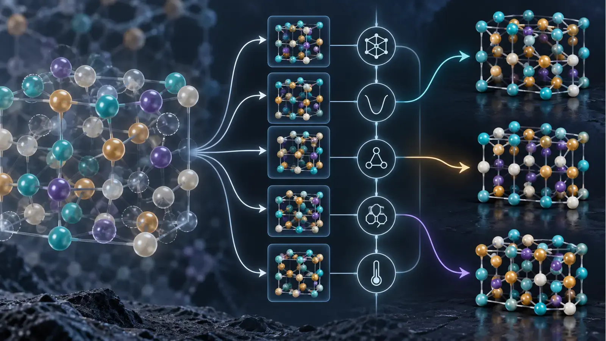
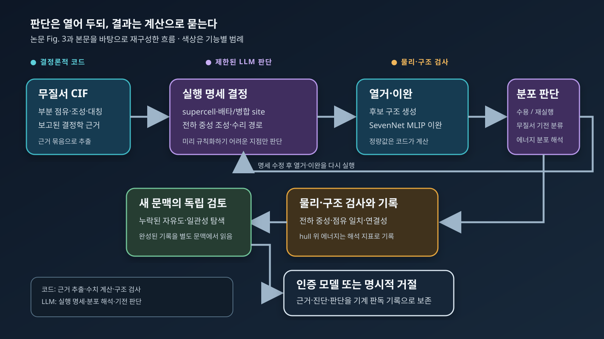

# 계산을 맡기는 다음 단계: 재료과학 ‘에이전트 프로그램’은 무엇을 증명했나

## 요약

결정구조 파일에 원자 자리의 점유율이 0.18이라고 적혀 있어도, 원자 시뮬레이션을 시작하려면 어느 자리를 실제로 채울지 정해야 한다. 서울대학교 연구진이 2026년 9월 1일 공개한 DeMARS는 이 선택을 대규모언어모델(Large Language Model, LLM)에 맡기면서, 후보 구조의 수치 계산과 물리 검사는 코드가 수행하도록 설계한 ‘에이전트 프로그램’이다. <a class="citation" href="#ref-1">[1]</a> 저자들은 약 800개 무질서 결정 사례로 프로그램을 성숙시킨 뒤 개발에 쓰지 않은 100개를 실행 중 사람 개입 없이 처리했다고 보고했다. 이 내부 평가를 통해 좁은 과학 업무를 끝까지 위임하는 방식을 보여주었으며, 인증·거절 건수와 반복 실행의 안정성, 코드 공개는 재현성을 판단할 다음 자료로 남았다.

*그림 1. AI 생성 개념 일러스트. 왼쪽의 부분 점유 결정에서 가운데의 후보 배열을 만들고, 물리 제약을 거쳐 오른쪽의 명시적 원자 모델을 선택하는 과정을 표현했다.*

## 평균 구조를 원자 배열로 바꾸는 일

결정학정보파일(Crystallographic Information File, CIF)은 단위격자, 대칭, 원자 위치와 원소·점유율을 담는다. 회절 실험으로 얻은 CIF의 부분 점유는 공간과 시간에 걸쳐 평균한 구조를 표현한다. 반면 밀도범함수이론(density functional theory, DFT) 같은 원자 계산에는 보통 정수 개의 원자가 들어 있는 명시적인 주기적 셀이 필요하다. 평균 점유를 지키면서 어떤 원자를 어디에 놓을지 선택하는 일이 그 사이에 있다.

논문이 든 $\mathrm{Ca}_{1-x}\mathrm{Th}_{x}\mathrm{F}_{2+2x}$의 $x=0.18$ 사례를 보자. $\mathrm{Ca}^{2+}$ 하나를 $\mathrm{Th}^{4+}$로 바꾸면 양전하가 2만큼 늘어난다. 전하 중성을 유지하려면 Th 하나당 $\mathrm{F}^{-}$ 두 개를 더 넣어야 하므로, 불소 조성은 $2+2(0.18)=2.36$이 된다. 이 산술을 만족하는 것과 추가 F를 넣을 틈새 자리, 함께 채울 수 없는 자리, 필요한 초격자(supercell)를 정하는 것은 서로 다른 일이다. 뒤의 선택에는 결정 구조와 국소 화학에 대한 해석이 들어간다.

Antypov 등의 통계에서 ICSD(Inorganic Crystal Structure Database) 항목의 약 절반은 무질서 구조로 분류됐다. 치환 무질서만 있는 구조의 비중 59%는 수소가 포함된 구조를 제외하고 조성·공간군의 중복을 제거한 집합에서 무질서 구조를 분모로 계산한 값이다. <a class="citation" href="#ref-2">[2]</a> 치환·빈자리·틈새 원자가 결합된 복잡한 경우에는 각 부분 점유 자리를 독립적으로 열거하면 조성이나 전하 중성, 원자들의 연결 관계가 깨질 수 있다. 가능한 조합 수도 빠르게 늘어난다. 후보를 많이 계산하기에 앞서 **어떤 화학적 제약을 가진 배열을 열거할지** 정해야 하는 이유다.

DeMARS는 De-averaged Minimal Atomistic Representation System의 약자다. 원 CIF의 근거와 화학 규칙을 만족하는 최소 원자 모델 또는 여러 모델의 집합을 만들어, 후속 시뮬레이션이 출발할 구조를 제공한다. 평균 구조 안에 숨어 있는 무질서의 상관관계를 연구할 때는 이 최소 모델에서 더 나아가 셀 크기와 구조 집합이 충분한지도 살펴야 한다.

## 좁은 과학 업무를 소프트웨어에 맡긴다

재료 계산의 상당 부분은 이미 자동화되어 있다. VASP·Quantum ESPRESSO가 주어진 입력을 계산하고, AiiDA·atomate2·AFLOW·AMP² 같은 워크플로 도구는 계산 의존관계와 재시작, 데이터의 생성 이력을 관리한다. 예를 들어 atomate2는 정해 둔 조건에 따라 동적으로 분기하거나 계산을 추가하고 오류를 복구할 수 있다. <a class="citation" href="#ref-3">[3]</a> 연구자는 그 과정에서 서로 가까운 두 원자 자리가 동시에 점유될 수 있는지, 결함의 전하상태를 어떻게 정할지, 자기일관장(self-consistent field, SCF) 계산의 실패에 수치 설정을 바꿀지 물리 모델을 다시 볼지 판단한다.

이런 판단 가운데 아직 규칙으로 표현하지 못한 부분을 어디까지 프로그램으로 만들 수 있을까. 저자들이 말하는 **에이전트 프로그램(agentic program)**은 입력·목표·허용 도구·과학 제약·검증 기준이 정해진 하나의 업무를 결정론적 알고리즘과 제한된 LLM 판단으로 끝까지 수행하는 소프트웨어다. 에이전트 하네스는 여기에 필요한 파일·코드 실행·지속 메모리·기술 규칙과 별도 검토 역할을 연결한다. DeMARS에서는 부분 점유 CIF를 받아 후속 계산에 쓸 원자 모델을 내는 일이 그 책임의 단위가 된다.

5월의 [「AI 과학자, 시작의 끝에서」](https://infant83.io/AI_Tech_Review/reviews/2026-05-23_ai-scientist-execution-harness/)는 가설 생성부터 논문 작성까지 넓은 연구 하네스의 검증을 다뤘다. DeMARS는 그 논의에서 한 업무의 위임 조건을 더 구체화한다. 연구자가 매 사례를 승인하던 방식에서 벗어나려면, 프로그램이 무엇을 받아 무엇을 내고 언제 거절해야 하는지 먼저 정해야 한다는 것이다.

## 계산 근거, 실행 명세, 물리 검사

DeMARS에서 LLM은 코드가 뽑아낸 근거를 읽고 계산할 명세를 만든다. 그 선택을 실행하고 검사하는 과정은 다음과 같다.

1. Python 코드가 CIF에서 조성·점유율·대칭·자리 정보를 추출한다.
2. LLM 분석자가 초격자 크기, 합치거나 배타적으로 취급할 자리, 전하 중성 조성, 누락 수소의 보완이나 맞춤 구조 생성 필요 여부를 실행 명세로 작성한다.
3. 열거 엔진이 후보 배열을 만들고 SevenNet 계열 머신러닝 원자간 퍼텐셜(Machine-Learning Interatomic Potential, MLIP)로 구조를 이완한다. MLIP은 제일원리 자료에서 학습한 에너지와 힘을 근사해 많은 후보를 빠르게 계산한다. <a class="citation" href="#ref-4">[4]</a>
4. 분석자가 구조와 에너지 분포를 검토해 다음 단계로 진행하거나, 명세를 좁혀 계산을 다시 실행한다.
5. 무질서의 기전을 분류한 뒤 전하 중성, 원 CIF 점유와의 일치, 다원자 음이온(polyanion)의 연결성 등 정해진 규칙을 검사한다. 볼록껍질 위 에너지(energy above hull)는 해석 정보로 계산하며 통과·실패 판정에는 쓰지 않는다고 논문은 명시한다.
6. 구조 생성과 검사 결과를 최종 기록으로 정리한다.
7. 별도 검토 에이전트가 이 기록을 새 문맥에서 점검한다.
8. 프로그램은 인증한 모델을 내거나, 인증할 근거가 부족한 이유를 기록한다.

*그림 2. 논문의 Fig. 3과 본문을 바탕으로 리뷰어가 재구성한 기능 구조도. 파란색은 결정론적 계산, 보라색은 LLM 판단, 주황색은 물리·구조 검사다. 계산 결과를 다음 판단의 입력으로 돌려보내고 별도 검토를 거쳐 인증 또는 거절하는 흐름을 보여준다.*

이렇게 하면 LLM이 제안한 화학적 해석을 실제 후보 배열과 계산 결과로 살필 수 있다. 예를 들어 두 자리를 서로 배타적으로 취급하자는 판단은 열거 엔진의 명세가 되고, 출력된 구조가 원 점유율과 전하 조건을 지키는지 코드로 확인한다. 이 글에서 주목하는 설계는 **판단의 결과를 계산 가능한 대상으로 만드는 일**이다.

| 시스템 형태 | 사람이 맡는 일 | 소프트웨어가 맡는 일 | 결과를 점검하는 방식 |
|---|---|---|---|
| 전통적 워크플로 | 판단 규칙과 새 예외의 처리 정의 | 명시한 알고리즘·조건에 따른 분기와 계산 | 오류 복구·단위 테스트 |
| 대화형 AI 보조 | 질문·선택·최종 승인 | 설명·코드 제안 | 사용자의 검토 |
| 가설 탐색 보조(Co-Scientist) | 연구 목표 설정과 가설 검토 | 가설 생성·비평·개선 | 과학자의 검토와 과업별 실험 <a class="citation" href="#ref-5">[5]</a> |
| 논문이 제안한 에이전트 프로그램 | 목표·책임·원칙 정의, 새 실패에서 원칙 갱신 | 성숙한 프로그램의 정해진 업무를 끝까지 실행 | 업무별 코드 검사와 별도 검토 |

표는 소프트웨어에 맡기는 목적과 책임의 범위를 비교한다. Co-Scientist는 연구자와 가설을 발전시키는 협업을, DeMARS는 정해진 구조 생성 업무의 위임을 목표로 한다. 도구 사용, MLIP, 검토 에이전트와 버전 관리는 기존 기술이며, 이 제안은 그 부품들을 좁은 과학 업무 하나로 묶는다. 입력 계약과 회귀 검사로 변경을 관리하는 점에서는 MLOps·DevOps와 닮았다. 과학 프로그램의 검사 항목에는 파일 형식뿐 아니라 어떤 조성·연결성·물리 모형을 허용할지도 포함된다.

## 800개 개발 사례와 100개 내부 평가

저자들은 개발 과정에서 **약 800개의 무질서 CIF**를 다뤘다고 보고한다. 그 과정에서 되풀이되는 판단을 지침과 진단, 검증 게이트, 결정론적 코드로 옮겼다. 이런 성숙 과정을 거친 뒤에는 개발에 쓰지 않은 ICSD의 **100개 CIF**를 무작위로 골라 처음부터 끝까지 처리했다. 표본 조건은 원소 3–5개, 단순하지 않은 자리 무질서, CIF에 기재된 자리 40개 이하다. 실행 도중에는 사례별 사람 개입이 없었다고 저자들은 설명한다.

실행 후에는 저자들이 출력 100개를 모두 수동 검사했다. 인증된 모델은 화학적으로 합리적이고 보고된 무질서와 일관됐으며, 거절 사례는 기록에서 그 이유를 확인할 수 있었다고 한다. 따라서 이 100개는 프로그램을 성숙시키는 데 쓰지 않은 내부 평가이며, 결과에는 모델 인증과 근거에 따른 거절이 함께 포함된다. 인증·거절·맞춤 구조 생성·모델 보완의 건수는 각각 공개되지 않았다.

$\mathrm{Sr}_2\mathrm{LiMoO}_{5.5}$ 사례는 검토 역할이 무엇을 더하는지 보여준다. 기존 코드 검사를 모두 통과했는데도 별도 검토 에이전트는 모든 후보에 같은 양이온 배열만 있다는 점을 찾아냈다. 결합 열거 루틴의 순서가 Li/Mo의 자리바꿈 무질서를 실제로 표본화하지 못한 것이 원인이었다. 검토자가 이 실패를 지적하면 별도 조정자가 일상 실행 사이에 프로그램을 수정하고, 실질적인 운영 원칙의 변경은 사람의 승인을 받는 방식이다. 저자들은 이렇게 발견한 문제를 지속적인 회귀 개선으로 남겼다고 보고한다.

이 사례에서 전하·점유·연결성 검사를 통과하는 일과, 의도한 탐색 공간을 실제로 계산하는 일은 구별된다. 한 후보가 타당한지만 검사하면 후보 집합에서 빠진 자유도는 놓칠 수 있다. 검토자가 전체 구조 집합과 생성 경위를 읽어야 하는 이유가 여기에 있다.

| 논문이 보고한 항목 | 결과를 해석하는 조건 | 추가로 필요한 자료 |
|---|---|---|
| 약 800개 성숙 사례 | 개발 중 규칙·코드·지침을 축적 | 사례별 입력·출력·개입 기록 |
| 미사용 100개 CIF의 자동 처리 | 정해진 ICSD 표본, 실행 중 사람 개입 없음, 저자의 사후 수동검사 | 인증·거절 건수, 재시도·소요시간·LLM 비용 |
| 전하 보상 예시 | $2+2(0.18)=2.36$의 조성 산술 | 실제 무질서 상관관계에 대한 구조 검증 |
| 코드·지침·모델 버전 관리 | 9월 6일 기준 프리프린트의 설계와 사례 | 공개 패키지, 반복 실행 통계, 독립 평가 |

## 재현성과 구조 정확성을 평가할 자료

9월 6일의 프리프린트는 DeMARS 코드를 동료평가 논문 출판 시 공개하겠다고 명시했다. 당시에는 같은 CIF로 구조 생성과 거절 판단, 실행 비용을 재확인할 공개 패키지가 없었다. 100개 평가에서 인증·거절 비율과 오류 유형, 재시도 횟수, 평가자 간 일치도를 함께 공개하면 프로그램이 어떤 입력을 얼마나 다루는지 판단할 수 있다. 같은 입력·계산 예산의 기준법과 비교하는 일도 이 단계에 필요하다.

반복 실행의 안정성도 별도의 질문이다. 동일한 CIF를 같은 모델로 여러 번 처리했을 때 명세와 최종 구조 집합, 인증 결과가 얼마나 같은지 논문은 측정하지 않았다. 모델·지침·에피소드 기록을 함께 버전 관리하고 변경 뒤 회귀 검사를 수행하자는 저자들의 원칙은, 그런 차이를 추적할 토대가 된다.

구조의 물리적 정확성을 살피려면 MLIP과 최소 주기 모델의 선택까지 평가해야 한다. 보편 MLIP은 반복 계산 비용을 낮추지만 학습 범위를 벗어난 배위·전하상태·무거운 원소·결합에서는 상대 에너지의 순서가 달라질 수 있다. 일부 구조를 DFT로 다시 이완해 구조와 에너지 순서가 유지되는지 확인할 수 있다. 단거리 질서, 배치 엔트로피, 유한 온도 점유나 확산 산란이 관심 대상이라면 여러 구조의 집합과 셀 크기 수렴성도 필요하다. 이 항목들은 DeMARS가 후속 계산의 시작 구조를 얼마나 적절하게 제공하는지 묻는 구체적인 평가다.

## DFT·OLED 업무에서 선택할 책임

DFT·OLED 계산에 이 접근을 적용해 보면, 입력과 산출물이 분명하면서 중간 판단이 반복되는 업무가 눈에 들어온다. 다음은 논문 결과를 바탕으로 한 편집자의 적용 제안이다.

1. **DFT 계산 설정 관리**: 구조·원소·목표 물성에서 PAW/유사퍼텐셜, 에너지 절단값, $k$ 격자, smearing, 스핀·스핀–궤도 결합(SOC) 설정을 제안한다. 수렴성·대칭·자기 상태 검사가 설정의 적절성을 평가한다.
2. **계산 실패 진단**: 로그에서 SCF 진동, 전하 출렁임(charge sloshing), 구조 이완의 발산을 분류하고 정해 둔 수정만 적용한다. 에너지·힘·점유의 회귀 검사를 통과하지 못하면 중단한다.
3. **결함·계면 구조 생성**: 표면 끝단, 전하 보상과 부동태화를 제안하고 화학량론·중성·최소 거리·대칭·유한 크기 조건을 코드로 검사한다.
4. **OLED 들뜬상태 선별**: 상태 성격, 진동자 세기, SOC, 상태 순서 뒤바뀜(root flipping), 배좌 의존성을 함께 읽어 TDDFT/TDA를 다시 계산할 필요를 판단한다. 속도상수와 기작의 판단은 계산 로그와 상태 추적 결과에 연결한다.
5. **사내 연구 계산 운영**: 사내 LLM 게이트웨이가 제한된 판단을 맡고 VASP·Gaussian·Fortran 계산은 기존 스케줄러와 GitLab runner가 실행한다. 입력·출력 해시, 컨테이너·컴파일러, 코드 커밋, 모델·지침 버전과 검사 결과를 한 기록에서 추적한다.

일상 실행을 위임한 뒤에도 새로운 실패 유형은 연구자의 판단으로 돌아온다. 사람은 원칙을 승인하고 프로그램의 코드·테스트·지침에 그 판단을 남긴다. 운영 성과는 전체 입력 중 인증한 비율, 사후 고급 계산·실험에서 잘못된 것으로 판정된 인증의 비율, 근거가 정당했던 거절의 비율로 볼 수 있다. 사람 개입률과 동일 입력의 구조·판정 일치도도 함께 측정해야 한다. 비용은 인증한 사례당 LLM 토큰, MLIP·DFT 계산 시간, 전체 경과 시간과 재시도를 포함해 비교하는 편이 유용하다.

## 다음 연구에서 보고 싶은 것

이 설계가 반복해서 쓸 연구 도구가 되는 과정을 확인하려면, 100개 평가 CIF의 식별자와 인증·거절 결과를 공개한 고정 평가가 필요하다. 같은 입력·계산 예산으로 규칙 기반 프로그램, 일반 도구 사용 에이전트, DeMARS를 비교하고, 각 사례를 5–10회 반복하면 실행 명세·구조 집합·인증의 변동을 볼 수 있다. SevenNet으로 선별한 일부 구조는 DFT로 다시 이완해 비교할 수 있다.

독립된 결정학자와 계산재료 연구자가 결과를 가린 평가 기준으로 검토하고 평가자 간 합의도를 보고하는 일도 제안한다. ICSD 밖의 공개 자료에서 평가하면 지원하는 입력 범위도 넓게 점검할 수 있다. 고정한 코드·지침·모델 설정, 버전 변경 전후의 회귀 검사와 함께 거절·실패 기록까지 공개하면 다른 연구팀이 프로그램의 판단 과정을 재검토할 수 있다. 에피소드가 축적될수록 이 기록을 과학 소프트웨어의 일부로 관리하는 일이 중요해진다.

## 관련 연구자에게 묻고 싶은 질문

- **Seungwu Han — 서울대학교 재료공학부·첨단재료연구소, KIAS AI and Natural Sciences Center.** DeMARS의 교신저자이며 SevenNet·자동 원자 시뮬레이션 연구를 이끌어 왔다. “100개 평가에서 인증·거절·맞춤 구조 생성 건수와 반복 실행의 변동을 어떤 공개 벤치마크로 만들 계획인가?”
- **Yunsung Lim — 서울대학교 첨단재료연구소.** 공동 제1저자로 에이전트 프로그램 개념과 DeMARS 사례를 제시했다. “에피소드에서 얻은 판단을 지침·운영 원칙·결정론적 코드 중 어디에 반영할지 결정하는 기준과 되돌리기 절차는 무엇인가?”
- **Haekwan Jeon — 서울대학교 재료공학부.** 공동 제1저자로 DeMARS 개발에 참여했다. “최소 주기 모델로 충분하지 않고 구조 집합·단거리 질서를 다뤄야 하는 경우를 어떤 검사가 탐지하는가?”

## 결론

DeMARS는 **과학자가 반복해서 내리는 좁은 판단 하나를 소프트웨어의 책임으로 만드는 방법**을 구체적인 재료 문제에서 보여준다. LLM이 만든 실행 명세는 원자 배열이 되고, 코드가 계산한 구조와 에너지는 다음 판단과 별도 검토의 근거가 된다. 잘못된 배열을 찾는 데서 나아가 빠진 탐색 자유도까지 발견한 사례는, 계산의 실행과 과학적 검토가 어떻게 협력할 수 있는지 드러낸다.

이 접근에서 중요한 선택은 맡길 업무의 크기와 검사할 물리 조건이다. 계산재료과학에는 조성·대칭·전하·힘·에너지처럼 계산으로 확인할 대상이 풍부하고, MLIP은 여러 사례를 거치며 프로그램을 다듬을 비용을 낮춘다. 공개 코드와 평가 결과, 반복성·독립 평가가 갖춰지는 과정을 따라가면, 이 좁은 책임이 다른 연구자의 일상 계산에도 쓰일 수 있는지 판단할 수 있을 것이다.

## References

<ol class="reference-list">
<li id="ref-1"><a href="https://arxiv.org/abs/2609.00795v1">Y. Lim, H. Jeon, J. Kim, J. Kim, and S. Han, Agentic programs: an emerging form of scientific software in computational materials science, arXiv:2609.00795v1 (2026).</a></li>
<li id="ref-2"><a href="https://doi.org/10.1107/S1600576725003000">D. Antypov, C. M. Collins, M. S. Dyer, J. B. Claridge, and M. J. Rosseinsky, Classification and statistical analysis of structural disorder in crystalline materials, J. Appl. Crystallogr. <b>58</b>, 659 (2025).</a></li>
<li id="ref-3"><a href="https://doi.org/10.1039/D5DD00019J">A. M. Ganose et al., Atomate2: modular workflows for materials science, Digit. Discov. <b>4</b>, 1944 (2025)</a>; <a href="https://doi.org/10.1039/D5DD90036K">A. M. Ganose et al., Correction: Atomate2: modular workflows for materials science, Digit. Discov. <b>4</b>, 2639 (2025).</a></li>
<li id="ref-4"><a href="https://doi.org/10.1038/s41467-026-70195-8">J. Kim, J. You, Y. Park, Y. Lim, Y. Kang, J. Kim, H. Jeon, S. Ju, D. Hong, S. Y. Lee, S. Choi, Y. Kim, J. W. Lee, and S. Han, Optimizing cross-domain transfer for universal machine learning interatomic potentials, Nat. Commun. <b>17</b>, 3432 (2026).</a></li>
<li id="ref-5"><a href="https://doi.org/10.1038/s41586-026-10644-y">J. Gottweis et al., Accelerating scientific discovery with Co-Scientist, Nature <b>655</b>, 487 (2026).</a></li>
</ol>

---

*원 발행일·근거 기준일: 2026년 9월 6일. 약 800개 성숙 사례와 100개 평가, 구조와 동작 사례는 원저자 보고다. 원 발행 때 기록한 독립 점검은 arXiv 게시 정보, 본문 수치·화학식의 일관성, 당시 코드 공개 문구, 인용 공식·동료평가 자료와 공개 페이지 렌더링이다. DeMARS를 독립 실행하지 않았으며 적용 제안과 운영 지표는 편집자의 해석이다.*

## 개정 기록

2026년 11월 17일 문체 개정: 부분 점유에서 명시적 원자 배열로 이어지는 설명과 한영 문단 연결을 정리했다. 100개 사례를 개발 미사용 내부 평가로 명확히 하고, 별도 검토·프로그램 수정·사람의 원칙 승인 역할을 구별했다. AI 생성 개념도와 기능 구조도의 캡션은 보이는 대상과 작용을 설명하도록 다듬었다. 원 발행일과 9월 6일 근거 범위, 기존 AI 표지는 유지했다. 한영 기능 도식의 분포·기전 판단과 규칙 검사 순서를 원 Fig. 3에 맞췄다. 본문 첫 인용순의 참고문헌 5개로 서지를 정리하고, 본문에서 쓰지 않는 배경 읽기 항목은 덜었다. 한영 문체 집필은 편집부(AEDAUT)의 `materials1117_edit`가 맡았으며, 원문 대조·통합·출력·게시 검증은 별도 기록의 실제 수행 범위를 따른다. AI 보조는 OpenAI Codex이며 정확한 모델 식별자는 미보존이다. 이번 개정에 별도의 문장 단위 사람 검토나 실험·프로그램 재실행은 없었다.
