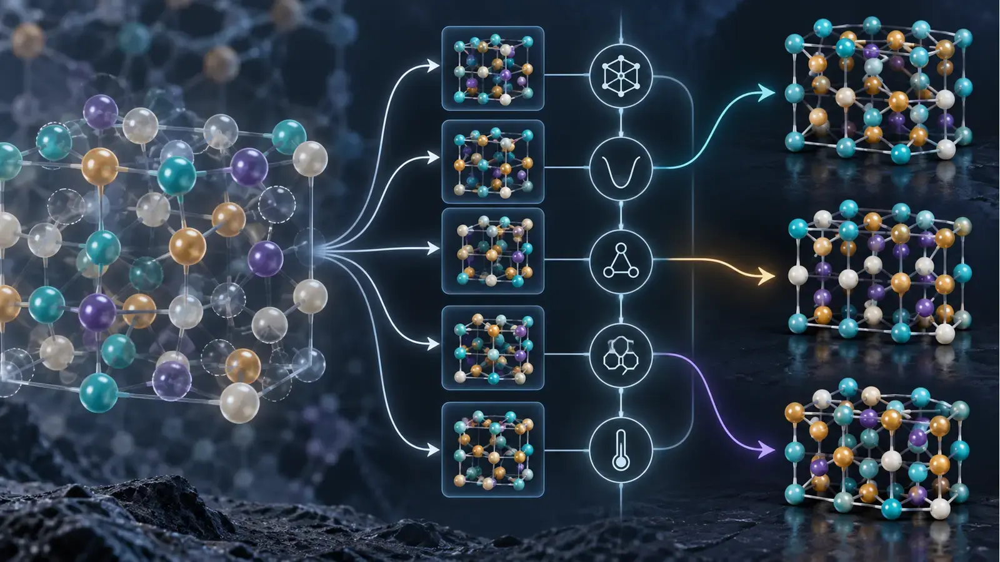
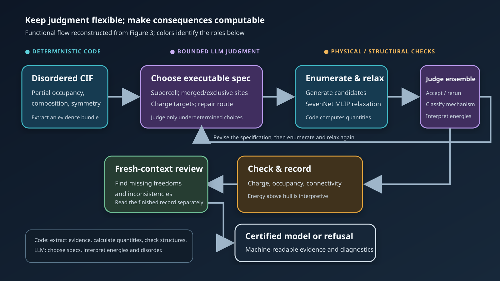

# Beyond Workflow Automation: What Has the Materials-Science “Agentic Program” Actually Demonstrated?

## Summary

A structure file can assign an atomic site an occupancy of 0.18, but an atomistic simulation still needs a choice about which sites to fill. DeMARS, introduced by a Seoul National University team in a preprint on 1 September 2026, gives an LLM a bounded role in making such choices while code calculates and checks the resulting structures. <a class="citation" href="#ref-1">[1]</a> The authors report maturing the program over roughly 800 disordered CIFs and then processing 100 unused cases without human intervention during execution. This internal evaluation illustrates how one narrow scientific task might be delegated end to end; certification and refusal counts, repeated-run stability, and public code remain the next evidence needed to assess reproducibility.

*Figure 1. AI-generated conceptual illustration. A partially occupied crystal on the left branches into candidate arrangements in the center; physical constraints guide the selection of explicit atomistic models on the right.*

## From an average structure to an atomic arrangement

A crystallographic information file (CIF) records a unit cell, symmetry, atomic positions, species, and occupancies. Partial occupancies obtained from diffraction describe a structure averaged over space and time. Atomistic calculations such as density functional theory (DFT) usually require an explicit periodic cell containing integer numbers of atoms. Between the two descriptions lies a choice: which atoms should occupy which sites while preserving the reported average composition?

Consider the paper's $\mathrm{Ca}_{1-x}\mathrm{Th}_{x}\mathrm{F}_{2+2x}$ example at $x=0.18$. Replacing one $\mathrm{Ca}^{2+}$ with $\mathrm{Th}^{4+}$ adds two units of positive charge. Two additional $\mathrm{F}^{-}$ ions per Th restore charge neutrality, giving the fluorine composition $2+2(0.18)=2.36$. Satisfying this arithmetic is one step. Selecting the interstitial sites for those extra ions, deciding which sites are mutually exclusive, and choosing a compatible supercell require structural and chemical interpretation.

The statistical study by Antypov and colleagues classifies roughly half of the Inorganic Crystal Structure Database (ICSD) entries as disordered. Its 59% share for structures with substitutional disorder only uses a different denominator: disordered structures in a set excluding hydrogen-containing structures and deduplicated by composition and space group. <a class="citation" href="#ref-2">[2]</a> In more complicated cases, substitutions, vacancies, and interstitials are coupled. Enumerating each partially occupied site independently can break composition, charge neutrality, or connectivity, while the number of combinations grows rapidly. Before calculating many candidates, a program must decide **which chemically constrained arrangements to enumerate**.

DeMARS stands for De-averaged Minimal Atomistic Representation System. It constructs a minimal explicit model, or an ensemble of models, consistent with the CIF evidence and chemical rules, providing a structure from which downstream simulations can begin. Studies of correlations hidden in an average structure may require further checks of cell size and the adequacy of the ensemble.

## Delegating one scientific responsibility

Much of computational materials science is already automated. VASP and Quantum ESPRESSO execute specified calculations; AiiDA, atomate2, AFLOW, and AMP² manage dependencies, retries, and data provenance. For example, atomate2 supports dynamic branches, additional calculations, and error recovery under specified conditions. <a class="citation" href="#ref-3">[3]</a> Researchers still make intermediate decisions: whether two nearby sites can be occupied simultaneously, how to impose defect charge compensation, or whether a failed self-consistent-field (SCF) calculation calls for a numerical adjustment or a revised physical model.

How much of the recurring judgment not yet expressed in rules can become software? In the authors' definition, an **agentic program** combines deterministic algorithms with bounded LLM judgment to complete a task whose inputs, objective, tools, scientific constraints, and acceptance criteria are specified. An agent harness connects the files, executable tools, persistent memory, instructions, and separate reviewer roles needed to do that work. For DeMARS, the unit of responsibility is to receive a partially occupied CIF and return an atomistic model suitable for further calculation.

The May review [“AI Scientists at the End of the Beginning”](https://infant83.io/AI_Tech_Review/reviews/2026-05-23_ai-scientist-execution-harness/) examined verification across broad research workflows, from hypothesis generation to writing. DeMARS develops a more specific question within that discussion: what conditions allow one task to proceed without a researcher approving each case? Its inputs, deliverables, and reasons for refusal must be defined before routine execution can be delegated.

## Computational evidence, executable choices, and physical checks

The LLM in DeMARS reads evidence extracted by code and writes a specification for computation. The paper describes the following sequence.

1. Python code extracts composition, occupancy, symmetry, and site information from a CIF.
2. An LLM analyst specifies the supercell, merged or mutually exclusive sites, charge-balanced composition, and whether missing hydrogen needs repair or custom construction is required.
3. An enumeration engine generates candidate arrangements. A SevenNet-family machine-learning interatomic potential (MLIP) relaxes them. The MLIP approximates energies and forces learned from first-principles data, making many candidate calculations inexpensive. <a class="citation" href="#ref-4">[4]</a>
4. The analyst examines the structures and energy distribution, proceeds to the next stage, or narrows the specification and reruns the calculation.
5. After classifying the disorder mechanism, the program checks charge neutrality, consistency with the CIF occupancies, polyanion connectivity, and other specified rules. The paper records energy above hull as interpretive information and explicitly excludes it from pass/fail decisions.
6. Construction and checking results are assembled into a finished record.
7. A separate reviewer agent examines that record in a fresh context.
8. The program returns a certified model or records why the evidence is insufficient for certification.

*Figure 2. Reviewer-constructed functional architecture based on the paper's Figure 3 and text. Blue denotes deterministic computation, violet LLM judgment, and amber physical or structural checks. Computed results feed subsequent choices and a separate review before certification or refusal.*

This arrangement turns a chemical interpretation into a choice that can be examined through candidate structures and calculations. For example, treating two sites as mutually exclusive becomes an enumeration specification; code can then check whether the resulting arrangements preserve occupancy and charge constraints. The design move that matters here is **making the consequences of judgment computable**.

| System form | Human responsibility | Software responsibility | How results are checked |
|---|---|---|---|
| Conventional workflow | Define decision rules and responses to new exceptions | Execute algorithms and branches under specified conditions | Error recovery and unit tests |
| Interactive AI assistant | Ask, choose, and approve | Explain and propose code | User inspection |
| Hypothesis collaborator (Co-Scientist) | Set research goals and examine hypotheses | Generate, critique, and refine hypotheses | Scientist review and task-specific experiments <a class="citation" href="#ref-5">[5]</a> |
| Proposed agentic program | Define objectives, responsibility, and principles; update principles after new failures | Execute the mature program's bounded task end to end | Task-specific code checks and separate review |

The table compares the goals and responsibilities delegated to software, including hypothesis-oriented collaboration in Co-Scientist and a single structure-construction task in DeMARS. Tool use, MLIPs, reviewer agents, and version control are established components; the proposal packages them around one narrow scientific task. Input contracts and regression checks resemble MLOps and DevOps practices. For scientific software, the checks must also specify which compositions, connections, and physical models are acceptable.

## Eight hundred development cases and a hundred internal tests

The authors report handling **roughly 800 disordered CIFs** during development. Recurring judgments became instructions, diagnostics, verification gates, and deterministic code. After this maturation, the program processed **100 previously unused ICSD CIFs** selected randomly under stated filters: three to five elements, nontrivial site disorder, and at most 40 listed sites. The authors report no case-by-case human intervention during execution.

Afterward, the authors manually inspected all 100 outputs. They describe certified models as chemically reasonable and consistent with the reported disorder, and refusals as supported by verifiable reasons in the records. These were therefore internal tests held out from maturation, with both certification and justified refusal among the possible outcomes. The paper does not give separate counts of certifications, refusals, custom constructions, or model repairs.

The $\mathrm{Sr}_2\mathrm{LiMoO}_{5.5}$ case shows what a separate review can add. All existing code checks passed, yet the reviewer agent noticed that every candidate had the same cation arrangement. Ordering in a coupled-enumeration routine had prevented the intended Li/Mo antisite degree of freedom from being sampled. The reviewer identifies such failures; a separate orchestrator revises the program between routine runs, with substantive changes to operating principles requiring human approval. The authors report turning this failure into a persistent regression improvement.

Checking charge, occupancy, and connectivity addresses a different question from checking whether the intended search space was explored. A test applied to each candidate can miss a degree of freedom absent from the entire candidate set. Examining the ensemble and its generation record helps reveal that omission.

| Reported item | Conditions for interpreting it | Further evidence needed |
|---|---|---|
| Roughly 800 maturation cases | Rules, code, and instructions accumulated during development | Per-case inputs, outputs, and interventions |
| Automated processing of 100 unused CIFs | Filtered ICSD sample; no human execution intervention; authors' manual post-hoc inspection | Certification/refusal counts, retries, runtime, LLM cost |
| Charge-compensation example | Composition arithmetic $2+2(0.18)=2.36$ | Structural checks of actual disorder correlations |
| Joint versioning of code, instructions, and models | Design and cases in the preprint available on 6 September | Public package, repeated-run statistics, independent evaluation |

## Assessing reproducibility and structural accuracy

The preprint available on 6 September promised to release DeMARS code with a peer-reviewed publication. At that date, there was no public package with which to recheck structure construction, refusal decisions, or execution costs. Certification and refusal rates, failure classes, retries, and evaluator agreement for the 100 cases would show which inputs the program handles and how often. A baseline comparison using the same inputs and compute budget is needed at this stage too.

Repeated-run stability is a separate question. The paper did not measure how consistently the same CIF, processed repeatedly with the same model, yields the same specification, ensemble, and certification decision. The authors' proposal to version the model, instructions, and episodic record together provides a basis for tracking such changes and testing regressions.

Physical accuracy also depends on the MLIP and the minimal periodic model. A universal MLIP lowers the cost of repeated calculations, but relative-energy ordering can change outside its training domain—for unusual coordination, charge states, heavy elements, or bonding. Re-relaxing a subset with DFT would test whether structures and energy ordering are preserved. Short-range order, configurational entropy, finite-temperature occupancy, and diffuse scattering may require an ensemble and cell-size convergence. These are concrete tests of how well DeMARS supplies starting structures for further research.

## Choosing responsibilities in DFT and OLED research

Applied to DFT and OLED calculations, the approach suggests tasks with clear inputs and deliverables but recurring intermediate judgments. The following are editorial proposals based on the paper.

1. **DFT protocol management:** propose PAW datasets or pseudopotentials, cutoffs, $k$ meshes, smearing, spin, and spin–orbit coupling (SOC); use convergence, symmetry, and magnetic-state checks to assess the choices.
2. **Calculation-failure diagnosis:** classify SCF oscillation, charge sloshing, and diverging structural relaxation from logs, then apply only specified remedies. Stop when energy, force, or occupation regression checks fail.
3. **Defect and interface construction:** propose terminations, charge compensation, and passivation, with code checking stoichiometry, neutrality, minimum distances, symmetry, and finite-size conditions.
4. **OLED excited-state triage:** combine state character, oscillator strength, SOC, root flipping, and conformer dependence to decide when TDDFT or TDA should be rerun. Connect judgments about rates and mechanisms to calculation logs and state tracking.
5. **On-premises research operations:** let an internal LLM gateway make bounded choices while established schedulers and GitLab runners execute VASP, Gaussian, and Fortran jobs. Track input/output hashes, containers or compilers, code commits, model and instruction versions, and all check results together.

New failure classes still return to the researcher's judgment after routine execution is delegated. People approve principles and preserve those decisions in code, tests, and instructions. Useful operating measures include the fraction of inputs certified, the fraction of certifications later judged wrong by higher-level calculations or experiments, and the fraction of refusals supported by adequate reasons. Human-intervention rates and repeated-run agreement of structures and decisions should accompany them. Cost per certified case should include LLM tokens, MLIP and DFT compute, wall time, and retries.

## What to seek in the next study

A fixed evaluation publishing the identities and certification/refusal outcomes of the 100 CIFs would help establish how this design becomes a reusable research tool. Comparing a rule-based program, a general tool-using agent, and DeMARS under matched inputs and compute budgets would clarify their contributions. Five to ten repetitions per case could expose variation in specifications, ensembles, and certification. DFT re-relaxation of a subset selected with SevenNet would test structural and energy-order preservation.

Independent crystallographers and computational materials scientists could assess blinded outputs using a shared rubric and report inter-rater agreement. Public datasets beyond ICSD would test a wider input range. Pinned code, instructions, and model settings, regression checks across versions, and refusal and failure records would allow other teams to examine the program's decisions. As episodes accumulate, managing those records as part of the scientific software becomes increasingly important.

## Questions for the researchers

- **Seungwu Han — Department of Materials Science and Engineering and Research Institute of Advanced Materials, Seoul National University; Center for AI and Natural Sciences, KIAS.** Corresponding author with a substantial SevenNet and atomistic-automation program. “How will certification, refusal, custom-construction counts, and repeated-run variability become part of a public benchmark?”
- **Yunsung Lim — Research Institute of Advanced Materials, Seoul National University.** Co-first author presenting the agentic-program concept and DeMARS case. “What determines whether an episode should become an instruction, an operating principle, or deterministic code, and how are those changes rolled back?”
- **Haekwan Jeon — Department of Materials Science and Engineering, Seoul National University.** Co-first author involved in DeMARS. “Which checks detect when a minimal periodic model is insufficient and an ensemble or explicit short-range order is needed?”

## Conclusion

DeMARS illustrates **how one narrow, recurring act of scientific judgment can become software's responsibility** in a concrete materials problem. An LLM's executable specification becomes an atomic arrangement; computed structures and energies supply evidence for the next decision and a separate review. The case in which a reviewer found a missing search degree of freedom shows how executing a calculation and examining its scientific adequacy can work together.

The consequential choices are the size of the delegated task and the physical conditions to check. Computational materials science offers many computable objects—composition, symmetry, charge, forces, and energies—while MLIPs lower the cost of refining a program over many cases. Following the release of code and evaluation outcomes, together with repeatability and independent assessment, will show whether that bounded responsibility can become part of other researchers' routine calculations.

## References

<ol class="reference-list">
<li id="ref-1"><a href="https://arxiv.org/abs/2609.00795v1">Y. Lim, H. Jeon, J. Kim, J. Kim, and S. Han, Agentic programs: an emerging form of scientific software in computational materials science, arXiv:2609.00795v1 (2026).</a></li>
<li id="ref-2"><a href="https://doi.org/10.1107/S1600576725003000">D. Antypov, C. M. Collins, M. S. Dyer, J. B. Claridge, and M. J. Rosseinsky, Classification and statistical analysis of structural disorder in crystalline materials, J. Appl. Crystallogr. <b>58</b>, 659 (2025).</a></li>
<li id="ref-3"><a href="https://doi.org/10.1039/D5DD00019J">A. M. Ganose et al., Atomate2: modular workflows for materials science, Digit. Discov. <b>4</b>, 1944 (2025)</a>; <a href="https://doi.org/10.1039/D5DD90036K">A. M. Ganose et al., Correction: Atomate2: modular workflows for materials science, Digit. Discov. <b>4</b>, 2639 (2025).</a></li>
<li id="ref-4"><a href="https://doi.org/10.1038/s41467-026-70195-8">J. Kim, J. You, Y. Park, Y. Lim, Y. Kang, J. Kim, H. Jeon, S. Ju, D. Hong, S. Y. Lee, S. Choi, Y. Kim, J. W. Lee, and S. Han, Optimizing cross-domain transfer for universal machine learning interatomic potentials, Nat. Commun. <b>17</b>, 3432 (2026).</a></li>
<li id="ref-5"><a href="https://doi.org/10.1038/s41586-026-10644-y">J. Gottweis et al., Accelerating scientific discovery with Co-Scientist, Nature <b>655</b>, 487 (2026).</a></li>
</ol>

---

*Original publication and evidence cutoff: 6 September 2026. The roughly 800 maturation cases, 100 evaluation cases, architecture, and operating examples are source-reported. The original review recorded checks of arXiv metadata, internal numerical and chemical consistency, the code-availability statement at that date, cited official or peer-reviewed context, and public-page rendering. DeMARS was not independently executed; proposed applications and operating measures are editorial interpretations.*

## Revision record

17 November 2026 editorial revision: clarified the progression from partial occupancy to explicit atomic arrangements and the bilingual argument. The 100 cases are described as internal tests held out from maturation, and the roles of separate review, program revision, and human approval of principles are distinguished. Captions now explain the visible objects and actions in the AI-generated concept and functional diagram. The original publication date, 6 September evidence scope, and AI-generated cover are retained. The existing bilingual architecture diagrams now follow the source Figure 3 order of ensemble and mechanism judgment before rule-based checks. Five references follow their first use; unused background reading entries were removed. `materials1117_edit` of the editorial team (AEDAUT) revised the Korean and English prose; source comparison, integration, output, and publication checks follow their separate records of actual work. AI assistance was OpenAI Codex; the exact model identifier is not retained. No separate line-by-line human review or experiment/program rerun was performed for this revision.
