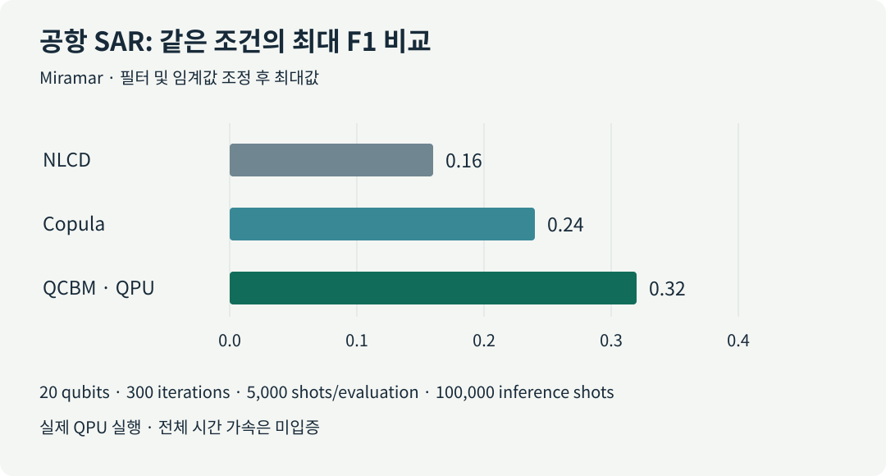
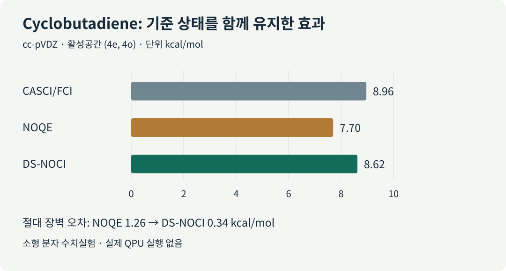

# 양자 계산의 전체 비용을 설계하다

분자의 에너지를 계산하거나 산업 데이터를 분류하는 양자 알고리즘을 고를 때, 연구자는 제한된 장비 시간과 정확도 목표를 함께 맞춰야 합니다. 회로가 짧아져도 입력을 준비하는 비용이 커질 수 있고, 좋은 예측값을 얻으려면 같은 회로를 수천 번 반복해야 할 수도 있습니다. 오류정정 장치에서는 연산을 기다리는 논리 큐비트까지 공간과 시간을 차지합니다. **어느 자원을 줄였으며, 그 절감이 전체 작업의 개선으로 이어지는가**를 확인해야 하는 이유입니다.

9월 9일 브리핑의 연구들은 이 질문의 서로 다른 부분을 다룹니다. 컴파일러는 주어진 계산이 차지할 연산 공간을 줄이고, 머신러닝 연구는 그 공간에 담을 입력과 얻어낼 표본을 살핍니다. 분자 계산에서는 이미 알고 있는 고전 기준 상태가 양자 계산의 불완전함을 보완합니다. 당시 공개된 네 프리프린트를 따라가며, 각 개선을 실제 연구의 예산에 어떻게 반영할지 생각해 봅니다. 장치 제작과 산업 행사 소식은 그 계산을 실행할 환경에 대한 전망으로 함께 읽습니다.

*그림 1. 격자·시트·지형·파동으로 계산 공간, 반복 표본, 입력과 기준 모델의 관계를 표현한 AI 생성 개념 일러스트입니다.*

[5쪽 한국어 PDF 브리핑 내려받기](daily_quantum_brief_2026-09-09.pdf) · [English review](https://infant83.github.io/AI_Tech_Review/reviews/2026-09-09_quantum-resource-aware-workflows/en/)

## 1. 어떤 비용을 세고 있는가

**회로 깊이**는 병렬로 실행할 수 있는 게이트를 묶었을 때 남는 순차 단계 수입니다. 게이트 수가 같아도 동시에 수행하는 정도에 따라 깊이가 달라집니다. 실제 장치에서는 게이트 종류별 시간, 큐비트 사이의 이동·연결, 측정과 리셋도 영향을 줍니다. **샷(shot)**은 회로를 실행하고 측정해 표본 하나를 얻는 반복 단위입니다. 양자 처리장치인 **QPU(quantum processing unit)**에서 한 번 좋은 값을 얻는 것과 충분히 신뢰할 통계량을 만드는 것은 서로 다른 비용을 요구합니다.

따라서 아래 결과를 읽을 때에는 먼저 무엇을 실행했고 무엇을 셌는지 구별할 필요가 있습니다. 같은 ‘양자 계산 개선’이라도 논리 블록의 절감, 영상 탐지 점수, 분자 장벽 오차는 각기 다른 질문에 대한 답입니다.

| 이번 업데이트 | 계산·검증 위치 | 핵심 결과의 단위 | 함께 확인할 비용 |
|---|---|---|---|
| Fermi–Hubbard QPE 컴파일 | 고전 컴파일·오류정정 자원 추정 | active volume, Toffoli 수 | 논리 블록, 대기 공간, 코드 주기, 상태 준비 |
| SAR 변화 탐지 | 일부 학습·추론을 실제 IonQ QPU에서 수행 | 필터·임계값 조정 후 최대 F1 | 회로 평가 수, shots, 고전 영상 처리 |
| 전력망 QML | 무잡음·해석적 회로 시뮬레이션 | 교차검증 균형 정확도 | 입력 인코딩, 유한 shots, 선택 측정의 성공률 |
| DS-NOCI 분자 계산 | 고전 수치실험·모의 잡음 | 반응장벽 오차 | 기준 상태, 행렬 측정, 부분공간 크기 |
| Superion 256 | 칩 제작·프로토타입 발표 | 제작 및 초기 이온 포획 단계 | 동시 운영 규모, 시스템 오류, 응용 성능 |
| Qubits Asia | 산업 행사의 예고 | 행사 일정 | 문제 규모, 고전 기준선, 총 실행시간 |

## 2. 게이트 수를 넘어 실제 연산 공간을 줄이는 컴파일

Fermi–Hubbard 모델은 격자에서 전자가 이동하고 같은 위치의 전자끼리 상호작용하는 다체계의 기본 모델입니다. 바닥상태 에너지를 구하는 **QPE(quantum phase estimation, 양자 위상 추정)**는 시간 진화에 담긴 위상으로 에너지를 읽습니다. 이때 긴 시간 진화를 기본 연산으로 나누는 과정에서 큰 회로가 생깁니다.

Harriet Apel 등의 연구는 이 회로를 실행할 오류정정 아키텍처까지 고려해 컴파일합니다. **active volume**은 실제 연산에 투입되는 논리 블록의 누적량을 세는 지표입니다. 비싼 Toffoli 게이트만 줄여도 다른 연산에 쓰는 블록은 남으므로, 연구진은 시간 진화의 순서와 병합, 회전 연산 공유, 페르미온 이동과 회로 관계를 나타내는 ZX 도식의 단순화를 함께 조정했습니다.<a class="citation" href="#ref-1">[1]</a>

정사각 격자의 한 변 L을 4에서 20까지 바꾼 비교에서 active volume은 기존 회로보다 **최대 3.9배 감소**했습니다. L=20에서 보고한 **약 2배의 Toffoli 환산 비용 감소**는 별도의 지표와 비교 기준입니다. 이 Toffoli 환산 지표는 T 게이트 두 개를 Toffoli 한 개의 비용으로 계산합니다. 두 배수를 곱한 값으로 실행속도를 계산할 수는 없습니다. 또한 active volume에는 유휴 블록의 공간·시간이 포함되지 않아 전체 장치 비용을 구할 때 이를 별도로 세어야 합니다.<a class="citation" href="#ref-1">[1]</a>

이 수치는 고전 컴파일과 논리 자원 추정의 결과입니다. 원문의 컴파일 비용에는 초기 상태·위상 추정용 window 상태 준비와 역양자 푸리에 변환이 제외되어 있습니다. 실행시간으로 바꾸려면 코드 주기와 측정 결과에 따른 다음 동작 결정 시간, 허용 실패율을 정해야 합니다. 초기 상태가 바닥상태와 얼마나 겹치는지도 반복 횟수를 바꿉니다. 재료 계산에 적용할 때 같은 Hamiltonian과 목표 에너지 오차를 먼저 고정하는 이유입니다. 그 조건에서 상태 준비와 회로 실행을 합쳐야 컴파일의 절감이 실제 계산 예산에 얼마나 남는지 알 수 있습니다.

## 3. 위성영상: 실제 QPU로 분포를 학습하면 무엇이 좋아지는가

회로를 적게 쓰는 일과 그 회로에서 유용한 표본을 얻는 일은 함께 설계해야 합니다. Samwel K. Sekwao 등의 연구는 **SAR(synthetic aperture radar, 합성개구레이더)** 전후 영상에서 변화가 생긴 곳을 찾는 문제를 다룹니다. 두 시점의 밝기 관계를 배워 ‘변화가 없었다면 두 번째 영상이 어떻게 보였을까’를 추정하는데, 드문 밝기 구간은 관측 표본이 적어 그 관계를 배우기 어렵습니다.<a class="citation" href="#ref-2">[2]</a>

**QCBM(quantum circuit Born machine)**은 회로의 측정 분포로 표본을 생성하는 모델입니다. 이 연구는 개별 밝기 분포를 정규화한 copula 공간에서 두 변수의 의존 관계를 학습합니다. Miramar 공항 자료의 한 설정에서는 **20큐비트 IonQ 회로를 학습과 추론에 모두 사용**했습니다. 최적화 300회, 회로 평가당 5,000 shots, 추론 100,000 shots를 썼습니다.<a class="citation" href="#ref-2">[2]</a>

필터·임계값 조정 후 최대 F1은 **QCBM 0.32, 고전 NLCD 0.16, 고전 copula 0.24**였습니다. F1은 정밀도와 재현율을 함께 반영하므로 변화 영역을 찾는 성능을 읽는 데 쓰입니다. 이 비교의 0.32는 전체 QPU 경로의 값이며, 필터와 탐지 임계값을 선택한 뒤 얻은 최대값입니다.<a class="citation" href="#ref-2">[2]</a>

*그림 2. Sekwao 등의 Miramar 비교값[2]을 기존 코드로 재도표한 그림입니다. 0에서 시작하는 같은 축에서 필터·임계값 조정 후 최대 F1을 비교합니다. 회로와 샷 조건은 그림 하단에 표시했습니다.*

간섭 정보를 활용하는 **InSAR(interferometric SAR)** 화산 자료에서는 22큐비트 모형을 이상적 시뮬레이터에서 학습하고 QPU로 추론했으며, 세 방법이 모두 약 0.66이었습니다. 공항에서의 차이가 모든 장면에서 반복되지는 않았다는 결과입니다. 제조 결함이나 공정 이상 탐지에 이 접근을 검토한다면, 먼저 드문 사건을 얼마나 잘 찾는지 같은 전처리·선택 규칙으로 비교할 수 있습니다. 여기에 학습·추론의 총시간을 함께 기록하면 탐지 품질의 개선과 그 대가를 구별할 수 있습니다. 원 연구는 전체 실행시간의 양자 가속을 제시하지 않았습니다.

## 4. 전력망 QML: 늘어난 큐비트에 유용한 입력이 들어가는가

측정 횟수와 함께 회로에 전달할 정보도 예산을 좌우합니다. 시계열 모델이 센서의 긴 변화를 고차원 특징으로 바꾸더라도, 작은 양자회로에 넣기 위해 압축하면 분류에 필요한 일부 정보가 사라질 수 있습니다. Sang Hyub Kim 등의 연구는 Chronos의 고정된 표현을 이용한 전력망 사건 분류에서, 고정된 core 회로에 새 입력을 전달하는 작은 **wing 모듈**을 추가했습니다.<a class="citation" href="#ref-3">[3]</a>

439개 학습 표본의 5겹 교차검증을 네 seed로 수행한 평균에서, 12큐비트 core와 선택 측정용 1큐비트를 쓰는 구성의 균형 정확도는 **83.6%**, 두 wing을 붙인 19큐비트 구성은 **85.2%**였습니다. 균형 정확도는 클래스별 재현율을 평균해 데이터 수가 많은 클래스의 영향을 줄입니다. 새로운 정보 없이 회로만 확대한 비교에서는 이득이 없었습니다. 같은 입력을 받은 더 큰 고전 MLP와 비교한 **1.7–2.0%p 개선**은 별도의 교차검증 결과입니다.<a class="citation" href="#ref-3">[3]</a>

모든 회로는 **잡음과 유한 shots가 없는 해석적 시뮬레이션**으로 평가됐으며, 독립 110개 시험 표본의 성능은 교차검증보다 4–5%p 낮았습니다. 따라서 이 연구가 보여주는 입력 설계의 효과와 실제 장치의 샷·인코딩·선택 성공률 비용은 나누어 평가해야 합니다. 분자 특징을 양자회로 폭에 맞추는 재료 ML에서도 같은 질문을 할 수 있습니다. 어떤 정보가 압축 과정에서 사라졌는지, 그 정보를 고전 모델에도 주면 결과가 어떻게 바뀌는지 살펴보는 것입니다.

## 5. 분자 계산: 좋은 고전 기준 상태를 함께 유지하기

앞의 입력 설계가 정보를 회로에 전달하는 문제라면, 분자 계산에서는 이미 가진 정보를 해를 구하는 공간에 남겨 두는 선택이 중요해집니다. 하나의 전자 배치로 분자 상태를 잘 근사하기 어려울 때 여러 기준 상태를 섞어 사용하는 **NOCI(nonorthogonal configuration interaction, 비직교 배치 상호작용)**를 생각할 수 있습니다. 기준 상태들은 서로 직교할 필요가 없습니다.

Vibin Abraham 등의 **DS-NOCI(dual-space NOCI)**는 고전 기준 상태와 상관 상태를 같은 변분공간에 함께 유지합니다. 양자회로가 만든 상관 상태가 불완전해도 기존 기준 상태를 선택할 여지가 남습니다. 정확한 Hamiltonian 행렬과 겹침 행렬을 쓰면 확대된 공간이 기존 공간을 포함하므로, 바닥상태 에너지는 기준 상태만 썼을 때보다 높아지지 않습니다. 잡음으로 행렬 원소가 달라지면 이 포함관계만으로 실제 에너지 상한을 보장할 수는 없습니다.<a class="citation" href="#ref-4">[4]</a>

cyclobutadiene의 cc-pVDZ 기저·전자 4개/궤도 4개의 활성공간에서 반응장벽 기준값은 **8.96 kcal/mol**이었습니다. 고전 수치 계산에서 NOQE의 장벽 오차 **1.26 kcal/mol**이 DS-NOCI에서는 **0.34 kcal/mol**로 줄었습니다.<a class="citation" href="#ref-4">[4]</a>

*그림 3. Abraham 등의 작은 활성공간 수치 결과[4]를 재도표했습니다. 같은 기준 장벽 8.96 kcal/mol에 대해 NOQE는 7.70, DS-NOCI는 8.62 kcal/mol을 주며, 고전 기준 상태를 함께 유지했을 때 장벽 오차가 작아졌습니다.*

분자 계산의 목표가 두 구조 사이의 에너지 차이라면, 각 구조에서 얻은 에너지뿐 아니라 그 차이가 얼마나 안정적인지 보아야 합니다. DFT·OLED 연구에서 유용한 고전 기준을 유지하면서 상관 효과를 보완하려는 관심도 여기서 이어집니다. 다룰 활성공간과 겹침 행렬의 안정성, 기준·상관 상태를 준비하고 행렬 원소를 측정하는 비용을 함께 정하면 작은 분자의 결과를 다음 계산에 연결할 기준이 생깁니다.

## 6. 장치 제작과 산업 실증은 어느 단계인가

계산 비용을 실제 장비 시간으로 바꾸려면 그 장비가 어디까지 만들어졌는지도 알아야 합니다. IonQ는 9월 8일 Superion 256의 첫 집적 칩 제작과 프로토타입의 초기 이온 포획을 발표하고 **2027년 납품**을 목표로 제시했습니다. 전자식 제어와 제조 확장을 지향하는 개발 이정표입니다. 칩 제작·초기 포획의 확인과 256큐비트 동시 운영·시스템 성능의 평가는 서로 다른 단계이며, 기존 제어 실험의 fidelity를 새 시스템 전체에 적용할 수는 없습니다.<a class="citation" href="#ref-5">[5]</a>

D-Wave Qubits Asia의 10월 28일 서울 행사도 이 글의 원 발행 시점에는 산업 실증을 살펴볼 예정된 자리였습니다.<a class="citation" href="#ref-6">[6]</a> 행사 예고에서 응용 성과로 논의를 이어 가려면 어떤 문제를 얼마나 크게 풀었는지, 기존 운영 솔버와 무엇을 비교했는지 확인해야 합니다. QPU 사용시간과 고전 후처리 비중까지 공개되어야 연구자가 자신의 작업 예산에 맞춰 판단할 수 있습니다.

## 7. 연구에서 다음으로 기록할 항목

컴파일의 공간 절감, 영상 탐지 점수, 분류 입력과 분자 기준 상태를 같은 성능 순위로 묶을 수는 없습니다. 대신 자신의 계산에서 고정할 조건을 정하면 각 연구가 제안하는 개선을 시험할 수 있습니다. 다음 표는 그 목적의 **리뷰 제안**입니다.

| 업무 | 비교에서 고정할 것 | 추가로 기록할 것 |
|---|---|---|
| 전자구조·OLED | 분자 구조, 기저, 활성공간, 목표 오차 | 기준 상태, 에너지·장벽 오차, 상태 준비, 행렬 측정 수 |
| 양자·고전 ML | 입력 특징, 데이터 분할, 전처리, 선택 규칙 | seed, 유한 shots, 성공률, 학습·추론 시간, 강한 고전 모델 |
| 회로·오라클 최적화 | 같은 함수, 정확도, 큐비트 예산, 목표 장치 | 깊이, 2큐비트 게이트, ancilla, 이동·대기, active volume |
| 산업 최적화 | 같은 instance, 제약조건, 허용시간 | feasible 해 비율, 후처리 후 비용, QPU·CPU 시간, 반복 안정성 |

재료 연구라면 익숙한 작은 분자에서 고전 기준을 먼저 고정하고, 후보 회로가 목표 관측량과 전체 작업시간을 어떻게 바꾸는지 확인할 수 있습니다. 계산을 빠르게 만드는 과정에서도 이미 얻은 유용한 정보가 사라지지 않는지 보아야 합니다. 회로 수준의 절감과 결과의 개선을 함께 기록할 때, 다음 계산에 쓸 자원을 어디에 배분할지 판단할 수 있습니다.

## 8. 참고문헌

<ol class="reference-list">
<li id="ref-1">H. Apel, A. Caesura, C. Harvey, S. Heavey, A. Kan, J. Lemieux, R. Levy, S. Pallister, J. Peetz, W. Pol, S. Sim, W. A. Simon, M. Steudtner, and G. Uchehara, Compiling the 2D Fermi-Hubbard ground-state energy estimation algorithm for active volume quantum architectures, <a href="https://arxiv.org/abs/2609.05316v1">arXiv:2609.05316v1</a> (2026).</li>
<li id="ref-2">S. K. Sekwao, S. De, A. Hocken, S. Staniewicz, E. Epifanovsky, C. Stringham, G. Farquharson, M. Roetteler, P. Kl. Barkoutsos, and J. Iaconis, SAR and InSAR change detection with quantum generative models, <a href="https://arxiv.org/abs/2609.05313v1">arXiv:2609.05313v1</a> (2026).</li>
<li id="ref-3">S. H. Kim, J. Baglio, R. Krishnakumar, C. Chen, O. Knitter, J. Mei, C. Girotto, M. Yamada, F. F. Flöther, and M. Roetteler, Towards scaling quantum fine-tuning of foundational time series models for classification, <a href="https://arxiv.org/abs/2609.05408v1">arXiv:2609.05408v1</a> (2026).</li>
<li id="ref-4">V. Abraham, B. Jayee, B. Peng, N. P. Bauman, and K. Kowalski, Toward resilient many-body formulations under incomplete correlation models: A dual-space variational formulation, <a href="https://arxiv.org/abs/2609.04387v1">arXiv:2609.04387v1</a> (2026).</li>
<li id="ref-5">IonQ, <a href="https://www.ionq.com/news/ionq-launches-superion-product-line-industry-leading-upgradeable-platform-designed-to-scale-manufacturable-fault-tolerant-quantum-computing">IonQ Launches Superion Product Line: Industry-Leading, Upgradeable Platform Designed to Scale Manufacturable Fault Tolerant Quantum Computing</a> (8 September 2026).</li>
<li id="ref-6">D-Wave, <a href="https://qubitsasia26.dwavequantum.com/">Qubits Asia 2026</a> (accessed 19 November 2026).</li>
</ol>

## 작성·검증과 수정 이력

원 발행일과 학술 근거 기준일은 2026-09-09입니다. 네 논문은 당시 공개된 v1을 대조했으며 계산을 독립 재실행하지 않았습니다. 원 작성의 Codex·Editorial Harness v2026.08 기록은 당시 이력으로 보존합니다.

2026-11-19 편집 개정에서는 설명의 연결과 반복된 경계·캡션을 다듬고, 교차검증과 독립 시험의 조건 및 APS 원저자·판본을 확인했습니다. D-Wave 행사의 날짜·장소는 현행 공식 페이지와 대조했으나 9월 9일 당시 페이지 본문은 확보하지 못했습니다. 과거의 확인일을 이번 검증으로 재확인한 것으로 표시하지 않으며, 뒤에 공개된 프로그램 세부는 본문에 소급해 넣지 않았습니다. 이후 연구 결과나 현 제품 상태를 원 발행 시점의 사실로 추가하지 않았습니다.

5쪽 한국어 PDF는 웹 리뷰 전체의 PDF판이 아니라 원호의 별도 브리핑입니다. 기존 리뷰 첨부에 이미 공개된 교정판을 보존하며, 아카이브의 이전 사본에 남았던 최적화 대상 표현·비교 도표의 분모·F1 조건·SAR 첫 저자 표기를 그 교정판과 맞췄습니다. 새 영문 PDF·표지·영상은 제작하지 않았습니다. 이번 개정의 실제 역할과 검수 범위는 하단 작성·검증 정보에 구별해 표시합니다.
