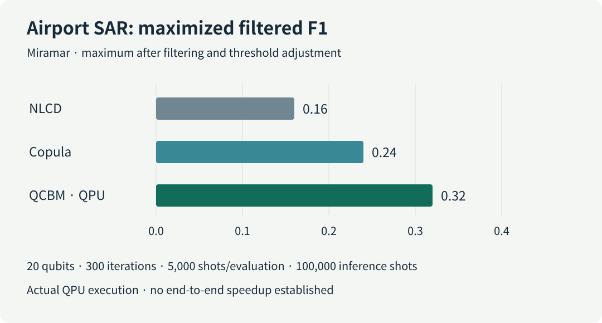
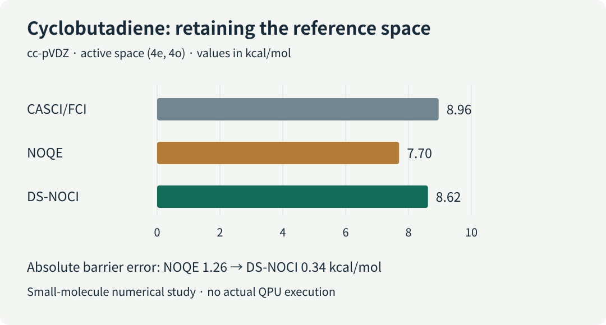

# Designing the full cost of quantum computation

A researcher choosing a quantum algorithm for molecular energies or industrial classification must meet an accuracy target within a limited computing budget. A shorter circuit can require expensive input preparation. A promising prediction can demand thousands of repeated measurements. An error-corrected device also spends space and time keeping logical qubits available while they wait. **Which resource improved, and does that improvement survive the complete workflow?**

The September 9 studies address different parts of that question. Compilation reduces the space used by a given calculation; machine-learning studies examine what information enters a circuit and what samples it produces. In chemistry, a useful classical reference can support an imperfect correlated calculation. We follow four papers available as preprints at the time, then consider fabrication and event announcements as prospects for the environment in which such workflows might run.

*Figure 1. An AI-generated conceptual illustration uses a lattice, sheets, terrain and a wave to represent computing space, repeated samples, inputs and reference models.*

[Download the five-page Korean briefing](daily_quantum_brief_2026-09-09.pdf) · [한국어 리뷰](https://infant83.github.io/AI_Tech_Review/reviews/2026-09-09_quantum-resource-aware-workflows/)

## 1. What is being counted?

**Circuit depth** counts sequential layers after compatible gates are placed in parallel. Equal gate counts can have different depths, while physical duration also depends on gate times, movement, connectivity, measurement and reset. A **shot** is one circuit execution and measurement yielding a sample. A **quantum processing unit (QPU)** must provide enough samples for a statistically useful result.

Before comparing improvements, distinguish what was executed and counted. Logical blocks, detection scores and molecular barrier errors answer different questions.

| Update | Execution or validation setting | Result unit | Other costs to record |
|---|---|---|---|
| Fermi–Hubbard compilation | Classical compilation and fault-tolerant resource estimation | Active volume; Toffoli count | Logical blocks, idle space, code cycles, preparation |
| SAR change detection | Selected training and inference on an IonQ QPU | Maximized filtered F1 | Evaluations, shots, classical image processing |
| Power-grid QML | Noiseless analytic circuit simulation | Cross-validation balanced accuracy | Encoding, finite shots, postselection success |
| DS-NOCI chemistry | Classical numerical tests and synthetic noise | Barrier error | Reference construction, matrices, subspace size |
| Superion 256 | Fabrication and prototype announcement | Development milestone | Concurrent operation, system error, applications |
| Qubits Asia | Industrial event preview | Event schedule | Problem size, classical baseline, elapsed time |

## 2. Compiling the space used by operations

The Fermi–Hubbard model represents interacting electrons moving on a lattice. **Quantum phase estimation (QPE)** reads energy from a time-evolution phase; decomposing that evolution creates a large circuit.

Harriet Apel and colleagues compile this circuit for an error-corrected architecture. **Active volume** counts the logical blocks used for computation. Reducing expensive Toffoli operations can leave other blocks costly, so the authors jointly adjust evolution ordering and merging, shared rotations, fermionic movement and ZX simplifications.<a class="citation" href="#ref-1">[1]</a>

Across square lattices with side length L from 4 to 20, active volume decreases by up to **3.9×** relative to prior circuits. The approximately **2× reduction in Toffoli-equivalent cost** at L=20 uses a separate metric and comparison baseline. The latter metric counts two T gates as one Toffoli. Multiplying these factors would not give a runtime improvement. Idle blocks also lie outside active volume and must be counted separately in total device spacetime.<a class="citation" href="#ref-1">[1]</a>

These are classical compilation results and logical resource estimates. The compiled cost excludes initial-state preparation, the phase-estimation window state and the inverse quantum Fourier transform. Turning it into elapsed time requires code cycles, feedforward latency and failure assumptions. Initial overlap with the ground state affects repetition as well. A materials calculation therefore needs a fixed Hamiltonian and target energy error, with preparation included alongside execution, before assigning a complete budget to the compilation savings.

## 3. Satellite imagery: learning a distribution on a QPU

The cost of a circuit and the usefulness of its samples belong in the same design. Samwel K. Sekwao and colleagues study change detection in **synthetic aperture radar (SAR)** images. Learning the relationship between intensities at two times helps estimate the later image expected if nothing had changed. Rare intensity regions offer few observations from which to learn that relationship.<a class="citation" href="#ref-2">[2]</a>

A **quantum circuit Born machine (QCBM)** generates samples from its measurement distribution. Here it learns dependence in copula space after normalizing the individual intensity distributions. A selected Miramar airport configuration used **20 IonQ qubits for both training and inference**: 300 optimization iterations, 5,000 shots per evaluation and 100,000 inference shots.<a class="citation" href="#ref-2">[2]</a>

Maximized filtered F1 was **0.32** for QCBM, versus **0.16** for classical NLCD and **0.24** for a classical copula estimator. F1 combines precision and recall. The 0.32 value refers to the fully QPU-based route and is a maximum after filtering and detection-threshold selection.<a class="citation" href="#ref-2">[2]</a>

*Figure 2. Existing code redraws the Miramar results from Sekwao et al.<a class="citation" href="#ref-2">[2]</a> on a common zero-based axis. Values are maxima after filtering and threshold selection; circuit and shot settings appear below the plot.*

On volcanic **interferometric SAR (InSAR)** data, a 22-qubit model was trained on an ideal simulator and run on a QPU for inference; all three methods reached approximately 0.66. The airport improvement did not recur across every scene. For manufacturing defects or process anomalies, a useful comparison would first match preprocessing and selection rules, then measure rare-event detection. Recording total training and inference time would reveal the cost of any quality improvement. The source study does not establish an end-to-end quantum speedup.

## 4. Power-grid learning: useful information in added qubits

The information supplied to a circuit matters alongside its measurement budget. A time-series model can produce high-dimensional sensor features, but compressing them into a small quantum register can discard information needed for classification. Sang Hyub Kim and colleagues use frozen Chronos representations for power-grid events and add small **wing modules** carrying new inputs to a fixed core.<a class="citation" href="#ref-3">[3]</a>

Averaging five-fold cross-validation over four seeds on 439 training examples, balanced accuracy rose from **83.6%** with a 12-qubit core plus one postselection qubit to **85.2%** with two wings and 19 qubits in total. Balanced accuracy averages recall across classes. Enlarging a circuit without new information did not help. A separate matched-input cross-validation comparison against a larger classical multilayer perceptron reported a **1.7–2.0 percentage-point** improvement.<a class="citation" href="#ref-3">[3]</a>

Every circuit used **noiseless analytic simulation without finite shots**. Performance on 110 independent test examples was 4–5 points below cross-validation. The input-design result and the costs of physical encoding, finite sampling and postselection therefore need separate assessment. Molecular or OLED learning poses a related question: which features disappear during compression, and what happens when a classical model receives the same recovered information?

## 5. Chemistry: retain a useful classical reference

Input design delivers information to a circuit. In chemistry, another choice is to retain useful information in the space from which the solution is obtained. **Nonorthogonal configuration interaction (NOCI)** combines several reference states when one electronic configuration is insufficient; those states need not be orthogonal.

Vibin Abraham and colleagues' **dual-space NOCI (DS-NOCI)** keeps classical references alongside correlated companions. Even an imperfect correlated state leaves the original references available for the variational solution. With exact Hamiltonian and overlap matrices, the enlarged space contains the original one and its ground-state energy cannot be higher than the reference-only result. Perturbed matrix elements do not automatically retain the physical energy upper-bound guarantee.<a class="citation" href="#ref-4">[4]</a>

For the cyclobutadiene barrier in a four-electron, four-orbital active space with cc-pVDZ, the reference was **8.96 kcal/mol**. In classical numerical calculations, barrier error fell from **1.26 kcal/mol** for NOQE to **0.34 kcal/mol** for DS-NOCI.<a class="citation" href="#ref-4">[4]</a>

*Figure 3. A redraw of Abraham et al.'s small-active-space numerical results.<a class="citation" href="#ref-4">[4]</a> Against the same 8.96 kcal/mol reference, NOQE gives 7.70 and DS-NOCI 8.62 kcal/mol. Retaining classical references reduces the barrier error.*

When the target is an energy difference between structures, the stability of that difference matters alongside each energy. This motivates retaining a useful classical reference while adding correlation in DFT or OLED research. Active-space choice, overlap conditioning, state preparation and matrix acquisition together determine how the small-molecule result might inform the next calculation.

## 6. Hardware and industrial deployment milestones

To convert a resource budget into device time, we also need to know what has been built. On September 8, IonQ announced first integrated-chip fabrication and initial ion trapping in Superion 256 prototypes, with deliveries targeted for **2027**. This is a development milestone toward electronic control and scalable manufacturing. Fabrication and initial trapping establish a different stage from concurrent 256-qubit operation and system performance; earlier control fidelity cannot be assigned to the complete new system.<a class="citation" href="#ref-5">[5]</a>

D-Wave Qubits Asia, scheduled for October 28 in Seoul, was likewise an opportunity to examine industrial work from the original article's September 9 perspective.<a class="citation" href="#ref-6">[6]</a> Moving from an event preview to an application result requires problem sizes and comparisons with incumbent solvers. QPU time and classical postprocessing must also be available before a researcher can assess the workflow against a computing budget.

## 7. A practical research record

Compilation space, detection quality, classification inputs and molecular references cannot be combined into one performance ranking. They can inform experiments once the conditions for a particular calculation are fixed. The following record is an **editorial proposal** for that purpose.

| Workflow | Keep matched | Record alongside the headline |
|---|---|---|
| Electronic structure / OLED | Geometry, basis, active space, target error | References, barrier error, preparation, matrix measurements |
| Quantum / classical ML | Features, data splits, preprocessing, selection rules | Seeds, shots, acceptance, training and inference time |
| Circuit / oracle optimization | Function, accuracy, qubit budget, target device | Depth, two-qubit gates, ancillas, movement, idle and active volume |
| Industrial optimization | Instances, constraints, time allowance | Feasibility, repaired solution cost, QPU/CPU time, stability |

A materials experiment can start with a familiar small molecule and fixed classical reference, then measure how the candidate circuit changes the target observable and complete execution time. Making a computation faster should also preserve information already known to be useful. Recording circuit savings and output quality together helps decide where the next calculation should spend its resources.

## 8. References

<ol class="reference-list">
<li id="ref-1">H. Apel, A. Caesura, C. Harvey, S. Heavey, A. Kan, J. Lemieux, R. Levy, S. Pallister, J. Peetz, W. Pol, S. Sim, W. A. Simon, M. Steudtner, and G. Uchehara, Compiling the 2D Fermi-Hubbard ground-state energy estimation algorithm for active volume quantum architectures, <a href="https://arxiv.org/abs/2609.05316v1">arXiv:2609.05316v1</a> (2026).</li>
<li id="ref-2">S. K. Sekwao, S. De, A. Hocken, S. Staniewicz, E. Epifanovsky, C. Stringham, G. Farquharson, M. Roetteler, P. Kl. Barkoutsos, and J. Iaconis, SAR and InSAR change detection with quantum generative models, <a href="https://arxiv.org/abs/2609.05313v1">arXiv:2609.05313v1</a> (2026).</li>
<li id="ref-3">S. H. Kim, J. Baglio, R. Krishnakumar, C. Chen, O. Knitter, J. Mei, C. Girotto, M. Yamada, F. F. Flöther, and M. Roetteler, Towards scaling quantum fine-tuning of foundational time series models for classification, <a href="https://arxiv.org/abs/2609.05408v1">arXiv:2609.05408v1</a> (2026).</li>
<li id="ref-4">V. Abraham, B. Jayee, B. Peng, N. P. Bauman, and K. Kowalski, Toward resilient many-body formulations under incomplete correlation models: A dual-space variational formulation, <a href="https://arxiv.org/abs/2609.04387v1">arXiv:2609.04387v1</a> (2026).</li>
<li id="ref-5">IonQ, <a href="https://www.ionq.com/news/ionq-launches-superion-product-line-industry-leading-upgradeable-platform-designed-to-scale-manufacturable-fault-tolerant-quantum-computing">IonQ Launches Superion Product Line: Industry-Leading, Upgradeable Platform Designed to Scale Manufacturable Fault Tolerant Quantum Computing</a> (8 September 2026).</li>
<li id="ref-6">D-Wave, <a href="https://qubitsasia26.dwavequantum.com/">Qubits Asia 2026</a> (accessed 19 November 2026).</li>
</ol>

## Authoring, verification and revision history

The original publication and scientific evidence cutoff are September 9, 2026. The four papers were checked in their v1 editions; their computations were not independently reproduced. The original Codex and Editorial Harness v2026.08 records remain historical production information.

The November 19, 2026 editorial revision improves connections and repeated qualifications and captions, and checks cross-validation/test conditions and APS author credits and editions. The event date and location were checked against the current D-Wave page, but its September 9 page body was not recovered. The old access-date record is not presented as newly verified, and later program details are not added retrospectively. Subsequent research results and current product states have not been imported into the historical assessment.

The five-page Korean PDF is a separate briefing for the original issue, rather than a PDF edition of this entire web review. Its already-published corrected attachment is preserved. The archive's older copy is synchronized to that edition to correct optimization wording, comparison denominators, F1 conditions and SAR first-author attribution. No English PDF, new cover or video was produced. Actual revision roles and verification scope are distinguished in the disclosure below.
