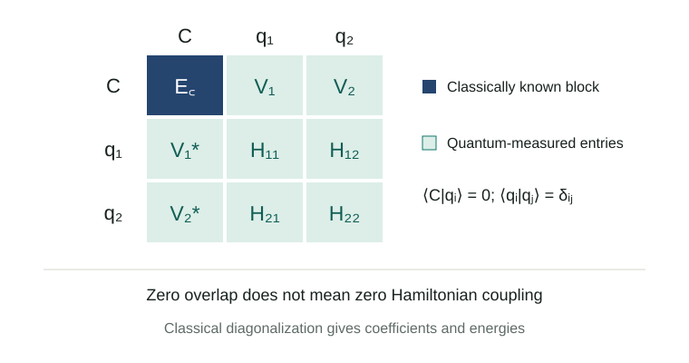

# Sharing the work of molecular calculation: classical–quantum collaboration through CASH-QSE

Calculating molecular properties requires a description of electrons that respond to one another. As a bond stretches, competing electronic configurations can change their importance. Classical electronic-structure methods have developed sophisticated ways to handle this problem. Quantum algorithms offer another set of representations, with their own preparation and measurement costs.

How should a calculation divide the work between a reliable classical description and additional quantum states? **CASH-QSE** retains a classically computed wavefunction component and supplements it with quantum states. The design of the small matrix joining them determines which energy contributions need to be measured again. Starting with electron correlation and active spaces, we examine when this division saves measurements and when it costs more.

*An editorial metaphor for combining wavefunction components. This is not a computed molecular orbital or electron-density plot.*

**Research status.** Artur F. Izmaylov first submitted CASH-QSE on 8 September 2026. This review covers version 1, consistent with its original publication date and scientific evidence cutoff of 10 September. The reported benchmarks use classical statevector calculations and circuit/sampling resource analysis; they do not execute on a quantum processing unit (QPU). [[1]](#ref-1)

## 1. Why a stretching bond can require several electronic configurations

Electrons repel one another: the probability of finding one electron depends on the positions of the others. Hartree–Fock (HF) obtains orbitals in a mean field and describes the wavefunction with one Slater determinant. A determinant specifies occupied spin orbitals while enforcing the antisymmetry required when electrons are exchanged. HF includes this exchange effect; recovering additional electron correlation means accounting for what a single determinant misses.

A single closed-shell bonding configuration can become inadequate as atoms separate. Combining configurations with different bonding and antibonding occupations permits a more flexible description of the separated fragments. Multiconfigurational methods therefore optimize a linear combination of determinants. [[2]](#ref-2)

Full configuration interaction (**FCI**) considers every allowed configuration in a specified orbital space. The reference is exact within that space, whose dimension grows rapidly. Before additional symmetry reductions, six spin-up and six spin-down electrons in 12 spatial orbitals give \(\binom{12}{6}^{2}=853,776\) determinants. Ten of each spin in 20 spatial orbitals give \(\binom{20}{10}^{2}=34,134,779,536\). These are independently calculated combinatorial examples, not CASH-QSE benchmark sizes.

An **active space** concentrates the detailed treatment on selected electrons and orbitals. CAS(6,6) distributes six electrons among six spatial orbitals in all allowed ways. CASSCF optimizes both configuration coefficients and orbitals. External correlation remains to be recovered. Classical options include multireference perturbation theory such as CASPT2 and NEVPT2, and larger active-space treatments using selected CI or DMRG. Quantum subspace methods enter an established field with strong classical alternatives. [[2]](#ref-2) · [[3]](#ref-3) · [[4]](#ref-4)

## 2. Short circuits still need repeated measurements

The variational quantum eigensolver (**VQE**) prepares a parametrized state, estimates its energy, and lets a classical optimizer update the circuit parameters. ADAPT-VQE grows the circuit by choosing useful operators rather than fixing the entire ansatz in advance. [[5]](#ref-5)

A single circuit execution does not return an exact energy. The mapped molecular Hamiltonian contains many Pauli terms; compatible terms can be grouped, and their expectations are estimated through repeated preparation and measurement. One such repetition is a **shot**. For independent samples with standard deviation \(\sigma\), the standard error of the mean is \(\sigma/\sqrt{M}\). Halving it requires four times as many samples.

This measurement problem predates CASH-QSE. Gonthier and colleagues analyzed VQE resources for molecular combustion energies and found that measurement requirements remained a serious obstacle for their molecular set even with improved Hamiltonian decompositions. Their analysis makes a practical point: shortening a circuit does not by itself determine the cost of obtaining an energy. The number of samples needed for the required precision must enter the calculation too. [[6]](#ref-6)

## 3. Combining classical and quantum states in a small matrix

Subspace approaches prepare several states and optimize their linear combination. Quantum subspace expansion (**QSE**) developed this idea for excited-state estimation and noise treatment. Classically boosted VQE later explicitly combined classically tractable states with quantum-prepared states, allowing known classical energies to be reused. [[7]](#ref-7) · [[8]](#ref-8)

For a normalized classical reference \(|C\rangle\) and correction \(|q\rangle\), a trial state is \(c_C|C\rangle+c_q|q\rangle\). Its energy depends on both diagonal energies and the coupling \(V=\langle C|H|q\rangle\). Adding the two diagonal energies alone would miss the mixing.

Orthogonality, \(\langle C|q\rangle=0\), does not imply that \(V\) vanishes. Orthogonal states are distinct directions in Hilbert space; the Hamiltonian can connect them. The example below diagonalizes a two-state matrix and displays the lower energy and the correction's weight as the coupling changes.

The interactive model is available in the HTML article.

The model sets \(E_C=0\) and \(E_q=\Delta>0\). It is an educational calculation, not a molecular simulation or a prediction of CASH-QSE shot savings. At the default \(\Delta=1\) eV and \(V=0.2\) eV, the lower eigenvalue is approximately −0.03852 eV and the correction weight is 3.58%. These defaults and the formula remain available without JavaScript.

\[E_- = \frac{\Delta-\sqrt{\Delta^2+4V^2}}{2},\qquad |c_q|^2 = \frac{1-\Delta/\sqrt{\Delta^2+4V^2}}{2}.\]

An exactly evaluated classical diagonal element contributes no shot noise. To first order, the sensitivity of the lower eigenvalue to error in the correction's diagonal energy is \(|c_q|^2\). A small correction can therefore reduce this sensitivity. Actual sampling expense also depends on operator variances and transition measurements; the correction weight alone cannot determine the gain.

## 4. How occupation constraints remove overlap

Different circuits may prepare nearly identical states. General subspace calculations then need an overlap matrix \(S\) and solve \(Hc=ESc\). For two normalized states with real overlap \(s\), the overlap eigenvalues are \(1+s\) and \(1-s\). Subtracting nearly identical states produces a small direction; normalizing that direction can amplify small matrix errors. At \(s=0.99\), the small eigenvalue is 0.01 and the condition number is 199. A design that retains a classical component must therefore address overlap as well as energy reuse. [[8]](#ref-8)

CASH-QSE constructs correction states orthogonal to the classical CASSCF reference and to each other through occupation structure. It avoids overlap measurements and uses an ordinary Hermitian eigenproblem. The classical block is evaluated classically, but preparing the reference or its components may still be necessary to measure classical–quantum couplings. [[1]](#ref-1)

Consider an illustrative reference space where orbital A must be doubly occupied and external orbital B must be empty. Classify configurations by the first condition they fail:

| Sector | A occupation | B occupation | Assignment |
|---|---|---|---|
| Classical space | 2 | 0 | Passes both tests |
| Correction 1 | 0 or 1 | Allowed by remaining constraints | Fails A first |
| Correction 2 | 2 | 1 or 2 | Passes A, then fails B |

Only configurations compatible with particle number and symmetry are admitted. Each belongs to one sector, so states supported on different sectors are orthogonal. Multiple states within one sector still require an orthogonal construction or a further subdivision. Merely preparing separate circuits does not establish orthogonality.

Useful correction states still have to be found within the chosen partition. Further subdivision can simplify each preparation while increasing the number of states and matrix elements to measure. Device noise can also violate the occupation conditions supporting orthogonality. Choosing the extent of subdivision therefore requires assessing both the additional measurements and the effect of constraint violations on the energy estimate.

## 5. What the nitrogen and water numbers actually compare

Selected nitrogen results show how classical-reference choice changes the balance between circuit and measurement resources. Shot counts cover the **converged final-energy estimate**, using exact statevector variances and FCI-assisted state selection, at sampling uncertainty 1.6 mEₕ. They are not total optimization costs or measured device runtimes. [[1]](#ref-1)

| N₂ / STO–3G | Reference | CASH shots | ADAPT shots | ADAPT/CASH | CASH largest complete circuit, CNOTs |
|---|---|---:|---:|---:|---:|
| 1.8 Å | HF | 1.1×10⁶ | 2.4×10⁶ | 2.1 | 342 |
| 1.8 Å | CAS(4,4) | 1.6×10⁵ | 2.4×10⁶ | 15 | 333 |
| 1.8 Å | CAS(6,6) | 8.5×10² | 2.4×10⁶ | 2,800 | 328 |
| 3.0 Å | HF | 2.3×10⁶ | 7.7×10⁵ | 0.33 | 338 |
| 3.0 Å | CAS(4,4) | 8.1×10⁵ | 7.7×10⁵ | 0.94 | 328 |
| 3.0 Å | CAS(6,6) | Classical stop | — | — | — |

*Ratios retain the paper's rounding. Above one means fewer CASH shots. Complete measurement circuits include preparation, transition operations and measurement-basis changes, with all-to-all logical connectivity. Counts are not depth or measured hardware gate counts.*

At 1.8 Å the largest circuits change only modestly, while sampling costs change dramatically. At 3.0 Å the HF partition retains short circuits yet loses the shot comparison. The final row also matters operationally: if the classical reference already meets the target, the computation can stop there.

Here, chemical accuracy is measured against FCI in the chosen basis. State selection targets an energy error of 1.6 mEₕ, while the shot estimate separately allows a sampling standard uncertainty of 1.6 mEₕ. Each is roughly on the familiar 1 kcal/mol scale; together they do not guarantee a final accuracy of 1.6 mEₕ. Comparison with experimental molecular energies also requires assessing the error from the restricted basis itself.

The water extension illustrates discrete shot allocation. It uses a **restricted 14-spatial-orbital cc-pVDZ window**, with CAS(4,4), rather than the complete cc-pVDZ space. Requiring at least one shot for every measurement group raises the estimate. [[1]](#ref-1)

| H₂O O–H distance | CASH continuous shots | CASH with one-shot group floor | ADAPT/CASH with the same floor |
|---|---:|---:|---:|
| 0.96 Å | 2.1×10⁴ | 5.18×10⁴ | 560 |
| 1.75 Å | 1.2×10⁴ | 3.28×10⁴ | 630 |
| 3.0 Å | 5.1×10² | 9.41×10² | 4,400 |

*Both methods receive the same floor. Variances are assumed known; pilot measurements are excluded. At 3.0 Å, the ADAPT shot estimate uses exact window FCI as a proxy, while the circuit count refers to a finite ADAPT state.*

[Download table data as CSV](benchmarks.csv)

## 6. The costs still outside the comparison

Known occupation and symmetry constraints can identify zero matrix elements and nonconnecting operator terms before measurement. Changes to an estimator that preserve its mean can also help fluctuations in grouped terms cancel. Estimating the same energy mean with a smaller variance reduces the required shots. The size of this effect depends on the prepared states and measurement groups.

Three additional costs must enter an application assessment: selecting correction states, learning useful measurement allocations, and executing circuits on a device. The reported ratios exclude pilot measurements, repeated state and orbital optimization, device noise and hardware routing. [[1]](#ref-1)

FCI assistance is a substantial qualification. Having found short, measurement-efficient representations with detailed knowledge of the answer, the next task is to find them cheaply for an unknown large molecule. Both the favorable partitions and those that lose the shot comparison provide concrete targets for testing that search.

The ADAPT comparator uses a specific operator pool, orbital choice and synthesis convention. Application decisions require extending this comparison to other VQE designs and classical DMRG, selected CI or NEVPT2 at the same Hamiltonian, basis and accuracy. The relevant cost then includes preparing the classical reference, learning the partition and measurement allocation, and executing the calculation.

## 7. Connecting this approach to DFT and OLED research

The classical block should not be confused with a DFT total energy. Kohn–Sham DFT evaluates an energy functional of the density with an exchange–correlation approximation. Inserting that scalar directly in place of \(\langle C|H|C\rangle\) does not preserve the same wavefunction variational problem. Using DFT orbitals as an initial guess is a separate, valid concept. [[9]](#ref-9) · [[2]](#ref-2)

An OLED application is a **research proposal**, not a result of these benchmarks. One could first identify orbitals involved in excitation and charge transfer, build tractable multireference reference problems, and ask whether the partition treats ground and excited states evenly. Small errors in two separate energies can still produce an inaccurate energy difference.

Emission studies would additionally need transition properties, spin–orbit coupling, vibrations, structural relaxation and environmental effects as appropriate to the target property. The water and nitrogen ground-state tests validate none of these OLED observables. Prior QSE work supplies an excited-state direction to investigate, with material-specific accuracy and cost still to be established. [[7]](#ref-7)

## 8. Finding useful partitions without already knowing the answer

The first practical research question is whether accessible chemical information can replace FCI-guided selection. Natural occupations, localized bonds, selected-CI approximations or tensor-network information are possible inputs. Each brings classical expense and a strong baseline: the preprocessing method might already solve the intended problem adequately.

A second task is to learn variances from limited pilot data and allocate later measurements robustly. Initial budgets, stopping rules and uncertainty estimates should be reported. Large numbers of short circuits also make device invocation and reset costs relevant. Finally, hardware tests need to quantify violations of occupation constraints and bias in transition estimates, including the expense of any symmetry checks or error mitigation.

CASH-QSE is a useful case study in preserving classical wavefunction information while designing the additional representation and its measurements together. Chemistry determines which configurations matter, linear algebra determines how the components combine, and statistics determines how accurately their matrix elements can be estimated. Practical value will depend on whether that combination remains favorable for unknown molecules after all preparation and learning costs are included.

## References and further reading

1.  A. F. Izmaylov, Classical active-space hybrid quantum subspace expansion (CASH-QSE): Quantum corrections without remeasuring the classically calculable energy, [arXiv:2609.08170v1](https://arxiv.org/abs/2609.08170v1) (2026).
2.  PySCF Developers, [Multi-configuration self-consistent field (MCSCF)](https://pyscf.org/user/mcscf.html), PySCF documentation (accessed 20 November 2026).
3.  PySCF Developers, [Multi-reference perturbation theory (MRPT)](https://pyscf.org/user/mrpt.html), PySCF documentation (accessed 20 November 2026).
4.  D. S. Levine, D. Hait, N. M. Tubman, S. Lehtola, K. B. Whaley, and M. Head-Gordon, CASSCF with extremely large active spaces using the adaptive sampling configuration interaction method, [J. Chem. Theory Comput. **16**, 2340 (2020)](https://doi.org/10.1021/acs.jctc.9b01255).
5.  H. R. Grimsley, S. E. Economou, E. Barnes, and N. J. Mayhall, An adaptive variational algorithm for exact molecular simulations on a quantum computer, [Nat. Commun. **10**, 3007 (2019)](https://doi.org/10.1038/s41467-019-10988-2).
6.  J. F. Gonthier, M. D. Radin, C. Buda, E. J. Doskocil, C. M. Abuan, and J. Romero, Measurements as a roadblock to near-term practical quantum advantage in chemistry: Resource analysis, [Phys. Rev. Research **4**, 033154 (2022)](https://doi.org/10.1103/PhysRevResearch.4.033154).
7.  J. R. McClean, M. E. Kimchi-Schwartz, J. Carter, and W. A. de Jong, Hybrid quantum-classical hierarchy for mitigation of decoherence and determination of excited states, [Phys. Rev. A **95**, 042308 (2017)](https://doi.org/10.1103/PhysRevA.95.042308).
8.  M. D. Radin and P. Johnson, Classically-boosted variational quantum eigensolver, [arXiv:2106.04755v1](https://arxiv.org/abs/2106.04755v1) (2021).
9.  PySCF Developers, [Density functional theory (DFT)](https://pyscf.org/user/dft.html), PySCF documentation (accessed 20 November 2026).

*Selected numerical data are reformatted from the paper. The two-state model and determinant counts are independent educational calculations. The molecular benchmarks have not been independently reproduced for this review.*

## Revision history

The 20 November 2026 revision improves the introduction and cost comparison, clarifies HF exchange and the connection between small overlap eigenvalues and error amplification, and orders references by first citation. It cites the 2020 journal edition of the ASCI-SCF paper and restores full coauthor credits. The original publication date and scientific evidence cutoff remain 10 September 2026; CASH-QSE version 1 results, numerical values and figures are retained. PySCF documentation was rechecked for this revision; its state at the original cutoff was not independently recovered.
