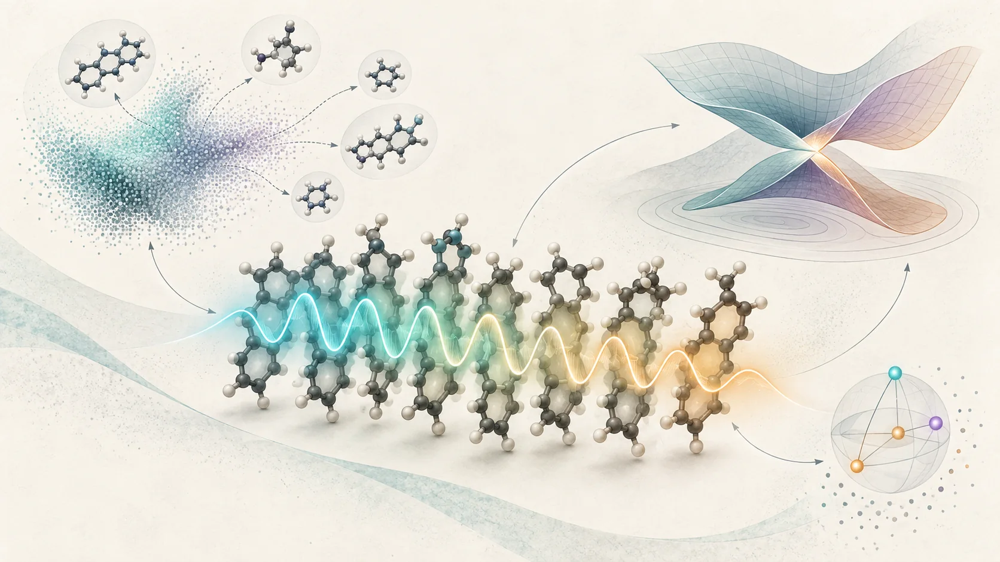
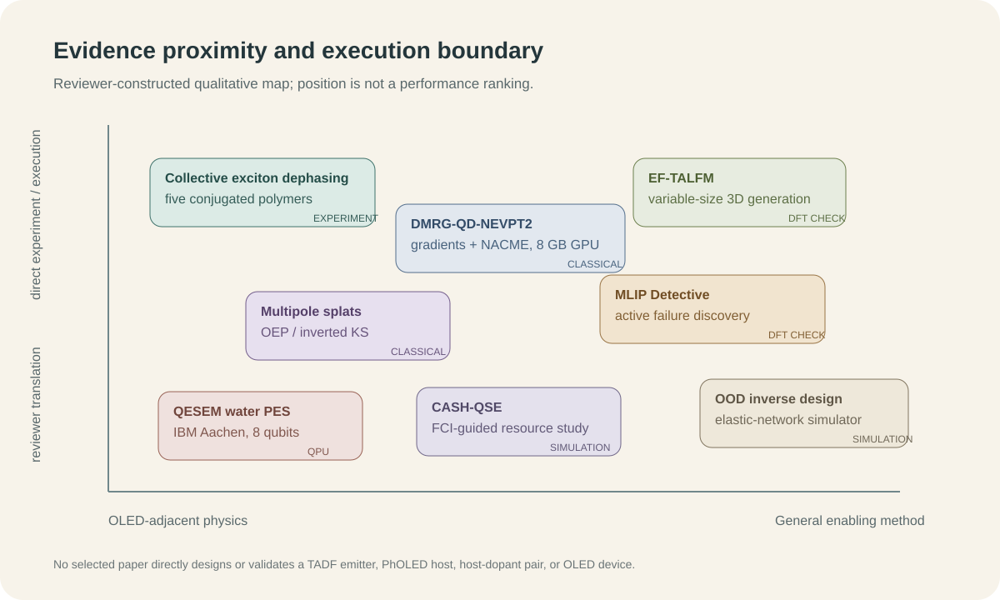
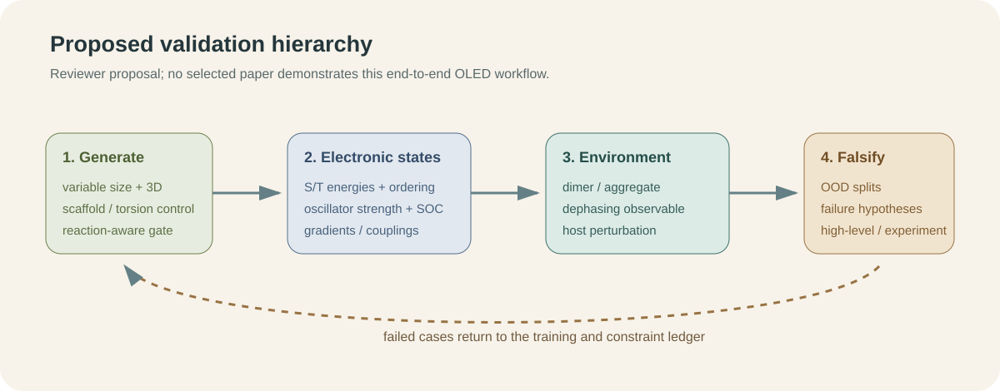

# 집단 엑시톤과 오차 예산이 규정하는 광여기 분자 역설계의 신뢰도

같은 공액고분자를 보더라도 빛의 코히런스를 검출할 때와 발광 신호를 검출할 때 읽히는 선폭은 달랐다. PBTTT에서 두 검출 방식이 주는 절대값은 달랐지만, 온도를 올려도 선폭이 크게 늘지 않는 경향은 함께 남았다. 공액고분자 5종의 실험이 던지는 질문은 분명하다. 분자 하나의 에너지를 잘 예측하는 모델이, 여러 분자가 모여 나타내는 광학 응답까지 설명하는가? [[1]](#ref-1)

2026년 9월 4–10일 문헌을 읽으며 주목한 것은 이 간극을 확인하는 방법이다. 분자 크기와 구조를 함께 만드는 생성기, 평균 점수 뒤의 실패를 찾는 탐색, 상태 교차를 살피는 전자구조 계산은 각기 다른 검증을 맡는다. 이들을 OLED 역설계로 연결하려면 후보의 수와 함께 어떤 관측량을 예측하며 어디에서 다시 계산할지도 정해야 한다. 아래에서는 그 연결을 따라가고, 마지막에 작은 후보군으로 시험할 실행안을 제안한다.

*그림 1. 이번 리뷰의 개념 일러스트. 중앙의 발광 집합체는 집단 엑시톤과 탈위상을, 주변 요소는 가변 크기 생성·전자상태 교차·양자 측정비용을 나타낸다. 생성된 분자와 퍼텐셜, 양자 요소는 특정 화학구조, 측정 morphology, 정량 곡면 또는 실행 가능한 회로가 아니다.*

영문 기술 브리프 개정판 · 2026년 11월 26일: [PDF](oled_inverse_design_weekly_brief_2026-09-11.pdf).

*그림 2. 리뷰어가 구성한 정성적 근거 지도. 위치는 OLED workflow와의 근접성과 원 논문이 실제로 수행한 검증 수준을 나타내며 성능 순위가 아니다. 선정 논문은 모두 프리프린트다.*

## 1. 선폭에는 집단상태와 검출 방식이 함께 들어간다

Kantrow 연구진은 공액고분자의 집단 여기와 광학 탈위상을 실험으로 비교했다. [[1]](#ref-1)

대상은 P3HT, P3HHT, PBTTT, PCE11, N2200이며, coherence-detected COLBERT와 population-detected 2D photoluminescence spectroscopy의 이용 가능한 측정들을 대조했다. 같은 재료에서 두 검출 방식을 직접 비교한 사례는 PBTTT다. 재료는 backbone, donor-acceptor 성격, side chain, 고체 조직이 서로 다르다. 균질 선폭은 약 20-90 meV였고 N2200의 COLBERT 값이 약 20 meV로 가장 좁았지만, 각 재료의 온도 의존성은 측정 범위에서 모두 약했다. PBTTT에서는 2DPL 선폭이 COLBERT보다 일관되게 컸으나 약한 열적 scaling은 두 방식에서 유지됐다.

저자들은 선폭 차이의 미시적 원인을 확정하지 않았다. exciton-vibration coupling과 relaxation pathway의 정량 모델이 필요하고, 공개 데이터 저장소 URL도 프리프린트에는 placeholder로 남아 있다. 이 폴리머 실험에서 OLED 후보로 옮겨올 수 있는 것은 검증의 관점이다.

OLED 파이프라인에서는 단분자 S1/T1·oscillator strength 예측 뒤에 dimer/aggregate exciton model과 observable-specific dephasing 검증을 별도 단계로 두어야 한다. 선폭 하나를 분자 고유 상수처럼 학습하지 말고, 검출 방식·온도·형태학 조건을 provenance로 보존하는 것이 직접적인 번역이다.

## 2. 크기까지 생성한 분자를 어떤 기준으로 거를 것인가

후보를 만드는 단계에서는 Yao 연구진의 EF-TALFM이 분자 크기를 미리 고정하는 제약을 풀었다. [[2]](#ref-2)

EF-TALFM은 고정 크기 분자 latent를 flow matching으로 샘플링한 뒤 autoregressive Transformer가 원자 종류, 좌표, 화학 상태와 분자 크기를 함께 결정한다. canonical atom ordering과 rigid-pose alignment를 사용해 equivariant layer 없이 3D 구조를 복원한다. PCQM4Mv2에서 unique·training-set novel·sanitization·PoseBusters를 모두 통과한 비율은 89.4%로, UAE-3D 75.6%, FlowMol 69.8%보다 높았다.

HOMO-LUMO gap은 4.1–7.8 eV 사이 10개 목표를 두고 목표당 10,000개를 생성했다. 기하·화학 검수를 통과한 후보 중 목표별 내부 순위의 상위 30%를 고르면 DFT 값이 목표의 0.1 eV 안에 드는 비율이 25.0%에서 52.4%로 늘었다. 이때 검증한 고유 hit의 약 97%는 해당 물성 범위의 학습 부분집합과 canonical SMILES가 겹치지 않았다. DFT 검증은 추가 구조 최적화 없는 B3LYP/6-31G(d) 단일점 계산이다. 잠재 차원은 32이며 같은 H100에서 보고한 학습시간은 882분, UAE-3D는 1,644분이었다. 각 모델의 학습 예산은 같지 않아 이를 같은 연산량의 속도 비교로 볼 수는 없다.

PCQM4Mv2의 HOMO-LUMO gap은 OLED의 S1, T1, ΔEST, SOC 또는 고체상 성능을 대체하지 않는다. canonical ordering과 alignment가 더 큰 비평면 donor-acceptor 분자에서 얼마나 안정적인지, route feasibility와 scaffold OOD가 유지되는지도 확인되지 않았다.

OLED용 재현 실험에서는 분자 크기를 사전 고정하지 않는 장점을 유지하되, 생성 후 상위 후보를 동일한 TDDFT/TDA·conformer protocol로 재평가해야 한다. novelty보다 target hit의 scaffold-held-out calibration과 합성 route 존재 여부를 우선 기록하는 편이 안전하다.

## 3. 맞힌 값 옆에서 틀리는 경로를 찾는다

좋은 후보를 골랐다는 판단에는 예측이 틀릴 상황을 찾는 절차도 필요하다. Okuno 연구진의 MLIP Detective는 이를 물리 가설의 탐색으로 구성했다. [[3]](#ref-3)

LLM 기반 Detective Agent가 검증 가능한 물리 가설을 만들고, 여러 Probe Agent가 값싼 simulation과 model committee disagreement로 이를 시험해 의심 사례를 추린다. MACE-MPA-0에서 O·F adsorbate가 포함된 PBE/PBE+U 혼합 영역의 40개 조합 가운데 27개가 분리 fragment보다 높은 비정상 에너지를 보였고, 영역 밖 72개 조합에서는 0개였다. 이 사례는 다중 Probe 구조가 기존 문헌의 실패를 재발견한 것으로, 사람 검토로 확인했으며 새 DFT 계산은 하지 않았다.

한편 초기 프로토타입이 찾은 CO/Cu(111)은 benchmark adsorption energy가 실험과 0.04 eV 안에서 맞았지만, desorption path에서는 모델이 vacuum asymptote보다 0.208 eV 높은 장벽을 만들었다. 동일한 25개 image에 대한 plane-wave PBE single point는 0.022 eV만 상승했다. 즉 equilibrium benchmark가 맞아도 경로가 물리적으로 틀릴 수 있음을 DFT로 확인했다.

현재 실증은 표면 흡착과 소수 failure family에 한정된다. LLM의 사전학습 노출을 배제할 수 없고, inspection specification이 탐색 경계를 정하며, 최종 확인은 여전히 전문가와 DFT 비용을 요구한다.

OLED 모델에도 같은 구조를 적용할 수 있다. ΔEST가 맞지만 state ordering이 틀리는 경우, relaxed conformer에서는 맞지만 torsion scan에서 불연속이 생기는 경우, host-dopant separation limit에서 비물리적 CT가 나타나는 경우를 미리 가설로 등록하고 상위 실패만 high-level 계산에 올린다.

## 4. 상태 교차에서 고수준 계산으로 올라간다

실패가 전자상태의 교차와 관련된다면, 계산 자체가 그 근방을 다룰 수 있어야 한다. Guerrero는 DMRG-QD-NEVPT2의 해석적 미분과 비단열 결합을 GPU에서 계산했다. [[4]](#ref-4)

DMRG가 active-space static correlation을, quasi-degenerate strongly contracted NEVPT2가 dynamic correlation을 담당한다. gradient와 interstate nonadiabatic coupling matrix element는 contraction graph의 reverse-mode transpose로 계산된다. NVIDIA RTX 4060 8 GB에서 전 과정을 실행했고, twisted ethene 교차점에서 smooth adiabat와 1/ΔE 형태로 발산하는 nonzero NACME를 얻었다. 비교한 adiabatic linear-response TDDFT는 그 지점에서 zero coupling을 반환했다.

활성공간 내부의 FCI와는 10^-15 Ha 수준으로 수치적으로 일치했다. 이는 실제 여기 에너지의 정확도와 구별해야 한다. 단정밀도 경로가 주는 수직 여기 에너지 차이는 본문에서 ethene 2.7×10^-6 eV, formaldehyde 8.3×10^-6 eV 등으로 보고되어, 초록의 일률적인 10^-6 eV 미만 서술과는 차이가 있다. CAS(10,10)의 dense 4-RDM 경로는 12.6 GB가 필요하지만 contraction을 융합하면 7.1 GB에 들어갔고 dense result와 8.9×10^-16 수준으로 맞았다. ethene aug-cc-pVTZ Cholesky build는 40분 안에 끝나지 않던 기존 구현에서 약 3분으로 줄었다.

검증은 작은 분자 중심이며 diffuse 기저를 포함한 계산도 있다. 실제 TADF 다중상태, triplet manifold, SOC, 용매·host, 큰 donor-acceptor로의 확장은 따로 확인해야 한다. 성능 최적화 CUDA 커널은 비공개이고, CPU 검증 묶음은 추후 공개 계획이어서 이 판본만으로 전체 타이밍을 독립 재현할 수는 없다.

OLED에서는 TDDFT/TDA screening 뒤 state crossing이나 CT/LE mixing이 심한 5-10개 후보만 active-space multireference 확인에 보내는 escalation layer로 적합하다. 이렇게 계산량을 의심 사례에 집중하는 것이 여기서 얻는 설계 판단이다.

## 5. 궤도 에너지 뒤의 퍼텐셜을 살핀다

상태의 에너지뿐 아니라 그 에너지를 만드는 표현도 점검 대상이다. Medvidović, Rubio, Carrasquilla는 국소 유효 퍼텐셜을 multipole splat으로 나타냈다. [[5]](#ref-5)

multipole splat은 올바른 장거리 감쇠를 구조적으로 넣은 local trial potential이다. 저자들은 optimized effective potential과 inverted Kohn-Sham을 각각 variational·supervised Hamiltonian learning으로 표현했다. near-exact inverted correlation potential과 비교해 self-interaction, delocalization, static-correlation error의 공간적 흔적을 분리했고, Ne의 ns·nd EXX-OEP Kohn–Sham 고유값에서 경험적 tail 보정 없이 Rydberg 계열을 회복했다. 이를 다체 여기 에너지의 직접 검증으로 읽어서는 안 된다. benzene(42전자)·naphthalene(68전자)의 π-공액계에서는 exact-exchange source density를 계산했다.

이 결과는 ground-state effective potential과 spectral access에 관한 것이며 OLED excited-state benchmark는 아니다. 그래도 long-range CT와 diffuse excitation이 중요한 후보에서 scalar orbital energy만 저장하기보다 potential representation과 density-derived diagnostic을 학습 데이터로 남기는 방향을 제시한다. basis sensitivity와 hybrid-functional dependence는 별도 검증해야 한다.

## 6. 분포 밖 설계는 물리 계산으로 되돌아온다

물리 계산으로 되돌아오는 설계 방식은 Shteingolts 연구진의 탄성망 연구에서도 드러난다. [[6]](#ref-6)

graph neural network molecular dynamics simulator를 짧은 동역학 초기화와 물리 제약 refinement에 연결했다. Poisson ratio 0.1-0.4의 non-auxetic network만 학습했지만 -0.3까지의 auxetic 구조를 설계했다. 학습 크기는 150-200 nodes였고, 최종 시험은 최대 5,000 nodes까지 확장됐다. static structure-to-property predictor는 같은 OOD 역설계에 실패했다. 노드 변위 전략에는 결합 길이가 원래의 30% 아래로, 인접 결합각이 20도 아래로 내려가는 것을 벌주는 기하학적 항을 썼다.

이는 분자가 아니라 disordered elastic network simulation이다. OLED 번역은 결과가 아니라 설계 원리다. surrogate의 직접 역전보다 differentiable trajectory와 물리 제약을 통해 torsion 또는 morphology를 최적화하고, 최종 후보를 원래 oracle로 재검증해야 한다. 화학 그래프로 성능 수치를 옮길 근거는 없다.

## 7. 실제 QPU의 오차와 측정비용을 같은 장부에 쓴다

양자 계산에는 별도의 비용 장부가 필요하다. Olarte Hernandez 연구진의 QESEM 실험은 물 분자 퍼텐셜 에너지 곡선에서 그 비용을 실제로 드러냈다. [[7]](#ref-7)

IBM Aachen Heron r3에서 156 physical qubit 가운데 8 qubit register를 사용했다. 대상은 H2O symmetric stretch 11개 geometry, (4,4) active space, STO-3G, 1-layer perfect-pairing tiled unitary product state다. ansatz와 orbital parameter는 QPU가 아니라 statevector oo-VQE에서 먼저 최적화했고, 실제 하드웨어에서는 energy expectation을 측정했다.

오차의 기준은 이상적인 1층 pp-tUPS statevector 에너지다. 이 기준 자체도 CASSCF보다 약 5 mHa 높으므로, 아래 chemical accuracy는 정확한 화학 에너지에 대한 달성을 뜻하지 않는다. raw QPU energy는 이 기준보다 대체로 약 500 mHa 높았다. QESEM으로 loose precision 0.1 Ha에서는 약 100 mHa 안에, tight precision 0.01 Ha에서는 대부분 30 mHa 안에 들어왔다. tight case의 maximum error는 34 mHa였고 merged result는 20 mHa 안이었다. 11개 가운데 한 점이 chemical accuracy에 직접 들어왔으며 ±5 mHa uncertainty까지 고려하면 5개가 해당 범위와 겹쳤다.

비용은 크다. merged result당 평균 shots는 loose 3,135,921, tight 16,762,896이었다. 샷 수는 두 실행을 합친 결과의 기하구조당 평균이고, 약 0.5–2.5시간은 각 기하구조에서 tight 개별 실행 한 번의 QPU 시간이다. 이처럼 오차를 줄인 결과와 그 대가를 함께 보고해야 다른 계산과 비교할 수 있다.

## 8. 이미 아는 에너지를 다시 측정하지 않는다

측정비용을 줄이는 또 다른 길은 고전적으로 계산한 성분을 양자 측정에서 빼는 것이다. Izmaylov의 CASH-QSE는 이 분업을 부분공간 전개에 넣었다. [[8]](#ref-8)

CASSCF reference는 고전적으로 계산하고, occupation structure로 reference 및 서로에 대해 정확히 직교하는 quantum component를 만든다. overlap measurement 없이 Hermitian eigenproblem을 풀며, H2O와 N2의 결합 신축을 STO-3G에서 시험했고, H2O는 제한된 cc-pVDZ 공간에서도 살폈다. 표의 HF 기준상태 행을 보면 H2O/STO-3G equilibrium에서 idealized shots는 5.6×10^3으로 ADAPT-VQE 2.9×10^6보다 520배 적었다. 3.0 Å에서는 3.2×10^2 대 1.2×10^5로 약 370배였다. 가장 큰 complete measurement circuit은 all-to-all logical CNOT 수백 개였다.

그러나 component 선택은 FCI 정보로 안내됐고, 수치는 noisy QPU 실행이 아닌 idealized final-energy sampling estimate다. chemical accuracy와 shot reduction은 작은 분자·기저에서의 결과이며 물리 qubit, routing, error mitigation 비용을 포함하지 않는다. OLED 적용은 active-space fragment를 고전 reference로 얼마나 잘 포착하는지부터 검증해야 한다.

## 9. 작은 후보군에서 검증 층을 연결한다

*그림 3. 이번 문헌을 바탕으로 리뷰어가 제안한 workflow. 어느 원 논문도 이 OLED pipeline을 end-to-end로 실행하지 않았다.*

12-24개 donor-acceptor 또는 host 후보 family를 정하고 conformer와 dimer geometry를 함께 만든다. EF-TALFM형 생성기는 분자 크기를 자유롭게 두되 reaction template와 commercial building block gate를 통과한 후보만 남긴다. 같은 TDDFT/TDA 설정에서 S1, T1, 상위 triplet, oscillator strength, NTO CT/LE 지표를 계산하고, dimer에는 excitonic coupling과 host perturbation descriptor를 추가한다.

검증은 평균 MAE보다 failure hypothesis로 설계한다. scaffold-held-out, torsion-held-out, dimer-separation scan에서 state-order swap, 비연속 energy, 비물리적 CT, 과도한 oscillator strength를 찾는다. 가장 의심스러운 5-10개만 multireference 또는 더 높은 기저 계산으로 올린다. QPU는 생산 계산에 넣지 않고, 작은 active-space test에서 logical circuit·shots·QPU time·classical baseline을 기록하는 자원 실험으로 분리한다.

## 결론

광여기 분자 설계에서는 서로 다른 세 검증 층이 만난다. 분자 내부에서는 전자상태와 교차를 안정적으로 계산해야 하고, 분자 사이에서는 집단 엑시톤과 관측량 의존 탈위상을 다뤄야 하며, 설계 탐색에서는 분포 밖 실패를 의도적으로 찾아야 한다. EF-TALFM은 후보 생성의 자유도를 넓혔지만, 그 후보를 OLED 재료로 만드는 증거는 별도의 전자구조·응집상·합성 검증에 있다.

양자 계산의 경계도 수치로 드러났다. QESEM의 tight 설정은 두 실행을 합친 기하구조당 평균 약 1,676만 shots를 썼고, CASH-QSE의 큰 절감은 FCI-guided idealized estimate다. 이 두 결과를 하나의 우열표로 합칠 수는 없다. 후보를 더 많이 만들거나 더 복잡한 계산으로 옮기기 전에, 어떤 오차를 어디서 줄였으며 그 비용을 어디까지 셌는지 남겨야 한다.

## References

1. H. J. Kantrow, E. Gutiérrez-Meza, E. R. Bittner, H. Li, and C. Silva-Acuña, Collective excitonic structure governs anomalously weak thermal optical dephasing in conjugated polymers, [arXiv:2609.06742v1](https://arxiv.org/abs/2609.06742v1).
2. W. Yao, C. Gruich, B. R. Goldsmith, and Y. Wang, Fixed-dimensional latent flow for generating variable-size 3D molecules, [arXiv:2609.08333v1](https://arxiv.org/abs/2609.08333v1).
3. R. Okuno, N. Charoenphakdee, K. Hisama, and Y. Tsuboi, MLIP Detective: Active failure mode discovery beyond benchmark scores for machine-learning interatomic potentials, [arXiv:2609.08399v1](https://arxiv.org/abs/2609.08399v1).
4. R. D. Guerrero, Analytic gradients and nonadiabatic couplings for device-resident DMRG-QD-NEVPT2 through conical intersections on a consumer GPU, [arXiv:2609.09990v1](https://arxiv.org/abs/2609.09990v1).
5. M. Medvidović, A. Rubio, and J. Carrasquilla, Multipole splats for optimized and inverted effective potentials, [arXiv:2609.09280v1](https://arxiv.org/abs/2609.09280v1).
6. S. A. Shteingolts, S. N. Salman, R. Levie, and D. Mendels, Out-of-distribution inverse design of elastic networks with differentiable graph neural network molecular dynamics, [arXiv:2609.06655v1](https://arxiv.org/abs/2609.06655v1).
7. R. Olarte Hernandez, E. Rossi, S. Coriani, K. M. Ziems, E. Kjellgren, J. Kongsted, T. Shnaider, and S. P. A. Sauer, Implementing QESEM’s high-accuracy error mitigation on a quantum computer: A water potential energy surface study, [arXiv:2609.07284v1](https://arxiv.org/abs/2609.07284v1).
8. A. F. Izmaylov, Classical active-space hybrid quantum subspace expansion (CASH-QSE): Quantum corrections without remeasuring the classically calculable energy, [arXiv:2609.08170v1](https://arxiv.org/abs/2609.08170v1).

## 작성·근거와 개정 이력

원 발행일은 2026년 9월 11일, 문헌 근거 기준일은 9월 10일이다. 당시 선정한 8편의 프리프린트 1판을 대조했으며 이후 판본과 현재 제품·출판 상태를 당시 결과에 소급하지 않았다. 조사 범위에서 직접적인 TADF·PhOLED·host–dopant 소자 설계, 열화·수명, SELFIES·CRBM, 화학용 D-Wave/QUBO·QAOA의 동등 예산 비교나 OLED 활성공간의 양자 우위 근거는 찾지 못했다. 이를 해당 분야 전체에 연구가 없었다는 뜻으로 넓히지 않는다. OLED 연결과 12–24개 후보·5–10개 고수준 계산의 실행안은 리뷰 제안이며 실제 수행 결과가 아니다.

2026년 11월 22일 개정안은 도입과 연구 사이의 연결을 다듬고 반복된 읽기 목록과 부재 설명을 줄였다. EF-TALFM의 novelty 비교 집합, MLIP 사례별 검증 방식, DMRG 단정밀도 차이와 diffuse 기저 범위, QESEM의 오차 기준·실행 집계, CASH-QSE의 HF 기준 행을 원문에 맞게 명시했다. 기존 세 그림은 유지하고 참고문헌을 최초 인용순·전원 저자·실제 판본으로 정리했다. 당시에는 종전 영문 기술 브리프의 구조 손상 때문에 PDF 동기화와 공개 반영을 보류했다.

2026년 11월 26일에는 감수한 영문 웹 원고와 같은 8편의 1판 자료에서 영문 기술 브리프 개정판을 새로 작성했다. 원 발행일과 9월 10일 근거 기준일은 유지한다. 종전 첨부의 전체 내용과 원래 5쪽 구성은 확인할 수 없어, 이 PDF를 정상 원판의 복원이나 동일 내용·레이아웃의 재현으로 제시하지 않는다. 손상 원본의 바이트·해시와 Git 이력을 보존하고 기존 첨부 주소에서 새 편집판을 제공한다.

책임 편집: 김현중. AI 보조: OpenAI Codex Work Mode. 편집부(AEDAUT)의 AI 에이전트가 한영 편집, 8편의 관련 본문·표·서지 대조와 독립 과학·문체 감수를 분담했다. 원 작성·검증 이력은 보존하며, 새 실험·코드 재현이나 별도 사람의 행별 검토를 수행했다고 표시하지 않는다.

이번 편집부(AEDAUT) 작업에서 `legacy1126_brief_author`가 새 영문 기술 브리프를 집필했고 `legacy1126_pdf_gate`가 기존 원출처 대조 기록과 저장 원문, 한영 대응·주장 조건·서지를 비작성자로 대조했다. `dqb1125_pdf`는 기존 PDF 구성요소를 재사용하는 주제별 생성 어댑터를 작성했다. root는 한영 개정 통합과 PDF·후보·게시 검증을 담당한다. 11월 22일 과학·문체 감수와 이번에 새로 읽은 범위는 회차 기록에서 구별한다. 정확한 모델 식별자는 미보존이며, 이번에도 원 실험·계산의 재현이나 별도 사람 문장 검토는 수행하지 않았다.
