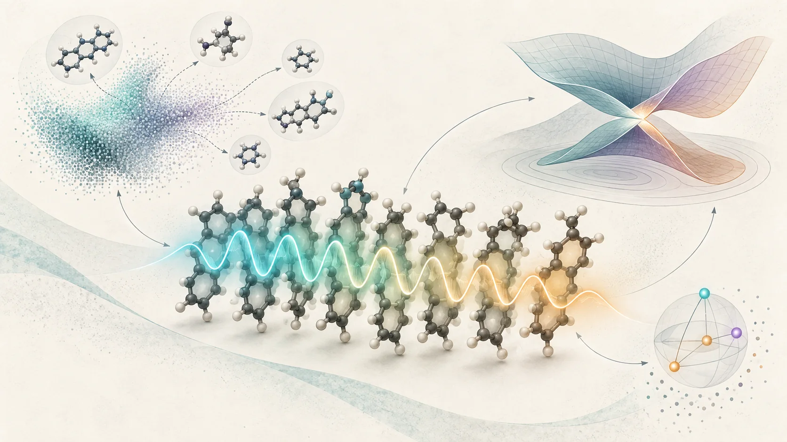
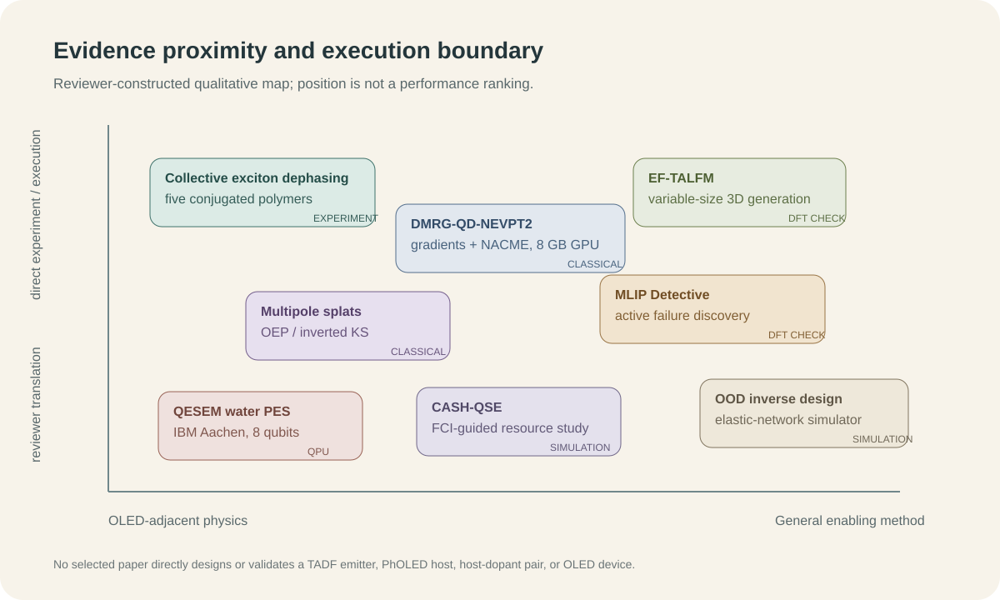
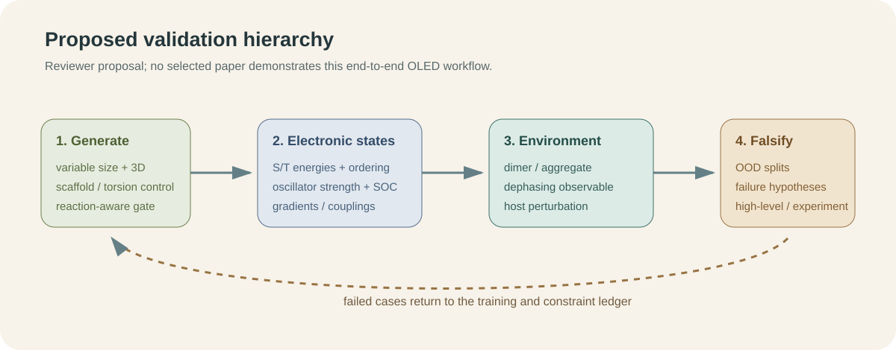

# Collective Excitons and Error Budgets Define Reliability in Photoactive Molecular Inverse Design

The linewidth of the same conjugated polymer changed with the way its optical response was detected. In PBTTT, coherence and photoluminescence detection gave different absolute widths, yet both retained weak temperature scaling. The five-polymer study poses a concrete question for molecular design: does a model that predicts an isolated molecule’s energy also describe the optical response of molecules acting together? [[1]](#ref-1)

The useful connection across the 4–10 September 2026 literature is how to test that gap. A generator that chooses molecular size and structure, a search for failures behind average scores, and electronic-structure calculations near state crossings each supply a different check. Bringing them into OLED inverse design means deciding which observable a candidate should reproduce and where to calculate again. The discussion below follows those checks toward a proposed experiment on a small candidate family.

*Figure 1. Conceptual illustration for this review. The central aggregate represents collective excitons and dephasing; the surrounding elements represent variable-size generation, state crossings, and quantum sampling cost. The generated molecules, potentials, and quantum motifs are not exact structures, measured morphology, quantitative surfaces, or executable circuits.*

Revised English technical brief, 26 November 2026: [PDF](../artifacts/oled_inverse_design_weekly_brief_2026-09-11.pdf).

*Figure 2. Reviewer-constructed qualitative evidence map. Placement reflects OLED-workflow proximity and what each paper actually executed; it is not a performance ranking. All eight selected items are preprints.*

## 1. Linewidth contains collective states and detection conditions

Kantrow and colleagues compare collective excitations and optical dephasing in conjugated polymers. [[1]](#ref-1)

The study compares available coherence-detected COLBERT and population-detected two-dimensional photoluminescence measurements across P3HT, P3HHT, PBTTT, PCE11, and N2200. PBTTT supplies the direct comparison of both detection modes on one material. The materials differ in backbone structure, donor-acceptor character, side chains, and solid-state organization. Homogeneous linewidths span about 20-90 meV; N2200 reaches about 20 meV in COLBERT. Every material nevertheless shows weak temperature scaling over its measured range. For PBTTT, 2DPL gives a systematically larger linewidth than COLBERT, while both preserve weak thermal scaling.

The paper does not assign a microscopic cause to the linewidth differences. Quantitative treatment of exciton-vibration coupling and relaxation pathways remains necessary, and the preprint's data-repository URL is still a placeholder. The transferable lesson from these polymers is a way to validate an OLED prediction.

An OLED pipeline should therefore place a dimer/aggregate exciton model and observable-specific dephasing test above isolated-molecule S1/T1 and oscillator-strength predictions. Linewidth should be stored with detection mode, temperature, and morphology provenance rather than treated as a molecular constant.

## 2. How to screen molecules whose size is also generated

At the generation stage, Yao and colleagues’ EF-TALFM removes the need to prescribe molecular size. [[2]](#ref-2)

EF-TALFM samples a fixed-size molecular latent with flow matching. An autoregressive Transformer then generates atom types, coordinates, chemical states, and molecular size. Canonical atom ordering and rigid-pose alignment permit a non-equivariant Transformer to reconstruct the 3D graph. On PCQM4Mv2, 89.4% of samples are simultaneously unique, training-set novel, sanitizable, and PoseBusters-clean, compared with 75.6% for UAE-3D and 69.8% for FlowMol.

The conditional benchmark uses ten HOMO-LUMO-gap targets from 4.1 to 7.8 eV and 10,000 samples per target. Selecting the target-wise top 30% by internal ranking among geometrically and chemically screened candidates raises the fraction within 0.1 eV of target from 25.0% to 52.4%. About 97% of unique verified hits do not exactly match canonical SMILES in the property-matched training subset. Verification uses B3LYP/6-31G(d) single points without further geometry optimization. The latent dimension is 32; reported training takes 882 minutes versus 1,644 for UAE-3D on the same H100. The model-specific training budgets differ, so these are not equal-compute speed measurements.

A PCQM4Mv2 HOMO-LUMO gap is not an OLED S1, T1, ΔEST, SOC, or condensed-phase performance target. Stability of canonical ordering for larger, nonplanar donor-acceptor molecules, route feasibility, and scaffold-OOD calibration remain untested.

For OLED work, preserve the ability to generate molecular size but re-evaluate shortlisted candidates under one conformer and TDDFT/TDA protocol. Rank scaffold-held-out target calibration and plausible synthesis routes above raw novelty.

## 3. Search for a wrong path beside a correct value

Judging a candidate also requires looking for circumstances in which its prediction fails. Okuno and colleagues frame MLIP Detective as a search over testable physical hypotheses. [[3]](#ref-3)

A Detective Agent proposes falsifiable physical hypotheses. Probe Agents screen them with inexpensive simulations, physical constraints, and committee disagreement to select cases for further inspection. For MACE-MPA-0, 27 of 40 O- or F-containing combinations in a mixed PBE/PBE+U region predict the relaxed adsorbate-surface system above separated fragments; none of 72 combinations outside that region does. The multi-Probe system rediscovers this previously documented failure; human review confirms it without new DFT calculations.

A separate CO/Cu(111) case found by the earlier prototype matches a benchmark adsorption energy within 0.04 eV of experiment, yet its desorption path is defective. MACE-MPA-0 produces a 0.208 eV barrier above the vacuum asymptote, whereas plane-wave PBE on the same 25 images rises only 0.022 eV. A correct equilibrium score therefore coexists with a qualitatively wrong path.

The demonstrations cover surface adsorption and a small number of failure families. LLM pretraining exposure cannot be excluded; the human-authored inspection specification bounds the search; final confirmation still consumes expert and DFT effort.

For OLED models, preregister failures such as correct ΔEST with incorrect state ordering, a smooth minimum with a discontinuous torsion scan, or unphysical charge transfer at large host-dopant separation. Escalate only the strongest candidates to high-level calculations.

## 4. Escalate the calculation near a state crossing

When a failure involves crossing electronic states, the calculation must describe that region. Guerrero evaluates analytic derivatives and nonadiabatic couplings of DMRG-QD-NEVPT2 on a GPU. [[4]](#ref-4)

DMRG supplies active-space static correlation; quasi-degenerate strongly contracted NEVPT2 adds dynamic correlation. Gradients and interstate nonadiabatic coupling matrix elements are evaluated as a reverse-mode transpose of a contraction graph. The full stack runs on an NVIDIA RTX 4060 with 8 GB. At twisted ethene, the method produces smooth adiabats and a nonzero, 1/ΔE-divergent coupling through the crossing, where adiabatic linear-response TDDFT returns zero.

The DMRG reference agrees numerically with FCI within the active space to 10^-15 Ha; this is distinct from accuracy against physical excitation energies. The main text reports single-precision vertical-excitation differences of 2.7×10^-6 eV for ethene and 8.3×10^-6 eV for formaldehyde, among others. They do not support the abstract’s uniform less-than-10^-6 eV statement. A dense CAS(10,10) four-RDM route would require 12.6 GB; fused contractions use 7.1 GB and agree with the dense result at 8.9×10^-16. An ethene aug-cc-pVTZ Cholesky build falls from not finishing within 40 minutes to about 3 minutes.

The validations concern small molecules and include diffuse-basis calculations. Extension to TADF multistate manifolds, triplets, SOC, host environments, and large donor-acceptor chromophores needs separate checks. The optimized CUDA kernels are not public, while the CPU validation bundle is planned for later release; the full timing results cannot be independently reproduced from this version alone. For an OLED workflow, the useful judgment is to concentrate this high-level effort on candidates with severe CT/LE mixing or crossings.

## 5. Inspect the potential behind the orbital energies

The representation producing an energy is another object of validation. Medvidović, Rubio, and Carrasquilla describe local effective potentials with multipole splats. [[5]](#ref-5)

Multipole splats impose the correct asymptotic decay on local trial potentials. The authors cast optimized effective potential and inverted Kohn-Sham calculations as variational and supervised Hamiltonian learning. They separate spatial fingerprints of self-interaction, delocalization, and static-correlation errors; recover the Ne ns/nd Rydberg series of EXX-OEP Kohn–Sham eigenvalues without an empirical asymptotic correction; and compute exact-exchange source densities for benzene (42 electrons) and naphthalene (68). The Rydberg result is not a direct validation of many-body excitation energies.

This is not an excited-state OLED benchmark. Its practical value is representational: for long-range CT and diffuse excitations, store potential- and density-based diagnostics alongside scalar orbital energies. Basis sensitivity and dependence on the underlying hybrid approximation remain part of the validation ledger.

## 6. Return out-of-distribution designs to the physical calculation

A return to physical calculation also appears in Shteingolts and colleagues’ inverse design of elastic networks. [[6]](#ref-6)

A graph-neural-network molecular-dynamics simulator is coupled to a short dynamical initialization and physics-based refinement. Although trained only on non-auxetic networks with Poisson ratios from 0.1 to 0.4, it designs values as low as -0.3. Training systems contain 150-200 nodes, while tests extend to 5,000 nodes. A comparable static structure-to-property predictor fails in the extrapolative design regime. The node-displacement strategy penalizes bond lengths below 30% of their original value and adjacent angles below 20 degrees.

These are disordered elastic networks, not molecules. The defensible OLED translation is methodological: optimize through a differentiable trajectory with explicit geometric constraints, then rerun the original electronic-structure oracle. None of the reported mechanical performance transfers quantitatively to chemical graphs.

## 7. Put QPU error and measurement cost in the same ledger

Quantum calculation requires a separate cost ledger. Olarte Hernandez and colleagues’ QESEM experiment exposes that cost along a water potential-energy curve. [[7]](#ref-7)

The experiment uses an 8-qubit register on IBM Aachen, a 156-qubit Heron r3 processor. It scans eleven symmetric-stretch geometries of H2O in a (4,4) active space with STO-3G and a one-layer perfect-pairing tiled unitary product state. Ansatz and orbital parameters are optimized classically at statevector level; the QPU measures energies rather than performing iterative on-device VQE optimization.

Errors are measured against the ideal one-layer pp-tUPS statevector energy, which is itself about 5 mHa above CASSCF. Chemical accuracy below therefore refers to that ideal ansatz, rather than exact chemical energies. Raw energies are typically about 500 mHa above this reference. QESEM brings loose 0.1 Ha settings within about 100 mHa; tight 0.01 Ha settings put all but one individual result within 30 mHa, with a 34 mHa maximum, while merged results lie within 20 mHa. One of eleven merged points is directly within chemical accuracy; with a ±5 mHa uncertainty band, five overlap that range.

The merged average shot count is 3,135,921 at the loose setting and 16,762,896 at the tight setting. The shot means combine two runs per geometry; the roughly 0.5–2.5 hours of QPU time applies to each individual tight run at a geometry. Error reduction and the cost of obtaining it must be reported together before comparing this calculation with another.

## 8. Avoid remeasuring energy already known classically

Another route to lower measurement cost is to leave classically known contributions out of quantum measurement. Izmaylov’s CASH-QSE puts that division into a subspace expansion. [[8]](#ref-8)

CASH-QSE retains the CASSCF reference classically and constructs occupation-structured quantum components exactly orthogonal to the reference and one another. It avoids overlap measurements and solves an ordinary Hermitian eigenproblem. Tests cover H2O and N2 bond stretching in STO-3G plus a restricted cc-pVDZ H2O space.

In the table’s HF-reference row for H2O/STO-3G at equilibrium, the idealized final-energy estimate is 5.6×10^3 shots versus 2.9×10^6 for ADAPT-VQE, a factor of 520. At 3.0 Å it is 3.2×10^2 versus 1.2×10^5, about 370-fold. The largest complete measurement circuits use a few hundred all-to-all logical CNOTs.

Component selection is guided by FCI information, and the figures are idealized sampling estimates, not noisy QPU runs. They omit physical-qubit routing and error-mitigation overhead. OLED translation must begin by testing whether a tractable classical active-space reference retains the relevant CT/LE and spin character.

## 9. Connect the checks on a small candidate family

*Figure 3. Reviewer-proposed workflow synthesized from this week's literature. No selected paper executes this OLED pipeline end to end.*

Choose a 12-24-member donor-acceptor or host family and construct conformers plus selected dimers. Allow an EF-TALFM-like generator to vary molecular size, but retain only candidates passing reaction-template and commercial-building-block gates. Under one TDDFT/TDA protocol, compute S1, T1, higher triplets, oscillator strength, and NTO-based CT/LE descriptors; add excitonic coupling and host perturbation descriptors for dimers.

Evaluate preregistered failure hypotheses rather than average MAE alone: state-order swaps, discontinuous torsion scans, unphysical long-range charge transfer, and inflated oscillator strengths under scaffold-held-out, torsion-held-out, and dimer-separation tests. Escalate only 5-10 cases to a multireference or larger-basis calculation. Keep QPU work as a separate resource experiment reporting logical circuits, shots, QPU time, and matched classical baselines.

## Conclusion

Three validation layers meet in photoactive molecular design. Electronic states and crossings must be computed reliably within a molecule; collective excitons and observable-dependent dephasing enter between molecules; and the design loop must actively search for failures outside benchmark distributions. EF-TALFM expands generative freedom, but electronic-structure, aggregate, and synthesis validation determine whether its candidates become OLED materials.

The quantum evidence is equally bounded. QESEM’s tight setting averages about 16.8 million shots per geometry after merging two runs. CASH-QSE reports much lower idealized sampling cost with FCI-guided component selection, not a hardware demonstration. These results cannot be combined into a single performance ranking. Before generating more candidates or escalating the calculation, record which error was reduced, where, and how much of its cost was counted.

## References

1. H. J. Kantrow, E. Gutiérrez-Meza, E. R. Bittner, H. Li, and C. Silva-Acuña, Collective excitonic structure governs anomalously weak thermal optical dephasing in conjugated polymers, [arXiv:2609.06742v1](https://arxiv.org/abs/2609.06742v1).
2. W. Yao, C. Gruich, B. R. Goldsmith, and Y. Wang, Fixed-dimensional latent flow for generating variable-size 3D molecules, [arXiv:2609.08333v1](https://arxiv.org/abs/2609.08333v1).
3. R. Okuno, N. Charoenphakdee, K. Hisama, and Y. Tsuboi, MLIP Detective: Active failure mode discovery beyond benchmark scores for machine-learning interatomic potentials, [arXiv:2609.08399v1](https://arxiv.org/abs/2609.08399v1).
4. R. D. Guerrero, Analytic gradients and nonadiabatic couplings for device-resident DMRG-QD-NEVPT2 through conical intersections on a consumer GPU, [arXiv:2609.09990v1](https://arxiv.org/abs/2609.09990v1).
5. M. Medvidović, A. Rubio, and J. Carrasquilla, Multipole splats for optimized and inverted effective potentials, [arXiv:2609.09280v1](https://arxiv.org/abs/2609.09280v1).
6. S. A. Shteingolts, S. N. Salman, R. Levie, and D. Mendels, Out-of-distribution inverse design of elastic networks with differentiable graph neural network molecular dynamics, [arXiv:2609.06655v1](https://arxiv.org/abs/2609.06655v1).
7. R. Olarte Hernandez, E. Rossi, S. Coriani, K. M. Ziems, E. Kjellgren, J. Kongsted, T. Shnaider, and S. P. A. Sauer, Implementing QESEM’s high-accuracy error mitigation on a quantum computer: A water potential energy surface study, [arXiv:2609.07284v1](https://arxiv.org/abs/2609.07284v1).
8. A. F. Izmaylov, Classical active-space hybrid quantum subspace expansion (CASH-QSE): Quantum corrections without remeasuring the classically calculable energy, [arXiv:2609.08170v1](https://arxiv.org/abs/2609.08170v1).

## Publication, evidence, and revision history

The original publication date is 11 September 2026 and the literature cutoff is 10 September. The first versions of the eight selected preprints were checked; subsequent versions and current product or publication status have not been retroactively treated as September results. The search did not find direct evidence in its scope for TADF/PhOLED/host–dopant device design, degradation or lifetime, SELFIES/CRBM, equal-budget chemical D-Wave/QUBO or QAOA comparisons, or OLED-active-space quantum advantage. This is not a claim of absence across those entire fields. OLED translations and the proposed 12–24 candidates and 5–10 high-level checks are reviewer proposals, not work performed.

The 22 November 2026 draft improves the opening and connections and reduces duplicated reading lists and absence statements. It clarifies EF-TALFM’s novelty comparison set, verification of the separate MLIP cases, DMRG precision differences and diffuse-basis scope, QESEM’s error reference and run accounting, and the HF-reference CASH-QSE row. The three existing figures are retained; references use first-citation order, all authors, and the versions actually checked. At that stage, structural damage to the previous English technical brief prevented PDF synchronization and publication.

On 26 November 2026, a revised English technical brief was newly composed from the reviewed English web manuscript and the same eight first-version sources. The original publication and 10 September evidence cutoff are retained. The previous attachment's complete contents and original five-page layout remain unavailable, so this PDF is not presented as a restored original or an identical reproduction. Its damaged bytes, hash and Git history are preserved; the existing attachment URLs serve the new editorial edition.

Responsible editor: Hyun-Jung Kim. AI assistance: OpenAI Codex Work Mode. AI agents of the editorial team (AEDAUT) divided bilingual editing, checks of the eight papers’ relevant text, tables, and bibliographic records, and independent scientific and prose review. Original authoring and verification history is retained. No new experiment, code reproduction, or separate human line-by-line review is claimed.

For this AEDAUT revision, `legacy1126_brief_author` wrote the new English technical brief; `legacy1126_pdf_gate` independently checked the retained primary-source audits and stored text, bilingual correspondence, claim conditions and references. `dqb1125_pdf` wrote the topic-specific adapter using existing PDF components. root integrates the bilingual revision and performs PDF, candidate and publication verification. The November 22 scientific/prose reviews and newly read scopes are distinguished in the run record. Exact model identifier not retained; no original experiment or calculation was reproduced and no separate human line-by-line review was performed.
