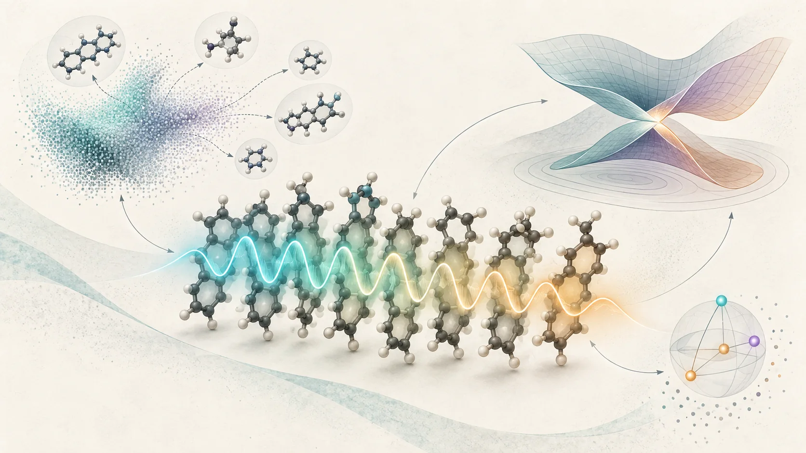
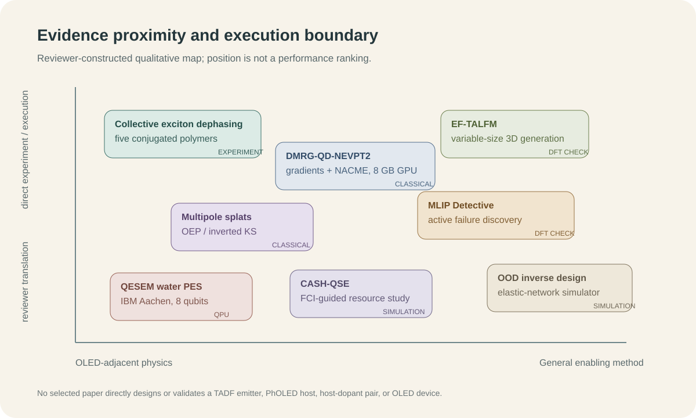
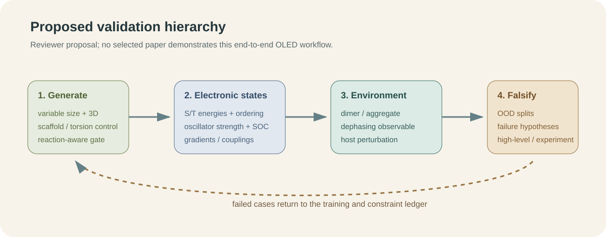

# Collective Excitons and Error Budgets Define Reliability in Photoactive Molecular Inverse Design

**Agentic Tech Review Letters | Revised English technical brief**

Original publication: 11 September 2026. Evidence cutoff: 10 September 2026. New editorial PDF edition: 26 November 2026.

The linewidth of PBTTT changed with the way its optical response was detected. Coherence and photoluminescence detection gave different absolute widths, yet both retained weak temperature scaling. Kantrow and colleagues' five-polymer comparison makes the target of molecular design more concrete: the optical response depends on collective states and on the observable being measured. [[1]](#ref-1)

An inverse-design loop must connect its molecular predictions to that response. The 4-10 September literature supplies several ways to test the connection: generate molecular size as well as structure, search for failures behind good average scores, examine electronic states near crossings, and count the cost of acquiring quantum energies. Together, they suggest a small, testable OLED study rather than an immediate device-design pipeline.

*Figure 1. Conceptual illustration for this review. The central aggregate represents collective excitons and dephasing; the surrounding elements represent variable-size generation, state crossings, and quantum sampling cost. The generated molecules, potentials, and quantum motifs are not exact structures, measured morphology, quantitative surfaces, or executable circuits.*

## Start with the optical observable

The polymer study compares coherence-detected COLBERT and population-detected two-dimensional photoluminescence across P3HT, P3HHT, PBTTT, PCE11, and N2200. Homogeneous linewidths span about 20-90 meV; N2200 reaches about 20 meV in COLBERT. PBTTT provides the direct comparison of both detection modes on one material: 2DPL gives a larger linewidth, while both measurements preserve weak thermal scaling. [[1]](#ref-1)

The paper leaves the microscopic origin of those differences open. Exciton-vibration coupling and relaxation pathways still need quantitative treatment, and the data-repository address in this version is a placeholder. For OLED design, the practical consequence is to retain detection mode, temperature, and morphology with a linewidth label. An isolated molecule's singlet and triplet energies and oscillator strength should lead onward to dimer or aggregate calculations and an observable-specific dephasing test.

*Figure 2. Reviewer-constructed qualitative evidence map. Placement reflects OLED-workflow proximity and what each paper actually executed; it is not a performance ranking. All eight selected items are preprints at the 10 September evidence cutoff.*

## Generate freely, then look for failures

Yao and colleagues' EF-TALFM makes molecular size part of generation. A fixed-dimensional latent is sampled by flow matching; an autoregressive Transformer then generates atom types, coordinates, chemical states, and size. Canonical atom ordering and rigid-pose alignment support reconstruction of the 3D graph. On PCQM4Mv2, 89.4% of samples are simultaneously unique, training-set novel, sanitizable, and PoseBusters-clean, against 75.6% for UAE-3D and 69.8% for FlowMol. [[2]](#ref-2)

Its conditional test uses ten HOMO-LUMO-gap targets from 4.1 to 7.8 eV and 10,000 samples per target. Selecting each target's internally ranked best 30% among 77,724 geometrically and chemically screened candidates yields 23,315 candidates and raises the fraction within 0.1 eV of target from 25.0% to 52.4%. About 97% of unique verified hits do not exactly match canonical SMILES in the property-matched training subset. Verification uses B3LYP/6-31G(d) single points without further geometry optimization. These gap targets therefore motivate a generative strategy; OLED singlet-triplet gaps, spin-orbit coupling, host effects, and synthesis feasibility need their own evaluation.

A useful evaluator should also find a wrong path beside a correct value. Okuno and colleagues' MLIP Detective proposes falsifiable physical hypotheses and screens them with inexpensive simulations, constraints, and committee disagreement. For MACE-MPA-0, it rediscovers a documented mixed PBE/PBE+U failure: 27 of 40 O- or F-containing combinations place the relaxed adsorbate-surface system above separated fragments, versus none of 72 outside that region. This rediscovery was confirmed by human review without new DFT calculations. [[3]](#ref-3)

The separate earlier-prototype CO/Cu(111) case shows why a good equilibrium score is insufficient. Adsorption energy agrees with experiment within 0.04 eV, yet the predicted desorption path rises 0.208 eV above the vacuum asymptote; new plane-wave PBE single points on the same 25 images rise only 0.022 eV. For OLED models, analogous preregistered tests could seek state-order swaps, discontinuous torsion scans, or unphysical long-range charge transfer. These remain reviewer proposals. The demonstrated search covers surface adsorption and a small set of failure families, is bounded by human-written specifications, and still requires expert and DFT confirmation; LLM pretraining exposure cannot be excluded.

## Spend the accurate calculation where it changes the decision

Crossing states require more than a scalar error score. Guerrero's GPU DMRG-QD-NEVPT2 combines active-space static correlation with quasi-degenerate, strongly contracted dynamic correlation and evaluates analytic gradients and interstate nonadiabatic couplings. The stack runs on an 8 GB NVIDIA RTX 4060. At twisted ethene it produces smooth adiabats and a nonzero coupling diverging as 1/ΔE near the crossing, where adiabatic linear-response TDDFT returns zero. [[4]](#ref-4)

The reported 10^-15 Ha agreement with active-space FCI concerns numerical consistency, not physical excitation-energy accuracy. The main text gives single-precision excitation differences of 2.7×10^-6 eV for ethene and 8.3×10^-6 eV for formaldehyde, which do not support the abstract's uniform below-10^-6 eV statement. Fused CAS(10,10) four-RDM contractions use 7.1 GB where a dense route would require 12.6 GB. The small-molecule tests include diffuse bases; transfer to large donor-acceptor molecules, triplets, spin-orbit coupling, and hosts still needs validation. Optimized CUDA kernels are not publicly released in this version, limiting independent timing reproduction.

The potential behind an orbital energy offers another diagnostic. Medvidović, Rubio, and Carrasquilla use multipole splats with correct asymptotic decay for optimized and inverted local effective potentials. They recover Ne ns/nd EXX-OEP Kohn-Sham eigenvalue Rydberg series and compute exact-exchange source densities for benzene and naphthalene. This scopes the Rydberg result to Kohn-Sham eigenvalues rather than many-body excitation energies. For long-range charge transfer and diffuse states, potential- and density-based checks can accompany energy labels. [[5]](#ref-5)

Shteingolts and colleagues supply a complementary lesson about returning a design to its physical calculation. Their differentiable graph-neural-network molecular dynamics, dynamical initialization, and physics-based refinement produce elastic networks with Poisson ratios down to -0.3 after training only on non-auxetic values from 0.1 to 0.4. Tests extend from 150-200 training nodes to 5,000. The node-displacement strategy penalizes bond lengths below 30% of their initial value and adjacent angles below 20 degrees. These are mechanical networks. The transferable proposal is to refine a generated molecular candidate under explicit geometric constraints and rerun the electronic-structure oracle, without transferring the mechanical performance numbers. [[6]](#ref-6)

## Count quantum accuracy and acquisition together

Olarte Hernandez and colleagues' QESEM experiment measures eleven symmetric-stretch H2O geometries using eight qubits on IBM Aachen, a 156-qubit Heron r3 processor. The STO-3G (4,4) calculation uses a one-layer perfect-pairing tiled unitary product state (pp-tUPS). Ansatz and orbital parameters are optimized classically at statevector level; the QPU measures energies. [[7]](#ref-7)

The error reference is that ideal pp-tUPS statevector energy, itself about 5 mHa above CASSCF. Raw energies are typically about 500 mHa above it. The loose 0.1 Ha setting brings results within about 100 mHa. At the tight 0.01 Ha setting, all but one individual result fall within 30 mHa, with a 34 mHa maximum; merged results lie within 20 mHa. One of eleven merged points is directly within chemical accuracy relative to the ideal ansatz, while five overlap that range with a ±5 mHa uncertainty band. The mean shot counts, 3,135,921 at the loose setting and 16,762,896 at the tight setting, merge two runs per geometry. Roughly 0.5-2.5 hours of QPU time applies to each individual tight run. The distinction is essential to interpreting the cost of the error reduction.

Izmaylov's CASH-QSE reduces measurement by retaining a classical CASSCF reference and constructing occupation-structured quantum components exactly orthogonal to it and one another. It avoids overlap measurements and solves an ordinary Hermitian eigenproblem. Tests cover STO-3G H2O and N2 stretching and a restricted cc-pVDZ H2O space. [[8]](#ref-8)

The H2O/STO-3G HF-reference table row estimates 5.6×10^3 final-energy shots versus 2.9×10^6 for ADAPT-VQE at equilibrium, a source-rounded factor of 520; at 3.0 Å, 3.2×10^2 versus 1.2×10^5 gives about 370. Component selection uses FCI information. These are idealized sampling estimates with a few hundred all-to-all logical CNOTs in the largest complete measurement circuits, excluding physical routing and error-mitigation overhead. They cannot rank directly against QESEM's noisy hardware acquisition. For an OLED application, the first check is whether a tractable classical reference retains the relevant charge-transfer/local-excitation and spin character.

## A small experiment that connects the checks

*Figure 3. Reviewer-proposed workflow synthesized from this week's literature. No selected paper executes this OLED pipeline end to end.*

Choose a 12-24-member donor-acceptor or host family, with conformers and selected dimers. Let an EF-TALFM-like generator vary size, then apply reaction-template and commercial-building-block gates. Under one TDDFT/TDA protocol, calculate singlets, triplets, oscillator strength, and natural-transition-orbital charge-transfer/local-excitation descriptors; add dimer excitonic coupling and host perturbations. Test state ordering, torsion continuity, long-range charge transfer, and oscillator strength under held-out scaffolds, torsions, and separations. Escalate 5-10 cases to multireference or larger-basis calculations. Treat QPU work separately, with circuits, shots, QPU time, and matched classical baselines.

This is a proposed study, not an executed OLED result. Its purpose is to connect a generated molecule to the observable and conditions that make it useful. Collective response, electronic-state reliability, and acquisition cost determine where another candidate or a more accurate calculation can improve that decision.

## References

1. H. J. Kantrow, E. Gutiérrez-Meza, E. R. Bittner, H. Li, and C. Silva-Acuña, Collective excitonic structure governs anomalously weak thermal optical dephasing in conjugated polymers, [arXiv:2609.06742v1](https://arxiv.org/abs/2609.06742v1).
2. W. Yao, C. Gruich, B. R. Goldsmith, and Y. Wang, Fixed-dimensional latent flow for generating variable-size 3D molecules, [arXiv:2609.08333v1](https://arxiv.org/abs/2609.08333v1).
3. R. Okuno, N. Charoenphakdee, K. Hisama, and Y. Tsuboi, MLIP Detective: Active failure mode discovery beyond benchmark scores for machine-learning interatomic potentials, [arXiv:2609.08399v1](https://arxiv.org/abs/2609.08399v1).
4. R. D. Guerrero, Analytic gradients and nonadiabatic couplings for device-resident DMRG-QD-NEVPT2 through conical intersections on a consumer GPU, [arXiv:2609.09990v1](https://arxiv.org/abs/2609.09990v1).
5. M. Medvidović, A. Rubio, and J. Carrasquilla, Multipole splats for optimized and inverted effective potentials, [arXiv:2609.09280v1](https://arxiv.org/abs/2609.09280v1).
6. S. A. Shteingolts, S. N. Salman, R. Levie, and D. Mendels, Out-of-distribution inverse design of elastic networks with differentiable graph neural network molecular dynamics, [arXiv:2609.06655v1](https://arxiv.org/abs/2609.06655v1).
7. R. Olarte Hernandez, E. Rossi, S. Coriani, K. M. Ziems, E. Kjellgren, J. Kongsted, T. Shnaider, and S. P. A. Sauer, Implementing QESEM's high-accuracy error mitigation on a quantum computer: A water potential energy surface study, [arXiv:2609.07284v1](https://arxiv.org/abs/2609.07284v1).
8. A. F. Izmaylov, Classical active-space hybrid quantum subspace expansion (CASH-QSE): Quantum corrections without remeasuring the classically calculable energy, [arXiv:2609.08170v1](https://arxiv.org/abs/2609.08170v1).

## Edition and verification

This new 26 November 2026 editorial PDF edition was written from the independently reviewed English web manuscript and the same eight preprint v1 editions. It preserves the original 11 September publication date and 10 September evidence cutoff. The earlier English technical-brief PDF is structurally damaged: its complete contents, claimed five-page extent, and layout could not be verified. This edition is a newly authored revised brief, not recovery or reproduction of that original. The three existing conceptual, qualitative, and proposed figures retain their stated roles.

Responsible editor: Hyun-Jung Kim. AI assistance: OpenAI Codex; exact model identifier not retained. AEDAUT agents' earlier source and prose audits are reused at their recorded scopes. Agent legacy1126_brief_author read the full reviewed English manuscript and its reference, scientific-audit, and prose-audit records and wrote this condensed brief; it did not independently reread the eight primary papers or generate or inspect a PDF. No original molecular calculation, model training, circuit or QPU experiment, proof reproduction, or separate human line-by-line review was performed for this edition.

Scientific review: legacy1126_pdf_gate compared this brief with the retained source audits and selected stored primary text. The PDF uses the topic-specific adapter prepared by dqb1125_pdf with existing Markdown/ReportLab components. root coordinates bilingual integration, PDF production and output/publication checks; those checks are recorded separately with the article. These agent roles do not imply a human-reader study.
