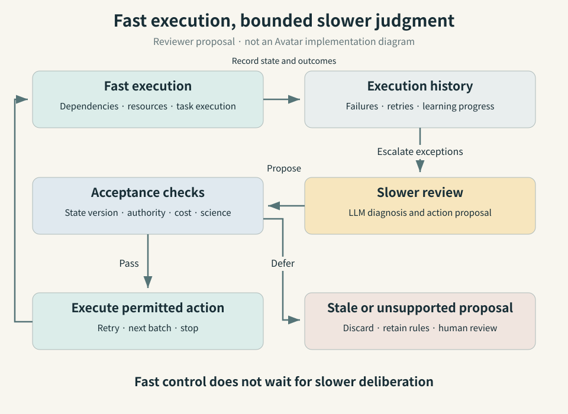

# When Should a Research Agent Intervene? Avatar and the Cost of Judgment

## Overview

The Avatar preprint, submitted on September 9, compares rule-based control with large language model (LLM) decisions while retaining the surrounding scientific-workflow architecture. Its authors report approximately 40% less GPU-busy time in a molecular search that retrieves stored QM9 values, but a larger mean backlog—about 99 tasks rather than 21—when LLM control replaces a rule-based autoscaler. Choosing which decisions to delegate requires accounting for the time spent waiting and the losses caused by a wrong decision. [1]

*Figure 1 · AI-generated conceptual. The dedicated illustration shows a fast execution path and a slower path that reviews results before branching. Atomistic models, compute hardware and inspection lenses represent the roles in each path.*

The original evidence-collection window was September 6–12, 2026. The earlier [DeMARS article](https://infant83.github.io/AI_Tech_Review/reviews/2026-09-06_agentic-programs-materials-science/en/) examined judgments involved in constructing atomistic models from disordered structures. Avatar tests decisions made **during execution: recovery, resource scaling and campaign termination**.

## Decisions made after calculations start

A computational materials campaign leaves a trail of decisions after its inputs have been prepared. Should a failed job be retried? Is the failure temporary, or will another attempt repeat it? Does another batch of candidates justify its cost? Automating these decisions could reduce the time researchers spend watching logs. It could also leave resources idle while a model deliberates, or terminate a promising campaign too soon.

A workflow management system (WMS) tracks task dependencies and execution state. In high-performance computing (HPC), it interacts with schedulers, data movement and recovery mechanisms. The agent **harness** discussed in the [earlier harness-engineering review](https://infant83.github.io/AI_Tech_Review/reviews/2026-05-09_ai-updates-weekly/) specifies the state it can observe, the tools it can use, its permitted actions, and the validation and records surrounding those actions.

Avatar asks which decisions benefit from replacing a rule with an LLM policy when the execution architecture and action interface remain fixed. It compares the effects of those policies on recovery, resource scaling and campaign termination. The numerical results discussed below are reported by the paper's authors. [1]

## Separate the responsibilities, then vary the policy

Avatar separates an **orchestrator**, which governs logical workflow progress; an **executor**, which realizes actions on computational resources; and a **provenance component**, which preserves execution history and produces diagnostic triggers. Provenance makes it possible to trace a result to its inputs, attempts and execution conditions. [1, §III–IV]

An actor is a stateful software component that communicates through messages. Academy, the middleware underlying Avatar, supports stateful agents without requiring a language model. Avatar places rules or LLM reasoning in observation, diagnosis and progression decisions to compare the following three conditions. [1, 2]

| Condition | Observation and failure diagnosis | Recovery and progression decisions | Task execution |
|---|---|---|---|
| M0 | Rules | Rules | Rules |
| M1 | LLM diagnosis added | Rules | Rules |
| M2 | LLM | LLM | Rules |

*Table 1 · Source-derived from Avatar §IV. The executor that performs the actual work remains rule-based in all three conditions.*

Proposed actions pass through an adapter: code that translates representations and checks actions against the supported interface. The common catalog includes retrying, scaling resources, throttling work, proposing candidate batches, retraining a surrogate and stopping a campaign. Policies control the execution system through these defined operations. [1]

A `stop-campaign` action can have a valid format and fall within the permitted authority while still being scientifically premature. Valid syntax, authorized action and justified scientific decision require different checks. This review uses that distinction to propose checking both whether an operation can be executed and whether the scientific evidence justifies executing it.

The reported stack includes Python 3.12, Academy 0.5.0, Parsl 2026.3.9, TaskVine and Colmena. Reasoning uses `open-ai/gpt-oss-20b`, served through Argonne's Sophia inference endpoint. The compute-node specification for E1/E2 is a Xeon Gold 6248R at 3 GHz, 48 CPU cores and 192 GB of memory. In E2, the actors exchange local messages within a single process on the `midway3-login3` login node, while numerical workers run on a separate dedicated `caslake` compute node. Academy's distributed capabilities and the actor communication and placement tested here should be distinguished. [1, 2]

## Three experiments, three distinct questions

### Recovery: how much work is spent repeating permanent failures?

E1 injects failures or stragglers into synthetic matrix-computation tasks. The disturbance-injection parameter is p=0.35, and the parameter determining the fraction of permanent failures is x=1/3. The study varies the retry ceiling and failure conditions. M2 uses repeated-failure history and abandons tasks diagnosed as permanently failing after one retry. The reported reduction of up to approximately 55% concerns wasted computation under these recovery conditions. [1, §V]

The principal baseline retries up to a fixed limit. Electronic-structure workloads contain failures with different remedies, including memory exhaustion, invalid inputs and electronic convergence problems. Adding rules that recognize these conditions would help separate the benefit of doing fewer retries from the contribution of language-model diagnosis.

### Scaling: a decision can arrive too late

E2 is a streaming workload with changing arrival rates. Each input creates preprocessing, parallel analysis and aggregation stages. The study compares fixed Parsl worker pools and dynamic Avatar control. A worker is an execution slot; backlog counts tasks waiting for processing. [1]

At N=128, the reported mean backlog is approximately 21 for rule-based autoscaling, M0/M1, and 99 for M2. The authors attribute the degradation to reasoning that cannot respond quickly enough for the control loop. Backlog was sampled every 0.2 seconds; this observation interval should be distinguished from each policy's decision period. [1, §V-A–B]

In this scaling workload, tasks accumulated while the controller waited for slower decisions. A follow-up could preserve fast rule-based control and use LLM diagnosis for situations those rules cannot resolve, then compare how the latency and diagnostic benefit change.

### Stopping: can a campaign do less work without losing its best result?

E3 uses Colmena for molecular active learning: a model chooses which candidates to evaluate next, then learns from the newly acquired values. The objective is to maximize the energy difference between the highest occupied molecular orbital (HOMO) and lowest unoccupied molecular orbital (LUMO). The setup uses 5,000 QM9 candidates, 100 initial labels and batches of 32 selections. A multilayer perceptron (MLP) trained on Morgan molecular fingerprints serves as the GPU-based surrogate. [1]

The property-evaluation step retrieves a **stored QM9 gap**. The study uses this lookup in place of new density functional theory (DFT) calculations to test the control of candidate selection, training and termination. [1, §V-A]

The native baseline and M0/M1 run all 12 rounds. M2 interprets the learning history and stops at round 7, reaching the same best observed gap while reducing GPU-busy time by approximately 40%, according to the authors. The campaign uses one NVIDIA Quadro RTX 6000 with CUDA 12.2 and requests 16 CPU cores. [1, §V]

| Experiment | Reported comparison | Quantity measured | Scope of the result |
|---|---|---|---|
| E1: recovery | Up to approximately 55% less wasted computation | Wasted worker time in a synthetic failure workload | Retry costs under synthetic disturbances |
| E2: scaling | Mean backlog approximately 21 → 99, N=128 | Pending tasks, rule autoscaler versus M2 | The specified streaming workload and control conditions |
| E3: stopping | 12 → 7 rounds; approximately 40% less GPU-busy time | GPU activity in a QM9-lookup campaign | New DFT, whole-system cost and energy outside this measurement |

*Table 2 · Source-derived from Avatar §V and the textual discussion of Figures 5–6. Each row states the measured quantity and comparison conditions for a different workload.*

Skipping five of twelve rounds is 5/12, approximately 41.7%. This is an arithmetic check in the review. Training-set growth and fixed overhead mean the fraction of skipped rounds need not equal the reduction in GPU activity. The paper's best-gap number lacks a sufficiently explicit unit description in the main text; this review does not assign it an assumed eV or Hartree unit.

## From GPU time to campaign cost

Comparing the total cost of a campaign requires accounting for inference-service resources, network waits, CPU work, recovery from bad decisions and human intervention, alongside the GPU activity reported in E3. GPU-busy time measures activity duration. Converting it to energy use or billed cost requires the corresponding measurements and rates.

To organize those cost terms for a follow-up comparison, this review uses the following **editorial accounting proposal**:

$$G = p_{\mathrm{useful}}C_{\mathrm{saved}}-C_{\mathrm{inference}}-\mathbb{E}[C_{\mathrm{wrong}}].$$

G denotes expected net benefit; p is the probability of a useful intervention; C_saved is the cost it avoids; C_inference covers inference and communication; the final term is expected loss from a wrong decision. All costs must use a common unit. CPU-seconds and GPU-seconds cannot simply be added. This accounting model is constructed for the review.

A timing constraint remains separate. If decision latency τ is comparable to the environment's change timescale Δ, even a well-reasoned action may be stale when applied. A comparison of scaling in E2 and campaign termination in E3 should measure which costs accumulate while each system waits for a decision.

<figure class="figure-panel figure-panel-fit">

<figcaption>Figure 2 · Proposed / reviewer-constructed. A materials-workflow design motivated by Avatar's separation of policies. Stale proposals are discarded and scientific stopping criteria are checked separately.</figcaption>
</figure>

## Testing whether the system knows when to stop

A follow-up could compare M2 with patience policies that stop after several rounds without improvement, policies based on uncertainty and expected improvement, and fixed-cost budgets. Using the same candidate pool and resource constraints would help establish what learning-based diagnosis contributes beyond skipping rounds in an unconditional twelve-round campaign.

A stopping policy should also be evaluated on the improvements it misses across new seeds and pools. Useful measurements include the best remaining candidate at termination, outcome distributions over initial samples, and improvements discovered by continuing after the proposed stopping point. Because QM9 labels already exist, the study setting is well suited to measuring retrospective loss on unselected candidates. In genuinely new calculations that ground truth is costly; some continuation budget must be reserved for validation.

The authors describe approximately 1,200 lines of common core code retained across the three workloads. The original September investigation did **not identify a public, experiment-specific Avatar repository and pinned commit**. Reconstructing the experiments requires Avatar's policies, prompts, invalid-action handling and per-seed logs in addition to the public Academy and Colmena code. The original review checked the paper and simple arithmetic. [1–3]

## A bounded experiment for materials research and enterprise operations

A practical first follow-up for materials calculations is to analyze historical failures and recommend next actions. Prior outcomes provide a basis for evaluating the benefits and risks of those recommendations. The following four steps are an operational proposal in this review.

1. **Replay completed cases.** Present failure logs but hide their eventual resolution. Compare ordinary retry, failure-aware rules, LLM diagnosis with rule execution, and LLM action proposals. Split related calculation families across evaluation boundaries to reduce leakage.
2. **Fix the scientific contract.** Record charge, spin, exchange–correlation functional, basis, k-point sampling and convergence criteria. A proposal that changes these conditions becomes a new scientific task, not an invisible retry. Finishing faster by calculating a different physical problem should not count as success.
3. **Begin in read-only shadow mode.** Let the model propose without actuating. Record human interventions and their duration, recoverable calculations wrongly abandoned, and the fraction yielding scientifically valid outputs. Report both all-task and automatically accepted-task denominators.
4. **Grant only bounded execution.** Use an approved action catalog, cost limits, state-version checks, duplicate-execution protection and a rule-based fallback. Leave global queue control and fast monitoring with the established execution system.

In organic light-emitting diode (OLED) calculations, targets can include excited-state properties, emission rates and degradation stability as well as orbital gaps. Applying Avatar's control policy to these tasks would require evaluating whether retry and stopping criteria serve each property calculation.

On-premises model hosting and restricted execution authority are separate design decisions. This review proposes separating the model service, compute execution account and publication or merge account, and treating logs as untrusted input. GitLab continuous integration/continuous delivery (CI/CD) can retain tests and change approval, while an HPC scheduler retains resource execution. This is an operational proposal, not a GitLab integration validated in Avatar.

## Researchers and seminar questions

| Candidate | Public affiliation and relevant evidence | Question for a seminar |
|---|---|---|
| Suman Raj | Avatar first author; University of Chicago and Argonne National Laboratory affiliations in the paper [1] | How much benefit remains after adding a deterministic permanent-failure classifier and a patience-based stopping policy? |
| Kyle Chard | Research Associate Professor at the University of Chicago and Argonne researcher; Avatar coauthor and Academy-related work [1, 2, 4] | How should multi-node systems reject stale or duplicated actions, and which execution records can be released for independent evaluation? |

Affiliations follow the public records checked on September 13, 2026. Project-specific leadership responsibilities were not inferred.

## What to watch next

A follow-up evaluation should include real DFT execution, distributed actor operation, adaptive baselines and repeated trials that account for human intervention. Recording inference, waiting and recovery costs would allow comparison of **total cost per valid result at matched scientific quality and acceptable risk**.

## References

1. [S. Raj, H. D. Nguyen, H. Pan, R. Chard, K. Chard, and I. Foster, Avatar: Toward autonomous end-to-end orchestration of scientific workflows using LLMs, arXiv:2609.10509v1 (2026).](https://arxiv.org/abs/2609.10509v1)
2. [Globus Labs, Academy: Federated actors and agents, version 0.5.0 (2026).](https://github.com/academy-agents/academy/tree/v0.5.0)
3. [Colmena, Colmena: AI-Steering for HPC, official documentation (accessed 27 November 2026).](https://colmena.readthedocs.io/en/latest/)
4. [K. Chard, Kyle Chard - University of Chicago (accessed 27 November 2026).](https://kylechard.com/)

## Preparation and review information

Original writing and review (2026-09-13): the responsible editor was Hyun-Jung Kim. One OpenAI Codex agent performed research, bilingual writing, source checks, scientific copyediting, coding and publication checks under the recurring publication request. The exact runtime model identifier was not retained. At that time, there was no separate verification agent or line-by-line human review. The evidence cutoff is September 12, 2026; source inspection took place on September 13.

The workflow followed [AI Tech Review Editorial Harness v2026.08](https://infant83.github.io/AI_Tech_Review/methods/), using web research, the GitHub connection, local Python rendering and checks, and browser inspection. The hero used the built-in imagegen tool; the diagram is deterministic SVG. Scientific copyediting preserved measurements and comparison conditions while removing abstract importance claims and excessive contrasts. Checks covered the paper, round-count arithmetic, pages, links and metadata; Avatar computations and GPU measurements were not reproduced. Total inference cost and generalization remain unverified.

## Editorial revision, 2026-11-27

AEDAUT retained the original publication date, September 13, 2026, and evidence cutoff, September 12, while revising the prose and references. Repeated qualifications were integrated with the comparison conditions. The revision clarifies E1's p=0.35 failure/straggler injection and E2's login-node actors versus the separate compute-node workers, and restores the full Avatar title, all six authors and the identity of the Academy 0.5.0 documentation. It does not add new research results or current product states to the September account.

`avatar1127_prose` performed the initial prose review and prepared the bilingual revision drafts; root integrated the revision and checked the complete argument and bilingual correspondence. `avatar1127_science` checked the complete Avatar v1 HTML text, tables, captions and references, full extracted text of the eight-page PDF with selected page 1/7 cross-checks, Academy 0.5.0 documentation and selected code, Colmena documentation and the researcher profile. Root also checked the experimental definitions, placement and results in §V. `avatar1127_build_audit` separately compared the existing bilingual public pages, assets, equation and publication path. The [revision record](https://github.com/Infant83/AI_Tech_Review/blob/main/.automation/writing-reviews/legacy-refresh/2026-11-27-avatar/README.md) distinguishes final review and actual output/publication checks.

This revision follows the current ATRL writing and prose-review guidance. The November 27 source recheck is distinct from the retained September inspection records. Existing cover art, diagrams and equation were preserved. AI assistance was OpenAI Codex; the exact model identifier was not retained. No Avatar code, experiment, GPU measurement or human-reader comprehension study was reproduced.

Attribution and adaptation: Avatar v1 by Raj, Nguyen, Pan, R. Chard, K. Chard and Foster is distributed under CC BY-NC-SA 4.0. Paper-derived explanations and tables here translate, summarize and critically adapt that work; no original figure was copied. This bilingual review text and its reconstructed diagrams are provided under [CC BY-NC-SA 4.0](https://creativecommons.org/licenses/by-nc-sa/4.0/). The generated hero is a separate AI conceptual illustration, not a figure from the paper.
