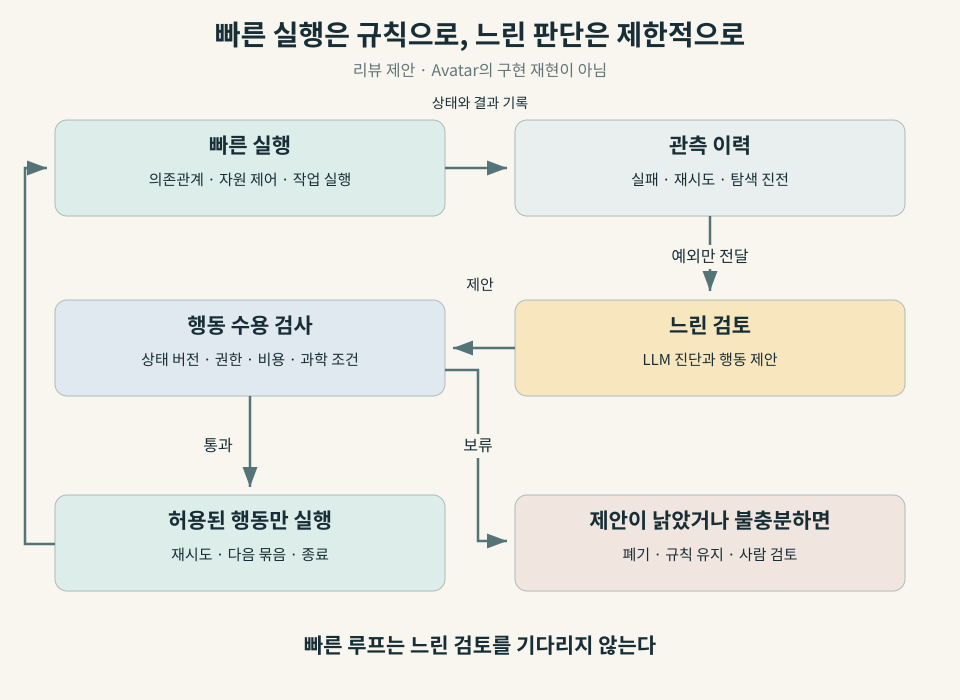

# 연구 에이전트는 언제 개입해야 하는가: Avatar가 드러낸 판단의 비용

## 요약

9월 9일 제출된 Avatar 프리프린트는 과학 계산의 실행 구조를 유지한 채 규칙 기반 제어와 대규모 언어모델(large language model, LLM)의 판단을 비교했다. 연구진은 QM9의 저장된 값을 조회하는 분자 탐색에서 GPU 사용시간을 약 40% 줄였지만, 빠르게 변하는 자원 수요에 대응하는 실험에서는 평균 대기열이 규칙 기반의 약 21개에서 LLM 제어의 약 99개로 커졌다고 보고했다. 어떤 판단을 에이전트에게 맡길지는 그 판단을 기다릴 시간과 잘못된 결정으로 생길 손실을 함께 따져야 한다. [1]

*그림 1 · AI-generated conceptual. 빠른 반복 실행과 결과 검토 후의 분기를 표현한 전용 개념 일러스트다. 원자 모형·계산 장치·검토 렌즈로 두 경로의 역할을 나타냈다.*

원 조사의 자료 수집 기간은 2026년 9월 6–12일이다. 앞선 [DeMARS 리뷰](https://infant83.github.io/AI_Tech_Review/reviews/2026-09-06_agentic-programs-materials-science/)는 무질서 결정의 원자 모델을 만드는 판단을 다뤘다. Avatar가 시험한 대상은 계산이 시작된 뒤 **실패를 어떻게 처리하고, 자원을 언제 늘리며, 탐색을 언제 끝낼지**다.

## 계산이 시작된 뒤의 판단

계산 재료과학에서 한 번의 입력 작성보다 더 오래 남는 일은 계산 묶음을 관리하는 일이다. 같은 계산이 다시 실패했을 때 재시도할지, 일시적인 자원 부족인지 물리적 설정 문제인지, 다음 후보를 평가할 가치가 남아 있는지 판단해야 한다. 이 판단을 자동화하면 연구자가 로그를 지켜보는 시간을 줄일 가능성이 있다. 반대로 판단을 기다리느라 계산 자원이 놀거나, 유망한 탐색을 일찍 끝내면 자동화가 손해를 만든다.

과학 워크플로 관리 시스템(workflow management system, WMS)은 작업의 의존관계와 실행 상태를 관리한다. 고성능 컴퓨팅(high-performance computing, HPC) 환경에서는 여기에 작업 스케줄러와 데이터 이동, 실패 복구가 연결된다. 5월의 [하네스 엔지니어링 리뷰](https://infant83.github.io/AI_Tech_Review/reviews/2026-05-09_ai-updates-weekly/)에서 다룬 에이전트의 **하네스**는 모델이 관측할 상태, 사용할 도구, 허용된 행동, 검증과 기록을 포함한 실행 환경이다.

Avatar는 **실행 구조와 허용 행동을 고정하고 판단 정책만 바꿨을 때, 어떤 결정에서 이득이 생기는지**를 묻는다. 복구·자원 확장·탐색 종료를 서로 다른 과업으로 구성해 정책의 효과를 비교했다. 아래 수치는 논문 저자들의 보고를 바탕으로 한다. [1]

## 세 역할을 나누고, 판단 정책을 교체한다

Avatar는 작업의 논리적 진행을 결정하는 조정자(orchestrator), 실제 작업을 실행하는 실행자(executor), 실행 이력과 실패를 기록하는 관측·이력 담당(provenance)을 분리한다. 여기서 provenance는 결과가 어떤 입력, 시도, 실행 조건을 거쳐 나왔는지 추적할 수 있는 기록이다. [1, §III–IV]

이 역할을 구현하는 **actor**는 상태를 보관하고 메시지로 통신하는 소프트웨어 구성요소다. 구현 기반인 Academy는 LLM 없이도 동작하는 상태 기반 에이전트 미들웨어다. Avatar에서는 관측·진단과 진행 판단에 규칙 또는 LLM을 배치해 다음 세 조건을 비교한다. [1, 2]

| 비교 조건 | 관측·실패 진단 | 복구·진행 결정 | 작업 실행 |
|---|---|---|---|
| M0 | 규칙 | 규칙 | 규칙 |
| M1 | LLM 진단 추가 | 규칙 | 규칙 |
| M2 | LLM | LLM | 규칙 |

*표 1 · Source-derived. Avatar §IV의 정책 배치다. 세 조건 모두 실제 작업을 실행하는 실행자는 규칙 기반이다.*

정책이 제안한 행동은 adapter를 거친다. 이는 시스템 간 표현을 맞추면서 허용된 행동과 형식인지 확인하는 코드다. 재시도, 자원 확장·축소, 처리량 제한, 후보 묶음 제안, 대리모델 재학습, 탐색 종료 등이 공통 행동 목록에 들어간다. 정책은 이 인터페이스에 정의된 동작을 통해 실행 시스템을 제어한다. [1]

`stop-campaign`이 올바른 형식이고 허용된 권한 안에 있어도, 그때 탐색을 끝낼 과학적 근거가 충분한지는 따로 판단해야 한다. **형식 검증, 권한 검증, 과학적 판단의 검증**은 서로 다른 일을 한다. 이 리뷰는 이 구별을 바탕으로, 실행할 수 있는 명령인지와 실행할 이유가 있는지를 각각 확인하는 설계를 제안한다.

연구진이 명시한 소프트웨어는 Python 3.12, Academy 0.5.0, Parsl 2026.3.9, TaskVine과 Colmena다. LLM은 Argonne의 Sophia 추론 서비스에서 제공한 `open-ai/gpt-oss-20b`다. E1/E2 계산에 사용한 노드의 사양은 Xeon Gold 6248R 3 GHz, CPU 48코어, 메모리 192 GB다. E2에서는 actor들이 `midway3-login3` 로그인 노드의 단일 프로세스에서 로컬 메시지를 교환하고, 수치 작업 worker는 별도의 `caslake` 계산 노드에서 실행됐다. Academy의 분산 기능과 이 실험에서 시험한 actor 통신·배치 구성을 구별할 필요가 있다. [1, 2]

## 세 실험은 서로 다른 질문에 답한다

### 1. 복구: 다시 해도 실패하는 일을 얼마나 반복하는가

E1은 행렬 계산을 수행하는 합성 작업에 실패나 straggler(지연 작업)를 주입하는 실험이다. 장애 주입 파라미터는 p=0.35이고, 영구 실패 비율을 정하는 파라미터는 x=1/3이다. 연구진은 재시도 상한과 실패 조건을 바꾸었다. M2는 반복 실패 이력에서 영구 실패로 진단한 작업을 한 번 재시도한 뒤 포기했다. 연구진이 보고한 낭비 계산의 최대 약 55% 감소는 이 복구 실험의 조건부 성과다. [1, §V]

기본 비교 대상은 정해진 횟수까지 다시 시도하는 정책이다. 실제 전자구조 계산에서는 메모리 부족, 입력 오류, 전자 수렴 실패처럼 대응이 다른 장애가 섞인다. 오류 종류를 구별하는 규칙을 기준선에 추가하면, 단순히 재시도를 줄이는 효과와 언어모델이 진단에 더한 효과를 분리해 비교할 수 있다.

### 2. 자원 확장: 판단이 늦으면 대기열이 쌓인다

E2는 입력 도착률이 달라지는 스트리밍 작업이다. 입력마다 전처리, 병렬 분석, 집계가 연결된다. 고정 worker 수의 Parsl과 Avatar의 동적 제어를 비교했다. worker는 작업을 실행할 수 있는 실행 슬롯이며, backlog는 아직 처리하지 못하고 쌓인 작업 수다. [1]

논문은 N=128 조건에서 규칙 기반 자동 확장(M0/M1)의 평균 backlog를 약 21, M2를 약 99로 보고한다. 저자들은 이를 LLM이 제어 루프에 필요한 속도로 반응하지 못한 결과로 해석한다. 대기열은 0.2초마다 표본추출했으며, 이 관측 간격과 각 정책의 결정 주기는 구별해야 한다. [1, §V-A–B]

이 자원 제어에서는 느린 판단을 기다리는 동안 대기열이 늘었다. 빠른 규칙 제어를 유지하면서 규칙이 처리하지 못한 상황을 LLM 진단에 맡기면 지연과 진단의 이득이 어떻게 달라지는지 후속 실험으로 비교할 수 있다.

### 3. 탐색 종료: 덜 계산하고도 같은 최선값을 얻었는가

E3는 Colmena를 이용한 분자 능동학습(active learning)이다. 능동학습은 현재 모델로 다음에 평가할 후보를 고르고, 새 값을 반영해 모델을 다시 학습하는 과정이다. 이 실험은 최고 점유 분자궤도(highest occupied molecular orbital, HOMO)와 최저 비점유 분자궤도(lowest unoccupied molecular orbital, LUMO)의 에너지 차이를 최대화한다. QM9 후보 5,000개, 초기 라벨 100개, 회차당 선택 32개를 사용했다. Morgan 분자 지문을 입력으로 하는 다층 퍼셉트론(multilayer perceptron, MLP)을 GPU에서 학습했다. [1]

분자 값을 얻는 단계에서는 **QM9에 저장된 gap을 조회**한다. 밀도범함수이론(density functional theory, DFT) 계산을 새로 수행하는 대신 기존 데이터로 후보를 평가해, 후보 선택·학습·종료를 조정하는 탐색 운영을 시험했다. [1, §V-A]

기본 정책과 M0/M1은 12회차를 모두 실행했다. M2는 학습 진전을 보고 7회차에 종료해 같은 최선의 gap에 도달하면서 GPU-busy time을 약 40% 줄였다고 보고한다. 실행 환경은 NVIDIA Quadro RTX 6000 한 장, CUDA 12.2이며 해당 작업에 CPU 16개를 요청했다. [1, §V]

| 실험 | 논문이 보고한 비교 | 무엇을 측정했나 | 결과의 범위 |
|---|---|---|---|
| E1, 실패 복구 | 낭비 계산 최대 약 55% 감소 | 합성 실패 작업의 낭비 worker 시간 | 합성 장애 조건의 재시도 비용 |
| E2, 자원 확장 | 평균 backlog 약 21 → 약 99, N=128 | 규칙 자동 확장 대비 M2의 대기 작업 수 | 해당 스트리밍 작업과 제어 조건 |
| E3, 탐색 종료 | 12 → 7회차, GPU-busy time 약 40% 감소 | QM9 조회 기반 탐색의 GPU 활동 시간 | 신규 DFT·총비용·전력 사용량은 이 측정 밖 |

*표 2 · Source-derived. Avatar §V 및 그림 5–6의 본문 설명을 재구성했다. 각 행은 서로 다른 작업에서 측정한 값과 그 비교 조건을 담는다.*

12회차 중 5회차를 생략한 비율은 5/12, 약 41.7%다. 리뷰에서 확인한 산술값이며, 회차마다 학습 데이터가 늘고 고정 비용도 있어 이 비율이 GPU 활동 시간의 감소율과 같을 필요는 없다. 원문의 최선 gap 수치에는 본문 단위 설명이 충분하지 않아 이 리뷰에서는 eV나 Hartree로 추정 변환하지 않았다.

## GPU 시간에서 계산 캠페인의 총비용으로

계산 캠페인의 총비용을 비교하려면 E3의 GPU 활동 시간에 더해 추론 서비스의 자원 사용, 네트워크 대기, CPU 작업, 실패한 판단의 복구, 사람의 개입을 계상해야 한다. GPU-busy time은 활동 시간이다. 전력 사용량이나 청구 비용으로 환산하려면 그에 맞는 측정과 단가가 필요하다.

후속 비교의 비용 항목을 정리하기 위해 이 리뷰에서는 다음 **제안식**을 사용한다.

$$G = p_{\mathrm{useful}}C_{\mathrm{saved}}-C_{\mathrm{inference}}-\mathbb{E}[C_{\mathrm{wrong}}].$$

여기서 G는 기대 순이득, p는 유용한 판단의 확률, C_saved는 그 판단으로 줄이는 비용, C_inference는 추론·통신 비용, 마지막 항은 잘못된 결정으로 생기는 기대 손실이다. 모든 C는 같은 비용 단위로 평가해야 한다. CPU 초와 GPU 초를 그냥 더하지 않는다. 이 식은 리뷰에서 구성한 비용 계상 방법이다.

시간 제약은 별도로 둬야 한다. 결정 지연 τ가 환경이 달라지는 시간 Δ와 비슷하면, 좋은 판단도 적용 시점에는 낡을 수 있다. E2의 자원 확장과 E3의 탐색 종료를 비교할 때에도 판단을 기다리는 동안 어떤 비용이 누적되는지 각각 측정해야 한다.

<figure class="figure-panel figure-panel-fit">

<figcaption>그림 2 · Proposed / reviewer-constructed. Avatar의 정책 분리에서 출발해 재료 계산에 제안하는 두 시간척도 구조다. 상태가 바뀌었으면 제안을 폐기하고, 과학적 종료 조건은 따로 검사한다.</figcaption>
</figure>

## “언제 멈출지 안다”를 검증하려면

다음 비교에는 개선이 없는 회차가 이어지면 멈추는 patience 정책, 불확실성과 기대 개선량을 이용하는 정책, 일정 비용까지 탐색하는 정책을 넣을 수 있다. 같은 후보군과 예산에서 M2를 이 적응형 종료 규칙들과 비교하면, 고정 12회차를 생략하는 것에 더해 학습 진단이 어떤 이득을 주는지 평가할 수 있다.

종료 정책을 다른 seed와 후보군에 적용했을 때 놓치는 개선량도 확인할 필요가 있다. 종료 시점에 남아 있던 후보의 최선값, 여러 초기 표본에 대한 결과 분포, 종료 후 추가 탐색에서 발견되는 개선량을 보고 싶다. 이미 정답이 있는 QM9라면 선택되지 않은 후보까지 이용해 사후 손실을 평가하기 좋다. 실제 신규 계산에서는 그 사후 정답 자체가 비싸므로 일부 후속 계산 예산을 검증용으로 남겨야 한다.

원문은 공통 코드 약 1,200줄을 세 작업에서 그대로 썼다고 설명한다. 9월 원작성 조사에서는 **Avatar 실험 전용 공개 저장소와 고정 commit을 확인하지 못했다**. Academy·Colmena의 공개 코드와 별도로 Avatar의 정책, prompt, 무효 행동 처리, seed별 로그가 있어야 실험을 다시 구성할 수 있다. 원작성 때 수행한 검토는 본문 대조와 산술 점검까지였다. [1–3]

## 재료 계산과 기업 운영에 적용할 작은 실험

재료 계산에 적용할 첫 후속 실험으로는, 과거 실패 로그를 분석해 다음 행동을 제안하는 작업이 적절하다. 이미 알려진 해결 과정과 비교해 제안의 이득과 위험을 평가할 수 있기 때문이다. 다음 네 단계는 이 리뷰의 운영 제안이다.

1. **과거 계산을 재생한다.** 알려진 실패 로그를 입력으로 주되 최종 해결법은 숨긴다. 기존 재시도, 오류 분류 규칙, LLM 진단+규칙 실행, LLM 행동 제안을 같은 사례에서 비교한다. 동일 구조의 계산이 학습과 평가에 섞이지 않도록 작업 계열별로 나눈다.
2. **바꾸지 않을 물리를 고정한다.** 전하·스핀·교환상관 범함수·기저·k점·수렴 기준 등은 작업 계약에 기록한다. 이 중 변경이 필요한 제안은 기존 계산의 재시도가 아니라 별도 과학 조건의 새 작업으로 남긴다. 빨리 끝났다는 이유로 다른 물리를 계산한 결과를 성공으로 세지 않는다.
3. **읽기 전용 검토부터 시작한다.** LLM은 다음 행동을 제안하고 실제 실행은 하지 않는다. 사람이 개입한 횟수와 시간, 잘못 포기한 계산, 유효한 결과를 얻은 비율을 모두 기록한다. 전체 작업 수와 자동 수용한 작업 수를 따로 분모로 둔다.
4. **유효한 제안만 제한 실행한다.** 승인한 행동 목록, 비용 한도, 상태 버전 검사, 중복 실행 방지 키, 규칙 기반 대체 동작을 둔다. 전역 큐 제어와 빠른 상태 감시는 기존 실행 시스템에 남긴다.

유기발광다이오드(organic light-emitting diode, OLED) 계산에서는 궤도 gap뿐 아니라 여기상태·발광속도·열화 안정성 등 목표 물성이 달라진다. Avatar의 운영 정책을 이런 작업에 적용하려면, 재시도와 종료 기준이 각 물성의 계산 목적에 맞게 작동하는지 평가해야 한다.

온프레미스 환경에서는 모델을 내부에 두었다는 사실과 작업 권한을 제한했다는 사실을 구분해야 한다. 모델 서비스, 계산 실행 계정, 게시·병합 계정을 분리하고, 로그를 비신뢰 입력으로 취급하는 구성을 제안한다. GitLab의 지속적 통합·배포(continuous integration/continuous delivery, CI/CD)는 테스트와 변경 승인을 담당하고, HPC 스케줄러는 자원 실행을 담당하도록 역할을 유지할 수 있다. 이는 이 리뷰의 운영 설계 제안이며 Avatar에서 검증한 GitLab 통합은 아니다.

## 연구자와 세미나에서 물을 질문

| 후보 | 확인한 공개 소속·대표 근거 | 초청 세미나 질문 |
|---|---|---|
| Suman Raj | Avatar 제1저자, 논문상 University of Chicago·Argonne National Laboratory 공동 소속 [1] | 규칙 기반 영구 실패 분류와 patience 종료 정책을 추가하면 M2의 이득은 얼마나 남는가? |
| Kyle Chard | University of Chicago Research Associate Professor·Argonne 연구자; Avatar 공동저자, Academy 관련 연구 [1, 2, 4] | 다중 노드 환경에서 상태가 바뀐 제안과 중복 명령을 어떻게 막고, 어떤 로그를 공개할 수 있는가? |

소속은 원 확인일인 2026년 9월 13일의 공개 기록을 기준으로 했다. 논문에 없는 프로젝트별 책임 범위는 추정하지 않았다.

## 다음 논문에서 확인할 것

후속 평가에서는 실제 DFT 실행, 분산된 actor의 운영, 적응형 기준선과 사람 개입을 포함한 반복 실험이 필요하다. 그때 추론·대기·복구 비용을 함께 기록해, **같은 과학적 결과와 허용 위험 아래 유효 결과당 총비용이 줄었는지** 비교해야 한다.

## 참고문헌

1. [S. Raj, H. D. Nguyen, H. Pan, R. Chard, K. Chard, and I. Foster, Avatar: Toward autonomous end-to-end orchestration of scientific workflows using LLMs, arXiv:2609.10509v1 (2026).](https://arxiv.org/abs/2609.10509v1)
2. [Globus Labs, Academy: Federated actors and agents, version 0.5.0 (2026).](https://github.com/academy-agents/academy/tree/v0.5.0)
3. [Colmena, Colmena: AI-Steering for HPC, official documentation (accessed 27 November 2026).](https://colmena.readthedocs.io/en/latest/)
4. [K. Chard, Kyle Chard - University of Chicago (accessed 27 November 2026).](https://kylechard.com/)

## 작성 및 검토 정보

원작성·검토(2026-09-13): 책임 편집자는 김현중이다. 정기 공개 요청에 따라 OpenAI Codex 에이전트 1개가 조사·한영 집필·출처 대조·과학 감수·코딩·게시 검사를 수행했다. 정확한 실행 모델 식별자는 보존되지 않았으며, 당시 별도 검증 에이전트나 문장 단위 사람 검토는 없었다. 근거 기준일은 2026-09-12이고 원문·문서 확인은 9월 13일 수행했다.

[AI Tech Review Editorial Harness v2026.08](https://infant83.github.io/AI_Tech_Review/methods/)에 따라 웹 검색·GitHub 연결·로컬 Python 렌더/검사·브라우저 확인을 사용했다. 표지는 imagegen 내장 생성 도구로 만들었고 도식은 결정론적 SVG다. 과학 감수에서는 수치와 비교 조건을 고정한 뒤 추상적 중요성 선언과 과도한 대비를 줄였다. 본문 대조, 회차 비율 산술, 페이지·링크·metadata 검사를 수행했지만 Avatar 계산과 GPU 측정은 재현하지 않았다. 전체 추론 비용과 일반화는 미확인이다.

## 2026-11-27 편집 개정

편집부(AEDAUT)는 원 발행일 2026-09-13과 당시 근거 기준일 2026-09-12를 유지하며 문체와 참고문헌을 개정했다. 반복되는 부정·유보를 비교 조건에 통합하고, E1의 p=0.35를 실패·지연 주입 조건으로 명확히 했다. E2의 로그인 노드 actor와 별도 계산 노드 worker 배치를 보완했으며, Avatar의 원제·저자 6명과 Academy 0.5.0 문서의 식별정보를 정식 서지에 반영했다. 새 연구 결과나 현재 제품 상태를 9월의 사실로 추가하지 않았다.

`avatar1127_prose`가 원고의 초기 문체 검토와 한영 수정 초안 작성을 맡았고, root가 통합 편집과 원고 전체의 논지·한영 대응을 검토했다. `avatar1127_science`는 Avatar v1 HTML 본문·표·캡션·참고문헌 전체, 8쪽 PDF 전체 추출 텍스트와 선택한 1·7쪽, Academy 0.5.0 문서·선택 코드, Colmena 공식 문서와 연구자 소개를 대조했다. root도 원문 §V의 실험 정의·배치·결과를 직접 확인했다. `avatar1127_build_audit`는 기존 한영 공개본·자산·수식과 출판 경로를 별도로 대조했다. 각 담당자의 최종 검토와 실제 출력·공개 확인 범위는 [개정 기록](https://github.com/Infant83/AI_Tech_Review/blob/main/.automation/writing-reviews/legacy-refresh/2026-11-27-avatar/README.md)에 구분한다.

현재 개정에는 ATRL의 공통 작성·문체 감수 기준을 적용했다. 원 논문·공식 문서의 재대조일은 2026-11-27이며, 9월 당시 문서 확인 기록과 구별한다. 기존 표지·도식·수식은 보존했다. AI 보조는 OpenAI Codex이며 정확한 모델 식별자는 미보존이다. Avatar의 코드·실험·GPU 측정과 사람 독자의 이해도 평가는 재현하지 않았다.

출처·재구성 고지: Raj, Nguyen, Pan, R. Chard, K. Chard, Foster의 Avatar v1은 CC BY-NC-SA 4.0으로 공개되어 있다. 이 글의 원문 기반 해설과 표는 해당 논문을 번역·요약·비평해 재구성했으며 원 그림을 복제하지 않았다. 이 한영 리뷰 본문과 재구성 도식은 [CC BY-NC-SA 4.0](https://creativecommons.org/licenses/by-nc-sa/4.0/)으로 제공한다. 생성 표지는 별도 AI 개념 이미지이며 원 논문의 그림이 아니다.
