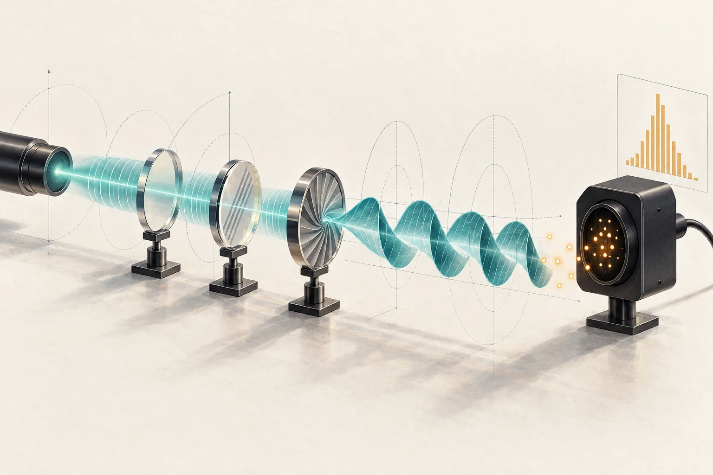
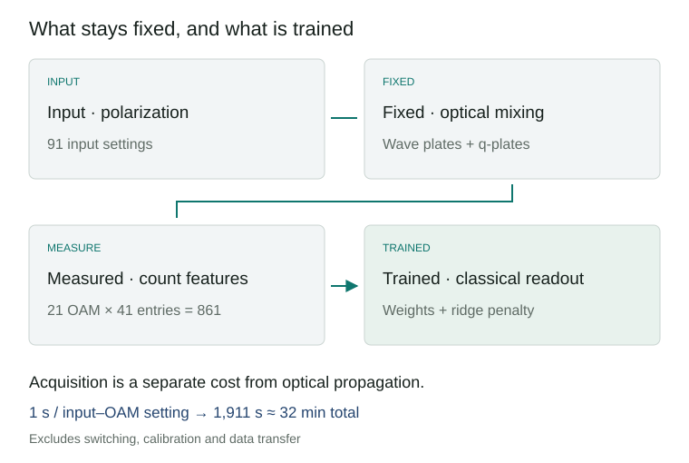
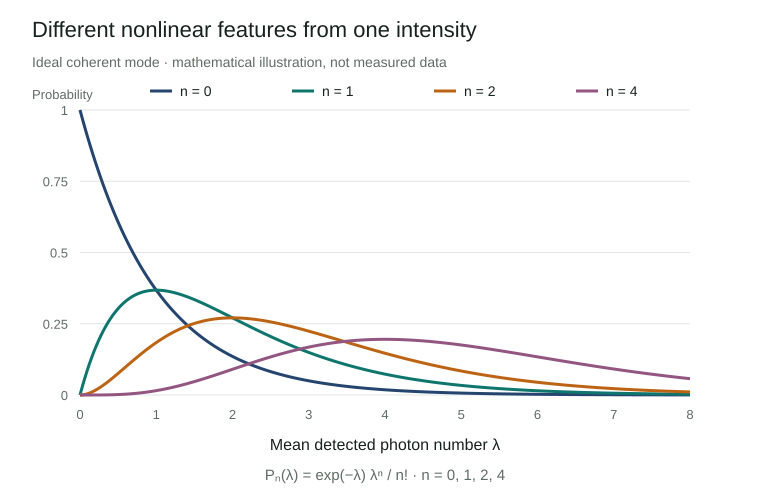

# From light intensity to photon-count distributions: multiphoton reservoir performance and acquisition time

Averaging a photodetector's count records summarizes the light's brightness in a single value. Keeping the records also allows us to estimate how often a fixed time window contains zero, one or two detection events. Hong and colleagues used these photon-count distributions as learning features. Their experiment compares nonlinear function reconstruction using distributions with reconstruction using mean intensity from the same optical field. [1,2]

This **multiphoton quantum reservoir** keeps the optical network fixed and trains only the final regression stage that combines the measurements. Reconstruction improved for some targets, but acquiring the distributions used for learning took approximately 32 minutes. Assessing performance and cost therefore begins with the features being measured. The paper also examines optical random walks and classical computational hardness; those claims require their own experimental and computational conditions. [1,2]

*An AI-generated illustration of optical mode conversion and photon counting. It does not reproduce the experimental layout or measured data.*

**Research status and dates.** The paper reports a peer-reviewed room-temperature optical experiment, first published on **19 August 2026**. This review's original publication date and scientific evidence cutoff are **13 September 2026**; the editorial revision is dated **28 November 2026**. The main article and its 15-page Supporting Information (SI) are the sources reviewed. Raw data are offered on reasonable request. The experimental results and apparatus timings were not independently reproduced. Sources were checked again for the editorial revision on **28 November 2026**, separately from the original evidence cutoff. [1,2]

## 1. Classical light can still be counted in photons

In quantum optics, **classical light** does not mean light without photons. It means that the state admits a nonnegative probability mixture of coherent states. An ideal laser's coherent state and thermal light are examples. A coherent state has Poisson photon-number statistics; single-mode thermal light has larger fluctuations. Fixed-number Fock states and squeezed light can provide nonclassical resources under this definition.

A **Fock state** \(|n\rangle\) has a definite photon number in a specified mode. The paper describes number-resolved measurements as projections in this basis. Operationally, its detector records event times and groups counts into acquisition windows. Selecting records in which seven photons were detected produces conditional statistics. With absorbing photodetection, this does not mean that a seven-photon state survives the measurement and becomes available to a subsequent circuit. [1,2]

Selecting detection records by photon number allows spatial correlations to be investigated beyond mean intensity. This is a result about the statistics being measured. Preparing a nonclassical state for use after absorption, or establishing that the same statistics are hard to generate classically, requires additional preparation or computational conditions. This distinction matters when assessing photon-number selection and the complexity argument later in the review. [1,2]

## 2. Encoding polarization and mixing spatial modes

The apparatus combines **polarization**, the orientation of the optical electric field, with **orbital angular momentum (OAM)**. An OAM mode is labelled by an integer \(\ell\) describing phase winding around the beam. Coupling these modes creates a synthetic lattice; it does not require a physical array of interacting particles.

A half-wave plate (HWP) rotates polarization, a quarter-wave plate (QWP) changes relative polarization phases, and a q-plate couples polarization to OAM shifts. For the learning experiment, internal wave-plate angles are chosen randomly once and then held fixed. Only the input polarization changes. A spatial light modulator (SLM) selects output OAM projections for detection. Every input therefore encounters the same physical feature map. [2]

The source configuration changes between experiments. The setup uses a 633 nm laser and thermal light generated with rotating ground glass. Thermal sources support the walk and thermal-statistics experiments. The function-reconstruction section specifically describes encoding inputs into the polarization of **spatially coherent light**. Treating every result as a single thermal-light learning experiment would obscure this distinction. [1]

*A reviewer-constructed flow diagram. The optical network remains fixed; only the final classical regression weights are trained. Repeated acquisition is needed to estimate distributions.*

## 3. Nonlinear features after linear optics

**Reservoir computing** passes inputs through a fixed complex system and predicts an output by taking a weighted sum of its measured responses. The final weighted-sum stage is the **readout**. In this experiment, only the readout's regression weights are trained; the optical network is not adjusted. The demonstrated task reconstructs functions of the present input. Forecasting a sequence using memory of earlier inputs is a different evaluation. [1,2]

Let \(\lambda\) be the mean detected photon number of an ideal coherent mode. Its count probabilities are

\[P_n(\lambda)=e^{-\lambda}\frac{\lambda^n}{n!}.\]

Using the mean alone and using \(P_0,P_1,P_2,\ldots\) create different feature maps. The vacuum probability decreases with intensity; the one- and two-photon probabilities peak at different intensities. **Measurement probabilities are nonlinear functions of intensity**, even without a material optical nonlinearity. This ideal Poisson example explains the mechanism; it is not a calibrated model of the experimental detector.

*Photon-count probabilities calculated from the Poisson equation above. Their different intensity dependences provide distinct nonlinear features. These curves are not experimental measurements.*

The experiment combines **21 OAM projections**, \(\ell=-10\ldots10\), with **41 number entries**, \(n=0\ldots40\), giving **861 components**. A linear readout forms \(\hat y=b+\sum_{\ell,n}w_{\ell,n}P_{\ell,n}(x)\). The SI specifies ridge regularization, which penalizes excessively large weights. [1,2]

The number 861 counts components of the feature vector, rather than qubits or independent computational degrees of freedom. In the SI's principal-component analysis (PCA), the first component explains **75%** of variance, 16 components explain **99%**, and the participation-ratio effective dimension of the features is **1.7**. The authors also report rank 91 for the feature matrix of 91 inputs. A matrix can have high rank while most of its variance is concentrated in a few directions. Effective dimension here describes the variance structure of the features. Accuracy on new inputs must be assessed with data withheld from training. [2]

## 4. Performance against the mean-intensity baseline

The dataset consists of **91 polarization-encoded inputs**, randomly split **80% for training and 20% for testing**. Table S2 reports test-set coefficients of determination, \(R^2\), averaged over random partitions. Values closer to one indicate better reconstruction. The baseline retains **21 mean photon numbers from the same optical field** and uses a linear regression readout. [2]

| Target | Mean-intensity features · 21 | Count-distribution features · 861 |
|---|---:|---:|
| Quadratic | 0.92 | 0.94 |
| Cubic | 0.89 | 0.93 |
| Quartic | 0.90 | 0.94 |
| Exponential | 0.96 | 0.97 |
| Logarithmic | 0.97 | 0.97 |
| Damped sinusoid | 0.69 | 0.94 |
| Reported mean | 0.89 | 0.95 |

The largest improvement is for the damped sinusoid. The logarithmic result is unchanged at the reported precision. Although the SI prose groups quartic and damped-sinusoid targets under an improvement from 0.69 to 0.94, **Table S2 gives 0.90 to 0.94 for the quartic target**. This review follows the individual table entries.

In this comparison, regression using 861 count-distribution features reconstructs the damped sinusoid more accurately than linear regression using 21 mean-intensity features. For a more specific assessment of what the measured distributions add, we propose follow-up comparisons with Poisson features calculated from mean intensity, polynomial or Fourier features, and kernel ridge regression. Identical data splits and tuning budgets would help distinguish the effects of feature count and regularization. Such comparisons are needed to weigh the cost of distribution measurements against computing features classically.

## 5. Regression training in 30 μs, data acquisition in approximately 32 minutes

The **30 μs training time** in SI Table S1 is an author-reported readout-training figure. It is not the duration of source preparation and feature acquisition. Detection events are grouped into **1 μs windows**, with **one million windows collected in one second per polarization–OAM setting**. The complete dataset therefore takes \(91\times21\times1\,\mathrm{s}=1,911\,\mathrm{s}\), or **31.85 minutes**, of raw acquisition. The SI explicitly reports approximately 32 minutes. Switching, alignment, calibration and data transfer add overhead. The same features are reusable across all six targets, so this acquisition cost should not be charged six times. [2]

The apparatus uses avalanche photodiodes (APDs) and a time tagger to collect detection events and count them within acquisition windows. The SI models a **50 ns detector dead time** as **20 effective bins per 1 μs window**. At a thermal mean photon number of 4.1, the model reports approximately 97% similarity to ideal number statistics. This is the distribution overlap \(\sum_n\sqrt{p_nq_n}\), not quantum-state fidelity or computational accuracy. Agreement worsens at larger mean counts. [2]

Applying this detector model to the high-count regime requires a correspondence between the 20 effective bins, the 0–40 feature labels and some two-arm selections of 21 photons per arm. The reviewed materials do not fully reconcile these through window definitions, channel combination or count correction. Agreement at mean photon number 4.1 does not establish the detector response throughout the higher-count regime. Raw time tags and calibration records are needed to determine how those feature entries were constructed. [1,2]

Rare outcomes also cost measurement time. Estimating an event probability \(p\) with relative standard error \(\epsilon\) from independent samples requires \(M=(1-p)/(\epsilon^2p)\). Higher-number tails of thermal light have smaller probabilities and demand more acquisition. This relation assumes ideal detection and independent samples; it does not correct dead time or temporal correlations in the source. [2]

## 6. Evidence and comparison conditions for quantum speedup

First, the walk experiment compares distribution width against the number of propagation steps. In the ordered network, ballistic spreading gives width proportional to step count, whereas diffusive spreading scales with its square root. This is an **observable-versus-step relation**, not a timing comparison between the full apparatus and a CPU or GPU. The seven-photon plot is a conditional distribution \(P(\ell\mid n=7)\), rather than a sevenfold coincidence of independently prepared single photons. [1,2]

Second, selecting photon-number pairs yields spatial correlations described as bosonic-like or fermionic-like. These terms describe correlations in the selected count records; they do not change the particle statistics of the photons themselves. The abstract refers to “up to 40” photons, while the two-arm \((21,21)\) selection in Fig. 2 sums to 42. These numbers should be cited with their respective conditions. Thermalization and antithermalization are observed through number statistics and the second-order correlation \(g^{(2)}(0)\) in selected modes. Extending this interpretation to thermalization calculations for molecules or interacting electronic systems would require a further correspondence with the dynamics of those systems. [1]

Third, the authors discuss permanent expressions for photon-detection probabilities and boson-sampling complexity. **Exactly calculating a probability and drawing samples from a distribution are distinct computational tasks.** Hardness also depends on the actual family of inputs and measurements. Sufficient conditions for efficient classical optical simulation using nonnegative phase-space distributions are established in prior work. [3]

The SI's coherent-state-mixture representation also permits a classical sampling construction for this apparatus. For a finite-mode model with an efficiently sampled nonnegative Gaussian input distribution, draw amplitudes \(\alpha\), propagate them by \(\beta=U\alpha\), then sample Poisson counts with means \(\eta_j|\beta_j|^2\), where \(\eta_j\) is detection efficiency. If a detector combines modes, sum their intensities. Coherent input is the fixed-amplitude special case. **Our inference is that unconditional sampling of this specified ideal source-and-measurement model does not require evaluating a permanent for every sample.** SI Note 2, Eqs. S20, S29 and S35 supply the relevant representation. Rare postselection adds the cost of generating samples until the desired event occurs, and real detector responses must be modelled separately. [2,3]

Assessing computational difficulty from the permanent expression therefore begins with checking whether the actual inputs and measurements meet those classical-sampling conditions. Practical performance can be evaluated against a calibrated classical simulator and competitive learning methods, comparing accuracy, throughput and energy at matched target error.

## 7. Development priorities and plausible applications

A plausible near-term application is sensing or metrology where the input is already optical. Avoiding electrical-to-optical conversion may help, and distribution features could preserve information discarded by intensity readout. For materials or OLED research, we propose testing classification of emission signals acquired under different conditions, or regression of quality indicators. These are suggested applications, rather than tasks demonstrated in the paper.

Before enlarging the feature vector, the next step should establish what information the detector adds. Compare measured distributions with distributions predicted from intensity using the same calibrated response. Then reduce the photon-number cutoff, mode count and acquisition time to identify which features actually support performance. If low-count entries suffice, a smaller measurement apparatus may be possible. If high counts are essential, detector multiplexing and calibration become priorities.

| Development question | Needed comparison | Application relevance |
|---|---|---|
| What information exceeds mean intensity? | Measured distributions versus calibrated Poisson or thermal features | Additional information versus feature expansion |
| Does performance generalize with little data? | Held-out contiguous intervals, repeated splits and uncertainties | Extension from interpolation to extrapolation or distribution shift |
| How fast can features be acquired? | Accuracy versus acquisition time, modes and count entries | Precision–throughput tradeoff |
| Does the complete system save resources? | Source, SLM, detection, transfer and learning at matched target error | Practical comparison with CPU/GPU methods |
| Does the map remain stable? | Separate-day calibration, temperature, loss and drift tests | Whether training on a stable response transfers to operation |

Designing a sensor that uses measured distributions as learning features requires choosing the count range together with the acquisition time. Testing whether low-count entries preserve performance, and which functions incur larger prediction errors as acquisition time is shortened, would help specify the source and detector. Comparing these measurements with classical feature computation under matched conditions is the experiment needed for the next development decision.

## References

<ol class="reference-list">
<li id="ref-1">M. Hong, M. A. Quiroz-Juarez, R. B. Dawkins, F. Mostafavi, J. Ferdous, A. Wilberg, B. M. Rodriguez-Lara, J. Woodring, C. You, R. de J. León-Montiel, and O. S. Magaña-Loaiza, <a href="https://doi.org/10.1002/advs.77225">Multiphoton quantum reservoirs for robust multidimensional computing</a>, Adv. Sci. <strong>13</strong>, e77225 (2026).</li>
<li id="ref-2">M. Hong, M. A. Quiroz-Juarez, R. B. Dawkins, F. Mostafavi, J. Ferdous, A. Wilberg, B. M. Rodriguez-Lara, J. Woodring, C. You, R. de J. León-Montiel, and O. S. Magaña-Loaiza, <a href="https://advanced.onlinelibrary.wiley.com/action/downloadSupplement?doi=10.1002%2Fadvs.77225&amp;file=advs77225-sup-0001-SuppMat.pdf">Supplementary information - Multiphoton quantum reservoirs for robust multidimensional computing</a> (2026).</li>
<li id="ref-3">S. Rahimi-Keshari, T. C. Ralph, and C. M. Caves, <a href="https://doi.org/10.1103/PhysRevX.6.021039">Sufficient conditions for efficient classical simulation of quantum optics</a>, Phys. Rev. X <strong>6</strong>, 021039 (2016).</li>
</ol>

## Authorship, verification and revision history

The original publication date and scientific evidence cutoff are 13 September 2026. Source checks for this revision were repeated on 28 November 2026; the newly obtained files do not establish byte identity with the files consulted on 13 September. The original text was written by a single agent in OpenAI Codex Work Mode; an exact model identifier and a separate human prose-review record were not preserved. The earlier source and Supporting Information checks remain in the existing evidence ledger.

On 28 November 2026, the editorial team (AEDAUT) revised the introduction, paragraph connections and Korean wording around the relation between detection records and learning features, with corresponding English revisions. The title now identifies performance and acquisition time. The revision preserves the numerical results, equations, existing CSV and scientific relationships in the figures; it also clarifies the readout terminology and that effective dimension describes the variance structure of the features. Author-reported results, the review's arithmetic and classical-sampling inference, and proposed follow-up work remain distinct. Numbered APS citations and bibliographic records were reorganized. The English adaptation was made after an initial independent prose review by the same agent; final independent checking, production and public verification are documented separately in the revision record. The experiment, learning code and apparatus timings were not independently reproduced, and no human-reader study was performed.
