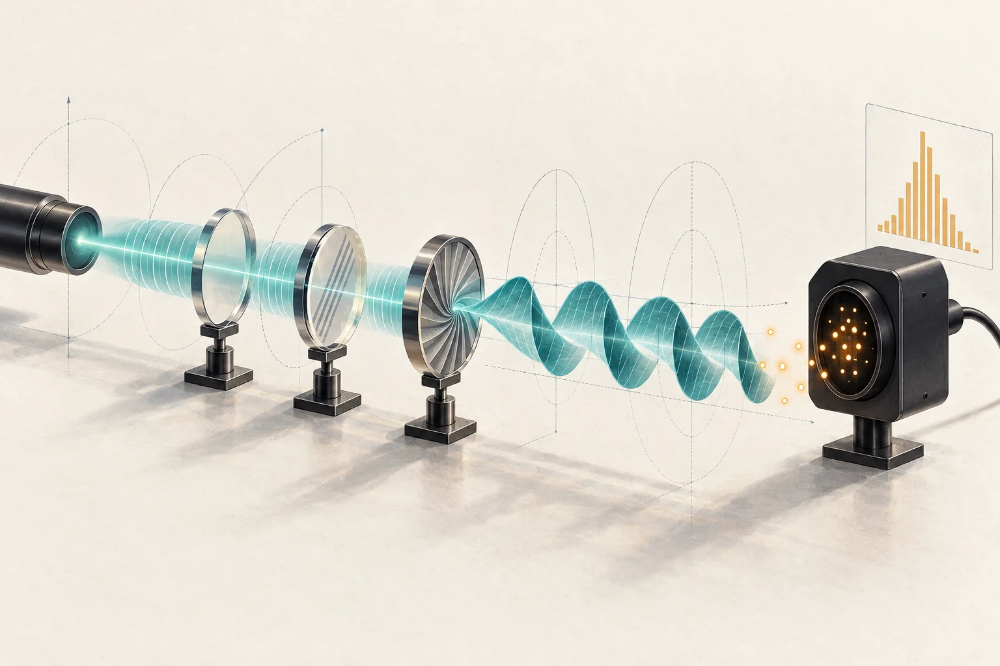
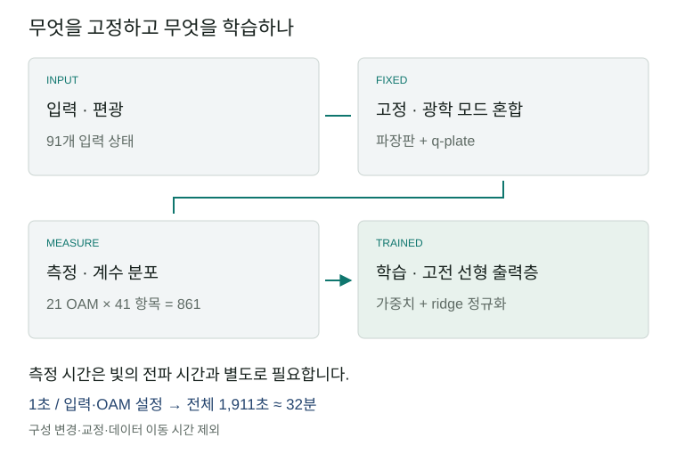
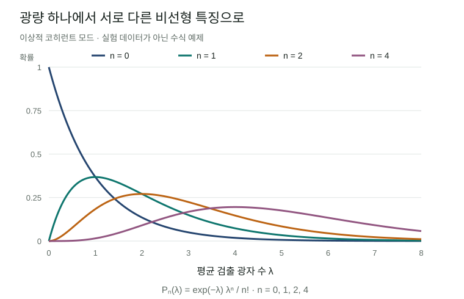

# 빛의 세기에서 광자 수 분포로: 다광자 저장소 계산의 성능과 측정시간

광검출기의 계수 기록을 평균하면 빛의 밝기를 한 값으로 요약할 수 있습니다. 평균하기 전의 기록을 보관하면, 정해진 시간 동안 검출이 0회, 1회, 2회 일어난 비율도 구할 수 있습니다. Hong 등은 이 광자 수 분포를 학습기에 입력했습니다. 같은 광학장에서 평균 광량을 특징으로 사용했을 때와 분포를 사용했을 때, 비선형 함수의 복원 성능이 어떻게 달라지는지 비교한 실험입니다. [1,2]

이 **다광자 양자 저장소(multiphoton quantum reservoir)**는 광학 회로를 고정한 채 측정값을 조합하는 마지막 회귀 단계만 학습합니다. 함수 복원 성능은 일부 과제에서 개선됐지만, 학습에 필요한 분포를 얻는 데에는 약 32분의 취득시간이 필요했습니다. 성능과 비용을 판단하려면 어떤 특징을 측정했는지부터 알아야 합니다. 논문이 함께 다룬 광학 랜덤워크의 확산과 고전 계산의 난해성도 각각의 실험·계산 조건에 맞춰 검토할 필요가 있습니다. [1,2]

*빛의 모드 변환과 광자 계수를 표현한 생성 일러스트입니다. 실제 실험 장치의 배치나 측정 데이터를 재현한 그림은 아닙니다.*

**연구 상태와 날짜.** 논문은 2026년 8월 19일 처음 공개된 동료평가 상온 광학 실험입니다. 이 글의 원 발행일과 과학적 근거 기준일은 **2026년 9월 13일**, 편집 개정일은 **11월 28일**입니다. 논문 본문과 15쪽 보충자료가 검토 대상이며, 원시 데이터는 요청 시 제공하는 방식으로 안내돼 있습니다. 실험 수치와 장치 시간은 독립 재현하지 않았습니다. [1,2]

## 1. 고전광에서도 광자는 셀 수 있습니다

양자광학에서 **고전광(classical light)**은 광자가 없다는 뜻이 아닙니다. 광학장의 상태를 코히런트 상태(coherent state)의 비음수 확률 혼합으로 표현할 수 있다는 뜻입니다. 이상적인 레이저를 설명하는 코히런트 상태와 열광(thermal light)이 대표적입니다. 코히런트 상태의 광자 수는 Poisson 분포를 따르고, 단일 모드 열광은 그보다 큰 수 변동을 보입니다. 반면 고정된 광자 수를 가진 Fock 상태나 압축광은 이 정의에서 비고전적인 자원이 될 수 있습니다.

**Fock 상태** \(|n\rangle\)는 특정 모드의 광자 수가 \(n\)으로 정해진 상태입니다. 논문은 광자 수를 구별하는 측정을 Fock 기저의 투영으로 설명합니다. 실제 장치에서는 검출 사건의 시각을 기록하고 정해진 시간창 안의 계수를 모아 분포를 구성합니다. ‘광자 7개가 검출된 경우만 골라 공간 분포를 본다’는 것은 측정 기록을 조건부로 선택하는 일입니다. 광자를 흡수하는 검출 뒤에 7광자 상태가 남아 다음 연산에 투입된다는 뜻은 아닙니다. [1,2]

광자 수에 따라 검출 기록을 선택하면 평균 세기와 다른 공간 상관을 조사할 수 있습니다. 이는 어떤 통계량을 측정하는가에 관한 결과입니다. 흡수 검출 뒤에 사용할 비고전적 상태를 준비하는 일이나, 같은 통계를 고전적으로 생성하기 어렵다는 주장은 별도의 준비·계산 조건을 요구합니다. 이 차이는 뒤에서 광자 수 선택과 계산복잡도의 근거를 평가할 때 중요합니다. [1,2]

## 2. 편광을 입력하고, 빛의 공간 모드를 섞습니다

장치는 빛의 **편광(polarization)**과 **궤도각운동량(OAM, orbital angular momentum)**을 함께 이용합니다. 편광은 전기장의 진동 방향을 나타냅니다. OAM 모드는 빔 둘레를 돌 때 위상이 얼마나 감기는지를 정수 \(\ell\)로 구분하는 공간 모드입니다. 실공간에 격자를 새긴 것이 아니라, 이 모드들을 서로 연결해 합성 격자처럼 다룹니다.

반파장판(HWP)은 편광을 회전시키고, 사분파장판(QWP)은 편광 성분의 상대 위상을 바꿉니다. q-plate는 편광과 OAM을 결합해 빛을 다른 모드로 옮깁니다. 학습 실험에서는 내부 파장판 각도를 무작위로 한 번 정한 뒤 고정했습니다. 입력만 수평에서 수직 편광으로 바꾸므로 모든 데이터가 같은 물리적 변환을 거칩니다. 출력은 공간광변조기(SLM)로 OAM 모드를 선택해 측정합니다. [2]

논문 안에서도 광원은 실험마다 다릅니다. 광원 준비에는 633 nm 레이저와 회전하는 간유리로 만든 열광이 쓰입니다. 랜덤워크와 열화 통계 실험에는 열광을 사용하지만, 함수 복원 부분은 **공간적으로 코히런트한 빛의 편광에 입력을 인코딩**한다고 설명합니다. 따라서 모든 결과를 하나의 열광 학습 실험으로 묶으면 실제 구성이 흐려집니다. [1]

*리뷰어가 재구성한 계산 흐름입니다. 광학 회로는 고정하고, 마지막 고전 회귀의 가중치만 학습합니다. 분포를 얻기 위한 반복 취득이 광학 전파와 별도로 필요합니다.*

## 3. 선형 광학 뒤에서 비선형 특징을 얻는 원리

**저장소 계산(reservoir computing)**에서는 입력을 고정된 복잡한 시스템에 통과시키고, 측정한 여러 응답을 가중합해 예측값을 만듭니다. 마지막 가중합을 담당하는 부분이 **출력층(readout)**입니다. 이 실험에서는 광학 회로의 내부를 조정하지 않고 출력층의 회귀 가중치만 학습했습니다. 검증한 과제는 현재 입력값에 대한 함수 복원이므로, 이전 입력을 기억해야 하는 시계열 예측과는 평가 대상이 다릅니다. [1,2]

평균 검출 광자 수를 \(\lambda\)라고 합시다. 이상적인 단일 코히런트 모드를 광자 계수하면 다음 확률을 얻습니다.

\[P_n(\lambda)=e^{-\lambda}\frac{\lambda^n}{n!}.\]

평균 \(\lambda\) 하나만 쓰는 것과 \(P_0,P_1,P_2,\ldots\)를 쓰는 것은 서로 다른 특징 설계입니다. \(P_0\)는 광량이 증가할수록 감소하고, \(P_1\)이나 \(P_2\)는 각각 다른 위치에서 봉우리를 만듭니다. 광학 소자가 물질의 비선형 반응을 일으키지 않아도 **측정 확률은 입력 광량의 비선형 함수**가 됩니다. 이는 이상적 Poisson 모델로 설명한 원리이며, 실제 검출기의 응답을 그대로 재현한 식은 아닙니다.

*위 Poisson 식으로 계산한 광자 수별 확률입니다. 평균 광량이 변할 때 각 확률의 봉우리 위치가 달라져 서로 다른 비선형 특징을 만듭니다. 실험 측정값은 아닙니다.*

실험에서는 \(\ell=-10\ldots10\)의 **21개 OAM 투영**과 \(n=0\ldots40\)의 **41개 광자 수 항목**을 결합해 **861개 성분**을 만들었습니다. 마지막에는 \(\hat y=b+\sum_{\ell,n}w_{\ell,n}P_{\ell,n}(x)\) 형태의 선형 출력층을 학습합니다. 보충자료는 가중치가 지나치게 커지는 것을 억제하는 ridge 정규화를 명시합니다. [1,2]

861은 특징 벡터의 성분 수입니다. 큐비트 수나 독립적인 계산 자유도의 수로 해석해서는 안 됩니다. 보충자료의 주성분분석(PCA)에서 첫 성분이 분산의 **75%**, 16개 성분이 **99%**를 설명하며, 참여비(participation ratio)로 계산한 특징의 유효차원은 **1.7**입니다. 저자들은 91개 입력에 대한 특징 행렬의 rank가 91이라고 보고합니다. 분산이 소수 방향에 집중되는 것과 행렬이 높은 rank를 갖는 것은 양립할 수 있습니다. 여기서 유효차원은 특징의 분산 구조를 기술하는 값입니다. 새로운 입력에서도 예측이 정확한지는 학습에 쓰지 않은 데이터로 평가해야 합니다. [2]

## 4. 성능은 어느 기준선보다 좋아졌나

입력은 편광을 바꿔 만든 **91개 상태**이며, 무작위로 **80%를 학습, 20%를 평가**에 사용했습니다. 아래 값은 여러 무작위 분할에서 평균한 평가 결정계수 \(R^2\)입니다. 1에 가까울수록 평가값을 잘 복원합니다. 기준선은 같은 광학장에서 **각 OAM의 평균 광자 수만 유지한 21차원 특징**에 선형 회귀를 붙인 모델입니다. [2]

| 목표 함수 | 평균 광량 특징 · 21개 | 광자 수 분포 특징 · 861개 |
|---|---:|---:|
| 2차 함수 | 0.92 | 0.94 |
| 3차 함수 | 0.89 | 0.93 |
| 4차 함수 | 0.90 | 0.94 |
| 지수 함수 | 0.96 | 0.97 |
| 로그 함수 | 0.97 | 0.97 |
| 감쇠 사인 함수 | 0.69 | 0.94 |
| 논문 보고 평균 | 0.89 | 0.95 |

감쇠 사인 함수에서 가장 큰 개선이 나타납니다. 로그 함수는 표시된 정밀도에서 차이가 없습니다. 보충자료의 설명 문장은 4차 함수와 감쇠 사인 함수를 함께 묶어 0.69→0.94라고 표현하지만, **표 S2에서 4차 함수는 0.90→0.94**입니다. 이 리뷰는 개별 행의 값을 따랐습니다.

이 결과에서는 평균 광량 21개를 특징으로 사용하는 선형 회귀보다 광자 수 분포 861개를 사용하는 회귀가 감쇠 사인 함수를 더 정확히 복원했습니다. 측정 분포의 효과를 더 구체적으로 평가하기 위한 후속 비교로, 평균 광량에서 계산한 Poisson 특징, 다항식·Fourier 특징, kernel ridge 회귀를 제안합니다. 데이터 분할과 조정 예산을 맞추면 특징 수와 정규화 선택의 효과도 구분할 수 있습니다. 이 비교가 있어야 분포 측정에 드는 비용을 고전적인 특징 계산과 비교해 판단할 수 있습니다.

## 5. 회귀 학습 30 μs와 데이터 취득 약 32분

보충자료 표 S1의 **30 μs 학습시간**은 출력층 학습에 관한 저자 보고값입니다. 광원을 설정하고 분포를 얻는 전체 시간과 동일하지 않습니다. 검출 기록은 **1 μs 시간창**으로 묶고, 편광–OAM 설정마다 **1초 동안 100만 개 창**을 취득합니다. 따라서 전체 데이터의 순수 취득시간은 \(91\times21\times1\,\mathrm{s}=1,911\,\mathrm{s}\), 약 **31.85분**입니다. 보충자료도 약 32분을 명시합니다. 광학 설정 변경, 정렬, 교정, 데이터 이동은 여기에 추가됩니다. 같은 특징 데이터는 여섯 함수에 재사용할 수 있으므로 취득시간을 함수마다 여섯 번 더할 필요도 없습니다. [2]

장치는 애벌랜치 광다이오드(APD)의 검출 사건을 시각 기록 장치로 수집하고 시간 구간별 계수를 구합니다. 보충자료는 **50 ns 불감시간(dead time)**과 1 μs 안의 **20개 유효 구간**을 모델링합니다. 평균 광자 수 4.1의 열광에서 이상적 분포와의 유사도는 약 97%라고 보고합니다. 여기서 유사도는 \(\sum_n\sqrt{p_nq_n}\)로 정의한 분포 간 값이며, 양자상태나 계산 결과의 충실도가 아닙니다. 평균 계수가 커질수록 모델과 이상 분포의 차이도 커집니다. [2]

이 검출 모델을 높은 계수 영역에 적용하려면, 20개 유효 구간과 특징 벡터의 0–40 표기, 일부 두 팔 측정의 팔당 21광자 선택이 어떻게 대응하는지 알아야 합니다. 시간창·채널 결합·계수 보정의 관계는 확인한 자료만으로 충분히 해명되지 않습니다. 평균 광자 수 4.1에서의 분포 일치는 그보다 높은 계수 영역 전체의 검출 응답을 확인한 결과가 아닙니다. 원시 시각 기록과 교정 자료를 대조해야 이 영역의 특징값을 어떻게 구성했는지 판단할 수 있습니다. [1,2]

희귀한 계수 결과를 충분히 모으는 데에도 비용이 듭니다. 확률 \(p\)의 사건을 독립 표본 \(M\)개로 추정할 때 상대 표준오차 \(\epsilon\)을 얻으려면 \(M=(1-p)/(\epsilon^2p)\)가 필요합니다. 열광의 높은 광자 수 꼬리에서는 \(p\)가 작아지므로 필요한 시간이 증가합니다. 이 식은 이상적 검출과 독립 표본을 가정하며, 불감시간이나 광원의 시간 상관을 보상하지 않습니다. [2]

## 6. 양자 가속 주장의 근거와 비교 조건

첫째, 랜덤워크 실험은 단계 수에 따른 분포 폭을 비교합니다. 정렬된 광학망에서는 OAM 분포가 탄도적(ballistic)으로 벌어져 폭이 단계 수에 비례하고, 비교하는 확산적 분포의 폭은 단계 수의 제곱근에 비례합니다. 이는 **전파 단계와 관측량의 관계**입니다. CPU나 GPU에서 같은 답을 얻는 데 걸리는 시간과 장치의 전체 실행시간을 비교한 결과는 아닙니다. 7광자 그림은 검출 결과를 선택한 \(P(\ell\mid n=7)\)이며, 독립적으로 준비한 단일광자 일곱 개의 동시 검출과 구분됩니다. [1,2]

둘째, 광자 수 쌍을 선택하면 보손형 또는 페르미온형으로 불리는 공간 상관 패턴이 나타납니다. 선택한 계수 기록의 상관 모양을 가리키는 표현이며, 광자 자체의 입자 통계를 바꾼 것은 아닙니다. 초록은 ‘최대 40광자’라고 설명하지만, Fig. 2의 두 팔 선택 조건 \((21,21)\)은 합계 42입니다. 이 두 수치는 각기 제시된 조건과 구분해 인용해야 합니다. 열화·반열화 실험에서는 선택한 모드의 광자 수 통계와 2차 상관함수 \(g^{(2)}(0)\) 변화를 관측했습니다. 분자나 상호작용 전자계의 열화 계산으로 확장해 해석하려면 대상 계의 동역학과의 대응을 더 확인해야 합니다. [1]

셋째, 저자들은 광자 검출 확률의 permanent 표현과 보손 샘플링을 연결해 계산복잡도를 논합니다. **어떤 확률을 정확히 계산하는 문제와, 그 분포에서 표본을 생성하는 문제는 다릅니다.** 실제 입력 계열과 측정 과제에 난해성 주장이 적용되는지도 확인해야 합니다. 비음수 위상공간 분포를 이용하는 고전 광학 시뮬레이션의 충분조건은 이미 정리되어 있습니다. [3]

보충자료의 코히런트 상태 혼합 표현을 이용하면 이 장치를 고전적으로 표본화하는 방법도 구성할 수 있습니다. 유한한 모드 수에서 효율적으로 표본화할 수 있는 비음수 Gaussian 분포로 입력 진폭 \(\alpha\)를 뽑고, 선형 광학 변환 \(\beta=U\alpha\)를 적용한 다음, 각 모드에서 평균 \(\eta_j|\beta_j|^2\)의 Poisson 계수를 뽑습니다. \(\eta_j\)는 검출 효율입니다. 검출기가 여러 모드를 함께 계수한다면 해당 강도를 더합니다. 코히런트 입력은 진폭이 고정된 특수한 경우입니다. **이상적인 해당 입력·측정 모델의 비조건부 샘플링에는 permanent를 매번 계산할 필요가 없다는 리뷰어의 해석**입니다. 보충자료 Note 2의 식 S20, S29, S35가 이 구성의 근거입니다. 희귀 조건부 표본을 얻으려면 그 사건이 일어날 때까지 표본을 생성하는 비용을 더해야 하며, 실제 검출기의 응답도 따로 반영해야 합니다. [2,3]

따라서 확률식의 permanent를 근거로 계산 난도를 판단할 때에는 실제 입력과 측정이 앞의 고전 표본화 조건에 해당하는지부터 확인해야 합니다. 장치의 실용적인 성능은 보정된 고전 시뮬레이터와 경쟁력 있는 학습 방법을 기준으로, 같은 목표 오차에서 정확도·처리량·에너지를 비교해 평가할 수 있습니다.

## 7. 개발과 응용은 무엇부터 확인하면 좋을까

가까운 응용 후보는 이미 광학 신호로 입력이 들어오는 센싱과 계측입니다. 전기적 데이터를 빛으로 바꾸는 비용을 줄일 수 있고, 평균 광량 이외의 분포 정보를 직접 활용할 여지가 있습니다. 재료·OLED 연구의 후속 실험으로는 여러 조건에서 얻은 발광 신호를 분류하거나 품질 지표를 회귀하는 과제를 제안할 수 있습니다. 이는 이 리뷰의 응용 제안이며 논문에서 검증한 과제는 아닙니다.

개발 순서는 특징을 더 늘리기 전에 측정에서 얻는 정보를 검증하는 쪽이 합리적입니다. 먼저 평균 광량으로 예측한 계수 분포와 실제 계수 분포를 같은 검출 모델로 비교해야 합니다. 그다음 특징 수, 광자 수 절단값, 취득시간을 줄여도 성능이 유지되는지 확인할 수 있습니다. 성능이 일부 낮은 계수 항목에 집중된다면 더 작은 측정 장치로 구현할 수 있습니다. 높은 계수 항목이 꼭 필요하다면 채널 다중화와 검출 응답 교정의 우선순위가 높아집니다.

| 개발 질문 | 다음에 필요한 비교 | 응용 판단에 주는 정보 |
|---|---|---|
| 분포가 평균 광량보다 무엇을 더 주나 | 측정 분포 대 교정된 Poisson·열광 특징 | 실제 추가 정보와 단순 특징 확장의 구분 |
| 적은 데이터에서도 일반화하나 | 연속 구간을 통째로 제외한 평가, 반복 분할·불확실성 | 보간에서 외삽·분포 변화로의 확장 |
| 측정이 얼마나 빨라질 수 있나 | 취득시간·모드 수·계수 항목 수에 따른 정확도 | 처리량과 정밀도의 교환관계 |
| 광학 장치가 전체 비용을 줄이나 | 광원·SLM·검출·데이터 이동·학습까지 같은 목표 오차에서 측정 | CPU/GPU 기준선 대비 실용성 |
| 시간이 지나도 동작하나 | 날짜를 달리한 교정·온도·손실·드리프트 평가 | 고정된 검출 응답에 대한 학습이 현장에서 유지되는지 |

측정 분포를 학습 특징으로 쓰는 센서를 설계하려면 필요한 계수 범위와 취득시간을 함께 정해야 합니다. 낮은 계수 영역만으로 성능을 유지하는지, 취득시간을 줄이면 어느 함수에서 예측오차가 커지는지 확인하면 광원과 검출기의 설계를 구체화할 수 있습니다. 이를 고전적인 특징 계산과 같은 조건에서 비교하는 것이 다음 개발 판단에 필요한 실험입니다.

## 참고문헌

<ol class="reference-list">
<li id="ref-1">M. Hong, M. A. Quiroz-Juarez, R. B. Dawkins, F. Mostafavi, J. Ferdous, A. Wilberg, B. M. Rodriguez-Lara, J. Woodring, C. You, R. de J. León-Montiel, and O. S. Magaña-Loaiza, <a href="https://doi.org/10.1002/advs.77225">Multiphoton quantum reservoirs for robust multidimensional computing</a>, Adv. Sci. <strong>13</strong>, e77225 (2026).</li>
<li id="ref-2">M. Hong, M. A. Quiroz-Juarez, R. B. Dawkins, F. Mostafavi, J. Ferdous, A. Wilberg, B. M. Rodriguez-Lara, J. Woodring, C. You, R. de J. León-Montiel, and O. S. Magaña-Loaiza, <a href="https://advanced.onlinelibrary.wiley.com/action/downloadSupplement?doi=10.1002%2Fadvs.77225&amp;file=advs77225-sup-0001-SuppMat.pdf">Supplementary information - Multiphoton quantum reservoirs for robust multidimensional computing</a> (2026).</li>
<li id="ref-3">S. Rahimi-Keshari, T. C. Ralph, and C. M. Caves, <a href="https://doi.org/10.1103/PhysRevX.6.021039">Sufficient conditions for efficient classical simulation of quantum optics</a>, Phys. Rev. X <strong>6</strong>, 021039 (2016).</li>
</ol>

## 작성·검증과 수정 이력

원 발행일과 과학적 근거 기준일은 2026년 9월 13일이다. 이번 출처 재대조일은 2026년 11월 28일이며, 새로 확보한 원문 파일이 9월 13일 당시 파일과 같은 바이트 판본이라고 소급해 확인한 것은 아니다. 당시 원고는 OpenAI Codex Work Mode의 단일 에이전트가 작성했으며 정확한 모델 식별자와 별도의 사람 문장 검토 기록은 보존되지 않았다. 당시 원문·보충자료 확인 기록은 기존 evidence ledger에 남아 있다.

2026년 11월 28일 편집부(AEDAUT)는 검출 기록과 학습 특징의 관계를 중심으로 도입·문단 연결·한국어 어휘를 다듬고 영문을 대응 개정했다. 제목의 비유적 ‘읽다’를 연구의 성능과 측정시간으로 구체화했다. 수치·식·기존 CSV와 그림의 과학적 관계를 유지하며 출력층 용어를 정리하고, 유효차원이 특징의 분산 구조에 관한 값임을 명확히 했다. 원저자 보고·리뷰의 산술·고전 표본화 해석·후속 제안을 구분하고 APS 번호 인용과 서지를 정리했다. 이번 개편의 원문 대조·독립 감수·출력·공개 확인 범위는 해당 개편 기록에 구분한다. 원 실험·학습 코드·장치 시간의 독립 재현이나 사람 독자 평가는 수행하지 않았다.
