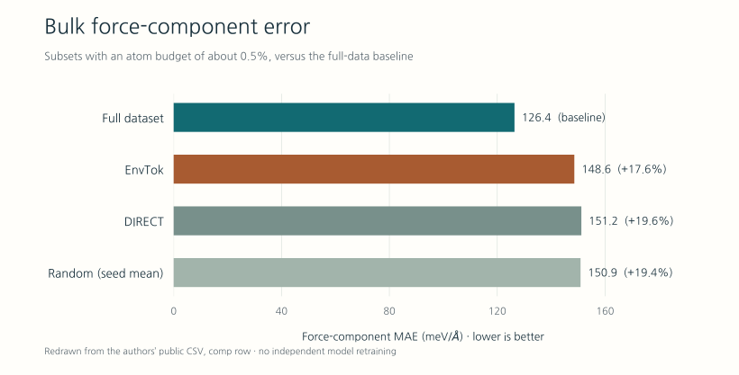

# Compressing OMat24: Dataset Redundancy and Local Chemical Environments

Responsible editor: Hyun-Jung Kim · AI assistance: Codex · Evidence cutoff: 19 October 2026 · <a href="#authoring-disclosure">Production and verification</a>

Local chemical diversity, predictive error and the allocation of high-accuracy reference calculations in OMat24 compression

<figure class="hero"><figcaption>AI-generated conceptual illustration of repeated local environments and the selection of diverse representatives. It depicts no actual crystal structure, atom count or measured compression ratio.</figcaption></figure>

**This study makes a convincing case that a large materials training dataset can be compressed substantially. Its “99%” headline describes a particular dataset and evaluation setting; it is not a universal constant for molecular or materials databases.** The practical question is which structures deserve expensive reference calculations. Answering it requires specifying the intended use and the acceptable loss of accuracy.

The paper reviewed is “Atoms that Matter: Largest Materials Datasets Are 99% Redundant, and Local Chemistry Can Guide the Required 1%,” by Evgeny Moerman, Igor Poltavsky, Anton Charkin-Gorbulin, and Alexandre Tkatchenko. This review examines the arXiv v1 preprint submitted on October 9, 2026. [Paper record](https://arxiv.org/abs/2610.14392v1)

## What counts as redundant data?

OMat24 is a large inorganic materials dataset containing calculated energies, forces, stresses, and related information. Its original release includes more than 110 million DFT calculations. Many configurations come from perturbing equilibrium structures or following molecular dynamics trajectories, so similar local atomic environments can recur across distinct structures. [Original OMat24 paper](https://arxiv.org/abs/2410.12771)

Two meanings of redundancy need to be distinguished: **identical records** and **additional samples that make only a small contribution to the performance of the model under consideration**. This study addresses the second. Small variations around a familiar environment can still help a model learn vibrations, elasticity, and precise energy differences. A high degree of redundancy for the tested tasks therefore does not, by itself, justify deleting the original data.

## The denominator behind “1%”

The authors exclude f-block elements and select approximately 6.5 million atoms from a pool of roughly 65 million structures containing 1.2 billion atoms. They train MACE models on subsets selected by EnvTok, DIRECT, and random sampling and compare them with the released MACE-OMAT-0 medium reference, which was trained on the full OMat24 dataset. The subset selection pool therefore has a different elemental scope from the reference model’s original full training set. [Methods II](https://arxiv.org/html/2610.14392v1#S2), [Supplementary Section S2](https://arxiv.org/html/2610.14392v1#as1_S2)

The fractions below are calculated from the published subset sizes and those approximate pool totals. Atom counts and structure counts have different denominators. [Public code and data documentation](https://github.com/em819/omat24-chemenv-subset/tree/723696de2c26584b8a907ef900690c0caf3c7b68)

| Selection method | Structures | Atoms | Fraction of atoms | Fraction of structures |
|---|---:|---:|---:|---:|
| EnvTok | 795,721 | 6,566,253 | About 0.55% | About 1.22% |
| DIRECT | 458,754 | 6,532,238 | About 0.54% | About 0.71% |
| Four random subsets | 356,247–356,249 each | About 6.5 million each | About 0.54% | About 0.55% |

**EnvTok retains more than 1% of the structures in the selection pool.** It covers diverse environments using relatively small cells, which explains the difference between the two measures. “A subset containing about 0.5% of the atoms” is the clearest description of this comparison. Matching atom counts is a reasonable way to set a budget, but it does not fully match DFT costs: electronic structure, cell size, and convergence difficulty also affect the time required.

## What does EnvTok select?

EnvTok represents each local environment using a token describing the central element, magnetic state, neighboring elements, coordination polyhedron, distortion, bond compression, and asymmetry. It then selects structures that collectively cover the resulting environment classes. Selection requires neither energy and force labels nor a pretrained force field; magnetic moments are optional inputs. [Methods II and Figure 1](https://arxiv.org/html/2610.14392v1#S2)

From a database design perspective, the method asks which chemical environments a structure contains. A new structure can receive a low priority if it contains only environments that are already well represented. Conversely, even a small structure can be valuable if it supplies a rare environment.

The same token does not guarantee the same physics. Discretization merges differences within each bin. If a target property depends on long-range interactions, more distant neighbors, or electronic states, the representation and evaluation need to capture those distinctions. Covering environment classes and accurately learning the curvature of the potential energy surface around each environment are also separate requirements.

## How much performance is retained?

<figure><figcaption>Bulk force component MAE (meV/Å); lower is better. Redrawn from the comp row of the authors’ public peratom_force_mae_bulk.csv at commit 723696d. Random sampling is the mean across four seeds. This is a visualization of reported outputs, not independent model retraining.</figcaption></figure>

| Evaluation | Full-data model | Subset models |
|---|---:|---:|
| Bulk force component MAE, meV/Å | 126.4 | EnvTok 148.6; DIRECT 151.2; random mean 150.9 |
| Formation-energy MAE, meV/atom | 56 | 63–74 |
| Mean fraction of MD trajectory completed | 75% | EnvTok 92%; DIRECT 93%; random 81% |
| Li migration-barrier MAE, eV | 0.146 | EnvTok 0.124; DIRECT 0.116; random 0.148 |

The force values come from the `comp` row of the authors’ [public aggregate CSV](https://github.com/em819/omat24-chemenv-subset/blob/723696de2c26584b8a907ef900690c0caf3c7b68/09_benchmarks/matpes/paper_tables/peratom_force_mae_bulk.csv). They should not be confused with the `norm` row, which averages force-error vector magnitudes. Recalculating the EnvTok formation-energy MAE from the 466 valid entries in the authors’ [public results CSV](https://github.com/em819/omat24-chemenv-subset/blob/723696de2c26584b8a907ef900690c0caf3c7b68/09_benchmarks/matcalc/results/Equilibrium_mace-omat-medium-subset-v14_T100_a1_suppm_0.01_FULL.csv) gives 62.7 meV/atom. This is an arithmetic check of the published outputs, not an independent retraining of the model.

The remaining figures are reported by the paper. The MD test ramps 80 systems from 300 to 3000 K and from 0 to 500 GPa over 10 ps. The 92% and 93% figures are average trajectory completion, whereas the proportions of runs that reach the end are 68% and 64%, respectively. The Li comparison uses a group of 621 paths without a Hubbard-U mismatch, after excluding roughly 3–4% of nonconverged cases separately for each model. These are model-specific converged subsets, rather than necessarily identical sets of paths. A difference between the non-spin-polarized PBE reference and the spin-polarized PBE training data remains in this group. [Figures 2–3 and Table II](https://arxiv.org/html/2610.14392v1#S3), [Li evaluation protocol](https://arxiv.org/html/2610.14392v1#as1_S4.SS4)

The force MAE increases by approximately 18–20%, and the formation-energy MAE by approximately 13–32%. The result is therefore a trade-off between dataset size and acceptable error. When small energy differences determine candidate rankings, that increase can still affect a decision. Higher MD completion provides evidence about numerical collapse; it does not establish that trajectories or phase transformations agree with DFT.

## Contribution and limits of the interpretation

Redundancy in materials data has precedents. Li and colleagues reported in 2023 that up to 95% of several materials property datasets could be removed with little change in in-distribution prediction performance. They also found that overrepresented data did not resolve the severe degradation on out-of-distribution samples. [Study summary from the authors’ institution, NIST](https://www.nist.gov/publications/exploiting-redundancy-large-materials-datasets-efficient-machine-learning-less-data)

DIRECT had already introduced structure selection through dimensionality reduction and clustering of pretrained representations. [Original DIRECT paper](https://arxiv.org/abs/2307.13710)

The present study extends the question to the scale of OMat24 and evaluates several practical uses together. The following points are this review’s interpretation of the evidence.

- **The strong random baseline is central.** If only a sophisticated selection method worked, its effectiveness would be difficult to separate from redundancy in the dataset. The substantial performance retained by random subsets makes the data-efficiency result more direct. At the same time, it weakens any claim that EnvTok is the best selection method for every property.
- **The comparison does not isolate a pure causal effect of dataset size.** [Supplementary Section S3](https://arxiv.org/html/2610.14392v1#as1_S3) documents differences between the full-data reference and the subset models in effective batch size, numerical precision, and training procedure. Comparisons using matched compute budgets and optimization procedures would help separate the effects of data composition and training.
- **Average performance and rare failures need to be assessed together.** Model choice can change depending on whether a large mean error comes from a few failures or from broadly worse predictions. A lower mean error alone does not establish greater reliability on every case.
- **Independence of the selection method and generality of the validation are different claims.** A subset can be selected without a model, while its compression ratio and performance still require testing across different model architectures.

The paper leaves similar redundancy in the molecular datasets OMol25 and QCML to future work. [Conclusions](https://arxiv.org/html/2610.14392v1#S4) Applying the 99% figure directly to molecular, OLED, or excited-state datasets would therefore go beyond the evidence presented here.

## Applying the findings to dataset construction

The following are proposed applications of the findings. The objective should be to establish whether fewer labels can meet the accuracy requirements of a research task, rather than to reach a predetermined compression ratio.

1. **Define the target property and acceptable error first.** Force fields, energy rankings, migration barriers, and excited-state predictions require different evaluations.
2. **Compare baselines under matched atom and compute budgets.** Include random sampling, chemical-diversity selection, and model-uncertainty selection.
3. **Control leakage between related structures.** Keep perturbations from the same parent together when splitting data, and test new compositions, molecular scaffolds, and coordination environments separately.
4. **Retain rare cases alongside average-error metrics.** Preserve dedicated evaluations for defects, compression, decomposition pathways, and other conditions where failures matter.
5. **Connect savings in reference labels to higher-accuracy calculations.** Relabel a portion at a higher level of theory, verify improvements in the target property, and then expand the effort.

For organic light-emitting molecules, a sensible evaluation would include the target charge, spin, and excited states, as well as molecular scaffolds, conformations, and intermolecular arrangements. Treating similar local structures as equivalent electronic states could remove distinctions that the research needs to retain.

Selection itself also costs compute. The public documentation lists approximately 440 CPU node-days for full tokenization, 400 GB of RAM for subset selection, and eight A100 GPUs for two days of training. Reusing the published structure ID lists avoids repeating the selection process. [Official execution documentation](https://github.com/em819/omat24-chemenv-subset/tree/723696de2c26584b8a907ef900690c0caf3c7b68) A reduction in label count should not be interpreted as the same reduction in total computational cost; exploration, selection, labeling, and training all need to be counted.

## Sources and checks

This review cross-checked the paper, supplementary information, and principal figures, and inspected the public results CSVs. The EnvTok formation-energy MAE, relative increases in force error, and atom and structure fractions were calculated separately. DFT calculations, model training, and MD simulations were not rerun.

The [public code](https://github.com/em819/omat24-chemenv-subset/tree/723696de2c26584b8a907ef900690c0caf3c7b68) is pinned to that commit. API metadata for the [Zenodo deposit](https://doi.org/10.5281/zenodo.23137852) was checked for the subset, model, and benchmark file listings; the complete archive was not downloaded.

<!-- AI Tech Review Authoring Disclosure --><section class="authoring-disclosure" id="authoring-disclosure" aria-labelledby="disclosure-heading"><h2 id="disclosure-heading">How this review was made</h2><dl>
<dt>Responsible editor</dt><dd>Hyun-Jung Kim</dd>

<dt>AI assistance</dt><dd>OpenAI Codex; exact authoring-model identifier not retained.</dd>

<dt>Agents and roles</dt><dd>root: original-paper and public-CSV checks, arithmetic, Korean writing, editing and publication; identify_paper: independent paper identification, prior-work research and English writing; critical_audit: numerical and methodological audit; publication_build: deterministic comparison figure, fonts, bilingual HTML/PDF production and output checks.</dd>

<dt>Inputs and outputs</dt><dd>Paper and official public code/results → bilingual review, conceptual cover, numerical comparison figure and PDFs.</dd>

<dt>Production request</dt><dd>Review the paper on materials-dataset redundancy and local-environment selection, then summarize and archive it in AI Tech Review.</dd>

<dt>Harness</dt><dd><a href="https://infant83.github.io/AI_Tech_Review/methods/">AI Tech Review Editorial Harness 2026.08</a></dd>

<dt>Verification scope</dt><dd>arXiv v1 text/supplement and fixed-commit public outputs: values, units and interpretation; arithmetic on atom/structure shares and errors; bilingual titles, assets, mobile layout and PDF output. No rerun of DFT, model training or MD.</dd>

<dt>Human review</dt><dd>Topic, review and archive publication requested; no line-by-line human approval.</dd>

<dt>Evidence cutoff</dt><dd>2026-10-19</dd>
</dl>
Reported findings, arithmetic on public outputs, review interpretation and application proposals are distinguished. The AI-generated cover is conceptual, with no measured atomic structure or computed result. The numerical chart redraws the authors’ public values in code.
</section><!-- End AI Tech Review Authoring Disclosure -->
