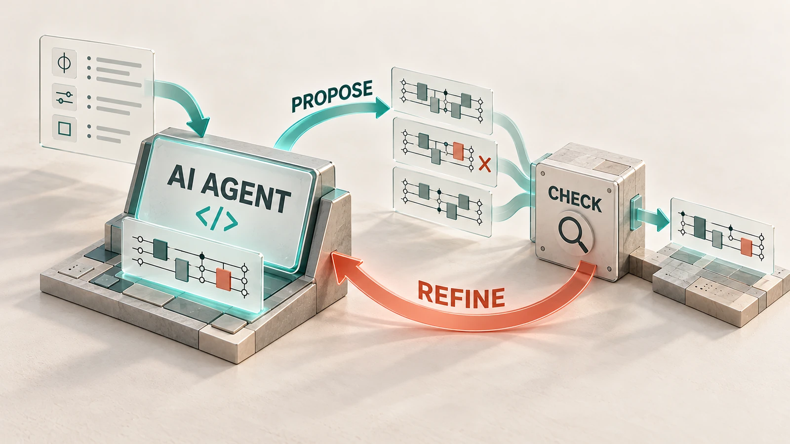
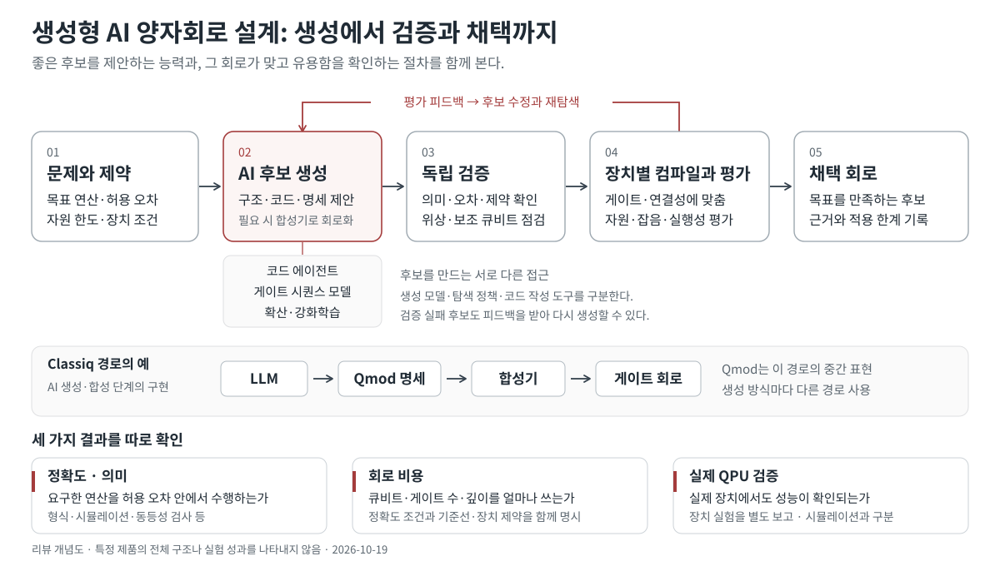
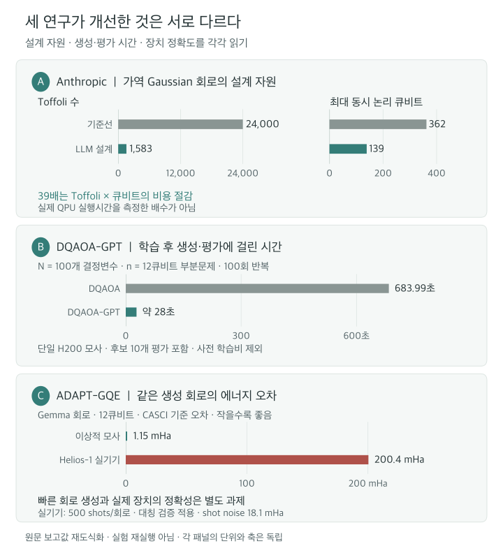
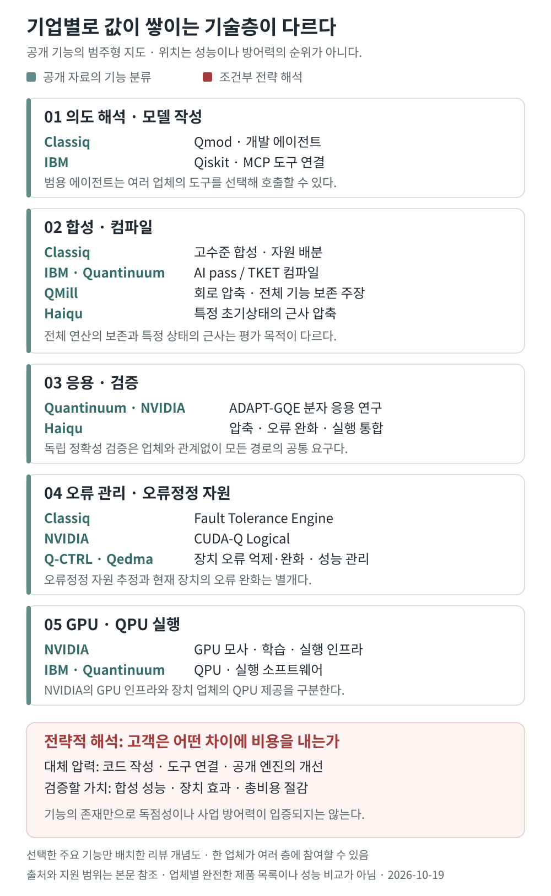
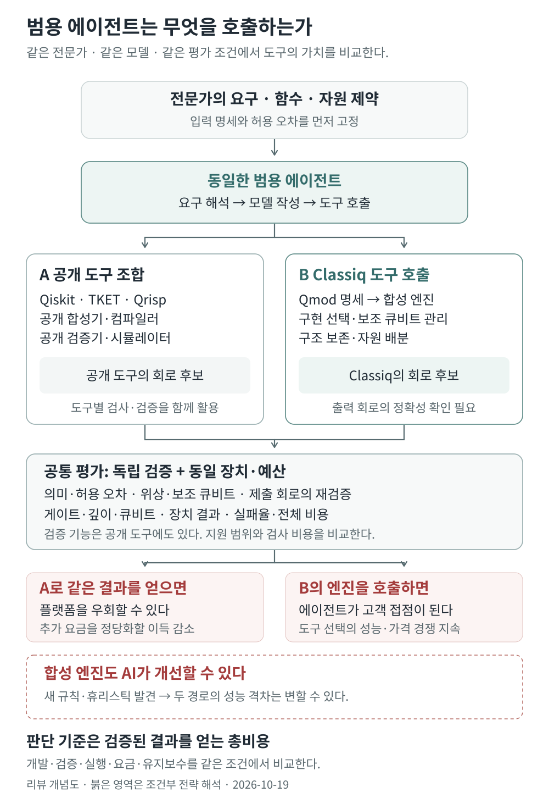

# 생성형 AI를 통한 양자회로 설계와 최적화

양자 알고리즘을 실행하려면 수식을 실제 게이트의 순서로 바꿔야 합니다. 같은 계산도 중간 결과를 얼마나 저장하는지, 보조 큐비트를 언제 되돌려 놓는지, 어떤 연산을 함께 처리하는지에 따라 필요한 자원이 크게 달라집니다. 생성형 AI는 이 구현을 여러 방식으로 제안하고, 컴파일러와 평가기가 좋은 후보를 고르는 과정에 참여하고 있습니다.

<figure class="article-hero-figure">

<figcaption>그림 1. AI 에이전트가 회로 후보를 제안하고 별도 검증 도구를 호출합니다. 검증·평가 결과가 에이전트로 돌아와 후보 수정으로 이어지는 과정을 표현했습니다.</figcaption>
</figure>

<small>AI로 제작한 개념 일러스트이며 실제 제품 화면·장치·실험 결과를 나타내지 않습니다.</small>

최근 연구는 관심을 가질 만한 구체적인 결과를 내놓았습니다. 2026년 10월 Anthropic 연구는 검증기의 피드백을 받은 LLM이 가역 산술회로의 설계를 개선했습니다. 7월 Quantinuum·NVIDIA·Pfizer 등의 ADAPT-GQE 연구는 Transformer로 분자의 바닥상태를 준비하는 회로를 생성하고 일부를 실제 QPU에서 실행했습니다. Classiq는 자연어 에이전트와 고수준 합성기를 제품 안에 결합했습니다. 각각 **설계 탐색, 응용별 회로 생성, 개발 도구의 제품화**를 보여주는 사례입니다. [Anthropic 논문](https://arxiv.org/abs/2610.22367), [ADAPT-GQE 논문](https://arxiv.org/abs/2607.22468), [Classiq 에이전트 발표](https://www.classiq.io/insights/classiqs-quantum-engineering-agents-now-in-your-ide-and-the-platform)

이 주제의 중심에는 **AI가 제안한 구현을 어떤 방법으로 검증하고, 어떤 자원 비용으로 평가하는가**라는 문제가 있습니다. 생성 속도, 회로의 정확성, 실제 장치에서의 성능을 구분하면 최근 성과가 어디까지 도달했는지 판단할 수 있습니다.

## 1 양자회로 생성과 최적화의 범위

**AI 기반 양자 소프트웨어 설계 자동화**는 요구를 프로그램으로 옮기는 작업부터 회로 합성·최적화·장치별 컴파일까지 포함합니다. 생성형 모델, 강화학습 컴파일러, 기존 합성기는 이 과정의 서로 다른 설계 결정을 맡습니다.

여기서 다루는 것은 고전 컴퓨터에서 실행되는 AI가 양자 프로그램이나 회로를 만드는 **AI for quantum computing**입니다. 양자회로 자체를 생성모델로 사용해 이미지나 데이터를 만드는 quantum generative AI와는 연구 대상이 다릅니다.

회로를 만드는 일에도 목적에 따른 차이가 있습니다.

| 작업 | 입력과 산출물 | 성공을 판단할 기준 |
|---|---|---|
| 양자 코드 작성 | 자연어 요구 → Qmod·Qiskit·OpenQASM 프로그램 | 실행 가능한 문법, 요구한 계산의 구현 |
| 기능 및 유니터리 합성 | 함수·목표 연산 → 게이트열 | 같은 연산 또는 명시한 근사 오차 |
| 응용별 상태 준비 | 분자 Hamiltonian·최적화 문제 → 회로와 파라미터 | 에너지·해의 품질·상태 정확도 |
| 기존 회로 최적화 | 회로 → 더 적은 자원의 등가 회로 | 의미 보존과 비용 감소 |
| 장치별 컴파일 | 논리회로 → 연결망·네이티브 게이트에 맞는 회로 | 라우팅·오류·실행시간·장치 제약 |

LLM, 자기회귀 Transformer, 확산모델은 생성 방법을 가리킵니다. 강화학습은 후보를 고르거나 수정하는 정책을 학습하는 방법으로, 생성형 모델과 결합할 수도 있습니다. 제약충족 기반 합성, 수학적 분해, 규칙 재작성도 같은 작업을 수행합니다. 제품이 회로를 자동으로 만든다는 사실만으로 생성형 AI의 효과가 입증되는 것은 아닙니다.

## 2 Classiq의 합성 엔진과 생성형 AI

Classiq의 Qmod에서는 개별 게이트를 모두 지정하기 전에 필요한 함수와 자원 제약을 기술합니다. 합성 엔진은 가능한 구현, 보조 큐비트의 할당과 재사용, 중간 계산을 되돌리는 **uncomputation**을 선택합니다. 예를 들어 덧셈을 수행할 때 큐비트를 더 사용해 게이트 수를 줄이는 구현과, 큐비트를 아끼는 구현 사이에서 선택할 수 있습니다. [Classiq 제품 설명](https://www.classiq.io/product), [Qmod 논문](https://arxiv.org/abs/2502.19368)

2026년 7월 9일 발표한 **Quantum Engineering Agents**는 이 합성 과정 앞에 자연어 개발 환경을 제공합니다. LLM이 요구를 Qmod 모델로 작성·수정하고, 합성기가 회로를 구체화합니다. IDE 플러그인은 Claude Code·Cursor·Cline·Codex 등과 연결하며, 플랫폼 Assistant는 모델링과 합성까지 지원합니다. 발표 기준 플랫폼 Assistant는 유료 구독, IDE 플러그인은 enterprise·early-adopter 대상입니다. [공식 출시 설명](https://www.classiq.io/insights/classiqs-quantum-engineering-agents-now-in-your-ide-and-the-platform)

<figure class="figure-panel">

<figcaption>그림 2. 문제와 제약에서 회로 후보를 만들고, 검증 결과와 자원 비용을 다음 탐색에 반영합니다. Classiq의 Qmod 합성 경로와 회로를 직접 생성하는 모델은 서로 다른 구현입니다. <a href="../artifacts/circuit_generation_workflow.svg">그림 크게 보기</a></figcaption>
</figure>

이 구조에서 LLM의 역할과 합성기의 역할을 분리해야 성과를 평가할 수 있습니다. 요구를 더 빨리 코드로 옮겼는지, 같은 Qmod 모델에서 합성기가 더 좋은 회로를 만들었는지, 사람이 작성한 모델과 비교해 오류가 줄었는지는 각각 다른 실험입니다. Classiq의 기존 회로 압축 성과를 모두 생성형 AI의 효과로 귀속할 수는 없습니다.

9월 30일 발표한 **Fault Tolerance Engine**은 Clifford+T 회로의 surface-code 공간·시간 배치와 논리 오류·자원 추정까지 범위를 확장합니다. 오류정정 환경에서는 비싼 T·Toffoli 연산, 논리 큐비트 수와 대기·라우팅 비용을 함께 평가합니다. 이 발표는 제품의 평가 범위가 논리회로에서 오류정정 구현 비용까지 확장되고 있음을 보여줍니다. [공식 발표](https://www.classiq.io/insights/introducing-classiqs-fault-tolerance-engine)

고수준 합성 도구의 성능과 함께 확인할 것은 **생성형 AI가 어떤 설계 결정을 새로 제안하며, 그 기여를 어떻게 분리해 측정할 수 있는가**입니다. 앞선 Classiq·AshN 사례는 기능 수준의 합성과 네이티브 게이트 최적화의 차이를 설명합니다. [Classiq·AshN 리뷰](https://infant83.github.io/AI_Tech_Review/reviews/2026-08-27_classiq-ashn-circuit-compression/)

## 3 최근 논문에서 확인되는 네 가지 접근

### 확산모델로 게이트와 회전각 생성

Fürrutter 등의 *Quantum circuit synthesis with diffusion models*는 2024년 5월 **Nature Machine Intelligence**에 게재됐습니다. 잡음에서 이미지를 복원하는 확산모델의 방식을 회로 표현에 적용해, 목표 얽힘이나 연산을 조건으로 회로를 생성합니다. masking과 editing으로 일부 회로 구조를 제한할 수도 있습니다. 얽힘 생성은 3–8큐비트 학습과 더 큰 크기로의 미세조정을, 유니터리 합성은 주로 3큐비트 규모를 다룹니다. 학습 단계에서 매번 양자 동역학을 모사하지 않는다는 장점은 데이터 준비와 최종 검증의 비용까지 사라진다는 뜻은 아닙니다. [정식 논문](https://www.nature.com/articles/s42256-024-00831-9), [저자 코드 genQC](https://github.com/FlorianFuerrutter/genQC)

2025년 6월 처음 공개된 후속 *Synthesis of discrete-continuous quantum circuits with multimodal diffusion models*는 게이트 종류와 연속 회전각을 함께 생성합니다. 2026년 4월 22일 **Machine Learning: Science and Technology 7(2), 025065**에 정식 출판됐습니다. 3–5큐비트 실험에서는 생성 후 수치 최적화가 정확도를 높입니다. 따라서 전체 비용에는 후보 생성과 후처리 시간을 모두 포함해야 합니다. [논문](https://arxiv.org/abs/2506.01666), [출판 DOI](https://doi.org/10.1088/2632-2153/ae5b21)

2026년 6월 28일의 *Lie Group Diffusion Models for Hardware-Aware Quantum Circuit Synthesis*는 먼저 연결망에 허용되는 회로 골격을 고르고, 각 단일 큐비트 연산을 수학적으로 올바른 공간인 **SU(2)** 위에서 생성합니다. 3큐비트 Ising·XXZ 등의 시간 진화를 7개 고정 CZ 골격과 국소 수치 최적화로 합성합니다. **하드웨어 제약을 반영하는 생성**을 구체화한 프리프린트이며, 대형 QPU 실행까지 확인한 결과는 아닙니다. [논문](https://arxiv.org/abs/2606.29636)

### Transformer로 응용에 맞는 연산 시퀀스 생성

**Generative Quantum Eigensolver, GQE**는 분자 에너지를 낮추는 연산의 순서를 토큰처럼 생성합니다. 에너지가 좋은 회로의 패턴을 학습해 다음 후보를 제안합니다. 2024년 최초 공개되고 2025년 개정된 초기 논문은 소형 분자 모사와 IBM 장치의 일부 큐비트를 사용한 실험을 보고합니다. 장치가 127큐비트라고 해서 생성한 분자 회로도 127큐비트인 것은 아닙니다. [GQE 논문](https://arxiv.org/abs/2401.09253)

**ADAPT-GQE**는 2026년 7월 24일 공개된 후속 연구입니다. imipramine의 여러 분자 구조에 대해 12·14·16큐비트 활성공간에서 ADAPT-VQE로 만든 회로를 학습하고, 강화학습과 증류로 생성모델을 개선합니다. 학습을 마친 Gemma 모델에서 후보 16개의 생성·시뮬레이션 평가 시간은 해당 ADAPT-VQE 기준선보다 930–8,800배 짧았습니다. 이 비교에는 사전 데이터 생성과 학습비가 포함되지 않습니다. [논문 3.1절 및 4.2절](https://arxiv.org/html/2607.22468v1)

실제 **Helios-1**에서는 12큐비트 회로 두 개를 실행했습니다. 실행 전에는 pytket으로 회로를 줄였습니다. Gemma 회로의 에너지 오차는 이상적 모사에서 **1.15 mHa**, 실제 장치에서는 **200.4 mHa**였습니다. 이 결과는 생성 회로의 하드웨어 실행을 보여주며, 장치 잡음 속에서 화학 정확도를 확보하는 과제도 드러냅니다. 12–16큐비트 전체 수치평가와 12큐비트 실기기 검증을 구분해야 합니다. [논문 4.3절 및 표 1](https://arxiv.org/html/2607.22468v1#S4.SS3)

**DQAOA-GPT**는 7월 22일 논문 공개, 9월 16일 IonQ·ORNL·NVIDIA·University of Tennessee의 산업 발표가 있었습니다. 100개 결정변수의 문제를 4–12큐비트 부분문제로 나누고, Transformer가 후보 회로를 생성합니다. 해당 실험에서 기존 DQAOA의 시간은 부분문제 크기에 따라 약 **33.8→684초**, DQAOA-GPT는 약 **28초**였습니다. 생성 방식의 시간에는 후보 10개에 대한 생성·모사·평가가 포함됩니다. 모든 회로는 H200 GPU에서 모사했으며, 이 비교는 학습된 생성기와 기존 변분 탐색 사이의 비교입니다. [논문](https://arxiv.org/html/2607.20225v1), [공식 발표](https://www.ionq.com/news/ionq-ornl-nvidia-and-the-university-of-tennessee-knoxville-show-ai-method-reduces-quantum-optimization-trade-off)

### 강화학습으로 등가 회로 탐색

**AlphaTensor-Quantum**은 2025년 3월 **Nature Machine Intelligence**에 게재됐습니다. 회로의 T 게이트를 줄이는 문제를 텐서 분해로 표현하고, 심층 강화학습과 탐색으로 좋은 분해를 찾습니다. 유한체 곱셈 등에서 효율적인 구조를 발견하고 일부 산술·화학 구성요소에서 인간이 만든 최선의 설계에 도달했습니다. 목적함수는 오류정정 계산의 **T-count**입니다. 이 결과를 실제 장치의 회로 깊이나 총 실행시간 감소율로 바꾸어 읽을 수는 없습니다. 큰 회로의 분할은 최적화 기회를 놓칠 수 있고, 응용별 학습과 탐색에도 상당한 계산이 필요합니다. [정식 논문](https://www.nature.com/articles/s42256-025-01001-1)

IBM의 **Pauli Network Circuit Synthesis with Reinforcement Learning**은 큰 회로 전체를 한 번에 생성하는 대신 작은 블록을 재합성합니다. 2025년 3월 프리프린트는 6큐비트 Pauli 블록에서 학습한 방법을 큰 회로의 후처리에 적용합니다. 현재 제품 문서의 Clifford·linear 등에도 블록 크기 제한이 있습니다. 큰 회로 처리 능력은 **작은 부분의 학습된 최적화를 반복 적용하는 구조**와 함께 이해해야 합니다. [논문](https://arxiv.org/abs/2503.14448), [AI transpiler 문서](https://quantum.cloud.ibm.com/docs/en/guides/ai-transpiler-passes)

### LLM이 코드를 제안하고 검증기가 탐색을 유도

Gu 등의 *Discovering state-of-the-art quantum circuits with large language models*는 **2026년 10월 15일 프리프린트**, 다음 날 Anthropic 공식 발표로 공개됐습니다. Claude Mythos 5가 가역회로 생성 프로그램을 작성하고, 독립 평가기가 정확성과 자원량을 검사해 다음 수정에 피드백합니다. 여덟 과제 가운데 일곱은 해당 기준선보다 Toffoli 수와 큐비트 수가 모두 줄었고, 모듈러 역원 과제는 새로운 자원 절충을 제시했습니다. [논문](https://arxiv.org/abs/2610.22367)

대표적인 **39배 개선**은 fixed-point Gaussian 계산에서의 **Toffoli 수 × 최대 동시 논리 큐비트 수**, 즉 TQ 비용입니다. Toffoli는 **24,000→1,583**, 큐비트는 **362→139**입니다. 실제 QPU 실행시간이나 금전적 비용을 측정한 배수가 아닙니다. 회로·평가기·일부 정리의 Lean 증명은 공개돼 있으며, 큰 입력 공간에는 무작위 검증도 사용합니다. 전체 회로의 모든 입력에 대한 형식증명이 완료됐다는 의미로 확대해서는 안 됩니다. [논문 표 1 및 검증 설명](https://arxiv.org/html/2610.22367v1), [공개 코드](https://github.com/andigu/uncompute)

이 연구의 화학 사례에서 **4.1배**는 Fe₂S₂의 sparse compilation 중 **alias–Select 부분**의 비교입니다. 논문은 현재 최선의 전체 자원 추정에 쓰이는 DFTHC 방법을 평가 범위 밖으로 둡니다. 어떤 과제와 구현을 기준선으로 삼았는지에 따라 개선의 의미가 달라집니다. [논문 보충자료 IV](https://arxiv.org/html/2610.22367v1)

2026년 9월의 **QuantumEvo**는 LLM이 BDD 기반 합성의 변수 순서를 정하는 휴리스틱 코드를 생성·진화시키는 사례입니다. 최종 회로를 직접 쓰는 모델 외에도, 기존 합성기를 더 잘 탐색하게 하는 알고리즘을 생성할 수 있습니다. [논문](https://arxiv.org/abs/2609.05327)

<figure class="figure-panel">

<figcaption>그림 3. 회로 자원 절감, 생성·평가 시간 단축, 장치 정확성은 서로 다른 성과입니다. 세 논문의 보고값을 재도식화했으며 각 패널의 단위와 축은 독립입니다. 실험을 재실행한 결과가 아닙니다. 출처: <a href="https://arxiv.org/html/2610.22367v1">Gu 등</a>, <a href="https://arxiv.org/html/2607.20225v1">DQAOA-GPT</a>, <a href="https://arxiv.org/html/2607.22468v1#S4.SS3">ADAPT-GQE</a>. <a href="../artifacts/reported_results_boundaries.svg">그림 크게 보기</a></figcaption>
</figure>

## 4 생성 성공률과 정확성 사이의 간격

양자회로의 검증에서는 “코드가 실행된다”, “의도한 함수를 계산한다”, “위상과 보조 큐비트까지 올바르다”를 나눠 확인해야 합니다. 산술 출력이 맞아도 상대 위상이 틀리거나 중간 정보가 남으면 더 큰 양자 알고리즘 안에서 문제가 생길 수 있습니다. 근사 합성에서는 허용 오차를 먼저 정해야 합니다.

AMD 연구진의 *When Close Enough Is Not Enough*는 2026년 7월 공개됐으며 arXiv에 **IEEE QCE 2026 논문**으로 기재돼 있습니다. 44.8M Transformer의 Clifford+T 회로 실험에서 정확한 등가성은 길이 9게이트 이하에서 **88%**, 26게이트를 넘으면 거의 0%로 떨어졌습니다. 여러 후보를 검증해 고르는 방법은 전체 정확 일치율을 **7%→22.5%**로 높였지만 길이에 따른 실패는 남았습니다. 이 수치는 해당 모델과 실험의 결과이며, 모든 생성모델에 같은 한계 길이를 부여하는 값은 아닙니다. [논문](https://arxiv.org/abs/2607.12780)

전용 LLM의 평가 지표도 자세히 봐야 합니다. 2025년 10월 프리프린트 **QUASAR**의 pass@1 **99.31%**는 문법적 정확성입니다. 논문이 정한 별도의 고품질 회로 비율은 같은 pass@1에서 **17.24%**였습니다. 문법, 기능, 최적화 품질을 하나의 성공률로 합치면 결과를 과대평가하게 됩니다. [논문](https://arxiv.org/html/2510.00967v1)

정확성의 요구 수준은 응용에 따라서도 다릅니다. 유니터리 합성은 모든 허용 입력에 대한 연산을 비교합니다. 분자 상태 준비는 특정 초기상태에서 얻은 에너지나 상태를 평가합니다. 잡음이 있는 장치에서는 이상적 회로의 근사 오차를 조금 허용해 게이트 수를 크게 줄이는 편이 측정 결과를 개선할 수도 있습니다. 이 경우 허용한 근사와 장치 오류를 구분해 기록해야 합니다.

## 5 산업계는 어떤 기능을 제품으로 제공하는가

<figure class="figure-panel">

<figcaption>그림 4. 기업의 공개 제품과 연구가 맡는 역할을 기술층별로 배치했습니다. 여러 층에 걸친 기능과 협업이 있으며, 배치는 성능·시장점유율·사업적 방어력의 순위를 뜻하지 않습니다. 근거는 아래 산업 동향과 9절의 기업별 비교에 연결했습니다. <a href="../artifacts/company_technology_layers.svg">그림 크게 보기</a></figcaption>
</figure>

| 기업 및 협업 | 제공하는 기능과 공개 상태 | 기술 평가에서 볼 부분 |
|---|---|---|
| **Classiq** | Qmod 합성 플랫폼, 자연어 Assistant·IDE 에이전트, 오류정정 자원 추정 | LLM의 모델 작성 효과와 합성 엔진의 회로 개선 효과를 분리 |
| **IBM Qiskit** | 설치 가능한 강화학습 기반 AI routing·재합성 pass, 현재 문서상 beta | 동일 backend·시간 예산·표준 transpiler와 비교, 전체 크기와 블록 크기 구분 |
| **Google DeepMind·Quantinuum** | AlphaTensor-Quantum 연구와 결과·데모 코드 | T-count 중심의 오류정정 설계 연구, 범용 상용 생성 서비스와 구분 |
| **Quantinuum·NVIDIA·Pfizer 등** | ADAPT-GQE 응용 연구 및 일부 실제 QPU 실행 | 생성·학습 비용과 장치에서의 에너지 정확도 |
| **IonQ·ORNL·NVIDIA·UT** | DQAOA-GPT 연구 및 GPU 기반 벤치마크 | 변분 탐색 절감과 고전 최적화 솔버 대비 성능을 따로 평가 |
| **QMill** | Circuit Compression 제품, 2026년 7월 qBraid Lab 배포 | 회사의 정확한 기능 보존 주장과 공개 회로 사례, 독립 비교 범위 |
| **Haiqu** | 2026년 5월 AgenticOS 출시 발표, 기업 early access | 특정 초기상태에 대한 근사 압축, 잡음 속 실행 결과와 오류 완화 |

IBM은 2024년 공개하고 2025년 갱신한 벤치마크에서, 100큐비트 이상 heavy-hex 회로의 AI transpiler가 표준 SDK보다 평균 2큐비트 게이트 **24%**, 깊이 **36%**를 줄였다고 보고합니다. 제품 문서의 작은 블록 재합성 제한과 함께 읽어야 합니다. 100큐비트 임의 연산을 한 모델이 직접 합성했다는 결과와는 평가 대상이 다릅니다. [IBM 벤치마크](https://www.ibm.com/quantum/blog/qiskit-performance), [현재 문서](https://quantum.cloud.ibm.com/docs/en/guides/ai-transpiler-passes), [저장소](https://github.com/Qiskit/qiskit-ibm-transpiler)

QMill은 공개 QASM 사례를 제시하고 Quarl과 동등한 계산 예산으로 비교했다고 밝히며, 정확한 기능 보존을 주장합니다. Haiqu의 문서는 all-zero 입력에서 얻는 상태를 근사하는 압축을 설명합니다. 따라서 두 제품의 압축 배수는 보존하려는 대상과 허용 오차를 확인한 뒤 비교해야 합니다. [QMill 공개 비교](https://qmill.com/en/blog-by-clayton-leite-qmill-sets-a-world-record-in-quantum-circuit-compression), [qBraid 배포](https://qbraid.com/press/qmill-circuit-compression-is-now-available-on-qbraid-lab), [Haiqu 압축 문서](https://docs.haiqu.ai/core_features/compression), [AgenticOS 발표](https://haiqu.ai/blog/haiqu-launches-agentic-quantum-operating-system-for-enterprise-applications-r-d)

NVIDIA는 이 사례들에서 모델 학습, 시뮬레이션, 후보 평가와 GPU·QPU 연결을 제공하는 역할이 큽니다. CUDA-Q를 사용하는 연구가 늘었다는 사실과 하나의 범용 회로 생성모델이 검증됐다는 주장은 구분해야 합니다. Q-CTRL의 Fire Opal처럼 AI 기반 오류 억제와 실행 자동화를 제공하는 업체는 인접 분야의 비교 대상으로 볼 수 있습니다. [CUDA-Q를 사용한 DQAOA-GPT](https://arxiv.org/html/2607.20225v1), [Fire Opal 문서](https://docs.q-ctrl.com/fire-opal/discover/adopt/fire-opal-overview)

자금과 유통도 제품화의 방향을 보여줍니다. Classiq는 2025년 5월 **1억 1천만 달러 Series C**, 11월 전략적 추가 투자 후 누적 **2억 달러 이상**을 발표했습니다. QMill의 qBraid 배포는 회로 최적화를 개발자가 호출할 수 있는 서비스로 판매하는 사례입니다. 이를 종합하면 기업들은 모델 자체와 더불어 기존 SDK, 실행 환경, 고객의 개발 도구에 통합하는 데 투자하고 있다고 해석할 수 있습니다. 투자 규모가 매출이나 기술 우위를 입증하는 지표는 아닙니다. [투자자 HPE 발표](https://pathfinder.hpe.com/news/classiq-raises-110m-in-largest-ever-quantum-software-funding-round), [Classiq 추가 투자 발표](https://www.classiq.io/insights/ionq-amd-and-qualcomm-ventures-join-classiq-strategic-up-round)

에이전트의 적용 대상은 주변 하드웨어 설계까지 포함합니다. IBM의 2026년 10월 13일 연구에서 보고한 **204배**는 양자 게이트 회로가 아니라 오류정정용 **고전 디코더**의 FPGA HLS 추정 지연시간 개선입니다. 수정 전 참조 구현과의 비교이며, 실측 QPU 전체 성능 배수가 아닙니다. 양자 시스템의 개발 자동화라는 산업 맥락에서 함께 볼 수 있습니다. [IBM 공식 연구 발표](https://research.ibm.com/blog/open-agent-factories-and-distributed-inference-for-chip-design)

## 6 성능을 비교할 때 고정할 조건

같은 기능과 정확도를 먼저 맞춘 뒤 자원을 비교해야 합니다. 고정한 큐비트 수에서 게이트가 얼마나 줄었는지, 큐비트를 늘려 더 짧은 회로를 얻었는지에 따라 선택이 달라집니다.

| 평가 항목 | 기록할 조건 |
|---|---|
| 의미적 정확성 | 등가성 증명·무작위 검사·fidelity·관측량 오차 중 무엇인지, ancilla 복원과 위상 검사 |
| 회로 자원 | 2큐비트 게이트·깊이·T·Toffoli·최대 큐비트 수를 각각 기록 |
| 장치 비용 | 같은 topology와 gate set, 라우팅 후 회로, 게이트 시간·오류 및 측정 비용 |
| 생성 및 탐색 비용 | 학습 데이터, 모델 학습, 추론, 후보 수, 검증과 후처리 시간 |
| 기준선 | 최신의 강한 컴파일러·전문가 구현·응용별 고전 솔버와 같은 시간·정확도 예산 |
| 일반화 | 학습에 없던 회로 계열·분자·문제 크기·장치에서의 성능, 실패율과 seed |

특히 추론 시간이 짧아지는 방법은 학습비를 여러 문제에 나눠 부담할 수 있어야 실용성이 생깁니다. 연구 또는 도입 검토에서는 **데이터 생성비 + 학습비 + 문제별 생성·검증·컴파일·실행비**를 같은 업무량에서 비교할 필요가 있습니다. 특정 논문의 속도 배수를 그대로 다른 문제의 절감률로 옮길 수는 없습니다.

비학습 방법도 계속 발전하고 있습니다. 2026년 9월 공개된 **QSymb**는 형식적 보장이 있는 기호 재작성 규칙을 합성하며, arXiv에는 OOPSLA 2026 게재 예정으로 기재돼 있습니다. 생성형 AI의 기여를 평가할 때는 이런 수학적·규칙 기반 최적화도 기준선에 포함해야 합니다. [논문](https://arxiv.org/abs/2609.01762)

## 7 재료 및 분자 연구에서 검토할 실험

분자 연구와 연결할 때는 **회로를 만드는 비용**과 **그 회로로 필요한 물성을 얻는 비용**을 함께 측정할 수 있습니다. ADAPT-GQE는 분자별 회로 생성과 QPU에서의 에너지 측정을 함께 다룹니다. 특정 활성공간의 바닥상태 에너지와 OLED의 여기상태·전하이동·삼중항 특성을 구하는 작업은 목표가 다릅니다. 회로 생성 결과를 원하는 물성의 정확도로 연결하는 검증이 필요합니다.

초기 실험은 공개된 작은 분자·활성공간을 고정하고, ADAPT-VQE나 기존 회로 생성법과 생성모델을 비교하는 구성이 적절합니다. 목표 에너지 오차를 정한 뒤 생성·검증 시간과 라우팅 후 자원량을 기록하고, 같은 회로를 잡음 모사나 실제 QPU에서 평가합니다. 분자 크기만 바꾸는 실험에 더해, 학습에 없던 분자 계열로 일반화되는지도 확인할 수 있습니다.

Classiq를 함께 평가하려면 같은 계산 요구와 자원 제약을 명시한 뒤, 사람이 작성한 Qmod 모델과 에이전트가 작성한 모델의 개발 시간·수정 횟수·정확성을 비교할 수 있습니다. 별도로 동일 모델을 합성하는 엔진의 성능을 평가하면 생성형 AI가 기여한 부분을 확인하기 쉽습니다.

## 8 범용 에이전트가 발전할 때 플랫폼에 남는 가치

양자 전문가가 좋은 코딩 에이전트에 논문과 요구사항을 주고 회로를 합성하도록 한다면, 별도의 플랫폼에 비용을 낼 이유는 무엇일까요. 공개 도구만으로 요구한 정확도와 실행 조건을 충분히 만족하는 과제에서는 전용 플랫폼을 생략할 수 있습니다. 이 가능성을 경쟁력 평가의 기준선에 포함해야 합니다.

이미 IBM은 범용 에이전트가 회로 작성, AI transpilation, 장치 선택과 작업 실행을 호출할 수 있는 **Qiskit MCP Servers**를 제공합니다. Classiq도 범용 코딩 에이전트에서 Qmod 모델 작성과 자사 합성 엔진을 이용하는 플러그인 경로를 제공합니다. 기업의 웹 화면을 거치지 않고 기존 개발 환경에서 기능을 사용하는 구성이 가능합니다. [IBM MCP 문서](https://quantum.cloud.ibm.com/docs/en/guides/qiskit-mcp-servers), [Classiq 플러그인 문서](https://docs.classiq.io/user-guide/ai/quantum-engineer-plugin)

여기에는 서로 다른 경쟁 상황이 있습니다. 에이전트가 Classiq를 호출하면 합성 엔진의 고객 접점이 바뀝니다. 에이전트가 공개 도구를 조합해 같은 결과를 내면 Classiq를 우회합니다. QuantumEvo처럼 새로운 합성 휴리스틱을 만들면 엔진 자체의 성능을 놓고 경쟁합니다. 앞서 살펴본 연구는 세 번째 가능성도 보여주므로, 합성 엔진이 AI의 대체 압력에서 언제나 안전하다고 가정할 수는 없습니다.

<figure class="figure-panel">

<figcaption>그림 5. 에이전트가 Classiq를 이용하는 경우와 공개 도구로 우회하는 경우를 구분했습니다. 두 경로의 가치는 같은 요구·정확도·장치·시간 예산에서 비교해야 합니다. 공개 기술에 기초한 평가 설계이며 두 경로의 성능을 직접 측정한 결과는 아닙니다. <a href="../artifacts/circuit_design_layers.svg">그림 크게 보기</a></figcaption>
</figure>

### 기술층별로 다른 대체 압력

아래 평가는 공개된 기술을 바탕으로 한 경쟁력 분석입니다. 기술의 존재, 경쟁사보다 나은 성능, 고객이 계속 비용을 지불하는 사업적 방어력은 각각 구분합니다.

| 기술층 | 범용 에이전트와 공개 도구로 가능한 일 | 유료 제품이 추가로 입증할 가치 |
|---|---|---|
| 자연어 인터페이스와 코드 작성 | 문서 검색, 예제 수정, SDK 호출, 결과 설명 | 양자 요구 해석의 오류 감소와 개발시간 절감. 인터페이스 자체의 대체 압력은 큼 |
| 고수준 언어와 중간 표현 | 기능·타입·제어 구조를 유지하는 프로그램 생성 | 큰 문제에서도 의미와 구조를 보존하며 컴파일하는 확장성 |
| 합성 및 자원 배분 | 구현 후보 선택, ancilla·uncomputation·라우팅 탐색 | 같은 정확도와 시간 예산에서 더 나은 회로를 얻는 성공률과 일관성 |
| 정확성 검증 | 공개 등가성 검사기·시뮬레이터·형식 검증 도구 활용 | 지원하는 회로 범위, 큰 문제의 검사 비용, 실패 설명과 재현 가능한 검증 기록 |
| 장치와 오류정정 비용 | 공개 topology·오류율·자원 모델을 이용한 평가 | 실제 장치 조건을 반영한 예측 정확도, 보정과 실행 결과를 반영하는 개선 |
| 반복 연구와 기업 운영 | 실행 스크립트·실험 이력·캐시·도구 연결 자동화 | 업데이트 후에도 재현되는 결과, 유지보수와 지원에 드는 총비용 절감 |

고수준 언어, 자동 uncomputation, 검증 기능은 Classiq만 제공하는 기능이 아닙니다. **Qrisp**는 고수준 표현과 보조 큐비트 관리·uncomputation을 연구·구현하고 있으며, **MQT QCEC**는 공개 회로 등가성 검사기를 제공합니다. 각 도구의 지원 범위와 한계는 다르지만, 기능 목록만으로 독점성을 주장하기는 어렵습니다. [Qrisp 논문](https://arxiv.org/abs/2606.31837), [Qrisp 컴파일러 문서](https://qrisp.eu/reference/Core/generated/qrisp.QuantumSession.compile.html), [MQT QCEC](https://github.com/munich-quantum-toolkit/qcec)

### Classiq가 방어할 수 있는 자산과 아직 확인할 부분

Classiq의 차별화 후보는 **기능 수준의 표현을 유지하면서 구현 선택과 자원 관리를 통합하는 합성 엔진의 성능**입니다. 2026년 9월 설명한 Qmod-to-Qmod 구조는 컴파일 중 함수 계층과 루프 등을 보존하고, CUDA-Q에도 이를 유지해 출력합니다. 이러한 표현은 모든 반복을 거대한 게이트 목록으로 미리 펼치는 비용을 줄일 수 있습니다. 이는 구체적인 컴파일러 설계 자산입니다. 회사가 보고한 내부 성능 향상과 최신 경쟁 도구 대비 우위는 별도의 비교입니다. [컴파일러 구조 발표](https://www.classiq.io/insights/qmod-to-qmod-a-new-compiler-architecture)

또한 Classiq의 대표 합성 논문은 고수준 구현 선택의 이점을 보여주지만, 2025년 당시 버전의 도구 및 기준선에 대한 결과입니다. 현재의 전문가·범용 에이전트·최신 공개 도구 조합보다 지속적으로 우수하다는 결론까지 제공하지는 않습니다. 고수준 기능을 보존하는 방식과 자원 절충을 통합한 **실제 결과의 차이**를 다시 측정해야 합니다. [합성 논문](https://arxiv.org/abs/2412.07372)

데이터도 종류에 따라 가치가 달라집니다. 공개 논문·예제 라이브러리와 합성 회로 자료는 경쟁자가 확보하거나 새로 만들 수 있습니다. 반면 재현하기 어려운 실패 사례, 장치별 실행 결과, 비용 모델의 오차를 보정한 기록은 제품 개선에 유용할 수 있습니다. 고객 자료를 재사용할 권리와 실제 성능 향상이 확보돼야 데이터 우위가 됩니다. 공개 자료만으로 Classiq가 이런 독점적 데이터 우위를 이미 확보했다고 단정할 수는 없습니다.

결국 Classiq는 에이전트가 호출할 수 있는 전문 합성 서비스로 경쟁할 수 있습니다. 사용자는 자체 도구 조합을 만들고 검증·관리하는 비용을 줄이는 대가를 지불합니다. 전문가와 에이전트만으로 충분히 해결되는 과제에서는 이 추가 비용을 정당화할 이득이 작아집니다. Qmod 기반 프로젝트가 만드는 전환 비용도 에이전트의 코드 변환 능력이 좋아질수록 낮아질 수 있으므로, 고객을 유지할 근거는 반복해서 얻는 성능과 운영상의 이득이어야 합니다.

## 9 기업별 기술 자산과 경쟁 압력

기업마다 수익을 얻으려는 기술층이 다릅니다. 아래의 방어 가능성은 제품 기능과 공개 결과에 기초한 조건부 판단이며, 업체별 매출·계약가격·고객 유지율을 비교한 순위는 아닙니다.

| 기업 | 차별화할 수 있는 자산 | 에이전트 시대의 방어 조건과 압력 |
|---|---|---|
| **Classiq** | 고수준 합성, 자원 배분, 구조를 보존하는 컴파일, 장치 간 구현 선택 | 같은 에이전트에 공개 도구를 준 경우보다 검증된 결과의 총비용이 낮아야 함. 프롬프트·문서 검색·Qmod 코드 작성만으로는 차별화가 약함 |
| **IBM** | Qiskit 생태계, AI pass, Runtime과 자사 QPU의 연결 | 에이전트가 기존 SDK와 장치 서비스를 사용하게 만들 수 있음. SDK 사용 증가가 유료 장치·서비스 수요로 전환되는지는 별도 문제 |
| **NVIDIA** | GPU 시뮬레이션·학습·실행 인프라와 CUDA-Q, 오류정정 컴파일 인프라 | 에이전트와 생성모델이 많아질수록 평가·시뮬레이션 수요를 확보할 기회. 소프트웨어 계층의 공개는 전문 업체의 기능 가격을 압박할 수 있음 |
| **Quantinuum** | TKET 컴파일러, 분자 응용 연구, 실제 QPU와 실행 소프트웨어의 결합 | 공개 TKET 자체의 독점성보다 장치·응용·컴파일의 결합 결과로 경쟁. AI 생성 회로도 기존 컴파일러를 사용하므로 상호 보완 가능 |
| **QMill** | 회로 압축 엔진과 API 배포 | 같은 기능·허용시간에서 최신 공개 최적화보다 나은 결과가 반복돼야 함. 공개된 몇 개 회로의 우수성만으로 범용 우위가 정해지지 않음 |
| **Haiqu** | 근사 상태 압축, 오류 완화, 실행을 통합하는 소프트웨어 | 같은 목표 관측량 오차와 실행 예산에서 실기기 이득을 입증해야 함. 자연어 연구 에이전트는 독자적 방어 근거가 약함 |
| **Q-CTRL 및 Qedma** | 장치 오류 억제·완화와 실행 성능 관리 | 실제 장치의 정확도·QPU 시간에서 반복 가능한 이득이 구매 이유. 하드웨어 업체의 기본 기능 확대와 오픈 도구가 경쟁 압력 |

이 비교에서 공개 도구의 범위를 주의해야 합니다. **TKET의 핵심 소스는 공개**돼 있으므로 이를 사용하는 에이전트가 Quantinuum에 반드시 컴파일러 사용료를 내는 구조는 아닙니다. IBM도 공개 SDK와 장치 접근·관리형 서비스의 경제성이 구분됩니다. 에이전트가 도구를 많이 호출한다는 사실만으로 해당 업체의 수익성이 보장되지는 않습니다. [TKET 저장소](https://github.com/Quantinuum/tket), [IBM MCP 문서](https://quantum.cloud.ibm.com/docs/en/guides/qiskit-mcp-servers)

오류정정 비용 추정 역시 경쟁이 확대되고 있습니다. NVIDIA는 **2026년 9월 14일 CUDA-Q Logical**을 공개해 논리 프로그램, 오류정정 코드, 물리 스케줄과 자원 추정을 연결합니다. Classiq의 오류정정 기능 확장은 기회인 동시에 이 공개 인프라와 비교될 영역입니다. 두 제품의 성능 우열을 확인한 직접 비교는 이번 자료에 포함돼 있지 않습니다. [NVIDIA 발표](https://nvidianews.nvidia.com/news/nvidia-expands-open-source-cuda-q-platform-for-fault-tolerant-quantum-computing), [기술 논문](https://arxiv.org/abs/2609.13388)

Q-CTRL·Qedma처럼 실행 결과를 개선하는 서비스는 자연어 코드 작성과 다른 비용을 줄입니다. 2026년 8월의 동일 장치 비교는 두 서비스 사이에도 정확도와 QPU 시간의 절충이 있음을 보고합니다. 이 프리프린트는 저자 한 명의 Q-CTRL 유료 자문 관계를 공개합니다. 결과는 해당 실험 조건의 비교로 읽어야 하며, 특정 업체가 모든 과제에서 우수하다는 근거는 아닙니다. [비교 논문과 이해관계 공개](https://arxiv.org/html/2608.05202v1)

## 10 앞으로의 전망과 플랫폼 선택 기준

**공개 도구와 에이전트가 일반적인 작업을 충분히 해결하는 경우**, 코드 작성과 도구 연결의 가격은 압박받을 가능성이 큽니다. 연구자는 여러 합성기와 검증기를 비교해 선택할 수 있고, 전문 업체는 사용하기 쉬운 통합 환경·지원 또는 특수한 최적화 성능으로 경쟁하게 됩니다. 새로운 합성 규칙과 휴리스틱까지 AI가 발견하면 엔진의 성능 격차도 빠르게 바뀔 수 있습니다.

**복잡한 제약에서 전문 합성기의 이점이 유지되는 경우**, 범용 에이전트는 그 엔진을 사용하는 창구가 될 수 있습니다. Classiq에 유리한 조건은 큰 문제, 제한된 큐비트 예산, 반복 컴파일과 장치 변경에서 개발·검증·실행 비용을 일관되게 줄이는 것입니다. 화면의 사용자가 줄더라도 API 호출이 늘어날 수 있지만, 에이전트가 대체 엔진을 쉽게 고를수록 가격과 교체 가능성을 놓고 경쟁해야 합니다.

**실제 QPU 운영과 오류정정 구현이 주요 비용을 결정하는 경우**, 정확한 장치 모델, 보정, 오류 관리, 논리회로의 공간·시간 배치가 더 중요해질 수 있습니다. IBM·Quantinuum의 장치 통합, NVIDIA의 컴퓨팅 인프라, Q-CTRL·Qedma의 실행 관리가 이 국면의 자산입니다. Classiq의 장치 중립적 합성이 가치 있으려면 여러 backend에서 이득을 유지해야 합니다. 어느 국면이 언제 우세해질지는 실제 장치와 고객 업무의 발전에 달려 있습니다.

### 같은 에이전트로 추가 가치를 측정

플랫폼 선택은 다음 세 조건을 비교하면 구체화할 수 있습니다.

| 비교 조건 | 확인할 효과 |
|---|---|
| A 동일한 범용 에이전트와 공개 SDK·합성기·검증기 | 자체 구성으로 달성할 수 있는 기준선 |
| B 동일한 에이전트에 Classiq 도구 추가 | A와 비교해 Classiq 도구가 더하는 이득 |
| C Classiq가 제공하는 기본 개발 방식 | 제품을 그대로 사용할 때의 개발·지원 편의. 내부 모델이 다르면 엔진 성능 비교와 구분 |

전문가가 수정할 수 있는 시간, 과제와 정확도, 장치, 추론·컴파일 예산을 맞추고 평가·튜닝에 사용하지 않은 보류 과제를 반복 실행해야 합니다. 가능하면 새로 만든 비공개 과제를 포함하되, 비공개 범용 모델의 학습 이력까지 확인했다고 가정하지 않습니다. A와 B는 모델 작성·검증·SDK 통합을 포함한 제품 전체의 추가 가치를 측정합니다. 엔진 자체의 효과를 분리하려면 입력 명세와 검증기를 고정한 추가 비교가 필요합니다.

회로 자원과 함께 실패·시간 초과, 검증 비용, 전문가 개입, 도구 요금과 유지보수 시간을 기록합니다. 검증 결과가 불확정인 회로를 성공으로 세지 않고, 출력된 회로를 실제 제출할 형태로 변환한 뒤에도 의미를 확인해야 합니다.

**플랫폼의 구매 이유는 검증된 결과를 얻는 총비용의 차이로 설명할 수 있어야 합니다.** 전문가와 범용 에이전트의 도구 조합이 같은 정확도와 비용을 달성하면 별도 플랫폼의 필요성은 줄어듭니다. Classiq 같은 업체는 더 큰 문제와 복잡한 제약에서 그 차이를 반복해 입증할 때 전략 자산을 방어할 수 있습니다. 앞으로의 경쟁력은 에이전트의 이름이나 자연어 기능의 유무보다, 에이전트가 어떤 엔진을 호출했을 때 사용자가 실제로 시간과 자원을 절약하는지에 달려 있습니다.

## 주요 논문과 최초 공개 및 출판 정보

| 논문 | 최초 공개 또는 정식 출판 | 이번 리뷰의 용도 |
|---|---|---|
| [Quantum circuit synthesis with diffusion models](https://www.nature.com/articles/s42256-024-00831-9) | arXiv 2023-11-03, Nature Machine Intelligence 2024-05-20 | 확산모델을 이용한 회로 생성의 대표 연구 |
| [The generative quantum eigensolver and its application for ground state search](https://arxiv.org/abs/2401.09253) | arXiv 2024-01-17, v2 2025-09-30 | 에너지 피드백을 이용한 연산 시퀀스 생성 |
| [Quantum circuit optimization with AlphaTensor](https://www.nature.com/articles/s42256-025-01001-1) | arXiv 2024-02-22, Nature Machine Intelligence 2025-03-20 | 강화학습과 텐서 분해를 이용한 T-count 최적화 |
| [Design and synthesis of scalable quantum programs](https://arxiv.org/abs/2412.07372) | arXiv 2024-12-10, v2 2025-01-22 | Classiq의 고수준 합성과 기존 성능 비교 범위 |
| [Pauli Network Circuit Synthesis with Reinforcement Learning](https://arxiv.org/abs/2503.14448) | arXiv 2025-03-18 | 작은 블록의 학습과 큰 회로 후처리 |
| [Synthesis of discrete-continuous quantum circuits with multimodal diffusion models](https://arxiv.org/abs/2506.01666) | arXiv 2025-06-02, MLST 정식 출판 2026-04-22 | 게이트 종류와 회전각의 공동 생성 |
| [QUASAR](https://arxiv.org/abs/2510.00967) | arXiv 2025-10-01, 프리프린트 | 문법과 회로 품질 지표 구분 |
| [Lie Group Diffusion Models for Hardware-Aware Quantum Circuit Synthesis](https://arxiv.org/abs/2606.29636) | arXiv 2026-06-28, 프리프린트 | 회로 골격과 연속 게이트를 분리한 생성 |
| [Automatic quantum function parallelization and memory management in Qrisp](https://arxiv.org/abs/2606.31837) | arXiv 2026-06-30, 프리프린트 | 고수준 최적화·메모리 관리의 공개 대안 |
| [When Close Enough Is Not Enough](https://arxiv.org/abs/2607.12780) | arXiv 2026-07-14, IEEE QCE 2026 기재 | 자기회귀 생성의 정확성 문제 |
| [DQAOA-GPT](https://arxiv.org/abs/2607.20225) | arXiv 2026-07-22, 프리프린트 | 조합최적화 회로 생성과 변분 탐색 비용 |
| [Learning to Prepare Molecular Ground States with Transformer Models](https://arxiv.org/abs/2607.22468) | arXiv 2026-07-24, 프리프린트 | ADAPT-GQE와 일부 실제 QPU 실행 |
| [Quantum Error Management in Practice: A Cross-Stack Benchmark](https://arxiv.org/abs/2608.05202) | arXiv 2026-08-05, 프리프린트 | 실행 관리 서비스의 정확도와 QPU 시간 비교 |
| [Synthesis of Compact and Expressive Quantum-Circuit Optimizations](https://arxiv.org/abs/2609.01762) | arXiv 2026-09-01, OOPSLA 2026 게재 예정 기재 | 비학습 기호 재작성 비교군 |
| [LLM-Driven Algorithm Design for Quantum Circuit Synthesis based on Binary Decision Diagrams](https://arxiv.org/abs/2609.05327) | arXiv 2026-09-04, 프리프린트 | 합성 휴리스틱 자체를 생성하는 QuantumEvo |
| [CUDA-Q Logical: Retargetable Compilation for Fault-Tolerant Quantum Computing](https://arxiv.org/abs/2609.13388) | arXiv 2026-09-11, 프리프린트 | 오류정정 컴파일과 자원 추정의 공개 인프라 |
| [Discovering state-of-the-art quantum circuits with large language models](https://arxiv.org/abs/2610.22367) | arXiv 2026-10-15, 프리프린트 | 검증기를 이용한 LLM 회로 설계 탐색 |

## 작성 및 검증 범위

근거 기준일은 **2026년 10월 19일**입니다. 주요 수치의 단위와 비교 조건을 논문 원문 및 공식 문서와 대조했습니다. 논문의 계산과 학습을 독립 재실행한 결과는 포함하지 않습니다. 기업 제품의 상태는 공식 발표·문서 기준이며 고객 환경의 사용성 평가는 별도입니다. 8–10절의 방어 가능성과 미래 시나리오는 공개 자료에 기초한 분석이며, 제안한 플랫폼 비교 실험의 실행 결과나 검증된 사업 성과가 아닙니다.

작성 지원은 OpenAI Codex입니다. 주제와 공개 게시 요청을 확인했으며, 별도의 문장 단위 사람 검토는 기록되지 않았습니다. 조사·감수·게시 역할과 검증 범위는 공개 페이지의 작성 정보에 표시합니다.
