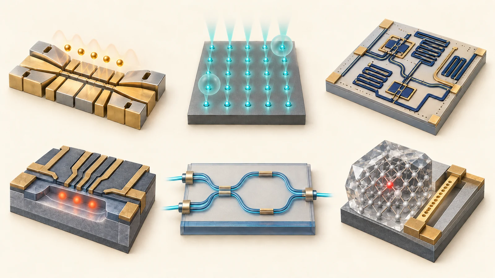
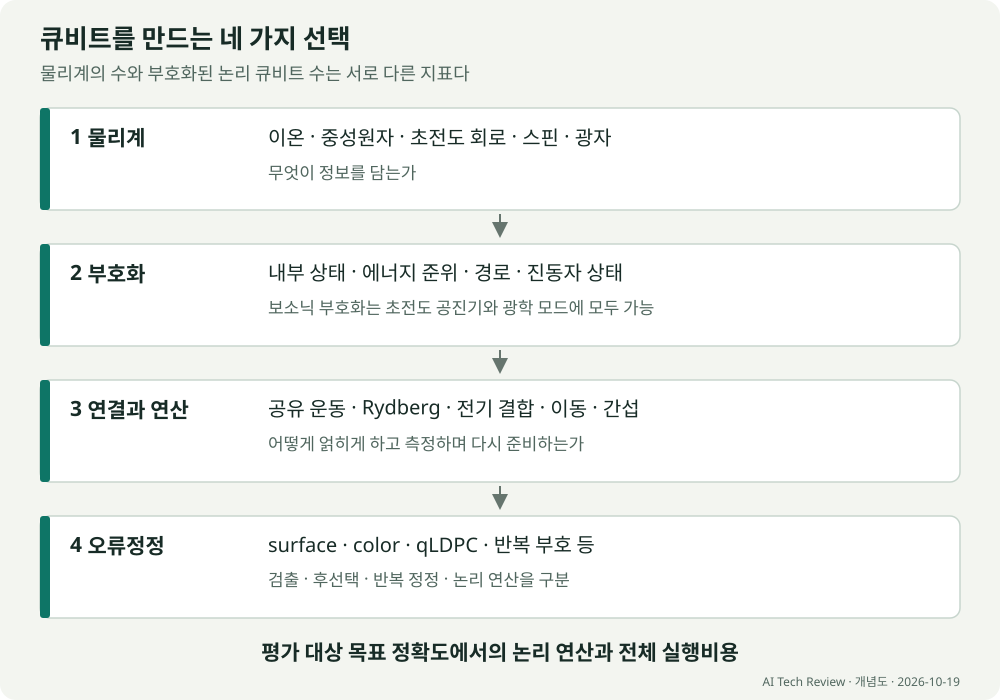
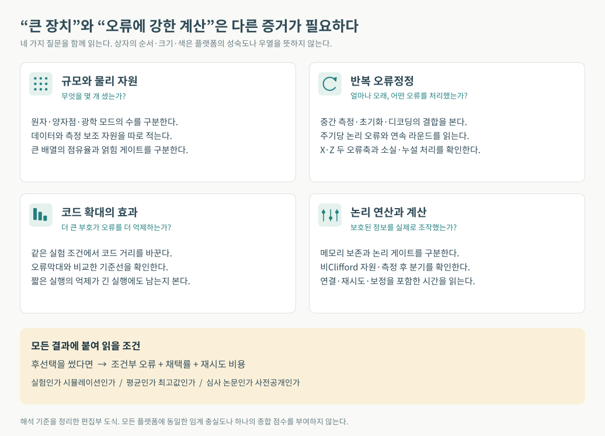
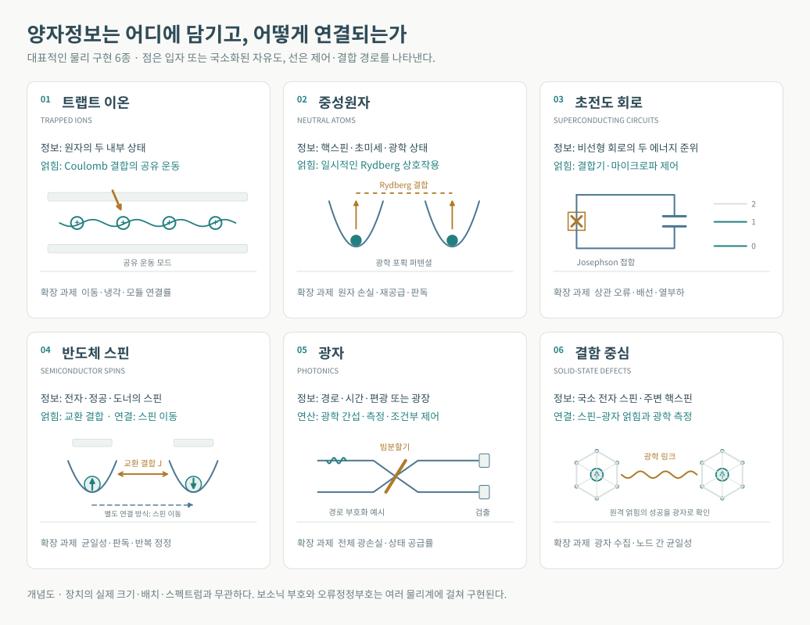
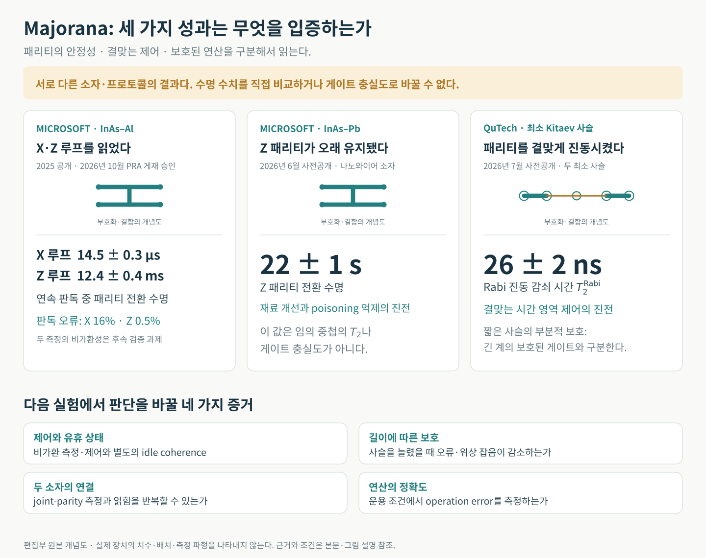
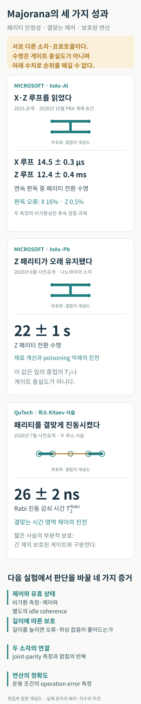
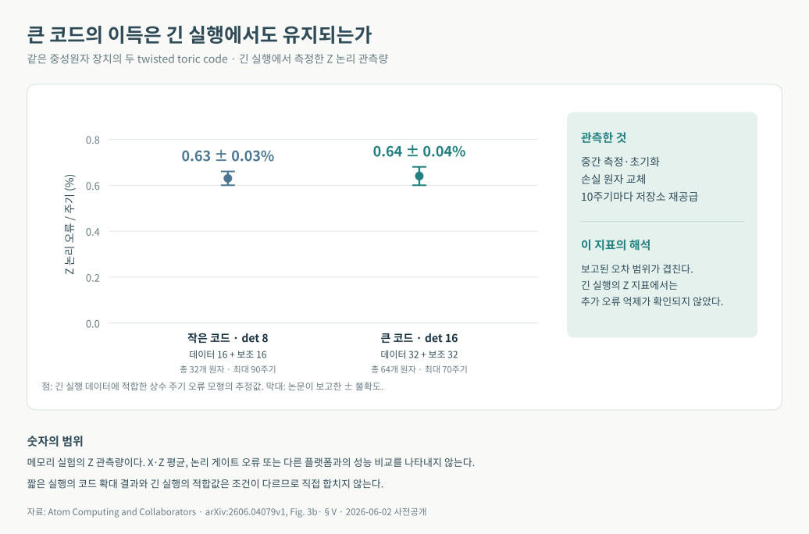
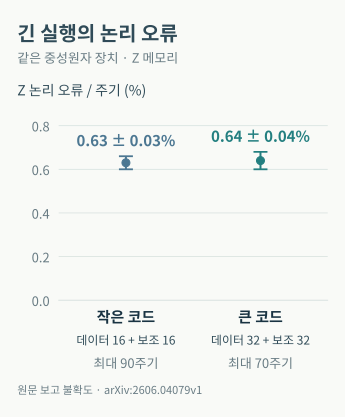

# 양자 큐비트 플랫폼의 현재와 확장 과제

양자컴퓨터의 물리적 구현을 비교할 때 중요한 것은 **얼마나 많은 큐비트를 만들었는지와 함께, 그 큐비트로 얼마나 정확한 계산을 얼마나 오래 지속할 수 있는지**다. 트랩트 이온은 정밀한 제어와 유연한 연결, 중성원자는 큰 배열과 재배치, 초전도 회로는 빠른 연산과 반복 오류정정에서 강점을 보인다. 실리콘 스핀은 집적과 제어회로의 통합을, 광자는 광학적 연결과 대규모 상태 생성을 발전시키고 있다. 이 강점을 유지하면서 시스템을 확장하는 것이 각 플랫폼의 다음 과제다.

<figure class="article-hero-figure">

<figcaption>그림 1. 왼쪽 위부터 트랩트 이온, 중성원자, 초전도 회로, 반도체 스핀, 광자 집적회로, 고체 결함 중심. 양자정보를 담는 물리계와 제어 구조를 개념적으로 표현했다. AI로 제작한 일러스트이며 실제 장치의 크기·연결 관계·원자 배치나 성능의 비교를 나타내지 않는다.</figcaption>
</figure>

2026년에는 논리 큐비트와 오류정정의 실험 범위가 넓어졌다. 동시에 ‘논리 큐비트’라는 표현 안에 오류 검출, 후선택, 반복 오류정정, 논리 연산이라는 서로 다른 성취가 섞여 있다. 아래 비교는 이 조건을 구분한다. **각 플랫폼의 물리적 장점이 어떤 계산 능력으로 이어졌으며, 확장을 위해 어떤 검증이 필요한지**를 평가한다.

## 실현 가능성과 파급력을 나누어 보는 우선순위

가까운 오류내성 계산의 진전을 읽을 때는 **이온·초전도·중성원자를 중심 경로로, 보소닉 부호화를 자원 부담을 줄이는 교차 경로로** 보는 것이 현재 실험 근거에 맞는다. 마요라나는 실현된다면 구현 비용을 크게 바꿀 수 있지만, 보호된 계산 큐비트를 입증하는 위험까지 함께 안고 있다. 이 구분은 아래 논문을 종합한 기술적 판단이며, 상용화 확률이나 출시 연도를 추정한 점수는 아니다.

| 비중을 두어 볼 경로 | 현재의 판단 근거 | 가까운 진전을 가를 지점 |
| --- | --- | --- |
| 이온·초전도·중성원자 | 높은 정확도의 논리 연산, 반복 오류정정, 원자 보충과 배열 제어라는 서로 다른 강점이 실제 실험으로 축적됐다 | 여러 논리 큐비트의 깊은 계산에서 억제가 유지되고 유효한 논리 연산 수/초가 늘어나는가 |
| 보소닉 부호화 | 물리적 안정화와 오류의 비대칭성을 이용해 정정 자원을 줄일 경로가 있다 | 연산·측정·바깥 부호를 통합해도 오류 구조와 자원 이득이 남는가 |
| 마요라나 | 성공 시 보호·밀도·자원 요구를 바꿀 잠재력이 크며, 최근 판독과 결맞는 제어가 각각 발전했다 | 같은 장치에서 제어·보호·반복 연산의 정확도를 함께 입증하는가 |
| 실리콘 스핀·광자 | 반도체 제조와 광학 연결이라는 장기 확장 자산이 있다 | 제조·제어 기반의 이점이 손실과 측정까지 포함한 논리 오류 억제로 이어지는가 |
| 결함 중심·분자 등 | 통신 메모리나 특수한 상호작용처럼 구체적인 역할이 두드러진다 | 범용 컴퓨터의 규모 외에, 해당 역할에서 필요한 정확도와 처리량을 달성하는가 |

충실도는 우선 충족할 조건이지만 그 숫자 하나로 실용성을 정할 수는 없다. **정확도**는 단일·이중·병렬 게이트와 판독·초기화·논리 연산을 나누어 보고, **제어 가능성**은 상태 준비·중간 측정·실시간 분기·드리프트 보정과 반복 재현성으로 판단한다. **실행 현실성**에는 냉각·이동·원자 보충·광자 손실·원격 연결 대기와 재시도를 포함한다. **확장 경제성**은 수율·배선·광학·냉각·상태 공장까지 묶어야 한다. 이 네 관점이 달라지면 같은 게이트 충실도에서도 유용한 계산량이 달라진다.

용도에 따른 비중도 다르다. 깊은 적응형 논리 회로에는 정확도·연결·분기 비용이 중요하고, 격자형 다체 시뮬레이션에는 원자 배열의 기하학적 제어가 장점이 될 수 있다. 광자와 결함 중심은 통신과 메모리의 역할을 함께 평가해야 한다. 범용 계산 능력, 특정 Hamiltonian의 시뮬레이션, 통신 노드의 성과를 한 ‘큐비트 수’로 합산할 수는 없다.

## 원문에서 출발하는 질문

Tomer Itelson의 LinkedIn 글은 중성원자를 광학 집게로 포획하고 빈자리를 재배열하는 과정을 설명한다. 원자가 전기적으로 중성이어도 빛에 의해 유도되는 전기 쌍극자 때문에 광학적 힘을 받는다. 적절한 파장과 광장 분포에서는 집중된 빛이 포획 퍼텐셜을 만든다. 원자종과 파장에 따라 퍼텐셜의 부호와 성질이 달라지므로 모든 레이저가 원자를 중심으로 끌어당기는 것은 아니다. [원문](https://www.linkedin.com/posts/tomer-itelson-827575161_after-a-short-break-back-to-quantum-hardware-share-7517649574442889217-4HL_/)

LinkedIn 글이 사진 출처로 제시한 Norcia 등의 *Iterative Assembly of ¹⁷¹Yb Atom Arrays with Cavity-Enhanced Optical Lattices*는 광학 집게와 공진기로 강화한 광격자를 결합하고, 저장소 배열에서 원자를 반복 공급했다. 1,225개 포획 자리에서 자리당 약 99% 점유율을 보였다. 이 수치는 배열을 채우는 능력이다. 1,225개의 논리 큐비트나 같은 수의 고충실도 얽힘 연산을 뜻하지 않는다. 논문이 제시한 계산 중 원자 재공급의 가능성도 배열 점유율 시연과 구분해야 한다. [PRX Quantum 5, 030316, 2024](https://doi.org/10.1103/PRXQuantum.5.030316), [저자 공개본](https://arxiv.org/abs/2401.16177)

이 글에서 ‘큐비트 소스’는 **양자정보를 담는 물리계와 그 정보를 제어하는 플랫폼**으로 해석한다. 광자 분야에서 말하는 단일광자 소스는 이보다 좁은 개념이다.

## 플랫폼을 구분하는 네 가지 층

큐비트는 추상적으로 두 상태의 중첩 α|0⟩ + β|1⟩이다. 실제 장치는 이 두 상태를 물질이나 빛의 자유도에 대응시켜야 한다. 원자 자체가 놓인 자리와 큐비트 상태는 대개 다르다. 원자가 같은 자리에 있어도 내부 스핀이나 전자 상태의 중첩을 가질 수 있다.

| 층 | 핵심 질문 | 예시 |
| --- | --- | --- |
| 물리계 | 무엇이 양자정보를 담는가 | 이온, 중성원자, 초전도 회로, 전자 스핀, 광자 |
| 부호화 | 어떤 상태를 0과 1로 정하는가 | 초미세 상태, 핵스핀, 회로의 에너지 준위, 광자 경로, 진동자 상태 |
| 연결과 연산 | 두 큐비트를 어떻게 얽히게 하는가 | 공유 운동, Rydberg 상호작용, 전기적 결합, 교환 상호작용, 광학 간섭 |
| 오류정정 | 오류를 어떻게 검출하고 억제하는가 | surface code, color code, qLDPC, cat 및 GKP 부호, 소실 검출 |

**보소닉 큐비트는 별도의 재료 이름이 아니다.** 진동자의 많은 상태를 이용하는 부호화 방식이며, 초전도 마이크로파 공진기와 광학 모드 모두에 구현할 수 있다. GKP 역시 특정 장비 회사나 물질을 가리키지 않는다. 위상 큐비트의 ‘위상 보호’와 surface code 같은 오류정정부호의 위상적 구조도 서로 다른 개념이다.

<figure class="figure-panel">

<figcaption>그림 2. 물리계의 선택과 부호화 방식, 연결 구조, 오류정정부호는 함께 설계한다. 보소닉 부호화는 초전도와 광자에 모두 적용할 수 있다. 각 층에서 센 자원 수를 논리 큐비트 수로 그대로 환산할 수는 없다. 본문의 정의에 따른 개념도. <a href="../artifacts/qubit_layers.svg">그림 크게 보기</a></figcaption>
</figure>

## 현재 성과를 비교할 때 읽어야 할 지표

**물리 큐비트 수와 논리 큐비트 수.** 여러 물리 큐비트를 한 논리 큐비트에 사용할 수 있다. [[n,k,d]] 부호는 n개의 물리 큐비트에 k개의 논리 큐비트를 담고 코드 거리 d를 갖는다. 작은 d로 k를 크게 만든 장치와, 큰 d로 오류를 강하게 억제한 장치는 성격이 다르다. 실제 장비에는 데이터 외에 측정 보조 큐비트, 이동 공간, 상태 공급 장치도 필요하다.

**게이트 충실도와 시스템 오류.** 단일 큐비트 99.99%는 두 큐비트 게이트나 전체 회로의 정확도가 아니다. 분리 실행한 randomized benchmarking 결과가 병렬 실행, 측정, 이동, 재초기화까지 포함한 정확도를 보장하지 않는다. 평균값과 가장 좋은 한 쌍의 수치도 구분해야 한다.

**오류 검출과 오류정정.** 검출은 이상을 알아내는 것이고, 정정은 검출 기록에서 오류를 추론해 물리적으로 보정하거나, 이후 연산과 판독에 반영할 보정 정보를 Pauli frame에 기록하는 것이다. 후선택은 이상이 있는 실행을 버린다. 후선택으로 조건부 정확도가 높아지면 채택률과 전체 실행비용을 함께 보고해야 한다. 다만 상태 준비처럼 실패를 미리 알아내 재시도하는 절차는 실제 오류내성 설계에서도 유용하다.

**코드 확대와 시간 확대.** 더 큰 코드에서 논리 오류가 작아지는 것과, 같은 코드가 수십·수백 라운드 동안 잘 유지되는 것은 별도의 검증이다. 짧은 실험에서의 오류 억제가 긴 계산에서도 유지되는지 확인해야 한다. 반복 부호가 한 종류의 오류만 보호한 결과도 임의의 양자 상태에 대한 완전한 보호와 구분한다.

**논리 메모리와 논리 계산.** 상태를 보존하는 실험에 이어 논리 큐비트 사이의 연산, 비Clifford 연산, 측정 결과에 따른 분기까지 필요하다. Clifford 연산만의 큰 회로는 특정 조건에서 고전적으로 효율적으로 모사되므로, 그 규모만으로 유용한 계산 우위를 판정할 수 없다.

공통적으로 볼 항목은 논리 오류율, 오류정정 주기, 코드 거리, 연속 라운드 수, 논리 게이트 오류, 후선택 채택률, 연결 비용, 보정 및 재시도까지 포함한 실행시간이다. **99.9% 같은 하나의 수치는 모든 플랫폼에 공통인 오류내성 합격선이 아니다.** 문턱값은 부호, 오류의 상관관계, 측정·누설·소실, 디코더와 연결 방식에 달려 있다.

<figure class="figure-panel">

<figcaption>그림 3. 양자 하드웨어 결과를 읽을 때 필요한 네 종류의 검증. 규모, 반복 오류정정, 코드 확대, 논리 계산은 서로 다른 질문이다. 상자 배열은 플랫폼의 성숙도나 순위를 표현하지 않는다. 후선택 사용 시에는 채택률과 재시도 비용을 함께 확인한다. 본문의 지표 구분을 도식화했다. <a href="../artifacts/evidence_requirements.svg">그림 크게 보기</a></figcaption>
</figure>

## 주요 플랫폼의 비교

아래 평가는 뒤의 논문들을 종합한 해석이다. 각 행의 성과는 서로 다른 규모와 프로토콜에서 측정되었으므로 숫자로 단일 순위를 매기지 않는다.

<figure class="figure-panel">

<figcaption>그림 4. 여섯 물리 플랫폼의 정보 저장과 연결 원리. 모든 도형은 편집부가 작성한 개념도이며, 실제 장치의 치수·배치·에너지 간격을 나타내지 않는다. 보소닉 부호화와 오류정정부호는 이 물리계 분류와 별도의 층이다. 각 플랫폼의 원리와 근거 논문은 이어지는 절에서 설명한다. <a href="../artifacts/qubit_mechanisms.svg">그림 크게 보기</a></figcaption>
</figure>

| 플랫폼 | 양자정보와 얽힘 방식 | 현재 확인된 강점 | 다음 확장 과제 |
| --- | --- | --- | --- |
| 트랩트 이온 | 원자 내부 상태와 공유 운동 또는 모듈 간 광자 연결 | 높은 정확도, 긴 기억, 유연한 연결, 논리 연산 | 이동과 냉각 시간, 광학 제어, 모듈 연결 속도 |
| 중성원자 | 초미세·핵스핀·광학 상태와 Rydberg 상호작용 | 큰 배열, 재배치, 병렬 게이트, 논리 실험 | 원자 손실과 보충, 반복 측정, 균일한 게이트 |
| 초전도 회로 | 인공 원자의 준위와 결합기 | 빠른 반복 오류정정, 제어 생태계 | 상관 오류, 배선과 열, 보정, 여러 논리 큐비트 연산 |
| 보소닉 부호화 | 공진기·진동자 상태에 분산 부호화 | 오류 구조를 설계하고 물리 자원 절감 가능 | 보조 큐비트 오류, 논리 게이트, 모드 간 연결 |
| 반도체 스핀 | 전자·정공·도너 핵스핀과 교환·이동 | 작은 소자, 반도체 제조와 제어회로 통합 | 균일성, 판독, 배선, 두 오류축의 반복 정정 |
| 광자 | 경로·시간·편광 또는 연속변수 광장 | 네트워크 연결, 광학적 병렬화 | 광손실, 상태 소스, 검출·스위칭·지연선 |
| 결함 중심 | 다이아몬드 등의 전자·핵스핀과 광학 연결 | 메모리와 통신의 결합, 원격 연산 | 광자 수집, 노드 균일성, 원격 얽힘 공급률 |
| 위상 및 Majorana | 비국소 자유도와 패리티 | 보호 가능한 부호화의 잠재력, 패리티 판독과 최소 사슬의 결맞는 제어 | 위상성·보호·고정밀 연산의 통합 입증 |

## 마요라나 큐비트의 파급력과 실현 가능성

**마요라나는 성공했을 때의 파급력이 크지만, 보호된 고정밀 계산 큐비트를 입증하는 선결 위험도 큰 경로다.** 2026년에는 긴 패리티 안정성과 최소 Kitaev 사슬의 결맞는 제어가 각각 진전했다. 이들은 다른 장치·프로토콜의 결과이며, 한 장치에서 긴 결맞음과 고충실도 연산과 위상 보호를 함께 달성했다는 의미로 합칠 수 없다.

### 성공했을 때 무엇이 달라지는가

여기서 마요라나는 초전도체에서 전자와 정공이 결합된 Majorana 영모드라는 준입자 상태를 가리킨다. Tetron 제안은 네 영모드와 고정된 전체 패리티를 이용해 하나의 큐비트를 구성한다. 정보를 떨어진 자유도에 분산해 국소 잡음에 덜 민감하게 만들고, 패리티 측정의 조합으로 연산하는 것이 목표다. 이 보호가 실제 장치에서 유지되면 잔류 오류와 바깥 오류정정에 드는 자원을 함께 줄일 여지가 있다. [Microsoft의 소자·연산 로드맵](https://arxiv.org/abs/2502.12252)

파급력은 기존 범용 알고리즘의 구현 비용을 낮추는 데 있다. 마요라나라는 물리계 자체가 분자 계산이나 최적화에 새로운 알고리즘적 가속을 자동으로 주는 것은 아니다. 작은 소자 면적, 전기적 제어와 패리티 측정은 집적에 유리할 수 있지만, 반도체의 무질서·자기장·게이트 조정·판독 회로의 비용을 포함해야 한다. 보호된 Clifford 연산에 더해 비Clifford 자원과 잔류 오류정정도 필요하다. 로드맵이 제안하는 단일 큐비트 검증, 두 tetron 연산, 여덟 tetron 오류검출과 논리 오류정정은 각각 별도 이정표다. [로드맵 저자 공개본](https://arxiv.org/html/2502.12252v3)

### 현재 무엇을 어느 장치에서 입증했는가

| 연구 경로와 공개 상태 | 확인된 결과 | 결과가 말해 주는 범위 |
| --- | --- | --- |
| Microsoft InAs–Al의 X·Z loop 측정. 2025년 사전공개, 2026년 10월 1일 Physical Review A 심사 채택 | X loop 수명 14.5 ± 0.3 μs, Z loop 수명 12.4 ± 0.4 ms. 적분 시간 2 μs 및 50 μs에서 operational assignment error는 각각 16%, 0.5% | 두 패리티 판독 경로의 성과다. 저자들은 빠른 교차 측정으로 X·Z의 비가환성을 확인하는 일을 다음 단계로 남겼다. [PRA 채택 원고](https://journals.aps.org/pra/accepted/10.1103/cx4w-lxx1), [본문](https://arxiv.org/html/2507.08795v2) |
| Microsoft InAs–Pb tetron. 2026년 6월 2일 사전공개 | Z 패리티 전환 시간 22 ± 1 s. 논문 제목은 *20 Second Parity Lifetime in an InAs–Pb Tetron Device* | 재료 변화로 패리티를 바꾸는 오류 경로를 크게 줄인 성과다. 임의 중첩의 T₂, 두 큐비트 게이트 충실도나 보호된 논리 수명이 아니다. [원문](https://arxiv.org/html/2606.03884v1) |
| QuTech의 결합한 최소 Kitaev 사슬. 2026년 7월 10일 사전공개 | 결맞는 패리티 Rabi 진동. 대표 측정에서 진동 주파수 106.7(0.4) MHz, 감쇠 시간 T₂ᴿᵃᵇⁱ = 26 ± 2 ns | 시간 영역에서의 결맞는 제어가 출현했다. 짧은 이른바 poor man's Majorana 사슬의 부분적 보호이며, 긴 계의 지수적 보호나 높은 게이트 충실도와 구분한다. [실험 원문](https://arxiv.org/html/2607.09511v1) |

판독 오류 0.5%를 다른 플랫폼의 두 큐비트 게이트 오류 0.5%와 같은 것으로 놓아서는 안 된다. 패리티 전환과 신호 잡음을 포함한 판독 연산 오류, 임의 상태를 조작하는 연산 오류, 여러 번의 연산 후 남는 논리 오류는 서로 다른 지표다. 22초와 26 ns도 서로 다른 장치에서 다른 동역학을 측정한 값이므로 성능 비율로 계산할 수 없다.

2026년 2월의 *Single-shot parity readout of a minimal Kitaev chain*는 최소 사슬의 단발 판독을 발전시켰고, 7월 연구는 결합한 사슬의 결맞는 제어로 범위를 넓혔다. 따라서 현황은 패리티 판독에만 머무른다는 서술로 정리하기 어렵다. 관건은 **결맞는 제어를 유지하면서 보호 이득과 연산 정확도를 함께 높이는가**다. [Nature 판독 논문](https://doi.org/10.1038/s41586-025-09927-7)

<figure class="figure-panel">

<figcaption>그림 5. 마요라나 관련 세 실험의 성과와 해석 범위. 세 패널은 다른 장치·프로토콜이며 성숙도 순위가 아니다. 패리티 전환, Rabi 감쇠와 판독 오류는 서로 다른 측정량이다. 아래의 네 항목은 후속 검증 기준이다. 소자 그림은 실제 배치를 재현하지 않은 편집부 개념도이며 출처와 조건은 위 표 및 이어지는 두 이론 논문에 제시했다. <a href="../artifacts/majorana_evidence.svg">그림 크게 보기</a></figcaption>
</figure>

### 수명과 보호를 판별하는 최근 연구

2026년 10월 8일 사전공개된 *Measurement-induced enhancement of the X-parity lifetime in a Majorana tetron*는 측정 회로와의 결합이 패리티 전환을 느리게 만들 수 있음을 이론적으로 분석했다. 연속 판독 중 긴 패리티 수명을 유휴 상태의 T₂*로 바로 읽기 어렵다는 의미다. 이 논문은 특정 Microsoft 장치의 실제 유휴 T₂*를 측정한 결과는 아니다. [이론 원문](https://arxiv.org/html/2610.12223v1)

10월 12일의 *Revealing topological protection through unprotected operations in a Majorana parity qubit*도 이론 연구다. 결합을 조절하는 Rabi 연산 자체가 잡음에 취약할 수 있으므로, 사슬 길이에 따른 최적화된 진동 횟수나 충분히 분리한 상태의 Ramsey 결맞음이 어떻게 바뀌는지 보자는 검증법을 제안한다. 보호를 새로 실증한 논문이 아니라, 보호를 확인할 다음 실험을 구체화한 논문이다. [이론 원문](https://arxiv.org/html/2610.17198v1)

위상성에 대한 논쟁도 구분해 읽어야 한다. 2025년 *Interferometric single-shot parity measurement in InAs–Al hybrid devices*는 해당 측정만으로 저에너지 상태의 위상성을 결정할 수 없다고 명시했다. 2026년 6월 24일 Nature의 *On the robustness of topological gap detection via transport*는 수송 자료와 위상 갭 판별 분석을 비판했고, Microsoft Quantum의 답변은 안정된 자속 주기의 간섭 신호가 비위상적 설명을 제약한다고 반박했다. 이 논쟁은 Microsoft의 특정 자료와 해석을 검토하는 것이며 최소 사슬의 결맞는 제어 실험 전체를 부정하는 근거로 확대할 수 없다. [2025년 원 논문](https://doi.org/10.1038/s41586-024-08445-2), [Nature 비판](https://doi.org/10.1038/s41586-026-10567-8), [답변](https://doi.org/10.1038/s41586-026-10568-7)

### 가까운 이정표와 중기 전망

마요라나의 전망을 바꿀 결과는 긴 수명 하나의 추가 기록보다 다음 검증의 결합이다. 측정 기반 경로에서는 서로 다른 축의 반복 측정과 비가환성, 펄스 제어 경로에서는 Rabi·Ramsey 제어와 잡음의 관계를 확인해야 한다. 그 위에 두 tetron의 joint-parity 측정과 얽힘, 반복 연산 오류, 여러 소자의 재현성이 필요하다. 사슬 길이·에너지 갭을 늘렸을 때 유휴 상태뿐 아니라 연산 중 오류도 줄어드는지가 보호의 경제적 가치를 결정한다.

Microsoft는 2026년 6월 Majorana 2 발표에서 2029년 확장 가능한 컴퓨터를 목표로 제시했다. 이는 기업의 개발 목표다. 발표의 ‘1,000배 신뢰성’ 표현을 게이트 충실도나 알고리즘 성공률의 1,000배 개선으로 바꾸어 읽을 수는 없다. 이 리뷰에서 가까운 관찰기간인 2027–2029년에 우선 확인할 것은 보호된 조작과 공동 측정의 재현 가능한 오류 자료이며, 대규모 상용 계산의 도래는 그 결과에 달린다. [회사 발표](https://news.microsoft.com/source/features/innovation/majorana-2-microsoft-discovery-agentic-ai)

현재 판단은 **장기 파급력 때문에 높은 관심을 둘 가치가 있으나, 가까운 유용한 오류내성 계산의 기준 경로로 삼기에는 선결 검증이 더 필요하다**는 것이다. 재료·제어·위상 보호의 성공이 한 장치에서 결합되면 평가가 크게 바뀔 수 있다. 아래의 이온·초전도·중성원자는 이미 쌓인 논리 처리 결과를 더 큰 계산으로 연결하는 과제의 비중이 상대적으로 크다.

## 자본과 산업 기반은 어디에 쌓이는가

투자는 연구를 지속할 여력, 제조시설과 제어 인력을 확보하는 능력을 보여 준다. 다만 기업 전체 조달액을 특정 큐비트의 연구비로 환산하거나, 민간 투자·정부 보조·매출·대출 약정을 합쳐 기술 순위를 만들 수는 없다. 다음은 규모와 산업적 성격을 보여 주는 **선별 사례**이며, 전 세계 투자액의 집계가 아니다. 금액은 모두 미국 달러다.

| 경로와 주체 | 확인된 자금·시설 신호 | 기술 평가에서의 의미와 한계 |
| --- | --- | --- |
| 초전도 중심 제조 기반: IBM Anderon | 2026년 9월 16일 미국 CHIPS R&D 최종 지원 계약 **최대 10억 달러**, IBM의 추가 **10억 달러** 지원 계획. 300 mm 양자 파운드리에서 첫 웨이퍼 공정 시작 | 제조·패키징·수율 개발에 큰 자원이 들어간다. 지원 한도가 모두 지급되었거나 고수율 양산에 도달했다는 뜻은 아니다. [NIST](https://www.nist.gov/news-events/news/2026/09/department-commerce-announces-finalization-chips-rd-award-anderon), [IBM](https://newsroom.ibm.com/2026-09-16-anderon,-an-ibm-company,-finalizes-agreement-with-the-u-s-department-of-commerce-for-a-1-billion-chips-award-to-accelerate-r-d-for-u-s-based-pure-play-quantum-foundry) |
| 이온: Quantinuum | 2026년 6월 5일 IPO 종료. 2분기 SEC 공시상 IPO 조달 **16억 2,880만 달러**, 인수 할인·수수료 차감 후이며 기타 발행비용 차감 전 | 연구·상용화에 쓸 기업 자본이다. 하드웨어에 이미 집행한 연구비나 고객 매출과는 구분한다. [SEC 10-Q](https://www.sec.gov/Archives/edgar/data/2110105/000162828026056743/qnt-20260630.htm) |
| 중성원자: QuEra | 2025년 말 공식 결산에서 연중 신규 자본 **2억 3,000만 달러 초과** 확보 보고 | 오류내성 하드웨어와 배치·운영 역량을 개발할 여력이다. 초기 발표의 조건부 금액을 그대로 확정 자금으로 세는 대신 연말의 갱신된 발표를 사용했다. [회사 결산](https://www.quera.com/press-releases/quera-computing-marks-record-2025-as-the-year-of-fault-tolerance-and-over-230m-of-new-capital-to-accelerate-industrial-deployment) |
| 광자: PsiQuantum | 2025년 9월 Series E **10억 달러** 조달 발표 | 광자 칩과 시설을 대규모로 구축하는 경로에 자본이 모인다. 건설·제조 자본의 크기가 곧 공개 검증된 논리 계산 성능은 아니다. [조달 발표](https://www.psiquantum.com/news-import/psiquantum-1b-fundraise) |
| 실리콘 스핀: Quantum Motion | 2026년 5월 Series C **1억 6,000만 달러**. 9월 추가 투자 유치 발표는 금액 비공개 | 실리콘 공정과 제어의 통합에 대한 산업적 기대를 보여 준다. 9월분을 임의 추정해 합산하지 않았다. [5월 발표](https://quantummotion.com/quantum-motion-raises-160-million-series-c-to-deliver-quantum-computings-transistor-moment/), [9월 발표](https://quantummotion.com/quantum-motion-secures-additional-investment-to-accelerate-scalable-silicon-quantum-computing/) |
| 마요라나: Microsoft | 2026년 9월 Maryland 연구센터 개소 및 DARPA 시험용 Majorana 2 제공 발표. 해당 발표에 마요라나 전용 투자액은 제시되지 않음 | 전담 시설과 외부 시험의 기반은 생겼다. 회사 전체 R&D나 지역 양자 생태계 예산을 마요라나 투자액으로 대입할 수 없고, 시험 참여 자체가 독립 검증의 성공은 아니다. [연구센터 발표](https://quantum.microsoft.com/en-us/insights/blogs/microsoft-quantum-research-center-maryland) |

외부 검증의 흐름도 여러 경로에 걸친다. DARPA는 2026년 10월 7일 Atom Computing·Diraq·IBM·IonQ가 Microsoft·PsiQuantum에 합류해 QBI Stage C의 여섯 팀이 되었다고 발표했다. Stage B는 계획을 검토했고, Stage C에서는 하드웨어 시험이 시작된다. 이는 중성원자·스핀·초전도·이온·마요라나·광자의 계획이 검증 대상이라는 뜻이며, 여섯 경로가 실용성을 이미 입증했다는 판정은 아니다. [DARPA 공식 발표](https://www.darpa.mil/news/2026/four-more-teams-enter-quantum-benchmarking-initiative-final-stage)

산업적 현실성은 **지원과 조달이 실제 공정 수율, 자동 보정, 가동률, 연결 공급률과 오류내성 계산 비용의 개선으로 전환되는가**로 확인해야 한다. 투자 흐름은 기술 평가의 한 축이지만, 보호와 정확도에 대한 실험적 증거를 대신하지 않는다.

## 트랩트 이온

### 물리 원리와 장점

트랩트 이온은 전하를 가진 원자를 전자기장으로 가두고, 초미세 상태나 수명이 긴 광학 전이 상태 등을 큐비트로 쓴다. 레이저 또는 마이크로파가 단일 큐비트를 회전시키고, Coulomb 힘으로 결합된 운동 모드가 두 큐비트의 얽힘을 매개한다. 같은 동위원소의 원자들은 본질적으로 같은 에너지 구조를 가져 소자별 제조 편차를 줄일 수 있다. 실제 빔 세기, 자기장, 운동 가열의 균일성은 여전히 제어해야 한다.

한 이온 사슬 안에서는 공유 운동을 통해 여러 쌍을 연결할 수 있다. QCCD 구조는 이온을 저장·연산·측정 구역 사이로 옮겨 필요한 쌍을 만난다. ‘all-to-all 연결’에는 이 이동과 스케줄링의 비용이 포함된다. 서로 다른 진공 장치 사이의 연결에는 광학 링크 같은 별도의 계층이 필요하다.

### 논문이 보여주는 현위치

2026년 6월 17일 출판된 *A 98-qubit trapped-ion quantum computer with all-to-all connectivity*는 Helios의 98개 물리 ¹³⁷Ba⁺ 큐비트를 보고했다. 연산 구역 전체 평균 두 큐비트 게이트 불충실도는 7.9(2) × 10⁻⁴, 충실도로 약 99.921%였다. 단일 큐비트 불충실도는 2.5(1) × 10⁻⁵였다. 중요한 점은 한 쌍의 최고 기록에 이어 여러 구역과 이동형 구조의 시스템 성능을 평가했다는 것이다. [Nature](https://doi.org/10.1038/s41586-026-10676-4)

2026년 9월 2일 사전공개된 *Experimental validation of a compact fault-tolerant architecture for trapped ions*는 20개 데이터 큐비트에 두 논리 큐비트를 담는 [[20,2,6]] C₄-Helix 부호를 사용했다. 안정자 측정 보조 자원은 별도다. 반복 오류정정의 오류는 논리 큐비트당 주기당 4.6 × 10⁻⁵로, 보고된 오차 구간은 +6.2/−2.6 × 10⁻⁵였다. 두 논리 큐비트 Clifford 연산 오류는 2.8 × 10⁻⁴, 구간은 +1.0/−1.6 × 10⁻⁴였다. 후선택 없이 해당 물리 기준선을 상회했다는 점이 중요하다. 이는 작은 논리 구성의 실험이며 더 개선된 하드웨어를 가정한 10⁻⁶∼10⁻⁸ 전망은 시뮬레이션이다. [arXiv 사전공개](https://arxiv.org/abs/2609.03194)

다른 방향의 규모 실험인 *Computing with many encoded logical qubits beyond break-even*는 48∼94개 부호화 논리 큐비트를 다룬다. 작은 거리의 오류검출 부호와 연결 부호, 후선택 조건을 사용하므로 94개의 강하게 오류정정된 논리 큐비트를 연속 운영했다는 의미로 읽으면 안 된다. 범용 연산을 다룬 별도 원고 *Fault-tolerant execution of error-corrected quantum algorithms*는 최대 12개 논리 큐비트와 97개 물리 큐비트의 회로를 보고했으며, 논리 T 게이트 불충실도는 약 2.6(4) × 10⁻³였다. 가장 큰 회로의 결과가 실용적인 계산 우위를 입증한 것은 아니다. [2026년 2월 25일 사전공개](https://arxiv.org/abs/2602.22211), [2026년 3월 4일 사전공개](https://arxiv.org/abs/2603.04584)

모듈 연결의 기준 사례인 *Distributed quantum computing across an optical network link*는 약 2 m 떨어진 두 이온 모듈 사이에서 원격 CZ 게이트 충실도 86.2(9)%를 보고했다. 광자 얽힘 생성 성공을 기다린 뒤 gate teleportation을 수행했다. 원격 연결의 작동 원리를 검증한 결과이며, 각 모듈 안의 높은 게이트 충실도가 링크에서도 그대로 유지된다는 뜻은 아니다. [Nature, 2025년 2월 5일](https://doi.org/10.1038/s41586-024-08404-x)

2026년 9월 11일 사전공개되고 10월 15일 개정된 *Error Correction in a Distributed Quantum Computer*는 광학 링크로 연결한 두 이온 모듈에서 원격 XX·ZZ 안정자 측정과 실시간 feed-forward를 수행했다. [[2,1,1]] 반복 부호에서는 검출·재시작을 사용했고, 알려진 Bell 상태에 가해진 단일 큐비트 Pauli 오류의 능동 정정도 다뤘다. 원격 안정자 측정이 실험 단계에 들어왔다는 진전이다. 임의의 미지 논리 상태를 연속 보호하는 완전한 분산 오류정정과는 구분한다. [저자 공개본 v2](https://arxiv.org/html/2609.13065v2)

### 확장 과제

이온 수를 한 사슬에서 계속 늘리면 운동 모드가 복잡해지고 개별 주소 지정과 병렬 연산이 어려워진다. 구역을 나누면 이 문제를 줄일 수 있지만 이동, 분리·병합, 재냉각에 시간이 든다. 높은 게이트 충실도를 논리 연산 처리량으로 바꾸려면 이 과정을 함께 최적화해야 한다.

모듈화의 판단 기준은 원격 얽힘을 한 번 만들었는지에 이어, 정해진 정확도로 초당 얼마나 공급하는지다. 이동형 제어, 집적 광학, 광자 수집, 동종·이종 이온의 역할 분리, 실시간 디코딩이 모두 중요하다. 이온의 다음 경쟁력은 높은 정확도를 유지한 병렬 논리 연산과 모듈 사이의 연결 비용에서 드러날 것이다.

## 중성원자

### 물리 원리와 원자종 선택

광학 집게와 광격자는 전하가 없는 원자를 가둘 수 있다. 큐비트는 원자 내부의 두 상태에 저장하며, 얽힘 게이트 때 원자를 전자의 공간 분포가 크게 확장된 Rydberg 상태로 잠시 올려 강한 상호작용을 이용한다. 한 원자의 여기가 근처 원자의 여기를 막는 Rydberg blockade가 대표적 원리다. 원자를 이동시켜 상호작용할 쌍을 바꿀 수 있어 기하학적 배치와 계산 연결을 유연하게 설계한다.

Rb와 Cs 같은 알칼리 원자는 초미세 상태 제어 경험이 풍부하다. Sr 같은 알칼리 토금속과 Yb 같은 알칼리 토금속 유사 원자는 핵스핀, 광학 시계 전이, 준안정 상태를 활용할 수 있어 저장·연산·판독의 역할을 나누기 좋다. 원자종의 선택은 가능한 레이저, 냉각, 판독, 소실 검출과 게이트 오류의 구조까지 바꾼다. 특정 원자종의 배열 성과를 다른 원자종의 게이트 성능과 합쳐 하나의 장비 성능처럼 제시하면 안 된다.

### 논문이 보여주는 현위치

배열 규모에서는 *A tweezer array with 6,100 highly coherent atomic qubits*가 6,100개 물리 원자와 12.6(1) s의 결맞음 시간을 보고했다. *Continuous operation of a coherent 3,000-qubit system*는 3,000개 이상 배열을 두 시간 넘게 유지하면서 저장된 원자의 결맞음과 재공급의 양립을 보였다. 이 두 결과는 많은 원자를 잘 저장하고 공급하는 능력의 진전이다. 해당 규모의 얽힘 게이트 또는 논리 오류정정 장치로 환산하지 않는다. [Nature, 2025년 9월 24일](https://doi.org/10.1038/s41586-025-09641-4), [Nature, 2025년 9월 15일](https://doi.org/10.1038/s41586-025-09596-6)

*A fault-tolerant neutral-atom architecture for universal quantum computation*는 최대 448개 ⁸⁷Rb 원자의 구역형 구조를 사용했다. 4라운드 surface-code 평가에서 거리 3→5로 늘릴 때 오류가 2.14(13)배 억제되었고, 거리 5에서 후선택 없는 논리 오류는 라운드당 0.62(3)%였다. 이 평가에서는 보조 원자 블록을 저장해 게이트 시퀀스 끝에 측정했다. 별도의 깊은 회로 실험에서는 중간 큐비트 재사용을 보였다. 논리 연산의 일부에는 후선택과 소프트웨어상의 feed-forward가 포함된다. 범용 오류내성 계산의 구성요소를 발전시킨 논문으로 해석해야 한다. Nature 649의 2026년 논문이지만 실제 온라인 공개일은 2025년 11월 10일이다. [Nature](https://doi.org/10.1038/s41586-025-09848-5)

비Clifford 자원의 공급도 이미 실험 대상이다. *Experimental demonstration of logical magic state distillation*는 거리 3·5 color code에서 5-to-1 논리 마법상태 증류를 시연했다. 따라서 다음 과제는 최초 시연 자체에 이어, 더 깊은 계산에 필요한 상태를 충분한 정확도와 채택률로 계속 공급하고 재시도 비용까지 줄이는 일이다. [Nature, 온라인 공개 2025년 7월 14일](https://doi.org/10.1038/s41586-025-09367-3)

2026년 6월 2일 사전공개된 *Quantum error correction with the toric code*는 중간 측정·초기화, 원자 손실 교체와 저장소 재공급을 결합했다. 데이터+보조 원자가 32개 또는 64개인 메모리를 각각 최대 90 또는 70주기 실행했다. 4주기 시점에서 X·Z 논리 관측량을 평균한 코드 확대의 오류 억제계수는 1.30(3)배였다. 그러나 장시간 실행의 Z 논리 오류는 작은 코드에서 주기당 0.63(3)%, 큰 코드에서 0.64(4)%로 큰 코드의 추가 억제가 유지되지 않았다. 지속 운영의 성과와 남은 오류 누적 문제가 동시에 드러난다. [arXiv 사전공개](https://arxiv.org/abs/2606.04079)

<figure class="figure-panel">

<figcaption>그림 6. 중성원자 장치의 두 twisted toric code에서, 저장소 재공급을 포함한 긴 실행의 Z 논리 오류율을 비교했다. 점은 상수 주기 오류 모형의 적합값, 막대는 논문 보고의 ± 불확도다. 데이터와 보조 원자는 각각 16+16개 및 32+32개이고, 최대 실행 길이는 90주기 및 70주기로 다르다. 이 지표에서 큰 코드의 추가 억제는 확인되지 않았다. 부호의 원자 수는 장치 전체의 원자 수와 다르다. <a href="https://arxiv.org/html/2606.04079v1">Atom Computing 등의 사전공개 논문 Fig. 3b와 V절</a>에 보고된 값을 재도식화했다. <a href="../artifacts/toric_long_run.svg">그림 크게 보기</a></figcaption>
</figure>

2026년 6월 12일 출판된 *Logical qubits with erasure conversion using metastable neutral atoms*는 ¹⁷¹Yb의 준안정 핵스핀 상태에서 오류를 위치가 알려지는 소거(erasure) 오류로 전환·검출했다. 이는 원자 자체의 손실뿐 아니라 부호화 공간 밖으로의 검출 가능한 누설도 포함한다. [[4,2,2]] 부호가 임의의 단일 Pauli 오류는 정정하지 못해도, 위치를 아는 한 개의 소거 오류는 복구할 수 있다는 차이를 활용한다. 같은 날 출판된 *High-fidelity entanglement and coherent multi-qubit mapping in an atom array*는 여러 원자 내부 부호화 사이의 얽힘 전달과 최대 20원자 GHZ를 보였다. 후자의 두 큐비트 게이트 충실도 99.78(4)%는 소실을 검출한 조건부 수치다. [Nature Physics 소거 전환](https://doi.org/10.1038/s41567-026-03309-0), [Nature Physics 얽힘 전달](https://doi.org/10.1038/s41567-026-03258-8)

### 확장 과제

큰 배열은 확장의 출발점이다. 그 전체에서 높은 게이트 충실도를 유지하려면 레이저 위상·세기·주파수 잡음, 원자의 잔류 운동, Rydberg 수명, 의도하지 않은 상호작용과 누설을 줄여야 한다. 재배치는 연결을 바꾸는 장점인 동시에 이동시간과 추가 오류의 원인이다.

가장 구조적인 과제는 원자 손실이다. 계산이 길어지면 손실을 찾아 새 원자를 넣고 초기화하며, 주변의 양자정보를 보존해야 한다. 소실 위치를 알 수 있다는 장점은 이를 정확히 검출할 때 생긴다. 판독 중 광산란이 이웃 큐비트에 주는 영향, 보조 원자의 재사용, 보충 속도가 논리 연산의 지속시간을 결정한다. 짧은 코드 확대 시연과 장시간 재공급 시연이 하나의 계산 안에서 결합되는지를 보아야 한다.

## 초전도 회로

### Transmon과 fluxonium

Josephson 접합과 축전기·인덕터로 비선형 양자 진동자를 만들고, 선택한 두 에너지 준위를 큐비트로 사용한다. Transmon은 전하 잡음 민감도를 낮추고, fluxonium은 큰 인덕턴스를 포함한 다른 설계를 사용한다. 마이크로파 펄스와 결합기가 연산을 제어한다. 수십 mK 수준의 냉각 환경, 제어 배선, 증폭기와 판독 회로가 시스템을 이룬다.

빠른 게이트와 측정은 오류정정 주기를 줄이는 데 유리하다. 반면 재료·계면 손실, 준입자, 주파수 충돌, 비계산 준위로의 누설, 제어선 간 간섭과 드문 상관 오류를 함께 다루어야 한다. 한 소자의 긴 수명을 다수 큐비트가 동시에 동작하는 장치의 성능으로 일반화할 수 없다.

### 논문이 보여주는 현위치

Google의 *Quantum error correction below the surface code threshold*는 Willow에서 거리 7의 101개 물리 큐비트 메모리를 구현했다. 코드 거리를 2 늘릴 때 오류 억제계수는 2.14 ± 0.02였고, 거리 7 논리 오류는 주기당 0.143 ± 0.003%였다. 논리 수명은 가장 좋은 구성 물리 큐비트보다 2.4 ± 0.3배 길었다. 거리 5에서는 실시간 디코더도 결합했다. 이는 반복 surface-code 메모리의 중요한 기준이다. 온라인 공개는 2024년 12월 9일, 권호는 Nature 638의 2025년이다. 2026년 정정은 그림 3a의 반복 부호 관련 표기를 고쳤다. [논문](https://doi.org/10.1038/s41586-024-08449-y), [정정](https://doi.org/10.1038/s41586-026-10559-8)

2026년 7월 8일의 *Reinforcement learning control of quantum error correction*는 오류 검출 신호를 보정의 학습 신호로도 썼다. 거리 7 surface-code 메모리의 평균 논리 오류는 주기당 7.72(9) × 10⁻⁴, 즉 약 0.0772%였다. 주입한 드리프트에 대해 제어와 디코더 조정을 함께 적용했을 때 논리 안정성이 3.5배 개선되었다. 그러나 실험은 매 실행마다 상태를 다시 준비한 짧은 메모리들을 반복했다. 하나의 긴 알고리즘을 중단 없이 보정하며 수행하는 확장 가능성은 시뮬레이션과 구분해야 한다. [Nature](https://doi.org/10.1038/s41586-026-10759-2)

게이트 수준에서는 *24 Days-Stable CNOT Gate on Fluxonium Qubits with Over 99.9% Fidelity*가 두 fluxonium의 60 ns CNOT를 보고했다. 최고 충실도는 99.94%, 재보정 없이 24일 동안 99.9% 이상이었다. 이는 안정적인 빠른 게이트의 중요한 사례이며 다수 큐비트 배열의 반복 오류정정 성과와는 다른 단계다. [PRX Quantum, 2025년 3월 11일](https://doi.org/10.1103/PRXQuantum.6.010349)

재료 개선과 논리 처리도 병행된다. *Millisecond lifetimes and coherence times in 2D transmon qubits*는 최고 T₁ 1.68 ms를 보고했다. *Scaling and logic in the colour code on a superconducting quantum processor*는 코드 확대와 transversal Clifford 연산, magic-state injection, 논리 teleportation을 결합했다. 반면 2026년 heavy-hex 실험 *Surface code scaling on heavy-hex superconducting quantum processors*는 일부 방향의 오류 억제를 보였으나, 기저에 무관한 below-threshold scaling의 충분한 증거는 없다고 명시했다. 같은 초전도 플랫폼 안에서도 재료·연결·부호와 측정 조건이 결과를 바꾼다. [Nature 재료 연구, 2025년 11월 5일](https://doi.org/10.1038/s41586-025-09687-4), [Nature color code, 2025년 5월 26일](https://doi.org/10.1038/s41586-025-09061-4), [Nature Communications, 2026년 7월 29일](https://doi.org/10.1038/s41467-026-76090-6)

### 확장 과제

이제 중요한 검증은 좋은 논리 메모리 여러 개를 연결해 연산하면서 같은 억제를 유지하는 것이다. 측정과 초기화가 데이터에 미치는 영향, lattice surgery, 비Clifford 상태 공급, 고전 제어기의 처리량을 함께 계산해야 한다. 빠른 물리 게이트가 있어도 제어 분기나 논리 연산의 라운드 수가 크면 전체 알고리즘은 느려질 수 있다.

집적 규모가 커지면 배선 수와 냉각부의 열부하, 제조 수율, 자동 보정이 중요해진다. 특히 드문 큰 상관 오류가 논리 오류의 바닥을 만들면 단순히 코드만 크게 하는 방식은 효과가 제한된다. 평균 충실도의 개선과 함께 오류 분포의 꼬리를 검증해야 한다.

## 보소닉 큐비트와 소실을 활용하는 부호화

### 진동자의 공간을 활용하는 이유

보소닉 부호는 하나의 진동자가 가진 여러 에너지 상태를 사용해 정보를 분산한다. Cat 부호는 떨어진 결맞음 상태들을 이용하고, GKP 부호는 위상공간의 격자 구조로 작은 변위를 검출한다. Dual-rail은 두 모드에 하나의 여기를 분산해 두 상태를 정의하며, 여기가 사라진 사건을 알아낼 수 있다. 이들은 같은 방식이 아니며 서로 다른 오류에 유리하다.

‘한 공진기에 논리 큐비트를 넣는다’고 해서 전체 장비가 한 소자로 끝나는 것은 아니다. 보조 큐비트, 읽기 회로, 안정화 구동, 다른 공진기와의 결합, 바깥쪽 오류정정부호가 추가될 수 있다. 특정 오류를 물리적으로 억제하고 나머지를 부호로 정정하는 설계가 핵심이다.

*Hardware-efficient quantum error correction via concatenated bosonic qubits*는 cat 내부에서 bit flip을 억제하고 바깥 반복 부호로 phase flip을 정정했다. 거리 3과 5의 최소 평균 논리 오류는 각각 주기당 1.75(2)%와 1.65(3)%였다. 이 결과는 물리적으로 편향된 오류와 바깥 부호를 결합한 사례다. 긴 bit-flip 수명 하나를 전체 양자 상태의 수명으로 읽으면 안 된다. [Nature, 2025년 2월 26일](https://doi.org/10.1038/s41586-025-08642-7)

2026년 9월 22일 사전공개된 *Bosonic Error Correction with Fluxonium*는 평면형 공진기와 fluxonium 보조 큐비트로 GKP 오류정정을 구현하고 논리 수명을 1.59 ± 0.05배 늘렸다. 큰 3차원 공진기와 다른 집적 경로를 보여 주지만 다중 논리 큐비트의 범용 계산 결과는 아니다. [arXiv 사전공개](https://arxiv.org/abs/2609.26880)

2026년 8월 5일의 *An entangling gate for dual-rail erasure qubits*는 각각 두 공진기로 부호화한 두 dual-rail 큐비트 사이에 저장 공진기 총 네 개를 사용해 약 500 ns의 CZ 게이트를 구현했다. 게이트당 소실 오류는 약 0.5%, 남은 Pauli 오류는 0.1% 미만이고 bit flip은 10⁻⁶ 수준이었다. 이 결과의 핵심은 총오류 중 상당 부분을 위치를 알 수 있는 소실로 분리하면서 얽힘 연산을 했다는 점이다. 부호 확대에 따른 오류 억제는 이 논문에서 실험한 전체 오류정정 장치의 결과가 아니라 시뮬레이션이다. [Nature](https://doi.org/10.1038/s41586-026-10822-y)

### 확장 과제

물리적 안정화가 잘 되어도 게이트가 그 유리한 오류 구조를 깨면 이득을 잃는다. 보조 큐비트의 오류가 데이터 모드로 전달되는 과정, 광자 손실의 검출 누락, 위상 오류, 큰 진동자 상태의 제어 비용을 줄여야 한다. 다음 성과는 메모리 수명 향상과 논리 게이트 정확도, 공진기 간 연결을 같은 실험에서 함께 개선하는 데 있다.

## 반도체 전자와 정공과 도너 스핀

### 반도체 집적의 기회와 제어의 어려움

게이트 전극이 만든 양자점에 전자나 정공을 가두고 스핀 상태를 쓴다. 실리콘 도너는 전자와 인 원자 등의 핵스핀을 활용한다. 두 스핀의 교환 상호작용으로 얽힘을 만들 수 있으며, 여러 스핀에 정보를 담는 exchange-only 부호화도 있다. 동위원소 정제는 주변 핵스핀 잡음을 줄이는 수단이다.

소자가 작고 반도체 공정과 연결된다는 점은 기회다. 그러나 양자점마다 전위와 에너지 구조가 다르고, 실리콘의 valley 상태, 전하 잡음, 교환 결합의 민감도, 느린 판독, 복잡한 배선이 장애다. 제조 장비가 익숙하다는 사실만으로 많은 큐비트가 자동으로 균일해지는 것은 아니다. 정공 스핀은 전기적 제어와 다른 재료 선택지를 제공하지만 이 역시 해당 소자의 다중 큐비트 검증이 필요하다.

### 논문이 보여주는 현위치

2026년 10월 15일 출판된 *Simultaneous high-fidelity single-qubit gates in a spin qubit array*는 5개 실리콘 스핀에서 공동 마이크로파 제어의 간섭을 보정했다. 최대 3개 동시 단일 큐비트 게이트는 99.99% 이상, 5개 동시는 99.9% 이상이었다. 개별 소자의 좋은 정확도를 동시 운용으로 넓혔다는 점이 중요하다. 이 수치는 단일 큐비트 게이트에 해당한다. [Nature Physics](https://doi.org/10.1038/s41567-026-03466-2)

2026년 7월 29일의 *Weight-four parity checks in a spin-shuttling architecture*는 이동 가능한 스핀과 네 개 정류장을 이용한 유효 5큐비트 장치를 보였다. 가중치 4까지의 X·Z 패리티 측정과 5스핀 GHZ 얽힘을 구현했다. surface code에 필요한 연결의 구성요소를 검증한 결과이며, 완전한 surface-code 메모리의 반복 오류정정 시연은 아니다. [Nature](https://doi.org/10.1038/s41586-026-10766-3)

같은 날 출판된 *A digitally controlled silicon quantum processing unit*는 54개 양자점을 최대 18개 exchange-only 큐비트로 구성할 수 있는 장치와 4 K CMOS 제어를 연결했다. 큐비트 하나에 전자 스핀 세 개를 쓰므로 54개 양자점과 54개 독립 계산 큐비트도 다르다. 거리 5의 고전적 반복 부호를 최대 200라운드 측정하고 거리 증가에 따른 4.7배 오류 억제를 보였다. [[4,2,2]] 양자 오류검출의 3라운드 후 충실도는 약 0.95였지만 약 77%의 실행을 버렸다. 제어 통합과 반복 측정의 성과를 두 오류축 전체의 무조건 오류정정과 구분해야 한다. [Nature](https://doi.org/10.1038/s41586-026-10754-7), [저자 공개본](https://arxiv.org/html/2604.16216v2)

2026년 3월 23일의 *Universal logical operations in a silicon quantum processor*는 인 도너의 핵스핀 다섯 개로 [[4,2,2]] 부호의 두 논리 큐비트를 구성하고 논리 연산과 작은 물 분자 VQE를 보였다. 중간 측정 대신 끝의 파괴적 패리티 판독과 후처리를 사용했고 T 연산에는 후선택이 포함된다. 실험의 논리 S 게이트는 비내고장성이었다. 임의의 단일 오류를 정정하는 부호가 아니며 논리 결맞음도 물리 평균보다 짧았다. 부호화 연산의 출현을 보여 주는 논문이다. [Nature Nanotechnology](https://doi.org/10.1038/s41565-026-02140-1)

제조 측면의 *Industry-compatible silicon spin-qubit unit cells exceeding 99% fidelity*는 300 mm 산업 공정의 네 개 2큐비트 소자에서 단일·이중 게이트 충실도 99% 이상을 보였다. Ge의 *Robust and localised control of a 10-spin qubit array in germanium*는 10개 정공 스핀의 국소 단일 큐비트 제어를 발전시켰다. 전자는 제조 경로, 후자는 정공과 전기적 제어의 대안이다. 각각 수백만 큐비트 운영이나 10큐비트 오류정정의 증거로 확대해서 읽지는 않는다. [Nature, 2025년 9월 24일](https://doi.org/10.1038/s41586-025-09531-9), [Nature Communications, 2025년 11월 26일](https://doi.org/10.1038/s41467-025-65577-3)

### 확장 과제

스핀의 다음 단계는 여러 큐비트에서 동시에 좋은 단일·이중 게이트, 빠르고 비파괴적인 판독, 재초기화, 반복 안정자 측정을 결합하는 것이다. 이동형 구조는 정밀한 결합기를 모든 이웃에 두는 부담을 줄일 수 있지만 이동 중 상태 보존과 경로 보정이 필요하다. 극저온 CMOS의 전력, 열과 신호 품질도 전체 규모를 제한한다.

실리콘에서는 부호화된 논리 연산이 시연되었다. 다음 평가는 부호가 처리하는 오류의 범위와 후선택 없는 보호의 지속시간을 기준으로 해야 한다.

## 광자

### 이산변수와 연속변수

이산변수 광자 큐비트는 한 광자의 경로·편광·시간 구간 등을 쓴다. 빔분할기와 위상기, 측정 및 feed-forward로 연산한다. 광자끼리의 직접 상호작용이 약해, 측정으로 유도한 연산이나 작은 얽힘 자원들을 fusion으로 이어 큰 계산 자원을 만드는 설계를 쓴다.

연속변수 방식은 빛의 두 직교 위상 성분을 활용하고 squeezed light와 cluster state를 만들 수 있다. 다만 Gaussian 상태와 Gaussian 연산만으로 보편적인 계산을 완성할 수 없으므로 GKP 같은 비Gaussian 자원이 중요하다. 광학계가 상온에서 동작하는 부분이 있어도 광원·검출기까지 모두 상온일 필요는 없으며 실제로 극저온 부품이 사용된다.

### 논문이 보여주는 현위치

*A manufacturable platform for photonic quantum computing*는 300 mm 공정 기반 광학 모듈에서 dual-rail 준비·측정 충실도 99.98 ± 0.01%, fusion Bell 상태 충실도 99.22 ± 0.12% 등을 보고했다. 이 충실도들은 검출 성공 조건부이며 손실은 제외한다. 따라서 이 값을 전체 성공률이나 손실을 포함한 논리 오류로 읽으면 안 된다. [Nature, 2025](https://doi.org/10.1038/s41586-025-08820-7)

Aurora의 *Scaling and networking a modular photonic quantum computer*는 84개 squeezer와 36개 광자수 분해 검출기, 네 개 랙을 연결하고 실시간 decoding과 feed-forward를 결합했다. 주기당 12개 공간 모드에 시간 방향의 상태를 계속 생성한다. 2시간 동안 누적된 864억 모드는 동시에 보존되는 독립 논리 큐비트 수가 아니다. 실험의 큰 광손실과 GKP 상태 품질은 아직 논리 오류 억제에 필요한 수준과 차이가 있다. [Nature, 2025](https://doi.org/10.1038/s41586-024-08406-9)

*Integrated photonic source of Gottesman–Kitaev–Preskill qubits*는 300 mm SiN 칩과 광자수 분해 검출로 광학 GKP 자원을 생성했다. 두 축에서 여러 봉우리와 비고전적인 Wigner 음수 구조를 보였으며, 실용적인 오류정정에는 더 나은 손실 관리가 필요하다. 생성된 GKP 상태와 오류정정으로 수명이 늘어난 논리 메모리는 서로 다른 성취다. [Nature, 2025년 6월 4일](https://doi.org/10.1038/s41586-025-09044-5)

2026년 7월 31일 출판된 Clavina의 *Extensible universal photonic quantum computing with nonlinearity*는 시간 구간 회로에 비선형 모듈을 더하고 실시간 feed-forward를 구현했다. 250 kHz 운전에서 초당 약 2,000개 GKP 상태를 생성했다. 저자의 ‘quasi-deterministic’ 표현에는 잡음이 큰 homodyne 결과를 거르는 절차가 포함된다. 비선형 자원을 회로에 통합한 진전이며 오류내성 보편 계산을 완성했다는 의미는 아니다. 더 낮은 손실과 높은 squeezing이 필요하다. [Nature Photonics](https://doi.org/10.1038/s41566-026-01962-8)

### 확장 과제

광자의 가장 큰 손실원은 생성, 결합, 전파, 스위칭, 지연, 검출의 전체 경로다. 전체 투과·검출 효율은 각 단계 효율의 곱으로 정해지므로 좋은 부품 하나만으로 전체 효율이 충분해지지 않는다. 광자 구별 불가능성, 소스의 공급률과 순도, 검출기의 효율과 잘못된 계수, feed-forward 지연도 중요하다.

거대한 광학 cluster state의 모드 수와 오류정정된 논리 큐비트 수를 구분해야 한다. 확장의 관건은 필요한 품질의 얽힘·비Gaussian 자원을 충분한 속도로 공급하면서 손실 문턱 안에서 계산하는지다. 광섬유 연결은 매력적이지만 긴 지연선도 손실을 낳으므로 저장과 스케줄링의 비용이 사라지는 것은 아니다.

## 결함 중심과 양자 네트워크

다이아몬드의 NV·SiV 중심이나 SiC의 결함 등은 고체 속 특정 결함의 전자 스핀을 큐비트로 사용한다. 주변 핵스핀을 메모리로 쓰고 전자와 광학 전이를 통신에 활용할 수 있다. 원자처럼 국소화된 준위를 고체 소자와 광학 구조 안에서 다룬다는 장점이 있다. 결함 종류마다 전이, 수명과 온도 요구가 다르므로 NV의 성과를 SiC 전체에 일반화할 수 없다.

*Entanglement of nanophotonic quantum memory nodes in a telecom network*는 다이아몬드 SiV 기반 핵스핀 메모리 노드의 얽힘을 35 km의 설치 광섬유 경로에서 보였다. 이는 광섬유 경로 길이이며 두 장치의 직선거리를 뜻하지 않는다. 메모리와 통신을 결합하는 장점을 보여 준다. [Nature, 2024](https://doi.org/10.1038/s41586-024-07252-z)

2026년 5월 26일의 *Unconditionally teleported quantum gates between remote solid-state qubit registers*는 NV의 광학 연결로 2 m 광섬유로 연결된 핵스핀 레지스터 사이의 CNOT를 수행했다. 이 게이트로 생성한 원격 Bell 상태 충실도는 63(4)%였다. 이는 출력 상태 충실도이며 게이트의 process fidelity와는 다르다. ‘unconditional’은 헤럴딩된 얽힘이 확보된 뒤 중간 측정 결과를 버리지 않고 feed-forward한다는 의미다. 링크 자체의 얽힘 생성이 항상 성공하는 것은 아니다. [Nature Communications](https://doi.org/10.1038/s41467-026-72818-6)

국소 레지스터 제어에서도 진전이 있다. *Single-gate, multipartite entanglement on a room-temperature quantum register*는 상온 NV 전자와 핵스핀 세 개의 4스핀 얽힘 연산을 14.8 μs에 구현했고 충실도는 0.92(4)였다. 상온 국소 제어의 성과이며 극저온 광학 링크의 결과와 구분한다. SiC의 *Room-Temperature Storage of Entanglement in a Silicon Carbide Quantum Node*는 전자와 두 핵스핀의 국소 저장을 보고한 사전공개 논문이다. 원격 네트워크 구현에 대한 결과는 아니다. [Nature Nanotechnology, 2026년 9월 14일](https://doi.org/10.1038/s41565-026-02254-6), [SiC 사전공개, 2026년 9월 12일](https://arxiv.org/abs/2609.13744)

핵심 병목은 광자 수집·결합 효율, 서로 다른 결함이 내는 빛의 주파수 일치, 표면 가공에 따른 잡음, 노드마다 다른 핵스핀 배치다. 원격 연산에는 메모리 수명 안에 좋은 얽힘을 공급해야 한다. 헤럴딩은 얽힘 준비의 성공을 알려 주지만 성공률 자체를 100%로 만드는 것은 아니다. 통신용 노드와 계산용 대형 프로세서는 서로 다른 역할을 담당할 수 있다.

## 분자와 다른 초기 플랫폼

*Long-lived entanglement of molecules in magic-wavelength optical tweezers*는 극성 분자의 회전 상태를 이용해 초 단위 얽힘을 보였다. Bell 상태 충실도는 0.924, 검출 가능한 누설을 보정하면 0.976이었다. 누설을 오류로 포함한 원값과 검출 가능한 누설을 보정한 값을 구분해야 한다. 분자의 결맞는 상호작용을 입증한 결과이며 큰 범용 프로세서나 반복 오류정정 시연은 아니다. [Nature, 2025년 1월 15일](https://doi.org/10.1038/s41586-024-08365-1)

중성 분자는 회전·진동·스핀의 풍부한 구조와 전기 쌍극자 상호작용을 제공한다. 원자보다 내부 상태가 많다는 장점은 냉각·초기화·판독·누설 제어를 어렵게 하는 원인이기도 하다. 전자의 헬륨 표면 포획 등 다른 접근도 연구되지만, 본 비교의 핵심인 다중 큐비트 논리 처리와 반복 오류정정까지의 성숙도를 따로 확인해야 한다.

초전도 flux 큐비트를 쓰는 양자 어닐러와 원자 배열 기반 아날로그 시뮬레이터도 중요한 장치다. 각각 특정 Hamiltonian의 진화나 최적화 문제를 다루는 방식이므로, 보편적 게이트 모델의 오류정정된 논리 큐비트 수와 직접 합산하지 않는다. 특정 실험의 계산 우위 주장도 목표 문제와 가장 좋은 고전 기준선을 기준으로 평가해야 한다.

## 최근 연구가 바꾸고 있는 판단

첫째, **소자를 만드는 능력에 지속적으로 운영하는 능력이 더해지고 있다.** 원자 보충, 이온 이동, 스핀 이동, 오류정정 신호를 이용한 보정이 이 변화의 사례다. 좋은 상태를 한 번 준비하는 실험과 장시간 계산을 운영하는 시스템 사이의 연결이 중요해졌다.

둘째, **오류의 확률과 함께 오류의 형태를 설계한다.** 알려진 위치의 소거 오류로 전환하는 원자 부호화, cat의 비대칭 오류, dual-rail의 광자 소실 검출이 그 사례다. 오류를 검출·정정하기 쉬운 형태로 전환하거나 특정 유형으로 편향시키고, 복구하기 어려운 오류를 억제한다. 다른 방식의 ‘오류 0.1%’끼리도 정정 비용이 같지 않을 수 있다.

셋째, **연결 구조와 오류정정부호를 함께 선택한다.** 이온의 재배치와 원자의 이동, 스핀 셔틀링은 먼 연결을 제공할 수 있지만 무료는 아니다. qLDPC는 물리 큐비트의 공간 비용을 줄일 가능성이 있으며, 실제 이득에는 연결·디코딩·논리 측정 비용이 포함된다. 2026년 Williamson과 Yoder의 논문은 일반 부호의 논리 측정 보조 자원을 줄이는 이론을 제시했다. 이는 오류정정 메모리의 좋은 부호가 계산 전체에서도 경제적인지 묻는 연구다. [Nature Physics, 2026년 4월 2일](https://doi.org/10.1038/s41567-026-03220-8)

넷째, **작은 논리 회로의 성공에서 큰 알고리즘의 실행비용으로 평가가 이동한다.** 각 논리 연산에서 독립적으로 계산 실패를 일으키는 오류가 확률 $p_{\mathrm{L}}$로 발생한다고 가정하면, $G$회 연산을 오류 없이 완료할 확률은 다음과 같다.

$$
P_0 = (1-p_{\mathrm{L}})^G \simeq \exp(-G p_{\mathrm{L}}).
$$

근사는 $p_{\mathrm{L}} \ll 1$인 경우에 적용한다. 예를 들어 $G = 10^8$이고 오류 없이 완료할 확률 90%를 목표로 한다면 $p_{\mathrm{L}}$은 약 $1.05 \times 10^{-9}$ 이하여야 한다. 이는 규모 차이를 보이기 위한 계산이며 메모리 주기당 오류를 게이트당 오류로 그대로 대입해서는 안 된다. 실험의 평균 게이트 불충실도 역시 이 $p_{\mathrm{L}}$과 그대로 동일시할 수 없다. 상관 오류와 재시도는 별도로 모델링해야 한다.

자원 추정은 공정 하나의 고정 상수가 아니다. Gidney의 2025년 RSA-2048 추정은 0.1% 게이트 오류, 1 μs surface-code 주기, 10 μs 제어 반응 등을 가정해 백만 개 미만의 잡음 있는 물리 큐비트와 일주일 미만의 실행을 제시했다. 이는 실험이나 모든 플랫폼의 요구량이 아니라 특정 구조의 자원 추정이다. 부호·산술·상태 공급 방법에 따라 필요한 큐비트와 시간이 바뀐다는 사례로 읽는 것이 적절하다. [사전공개 논문](https://arxiv.org/abs/2505.15917)

## 앞으로 2–3년, 어떤 결과가 판단을 바꾸는가

2027–2029년은 여기서 진행 상황을 관찰하기 위해 잡은 기간이며 출시를 예측한 기간이 아니다. 현재의 우선순위는 이온·초전도·중성원자의 논리 처리 성과가 **여러 논리 큐비트의 지속적인 범용 계산으로 이어지는지**다. 마요라나에는 보호된 연산의 선결 검증을, 보소닉에는 계산 전체의 자원 절감을, 스핀·광자에는 제조·연결 자산의 논리적 성능 전환을 더 큰 질문으로 둔다.

| 주목할 경로 | 판단을 바꿀 구체적 결과 | 함께 공개되어야 할 비용 |
| --- | --- | --- |
| 이온·초전도·중성원자의 계산 통합 | 여러 논리 큐비트의 연산·측정·분기와 비Clifford 자원 공급을 결합한 긴 실행에서도 오류 억제 유지 | 보정·이동·냉각·손실 교체·상태 준비 재시도를 포함한 시간, 채택률, 유효 논리 연산 수/초 |
| 마요라나의 보호와 제어 | 같은 하드웨어에서 비가환 제어, 다중 소자의 공동 패리티·얽힘, 길이에 따른 보호와 반복 연산 오류의 검증 | 제어·판독 회로를 포함한 소자 수율과 조정 부담, 바깥 오류정정 자원 |
| 보소닉의 오류 구조 활용 | 메모리의 보호 이득이 논리 게이트와 바깥 부호를 통합해도 유지 | 모드·보조 소자·측정·비Clifford 상태 준비까지 포함한 전체 자원 |
| 스핀·광자의 확장 기반 | 병렬 제어·이동·판독 또는 광손실과 상태 공급을 포함해 논리 오류가 억제 | 제조 수율·제어 배선·냉각, 검출·스위칭·지연선과 실패 재시도 |
| 결함 중심 등 통신·메모리 경로 | 여러 노드에 메모리 수명 안에서 충분히 좋은 얽힘과 원격 연산을 지속 공급 | 링크의 성공 대기·변환·수집 손실과 노드별 편차 |

실현 가능성과 파급력은 별도의 판단이다. **현재의 실험 근거에 더 무게를 두는 경로와, 성공할 때 구현 비용을 크게 바꿀 경로를 함께 추적해야 한다.** 자본이 많이 모이는 경로에서도 장치 성능을 따로 검증하고, 높은 충실도도 계산 속도와 운영 부담까지 연결해 읽어야 한다. 같은 목표 알고리즘과 실패 허용치에서 필요한 전체 물리 자원과 실행시간이 이 비교의 공통 기준이다.

## 문헌의 범위와 최근 논문 목록

확인 기준일은 2026년 10월 19일이다. 기술 평가는 출판사 원문과 저자들의 arXiv 공개본을 중심으로 구성했고, 자본·산업 기반은 공시와 기관·기업의 공식 발표를 대조했다. 동료심사 출판물과 사전공개 논문을 표시했고, 온라인 공개일과 권호 연도가 다른 경우에는 이를 병기했다. 최신 논문의 선별 비교이며 모든 플랫폼의 전 문헌을 망라한 체계적 문헌고찰은 아니다.

아래는 2026년에 공개되거나 심사 상태가 갱신된 주요 문헌이다. 첫 공개일 또는 명시한 상태 갱신일 순으로 정렬했다. 핵심 수치와 실험 조건은 해당 절에서 설명했으며, 이론·사전공개·심사 채택을 구별했다.

| 공개·상태 갱신일 | 주요 2026년 문헌 | 상태와 주의점 |
| --- | --- | --- |
| 2월 11일 | [최소 Kitaev 사슬 패리티 판독](https://doi.org/10.1038/s41586-025-09927-7) | Nature 실험 논문 |
| 2월 25일 | [많은 부호화 논리 큐비트](https://arxiv.org/abs/2602.22211) | 사전공개, 후선택 조건 |
| 3월 4일 | [이온 오류정정 알고리즘](https://arxiv.org/abs/2603.04584) | 사전공개, 비Clifford 비용 포함 |
| 3월 23일 | [실리콘 논리 연산](https://doi.org/10.1038/s41565-026-02140-1) | Nature Nanotechnology, 오류검출·후처리 |
| 4월 2일 | [일반 부호의 논리 측정 자원 절감](https://doi.org/10.1038/s41567-026-03220-8) | Nature Physics, 이론 |
| 5월 26일 | [결함 레지스터 간 원격 게이트](https://doi.org/10.1038/s41467-026-72818-6) | Nature Communications, 얽힘 준비 후의 무후선택 연산 |
| 6월 2일 | [중성원자 toric-code 오류정정](https://arxiv.org/abs/2606.04079) | 사전공개, 장시간 코드 확대 이득의 한계 |
| 6월 2일 | [InAs–Pb 패리티 수명](https://arxiv.org/abs/2606.03884) | 사전공개, 패리티와 T₂ 구분 |
| 6월 12일 | [중성원자 소거 전환](https://doi.org/10.1038/s41567-026-03309-0) | Nature Physics |
| 6월 12일 | [원자 내부 상태 사이 얽힘 전달](https://doi.org/10.1038/s41567-026-03258-8) | Nature Physics, 조건부 게이트 수치 |
| 6월 17일 | [98큐비트 이온 프로세서](https://doi.org/10.1038/s41586-026-10676-4) | Nature |
| 6월 24일 | [위상 갭 판별 비판](https://doi.org/10.1038/s41586-026-10567-8)과 [답변](https://doi.org/10.1038/s41586-026-10568-7) | Nature Matters Arising와 Reply |
| 7월 8일 | [오류정정 제어의 강화학습](https://doi.org/10.1038/s41586-026-10759-2) | Nature, 무중단 긴 계산은 시뮬레이션과 구분 |
| 7월 10일 | [결합한 최소 Kitaev 사슬의 마요라나 패리티 큐비트](https://arxiv.org/abs/2607.09511) | 사전공개, 결맞는 제어와 장거리 위상 보호 구분 |
| 7월 29일 | [실리콘 이동형 패리티 측정](https://doi.org/10.1038/s41586-026-10766-3) | Nature |
| 7월 29일 | [디지털 제어 실리콘 QPU](https://doi.org/10.1038/s41586-026-10754-7) | Nature, 반복 부호와 양자 오류검출 구분 |
| 7월 29일 | [heavy-hex surface-code 확대](https://doi.org/10.1038/s41467-026-76090-6) | Nature Communications, 비등방적 결과 |
| 7월 31일 | [Clavina 비선형 광학 계산](https://doi.org/10.1038/s41566-026-01962-8) | Nature Photonics, GKP 상태 생성 |
| 8월 5일 | [dual-rail 소실 큐비트의 얽힘 게이트](https://doi.org/10.1038/s41586-026-10822-y) | Nature, 게이트 실험과 QEC 시뮬레이션 구분 |
| 9월 2일 | [이온 C₄-Helix 논리 구조](https://arxiv.org/abs/2609.03194) | 사전공개 |
| 9월 11일 | [분산 이온 컴퓨터의 오류정정](https://arxiv.org/html/2609.13065v2) | 사전공개, 10월 15일 v2; 알려진 Bell 상태·검출 재시작 조건 |
| 9월 12일 | [SiC 상온 얽힘 저장](https://arxiv.org/abs/2609.13744) | 사전공개, 국소 노드 |
| 9월 14일 | [상온 결함 레지스터의 다중 얽힘](https://doi.org/10.1038/s41565-026-02254-6) | Nature Nanotechnology |
| 9월 22일 | [fluxonium 기반 보소닉 오류정정](https://arxiv.org/abs/2609.26880) | 사전공개 |
| 10월 1일 심사 채택 | [마요라나 tetron X·Z loop 수명](https://journals.aps.org/pra/accepted/10.1103/cx4w-lxx1) | Physical Review A 채택 원고; 최초 사전공개는 2025년 7월 |
| 10월 8일 | [측정 유도 X 패리티 수명 향상](https://arxiv.org/abs/2610.12223) | 이론 사전공개, 유휴 결맞음의 직접 측정 아님 |
| 10월 12일 | [비보호 연산을 통한 위상 보호 검증법](https://arxiv.org/abs/2610.17198) | 이론 사전공개, 길이·Ramsey 비교 제안 |
| 10월 15일 | [스핀 배열의 동시 단일 큐비트 게이트](https://doi.org/10.1038/s41567-026-03466-2) | Nature Physics, 단일 큐비트 연산 수치 |
