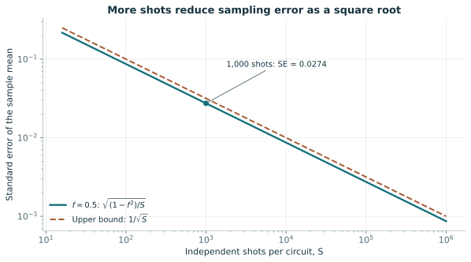

# 02. 큐비트, 위상, 게이트와 측정

> 독립 집필한 80분 학습 단원 · 2026-10-20 기준. 원강좌 Lecture 1의 공개 주제를 출발점으로 확장했으며 실제 수업 필기가 아니다.

## 시작하기 전에

양자 학습 모델이 숫자를 예측하는 과정을 이해하려면 상태, 연산, 측정을 구별해야 한다. [1강](01-learning-problems-and-quantum-claims.md)의 평균과 분산을 복습한다. 복소수의 절댓값, 켤레전치, 행렬곱이 낯설면 [수학 준비 노트](../math-primer.md)를 함께 편다. 이 강의에서는 벡터의 원소를 계산하고, 밀도행렬이 올바른 상태인지 판정하고, 한 측정 설정으로 알 수 없는 정보를 찾아내며, 측정 평균의 불확실성을 계산한다.

이상적 단일 큐비트를 먼저 다룬다. 실제 장치의 누설, 상태 준비 오류, 상관된 잡음은 이 모형에 모두 포함되어 있지 않다. 이상 모형과 측정 데이터의 불일치를 곧바로 양자역학의 실패로 해석하지 않는다.

## 80분 학습 순서

| 시간 | 수행할 활동 | 남길 결과 |
|---|---|---|
| 0–10분 | 용어와 복소수 내적 확인 | 정규화 계산 한 개 |
| 10–25분 | 위상과 H 게이트 예제 계산 | 두 상태의 Z·X 통계 |
| 25–45분 | 밀도행렬·Bloch 벡터·POVM 유도 | 상태 판정과 확률 |
| 45–60분 | 측정 분산 예제를 손으로 재계산 | 표준오차와 가정 |
| 60–75분 | 문제 1·3부터 풀고 선택한 문제의 해설만 대조 | 오개념 수정 기록 |
| 75–80분 | 답을 보지 않고 완료 점검 | 진도 판단 |

계산을 멈추고 직접 식을 쓰는 시간이 포함되어 있다. 네 문제 전체와 선택 원문은 복습 시간에 마친다.

강의 후 **60–90분**에는 남은 문제를 해설 없이 풀고, 유도 하나를 재작성하고, 오답을 수정한다. 원문 전문 독해와 코딩 실습은 별도 시간이다.

## 핵심 용어

| 한국어·영어 | 정의와 직관 |
|---|---|
| 큐비트·qubit | 상태공간이 \(\mathbb C^2\)인 두 수준 양자계의 정보 단위. 측정 결과는 연속 벡터 전체가 아니다. |
| 켓과 브라·ket/bra | 열벡터 \(|\psi\rangle\)와 그 켤레전치 \(\langle\psi|\). 내적은 bra와 ket의 곱이다. |
| 진폭·amplitude | 기저벡터의 복소 계수 \(\alpha,\beta\). 확률은 계수 자체가 아니라 절댓값 제곱이다. |
| 상대 위상·relative phase | 두 진폭 사이의 위상차. 간섭 측정으로 구별될 수 있다. |
| 전역 위상·global phase | 모든 진폭에 같은 \(e^{i\gamma}\)를 곱하는 변화. 고립된 상태의 측정 확률을 바꾸지 않는다. |
| 유니터리·unitary | \(U^\dagger U=I\)인 선형 연산. 닫힌 계의 가역 진화를 나타낸다. |
| 관측량·observable | 에르미트 행렬 \(O=O^\dagger\). 고유값이 가능한 측정 수치다. |
| 밀도행렬·density matrix | \(\rho\succeq0,\operatorname{Tr}\rho=1\)인 행렬. 순수 상태와 혼합 상태를 함께 표현한다. |
| Bloch 벡터·Bloch vector | \(\rho=(I+\mathbf r\cdot\boldsymbol\sigma)/2\)의 실수 벡터 \(\mathbf r\). 길이는 1 이하이다. |
| 일반화 측정·POVM | 양의 준정부호 효과 \(E_m\)들이 \(\sum_mE_m=I\)를 만족하는 측정 명세. 확률은 \(\operatorname{Tr}(\rho E_m)\)다. |
| 순도·purity | \(\operatorname{Tr}(\rho^2)\). 큐비트에서 순수 상태는 1, 완전 혼합은 1/2다. |
| 표준오차·standard error | 추정량의 표준편차. 한 번 측정한 결과의 표준편차와 다르다. |

[통합 용어집](../glossary.md)에서 발음이나 다른 용례를 확인할 수 있다. 여기서 “순수”는 오염이나 장치 품질에 대한 일상적 표현이 아니라 수학적 상태 분류다.

## 유도 1: 진폭, 위상과 측정 기저

계산 기저를 \(|0\rangle=(1,0)^T\), \(|1\rangle=(0,1)^T\)로 고정하면 순수 상태는

$$
|\psi\rangle=\alpha|0\rangle+\beta|1\rangle,
\qquad |\alpha|^2+|\beta|^2=1
$$

이다. 예를 들어 \(\alpha=1/\sqrt2,\beta=i/\sqrt2\)이면 내적은 \(\langle\psi|\psi\rangle=(1/2)+(-i)i/2=1\)이다. 켤레를 빠뜨리면 0이 되어 잘못된 정규화 판정을 한다. Born 규칙은 계산 기저 측정의 확률을 \(p(0)=|\alpha|^2\), \(p(1)=|\beta|^2\)로 준다.

기저를 바꾸면 위상을 확률로 바꿀 수 있다. Hadamard 게이트

$$
H=\frac1{\sqrt2}\begin{pmatrix}1&1\\1&-1\end{pmatrix}
$$

를 작용시키면 \(H|\psi\rangle=[(\alpha+\beta)|0\rangle+(\alpha-\beta)|1\rangle]/\sqrt2\)다. 따라서 H 후에 0이 나올 확률은 \(|\alpha+\beta|^2/2\)이며, 전개하면 \([1+2\operatorname{Re}(\alpha^*\beta)]/2\)다. 교차항이 간섭이다. 확률 두 개 \(|\alpha|^2,|\beta|^2\)만으로 이 항을 복구할 수 없다.

반면 모든 진폭에 같은 위상을 곱하면 \(|e^{i\gamma}\alpha+e^{i\gamma}\beta|^2=|\alpha+\beta|^2\)다. 다른 모든 측정에서도 같은 상쇄가 일어난다. 전역 위상과 상대 위상을 구별해야 하는 이유다.

## 완전 예제 1과 반례: 같은 Z 분포는 같은 상태가 아니다

\(|+\rangle=(|0\rangle+|1\rangle)/\sqrt2\)와 \(|-\rangle=(|0\rangle-|1\rangle)/\sqrt2\)를 보자. Z 측정에서는 둘 다 0과 1을 반반 출력한다. H를 곱하면 각각 \(|0\rangle\)와 \(|1\rangle\)가 되므로 H 뒤 Z 측정으로 완전히 구별된다. 이는 X 기저 측정과 같다.

그렇다면 동전을 던져 절반은 \(|0\rangle\), 절반은 \(|1\rangle\)를 준비하면 \(|+\rangle\)인가? 아니다. 동전 혼합의 밀도행렬은 \(\rho_{\rm mix}=I/2\)이고 \(|+\rangle\langle+|=\tfrac12\begin{pmatrix}1&1\\1&1\end{pmatrix}\)다. 두 행렬은 대각 원소가 같지만 비대각 원소가 다르다. H 뒤 Z 측정에서 혼합은 계속 반반, \(|+\rangle\)는 0만 출력한다. 중첩을 “모르는 고전 비트”로 대체하면 이 실험을 설명할 수 없다.

## 게이트와 행렬곱의 순서

Pauli 행렬은

$$
X=\begin{pmatrix}0&1\\1&0\end{pmatrix},\quad
Y=\begin{pmatrix}0&-i\\i&0\end{pmatrix},\quad
Z=\begin{pmatrix}1&0\\0&-1\end{pmatrix}
$$

이고, \(R_y(\theta)=e^{-i\theta Y/2}\)는

$$
R_y(\theta)=\begin{pmatrix}
\cos(\theta/2)&-\sin(\theta/2)\\
\sin(\theta/2)&\cos(\theta/2)
\end{pmatrix}
$$

다. \(Y^2=I\)를 이용하여 지수함수의 짝수·홀수 거듭제곱을 모으면 이 식을 얻는다. 행렬곱은 오른쪽부터 작용한다. 회로에서 “먼저 H, 다음 Z”라고 썼으면 수식은 \(ZH|0\rangle\)다. 소프트웨어 명령 순서와 행렬식을 같은 방향으로 읽지 않는다.

게이트를 모든 상태에 똑같이 적용하면 상태 간 내적은 보존된다. 실제 측정은 이 유니터리 진화와 별개의 과정이며, 결과를 무시한 측정은 coherence를 없앨 수 있다. 잡음까지 하나의 상태벡터로 다루려 하지 말고 밀도행렬로 넘어간다.

## 유도 2: 밀도행렬에서 Bloch 구와 측정으로

상태를 확률 \(q_j\)로 골라 준비하면 \(\rho=\sum_jq_j|\psi_j\rangle\langle\psi_j|\)다. 모든 벡터 \(v\)에 대해 \(v^\dagger\rho v=\sum_jq_j|\langle\psi_j|v\rangle|^2\ge0\)이므로 양의 준정부호다. trace는 \(\sum_jq_j=1\)이다. 같은 밀도행렬은 여러 서로 다른 혼합 방식으로 만들 수 있으므로 혼합의 준비 이력이 상태 자체에서 유일하게 읽히지는 않는다.

trace 1인 에르미트 2×2 행렬은

$$
\rho=\frac12\begin{pmatrix}1+r_z&r_x-ir_y\\r_x+ir_y&1-r_z\end{pmatrix}
=\frac12(I+r_xX+r_yY+r_zZ)
$$

로 쓸 수 있다. 고유값은 \((1\pm\|\mathbf r\|)/2\)다. 따라서 양의 준정부호 조건은 \(\|\mathbf r\|\le1\)과 같다. 또한 Pauli 행렬의 trace 관계를 이용하면 \(\operatorname{Tr}(\rho X)=r_x\)이고 Y, Z도 같다. 즉 Bloch 좌표는 서로 다른 세 측정의 평균이다. 구의 표면은 순수 상태, 내부는 혼합 상태를 나타내며 실제 공간의 작은 공이라는 뜻은 아니다.

예를 들어 \(\rho=\operatorname{diag}(3/4,1/4)\)이면 \(\mathbf r=(0,0,1/2)\), 순도는 \((3/4)^2+(1/4)^2=5/8\)다. 일반식 \(\operatorname{Tr}(\rho^2)=(1+\|\mathbf r\|^2)/2\)와도 일치한다. 반대로 \(\operatorname{diag}(1.1,-0.1)\)은 trace가 1이어도 음의 확률을 만들어 상태가 될 수 없다.

Z 측정의 두 효과는 \(E_0=(I+Z)/2\), \(E_1=(I-Z)/2\)이며 \(p(0)=(1+r_z)/2\)다. 일반 POVM은 효과가 꼭 직교 projector일 필요가 없다. 예를 들어 \(E_\pm=(I\pm\eta Z)/2\), \(0\le\eta\le1\)이면 \(p(+)= (1+\eta r_z)/2\)다. \(\eta<1\)은 Z 신호가 약해진 측정의 간단한 모형이다. 효과만으로는 측정 뒤 상태가 완전히 결정되지 않는다. 그 변화를 알려면 측정 연산자 또는 quantum instrument라는 추가 명세가 필요하다.

## 유도 3과 완전 예제 2: 유한 샷의 불확실성

\(R_y(\theta)|0\rangle\)에서는 \(p(1)=\sin^2(\theta/2)\)다. Z 결과를 0일 때 +1, 1일 때 −1로 기록하면 평균은 \(f=1-2p(1)=\cos\theta\)다. 같은 상태를 독립적으로 다시 준비한 결과 \(Z_1,\ldots,Z_S\)를 평균하면

$$
\widehat f=\frac1S\sum_sZ_s,\quad
\mathbb E\widehat f=f,\quad
\operatorname{Var}(\widehat f)=\frac{1-f^2}{S}.
$$

마지막 식은 각 결과의 제곱이 1이고 독립 결과 사이 공분산이 0이어서 나온다. 드리프트나 재설정 오류로 결과가 상관되면 이 분산식은 그대로 적용할 수 없다.

\(\theta=\pi/3\)이면 \(f=1/2\), \(p(1)=1/4\)다. 1,000 shots에서 표준오차는 \(\sqrt{0.75/1000}\simeq0.0274\), 정규 근사의 95% 폭은 약 ±0.0537이다. 이는 무한 반복에서의 확률적 성질이지 이번 측정의 오차가 반드시 그 안이라는 보증은 아니다. 소표본이나 0·1 근처에서는 이항분포 기반 구간을 쓴다. 관측이 모두 +1이었다고 실제 평균이 정확히 1이라고 선언하지 않는다.

그림 2-1. 독립적인 ±1 측정의 표준오차를 본문 식에서 계산했다. 실선은 평균 0.5, 점선은 분산 상한이다. 교육용 해석 곡선이며 실제 장치 데이터나 systematic bias의 감소를 보여주지 않는다.

만약 측정 장치 때문에 평균이 실제로 0.45가 되었다면 shots를 무한히 늘려도 추정값은 0.45로 수렴한다. 이상적인 0.5와의 차이 0.05는 통계 분산이 아니라 편향이다. 12강의 오류 완화는 이 차이를 별도로 다룬다.

## 연습문제와 풀이

### 문제 1. 복소 진폭과 위상

\(|\psi\rangle=(|0\rangle+i|1\rangle)/\sqrt2\)의 Z, X, Y 평균을 계산하라. **힌트:** \(\rho=|\psi\rangle\langle\psi|\)를 만들고 Bloch 식과 비교한다.

**풀이:** \(\rho=\tfrac12\begin{pmatrix}1&-i\\i&1\end{pmatrix}\)이므로 \((r_x,r_y,r_z)=(0,1,0)\)이다. 따라서 Z와 X 평균은 0, Y 평균은 +1이다. Z에서 반반이라는 사실만으로 상대 위상이 없다고 말하면 안 된다. Y 기저에서는 한 결과가 확정되므로 이 위상을 측정 통계로 구별할 수 있다.

### 문제 2. 게이트 순서

\(HZH|0\rangle\)와 \(ZHH|0\rangle\)을 비교하라. **힌트:** 오른쪽 게이트부터 적용하고 \(H^2=I\)를 활용한다.

**풀이:** 첫 회로는 \(|0\rangle\to|+\rangle\to|-\rangle\to|1\rangle\)다. 둘째 회로는 두 H가 상쇄되어 \(Z|0\rangle=|0\rangle\)이다. Z 측정 결과는 각각 1과 0으로 확정된다. 같은 게이트들을 사용했다는 사실만으로 같은 연산이 되지 않는다. 회로 그림의 시간 방향과 식의 곱 순서를 모두 써야 오류를 피한다.

### 문제 3. 올바른 상태와 약한 측정

\(\rho=(I+0.6X+0.8Z)/2\)는 올바른 상태인가? \(\eta=1/2\)인 위 POVM에서 + 확률은? **힌트:** Bloch 길이를 먼저 계산한다.

**풀이:** 길이는 \(\sqrt{0.6^2+0.8^2}=1\)이므로 고유값은 1과 0이다. 순수 상태이며 올바르다. + 확률은 \([1+(1/2)0.8]/2=0.7\)이다. 강한 Z 측정이라면 0.9이므로 측정 효과를 바꾸는 것만으로 결과 분포가 달라진다. 상태가 바뀌었다고 단정할 수 없고 측정 모형부터 확인한다.

### 문제 4. 샷 증가와 편향

실제 측정 평균 0.45를 400회와 40,000회로 추정한다. 표준오차와 이상 평균 0.5에 대한 편향을 비교하라. **힌트:** 분산에 들어가는 평균은 실제 측정 평균이다.

**풀이:** \(1-0.45^2=0.7975\)이므로 표준오차는 각각 \(\sqrt{0.7975/400}\simeq0.0447\)와 0.00447이다. shots를 100배 늘리면 표준오차는 10분의 1이 된다. 반면 이상 평균에 대한 편향은 두 경우 모두 −0.05다. 작은 오차막대는 정확한 이상값을 보증하지 않으며, 오히려 편향된 평균을 더 정밀하게 드러낼 수 있다.

## 학습 완료 점검

- \(|+\rangle\)와 \(I/2\)를 Z로는 구별하지 못하고 X로는 구별하는 이유를 행렬의 비대각 원소로 설명하면 통과다. 실패하면 예제 1로 돌아간다.
- trace 1만으로 상태를 판정하지 않고 양의 준정부호 조건을 확인하면 통과다. 실패하면 Bloch 고유값 유도를 다시 계산한다.
- \(p(1)=(1-\langle Z\rangle)/2\)를 직접 유도하고 ±1 출력과 0/1 출력을 구별하면 통과다.
- 표준오차와 편향에 대해 각각 shots 증가의 효과를 말하면 통과다. 둘 다 사라진다고 답하면 예제 2를 반복한다.

## 원문 읽기

- [IBM Quantum Learning, Single systems: Quantum information](https://quantum.cloud.ibm.com/learning/en/courses/basics-of-quantum-information/single-systems/quantum-information): 공개 교육 페이지의 quantum states, measurements, unitary operations 설명을 본문의 벡터 계산과 대조한다. 공식 교육 자료이며 연구 결과를 입증하는 실험 보고서는 아니다.
- [Watrous, The Theory of Quantum Information 공개 원고](https://cs.uwaterloo.ca/~watrous/TQI/): Chapter 2의 states와 measurements 정의를 찾아 \(\rho\)와 POVM을 읽는 심화 자료다. 본문 예제만으로 다음 강의를 진행할 수 있으며 원고 전체 정리를 선수 조건으로 요구하지 않는다.
- [PennyLane RY API](https://docs.pennylane.ai/en/stable/code/api/pennylane.RY.html): 행렬의 부호와 각도 관례를 확인한다. 실습의 고정 설치 버전과 현재 문서가 다를 수 있다. [실습 1](../labs/README.md)에서 닫힌 식과 상태벡터 모사를 대조한다.

[이전](01-learning-problems-and-quantum-claims.md) · [목차](../README.md) · [다음: 여러 큐비트](03-entanglement-and-circuits.md)
