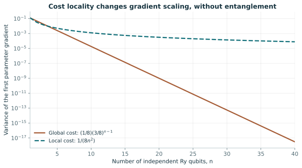

# 09. 학습 가능한 회로와 barren plateau의 조건

> 공개 실라버스에서 출발해 독립 집필한 80분 자율학습 노트다. 원강의 설명을 복원하지 않았다. 근거 기준일: 2026-10-20. 독립 교육 유도와 문헌의 조건부 정리를 구별하며 QPU 실험은 수행하지 않았다.

[이전: 08. 커널과 SVM](08-kernels-and-svm.md) · [전체 강의](../README.md) · [다음: 10. 일반화와 벤치마킹](10-generalization-and-benchmarking.md)

## 학습의 출발점과 도달점

[07강](07-gradients-and-training.md)의 회로 미분과 샷 분산을 이해하고 확률변수의 평균·분산을 복습한다. 필요한 적분은 [수학 준비](../math-primer.md)를 참고한다. 이 강의의 목표는 영 기울기 하나와 크기 증가에 따른 기울기 집중을 구별하고, 독립 회전 회로의 전역·국소 비용 분산을 직접 유도하며, 관측된 평평한 훈련 곡선을 진단하는 것이다. 또한 최근의 plateau 회피와 고전 모사 가능성 논의가 어떤 출력과 회로 분포를 대상으로 하는지 읽을 수 있어야 한다.

표현력은 어떤 함수를 회로가 담을 수 있는지 묻는다. 학습 가능성은 제한된 시간과 측정으로 그 함수의 매개변수를 찾을 수 있는지 묻는다. 학습하기 좋은 점이 하나 있다는 사실과 무작위 초기화가 그 점 근처에 도달할 확률도 다르다. 이 세 질문을 구분하지 않으면 회로를 깊게 만들고 훈련이 멈춘 이유를 모두 양자 잡음 탓으로 돌리기 쉽다.

## 80분 학습 순서

| 시간 | 실제 수행할 활동 |
|---|---|
| 0–5분 | 평균 0과 분산 0의 차이를 간단한 확률변수로 설명한다. |
| 5–15분 | 핵심 용어를 읽고 초기화 분포와 샷 분포를 서로 다른 색으로 표시한다. |
| 15–40분 | 곱 회로의 두 미분과 분산을 적분으로 유도한다. |
| 40–55분 | 두 비용의 크기 의존성을 계산하고 GHZ 반례로 국소 정보의 손실을 확인한다. |
| 55–70분 | 문제 1–2개를 선택해 풀고 틀린 가정을 해설과 대조한다. |
| 70–75분 | 원문 읽기의 최신 결과에서 평균·정밀도·관측량 조건을 찾는다. |
| 75–80분 | 출구 점검으로 진단 순서와 회피 방법의 한계를 설명한다. |

80분은 핵심 유도와 선택 문제 1–2개를 다루는 학습 시간이다. 나머지 문제의 독립 풀이, 모든 해설과의 대조, 유도 재작성에는 강의 후 60–90분을 따로 배정한다. 원문 읽기 5분은 지정된 조건을 찾는 안내 독해이며 논문 전문 독해 시간은 포함하지 않는다.

## 핵심 용어

| 한국어·영어 | 이 강의에서의 정의 |
|---|---|
| 불모 고원, barren plateau | 지정된 회로·초기화 분포에서 관련 기울기가 시스템 크기에 따라 지수적으로 집중하는 현상. |
| 초기화 앙상블, initialization ensemble | 초기 매개변수나 회로를 뽑는 확률분포. |
| 집중 현상, concentration | 확률변수가 작은 범위에 모이는 현상. 무엇을 무작위로 뽑는지 명시해야 한다. |
| 전역 비용, global cost | 많은 큐비트에 걸친 연산자나 전체 상태 정보를 사용하는 목적함수. |
| 국소 비용, local cost | 적은 수의 큐비트에 작용하는 항들의 합으로 정의한 목적함수. |
| 유니터리 2-design | 유니터리 원소와 그 켤레의 2차 모멘트가 Haar 분포와 일치하는 앙상블. |
| Haar 분포, Haar measure | 유니터리 군의 좌우 곱 변환에 불변인 균일 분포. |
| 빛원뿔, causal light cone | 특정 게이트가 특정 출력 관측량에 영향을 줄 수 있는 회로 영역. |
| 유니탈 채널, unital channel | 항등연산자를 그대로 두는 양자 채널. |
| 비유니탈 채널, non-unital channel | 항등연산자를 그대로 두지 않는 양자 채널. |
| 대리 모형, surrogate model | 원 회로의 손실이나 예측을 대신 근사하는 고전 모델. |
| 신호 대 잡음비, signal-to-noise ratio | 추정하려는 신호 크기와 통계 변동 크기의 상대 비율. |

기술 용어를 쓸 때에는 [통합 용어집](../glossary.md)의 정의와 함께 어떤 확률공간을 사용하는지 말한다. 여기서는 같은 기울기에 대해서도 초기화 분산과 측정 분산이라는 두 다른 분산을 다룬다.

## 유도 1: 분산 감소가 대부분의 초기값을 묶는다

큐비트 수 \(n\), 비용 \(C(\theta)\), 좌표 기울기 \(g_j=\partial_jC\)를 두자. 매개변수 \(\theta\)를 정해진 초기화 분포에서 뽑는다. 어떤 회로 계열에서 양수 상수 \(A\), \(b>1\)에 대해

$$
\mathbb E_\theta[g_j]=0,\qquad \operatorname{Var}_\theta(g_j)\leq A b^{-n}
$$

이면, Chebyshev 부등식에 의해 고정된 \(\epsilon>0\)에 대한 확률은

$$
\Pr_\theta(\lvert g_j\rvert\geq\epsilon)\leq\frac{A b^{-n}}{\epsilon^2}.
$$

우변이 작을수록 대부분의 초기값에서 절댓값 기울기가 작다. 그러나 이것은 모든 점의 기울기가 0이라는 진술이 아니다. 평균이 0이라는 사실만으로도 부족하다. 예를 들어 \(g=\pm1\)이 같은 확률이면 평균 0이지만 분산은 1이다. 반대로 어떤 최소점 한 곳의 미분이 0인 것은 평범한 정상점의 성질이다. 크기 \(n\)을 바꾸어 앙상블 분산을 관찰해야 plateau라는 용어의 의미가 생긴다.

[McClean 등의 2018년 연구](https://arxiv.org/abs/1803.11173)는 충분히 무작위화된 회로의 상황을 분석한다. 2-design이라는 조건은 복잡한 전체 확률분포를 모두 Haar와 같게 만드는 조건보다 약하지만, 기울기의 2차 모멘트 계산에는 강한 역할을 한다. 얕은 임의 회로를 자동으로 global 2-design이라고 할 수 없고, 초기값 분포를 좁히면 같은 증명을 그대로 사용할 수 없다. 정리를 읽을 때는 회로의 왼쪽·오른쪽 부분 중 어느 부분이 얼마나 무작위화되는지 표시한다.

## 유도 2: 얽힘 없이도 전역 비용의 기울기가 줄어든다

독립 회전만 있는 상태 \(\lvert\psi_\theta\rangle=\bigotimes_{j=1}^nR_y(\theta_j)\lvert0\rangle\)를 사용한다. 초기 각도 \(\theta_j\)는 서로 독립이며 \([0,2\pi]\)에서 균일하다. 각 큐비트가 0일 확률을 \(q_j=\cos^2(\theta_j/2)\), 투영 연산자를 \(P_j=\lvert0\rangle\langle0\rvert_j\)라 두자. 목표가 전부 0인 상태에 가까워지는 것이라면

$$
C_G=1-\prod_{j=1}^n q_j,\qquad C_L=1-\frac1n\sum_{j=1}^n q_j
$$

라는 두 비용을 생각할 수 있다. 아래첨자 \(G,L\)은 각각 전역과 국소다. \(dq_1/d\theta_1=-(\sin\theta_1)/2\)이므로

$$
\partial_1C_G=\frac12\sin\theta_1\prod_{j=2}^nq_j,\qquad
\partial_1C_L=\frac{\sin\theta_1}{2n}.
$$

각도 한 바퀴의 사인 평균은 0이므로 두 미분의 평균은 0이다. 이제 제곱 평균이 분산이 된다. 적분에서 \(\mathbb E[\sin^2\theta]=1/2\)이다. 또 \(\cos^4u=(3+4\cos2u+\cos4u)/8\)이고 여기서 \(u=\theta/2\)이므로 \(\mathbb E[q^2]=3/8\)이다. 초기 각도의 독립성으로 곱의 평균을 평균의 곱으로 바꾼다.

$$
\operatorname{Var}(\partial_1C_G)=\frac14\cdot\frac12\left(\frac38\right)^{n-1}
=\frac18\left(\frac38\right)^{n-1},\qquad
\operatorname{Var}(\partial_1C_L)=\frac1{8n^2}.
$$

이는 논문 수치를 가져온 것이 아니라 완전히 지정된 단순 모델의 독립 계산이다. 전역 비용의 곱 구조가 다른 큐비트들의 작은 확률을 모두 곱해 신호를 억제한다. 얽힘이나 깊은 회로가 전혀 없어도 지수 감소가 가능하다. 국소 비용에서는 좌표당 \(1/n\) 정규화만 남아 다항 감소한다. 비용 이름을 바꾸는 일이 실제 측정 난이도를 바꿀 수 있는 이유다.

그림 9-1. 위 두 식의 해석값을 큐비트 1–40개에 대해 그렸다. 세로축은 로그다. 균일 독립 각도와 지정한 비용의 교육용 예이며, 일반 QNN의 분산이나 논문의 실제 측정값을 나타내지 않는다.

## 예제와 반례: 국소 비용으로 바꾸면 충분한가

\(n=10\)이면 전역 분산은 약 \(1.83\times10^{-5}\), 국소 분산은 0.00125다. 전역의 초기 기울기 표준편차는 약 0.00428이다. 07강의 독립 이동 측정 상한 \(1/\sqrt{2S}\)를 이 크기 이하로 만들려면 이동 회로당 약 27,300샷이라는 보수적 값이 나온다. 실제 관측량의 분산과 매개변수 위치에 따라 필요한 값은 달라진다. 이 계산은 두 확률공간의 역할을 연결하는 예이며 모든 측정 방식의 하한은 아니다.

이 특별한 목표에서는 \(C_L=0\)이면 모든 \(q_j=1\)이므로 전역 목표 상태를 얻는다. 그러나 목표가 GHZ 상태의 상대 위상이라면 사정이 다르다. \(\lvert\mathrm{GHZ}_\pm\rangle=(\lvert0^n\rangle\pm\lvert1^n\rangle)/\sqrt2\)는 서로 직교하지만 모든 적절한 부분계의 축소 밀도행렬이 같다. 한 큐비트 관측만으로 만든 비용은 두 위상을 구분하지 못한다. 따라서 기울기가 큰 국소 비용이라도 원하는 문제의 정답 정보를 보존하는지 확인해야 한다. 비용을 바꾼 뒤 같은 과제를 풀었다고 말하려면 그 연결을 증명하거나 시험해야 한다.

[Cerezo 등의 비용 의존성 연구](https://arxiv.org/abs/2001.00550)는 지정된 국소 2-design 구조에서 깊이와 관측량 범위를 함께 다룬다. 국소 관측량의 light cone이 작으면 그 기대값이 참조하는 회로 영역도 작아질 수 있다. 깊이가 커져 cone이 전체 시스템으로 퍼지면 같은 보호 논리가 유지되지 않는다. 얕은 회로의 plateau 회피가 깊은 회로 전체에 관한 정리로 변하지 않는 이유다.

## 유도 3: 깊이 방향 잡음 수축과 크기 방향 집중을 분리한다

교육용으로 한 큐비트 유니터리 사이에 depolarizing 채널 \(\mathcal D_p(\rho)=(1-p)\rho+pI/2\)를 \(L\)번 넣자. \(0\leq p\leq1\)이고 \(I\)는 항등행렬이다. Bloch 벡터가 매번 \(1-p\)배로 수축하고 이 채널은 유니터리와 교환하므로 traceless 관측량의 기대값과 그 각도 미분은 이상값의 \((1-p)^L\)배다. 분산은 \((1-p)^{2L}\)배다. 이로써 큐비트 수를 늘리지 않아도 깊이가 증가하면 신호가 사라질 수 있음을 보인다.

다큐비트 회로에서는 관측량의 Pauli 성분, 잡음의 작용 범위, light cone이 함께 들어간다. 위 한 큐비트 등식을 모든 국소 채널의 다큐비트 식으로 바꾸어서는 안 된다. [Wang 등의 noise-induced plateau 논문](https://www.nature.com/articles/s41467-021-27045-6)은 국소 Pauli 잡음과 깊이에 관한 조건을 분석한다. 진단에서는 고정 \(n\)의 깊이 증가와 고정 깊이의 \(n\) 증가를 따로 그린다.

2026년 [Mele 등의 논문](https://www.nature.com/articles/s41567-026-03245-z)은 국소 비유니터리 잡음과 무작위 게이트 앙상블을 다룬다. 비유니탈 잡음에서는 마지막 층 부근의 국소 기울기가 남을 수 있지만, 앞쪽 층의 영향은 약해져 기대값 계산에 대한 유효 깊이가 얕아진다. 고정 가산 정밀도의 기대값을 전형적 회로에서 고전적으로 추정하는 결과와 함께 읽어야 한다. 이는 모든 회로, 모든 정밀도, 전체 출력 sampling의 용이성을 증명하는 진술이 아니다.

[2025년 perspective](https://arxiv.org/abs/2312.09121)는 분석한 plateau 회피 계열 가운데 손실 계산이 작은 부분공간에 머무는 경우를 논한다. 일부 대리 모형은 먼저 양자 데이터를 수집해야 하므로 순수한 무자료 고전 계산과도 구별한다. 읽을 때에는 학습 가능성, 손실의 고전 모사, 유용한 정답, 계산 우위라는 네 질문을 따로 적는다. 어느 하나의 긍정 답이 나머지를 자동으로 해결하지 않는다.

## 실제 자율학습 진단 활동

종이에 세로축을 기울기 제곱 평균, 가로축을 큐비트 수로 하는 표를 만든다. 위 곱 회로의 \(n=2,4,8,16\) 해석값을 넣고 로그 축에서 비교한다. 심화 실습에서는 초기각을 여러 번 뽑아 표본분산을 계산하고 해석값과 대조한다. seed 수가 작으면 희귀한 큰 기울기의 기여를 놓칠 수 있으므로 반복 수와 오차를 기록한다. 이 단계는 CPU 계산만으로 가능하다.

실제 훈련이 멈추면 먼저 정확한 기대값에서도 멈추는지 본다. 아니면 샷 분해능이나 장치 편향을 의심한다. 정확한 계산에서도 멈추면 학습률, 라벨 연결, 고전 출력 포화, 대칭에 의한 영 미분, ansatz의 표현 부족을 점검한다. 그다음 초기화 분포와 크기를 바꾸어 기울기 분산을 조사한다. 물리적 초기화, 층별 훈련, 국소 목적, 대칭 보존은 검토할 수 있지만 어떤 정보와 가설 공간을 바꾸는지 함께 기록한다. plateau가 없다는 것은 빠른 전역 최적화나 우수한 일반화의 충분조건이 아니다.

## 연습문제와 풀이

**문제 1.** 평균 0인 기울기에서 분산이 \(2^{-n}\)이면 \(\lvert g\rvert\geq0.1\)의 확률 상한은? **힌트:** Chebyshev 식의 분모를 제곱한다.

**풀이.** 상한은 \(100\cdot2^{-n}\)이며 확률이므로 1과의 최솟값으로 제한한다. \(n=20\)이면 약 \(9.54\times10^{-5}\)다. 이는 평균 0과 지정 분산의 가정 아래 상한이며 실제 확률과 같다는 뜻은 아니다.

**문제 2.** 곱 회로에서 큐비트 하나를 추가할 때 두 분산의 비율을 구하라. **힌트:** 각각 \(n+1\)식과 \(n\)식의 몫을 계산한다.

**풀이.** 전역은 \(3/8\), 국소는 \(n^2/(n+1)^2\)다. 전역은 매번 같은 비율로 줄고 국소는 비율이 점점 1에 접근한다. 따라서 고정된 작은 범위의 데이터만 보고 두 scaling을 판정하지 말아야 한다.

**문제 3.** 각도를 독립적으로 뽑지 않고 모두 같은 무작위 각도로 초기화하면 위 전역 분산 유도가 유지되는가? **힌트:** 곱의 평균을 분리한 줄을 찾는다.

**풀이.** 유지되지 않는다. \(\sin^2\theta\,\cos^{4(n-1)}(\theta/2)\)의 하나의 적분을 계산해야 하며 서로 독립인 평균들의 곱으로 나눌 수 없다. 기울기의 형태는 같아도 초기화 분포가 달라지면 분산 결론을 다시 유도해야 한다.

**문제 4.** 깊은 잡음 회로의 마지막 층 기울기가 크면 무엇을 추가로 확인해야 하는가? **힌트:** 오래된 입력 정보와 출력 접근 방식을 나눈다.

**풀이.** 앞쪽 층과 입력 정보가 출력에 남아 있는지, 목표 라벨에 관련된 정보인지, 필요한 정밀도의 기대값이 고전적으로도 계산 가능한지 확인한다. 그 뒤 sampling이나 전체 상태 복원이 실제 과제인지 구별한다. 국소 마지막 층의 한 미분이 크다는 관찰만으로 깊은 양자 처리의 유용성이나 우위는 결론 낼 수 없다.

## 학습 완료 점검

- 두 분산 식을 적분과 독립성으로 재구성한다. \(3/8\)이 나온 이유까지 설명하면 통과다. 실패하면 유도 2와 [수학 준비](../math-primer.md)를 복습한다.
- 평평한 훈련 곡선에 대해 적어도 세 대안을 먼저 검사한다. 단일 정상점과 크기별 앙상블 분산을 구별하면 통과다. 실패하면 진단 활동을 다시 읽는다.
- 국소 목적과 잡음이 기울기를 남겨도 과제와 우위가 남는지 따로 묻는다. GHZ 반례와 2026년 결과의 평균 조건을 함께 말할 수 있어야 [10강](10-generalization-and-benchmarking.md)으로 진행한다.

## 원문 읽기

- [McClean et al., 2018](https://arxiv.org/abs/1803.11173): 공개 초록·출판 정보를 확인했다. 무작위화 조건과 확률적 결론을 표시하는 것이 과제이며, 전체 증명을 독립 검증하지 않았다.
- [Cerezo et al., 2021](https://arxiv.org/abs/2001.00550): 국소·전역 비용과 얕은 회로의 관계를 읽는다. 위 곱 회로의 독립 유도와 원 논문의 일반 정리를 구별한다.
- [Wang et al., 2021](https://www.nature.com/articles/s41467-021-27045-6): 잡음 모형과 깊이 가정을 확인할 원 출처다. 기존 노트의 초록 대조 범위를 유지한다.
- [Cerezo et al., perspective 2025](https://arxiv.org/abs/2312.09121): 공개 초록과 주장 범위를 재확인했다. 모든 plateau-free 모델의 모사 가능성 정리로 읽지 않는다.
- [Mele et al., Nature Physics 2026](https://www.nature.com/articles/s41567-026-03245-z), [공개본](https://arxiv.org/abs/2403.13927): 공개 초록과 출판사 검색 본문의 평균·정밀도 조건을 대조했다. 논문 전체 증명이나 QPU 실험을 재현한 것은 아니다.
