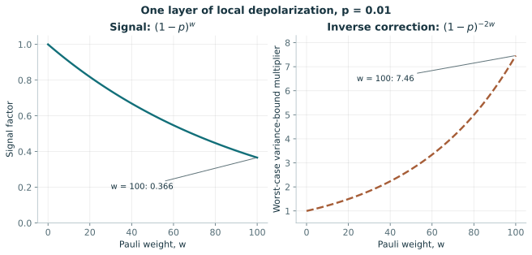

# 18. 2025–2026 프런티어: 논문의 주장을 검증 가능한 학습 문제로 바꾼다

> 독립 집필한 확장 강의. 원 CMU 실라버스 밖의 보완 내용이며 원 강의의 녹취·복원이 아니다. 검색·대조 기준일: 2026-10-20. 이 날짜까지 확인한 선택적 사례이며 전체 최신 논문 목록이 아니다. 아래 손계산·연구 계획은 노트의 교육용 재구성이다.

앞 강의: [17. 내결함성 QML](17-fault-tolerant-qml.md) · 다음 단계: [종합 프로젝트](../projects/capstone.md)

## 선수 지식과 학습 목표

[10강](10-generalization-and-benchmarking.md)의 공정 비교, [13강](13-quantum-data-and-shadows.md)의 측정 접근, [14강](14-advantage-and-dequantization.md)의 우위 명제, [17강](17-fault-tolerant-qml.md)의 자원을 복습한다. 통계 식은 [수학 보충](../math-primer.md), 연구 용어는 [용어집](../glossary.md)에서 찾는다. 수강 뒤에는 최신 논문 한 편에서 문제·입력·오차·기준선·증거를 추출하고, 확인하지 못한 가정을 빈칸으로 남기며, 기존 결과를 확장해 볼 작은 반증 가능한 실험을 설계해야 한다.

이 강의는 최신 제목을 외우는 시간보다 원문을 읽는 시간을 확보한다. 논문의 ‘advantage’는 시간·메모리·표본·정확도 중 무엇을 말하는가? 실제 장치를 실행했는가, 논리 자원을 추정했는가? 증명의 문제군과 실험 자료가 같은가? 이 세 질문을 먼저 쓰면 서로 다른 연구를 한 줄 순위로 오해하지 않는다. 이론을 이해하려면 정리의 모든 가정을 읽어야 하며, 초록·소개만 확인한 항목은 그 수준을 명시한다.

## 80분 학습 순서

| 시간 | 직접 할 활동 |
|---|---|
| 0–8분 | 용어와 사례표를 읽고 증거 종류를 분류한다 |
| 8–28분 | 자원 비율·잡음 감쇠·역보정 분산을 직접 유도한다 |
| 28–46분 | 자원 절충과 잡음 수치의 완전 예제를 계산한다 |
| 46–58분 | 완료된 원문 읽기 양식을 검토하고 다른 논문의 빈 양식을 채운다 |
| 58–75분 | 핵심 문제 1–2를 독립 시도하고 잡음·자원 계산을 대조한다 |
| 75–80분 | 한 문장의 조건부 결론과 미확인 항목을 제출한다 |

전체 보충 증명은 80분 밖의 심화 읽기다. 수업 중 확인할 범위를 주 정리의 문장·입력 정의·대표 그림으로 좁히고, 추가 독해가 필요한 항목을 완료한 것처럼 표시하지 않는다.

80분은 안내된 핵심 학습 시간이다. 남은 문제 3·4와 원문 심화 읽기는 별도 60–90분 복습에 배정한다. 문제는 먼저 독립적으로 시도한 뒤 해설을 읽는다.

## 핵심 용어

| 한국어·영어 | 정의와 읽는 방법 |
|---|---|
| 프리프린트, preprint | 동료평가 출판 전후 공개하는 저자 원고다. 버전·개정일을 함께 고정한다 |
| 최종 출판본, version of record | 출판사가 확정한 학술 기록 버전이다. 최초 온라인 공개일과 다를 수 있다 |
| 문제군, problem family | 크기를 바꾸어 정의하는 문제들의 집합이다. 단일 실자료 성능과 점근 정리의 범위를 나눈다 |
| 하한, lower bound | 정해진 모델의 모든 허용 알고리즘이 적어도 필요한 자원이다. 테스트한 기준선 몇 개의 비용과 다르다 |
| 상한, upper bound | 제시한 알고리즘이 충분히 사용하는 자원이다. 최적 비용과 같다고 보장하지 않는다 |
| 가설 검정, hypothesis testing | 관측 자료로 경쟁하는 분포·과정 가설을 정해진 오류 확률 아래 구별하는 과제다 |
| 양자 통계적 쿼리, quantum statistical query·QSQ | 양자 예제 상태에 대한 관측량 기대값을 허용 오차로 받는 학습 접근이다 |
| 논리 자원 추정, logical resource estimate | 오류정정된 연산 단위의 회로·메모리·비용을 계산한 결과다. 실제 물리 장치 실행은 별도다 |
| 추론·외삽, inference·extrapolation | 직접 측정하지 않은 규모를 대응식·모델·fit으로 추정하는 일이다. 근거와 가정이 필요하다 |
| 개방 문제, open problem | 현재 결과가 해결하지 못한 구체적 수학·실험 질문이다. ‘더 큰 장치’만으로는 충분한 정의가 아니다 |
| 재현, reproduction | 주어진 자료·코드·조건으로 특정 결과를 다시 계산하는 일이다. 논문을 읽고 설명하는 것과 구별한다 |

‘논문 보고’는 저자가 주장한 결과, ‘노트 계산’은 이 강의의 독립적인 작은 계산, ‘후속 제안’은 미실행 연구 계획이라는 뜻으로 사용한다. 이 세 표현을 연구 노트에 함께 남긴다.

## 최신 사례를 범위와 함께 읽는다

| 원 연구와 상태 | 문제·실행 수준 | 결론을 읽을 범위 |
|---|---|---|
| Liu 외, [photonic learning](https://arxiv.org/abs/2502.07770), Science 389, 1332–1335 (2025); 최초 2025-02-11 | 실제 광학 장치의 다중 모드 변위 과정 학습 | 100모드 재구성과 별도 가설 검정의 기준선·보장 차이를 구분한다. 모드는 큐비트 수가 아니다 |
| Lewis·Gilboa·McClean, [shallow neural networks](https://www.nature.com/articles/s41467-025-68097-2), 온라인 2025-12-31, VOR 2026-02-04 | QSQ에서 periodic neuron을 배우는 이론 | 분포·접근 조건과 고전 gradient·correlational SQ 하한의 적용 모델을 명시한다 |
| Zhao 외, [massive classical data](https://arxiv.org/abs/2604.07639v2), 최초 2026-04-08, v2 2026-10-01 프리프린트 | 스트리밍 oracle sketching 정리·실자료 수치·논리 자원 | 메모리 크기와 제한된 메모리의 표본·시간 절충이다. 실제 QPU의 범용 속도 실측이 아니다 |
| Cotler·Gong·Kannan, [noisy learning](https://www.nature.com/articles/s41467-026-73693-x), 온라인 2026-05-29, VOR 2026-07-23 | 외부 미지 계에 잡음으로 접근하는 학습 이론 | 일부 이상적 우위의 소실과 남는 구조적 가능성을 구분한다 |
| Kannan·Putterman·Cotler, [quantum uploading](https://arxiv.org/abs/2605.02057v2), 최초 2026-05-03, v2 2026-09-06 프리프린트 | 미지 상태의 보호 부호화 정리·천문 영상 수치 예시 | 즉시 부호화하지 않는 비교 전략과의 조건부 차이다. 내결함성 천문 장치 실측은 아니다 |

광학 논문의 **Process reconstruction**, **Provable, scalable quantum advantage**, Fig. 2·3은 특히 나누어 읽는다. 100모드 재구성의 11.8 orders 개선은 낮은 모드 수 자료의 fit에서 외삽한 vacuum·heterodyne 기준선과의 비교다. 저자는 이 재구성만으로 provable advantage를 주장하지 않는다고 명시한다. 별도 가설 검정에서는 측정 후에 질문의 방향을 공개하여 사전 지식의 차이를 통제하고 entanglement-free 전략 하한과 비교한다. 거대한 수치 하나를 모든 과제의 실험적 시간 우위로 바꾸면 안 된다.

Shallow-network 연구는 일반 실자료 전체를 분류하는 알고리즘이 아니라 특정 periodic neuron과 충분한 분포 구조의 학습이다. 양자 예제 상태·QSQ 접근을 데이터 파일 입력으로 자동 대체할 수 없다. 고전 하한 역시 명시한 알고리즘 계열에 대한 것이므로 ‘모든 고전 알고리즘보다 빠르다’는 문장으로 넓히지 않는다. Massive-data 연구의 60 미만 논리 큐비트와 실자료 수치도 물리 장치의 실행 기록과 분리한다. 본 노트는 해당 대형 코드를 독립 재현하지 않았다.

생성형 최신 결과는 [15강](15-generative-quantum-models.md)의 68물리 큐비트·816 shallow 표현과 34,304 shallow 규모 추론의 구분을 유지한다. 양자 상태를 고전 attention 모델로 학습하는 방향은 [16강](16-symmetry-and-scientific-learning.md)에서 다뤘다. 이 구분들은 주장의 가치를 줄이려는 절차가 아니라 무엇을 실제로 달성했는지 정확히 이해하는 학술 독해다.

## 첫 번째 유도: 우위는 세 비율로 나눈다

동일 문제·입력 조건·오차·성공확률에서 고전과 양자 알고리즘의 메모리를 \(M_C,M_Q\), 표본 수를 \(N_C,N_Q\), 시간을 \(T_C,T_Q\)라 하자. 교육용 비교 비율을

$$
R_M=M_C/M_Q,\qquad R_N=N_C/N_Q,\qquad R_T=T_C/T_Q
$$

로 정의한다. 비율이 1보다 크면 해당 자원에서 양자 쪽이 작다. 메모리는 고전 비트·정해진 정밀도 레지스터·논리 큐비트 중 단위를 명시해야 한다. 단순히 서로 나누었다고 실제 물리 크기 비율이 되는 것은 아니다. 같은 표본 수라도 한 표본을 준비하는 비용이 다르면 시간 비율은 달라진다.

전체 시간을 \(T_Q=T_{\mathrm{setup}}+N_Qt_Q+T_{\mathrm{post}}\)로 쓰면, \(N_Q\)만 작다는 사실에서 전체 속도가 따라오지 않는 이유가 드러난다. \(t_Q\)는 한 자료의 coherent 처리·측정 비용, \(T_{\mathrm{post}}\)는 고전 후처리다. 입력을 매번 구축하면 setup을 반복 항으로 옮긴다. 이 회계식은 위 다섯 논문의 정리가 아니라 누락된 항을 찾는 방법이다.

## 완전 예제 1: 메모리는 적고 시간은 더 든다

고전 방식의 작업 메모리가 \(10^9\)비트이고 양자 방식이 30논리 큐비트라 하자. 알고리즘 단위의 크기 차이는 보고할 수 있지만 30논리 큐비트의 실제 장치 크기를 모르면 물리 메모리 비율은 정할 수 없다. 양쪽이 동일 목표에서 각각 \(N_C=10^6\), \(N_Q=10^4\)자료를 사용한다면 표본 비율은 100이다.

한 자료 처리 시간이 고전 1마이크로초, 양자 1밀리초라면 핵심 처리 총시간은 각각 1초와 10초다. 여기에 양자 setup 2초를 넣으면 시간 비율은 \(1/12\)다. 표본 이점과 시간 불이점이 동시에 성립한다. 자료 생성이 한 개당 1초 걸리는 희귀 물리 실험이라면 상황이 뒤집힐 수 있다. 실제 목적의 비용 구조를 적어야 의미 있는 비교가 된다.

## 두 번째 유도: 국소 잡음이 고차 신호를 줄인다

교육용 채널을 \(\mathcal D_p(\rho)=(1-p)\rho+pI/2\), \(0\le p<1\)로 정한다. \(p\) 규약은 논문마다 다를 수 있다. Traceless Pauli 행렬 \(Q\)에 대해 \(\mathcal D_p^*(Q)=(1-p)Q\)이고 항등행렬은 보존된다. 무게 \(w\)인 문자열 \(P\)에는 비항등 인자가 \(w\)개 있으므로

$$
\operatorname{Tr}[P\mathcal D_p^{\otimes n}(\rho)]
=\alpha\mu,\qquad \alpha=(1-p)^w,\quad \mu=\operatorname{Tr}(P\rho).
$$

Heisenberg 관점에서 채널을 관측량에 옮기고 텐서곱별 감쇠를 곱한 결과다. 임의의 깊은 회로에서는 관측량 지지집합이 변하고 상관 잡음이 생길 수 있으므로 ‘모든 회로에서 항상 같은 감쇠’라고 쓰지 않는다.

## 세 번째 유도와 완전 예제 2: 역보정의 분산

잡음 뒤 Pauli 측정값 \(Y\in\{-1,1\}\)의 평균은 \(\alpha\mu\), 분산은 \(1-\alpha^2\mu^2\)다. \(\alpha\)를 정확히 안다고 가정하여 \(\hat\mu=\overline Y/\alpha\)로 보정하면 불편하지만

$$
\operatorname{Var}(\hat\mu)
=\frac{\alpha^{-2}-\mu^2}{N}\le\frac{\alpha^{-2}}{N}.
$$

무잡음 측정 분산은 \((1-\mu^2)/N\)다. 따라서 샷 비용의 정확한 비율은 상태에 의존하고 \(\mu=0\)일 때 \(\alpha^{-2}\)가 된다. \(\alpha\)도 추정해야 하면 보정 계수 불확실성과 편향이 추가된다.

\(p=0.01,w=100\)에서는 \(\alpha=0.99^{100}\approx0.3660\), \(\alpha^{-2}\approx7.46\)이다. \(\mu=0\)의 표준오차를 0.05로 맞추려면 무잡음 400샷에 비해 보정은 적어도 약 2986샷이라는 분산 기준 계산을 얻는다. \(w=10\)이면 계수는 약 1.22다. 동일 잡음률이라도 관측량의 차수가 중요하다. 이는 전체 noisy-learning 정리나 실제 오류 완화 성능의 재현이 아니다.

그림 18-1. 본문의 단일 층·큐비트별 독립 채널을 해석적으로 계산한 곡선이다. 오른쪽은 단순 역보정의 분산 상한 계수이며 실제 샷 비율은 원 상태 평균과 보정 계수의 추정 오차에도 의존한다. 실제 장치 데이터가 아니다.

## 원문 읽기 양식과 완료 예시

빈 양식을 복사해 논문 한 편에 적용한다. (1) 제목·버전·날짜, (2) 자료 한 개의 물리적 의미, (3) 준비·역연산·메모리·측정의 허용 기능, (4) 목표 거리·오차·실패확률, (5) 고전 또는 비부호화 기준선의 허용 자원, (6) 정리·그림 위치, (7) 실제 실행 수준, (8) 입증하지 않은 범위, (9) 후속 실험을 적는다. 이 아홉 항목은 원문 문장을 옮기는 요약보다 문제를 재구성하는 데 목적이 있다.

확인하지 못한 정리의 상수·범위는 ‘미확인’으로 남긴다. 예를 들어 초록의 exponential을 보고 임의의 \(2^n\)을 비용식에 넣지 않는다. Big-O의 변수, 숨은 상수의 독립성, 고정한 잡음률, \(\epsilon\)과 \(\delta\)의 의미를 본문에서 찾는다. 정리의 상한과 실험의 finite-size 결과가 직접 비교 가능한지도 확인한다. 빈칸은 무지가 아니라 다음 독해의 정확한 목표다.

완료 예시는 uploading 원고의 **Theorem 2, informal**이다. 버전은 v2 2026-09-06, 자료는 외부 \(n\)큐비트 미지 상태, 목표는 \(k\)국소 Pauli 추정이다. 비교는 물리 상태에 brickwork 무작위 전처리를 하는 raw 방식과 즉시 부호화한 shallow-shadows 방식이다. 원문은 상수 잡음 \(\lambda\), 주입 잡음 \(\lambda<\eta<c\lambda\)에서 \(N_{\mathrm{raw}}/N_{\mathrm{inj}}\ge\exp(\Omega(\lambda k))\)라는 비형식 정리를 제시한다. 정밀도·실패확률과 상수의 완전한 범위는 보충 정리 확인 항목으로 남긴다. 실제 장치 실행 결과로 분류하지 않는다.

이 예시에서 노트가 도출하는 후속 질문은 ‘유한 \(k\)에서 주입 준비 시간까지 넣어도 총시간이 줄어드는가’다. 위 비율은 표본 비교이므로 총시간 답을 주지 않는다. 작은 계산 계획은 raw·uploaded의 같은 목표 오차를 고정하고 표본 수, 전처리 깊이, 입력 준비 시간, 논리 비용을 따로 바꾸는 것이다. 실패 조건은 주입 비용 때문에 총시간 차이가 사라지거나 추정 오차가 목표를 넘는 경우다. 이러한 계획은 아직 실행하지 않은 제안이며 원 논문의 새로운 결론이 아니다.

## 연습문제와 풀이

1. **감쇠 계산.** \(p=0.02,w=20,\mu=0\)에서 역보정의 분산 계수와 표준오차 0.1에 필요한 샷을 구하라. **힌트:** \(\alpha^{-2}=0.98^{-40}\)다. **풀이:** 계수는 약 2.244이고 \(\operatorname{Var}\le2.244/N\)이다. 표준오차 0.1에는 \(N\ge224.4\), 정수 225샷을 쓴다. 무잡음의 100샷보다 늘어난다. 이는 분산 기준이며 신뢰구간 보장을 따로 요구하면 추가 설계가 필요하다.

2. **단위 점검.** 100모드 광학 실험과 100물리 큐비트 장치의 크기가 같다고 써도 되는가? **힌트:** 기저 공간과 실험 자원을 비교한다. **풀이:** 아니다. 광학 모드는 연속변수 자유도이고 큐비트는 2차원 정보 단위다. 모드의 에너지·squeezing·손실·시간 다중화 자원을 적어야 비교할 수 있다. 숫자 100만으로 정보 용량·하드웨어 규모·계산 우위를 동일시하지 않는다.

3. **미확인 가정.** 논문 초록에서 표본 우위만 확인했고 정리의 오차 척도를 못 찾았다. 기존 노트의 MSE를 대신 넣어도 되는가? **힌트:** 문제 정의가 같아지는지 생각한다. **풀이:** 안 된다. MSE·가산 기대값 오차·분포 거리·검정 오류는 다른 목표다. ‘오차 척도 미확인, 정리·보충자료 확인 필요’라고 적고 정량 우위 계산을 보류한다. 같은 문제로 바꾸어 비교하려면 두 척도 사이의 정당한 변환을 증명해야 한다.

4. **후속 실험 설계.** 표본 수는 100배 줄지만 한 표본 처리 시간이 1000배 커진다. 어떤 결과를 보고하고 어떤 조건에서 실용 이점이 남는가? **힌트:** 자료 획득 시간도 넣는다. **풀이:** 처리만 비교하면 총시간은 10배 증가한다. 두 방식을 각각 \(N_C(t_{\mathrm{data}}+t_C)\), \((N_C/100)(t_{\mathrm{data}}+1000t_C)\)로 쓰면 양자 쪽이 작을 조건은 \(99t_{\mathrm{data}}>900t_C\)다. 자료 생성이 충분히 느리면 표본 절약이 총시간을 줄일 수 있다. 추가 setup 비용이 있으면 그 조건도 포함한다.

## 학습 완료 점검

- 원문 한 편을 아홉 항목 양식으로 작성하고 미확인 가정을 분명히 남긴다. 초록의 문구만 복사한 답은 완료가 아니다.
- 광학 재구성의 fit 외삽과 가설 검정의 하한 비교를 구분한다. 구분하지 못하면 Fig. 2·3과 관련 단락을 다시 읽는다.
- 표본 우위·시간 우위·물리 자원 우위를 각각 따로 판단하고 후속 실험의 실패 조건을 쓴다. [종합 프로젝트](../projects/capstone.md)는 이 판단을 작은 재현 가능한 실험으로 이어간다.

## 원문 읽기

- [Photonic learning 공개 본문](https://arxiv.org/html/2502.07770): **Process reconstruction**, **Provable, scalable quantum advantage**, Fig. 2·3을 확인했다. 경험적 외삽과 하한의 적용 과제가 같은지 비교한다.
- [Shallow neural networks 출판본](https://www.nature.com/articles/s41467-025-68097-2): Introduction의 quantum example·QSQ와 고전 하한 모델을 확인한다. 무제한 고전 알고리즘으로 적용 범위를 넓히지 않는다.
- [Massive classical data v2](https://arxiv.org/abs/2604.07639v2): 버전·초록의 메모리 주장과 실자료·논리 큐비트의 실행 수준을 확인했다. 완전 정리의 가정은 본문·보충자료로 이어서 읽는 과제다.
- [Noisy quantum learning theory](https://www.nature.com/articles/s41467-026-73693-x): 최초 공개·VOR 날짜와 입력 인터페이스 문제를 확인했다. 정리마다 noise·메모리 조건이 다른지 추적한다.
- [Quantum uploading v2 공개 본문](https://arxiv.org/html/2605.02057v2): **II Quantum Uploading**, **III.1 Classical shadow tomography**, **Theorem 2**, 보충 **S5**가 완료 예시의 읽기 위치다. 비형식 정리와 완전한 기술 가정을 구분한다.
