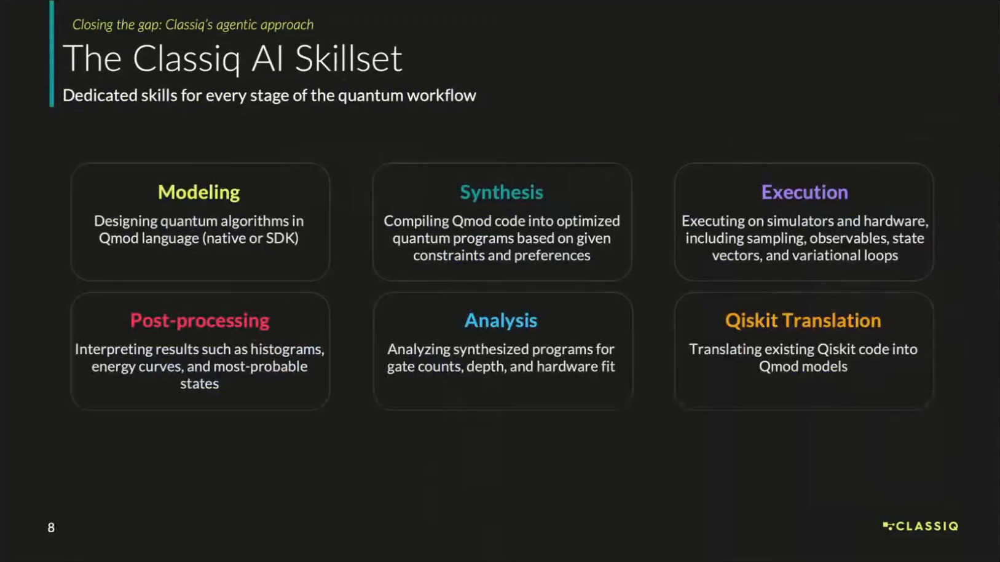
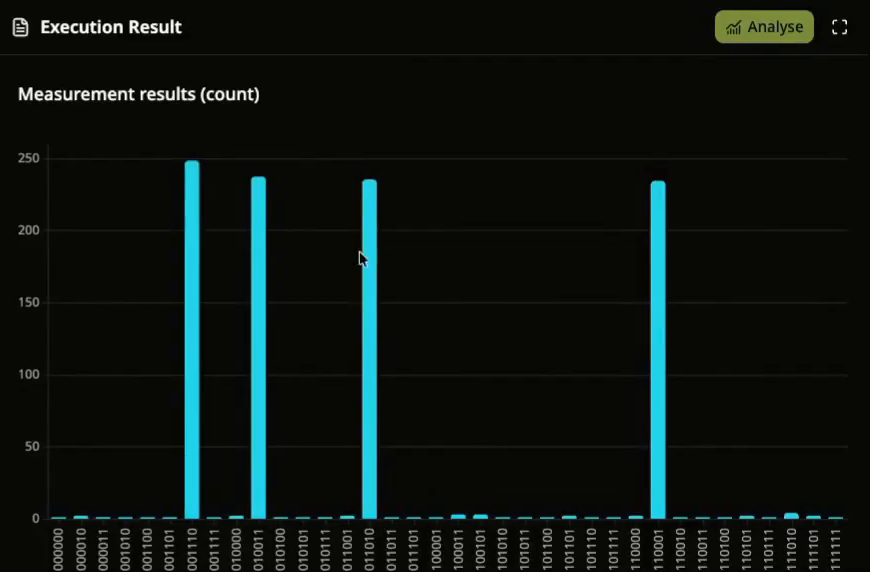
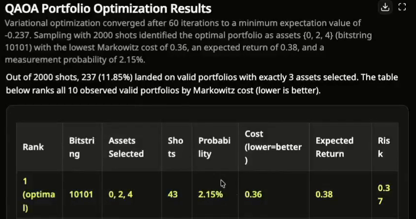
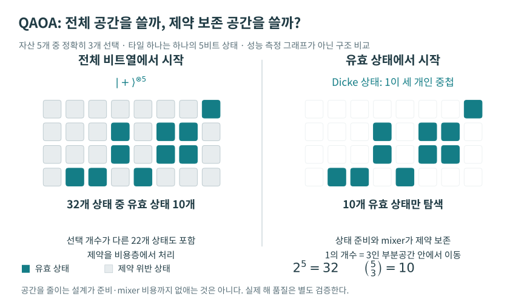
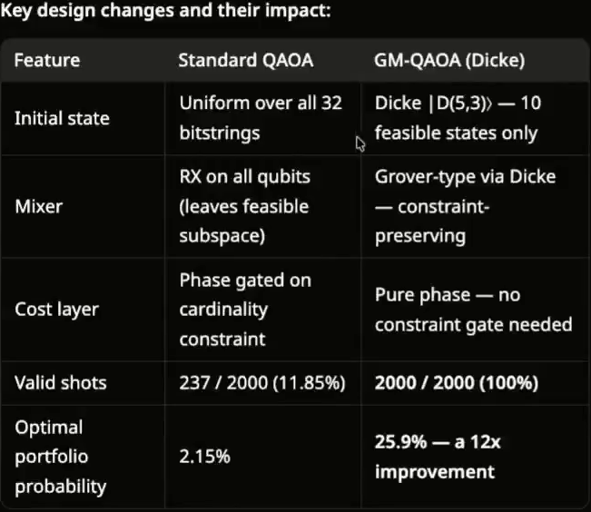
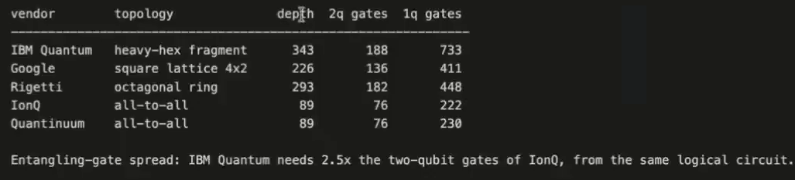
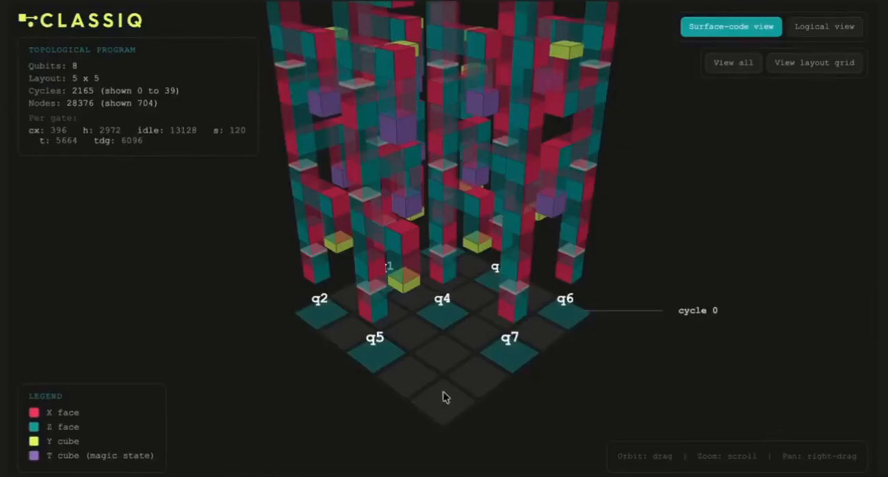
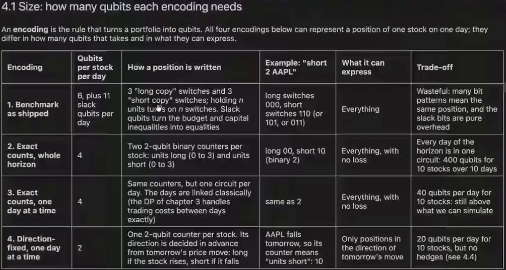

# 01. 새로운 Classiq 플랫폼으로 양자 응용 만들기

- 정식 제목: **Classiq Quantum Office Hours: Building Quantum Applications with the New Classiq Platform**
- 진행: Dr. Erik Garcell, Dr. John “Jack” Glennon
- 공식 다시보기: [Classiq Technologies YouTube, 59분 36초](https://www.youtube.com/watch?v=QtKbkvWgncQ)
- YouTube 공개 시각: 2026년 10월 21일 13:19 PDT, 한국 시각 10월 22일 05:19. 이는 업로드 시각이며 행사 개최 시각과 구분한다.
- 정리 근거: 공식 영상 음성을 로컬에서 전사한 뒤 문맥을 검토했다. 이름·제품명·전문용어는 교정했으며, 아래 시각은 영상 시작점을 기준으로 한 대략적인 발언 위치다. YouTube 설명란에는 금융 사례를 다룬다는 문구도 있으나, 본 정리는 실제 영상에서 확인되는 시연 내용을 따른다.

## 이 세션에서 봐야 할 것

핵심은 자연어 요청으로 회로를 한 번 생성하는 데서 그치지 않고, **문제의 의미를 설명하고, Qmod 모델을 만들고, 합성된 회로를 살펴보고, 실행 결과를 원래 문제와 연결하는 개발 흐름**이다. 같은 간단한 Grover 탐색 예제를 이전 인터페이스와 새 인터페이스에서 비교함으로써 에이전트가 제공하는 설명·탐색·반복 작업의 차이를 보여 준다.

발표자는 Classiq를 양자·고전 개발자가 양자 알고리즘을 설계하고 디버깅하고 실행하는 기업용 개발 플랫폼으로 소개한다. 이 설명은 제품의 목표와 제공 기능에 대한 소개다. 작은 시뮬레이터 예제가 산업 문제에서의 양자 우위를 검증하는 실험은 아니다.

## 00:00–12:38 | 도입, 청중 조사와 에이전트 구조

### 무엇을 자동화하는가

[07:16](https://www.youtube.com/watch?v=QtKbkvWgncQ&t=436s)부터 설명하는 기본 흐름은 Qmod로 고수준 모델을 기술하고, 합성 엔진이 이를 회로로 변환하며, 시각화 도구로 확인한 뒤, 클라우드 또는 온프레미스의 게이트 기반 하드웨어에 실행하는 것이다.

여기서 Qmod와 합성 엔진의 역할을 구분해야 한다. 사용자는 어떤 계산·조건·알고리즘을 구현할지 기술하고, 합성 엔진이 그 의도를 구체적인 회로로 만든다. 에이전트는 이 앞뒤 과정에서 사용자의 요구를 정리하고, 도구를 호출하고, 결과를 설명한다.

[07:52–08:41](https://www.youtube.com/watch?v=QtKbkvWgncQ&t=472s) 발표자는 AI가 개발자의 시간을 구현 세부사항과 오류 수정에서 설계·알고리즘 선택으로 옮길 수 있다고 설명한다. 모르는 알고리즘을 조회하거나 현재 데이터에 어떤 방법이 적절한지 탐색하는 것 역시 에이전트의 사용 예로 든다. 이는 에이전트가 생성한 선택이 자동으로 최적이라는 뜻은 아니다. 선택의 이유와 전제조건을 확인하는 용도로 읽어야 한다.

### 웹과 로컬 개발 환경을 연결하는 공통 계층

[08:47](https://www.youtube.com/watch?v=QtKbkvWgncQ&t=527s)부터 웹 플랫폼과 사용자의 로컬 개발 환경이라는 두 접근 경로를 소개한다. 두 경로는 공통 AI 계층에 연결되고, 이 계층이 스킬·도구·MCP 서버를 통해 Classiq 문서와 알고리즘 예제 저장소에 접근한다.

[09:21–10:55](https://www.youtube.com/watch?v=QtKbkvWgncQ&t=561s) 소개의 중요한 기능은 다음과 같다.

| 스킬 | 화면에서 소개한 기능 | 개발자가 확인할 점 |
|---|---|---|
| Modeling | Qmod 언어 또는 SDK로 양자 알고리즘을 설계한다. | 입력 범위·목적함수·제약조건이 요구와 맞는가? |
| Synthesis | 제약과 선호를 반영해 Qmod 코드를 최적화한 양자 프로그램으로 컴파일한다. | 어떤 제약과 최적화 목표를 주었는가? |
| Execution | 시뮬레이터와 하드웨어에서 샘플링·관측량·상태벡터·변분 반복을 실행한다. | 실행 백엔드와 결과의 종류가 목적에 맞는가? |
| Post-processing | 히스토그램·에너지 곡선·확률이 큰 상태를 해석한다. | 측정 결과가 원래 문제에서 무엇을 뜻하는가? |
| Analysis | 게이트 수·깊이·하드웨어 적합성을 분석한다. | 알고리즘의 답뿐 아니라 구현 비용도 적절한가? |
| Qiskit Translation | 기존 Qiskit 코드를 Qmod 모델로 변환한다. | 변환 전후의 의미가 보존되는가? |

그림 1-1. **개발 단계별 AI 스킬 여섯 가지.** 위쪽은 모델 작성→합성→실행, 아래쪽은 결과 해석·회로 분석·코드 변환이다. 아래 행을 하나의 순차적 처리 순서로 읽을 필요는 없다. 원 슬라이드의 명칭을 위 한국어 표와 대응시킬 수 있다. 출처: Classiq Technologies, [09:26](https://www.youtube.com/watch?v=QtKbkvWgncQ&t=566s).

이 여섯 명칭과 역할은 약 09:26의 발표 화면을 함께 확인했다. Post-processing은 결과의 의미를 해석하는 기능이고, Analysis는 회로의 구조·자원을 분석하는 기능이라는 차이가 중요하다.

### 청중 조사

[04:18–06:07](https://www.youtube.com/watch?v=QtKbkvWgncQ&t=258s) 첫 설문은 양자컴퓨팅 경험을 묻는다. 진행자는 대략 절반이 이미 양자 프로그램을 만들어 본 적이 있다고 설명하며, 기초 학습자와 정기적으로 개발하는 사람도 함께 참석했다고 말한다. 이 설문은 시연의 설명 수준을 정하기 위한 현장 조사다.

[11:16–12:26](https://www.youtube.com/watch?v=QtKbkvWgncQ&t=676s) 두 번째 설문은 고전 코딩에서 AI 에이전트를 어떻게 쓰는지 묻는다. 진행자는 코드 작성·디버깅 보조가 가장 흔하고, 자동 완성·짧은 제안부터 전체 작업 흐름 위임까지 사용 방식이 다양하다고 설명한다. 정확한 막대그래프 수치는 음성에 나오지 않아 수치화하지 않았다.

## 12:44–18:12 | 시연 1: 곱이 6인 정수 쌍을 Grover 탐색으로 찾기

### 문제를 자연어로 정확히 고정한다

[13:26](https://www.youtube.com/watch?v=QtKbkvWgncQ&t=806s)의 요청은 다음 문제다.

> 0부터 7까지의 정수 x, y에 대해 x × y = 6을 만족하는 모든 순서쌍을 Grover 탐색으로 찾는다.

이 문장은 원문의 긴 인용이 아닌 문제의 한국어 재서술이다. 가능한 입력은 8 × 8 = 64개이고, 답은 (1, 6), (2, 3), (3, 2), (6, 1) 네 개다. x와 y를 각각 3비트로 표현하므로 탐색 레지스터는 6큐비트로 구성할 수 있다. 실제 합성 회로의 전체 큐비트 수에는 구현을 위한 보조 자원이 추가될 수 있으므로, 6을 전체 회로의 자원 수로 단정해서는 안 된다.

### 에이전트가 모델 작성 전에 계산한 것

[13:56–14:40](https://www.youtube.com/watch?v=QtKbkvWgncQ&t=836s) 에이전트는 탐색 공간, 정답 수와 반복 횟수를 설명한 후 Qmod 코드를 만든다. 시연은 작은 문제이므로 정답 네 개를 고전적으로도 바로 확인할 수 있다. 그 결과를 사용해 Grover 반복 횟수를 정한다.

[15:59–16:16](https://www.youtube.com/watch?v=QtKbkvWgncQ&t=959s)에 보이는 모델은 Grover 연산자를 세 번 적용한다. 학습을 위해 수식으로 확인하면, N = 64, M = 4일 때 sin²θ = M/N = 1/16이고, k번 적용 후 이상적인 성공 확률은 sin²((2k+1)θ)다. k = 3이면 약 96%가 된다. **이 확률 계산은 정리자의 보충 설명이며 발표자가 보여 준 측정 빈도를 대신하는 값이 아니다.**

작은 문제에서 미리 정답 수를 세는 절차를 대규모 미지의 문제에 그대로 적용할 수는 없다. 이 시연에서는 에이전트가 알고리즘의 매개변수와 설명을 함께 생성하는 과정을 학습하는 데 의미가 있다.

### 생성한 Qmod 모델을 읽는 순서

[14:52–15:49](https://www.youtube.com/watch?v=QtKbkvWgncQ&t=892s) Jack은 x와 y를 묶은 사용자 정의 양자 자료구조, 양자 숫자, 조건을 판별하는 함수, 프로그램의 진입점인 main을 살핀다. x × y = 6이라는 조건은 고수준 산술식으로 표현한다. 개발자가 곱셈과 비교의 모든 게이트를 수작업으로 배치하는 과정은 시연하지 않는다.

이때 학습자가 확인해야 할 흐름은 다음과 같다.

1. 입력의 범위가 x, y ∈ {0, …, 7}로 보존되는지 확인한다.
2. 조건 함수가 x × y = 6을 표시하는지 확인한다.
3. 균등한 초기 상태를 준비하는지 확인한다.
4. 조건을 표시하는 위상 오라클과 확산 연산을 결합한 Grover 연산자를 반복하는지 확인한다.
5. 측정 후 얻은 비트열을 x, y 값으로 해석한다.

### 회로를 한 단계씩 펼쳐 보는 이유

[16:34–18:12](https://www.youtube.com/watch?v=QtKbkvWgncQ&t=994s) 시각화 도구에서는 처음에 함수와 변수 중심의 고수준 회로가 보이고, 그 안을 열어 개별 큐비트와 더 낮은 수준의 연산을 살핀다.

Hadamard 변환은 각 큐비트의 Hadamard 게이트로 내려가 볼 수 있고, Grover 연산자는 위상 오라클과 확산 연산으로 나누어 볼 수 있다. 조건 함수도 더 펼치면 게이트 수준까지 확인할 수 있다. 확산 부분에서는 기저 변환과 0 상태에 대한 반사를 설명한다.

이 계층 구조의 의미는 회로가 복잡해질수록 모든 게이트를 한 화면에 놓고 해석하기 어려워진다는 데 있다. 잘못된 조건을 찾는 작업은 고수준에서, 특정 연산의 구현이나 비용을 보는 작업은 더 낮은 수준에서 수행할 수 있다.

### 실행 결과와 보고서를 읽는다

[18:33–20:12](https://www.youtube.com/watch?v=QtKbkvWgncQ&t=1113s) Jack은 실행 버튼을 누르고 히스토그램과 자료표를 확인한다. 네 정답 상태의 측정 확률이 각각 약 25% 수준으로 높아지고, 나머지는 낮아지는 모습을 설명한다. 이어 분석 보고서는 정답 여부, 각 답의 확률과 정답에 해당하는 측정 비율을 보여 준다. 발표 중 보고된 정답 측정 비율은 약 95%다.

그림 1-2. **발표에서 실행한 Grover 예제의 측정 분포.** 가로축은 비트열, 세로축은 측정 횟수(count)다. 네 높은 막대가 곱이 6인 순서쌍에 대응한다. 확률로 읽으려면 총샷 수로 나누어야 하며, 이 그림은 별도의 이상적 확률 계산과 구별한다. 출처: Classiq Technologies, [18:55](https://www.youtube.com/watch?v=QtKbkvWgncQ&t=1135s).

여기서 “각각 약 25%”는 반올림한 설명이다. 정확히 네 상태에 25%씩이고 나머지 상태에도 양의 확률이 있다는 뜻으로 읽으면 합이 100%를 넘는다. 상세 수치는 보고서의 개별 값으로 확인해야 한다. 시연의 포인트는 측정 비트열이 원래 문제의 x, y 쌍으로 연결된다는 점이다.

## 20:32–29:25 | 시연 2: 자산 5개 중 3개를 고르는 QAOA와 제약 보존 믹서

### 요구를 비즈니스 언어에서 수학적 모델로 옮긴다

[20:47](https://www.youtube.com/watch?v=QtKbkvWgncQ&t=1247s) Jack은 자산 5개, 기대 수익률과 공분산을 고려해 3개 자산으로 구성된 포트폴리오를 고르는 QAOA 문제를 보여 준다. 실행 시간이 걸려 미리 생성한 작업을 설명하는 방식이다. 따라서 화면에 보이는 모든 작업을 발표 중 실시간으로 수행한 것으로 읽으면 안 된다.

에이전트는 위험과 기대 수익률로 구성한 목적함수, 선택 개수 3이라는 카디널리티 제약, 이진 선택 변수 다섯 개와 예제 데이터를 제안한다. [21:23](https://www.youtube.com/watch?v=QtKbkvWgncQ&t=1283s)에는 목적함수를 최소화하기 때문에 기대 수익률 항에 음의 부호가 붙는다고 설명한다.

정리자의 수학적 표기로 쓰면 대표적인 형태는 다음과 같다.

- xᵢ ∈ {0, 1}: i번째 자산의 선택 여부
- Σ: 수익률 공분산 행렬, μ: 기대 수익률 벡터
- 목적: 위험 가중치 λ에 대해 λxᵀΣx − μᵀx를 최소화
- 제약: Σᵢxᵢ = 3

이 식은 발표의 위험·수익·선택 개수 관계를 이해하기 위한 표준화된 재서술이다. 영상 속 변수 이름이나 정규화 상수까지 전사한 원본 코드가 아니다.

### 첫 구현: 전체 비트열 위의 QAOA

[21:59–24:11](https://www.youtube.com/watch?v=QtKbkvWgncQ&t=1319s) 첫 모델은 Hadamard 변환으로 비트열 전체의 균등 중첩을 만들고, 매개변수화한 비용층과 믹서층을 반복한다. 비용층에는 위험·수익 목적함수와 제약을 고려하는 로직을 넣는다. 시연에서 QAOA 층 수는 3이다.

Jack은 Qmod 코드의 비용 함수, 선택 개수를 세는 함수, 비용층, 믹서층, QAOA ansatz와 main을 따라간다. 합성된 회로 역시 함수 단위로 펼쳐 비용층과 믹서층의 3회 반복을 확인한다.

[24:11–25:21](https://www.youtube.com/watch?v=QtKbkvWgncQ&t=1451s) 다음 요청은 매개변수를 최적화하고 수렴 곡선과 최적 포트폴리오의 측정 확률을 보고하라는 것이다. 에이전트는 비용의 기대값을 구할 Pauli 항을 만들고, 도중의 오류를 수정하며, 실행 결과를 모아 보고서를 만든다. 25:20의 화면 보고서는 전체 2,000샷 중 237샷(11.85%)이 선택 개수 제약을 만족하고, 보고서가 최적이라고 표시한 포트폴리오 `{0,2,4}`가 43샷(**2.15%**) 나왔다고 적고 있다.

오류를 스스로 수정했다는 점은 개발 편의의 사례다. 모든 오류가 자동으로 잡히거나 출력된 보고서가 독립적인 정답 증명이라는 뜻은 아니다.

그림 1-3. **첫 QAOA 결과의 분모를 확인하는 원화면.** 위 문장에 전체 샷 2,000개와 유효 샷 237개가 명시돼 있고, 첫 행의 `10101`은 43샷·2.15%다. 유효 상태만 보여주는 표에서도 확률은 전체 샷 기준이라는 점을 확인할 수 있다. 원보고서의 최적성 주장을 이 노트가 독립 재실행한 것은 아니다. 출처: Classiq Technologies, [25:20](https://www.youtube.com/watch?v=QtKbkvWgncQ&t=1520s).

### 두 번째 구현: 제약을 보존하는 부분공간만 탐색한다

[25:38](https://www.youtube.com/watch?v=QtKbkvWgncQ&t=1538s) Jack은 같은 문제를 다시 풀되 선택 개수 제약을 보존하는 믹서로 바꾸고, 정확히 3개 자산이 선택된 상태만 동일한 가중치로 중첩하도록 요청한다. 발표에서는 이를 **Grover mixer QAOA**라고 부른다.

[26:13](https://www.youtube.com/watch?v=QtKbkvWgncQ&t=1573s) 생성된 코드에는 Dicke 상태를 준비하는 내장 함수가 등장한다. Dicke 상태는 여기서 “1이 정확히 세 개인 다섯 비트 상태들의 균등 중첩”으로 이해하면 된다. 가능한 상태 수는 조합 수 C(5, 3) = 10개다. 전체 다섯 비트 공간의 32개 상태와 구분된다.

그림 1-4. **전체 공간과 제약 보존 공간의 차이.** 타일 하나가 하나의 5비트 상태이며, 청록색 10개는 정확히 세 자산을 선택하는 상태다. 왼쪽은 나머지 22개 상태도 포함하고, 오른쪽은 Dicke 상태 준비와 제약 보존 믹서로 유효 공간 안에서 움직인다. 정리자가 32개 비트열을 열거해 만든 개념도이며 측정 분포를 그린 그림은 아니다.

| 비교점 | 시연의 첫 구현 | Grover mixer를 사용한 구현 |
|---|---|---|
| 시작 상태 | 전체 비트열에 대한 균등 중첩 | 자산을 정확히 3개 고른 상태만의 균등 중첩 |
| 제약과 탐색 공간 | 유효하지 않은 선택 개수의 상태도 존재 | 믹서가 선택 개수를 보존하는 부분공간에서 움직이도록 설계 |
| 회로에서 확인한 변화 | Hadamard 준비와 비용·믹서 반복 | Dicke 상태 준비와 해당 부분공간의 믹서 |
| 전체 2,000샷 중 유효 샷 | 237샷, 11.85% | 2,000샷, 100% |
| 보고서에 표시된 최적 해의 측정 확률 | 43/2,000 = 2.15% | 518/2,000 = 25.9% |

[27:17–29:25](https://www.youtube.com/watch?v=QtKbkvWgncQ&t=1637s) 두 번째 결과에서는 같은 포트폴리오의 측정 확률이 높아졌다고 설명하고, 3개 자산을 선택하는 유효 상태들의 측정 분포와 수렴 곡선을 비교한다. 28:00의 보고서는 유효 샷이 2,000/2,000, 최적 포트폴리오가 518/2,000(**25.9%**)라고 적고 있다. 첫 결과의 구두 근삿값 2%와 두 번째의 약 25%를 이 화면의 정확한 분모·표시값으로 보완했다.

그림 1-5. **어떤 변경이 어떤 비율과 함께 보고됐는가.** 첫 세 행은 시작 상태·믹서·비용층의 차이이며, 아래 두 행은 유효 샷과 최적 포트폴리오의 비율이다. 확률의 분모는 두 구현 모두 전체 2,000샷이다. 보고서의 약 12배라는 표현은 이 예제의 최적 포트폴리오 빈도 비율이며 실행시간 가속비가 아니다. 출처: Classiq Technologies, [28:00](https://www.youtube.com/watch?v=QtKbkvWgncQ&t=1680s).

이 비교에서 얻을 학습 내용은 **제약을 비용층에서 처리하는 방식과 탐색 공간 자체에 반영하는 방식이 다르다**는 점이다. 원비교표는 첫 구현을 카디널리티 조건으로 비용 위상을 적용하는 방식으로, 두 번째를 제약 게이트가 필요 없는 순수 비용 위상으로 설명한다. 첫 구현에 일반적인 벌점 항이 쓰였다고 단정하지 않는다. 또한 전체 샷 중 유효한 해가 나오는 비율과 전체 샷 중 특정 최적 해가 나오는 비율은 다른 지표다. 단일 예제의 차이를 QAOA 일반의 개선율, 금융 수익 개선, 고전 최적화 대비 속도 향상으로 해석할 근거는 이 영상에 없다. 최적화 설정·시드·게이트 비용 등을 통제한 독립 벤치마크도 본 정리에서 재현하지 않았다.

### 보고서가 제품 기능으로 중요한 이유

[28:12](https://www.youtube.com/watch?v=QtKbkvWgncQ&t=1692s) Erik은 생성된 코드와 주석뿐 아니라 문제의 맥락·결과·의미를 묶은 보고서가 다른 팀이나 관리자에게 설명할 때 도움이 된다고 강조한다. Jack은 비교 그래프가 제약을 만족하는 상태를 기준으로 구성된 점을 짚는다. 이는 후처리가 단순한 그래프 그리기를 넘어 문제의 의미를 보존해야 한다는 사례다.

## 29:42–39:30 | 실제 청중 질문과 답변 1

아래는 영상에서 실제로 읽고 답한 질문을 한국어로 재구성한 것이다. 답변은 발표자의 설명이며, 별도로 계약·보안 인증·지원 목록을 검증한 결과와는 구분한다.

### Q1. 어떤 LLM 플랫폼을 지원하는가? — 29:42

[답변 장면](https://www.youtube.com/watch?v=QtKbkvWgncQ&t=1782s) Erik은 Classiq 문서 사이트의 AI 검색에 질문을 넣어 찾는다. 화면에서 조회한 Quantum Engineering Plugin의 연결 환경은 **Claude Code, Cursor, Codex, Copilot**이라고 설명한다. 설치 방법과 MCP 서버 설정 문서로 이어지는 경로도 보여 준다.

여기서 답변이 제시한 목록은 개발 도구·코딩 환경의 이름이다. 이 발언만으로 지원하는 모든 기저 LLM 모델과 버전을 확인한 것은 아니다.

### Q2. 기존 Classiq 사용자에게 새 플랫폼의 가장 큰 변화는 무엇인가? — 31:19

[답변 장면](https://www.youtube.com/watch?v=QtKbkvWgncQ&t=1879s) Erik은 두 층을 구분한다. 합성 엔진은 계속 개선하고 있으며, 최근에는 양자 신경망 등에서 효율 개선을 했다고 설명한다. 일상적인 사용에서는 AI 에이전트와 대화하면서 방법을 묻고, 코드를 작성·수정하고, 전체 응용의 초기 구현을 생성할 수 있다는 변화가 크다고 답한다.

Jack은 기존 플랫폼 기능이 유지되는 가운데 빠른 피드백과 브레인스토밍이 더해졌다고 설명한다. 따라서 새 기능은 초보자를 위한 자연어 입문 도구뿐 아니라 숙련자가 구현 초안을 만들고 방법을 비교하는 도구로도 제시된다. 영상의 이 대목에는 합성 속도 개선의 수치 비교는 나오지 않는다.

### Q3. 기존 Qiskit 노트북을 가져와 Classiq 코드로 바꿀 수 있는가? — 34:10

[답변 및 즉석 시연](https://www.youtube.com/watch?v=QtKbkvWgncQ&t=2050s) Erik은 가능하다고 답하고, Grover 알고리즘을 다룬 Qiskit 온라인 문서·튜토리얼을 Qmod 버전으로 바꾸도록 요청한다. 에이전트가 문서를 가져오고 Qiskit 개념과 Classiq의 대응 개념을 표로 설명하며 코드와 변환 노트를 생성하는 과정을 보여 준다.

발표자는 수작업 CZ 게이트나 위상 오라클의 일부 구현을 Qmod의 고수준 구성으로 표현할 수 있다고 설명한다. 학습 포인트는 줄 단위 문법 치환보다 추상화 수준이 바뀐다는 점이다. 영상에서는 이 예제 변환의 설명과 생성 결과를 보여 준다. 임의의 모든 Qiskit 노트북이 수정 없이 변환된다는 보장은 이 시연만으로 만들 수 없다.

### Q4. 금융기관은 외부로 데이터를 내보내기 어려운데 실제 협업에서 어떻게 처리하는가? — 37:13

[답변 장면](https://www.youtube.com/watch?v=QtKbkvWgncQ&t=2233s) Erik은 AWS 미국 동부의 인프라, 보안 조치와 인증 준수에 관해 설명한 뒤 다음 접근을 제시한다.

- 초기 검토에는 공개 예제·샘플 데이터로 시작한다.
- 실제 고객 데이터를 다루면 NDA와 고객의 데이터 공유 절차를 따른다.
- 고객이 사용하는 파일 공유 방식과 보안 요구에 맞춰 협업한다.
- 개발하거나 공동 개발한 결과의 지식재산은 최종 고객에게 속한다고 설명한다.
- Jack은 고객 정보의 성격을 유지하면서 민감한 내용은 드러내지 않도록 익명화하는 방법도 덧붙인다.

이는 현장 답변의 요약이다. 구체적인 인증의 번호·범위·유효기간, 계약별 소유권 조항, 데이터 보관·모델 학습 정책까지 영상에서 확인된 것으로 확대하지 않는다.

## 39:55–44:36 | 시연 3: 논문을 설명받고, 프로토콜을 코드로 확인한다

[39:55](https://www.youtube.com/watch?v=QtKbkvWgncQ&t=2395s) Erik은 새 논문을 만났을 때 에이전트에게 설명을 요청하는 자신의 사용 방식을 소개한다. 예제의 주제는 **암호화된 양자 정보의 복제(encrypted cloning)**다. 처음에는 매체·논문 소개를 언급하다가 Physical Review Letters 논문을 가리킨다고 정정한다. 발표 화면의 링크는 arXiv:2501.02757이며, 원문에서 제목과 저자를 확인했다. 논문은 Koji Yamaguchi와 Achim Kempf의 **Encrypted Qubits can be Cloned**, Physical Review Letters 136, 010801 (2026)이다. [논문 원문·초록](https://arxiv.org/abs/2501.02757)

중요한 개념적 질문은 “양자 상태를 복제한다는 설명이 복제 불가능 정리와 어떻게 양립하는가?”다. 에이전트는 주장, 해결하려는 문제, 프로토콜, 복호화와 키의 역할, 관련 수학 및 응용을 설명한다. Erik은 설명 이후 해당 프로토콜을 Qmod로 구현하고, 암호화·복제·복호화 후 상태가 보존되는지 검증하고, 결과 보고서를 작성하도록 요청한다.

[42:40–44:21](https://www.youtube.com/watch?v=QtKbkvWgncQ&t=2560s) 미리 반복 작업을 해 둔 결과로 이동해 주석이 달린 코드와 보고서를 보여 준다. 논문과 Classiq의 유니터리 표현 규약이 달라 변환이 필요했고 에이전트가 그 차이를 설명했다고 말한다. 여기서 학습할 점은 논문의 수식과 SDK의 표현이 겉모양까지 같아야 하는 것은 아니라는 점이다. 기저 순서·연산자 규약·위상·입출력 의미를 맞춰야 한다.

[43:51](https://www.youtube.com/watch?v=QtKbkvWgncQ&t=2631s) 발표자가 읽는 보고서의 설명은, 한 암호화 사본을 복호화할 때 사용한 키 자원이 소모되어 다른 사본을 추가로 복호화할 수 없으므로 복제 불가능 정리와 일치한다는 것이다. 이 제한은 논문의 초록에서도 명시한다. [논문 초록](https://arxiv.org/abs/2501.02757) 따라서 이 시연을 임의의 알려지지 않은 양자 상태를 독립적으로 사용 가능한 두 개의 원본으로 만드는 기술로 해석하면 안 된다.

이 부분은 논문을 학습하고 구현 초안을 만드는 개발 도구의 사례다. 본 정리에서는 원논문의 모든 정리·가정을 검증하거나 화면 속 구현이 논문 전체를 재현하는지 독립적으로 재실행하지 않았다.

## 44:39–50:42 | 시연 4: 로컬 개발 환경, 하드웨어 비교, 내결함성 자원 추정

### 웹 인터페이스와 로컬 환경은 무엇이 다른가?

[44:39](https://www.youtube.com/watch?v=QtKbkvWgncQ&t=2679s) Erik은 웹과 로컬 개발 환경의 차이를 묻는 청중 질문을 받아 자신의 노트북과 Claude를 함께 사용하는 화면을 보여 준다. Classiq Quantum Engineering Plugin에서 설정·모델링·합성·분석·실행·후처리·Qiskit 변환 스킬과 MCP 연결을 불러오고, 같은 도구를 로컬 코드 작성에 사용하는 방식이다.

이 시연에서의 구분은 모델이나 알고리즘의 의미보다 개발 작업의 접점에 있다. 웹에서는 대화·모델·회로·결과를 플랫폼 안에서 함께 살피고, 로컬에서는 자신의 노트북·IDE와 코딩 에이전트를 중심으로 같은 Classiq 기능을 호출한다.

### 같은 해밀토니안을 다른 하드웨어에 합성한다

[45:46–46:49](https://www.youtube.com/watch?v=QtKbkvWgncQ&t=2746s) 간단한 해밀토니안 예제로 회로를 합성하고, IBM·Google·Rigetti·IonQ·Quantinuum 등 서로 다른 게이트 집합과 구조를 갖는 대상으로 다시 합성한 결과를 비교한다. 깊이, 2큐비트 게이트 수, 1큐비트 게이트 수를 확인하고, 추가로 충실도와 실행 시간의 추정값을 반영한 비교 그래프를 만든다.

그림 1-6. **하드웨어 조건이 바꾸는 합성 회로의 자원.** 먼저 `topology`를 읽고 `depth`, `2q gates`, `1q gates`를 비교한다. 원표의 수치는 이 모델·합성 설정의 결과이며 실제 QPU에서 측정한 정확도·실행시간의 순위는 아니다. 게이트의 기본 단위도 장치별로 다를 수 있다. 출처: Classiq Technologies, [46:30](https://www.youtube.com/watch?v=QtKbkvWgncQ&t=2790s).

서로 다른 하드웨어가 같은 회로 파일을 그대로 실행한다는 설명보다, **같은 고수준 모델을 하드웨어 조건에 맞춰 다시 구현한다**는 설명이 더 정확하다. 장치별 연결 구조와 기본 게이트가 달라지면 깊이와 게이트 수가 달라질 수 있다.

발표자가 그래프에 보이는 실행 시간과 충실도를 설명할 때 “예상” 값을 포함한다고 말한다. 이는 여러 실제 QPU에서 동일한 날 동일 조건으로 측정한 실험 성적표와 구분해야 한다. 소프트웨어가 제시하는 추정치의 가정과 하드웨어 사양의 시점을 함께 확인해야 한다.

### 내결함성으로 옮기면 논리 회로와 물리 자원을 함께 본다

[47:05–48:41](https://www.youtube.com/watch?v=QtKbkvWgncQ&t=2825s) 다음 요청은 같은 예제를 내결함성 버전으로 바꾸라는 것이다. 발표자는 Clifford+T 게이트 표현, 격자 수술(lattice surgery), 여러 코드 거리, 목표 오류 예산, 필요한 물리 큐비트와 실행 시간의 관계를 보여 준다. 논리적 관점에서 표면 코드 배치와 라우팅으로 내려가 보는 시각화도 소개한다.

그림 1-7. **표면 코드의 공간 배치와 논리 시간을 함께 본다.** 수평면의 q0–q7은 패치의 위치이고, 위로 쌓인 방향은 논리적 시간이다. 왼쪽 요약은 전체 2,165주기 중 0–39주기를 표시한다고 적고 있다. 아래 범례의 X·Z 면과 Y·T 큐브는 프로그램의 시공간 표현이며 물리 장치의 사진이나 독립 측정 결과가 아니다. 출처: Classiq Technologies, [48:00](https://www.youtube.com/watch?v=QtKbkvWgncQ&t=2880s).

그 뒤 문제 크기와 Trotter 단계 수를 늘릴 때 물리 큐비트 자원이 어떻게 커지는지 탐색한다. 이 부분의 의미는 “작은 논리 회로가 곧 적은 물리 큐비트”라는 가정을 피하고, 신뢰도 목표와 오류 정정 비용까지 포함해 응용의 자원을 계획한다는 것이다. 화면 속 특정 자원 수는 가정한 오류 모형·코드 거리·스케줄·회로 근사와 결합된 예제 값이다.

### 공개 벤치마크 문제를 축소할 때 무엇을 잃는가?

[48:54–50:42](https://www.youtube.com/watch?v=QtKbkvWgncQ&t=2934s) 앞서 데이터 공유 질문에서 약속한 공개 데이터 예시로 Quantum Optimization Benchmarking Library를 소개한다. 거래 비용과 공매도를 포함한 다기간 포트폴리오 문제를 노트북으로 모델링하고, 위험·이익·공매도 수수료·현금 이자·거래 비용을 표현한 작업을 보여 준다.

그다음 원래 큰 데이터를 더 작은 문제로 줄이거나 다른 방법으로 인코딩하는 네 가지 접근을 비교한다. Erik은 가장 작게 줄인 한 방법에서는 헤지 선택 능력을 잃을 수 있어 반드시 최선의 방법은 아니라고 말한다. 이 장면에서 가장 중요한 질문은 “큐비트를 얼마나 줄였는가?”와 함께 **“축소하면서 원래 금융 문제의 어떤 자유도와 의미를 제거했는가?”**다.

50:10에서 읽기 좋게 보이는 원표의 네 접근을 정리하면 다음과 같다. 첫 행은 원래 벤치마크의 스위치식 표현이고, 아래 세 행은 다른 인코딩·처리 대안이다. 음성에서 정정하며 말한 큰 자원 수를 그대로 압축비로 옮기는 대신, 원표의 표현 단위와 범위를 따른다.

| 화면의 접근 | 표현과 처리 단위 | 10개 주식 예제에서 제시된 자원 | 의미와 교환 조건 |
|---|---|---|---|
| Benchmark as shipped | 주식·하루마다 롱 스위치 3개와 숏 스위치 3개, 별도로 하루당 slack 11큐비트 | 주식·하루당 6개에 하루별 slack 추가 | 같은 보유량을 여러 비트열로 표현할 수 있고 예산·자본 부등식을 등식으로 바꾸는 slack 공간 사용 |
| Exact counts, whole horizon | 주식·하루마다 4큐비트. 롱 보유 수 0–3과 숏 보유 수 0–3을 각각 2비트 이진 카운터로 표현 | 10일 전체를 함께 다루면 400큐비트 | 전체 시간 범위를 한꺼번에 표현 |
| Exact counts, one day at a time | 주식·하루마다 같은 4큐비트. 날짜 간 연결은 고전적 동적 계획법으로 처리 | 하루당 40큐비트 | 표에서는 바로 위 접근의 표현 내용을 유지한다고 설명하지만, 한 번에 양자 회로로 다루는 시간 범위가 다름 |
| Direction-fixed, one day at a time | 주식·하루마다 2큐비트. 표는 롱·숏 방향을 다음날 가격 움직임에 따라 미리 고정한다고 설명 | 하루당 20큐비트 | 방향 선택을 고정하여 헤지 자유도를 잃는다고 명시 |

그림 1-8. **큐비트 수의 분모와 표현 범위를 읽는 원표.** 두 번째 열은 주식 하나·하루 단위의 수이고 오른쪽 열은 10개 주식 예의 전체 기간 또는 하루 자원을 설명한다. 마지막 행은 롱·숏 방향을 미리 고정하므로 헤지 자유도를 잃는다. 위의 한국어 표는 이 원화면을 풀어 쓴 것이다. 출처: Classiq Technologies, [50:10](https://www.youtube.com/watch?v=QtKbkvWgncQ&t=3010s).

따라서 400·40·20을 같은 문제·같은 시간 범위·같은 표현력을 유지한 단순 압축률로 비교하면 안 된다. 400은 전체 10일, 40과 20은 하루 단위이며, 마지막 방식은 선택 가능한 해의 의미도 바뀐다. 일별 처리에서는 고전 동적 계획법의 상태 저장·전이 계산 비용도 확인해야 하므로 회로 폭 감소가 전체 계산량 감소를 보장하지 않는다. 이 표는 발표자가 에이전트로 탐색한 설계 대안의 예이고, 정리자가 동일한 데이터로 다시 검증한 벤치마크는 아니다.

원표의 “다음날 가격 움직임”이 실행 시점에 만들 수 있는 예측인지, 이미 알려진 미래 가격을 이용한 예제 가정인지는 영상만으로 확정하지 못했다. 방향 고정 모델을 실제 의사결정에 연결하려면 이 입력 정보의 시점을 확인해야 한다. 또한 이 표는 인코딩의 상태 공간을 비교하므로 산술용 보조 공간 등을 포함한 최종 장치 요구량과는 구별한다.

## 50:58–55:14 | 시연 5: Qiskit 코드 변환 후 IBM과 IonQ 대상으로 다시 합성

[51:32](https://www.youtube.com/watch?v=QtKbkvWgncQ&t=3092s) Jack은 이번에는 온라인 문서 링크 대신 기존 Qiskit 코드를 직접 제공한다. 앞의 x × y 예제와는 다른 Grover 탐색이며 두 개의 표시 상태를 찾는다. 요청은 같은 논리를 Qmod로 재구현하라는 것이다.

에이전트는 찾는 상태, 오라클과 확산 연산, 반복 횟수, 사용할 고수준 함수 및 Qiskit과 Qmod의 대응을 설명한다. [52:26](https://www.youtube.com/watch?v=QtKbkvWgncQ&t=3146s)에는 비트 순서 차이와 조건 함수의 설계를 짚는다. 변환에서 비트열 표기의 순서를 잘못 옮기면 문법상 실행되어도 다른 상태를 표시할 수 있으므로, 이런 대응 설명이 중요하다.

[52:56–53:19](https://www.youtube.com/watch?v=QtKbkvWgncQ&t=3176s) 합성 회로의 Hadamard 변환, Grover 연산자, 위상 오라클과 확산 연산을 확인하고 실행한다. 두 목표 상태의 측정 확률이 각각 50%에 가까워지는 결과를 설명한다.

[53:34–54:49](https://www.youtube.com/watch?v=QtKbkvWgncQ&t=3214s) 이어 IBM 장치와 IonQ 장치용으로 각각 다시 합성해 회로 지표를 비교한다. 발표자가 설명한 결과는 다음과 같다.

- 회로 폭은 두 구현에서 같다.
- 기본 게이트 집합이 다르다.
- 연결 구조 차이와 함께 깊이가 달라지고, 이 예제에서는 IBM 쪽이 더 깊다.
- 보고서에서는 IonQ용 구현의 전체 게이트 수가 약 4배 적다고 설명한다.

이 역시 이 예제와 선택한 합성 조건의 회로 지표다. 게이트 하나의 의미·시간·오류율이 서로 다를 수 있으므로, 게이트 수의 비율을 그대로 실제 하드웨어 성능의 비율로 바꾸어 읽으면 안 된다. 실측 충실도·실행 시간·대기열·비용까지 판단하려면 추가 근거가 필요하다.

## 55:45–58:17 | 실제 청중 질문과 답변 2

### Q5. Qiskit 코드를 옮길 때 고수준 언어가 garbage collection을 더 효율적으로 처리하는가? — 55:45

[답변 장면](https://www.youtube.com/watch?v=QtKbkvWgncQ&t=3345s) Erik은 Qmod의 지역 변수가 스코프를 벗어날 때 계산을 되돌려 0 상태로 만들고 큐비트를 재사용할 수 있도록 자동 처리한다고 설명한다. 보조 큐비트 관리도 고수준 모델의 이점으로 제시한다.

**공식 문서로 보충한 정확한 의미:** 양자 언컴퓨테이션은 중간 계산을 되돌리고 다른 큐비트와의 얽힘을 풀어 보조 자원을 재사용 가능하게 만드는 과정이다. Qmod의 자동 처리는 지역 변수 사용에 대한 규칙 아래 이루어지며, 규칙 위반은 컴파일 오류가 될 수 있다. 모든 임의의 양자 상태를 필요할 때 지워도 된다는 뜻은 아니다. [Classiq 공식 Uncomputation 문서](https://docs.classiq.io/qmod-reference/language-reference/uncomputation)

따라서 기존 코드를 옮긴 뒤에는 단순히 출력 확률만 볼 것이 아니라, 중간 결과가 어떤 변수에 저장되고 언제 더는 필요하지 않은지도 함께 확인할 수 있다. 영상에서는 특정 원본 노트북의 변환 전후 자원 절감량을 측정한 별도 실험까지 제시하지는 않는다.

### Q6. 다른 QPU를 벤치마크할 때마다 코드를 리팩터링해야 하는가? — 56:52

[답변 장면](https://www.youtube.com/watch?v=QtKbkvWgncQ&t=3412s) Erik은 “벤치마크”의 의미에 따라 다르다고 전제하고, 같은 해밀토니안 모델을 유지한 채 대상 백엔드를 바꿔 다시 합성할 수 있다고 답한다. 기본 게이트와 연결 구조를 반영해 다중 제어 연산 등 내부 구현을 선택한다고 설명한다.

이 답변에서 확인할 수 있는 것은 모델의 이식성과 하드웨어 조건을 반영한 합성이다. 실제 QPU에서의 동일 조건 실험 결과를 얻는 일과, 합성 회로의 깊이·게이트 수를 비교하는 일은 구분해야 한다.

### 도입 전 질문도 있었는가? — 02:25

[도입 전 질의](https://www.youtube.com/watch?v=QtKbkvWgncQ&t=145s)에는 결과를 고려한 합성과 독립적인 검증에 관련한 질문을 읽는 대목이 있다. 질문 전체가 음성에서 명확하게 복원되지 않아 완전한 질문 문장으로 확정하지 않는다. 진행자는 양자 커널과 CUDA-Q 연계, 동적 회로를 언급하며 더 깊은 논의는 행사 후 이어 갈 수 있다고 답한다. 이 짧은 답을 독립 검증 방법이 충분히 제시되었다는 결론으로 확대하지 않는다.

## 58:17–59:36 | 마무리

진행자는 내결함성 엔진과 관련한 IDC 보고서와 문의 경로를 안내하고, 현장에서 다루지 못한 질문은 행사 후 답하겠다고 말한다. 영상에 나오지 않은 사후 답변이나 채팅 전부는 확보하지 않았으므로 본 Q&A 목록에 포함하지 않았다. 보고서의 시장 전망 수치는 이 세션의 구현 원리를 이해하는 데 직접 필요하지 않아 여기서는 인용하지 않았다.

## 복습 질문 — 정리자가 만든 질문

아래 질문은 실제 청중 질문과 구분되는 학습용 질문이다.

1. x, y가 각각 0부터 7일 때 탐색 상태가 왜 64개인가? 6큐비트 탐색 레지스터와 합성 회로의 전체 큐비트 수는 왜 다를 수 있는가?
2. 정답 수를 아는 작은 Grover 예제와 정답 수를 모르는 실제 탐색 문제에서 반복 횟수를 정하는 어려움은 어떻게 다른가?
3. 자산 5개 중 정확히 3개를 고르는 유효 상태는 몇 개인가? 전체 상태 공간에서의 탐색과 제약 보존 부분공간에서의 탐색은 무엇이 다른가?
4. QAOA 최적 해 측정 확률이 2.15%에서 25.9%로 바뀌었다는 사실만으로 양자 우위를 주장할 수 없는 이유를 세 가지 들어 보라.
5. Qiskit 코드를 Qmod로 옮길 때 비트 순서, 오라클과 측정 해석 중 무엇을 검증해야 하는가?
6. 물리 큐비트 수를 추정할 때 논리 회로의 큐비트 수 외에 어떤 가정이 필요한가?
7. 금융 문제를 적은 큐비트로 줄이면서 헤지 능력을 잃었다면, 줄어든 자원 수와 모델의 충실성을 어떤 기준으로 비교해야 하는가?
8. 생성된 보고서가 그럴듯해도 사용자가 독립적으로 확인해야 할 항목은 무엇인가?

### 짧은 해설

1. 8 × 8 = 64개다. 보조 계산·언컴퓨테이션 등의 구현 자원이 추가될 수 있어 탐색 레지스터 6개와 전체 회로 폭은 다를 수 있다.
2. 정답 수를 모르면 회전각 θ와 가장 좋은 반복 횟수를 미리 정하기 어렵다. 다른 반복 횟수를 시도하거나 정답 수를 추정하는 절차의 비용을 포함해야 한다. 작은 문제에서 전수열거한 정답 수를 무료로 안다는 전제를 일반 문제로 옮기지 않는다.
3. 유효 상태는 C(5,3)=10개다. 전체 32개 상태에서 비용층으로 제약을 처리하는 것과 처음부터 10개 유효 상태의 공간을 보존하는 것은 준비·믹서·탐색 방식이 다르다.
4. 단일 인스턴스·두 구현의 결과이고, 시작 상태·믹서·비용층 등 여러 설계가 함께 바뀌었으며, 고전 기준선과 전체 실행 비용을 비교하지 않았다. 분모는 둘 다 2,000샷임을 원화면에서 확인했지만 최적화·시드·게이트 비용까지 통제한 일반적 비교가 되는 것은 아니다.
5. 입력 비트 순서, 목표 상태를 표시하는 조건, 오라클과 확산 연산, 반복 횟수, 측정 후 변수 해석을 확인한다. 작은 입력의 기준 분포와 비교하고 전역 위상과 관측 가능한 상대위상을 구별한다.
6. 물리 오류율, 목표 실패확률, 오류정정 코드와 코드 거리, 논리 게이트 분해, T 자원, 배치·라우팅·스케줄과 주기 시간이 필요하다. 선택한 가정과 회로 근사에 따른 추정값으로 기록한다.
7. 전체 기간과 하루 단위 계산을 구분하고, 고전 DP 비용과 고정한 롱·숏 방향이 만드는 목적값 손실을 함께 비교한다. 헤지 자유도가 다르면 원래 문제의 정확한 해와 축소 문제의 해를 같은 결과로 세지 않는다.
8. 요구의 수학적 번역, 제약조건, 실행 백엔드, 비교 기준, 성공 확률의 분모, 샷 수, 자원 수와 데이터 축소의 의미를 우선 확인한다. 보고서 자체가 주장하는 정확성을 작은 기준 계산이나 별도 검사로 대조한다.
