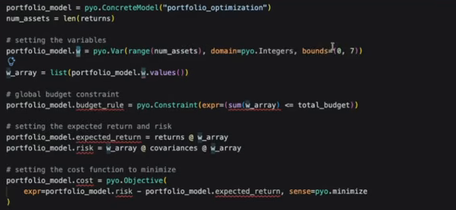
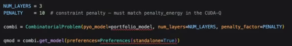
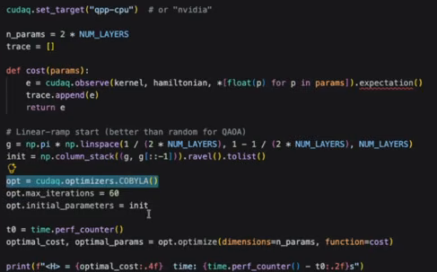
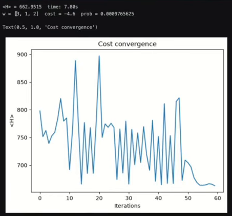
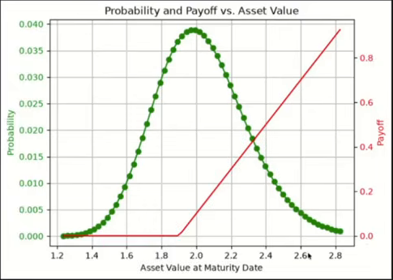
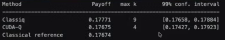

# 02. NVIDIA × Classiq 금융 모델을 양자회로와 CUDA-Q 실행으로 연결하기

2026년 10월 15일 세션 · 다시보기 약 58분 48초 · 근거 확인 2026년 10월 22일

발표자는 Classiq의 Vincent van Wingerden과 NVIDIA의 Esperanza Cuenca Gomez다. [공식 행사 안내](https://www.classiq.io/events-webinars/building-practical-quantum-finance-applications-with-classiq-and-nvidia-cuda-q)는 10월 15일 행사로 기록하며, [Classiq 공식 다시보기](https://www.youtube.com/watch?v=E4Uko49fBaU)는 10월 20일 한국 시각에 공개된 영상이다. 아래는 실제 시간 자막 전체와 시연 화면의 코드·출력·질문 슬라이드를 대조한 상세 노트다. 개념을 보완하거나 직접 재계산한 부분은 별도로 표시했다.

이 세션에서 배울 것은 금융 문제를 푸는 양자 알고리즘의 선택과 구현 책임을 나누는 방법이다. 분석가는 목적함수와 제약조건 또는 확률분포와 지급액을 정하고, Classiq는 이를 양자회로로 합성하며, CUDA-Q는 합성한 회로를 커널로 받아 반복 실행한다. 두 시연에서 실제 선택한 CUDA-Q 백엔드는 화면상 `qpp-cpu`다. GPU 가속은 이 실행 경로를 확장하는 기능과 별도 벤치마크로 설명되며, 이 영상의 노트북 출력을 GPU 측정값으로 읽으면 안 된다.

## 다시보기 길잡이

| 구간 | 실제 다룬 내용 | 확인할 핵심 |
|---|---|---|
| [00:03–03:08](https://www.youtube.com/watch?v=E4Uko49fBaU&t=3s) | 발표자 소개, 참여자의 양자 경험 설문 | 입문자부터 구현 경험자까지 함께 보는 세션 |
| [03:12–06:43](https://www.youtube.com/watch?v=E4Uko49fBaU&t=192s) | NVIDIA의 양자·고전 이종 계산 구조와 CUDA-Q | NVIDIA는 큐비트 제작보다 가속 계산·실행 플랫폼을 설명 |
| [07:11–13:46](https://www.youtube.com/watch?v=E4Uko49fBaU&t=431s) | Classiq의 모델·합성·시각화·실행, AI 코딩 도우미 | 어떤 계산을 할지와 회로를 어떻게 만들지를 분리 |
| [14:01–18:13](https://www.youtube.com/watch?v=E4Uko49fBaU&t=841s) | 포트폴리오 최적화의 수학적 구성 | 수익률, 공분산, 정수 배분량, 예산 |
| [19:00–21:17](https://www.youtube.com/watch?v=E4Uko49fBaU&t=1140s) | 중간 청중 질문 3건 | 비용·라이선스, SDK 연결, Classiq의 차이 |
| [21:18–30:44](https://www.youtube.com/watch?v=E4Uko49fBaU&t=1278s) | Pyomo → QAOA → CUDA-Q 시연 | 3개 자산의 정수 배분 문제, 12큐비트 회로 |
| [30:49–32:36](https://www.youtube.com/watch?v=E4Uko49fBaU&t=1849s) | 금융 양자 도입의 출발점 설문 | 사업 문제 → 수학적 모델 → 알고리즘 순서 |
| [32:39–37:50](https://www.youtube.com/watch?v=E4Uko49fBaU&t=1959s) | 유럽형 콜옵션과 IQAE 소개 | 확률분포와 지급액을 결합한 기대값 추정 |
| [38:03–45:13](https://www.youtube.com/watch?v=E4Uko49fBaU&t=2283s) | 분포 준비 → 진폭 부호화 → 반복 추정 시연 | 6개 자산 레지스터 큐비트, 64개 격자점 |
| [45:21–48:55](https://www.youtube.com/watch?v=E4Uko49fBaU&t=2721s) | GPU 활용, 확장 방향, 대학 교육·연구 | 기존 온프레미스·클라우드 GPU의 활용 제안 |
| [49:09–57:08](https://www.youtube.com/watch?v=E4Uko49fBaU&t=2949s) | 마지막 청중 질문 6건 | 알고리즘, 노이즈, 내부 구현, 컴파일러, 화학, 중성원자 |

## 1. 두 플랫폼은 계산 과정의 어느 부분을 맡는가

[03:12부터](https://www.youtube.com/watch?v=E4Uko49fBaU&t=192s) Esperanza는 양자컴퓨터를 고전컴퓨터와 분리된 독립 장치로 소개하지 않는다. CPU·GPU·QPU가 함께 작동하는 이종 계산 구조를 먼저 제시한다. 양자회로를 만들고 실행하며 결과를 평가하는 과정에 고전 계산이 계속 필요하기 때문이다. CUDA-Q는 Python과 C++에서 양자 커널을 표현하고, 선택한 QPU 또는 시뮬레이터에 실행하는 플랫폼으로 설명된다.

[07:11부터](https://www.youtube.com/watch?v=E4Uko49fBaU&t=431s) Vincent는 양자 프로그래밍의 어려움을 개별 게이트를 직접 연결하는 작업에서 찾는다. 자산 수, 표현 정밀도 또는 목표 하드웨어가 바뀔 때 회로 구현까지 다시 손보아야 한다면 금융 모델 연구의 반복 속도가 떨어진다. Classiq의 제안은 다음 네 단계다.

1. **모델 작성:** 계산하려는 수학적 기능을 높은 수준에서 기술한다. 예컨대 `QNum`은 양자 레지스터가 나타내는 수를 변수처럼 다루도록 한다.
2. **합성:** 모델과 목표 하드웨어·최적화 조건을 입력받아 게이트 회로를 만든다. 발표자는 연결성, 게이트 집합, 사용 가능한 보조 큐비트와 최적화 우선순위를 구현 결정의 예로 든다.
3. **시각화:** 합성된 프로그램을 열어 변수와 실제 게이트 수준의 구조를 확인한다.
4. **실행:** 연결된 실제 하드웨어 또는 CPU·GPU 시뮬레이터에 보낸다.

[12:33부터](https://www.youtube.com/watch?v=E4Uko49fBaU&t=753s) AI 코딩 도우미도 소개한다. 논문 구현이나 분자 바닥상태 계산 같은 요청으로 Classiq SDK 코드를 만들 수 있다는 설명이다. 발표자가 강조한 점은 사람이 높은 수준의 출력을 읽고 검토할 수 있다는 것이다. 이 기능의 정확도 평가나 AI가 만든 금융 모델의 정당성 검증은 세션에서 수행하지 않는다.

**보충 해설:** `QNum`을 실수형 변수처럼 쓸 수 있다는 설명은 양자컴퓨터가 무한 정밀도 실수를 저장한다는 뜻이 아니다. 실제 회로에서는 정해진 수의 큐비트와 부호·소수 비트 설정으로 유한한 수를 표현한다. 높은 수준의 표기가 표현 비용이나 수학적 가정을 없애지는 않는다.

## 2. 포트폴리오 예제는 무엇을 최적화하는가

[14:01–18:13의 소개](https://www.youtube.com/watch?v=E4Uko49fBaU&t=841s)는 수익과 위험을 함께 고려하여 자산 배분을 고르는 문제다. 수익률이 큰 자산에만 몰아서 투자하면 위험과 공분산이 불리할 수 있다. 따라서 기대수익 벡터와 공분산 행렬을 함께 사용한다. 발표는 공매도와 추가 한도도 모델링할 수 있다고 설명하지만, 실제 시연은 공매도가 없는 작은 정수 배분 사례다.

[21:47–24:58의 코드](https://www.youtube.com/watch?v=E4Uko49fBaU&t=1307s)에서 입력을 다음처럼 고정한다. 숫자는 교육용 예시이며 시장 데이터나 퍼센트 단위 수익률로 제시되지 않는다.

| 항목 | 화면에서 확인한 값 | 뜻 |
|---|---|---|
| 자산 수 | 3 | 각 자산을 몇 단위 살지 결정 |
| 기대수익 벡터 | `(3, 4, −1)` | 자산별 수익 기여 |
| 배분량 | `w_i ∈ {0,…,7}` | 분할 매수 없는 정수 단위 |
| 예산 | `w_1+w_2+w_3 ≤ 6` | 세 자산의 단위 가격을 모두 1로 둔 제약 |
| 공분산 행렬 | 아래 식 | 자산별 분산과 자산 간 동반 변동 |
| 최소화 목표 | `wᵀΣw − μᵀw` | 위험에서 기대수익을 뺀 값 |

\[
\mu=\begin{pmatrix}3\\4\\-1\end{pmatrix},\qquad
\Sigma=\begin{pmatrix}
0.9&0.5&-0.7\\
0.5&0.9&-0.2\\
-0.7&-0.2&0.9
\end{pmatrix}.
\]

여기서 `w_i`는 자산별 보유량이고, `μᵀw`는 총 기대수익, `wᵀΣw`는 포트폴리오 분산에 대응하는 위험 항이다. 대각항은 각 자산 자체의 변동을, 비대각항은 두 자산의 함께 움직이는 정도를 반영한다. 이 예제에서 위험 계수를 따로 두지 않고 두 항을 그대로 빼므로, 계수와 단위의 선택은 이미 고정된 모델 가정이다.

Pyomo의 정수 변수·제약조건·목적함수로 이 부분을 작성한다. [24:43의 강조점](https://www.youtube.com/watch?v=E4Uko49fBaU&t=1483s)은 이 단계에 큐비트나 게이트가 전혀 나오지 않는다는 것이다. 재무·최적화 담당자가 이해하는 모델을 먼저 완성한 뒤 양자 알고리즘으로 연결한다.

그림 2-1. **업무 조건을 먼저 고정하는 실제 발표 코드.** `bounds=(0,7)`은 정수 보유량의 범위이고, 합계의 `<= total_budget`은 예산 상한이다. 아래에서 위험−기대수익을 최소화한다. 원화면의 관련 코드만 발췌했다. 출처: Classiq·NVIDIA, [23:30](https://www.youtube.com/watch?v=E4Uko49fBaU&t=1410s).

## 3. Pyomo 모델은 어떻게 QAOA 회로가 되는가

[25:02–27:43](https://www.youtube.com/watch?v=E4Uko49fBaU&t=1502s)에서 `CombinatorialProblem`에 Pyomo 모델, QAOA 층 수 3, 제약 위반 벌점 10을 전달한다. 합성 후 시각화한 회로는 12큐비트다. 따라서 자산이 3개라는 사실과 전체 회로가 3큐비트라는 주장은 구별해야 한다. 이 시연은 자산마다 0 또는 1을 고르는 이진 선택보다 넓은 정수 표현을 쓰며, 합성 회로에는 제약 처리에 필요한 자원도 포함된다.

그림 2-2. **수학 모델을 QAOA로 연결하는 설정.** 층 수 3과 벌점 10이 코드에 명시된다. 원화면의 주석도 CUDA-Q에서 평가하는 해밀토니안의 벌점을 같게 유지하라고 강조한다. 출처: Classiq·NVIDIA, [25:05](https://www.youtube.com/watch?v=E4Uko49fBaU&t=1505s).

**보충 해설:** QAOA는 비용에 따라 상태의 위상을 바꾸는 연산과 상태를 섞는 연산을 번갈아 적용한다. 각 층의 회전 매개변수 `γ, β`를 고전 최적화기가 조정한다. 3개 층이면 이 시연에서 최적화할 매개변수는 6개다. 좋은 해가 측정될 가능성을 높이려는 근사 알고리즘이며, 층 수 3과 제한된 반복으로 전역 최적해가 보장되는 것은 아니다. [QAOA 원 논문](https://arxiv.org/abs/1411.4028)이 제시하는 알고리즘의 일반적 성격을 설명한 것으로, 발표에서 금융 우위가 증명되었다는 의미는 아니다.

[28:04–29:50](https://www.youtube.com/watch?v=E4Uko49fBaU&t=1684s)의 연결은 두 종류다. 목적함수를 CUDA-Q의 스핀 연산자로 바꾸고, 합성된 회로를 `qprog_to_cudaq_kernel`로 CUDA-Q 커널에 옮긴다. 화면의 주석은 두 경로에서 벌점 값을 일치시켜야 한다고 명시한다. 다른 벌점을 쓰면 최적화기가 평가하는 비용과 회로가 표현하는 비용이 달라질 수 있기 때문이다.

이어 `cudaq.observe`로 주어진 매개변수의 해밀토니안 기대값을 구하고, `cudaq.optimizers.COBYLA`로 매개변수를 갱신한다. 화면에서는 최대 반복을 60으로 둔다. [NVIDIA의 실행 문서](https://nvidia.github.io/cuda-quantum/latest/using/basics/run_kernel.html)에 따르면 `observe`는 관측량의 기대값을 구하는 함수이고 `sample`은 측정 분포를 얻는 함수다. 이 차이가 뒤에 나오는 출력 해석에 필요하다.

그림 2-3. **실제 데모의 실행 대상은 CPU 시뮬레이터다.** 맨 위의 `qpp-cpu`가 선택돼 있고 `nvidia`는 대안 주석이다. 가운데의 `observe` 호출을 고전 최적화기 COBYLA가 반복한다. GPU 가속 기능 소개와 이 노트북의 실제 실행 설정을 구별할 근거가 되는 화면이다. 출처: Classiq·NVIDIA, [29:25](https://www.youtube.com/watch?v=E4Uko49fBaU&t=1765s).

### 실제 출력과 읽는 방법

[28:57의 코드 화면](https://www.youtube.com/watch?v=E4Uko49fBaU&t=1737s)은 `cudaq.set_target("qpp-cpu")`를 선택하고 GPU용 `"nvidia"`를 주석으로 제시한다. [30:18의 출력](https://www.youtube.com/watch?v=E4Uko49fBaU&t=1818s)은 다음과 같다.

| 화면의 값 | 기록 | 올바른 해석 |
|---|---:|---|
| 최적화기가 반환한 `<H>` | 662.9515 | 해밀토니안 기대값 출력 |
| 해당 최적화 호출 시간 | 7.80초 | CPU CUDA-Q 경로에서 표시한 시간; 전체 작업 시간 아님 |
| 디코딩해 표시한 배분량 | `[3,1,2]` | 첫째 자산 3단위, 둘째 1단위, 셋째 2단위 |
| 그 배분량의 금융 목적함수 | −4.6 | 위에 정의한 위험−수익 값 |
| 그 행의 표시 확률 | 0.0009765625 | 출력된 표본 행의 `prob`; 높은 성공확률의 근거로 쓰기 어려움 |

그림 2-4. **원영상의 실제 출력과 평가 곡선.** 위의 `<H>`는 전체 상태의 기대값이고 `cost=-4.6`은 표시한 한 배분의 비용이다. 가로축은 평가 반복, 세로축은 `<H>`이며 곡선은 오르내린다. 화면의 7.80초는 표시된 최적화 호출 시간이다. 출처: Classiq·NVIDIA, [30:18](https://www.youtube.com/watch?v=E4Uko49fBaU&t=1818s).

기대값 `<H>`와 개별 배분의 비용 −4.6은 서로 다른 값이다. 전자는 회로가 만드는 전체 상태에 대한 평가이고, 후자는 디코딩한 한 해의 비용이다. 예산 벌점과 표현 방식도 개입하므로 두 숫자를 같은 지표로 비교하면 안 된다. 특히 [29:35의 코드](https://www.youtube.com/watch?v=E4Uko49fBaU&t=1775s)는 CUDA-Q 최적화 뒤에 `combi.sample(optimized_params)`로 Classiq 표본을 얻고, 예산을 만족하는 행만 남긴 뒤 비용이 가장 낮은 행을 표시한다. 따라서 −4.6은 최적화한 상태 전체가 그 비용을 가졌다는 뜻이 아니다. 그래프는 약 60번의 평가 동안 크게 오르내리다가 마지막 구간에서 낮아진다. 발표자의 구두 설명을 매 단계 단조롭게 개선된 것으로 옮기지 않는다.

**직접 재계산:** 화면의 입력·목적함수·예산을 그대로 쓰면 가능한 정수 배분은 84개다. 이를 모두 계산했을 때 최저 비용은 −4.8이고, `[2,1,1]`과 `[1,2,1]`이 그 값을 준다. 시연 배분 `[3,1,2]`는 위험 6.4, 수익 11, 비용 −4.6으로 예산을 만족하지만 전역 최적해는 아니다. 이는 양자회로·CUDA-Q 실행을 독립 재현한 결과가 아니라, 작은 고전 최적화 문제의 목적함수만 정확 열거해 검산한 결과다.

이 사례가 보여준 성과는 금융 모델이 회로와 반복 실행까지 연결된다는 점이다. 최상의 고전 정수 최적화기보다 빠르다거나 실제 QPU에서 금융 우위를 얻었다는 결과는 이 출력에 없다.

## 4. 옵션 가격 문제는 왜 기대값 추정 문제가 되는가

[32:39–37:50](https://www.youtube.com/watch?v=E4Uko49fBaU&t=1959s)의 두 번째 사례는 유럽형 콜옵션이다. 만기 가격 `S_T`가 행사가격 `K`보다 높을 때만 차액을 지급하므로 지급액은 `max(S_T−K,0)`다. 만기 가격을 확률분포로 나타내면 구할 양은 그 분포에 대한 평균 지급액이다.

**보충 해설:** 일반적인 무차익 옵션 가격식은 위험중립 확률분포에 대해 할인한 기대지급액이다.

\[
V_0=e^{-rT}\,\mathbb{E}_{\mathbb Q}\bigl[\max(S_T-K,0)\bigr].
\]

`r`은 할인율, `T`는 만기까지의 시간이다. 다만 실제 시연 코드의 출력 열은 `Payoff`이고, 마지막 고전 기준값도 같은 격자 위의 지급액 평균이다. 따라서 아래의 약 0.177을 별도 할인·위험중립 보정까지 검증한 실제 시장가격으로 확장하지 않는다.

고전 Monte Carlo는 가격을 여러 번 표본추출해 지급액을 평균낸다. IQAE는 가격 분포와 지급액을 양자 상태의 확률로 부호화하고, 그 확률을 반복적으로 추정한다. [IQAE 원 논문](https://arxiv.org/abs/1912.05559)은 양자 위상 추정 없이 Grover 연산을 사용하며, 이론적 질의 복잡도에서 고전 Monte Carlo에 비해 이차적 개선을 준다는 결과를 제시한다. 그 이론에는 상태 준비·오라클 호출을 어떻게 비용으로 세는지라는 조건이 있다. 시뮬레이터에서 작은 예제를 실행한 시간만으로 이 금융 문제 전체의 양자 우위가 입증되지는 않는다.

## 5. 실제 IQAE 시연을 단계별로 따라가기

### 가격 분포를 유한 격자로 바꾸기

[38:03–39:16](https://www.youtube.com/watch?v=E4Uko49fBaU&t=2283s)에서 자산 가격을 로그정규분포로 둔다. 화면의 설정은 자산 레지스터 6큐비트, 로그 변수의 평균 `μ=0.7`, 표준편차 `σ=0.13`, 행사가격 `K=1.9`다. 이때 자산 레지스터는 `2⁶=64`개 가격 격자점을 나타낸다. 이 6은 자산 분포를 표현하는 큐비트 수이며, 표시용 비트와 보조 자원을 포함한 전체 합성 회로 폭과 동일하다고 가정하지 않는다.

고전 전처리에서 가격 평균·표준편차를 구하고 평균의 ±3표준편차 범위에 격자를 만든다. 각 격자에서 확률밀도를 평가한 뒤 합이 1이 되도록 정규화한다. 따라서 연속 로그정규분포 자체가 정확히 보존되는 계산은 아니다. 가격 구간을 자른 오차와 64점 이산화 오차가 포함된다.

그래프에는 초록색 확률분포와 빨간색 지급액을 함께 그린다. 행사가격 1.9 이하에서 지급액은 0이고 그보다 높으면 선형으로 증가한다. 두 곡선을 함께 읽으면 ‘확률이 큰 가격’과 ‘지급액이 큰 가격’이 다르며, 기대지급액은 두 요소를 곱해 모두 합산한 값이라는 점을 알 수 있다.

그림 2-5. **확률과 지급액을 함께 읽는 발표 그래프.** 초록 점은 가격 격자별 확률로 왼쪽 축을, 빨간 선은 지급액으로 오른쪽 축을 사용한다. 두 세로축의 눈금과 단위가 다르므로 곡선의 교차점 자체에 금융적 의미를 부여하지 않는다. 기대지급액은 같은 가격에서의 두 값을 곱해 합한 양이다. 출처: Classiq·NVIDIA, [40:15](https://www.youtube.com/watch?v=E4Uko49fBaU&t=2415s).

### 분포와 지급액을 양자 상태에 넣기

[39:18–40:46](https://www.youtube.com/watch?v=E4Uko49fBaU&t=2358s)에서 `@qfunc`로 양자 함수를 정의한다. `load_distribution`은 분포 준비를, `payoff`는 행사가격 조건을 확인한 지급액 부호화를 담당한다. 이를 `european_call_state_preparation`에서 합친다.

**보충 해설:** 가격 격자 확률을 `p_j`, 정규화한 지급액을 `f_j∈[0,1]`로 쓰면 핵심 상태는 다음처럼 이해할 수 있다.

\[
A|0\rangle
=\sum_j\sqrt{p_j}\,|j\rangle
\left(\sqrt{1-f_j}\,|0\rangle+\sqrt{f_j}\,|1\rangle\right).
\]

마지막 표시 큐비트가 1일 확률은 `a=Σ_j p_j f_j`다. 따라서 그 확률을 추정한 뒤 지급액의 정규화 계수를 곱하면 기대지급액을 얻는다. 이 식은 강연 코드의 기능을 설명하기 위한 재구성이며, 화면의 회로를 독립 시뮬레이션한 결과가 아니다.

### 반복 가능한 커널 만들기

[40:48–42:44](https://www.youtube.com/watch?v=E4Uko49fBaU&t=2448s)에서 표시 큐비트에 작용하는 오라클과 상태 준비를 결합한다. `main(k, indicator)`의 `k`가 진폭 증폭의 반복 횟수에 대응한다. 모델을 합성한 뒤 `qprog_to_cudaq_kernel`로 내보내고 `cudaq.draw`로 일반 CUDA-Q 커널처럼 그린다. 구현의 포인트는 Classiq 안에서만 실행되는 특수 결과를 만드는 것이 아니라 기존 CUDA-Q 실행 코드에 넣을 수 있는 커널을 만든다는 데 있다.

### 같은 추정기를 유지하고 실행 함수 바꾸기

[42:47–45:13](https://www.youtube.com/watch?v=E4Uko49fBaU&t=2567s)에서 두 수준의 인터페이스를 보인다. 먼저 Classiq의 `IQAE` 래퍼로 상태 준비 함수와 오차·신뢰도 설정을 전달해 실행한다. 이어 `GenericIQAE`에는 표본추출 함수를 인자로 넘긴다. 하나는 Classiq의 `sample`, 다른 하나는 `cudaq.sample`을 호출하고, 각각 표시 큐비트가 1인 횟수를 반환한다. 같은 고전 추정 반복에 어떤 실행기를 연결할지 바꿀 수 있음을 보여주는 부분이다.

IQAE의 반복은 앞서 QAOA에서 회전각을 조정한 변분 최적화와 다르다. IQAE에서는 증폭 반복 횟수와 측정 통계를 바탕으로 미지의 확률이 들어 있을 구간을 좁힌다. 두 방법 모두 고전 코드가 양자회로를 반복 호출하지만, 반복하는 목적과 갱신하는 양은 같지 않다.

화면 설정은 `EPSILON=0.02`, `ALPHA=0.01`, 반복당 `SHOTS=4000`이다. `ALPHA=0.01`에 해당하는 출력 신뢰구간은 99%다. 여기서 epsilon을 실제 옵션가격의 상대 오차 2%로 읽으면 안 된다. 정규화·재변환을 거쳐 지급액 단위의 오차가 정해진다. `max k`도 최대 Grover 반복 횟수이며 총 표본 수나 전체 오라클 호출 수와 다르다.

### 화면에 나온 수치는 얼마나 일치하는가

[43:15의 첫 래퍼 출력](https://www.youtube.com/watch?v=E4Uko49fBaU&t=2595s)은 추정치 0.1768, 99% 신뢰구간 `[0.1756,0.1779]`, 반복 2회, 최대 `k=9`다. [44:45의 최종 비교](https://www.youtube.com/watch?v=E4Uko49fBaU&t=2685s)는 아래와 같다. 첫 래퍼와 최종 비교의 Classiq 값은 별도 표본추출 실행이므로 소수점 아래가 동일할 필요는 없다.

| 실행 경로 | 기대지급액 추정 | 최대 `k` | 출력된 99% 신뢰구간 |
|---|---:|---:|---|
| Classiq 표본추출 + GenericIQAE | 0.17771 | 9 | `[0.17658,0.17884]` |
| CUDA-Q 표본추출 + GenericIQAE | 0.17675 | 4 | `[0.17427,0.17923]` |
| 같은 64점 격자의 고전 직접 합 | 0.17674 | 해당 없음 | 해당 없음 |

그림 2-6. **발표의 최종 비교 출력.** 위의 한국어 표는 이 원출력의 값을 옮긴 것이다. 두 추정값은 같은 격자 기준과 비교되며, 실행시간 열은 없다. 이 표로 GPU 속도 향상이나 실제 QPU 우위를 계산할 수는 없다. 출처: Classiq·NVIDIA, [44:45](https://www.youtube.com/watch?v=E4Uko49fBaU&t=2685s).

두 추정 신뢰구간에 같은 격자 기준값이 들어 있다. 화면의 전처리를 별도로 재계산한 고전 기대지급액은 0.1767391664로, 표시값 0.17674와 일치했다. 이 비교는 실행기를 바꿔도 이 예제의 기대지급액이 통계적으로 일관됨을 보여준다. 연속분포·실제 시장 데이터에 대한 정확성이나 고전 최선 방법 대비 속도 우위를 검증한 표는 아니다. [44:36의 코드](https://www.youtube.com/watch?v=E4Uko49fBaU&t=2676s)도 `qpp-cpu`를 사용하며 `nvidia`로 바꾸면 GPU 상태벡터 시뮬레이션을 할 수 있다는 주석을 붙인다. 최종 비교표에는 실행시간 열이 없어, 이 표만으로 GPU 배속을 산출할 수 없다.

## 6. 강연에서 실제로 받은 질문과 답변

아래 9건은 영상에 선택되어 표시되거나 낭독되고 구두 답변이 이어진 청중 질문이다. 한국어 질문은 요지 번역이며, 발표자의 답변과 이 노트의 검토를 구분했다. 다시보기에는 전체 Zoom Q&A·채팅 기록이 제공되지 않아, 화면에 선택되지 않은 질문의 총수와 채팅으로만 답한 내용은 확인할 수 없다.

### Q1. CUDA-Q와 Classiq를 누구나 무료로 사용할 수 있는가?

[19:00–19:36](https://www.youtube.com/watch?v=E4Uko49fBaU&t=1140s). **답변:** CUDA-Q는 내려받아 사용할 수 있는 오픈소스 프로젝트다. Classiq는 라이선스가 필요하며 플랫폼에 가입하면 안내를 받을 수 있다고 답한다. **기록 범위:** 화면에서 질문 뒤가 말줄임으로 잘리고 발표자도 뒷부분을 놓쳤다고 말한다. 따라서 질문의 추가 조건은 복원하지 않았다. 무료 사용 가능 범위, 학술용 조건, QPU·클라우드 사용료까지 답한 것으로 확장하지 않는다.

### Q2. Qiskit·PennyLane 등 다른 SDK와 연결하기 쉬운가?

[19:44–20:19](https://www.youtube.com/watch?v=E4Uko49fBaU&t=1184s). **답변:** Classiq는 모듈식 접근을 취하며 높은 수준의 모델링과 다른 SDK의 실행을 조합할 수 있다고 설명한다. CUDA-Q 연결이 오늘 시연의 중심이라는 답이다. **기록 범위:** 이 영상에서 실제로 검증해 보이는 연동은 CUDA-Q다. Qiskit·PennyLane을 직접 실행하는 별도 시연은 없다.

### Q3. Classiq는 Qiskit·PennyLane과 무엇이 다른가?

[20:24–21:14](https://www.youtube.com/watch?v=E4Uko49fBaU&t=1224s). **답변:** Vincent는 Qiskit·PennyLane에서는 보통 논리 회로와 기능의 구현 방법을 사용자가 직접 지정하는 반면, Classiq에서는 계산할 기능을 표현하고 목표 하드웨어를 아는 합성기가 구현을 정한다고 설명한다. **검토:** 이 답변은 Classiq가 제시하는 주된 사용 방식의 비교다. 다른 SDK가 높은 수준의 라이브러리·컴파일 기능을 전혀 제공하지 않는다는 포괄적 주장으로 읽지 않는다.

### Q4. 포트폴리오 최적화에 알려진 효율적 양자 알고리즘은 무엇인가? 가장 유명한 양자 알고리즘은 무엇인가?

[49:09–50:11](https://www.youtube.com/watch?v=E4Uko49fBaU&t=2949s). 질문 슬라이드에서 두 질문이 함께 확인된다. **답변:** 유명한 알고리즘의 예로 Shor 알고리즘을 들고, 포트폴리오 최적화에서는 QAOA가 널리 쓰이며 기본형과 변형이 있다고 답한다. 제약을 만족하지 않는 공간을 피하거나 수렴을 개선하려는 변형도 언급한다. **남은 점:** 어떤 포트폴리오 입력군에서 어떤 고전 기준보다 효율적인지에 대한 복잡도 정리나 실측 비교는 답변에 없다. ‘자주 연구되는 알고리즘’과 ‘실용적 우위가 증명된 알고리즘’을 구별해야 한다.

### Q5. 합성 최적화는 게이트 집합만 고려하는가, 장치의 노이즈도 고려하는가?

[50:26–51:43](https://www.youtube.com/watch?v=E4Uko49fBaU&t=3026s). **답변:** 목표가 무엇인지에 달려 있다고 구분한다. 논리 회로 합성에서는 장치의 연결성과 게이트 집합을 고려하지만, 생성 회로가 너무 깊어 실제 장치에서 유효한 신호를 얻지 못할 수도 있다고 말한다. 별도의 내결함성 엔진은 오류정정 회로를 만들기 위해 목표 장치의 노이즈 특성을 고려한다고 답한다. **검토:** 모든 회로가 자동으로 노이즈를 극복한다는 답변이 아니다. 실제 노이즈 모델이나 오류정정 자원 수치를 시연하지는 않는다.

### Q6. 높은 수준으로 코딩해도 내부 저수준 기능을 확인할 문서가 있는가?

[51:53–53:02](https://www.youtube.com/watch?v=E4Uko49fBaU&t=3113s). **답변:** 공개 라이브러리 함수는 GitHub에서 구현을 볼 수 있다. 합성 뒤에는 게이트 기반 프로그램이 나오므로 시각화에서 CNOT·RX 등 구체적인 구현을 볼 수 있다고 답한다. **기록 범위:** 공개 함수의 합성 전 구현과 모든 합성 출력의 게이트 수준 확인을 구별한다. 합성 엔진 자체가 모두 공개되어 있다는 답변은 아니다.

### Q7. Classiq는 일종의 양자 컴파일러인가?

[53:20–53:53](https://www.youtube.com/watch?v=E4Uko49fBaU&t=3200s). **답변:** 그렇다고 답한다. 처음부터 양자 프로그램을 효율적이고 확장 가능하게 만들기 위한 컴파일러에 집중했다는 설명이다. **의미:** 앞에서 제시한 모델→합성→게이트 회로라는 구조를 한 문장으로 확인하는 질문이다.

### Q8. 화학의 분자 시뮬레이션에도 적합한가?

[53:57–55:50](https://www.youtube.com/watch?v=E4Uko49fBaU&t=3237s). **답변:** 적합하다고 답하며, 분자·화학계의 에너지 계산에서 양자 위상 추정(QPE)을 예로 든다. 깊이·회전 게이트·CNOT 수를 줄이는 회로 구현이 중요하고, SoftBank 협업 결과를 찾아보라고 안내한다. **기록 범위:** 이 부분은 응용 가능성과 외부 결과 안내다. 분자 계산을 현장에서 실행하거나 비교 수치를 제시한 시연은 아니다. 회로 자원 감소와 화학 문제에서의 실제 양자 우위는 따로 검증해야 한다.

### Q9. 중성원자 기반 양자 하드웨어를 지원하는가?

[56:07–57:06](https://www.youtube.com/watch?v=E4Uko49fBaU&t=3367s). **답변:** 조건부로 그렇다. 해당 장치가 게이트 연산을 지원하면 회로를 만들 수 있지만, 엄격한 아날로그 방식만 지원하는 장치는 당시 Classiq 경로에서 활용하지 못한다고 답한다. **의미:** 큐비트의 물리적 종류뿐 아니라 장치가 제공하는 계산 모델을 확인해야 한다는 답이다. 자동 자막의 `neural atom`은 화면 질문과 문맥에 따라 `neutral atom`, 즉 중성원자로 바로잡았다.

시간 부족으로 [57:09 이후](https://www.youtube.com/watch?v=E4Uko49fBaU&t=3429s) 질문을 마감한다. 특정 질문을 읽고 답을 유보하는 장면은 확인되지 않는다. 따라서 위 9건은 ‘영상에서 구두 답변이 확인된 질문’이며, 나머지를 임의로 ‘미답변 목록’에 추가하지 않는다.

## 7. 복습할 때 스스로 답해 볼 질문

이 항목은 실제 청중 질문과 별개로 작성한 학습용 질문이다.

1. 자산 수가 3인데 회로는 왜 12큐비트인가? 정수 표현, 예산 제약, 보조 자원 중 어떤 정보가 추가로 필요한가?
2. 위험−수익이 가장 작은 표본을 하나 얻는 것과 그 표본을 높은 확률로 얻는 것은 어떻게 다른가? `<H>`, 개별 비용, 출력 확률을 각각 설명할 수 있는가?
3. 예산을 6으로 두었는데 최적해가 반드시 6단위를 모두 사용해야 하는가? `≤6`과 `=6`은 같은 문제가 아닌 이유가 무엇인가?
4. Classiq 회로의 벌점 10과 CUDA-Q에서 평가하는 해밀토니안의 벌점이 다르면 어떤 문제가 생기는가?
5. 옵션 예제에서 분포를 정확히 준비했더라도 연속 가격분포에 대한 오차가 남는 이유는 무엇인가?
6. 표시 큐비트가 1일 확률을 알면 왜 기대지급액을 얻을 수 있는가? `√f_j`를 진폭으로 넣는 이유를 설명할 수 있는가?
7. 99% 신뢰구간은 분포의 64점 이산화 오차와 모델 위험까지 포함하는가? 이 시연의 신뢰구간이 다루는 것은 무엇인가?
8. CUDA-Q의 백엔드를 `qpp-cpu`에서 `nvidia`로 바꾼 속도 향상과 QPU에서 얻는 양자 알고리즘 우위는 각각 무엇을 비교해야 판정할 수 있는가?
9. 중성원자 장치에 접근할 때 ‘지원한다’는 말만 듣지 않고 확인해야 하는 연산 방식은 무엇인가?

### 복습 질문의 풀이

1. 자산 수는 업무 변수의 개수다. 각 보유량 0–7을 표현하려면 변수마다 3비트가 필요하고, 예산 제약의 slack·산술·보조 공간이 추가될 수 있다. 실제 12큐비트가 어떤 용도로 배정됐는지는 합성 모델과 회로에서 확인한다. 3개 자산을 3큐비트로 표현했다고 계산하지 않는다.
2. `<H>`는 전체 상태의 해밀토니안 기대값이고, −4.6은 선택한 한 배분의 금융 비용이다. 작은 표시 확률의 좋은 해는 반복 실행에서 자주 나오지 않을 수 있다. 최선 표본·기대 비용·유효 해 비율과 성공확률을 함께 보고한다.
3. 예산이 상한이면 모두 쓰지 않아도 된다. 이 입력의 최적 배분 `[2,1,1]`은 4단위만 사용한다. 등식으로 강제하면 허용 집합을 바꾸므로 새로운 최적화 문제가 된다.
4. 회로를 만드는 모델과 평가하는 해밀토니안이 다른 문제를 표현할 수 있다. 원래 목적함수와 제약, 벌점의 계수·상수항·변수 인코딩이 두 경로에서 일치하는지 확인한다.
5. 유한 구간의 64점 분포는 연속 분포를 잘라 이산화한 것이다. 그 이산 분포를 정확히 준비해도 구간 밖 꼬리와 격자 근사 오차는 남는다. 양자 추정 오차와 별도로 평가해야 한다.
6. 보조 비트의 진폭을 정규화 payoff의 제곱근으로 만들면, 측정확률은 payoff 자체에 비례한다. 가격 상태의 확률로 다시 가중해 합산하므로 `a=Σ_j p_j f_j`가 되고 정규화 상수를 곱해 평균 지급액을 복원한다. 임계값 비교만 하면 행사 확률만 얻는다.
7. IQAE의 통계적 구간은 정한 회로·분포·추정 절차의 성공확률을 다룬다. 연속 분포의 이산화, 실제 시장 모형의 부정확성, 구현 편향을 모두 포함하는 총오차 구간으로 읽지 않는다. 99%라는 값은 해당 방법의 반복 실험 보장과 가정 아래 해석한다.
8. 전자는 같은 회로·정밀도·측정 조건을 두 고전 시뮬레이터에서 실행한 비교다. 후자는 실제 QPU가 같은 업무 목표와 오차에서 정한 고전 알고리즘 기준보다 나은지 비교하는 문제다. 전처리·컴파일·대기·후처리를 포함할 범위도 같게 정한다.
9. 게이트 기반 디지털 연산인지 아날로그 해밀토니안 진화인지 확인한다. 발표자가 설명한 게이트 기반 회로의 지원을 모든 중성원자 장치와 모든 연산 방식의 지원으로 확장하지 않는다. 실제 접근 가능한 백엔드·게이트·연결성·계정 조건은 별도로 확인한다.

## 8. 이 세션을 보고 실제로 판단할 수 있는 것

금융 모델을 작성하는 부분, 게이트 회로를 만드는 부분, 회로를 반복 실행하는 부분은 다른 작업이다. 이 세션은 세 작업을 연결하는 작은 예제를 끝까지 보여준다. 포트폴리오에서는 정수 최적화 모델을 QAOA 회로와 CUDA-Q 기대값 평가로 옮겼고, 옵션에서는 지급액 기대값을 표시 큐비트의 확률로 바꾸어 두 표본추출 경로에서 일관된 결과를 얻었다.

동시에 실제 화면을 기준으로 보면 시연은 CPU 시뮬레이션이며, 포트폴리오 출력은 전역 최적해가 아니고, 옵션 비교는 같은 이산 격자의 정합성을 확인한다. 앞으로 확인할 것은 더 큰 문제에서의 해 품질, 상태 준비 비용, 반복당 표본 수, 회로 깊이, 같은 정밀도의 최선 고전 계산과 비교한 전체 시간이다. [45:21 이후의 확장 논의](https://www.youtube.com/watch?v=E4Uko49fBaU&t=2721s)는 GPU 병렬화·지연 감소와 복잡한 파생상품·VaR·대학 연구 활용으로 이어지지만, 이 항목들은 현장 시연으로 측정한 새 결과와 구별된다.

## 출처와 검토 범위

- 주된 근거: [Classiq 공식 다시보기](https://www.youtube.com/watch?v=E4Uko49fBaU). 영어 자동 자막 전체를 읽고, 수학적 입력·백엔드 설정·출력 표·질문 슬라이드는 해당 화면과 대조했다. 자동 자막에서 반복적으로 잘못 인식된 Classiq·CUDA-Q·IQAE·중성원자 명칭을 화면과 문맥으로 바로잡았다.
- 행사 날짜: [Classiq 공식 행사 안내](https://www.classiq.io/events-webinars/building-practical-quantum-finance-applications-with-classiq-and-nvidia-cuda-q).
- 보충 원전: [QAOA 원 논문](https://arxiv.org/abs/1411.4028), [IQAE 원 논문](https://arxiv.org/abs/1912.05559), [NVIDIA CUDA-Q 실행 문서](https://nvidia.github.io/cuda-quantum/latest/using/basics/run_kernel.html).
- 직접 검산: 화면에 나타난 3자산 모델의 가능한 배분 84개를 정확 유리수 연산으로 열거하고 목적함수·최적값을 확인했다. 옵션의 64점 고전 격자 기대지급액도 다시 계산해 표시값과 대조했다. Classiq 합성이나 CUDA-Q 양자회로는 독립 재실행하지 않았다.
- 저자들의 [공동 기술 블로그](https://www.classiq.io/insights/quantum-computing-for-finance-how-high-level-quantum-programming-and-gpu-acceleration-are-changing-the-game)는 추가 학습 자료다. 현재 본문의 자산 배분 결과·옵션 큐비트 수와 구현이 영상과 달라, 이 노트의 시연 수치를 블로그 값으로 대체하지 않았다.
- 작성 보조: OpenAI Codex, 에이전트 역할 `finance_replay`가 다시보기 자료 확보·시간별 정리·화면 대조·소규모 고전 검산을 수행했다. 정확한 모델 식별자는 미보존이다. 편집 기준은 AI Tech Review 2026.08 및 과학 설명 준칙 1.0을 적용했다. 사람의 문장별 검토·청취 평가는 수행 여부를 확인하지 못했다.
