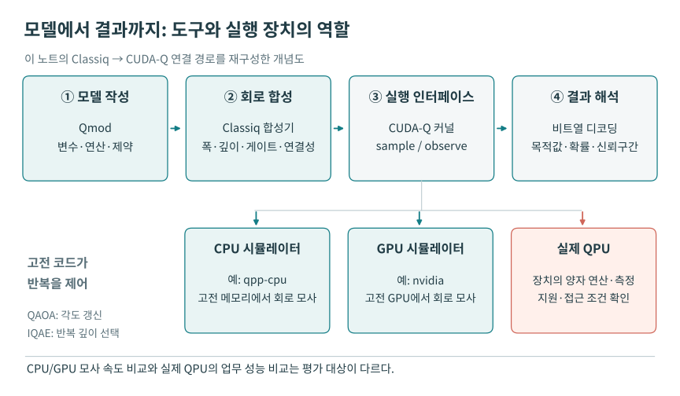
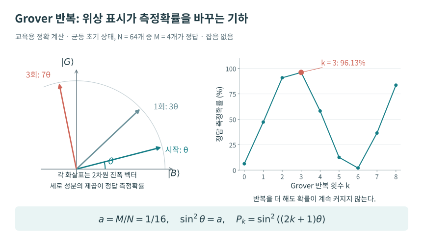

# 03. 자연어 요구를 실행 가능한 양자 프로그램으로 바꾸기

**대상 세션:** Classiq Quantum Office Hours: From Idea to Quantum Circuit with AI Agents  
**행사:** 2026년 7월 8일 · **다시보기 공개:** 2026년 10월 20일 · **길이:** 43분 55초  
**발표·진행:** Dr. Erik Garcell, Director of Quantum Solutions Architecture; Dr. John (Jack) Glennon, Quantum Applications Engineer  
**정리 기준:** 2026년 10월 22일. 공식 다시보기의 영어 자동자막 전 구간과 공식 행사 페이지를 대조했다. 아래 시각은 녹화물 상대시각이며 몇 초의 자막 오차가 있을 수 있다. 실제 청중 문답, 진행자끼리의 질문, 노트 작성자가 추가한 학습 질문을 구별했다. 화면의 전체 코드·그래프를 독립 실행하거나 픽셀 단위로 검수하지는 않았다.

[공식 다시보기](https://www.youtube.com/watch?v=gaLZNQkcsp8) · [공식 행사 소개와 발표자 정보](https://get.classiq.io/office-hour-webinars/from-idea-to-quantum-circuit-with-ai-agents/)

## 이 세션에서 판단할 수 있게 되는 것

이 세션의 핵심은 AI가 양자 알고리즘을 새로 발견했다는 데 있지 않다. 사용자가 해를 판별하는 조건을 자연어로 제시했을 때, 에이전트가 Qmod 모델을 만들고 Classiq 합성기를 호출해 회로를 준비하며, 사용자가 모델·회로·실행 결과를 오가며 확인하는 작업 흐름을 보여 준다. 작은 Grover 탐색 시연을 중심으로 시작 장벽을 설명한 다음, 기존 개발자에게는 논문 구현 보조와 하드웨어별 컴파일 비교가 어떻게 유용할지 제시한다.

따라서 학습할 때에는 서로 다른 세 질문을 분리해야 한다. **요구한 문제를 올바르게 모델링했는가**, **그 모델을 실행 가능한 회로로 만들었는가**, **그 회로의 비용과 결과가 목적에 적합한가**이다. 데모는 컴파일과 실행이 이루어진 사례를 보여 준다. 모델과 회로의 의미가 모든 입력에서 같다는 독립 증명이나 업무상의 유용성을 보증하는 결과는 아니다.

## 1. 전체 흐름과 주요 장면

| 다시보기 | 실제로 다루는 내용 | 학습할 때의 초점 |
|---|---|---|
| [00:00–02:00](https://www.youtube.com/watch?v=gaLZNQkcsp8&t=0s) | 발표자 소개, Office Hours의 목적, 청중 경험 설문 | 제품 중심 시연이며 알고리즘 증명 강의와 범위가 다름 |
| [02:04–08:31](https://www.youtube.com/watch?v=gaLZNQkcsp8&t=124s) | Qmod·합성기·시각화·실행, 여러 AI 도구와 당시 로드맵 | 모델, 컴파일, 실행의 역할 구분 |
| [08:34–10:23](https://www.youtube.com/watch?v=gaLZNQkcsp8&t=514s) | 학습·개발 병목 설문 | 시작하기, 알고리즘 배우기, 앱 만들기가 많이 언급됨 |
| [10:49–15:14](https://www.youtube.com/watch?v=gaLZNQkcsp8&t=649s) | `x*y=6` Grover 프로그램 생성, 1,000 shots 시뮬레이션, Qmod 열람 | 자연어에서 oracle과 결과 해석까지 연결 |
| [15:17–18:43](https://www.youtube.com/watch?v=gaLZNQkcsp8&t=917s) | width/depth 최적화, 계층별 회로 보기, 재실행 | 자원 목표가 달라지면 같은 모델의 회로가 달라짐 |
| [19:26–24:13](https://www.youtube.com/watch?v=gaLZNQkcsp8&t=1166s) | 첫 청중 Q&A | 필요한 선수지식, 범용 챗봇과의 차이 |
| [24:17–32:38](https://www.youtube.com/watch?v=gaLZNQkcsp8&t=1457s) | IDE 설문, 플러그인, Studio, 논문 구현 사례와 다중 모듈 예 | 코드 생성 이외의 활용 |
| [32:40–40:53](https://www.youtube.com/watch?v=gaLZNQkcsp8&t=1960s) | 두 번째 Q&A, 문서 assistant 시연, 팀 구성, QAOA 비교 노트북 | 설명과 학습, 검토해야 할 벤치마크 조건 |
| [40:56–43:47](https://www.youtube.com/watch?v=gaLZNQkcsp8&t=2456s) | 다음 회차 관심 분야 설문, 정리 | 금융·제약/화학·AI/ML 관심이 대략 세 갈래로 나타남 |

설문 수치는 발표자가 읽어 준 근삿값이다. 표본 수·응답자 구성·원 설문 데이터가 공개된 통계 연구로 취급하지 않는다.

## 2. 플랫폼을 네 단계로 나누어 이해하기

[02:04–04:59](https://www.youtube.com/watch?v=gaLZNQkcsp8&t=124s)에서 Erik은 Classiq를 모델 작성부터 실행까지 잇는 개발 플랫폼으로 소개한다. 개발자는 Qmod로 계산의 구조를 표현하고, 합성기가 목표와 제약에 맞추어 회로를 만들며, 시각화 도구로 이를 검사한 뒤, 실행 환경을 선택한다. 여기서 자연어 에이전트가 추가되는 위치를 구별하면 뒤의 시연이 선명해진다.

1. **문제와 알고리즘 선택:** 어떤 입력에서 무엇을 구하고 싶은지 결정한다. `x*y=6`에서는 곱셈 조건을 만족하는 정수쌍을 찾는 것이 문제이고, Grover 탐색이 사용자가 요구한 알고리즘이다.
2. **Qmod 모델 생성:** 양자 변수, 조건식, 초기 상태 준비, 반복 구조 등 알고리즘의 의미를 코드로 표현한다. 높은 추상화 수준의 표현을 쓴다고 해서 변수의 범위나 정밀도가 저절로 정해지는 것은 아니다.
3. **회로 합성:** 모델과 width·depth·게이트 집합·연결성 등의 조건을 입력받아 회로를 만든다. 에이전트의 언어 생성과 합성기의 회로 생성은 별도 단계다.
4. **실행과 해석:** 시뮬레이터 또는 접근 가능한 QPU에서 측정하고, 비트열을 모델의 변수와 연결해 읽는다. 적절한 통계량과 고전 기준값을 비교하는 일도 포함한다.

그림 3-1. **모델에서 결과까지 도구와 장치의 역할.** 이 회차의 네 단계에 10월 금융 세션의 CUDA-Q 연동을 이어 붙인 설명용 도식이다. 실행 인터페이스 아래에서 CPU·GPU 시뮬레이터와 실제 QPU가 갈라지는 부분을 읽는다. Classiq 자체의 실행 경로도 있으며, 그림은 CUDA-Q를 사용하는 대표 경로를 보여준다. QAOA의 각도와 IQAE의 증폭 깊이를 갱신하는 고전 반복은 서로 다른 목적을 갖는다.

발표자는 하드웨어의 차이를 개발자가 매번 직접 다루는 부담을 줄인다고 설명한다. 이를 “어떤 모델이든 모든 기계에서 같은 비용과 품질로 실행된다”는 뜻으로 확대하면 안 된다. **상위 모델을 유지하면서 각 하드웨어에 맞추어 다시 합성할 수 있다**는 의미로 이해해야 한다. 큐비트 수, 연결성, 네이티브 게이트와 오류율은 계속 회로의 실행 가능성과 품질을 제한한다.

당시 도구 소개도 시점을 고정해 읽어야 한다. [06:28–08:20](https://www.youtube.com/watch?v=gaLZNQkcsp8&t=388s)에서 Studio agent, 공개 문서 assistant, 홈페이지 assistant와 IDE 플러그인을 소개하고, 일부 기능을 “내일” 유료 고객에게 제공한다고 말한다. 이는 **7월 8일 발표 시점의 제공 계획**이다. 10월 20일에 업로드된 영상의 공개일을 기준으로 “다음 날 출시”라고 옮기지 않는다. `V-Next`라는 내부 이름의 완전한 agentic 플랫폼도 이 자리에서는 방향·로드맵으로 제시된다.

## 3. 중심 시연: `x*y=6`을 만족하는 정수쌍 찾기

### 3.1 자연어 요청에서 어떤 명세가 나오는가

[10:49–12:33](https://www.youtube.com/watch?v=gaLZNQkcsp8&t=649s)에서 Jack은 양자 초보자의 관점으로 “Grover search로 `x*y=6`인 모든 쌍을 찾아 달라”고 요청한다. assistant의 응답은 문제 설명, 예상되는 해, 변수·함수의 역할을 정리한 표, 관련 라이브러리·문서 링크를 포함한다. 중앙 화면에는 이미 합성된 회로가 나타난다.

여기서 실제로 생성된 것은 자연어 설명만이 아니다. [12:46–13:08](https://www.youtube.com/watch?v=gaLZNQkcsp8&t=766s)에서 Erik이 “컴파일까지 한 것인가”라고 묻고 Jack이 바로 실행할 수 있는 회로라고 확인한다. 이 대화는 **공동 진행자 사이의 설명 질문**이며 청중 Q&A가 아니다.

**필기자 보충 — 명세에 반드시 들어가야 하는 것.** 수학적으로 `xy=6`은 변수의 영역에 따라 다른 문제다. 양의 정수라면 `(1,6),(2,3),(3,2),(6,1)` 네 쌍이지만, 음의 정수까지 허용하면 `(-1,-6)` 등도 생기고 실수라면 무한히 많은 해가 있다. 실제 데모는 네 양의 정수쌍이 증폭된다고 설명한다. 이 노트에서는 화면 전체의 타입 선언을 재현하지 않았으므로 정확한 비트폭·부호 설정까지 단정하지 않는다. 사용자가 프로그램을 만들 때에는 정수/고정소수점, 부호, 입력 범위, 결과를 한 쌍만 찾는지 여러 해를 수집하는지까지 명세해야 한다.

### 3.2 시뮬레이터 결과와 모델 읽기

[13:11–13:58](https://www.youtube.com/watch?v=gaLZNQkcsp8&t=791s)에서 1,000 shots로 **시뮬레이터**를 실행한다. Jack은 히스토그램에서 네 상태가 증폭됐고, 해석 표에서 `(3,2)`, `(6,1)`과 순서를 뒤집은 쌍들을 볼 수 있다고 설명한다. 이는 조건에 맞는 작은 탐색 예의 실행 확인이다. 실제 QPU 성능, 큰 정수 인수분해, 고전 알고리즘 대비 시간 우위의 실험은 아니다.

[14:02–15:14](https://www.youtube.com/watch?v=gaLZNQkcsp8&t=842s)에는 모델 창으로 돌아가 Qmod 코드를 읽는다. `x,y`를 담는 구조, `x*y==6`을 판별하는 oracle, 내장 함수로 구성한 main이 핵심이다. 기호 산술로 조건을 적을 수 있다는 점을 강조한다. 공식 Qmod 설명도 알고리즘의 의도를 높은 수준에서 표현하고 구현 결정을 자동화하는 방향을 설명한다. [Vax 외, Qmod: Expressive High-Level Quantum Modeling](https://arxiv.org/abs/2502.19368).

### 3.3 Grover가 실제로 하는 일을 식으로 보충하기

다음은 시연을 이해하기 위한 **노트 작성자의 수학적 재구성**이다. 영상에서 이 유도를 모두 설명한 것은 아니다. 탐색 영역에 `N`개의 후보가 있고 그중 `M`개가 조건을 만족한다고 하자. 균일한 초기 상태와 정답 상태의 균일 중첩을 각각

\[
|s\rangle=\frac{1}{\sqrt N}\sum_z|z\rangle,\qquad
|G\rangle=\frac{1}{\sqrt M}\sum_{f(z)=1}|z\rangle
\]

로 놓는다. `z`는 여기서 `(x,y)`를 하나로 묶은 입력이고 `f(x,y)=1`은 곱셈 조건이 참임을 뜻한다. 정답이 아닌 상태의 정규화된 중첩을 `|B⟩`라고 하면

\[
|s\rangle=\sin\theta\,|G\rangle+\cos\theta\,|B\rangle,
\qquad \sin^2\theta=\frac MN.
\]

위상 oracle `O_f|z⟩=(-1)^{f(z)}|z⟩`와 초기 상태에 대한 반사를 번갈아 적용하면 이 2차원 평면에서 상태가 회전한다. `r`회 반복 후 정답을 측정할 확률은

\[
P_{\mathrm{good}}(r)=\sin^2\bigl((2r+1)\theta\bigr)
\]

그림 3-2. **진폭의 회전이 확률을 바꾸는 방법.** 왼쪽은 정규화된 정답·비정답 중첩을 축으로 한 평면이며, 화살표의 세로 성분을 제곱하면 정답 확률이다. 오른쪽은 후보 64개 중 정답 4개인 무잡음 균등 준비 예의 직접 계산이다. 3회 반복에서 96.13%지만 이후 감소할 수 있다. 원영상의 측정 히스토그램을 재현한 실험 그래프가 아니다.

이다. 따라서 “정답을 표시한다”와 “정답을 높은 확률로 얻는다”가 구별된다. oracle만으로 모든 해가 읽히는 것이 아니며, 반복을 너무 많이 하면 성공확률이 다시 작아질 수도 있다. 한 번 측정하면 정답 하나가 나오므로, 여러 해를 모두 모으려면 반복 측정과 이미 본 해의 관리가 필요하다. 이 시연의 네 봉우리는 많은 shots로 얻은 분포를 보고한 것이다. [Brassard 외, Quantum Amplitude Amplification and Estimation](https://arxiv.org/abs/quant-ph/0005055), [Classiq의 Grover 연산자 구성 예제](https://docs.classiq.io/qmod-reference/language-reference/statements/within-apply).

## 4. 같은 모델에서 width와 depth를 바꾸는 이유

[15:17–16:44](https://www.youtube.com/watch?v=gaLZNQkcsp8&t=917s)에 Jack은 먼저 width 최적화를 선택한다. 자동자막에서 확인되는 보고값은 **13 qubits, depth 1,900을 조금 넘는 회로**이다. 다음으로 depth 최적화를 선택하면 **depth 1,300을 조금 넘는 회로**가 나오며 큐비트 수는 조금 늘었다고 설명한다. 두 번째 정확한 큐비트 수와 두 회로의 정확한 depth 정수는 이 기록에서 확정하지 않는다.

| 합성 목표 | 발표에서 읽어 준 결과 | 이 장면의 의미 |
|---|---|---|
| Width 줄이기 | 13 qubits, depth > 약 1,900 | 작업 공간을 절약하면서 더 긴 계산을 허용 |
| Depth 줄이기 | depth > 약 1,300, 큐비트 수 증가 | 공간을 더 써 계산을 병렬화하거나 재사용 부담을 줄일 여지 |

**필기자 보충.** `width`는 회로가 요구하는 큐비트 수이고 `depth`는 병렬 실행 가능한 게이트들을 층으로 묶었을 때의 길이다. 일반적으로 보조 큐비트를 재사용하면 공간은 줄지만 계산·역계산을 반복해야 할 수 있다. 반대로 여분의 보조 공간은 일부 작업을 겹치게 할 수 있다. 다만 모든 회로에서 단순히 “큐비트를 늘리면 depth가 줄어든다”는 법칙이 성립하는 것은 아니다. 또한 논리 depth가 같아도 게이트 시간, 2큐비트 게이트 개수, 라우팅과 오류율에 따라 실제 실행 품질은 달라진다.

[16:48–17:40](https://www.youtube.com/watch?v=gaLZNQkcsp8&t=1008s)에는 상위 함수 박스를 펼쳐 게이트 수준까지 내려간다. 추상화는 내부를 보지 못하게 하는 장치가 아니라 사람이 우선 읽을 수준을 바꾸는 수단으로 설명된다. [17:42–18:35](https://www.youtube.com/watch?v=gaLZNQkcsp8&t=1062s)에는 여러 실행 대상의 메뉴와 재실행 결과를 보여 주며 같은 문제 모델의 재사용을 강조한다. 다만 이때 언급한 여러 하드웨어에서 모두 실제 실행해 결과를 비교한 것은 아니다.

## 5. 홈페이지 assistant, IDE 플러그인, Studio, 문서 assistant

이 세션에는 비슷한 이름의 AI 도구가 여러 개 나온다. 기능과 쓰이는 맥락으로 구분하면 혼동이 줄어든다.

| 도구 | 영상의 활용 | 사용자가 확인할 대상 |
|---|---|---|
| 홈페이지 assistant | 자연어로 Grover 프로그램을 만들고 회로·모델·실행으로 이동 | 생성 명세, 코드, 회로, 결과가 같은 문제를 가리키는지 |
| Quantum Engineering Agent 플러그인 | VS Code·터미널 등 기존 개발 환경에서 모델링·합성·실행·분석을 보조 | 요청한 변경 범위, 호출된 도구, 생성 코드와 실행 로그 |
| Classiq Studio agent | 준비된 브라우저 기반 VS Code 환경에서 노트북 생성·수정·설명 | 환경 의존성, 원 논문과 구현의 대응, 고전 기준값 |
| 공개 문서 assistant | 사용자 가이드·예제 검색, 코드의 변수·함수 설명 | 연결된 문서가 실제 설명을 뒷받침하는지 |

[25:45–27:31](https://www.youtube.com/watch?v=gaLZNQkcsp8&t=1545s)에는 플러그인의 모델링·합성·실행·분석·후처리 기능과 문서 서버 연결을 소개한다. 자동자막에서 `MCP`가 여러 방식으로 오인식되지만 문맥상 문서 도구를 연결하는 서버를 뜻한다. [27:36–28:34](https://www.youtube.com/watch?v=gaLZNQkcsp8&t=1656s)에는 Studio의 Python·Classiq·의존성이 준비돼 있어 여러 사람의 입문 환경을 맞추는 부담을 줄인다고 설명한다.

### 논문 구현 보조 사례는 어디까지 확인됐는가

[28:38–31:29](https://www.youtube.com/watch?v=gaLZNQkcsp8&t=1718s)에서 Erik은 포트폴리오 최적화, DMET를 이용한 분자 문제 분할, 암호화된 양자 복제와 관련된 논문을 구현해 본 경험을 말한다. “약 90%는 수정 없이 진행된다”는 취지의 설명은 **발표자의 경험담**이다. 표본·평가 절차·실패 판정이 제시된 재현성 실험이나 신뢰도 통계가 아니다. 이 노트도 해당 원 논문들의 구현 결과를 독립 검증하지 않았다.

특히 “암호화하면 한 번 복제할 수 있다”는 짧은 설명은 원 논문과 프로토콜 조건을 확인하기 전 일반적인 no-cloning 정리를 수정한 결과로 받아들일 수 없다. 이 세션에는 정확한 논문 식별자와 가정이 자막으로 충분히 남지 않는다. 따라서 사례의 존재만 기록하고 세부 이론은 미확정으로 둔다.

[31:38–32:28](https://www.youtube.com/watch?v=gaLZNQkcsp8&t=1898s)에는 세 ion-trap 모듈에서 inverse QFT를 구성하고 모듈 간 양자 통신을 줄이는 노트북 사례를 든다. 발표자는 모듈별 2큐비트 게이트와 모듈 간 비율을 요약한 결과를 보여 줬다고 설명하며 `72%`라는 값을 읽는다. 분모·비교 기준·모듈 배정·실제 통신 모델을 이 자료만으로 확정하기 어려우므로 “통신을 72% 감소시켰다”로 바꾸어 쓰지 않는다.

### 전문가의 작업 시간을 줄이는 사례

[38:48–40:45](https://www.youtube.com/watch?v=gaLZNQkcsp8&t=2328s)에는 QAOA 구현 방식을 입력 크기별로 비교한 노트북을 소개한다. 비교 지표로 합성 시간·컴파일 시간·transpiled depth를, 후속 비교로 하드웨어 연결성별 결과를 언급한다. 발표자는 약 35개 사례를 분석한 뒤 좋은 사례를 골라 하드웨어 비교를 했다고 말한다. 따라서 이 장면은 자동 분석 노트북을 만드는 활용 예로 읽으며, 선택된 사례의 결과를 전체 문제군에 대한 우위로 일반화하지 않는다.

## 6. 녹화물에서 확인되는 실제 청중 Q&A

질문은 영어 발화를 한국어로 요약한 것이며 직접 인용문이 아니다. 녹화물은 채팅창 전체를 보존한 원장이 아니므로 아래는 **진행자가 소리 내어 읽거나 명시적으로 받은 질문만** 정리한 것이다.

### Q1. Classiq를 쓰려면 어느 정도 양자 배경이 필요한가?

[19:48–22:02](https://www.youtube.com/watch?v=gaLZNQkcsp8&t=1188s)

**답변:** Erik은 전문가 수준까지 필요하지 않지만 Grover 탐색, amplitude amplification처럼 주요 알고리즘이 무엇을 하고 어디에서 이득을 낼 수 있는지의 기초는 알아야 한다고 답한다. 기업의 기존 AI·소프트웨어 개발자가 알고리즘을 배우면서 전환할 수 있다는 설명이다. Jack은 agent로 설명이 포함된 튜토리얼과 Jupyter 노트북을 만들어 학습에 활용한 경험을 보탠다.

**해석:** 하드웨어 펄스·게이트 분해 전문성이 줄어든다는 취지다. 문제를 잘못 고르거나 입력 영역을 잘못 정의한 오류까지 자동으로 사라진다는 답은 아니다.

### Q2. AI assistant는 일반 ChatGPT 사용과 무엇이 다른가?

[22:04–24:13](https://www.youtube.com/watch?v=gaLZNQkcsp8&t=1324s)

**답변:** Erik은 Qmod·공식 예제·문서에 대한 맥락과 도구 연결, 실행 오류를 읽고 몇 차례 수정하는 반복 절차를 차이로 든다. 높은 수준의 언어 표현도 생성의 부담을 줄인다고 설명한다. 특정 양자 언어 비교 논문을 들어 Qmod의 표현력을 언급한다.

**필기자 검토:** 이것은 당시 자사 제품의 설계와 기대효과를 설명한 답변이다. 모든 범용 AI 제품의 현재 성능을 측정한 비교는 아니다. 관련성이 높은 [Corrales-Garro 외의 언어 비교 논문](https://arxiv.org/abs/2504.08876)은 네 가지 기초 알고리즘의 코드 길이·순환 복잡도·Halstead 지표를 비교한다. 이런 정적 지표의 좋은 결과를 모든 앱의 개발 생산성, 실행 효율, AI 정확도에 대한 보증으로 확대할 수 없다. 영상에서 논문 제목을 완전히 읽지는 않아 이 논문과의 동일성은 문맥에 근거한 대응이다.

### Q3. AI는 코드만 쓰는가, 양자 개념도 설명하는가?

[32:50–35:59](https://www.youtube.com/watch?v=gaLZNQkcsp8&t=1970s)

**답변·시연:** 개념 설명도 가능하다고 답한 뒤 Jack이 공개 문서 assistant를 보여 준다. 사용자 가이드에서 Grover 관련 내용을 찾아 달라는 요청에 controlled phase operation, 양자 수와 산술, Grover workshop·그래프 색칠 튜토리얼을 연결한다. 이어 예제 코드를 요청하고 각 변수·함수의 설명과 관련 문서 링크까지 받아 본다.

**학습 포인트:** 한 번에 정답 설명을 받는 데서 멈추지 않고 “어느 문서에 근거하는가”, “이 함수가 이 알고리즘에서 왜 필요한가”로 질문을 좁히는 흐름이다.

### Q4. Classiq 사용 튜토리얼은 어디에 있는가?

[36:01–36:53](https://www.youtube.com/watch?v=gaLZNQkcsp8&t=2161s)

**답변:** 문서의 Getting Started를 보여 주며 Qmod 문법, 첫 알고리즘, 간단한 프로젝트로 이어지는 튜토리얼을 안내한다. Jack은 교육 세션에서 활용한 경험을 말한다. 현재 접근은 [Classiq Getting Started](https://docs.classiq.io/latest/getting-started/)와 [공식 라이브러리](https://github.com/Classiq/classiq-library)를 출발점으로 삼을 수 있다.

### Q5. 좋은 개발자는 있지만 양자 전문가는 없는 팀은 어떻게 시작해야 하는가?

[36:56–40:53](https://www.youtube.com/watch?v=gaLZNQkcsp8&t=2216s)

**답변:** 기존의 활발한 소프트웨어·AI 개발팀이 적절한 출발점이라고 Erik이 답한다. 주요 알고리즘이 어떤 문제에 맞는지 배우는 과정은 필요하지만, 저수준 하드웨어 구현 부담을 줄일 수 있다고 설명한다. 이미 양자 전문성이 있는 사람에게도 QAOA 구현 비교, 입력 크기별 자원 분석, 하드웨어별 컴파일 분석을 빠르게 만드는 용도가 있다고 덧붙인다.

**실무적으로 읽기:** 도메인 담당자가 목표와 데이터 의미를, 개발자가 모델과 검증을, 양자 알고리즘 담당자가 적용 조건과 자원을 검토하는 역할이 필요하다. 이 역할 구분은 노트 작성자의 보충이며 발표자가 채용 인원이나 필수 조직도를 제시한 것은 아니다.

### 별도 기록: 질문 내용이 녹화물에 남지 않은 청중 개입

[28:57–29:17](https://www.youtube.com/watch?v=gaLZNQkcsp8&t=1737s)에 Erik이 Mark의 질문에 감사하며 논문 재현 용도를 이야기한다. 질문 전문을 소리 내어 읽지 않았으므로 “청중이 정확히 어떤 문장으로 무엇을 물었다”는 항목은 복원하지 않았다.

또한 [18:45–19:24](https://www.youtube.com/watch?v=gaLZNQkcsp8&t=1125s)의 “한 번 생성한 뒤 수정 질문을 계속할 수 있는가”는 Erik과 Jack의 대화다. Jack은 oracle의 `*`를 `+`로 바꾸는 식의 반복 수정을 예로 든다. 이를 청중 질문 수에 합산하지 않는다.

## 7. 복습 질문과 풀이 — 노트 작성자가 추가

아래는 실제 청중 질문이 아니다. 데모의 구조를 스스로 점검하기 위한 연습이다.

**문제 1.** `x,y∈{0,1,…,7}`이라면 `xy=6`의 해는 몇 개이며 초기 균일 상태에서 정답 확률은 얼마인가? 두 차례 Grover 반복 후에는 어떤가?

**풀이.** 순서를 구분한 해는 `(1,6),(2,3),(3,2),(6,1)` 네 개다. 후보가 64개이므로 `M/N=1/16`, 초기 성공확률은 6.25%다. `θ=arcsin(1/4)`이고 두 번 반복하면 `sin²(5θ)≈0.9084`다. 입력 영역과 반복 횟수를 정해 만든 계산 예로, 영상의 실제 비트폭이나 Grover 반복 횟수를 추정한 것이 아니다.

**문제 2.** 히스토그램에서 네 정답 봉우리가 보이면 “모든 해를 항상 반환한다”는 결론을 내려도 되는가?

**풀이.** 안 된다. 각 shot은 결과 하나를 반환한다. 정답 아닌 상태의 잔여 확률과 유한 shots 때문에 정답 누락이 생길 수 있다. 해의 전체 집합을 요구한다면 누락 확률·중복 수집·종료 조건을 추가해야 한다.

**문제 3.** depth가 약 1,900에서 약 1,300으로 줄면 실제 QPU 실행 시간이나 오류도 정확히 같은 비율로 줄어드는가?

**풀이.** 아니다. 동일한 논리 depth에서도 게이트 종류별 시간, 연결성에 따른 라우팅, 2큐비트 게이트 수, 측정·리셋·대기 시간이 다르다. 그 비율은 이 데모의 논리 회로 지표에서만 계산할 수 있다. 다른 하드웨어에서는 그 하드웨어의 게이트 집합으로 다시 합성한 비용을 비교해야 한다.

**문제 4.** 생성 코드가 정상 실행되는데 왜 별도의 검증이 필요한가?

**풀이.** 타입·문법·합성 가능성은 요구의 정확성과 다르기 때문이다. 예를 들어 음수를 원했는데 unsigned 변수를 만들었거나, `xy=6` 대신 `x+y=6`을 구현했어도 회로 자체는 정상 실행될 수 있다. 작은 입력을 전수 검사하는 고전 oracle, 기대 해 목록, 유효하지 않은 입력, 측정 분포를 함께 확인하면 이런 오류를 찾기 쉽다.

**문제 5.** 논문 구현을 에이전트에 맡길 때 비교해야 할 최소 항목은 무엇인가?

**풀이.** 원 논문의 모형·가정·입력 크기·정밀도·알고리즘 변형을 코드와 대응시키고, 논문의 표·식에 있는 작은 기준값을 재계산한다. 합성 성공·시뮬레이터 성공·실제 QPU 실행을 구별하며, 논문과 다른 입력이나 근사를 사용했다면 그 차이를 결과 옆에 적는다. 이 항목은 이 세션의 재현 성공률 주장을 승인하는 검사가 아니라 후속 실습의 설계다.

## 8. 다음 회차로 이어지는 질문

이 회차가 보여 준 가장 구체적인 결과는 작은 탐색 문제를 **자연어 → 높은 수준의 모델 → 합성 회로 → 시뮬레이터 결과**로 잇는 데모다. 금융 회차에서는 여기서 한 단계 앞선 질문, 즉 “우리 업무를 어떤 수학 문제로 써야 양자 알고리즘을 선택할 수 있는가”로 이동한다. 두 회차를 연결해 읽으면 AI 도구의 편의성만으로는 양자 활용 사례를 선택할 수 없고, 도메인 문제·알고리즘 가정·자원 비용을 함께 판단해야 함을 이해할 수 있다.

## 출처와 확인 범위

- **S03-V:** [공식 다시보기](https://www.youtube.com/watch?v=gaLZNQkcsp8). 영어 자동자막 전 구간 수집, 상대시각 대조. 정확한 코드 전체·화면의 작은 수치·하드웨어별 실행을 독립 검증하지 않음.
- **S03-E:** [공식 행사 페이지](https://get.classiq.io/office-hour-webinars/from-idea-to-quantum-circuit-with-ai-agents/). 행사일·발표자·예고된 범위를 확인하는 자료. 실제 발언·결과의 대체 근거로 사용하지 않음.
- **S03-Q:** [Vax 외, Qmod, arXiv:2502.19368](https://arxiv.org/abs/2502.19368). 언어 설계 설명을 보충.
- **S03-G:** [Brassard 외, Quantum Amplitude Amplification and Estimation](https://arxiv.org/abs/quant-ph/0005055). Grover 회전과 보충 계산의 근거.
- **S03-D:** [Classiq Grover workshop](https://docs.classiq.io/qmod-reference/language-reference/statements/within-apply). oracle·반사 구성의 공식 실습.
- **S03-P:** [Corrales-Garro 외, 언어 표현력 비교, arXiv:2504.08876v2](https://arxiv.org/abs/2504.08876v2). 논문 범위와 지표를 확인. 발표자가 언급한 논문과의 대응은 문맥에 근거함.

**검토 상태:** 자동자막 기반 전 구간 내용 검토 및 주요 개념 보충 완료. 자막 오인식인 Classiq·Qmod·Erik Garcell 등의 이름은 공식 자료에 맞춰 표기를 정리했다. 논문 재현 사례의 원문 식별, 세 ion-trap 예의 정확한 지표, 최적화 회로의 전체 gate count는 미확정이다. 원 자막·메타데이터는 비공개 조사 자료로 보존하며 본문에 재배포하지 않는다.
