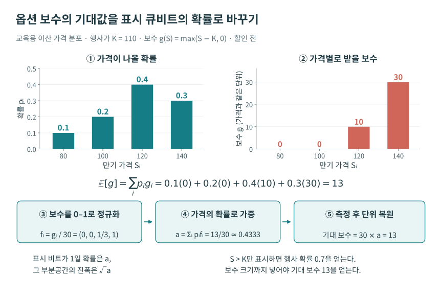
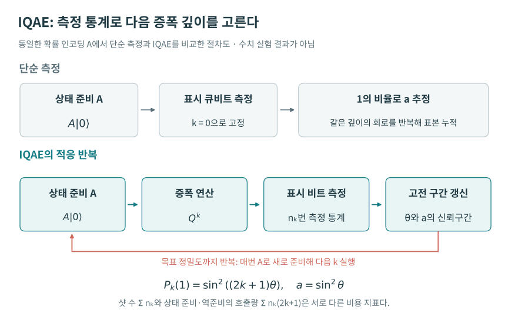

# 04. 금융 업무를 양자 알고리즘으로 옮기는 방법

**대상 세션:** Classiq Quantum Office Hours: Quantum Computing for Finance — From Use Case to Application  
**행사:** 2026년 8월 27일 · **다시보기 공개:** 2026년 10월 20일 · **길이:** 44분 48초  
**발표·진행:** Dr. Erik Garcell, Director of Quantum Solutions Architecture; Dr. John (Jack) Glennon, Quantum Applications Engineer  
**정리 기준:** 2026년 10월 22일. 공식 다시보기의 영어 자동자막 전 구간, 공식 행사 소개, 주요 알고리즘의 원 논문과 공식 문서를 대조했다. 시각은 녹화물 상대시각이다. 실제 발언, 수학적 보충, 발언의 교정과 미확정 사항을 구별한다. 코드·데이터·QPU 성능은 독립 재현하지 않았다.

[공식 다시보기](https://www.youtube.com/watch?v=diJa_JRJ2F8) · [공식 행사 소개](https://get.classiq.io/office-hour-webinars/quantum-computing-for-finance/)

## 이 세션의 중심 질문

금융 기관이 양자를 검토할 때 “어느 양자 알고리즘을 쓸 것인가”부터 시작하면 업무의 목적과 구현이 어긋날 수 있다. 이 회차는 **업무 문제 → 수학적 정식화 → 양자 계산의 적합성 → 알고리즘과 하드웨어 선택**의 순서를 제안한다. Asian option pricing과 자금세탁 탐지를 예로 들고, 후반에는 European call option의 기대 보수를 QAE로 추정하는 원리를 설명한다.

이 회차는 금융 전반에서의 양자 우위를 실험으로 입증한 발표가 아니다. 과제 선택의 절차, 알고리즘의 이론적 질의 복잡도, Classiq로 모델을 작성·합성하는 방법, GPU를 활용한 양자 회로 모사 결과가 한 영상에 들어 있다. 각 결과가 무엇을 측정하는지 구별해야 뒤의 수치도 올바르게 읽을 수 있다.

## 1. 회차의 전개와 다시보기 길잡이

| 다시보기 | 내용 | 핵심 질문 |
|---|---|---|
| [00:06–05:26](https://www.youtube.com/watch?v=diJa_JRJ2F8&t=6s) | 발표자·플랫폼 소개, 청중 경험 설문 | 누가 어떤 단계에서 이 도구를 쓰는가? |
| [05:29–07:25](https://www.youtube.com/watch?v=diJa_JRJ2F8&t=329s) | 금융 활용 동기, 시장 보고서와 역량 준비 | 장기 전망과 이미 달성한 결과를 구별할 수 있는가? |
| [07:27–13:57](https://www.youtube.com/watch?v=diJa_JRJ2F8&t=447s) | 업무에서 알고리즘으로 옮기는 4단계, 세 문제군 | 우리 문제가 실제로 어떤 계산인가? |
| [14:00–18:43](https://www.youtube.com/watch?v=diJa_JRJ2F8&t=840s) | 첫 Q&A 세 질문 | 가속기 비유, QAOA 우위, 필요한 논리 큐비트 |
| [18:48–23:07](https://www.youtube.com/watch?v=diJa_JRJ2F8&t=1128s) | Asian option, IQAE, Brownian motion·Karhunen–Loève 사례 | 경로의 기대 보수를 어떻게 표현하는가? |
| [23:19–24:15](https://www.youtube.com/watch?v=diJa_JRJ2F8&t=1399s) | AML의 표·그래프 표현과 quantum kernels | 동일한 업무라도 데이터 표현이 어떻게 달라지는가? |
| [24:18–32:14](https://www.youtube.com/watch?v=diJa_JRJ2F8&t=1458s) | 두 번째 Q&A 두 질문 | 모델 의도 보존, 고전 최적화와의 비교 |
| [32:16–35:24](https://www.youtube.com/watch?v=diJa_JRJ2F8&t=1936s) | 양자 적용의 적합성·한계, 정리 | 모든 금융 문제에 양자를 넣어야 하는가? |
| [35:25–40:59](https://www.youtube.com/watch?v=diJa_JRJ2F8&t=2125s) | European call·QAE·IQAE, GPU 가속 사례 | 기대 보수를 확률로 옮긴 뒤 무엇을 추정하는가? |
| [41:03–43:23](https://www.youtube.com/watch?v=diJa_JRJ2F8&t=2463s) | AI 플러그인으로 두 연결성·게이트 집합의 합성 비교 | 실행할 하드웨어를 어떻게 선택하는가? |
| [43:25–44:43](https://www.youtube.com/watch?v=diJa_JRJ2F8&t=2605s) | 가속 결과 회고, 종료 | 성능 주장의 조건은 무엇인가? |

## 2. 업무 요구를 네 단계로 분해하기

### 2.1 먼저 업무에서 바뀌어야 할 값을 정한다

[09:19–10:26](https://www.youtube.com/watch?v=diJa_JRJ2F8&t=559s)에서 Erik은 비용이 크거나 경쟁력이 필요한 실제 업무를 골라 수학 문제로 바꾸는 과정을 설명한다. “포트폴리오를 개선한다”만으로는 계산이 정해지지 않는다. 기대 수익, 위험, 거래 비용 중 무엇을 목적함수에 넣을지, 얼마의 시간과 어느 정도의 오차를 허용하는지 정해야 한다.

**필기자 보충 예.** “주어진 예산에서 30개 종목을 고르며 변동성을 줄인다”는 요구라면 이진 선택 변수 `z_i∈{0,1}`, 수익률 벡터 `μ`, 공분산 행렬 `Σ`, 선택 수 제약 `Σ_i z_i=30` 같은 구조가 생긴다. 반면 “이미 정한 포트폴리오의 손실분포에서 99% 분위수를 계산한다”는 요구는 기대값·확률·분위수 추정으로 옮겨 간다. 둘 다 금융이라는 이유만으로 같은 양자 알고리즘을 선택하지 않는다.

### 2.2 업무 이름을 수학 구조로 바꾼다

[11:24–13:45](https://www.youtube.com/watch?v=diJa_JRJ2F8&t=684s)의 주된 구분은 다음과 같다. 발표자는 이것이 완전한 목록이 아니고, 같은 업무가 여러 방식으로 정식화될 수 있다고 덧붙인다.

| 수학 문제군 | 발표에서 든 업무 | 발표에서 연결한 접근 | 실제로 확인할 조건 |
|---|---|---|---|
| 조합 최적화 | 포트폴리오 선택, 자산 배분, 거래 실행 | QAOA 등 변분·혼합 접근 | 이산 변수·제약 구조, 고전 solver 성능, 해 품질 |
| 통계적 샘플링·적분 | 파생상품 가격, 위험 평가, 신용 위험, 스트레스 테스트 | QAE·IQAE 등 | 분포 준비·보수 함수 비용, 오차·신뢰수준, 회로 깊이 |
| 분류·이상 탐지 | 신용 점수, 자금세탁·사기 탐지 | quantum kernel 등 | 데이터 인코딩, 학습 표본, 강한 고전 기준과 일반화 |

이 표는 **후보를 고르는 지도**다. 특정 업무 이름 옆에 양자 알고리즘 이름을 놓았다고 해서 우위가 확보되는 것은 아니다.

### 2.3 양자에 적합한 부분과 고전에 남길 부분을 가른다

[10:03–11:23](https://www.youtube.com/watch?v=diJa_JRJ2F8&t=603s)에서 발표자는 양자가 노트북 전체를 대체하는 것이 아니라 특정 종류의 계산에 쓰이는 연산 장치라는 관점을 권한다. [32:16–35:24](https://www.youtube.com/watch?v=diJa_JRJ2F8&t=1936s)에서는 모든 문제를 양자 하드웨어에 넣는 것이 적절하지 않으며, 데이터·수학 구조·하드웨어를 함께 봐야 한다고 다시 설명한다.

**필기자 검토.** 이 원칙은 타당하지만, 영상의 “NP-hard이면 양자에 적합하다”, “고차원 데이터이면 양자 ML이 더 잘 구분한다”는 표현은 충분조건이 아니다. 실제 비교에는 입력 로딩, 학습·최적화, 측정 횟수, 통신·대기, 결과 오차까지 들어간다. 특히 고전 알고리즘의 실패가 관측됐더라도 양자 방법의 성공이 자동으로 따라오지 않는다.

### 2.4 목표 하드웨어에 맞는 알고리즘을 고른다

영상은 NISQ, 초기 내결함성, 완전 내결함성의 세 시기를 구별한다. NISQ에서는 짧은 변분 회로와 고전 피드백을 활용하고, 더 긴 coherent 연산이 필요한 알고리즘은 오류 수정이 가능한 하드웨어를 염두에 둔다는 취지다. [10:52–11:23](https://www.youtube.com/watch?v=diJa_JRJ2F8&t=652s)에 나오는 2028–2030 같은 연도는 **발표자의 당시 미래 전망**이며 이 노트가 검증한 출시 일정이 아니다.

기업의 후속 작업은 “몇 큐비트짜리 장치가 나오면 된다”보다 구체적이어야 한다. 입력 크기·정밀도·허용 오류를 정한 모델을 합성하고, logical width·depth·비Clifford 자원과 오류 정정 비용 등 필요한 지표를 계산해야 한다. 영상도 입력 데이터와 허용오차에 따라 요구 큐비트 수가 달라진다고 Q&A에서 강조한다. 논리 큐비트와 물리 큐비트를 같은 수로 읽지 않는다.

## 3. 사례 A: Asian option은 왜 경로의 적분 문제인가

[18:48–20:34](https://www.youtube.com/watch?v=diJa_JRJ2F8&t=1128s)에서 첫 사례로 Asian option pricing을 든다. 만기 한 시점의 가격만 보는 European option과 달리, Asian option의 보수는 여러 관측시점의 평균 가격에 의존한다. 따라서 “하나의 가격을 준비하고 보수를 계산”하는 것을 넘어 **확률적 경로 전체 또는 그 요약량**을 다루어야 한다.

다음 식은 영상을 이해하기 위한 **필기자 보충**이다. 관측 가격이 `S_{t_1},…,S_{t_L}`이고 행사가가 `K`일 때 산술평균 Asian call의 단순한 보수는

\[
\bar S=\frac1L\sum_{\ell=1}^{L}S_{t_\ell},\qquad
g=\max(\bar S-K,0),\qquad
V_0=e^{-rT}\mathbb E_{\mathbb Q}[g]
\]

이다. `r`은 이 식에서 가정한 상수 무위험 이자율, `T`는 만기, `Q`는 가격 모형에 맞는 위험중립 측도를 뜻한다. 이 식은 투자 전략을 추천하는 식이 아니라, 영상의 “업무를 기대값 추정으로 바꾼다”는 설명을 구체화한 것이다.

예를 들어 geometric Brownian motion을 가정하면

\[
S_t=S_0\exp\left((r-\tfrac12\sigma^2)t+\sigma W_t\right)
\]

로 경로를 표현한다. 여기서 `W_t`는 Brownian motion, `σ`는 변동성이다. 양자 계산에서는 분포를 양자 상태에 준비하고, 각 경로의 평균과 보수를 가역적으로 계산한 다음, 보수의 기대값을 특정 큐비트의 측정확률로 옮기는 절차가 필요하다. QAE는 그 확률 추정을 가속할 후보이지 경로 준비와 산술 비용을 삭제하는 연산은 아니다.

### Karhunen–Loève 확장과 차원 줄이기

[21:46–23:07](https://www.youtube.com/watch?v=diJa_JRJ2F8&t=1306s)에서 Erik은 J.P. Morgan 연구진의 *Quantum option pricing via the Karhunen–Loève expansion*을 구현한 경험과 Brownian·fractional Brownian motion을 Asian option 절차에 연결한 예를 소개한다. 자동자막에서 논문명과 `Brownian`, `Chebyshev`가 깨져 있어 제목은 원 논문과 대조했다. [Prakash 외, arXiv:2402.10132](https://arxiv.org/abs/2402.10132).

**필기자 보충.** KL 확장은 확률 과정을 적절한 기저 함수와 확률 계수들의 합으로 나타내고 유한 개 항으로 절단하는 방법이다. 경로의 모든 시점을 독립적인 숫자로 저장하기보다 구조를 이용할 수 있지만, 절단 오차·시간 이산화·숫자 표현·분포 로딩의 비용이 생긴다. 원 논문은 관측시점 수 `T`와 오차 `ε`를 구별한 복잡도를 분석하며, 그 논문의 전체 옵션 가격 알고리즘을 단순히 “`1/ε` 비용”으로 요약할 수 없다. QAE의 질의 복잡도와 응용 전체의 복잡도는 다르다.

fractional Brownian motion을 넣었다는 발표도 모형의 정당성과 별개의 구현 사례다. 금융 가격 계산에서 표준 Brownian 모형을 그대로 대체해도 되는지, 위험중립 가격이 어떻게 정의되는지는 별도 모형 검토가 필요하다. 이 영상에서는 그 가정까지 전개하지 않는다.

## 4. 사례 B: 자금세탁 탐지는 표현부터 달라진다

[23:19–24:15](https://www.youtube.com/watch?v=diJa_JRJ2F8&t=1399s)에서 두 번째 사례로 AML을 든다. 동일한 거래 자료도 행이 거래인 표로 쓸 수 있고, 계좌·거래관계를 그래프로 만들 수도 있다. 발표자는 이상 거래의 경로나 구조를 찾는 최적화, 또는 그래프에서 비정상 패턴을 분류하는 머신러닝 방식이 가능하며 quantum kernel을 자주 본다고 설명한다.

**필기자 보충.** kernel 방식의 한 예는 데이터를 상태 `|φ(x)⟩`로 인코딩하고

\[
k(x,x')=|\langle\phi(x)|\phi(x')\rangle|^2
\]

같은 유사도를 측정한 뒤 고전 분류기에 주는 것이다. 이 경우 핵심은 “공간이 고차원이다”가 아니라, 선택한 특징맵이 업무에 필요한 차이를 보존하고 일반화에 도움이 되는가이다. 거짓 양성, 데이터 누수, 클래스 불균형, kernel 추정 오차와 학습 표본의 관계를 비교해야 한다. 이 식과 평가 항목은 노트의 보충이며 영상에서 AML 정확도·재현율·QPU 우위 수치가 제시된 것은 아니다. 관련 공식 예제는 [Classiq Quantum Kernels and Support Vector Machines](https://docs.classiq.io/explore/applications/finance/credit_card_fraud/credit_card_fraud)에서 확인할 수 있다.

## 5. European call에서 QAE의 역할을 단계별로 이해하기

[35:25–40:59](https://www.youtube.com/watch?v=diJa_JRJ2F8&t=2125s)에 Jack은 옵션 가격 사례로 알고리즘을 구체화한다. 영상의 설명 순서는 분포와 payoff, 고전 Monte Carlo 오차, QAE의 확률 인코딩, Grover 회전, 추정, canonical QAE와 IQAE의 차이다.

### 5.1 분포와 보수를 구분한다

European call의 보수는 만기 자산가격 `S_T`에 대해

\[
g(S_T)=\max(S_T-K,0)
\]

이다. 영상에서는 `ln S_T`가 정규분포를 따른다는 lognormal 가격 모형을 설명한다. **자산가격 자체가 정규분포를 따른다**고 바꾸면 음수 가격을 허용하는 다른 모형이 된다. [36:21–36:59](https://www.youtube.com/watch?v=diJa_JRJ2F8&t=2181s).

필기자 보충으로 이산화한 가격을 `s_j`, 그 확률을 `p_j`라고 놓자. `Σ_j p_j=1`이어야 한다. 유한 구간에서 `0≤g(s_j)≤C`가 되도록 상수 `C`를 정하고 `f_j=g(s_j)/C∈[0,1]`로 정규화한다. 분포와 보수를 준비하는 연산 `A`는 개념적으로

\[
A|0\rangle
=\sum_j\sqrt{p_j}|j\rangle
\left(\sqrt{1-f_j}|0\rangle+\sqrt{f_j}|1\rangle\right)
\]

을 만든다. 마지막 큐비트가 `1`일 확률은

\[
a=\sum_jp_jf_j=\frac{\mathbb E[g]}C,
\qquad V_0\approx e^{-rT}C a
\]

이다. 이 상태 준비와 payoff 인코딩을 한 덩어리로 보고 QAE가 `a`를 추정한다. `a`는 **측정확률**이다. 상태벡터에서 좋은 부분공간에 붙는 진폭은 `√a`이므로 두 값을 혼용하지 않는다. 옵션 가격의 단위는 `C`와 할인 계수를 다시 곱할 때 복원된다. 이 수식은 발표의 “expected value를 amplitude에 넣는다”는 표현을 엄밀하게 풀어 쓴 노트다. [Brassard 외](https://arxiv.org/abs/quant-ph/0005055), [Classiq 옵션 가격 공식 예제](https://docs.classiq.io/latest/explore/applications/finance/option_pricing/option_pricing/).

### 5.2 good/bad 상태는 payoff가 0인지 여부만을 세는 것이 아니다

영상 [37:34–38:35](https://www.youtube.com/watch?v=diJa_JRJ2F8&t=2254s)은 good·bad 상태를 이용해 설명한다. 위 식에서 good은 마지막 보조 큐비트가 `1`인 부분공간이다. 경로·가격별로 그 큐비트가 `1`일 **확률을 보수 크기에 비례**하게 해야 평균 보수를 얻는다. 단순히 `S_T>K`인지만 표시하면 추정되는 것은 옵션이 행사될 확률이지 기대 보수 자체가 아니다.

이 차이는 코드 검토에서 중요하다. oracle이 `price>strike`라는 비교만 하는지, `max(price-strike,0)`의 크기를 정규화해 넣는지 확인해야 한다. 분포와 payoff를 별도 함수로 구성하는 고수준 모델은 이 검토를 쉽게 하지만 정규화와 자료형의 의미까지 자동 보증하지는 않는다.

아래의 작은 교육 예에서는 같은 가격별로 확률과 지급액을 짝지어 읽는다. 행사가 110일 때 가격 120과 140에서 각각 10과 30을 지급하므로, 행사될 확률 0.7과 기대지급액 13은 다른 양이다. 이 입력의 전체 손계산은 [보충 해설](../technical-companion.md)에서 이어서 확인할 수 있다.

그림 4-1. **지급액의 크기까지 표시 비트의 확률에 넣는다.** 위 두 패널은 같은 네 가격의 확률과 지급액이며 아래는 지급액을 30으로 나눠 정규화하고 확률로 가중한 뒤 단위를 복원하는 순서다. 마지막 비트가 1일 확률은 13/30이고 그 부분공간의 진폭은 그 제곱근이다. 실제 시장 데이터나 발표의 64점 로그정규 예제를 그린 것이 아닌 독립 손계산 도식이다.

### 5.3 Grover 연산은 미지의 확률을 각도로 바꾸어 읽게 한다

정규화된 상태를

\[
A|0\rangle=\cos\theta|B\rangle+\sin\theta|G\rangle,
\qquad a=\sin^2\theta
\]

라고 놓자. 적절한 반사들의 곱으로 만든 Grover 연산 `Q`를 `k`회 적용한 뒤 마지막 큐비트를 측정하면

\[
P_k(1)=\sin^2((2k+1)\theta)
\]

를 얻는다. 더 큰 `k`는 `θ`에 대한 변화에 더 민감하지만 사인 제곱의 주기성 때문에 가능한 각도가 여러 개 생긴다. IQAE는 앞서 얻은 신뢰구간을 이용해 다음 `k`를 고르고 각도 범위를 좁힌다. 단순히 무조건 큰 `k`를 선택하거나 모든 회로의 결과를 동일하게 평균하는 알고리즘은 아니다. 이 부분은 발표의 회전 그림을 수식으로 재구성한 설명이다. [Grinko 외, Iterative Quantum Amplitude Estimation, §II–III](https://arxiv.org/abs/1912.05559).

### 5.4 Canonical QAE와 IQAE는 무엇을 교환하는가

| 방식 | 영상의 설명 | 이해를 위한 보충 |
|---|---|---|
| Canonical QAE | 보조 레지스터와 깊은 회로를 사용하는 QPE 기반 접근 | controlled Grover powers와 역 QFT가 필요하고 위상을 측정해 `a`로 변환 |
| IQAE | 여러 Grover 거듭제곱 회로의 실행·측정 통계와 고전 후처리를 반복 | QPE용 보조 레지스터·역 QFT를 피하지만 고차 Grover 회로의 깊이와 순차적 적응 비용은 남음 |

[38:35–40:03](https://www.youtube.com/watch?v=diJa_JRJ2F8&t=2315s). 영상은 고수준 Qmod의 payoff 함수와 IQAE 내장 함수를 연결하는 예를 든다. 정확한 모델을 간결하게 쓰고 합성·실행 단계를 재사용하는 개발상의 이점이다. IQAE가 canonical 방식보다 필요한 일부 자원을 줄인다는 사실만으로 대규모 금융 업무가 현재 noisy QPU에서 유리하게 실행된다고 결론내릴 수 없다.

그림 4-2. **IQAE에서 고전 피드백은 무엇을 바꾸는가.** 위는 같은 확률 인코딩을 증폭 없이 반복 측정하는 경로이고, 아래는 측정 통계로 다음 Grover 반복 횟수 k를 고르는 경로다. 매 회로는 상태를 새로 준비한다. 한 샷 안에 들어가는 준비·역준비 호출량이 깊이에 따라 달라지므로 샷 수와 질의 수를 따로 센다. IQAE 원리의 설명용 재구성이며 특정 성능 측정값을 그리지 않았다.

### 5.5 Monte Carlo와 QAE의 오차 차수를 정확히 읽기

[19:47–20:24](https://www.youtube.com/watch?v=diJa_JRJ2F8&t=1187s)의 Erik 발언에는 고전 Monte Carlo를 `1/N²`처럼 말하는 부분이 있다. 뒤이어 “오차를 절반으로 줄이려면 고전에서는 4배, 양자에서는 2배”라고 설명하며, Jack은 [36:44–37:30](https://www.youtube.com/watch?v=diJa_JRJ2F8&t=2204s)에서 올바른 `1/√M` 대 `1/M` 차수를 말한다. 이 노트는 다음과 같이 교정한다.

유한한 분산 `σ_g²`를 갖는 독립 표본의 평균에 대해

\[
\operatorname{RMSE}(\widehat{\mathbb E[g]})=\frac{\sigma_g}{\sqrt{N}}.
\]

따라서 목표 오차 `ε`를 맞추는 데 일반적인 Monte Carlo는 `N=O(ε^{-2})`개의 표본이 필요하다. 이상적인 QAE는 oracle 질의 수를 세면 `O(ε^{-1})`이고, IQAE에는 신뢰도·정밀도에 따른 로그 인자가 붙는다. **오차율은 `N^{-1/2}` 대 `N^{-1}`**, **오차를 맞추는 비용은 `ε^{-2}` 대 `ε^{-1}`**이다. 두 표현을 뒤섞으면 영상의 잘못된 지수 표현이 나온다. [Grinko 외, §I–III](https://arxiv.org/abs/1912.05559).

또한 영상의 “100만 표본 대 약 1천”은 차수를 직관적으로 보여 주는 예다. 같은 가격 오차·신뢰수준·상수·oracle 비용을 맞춘 실측 시간 비교가 아니다. QAE의 `Q^k` 한 회로는 `k`번의 Grover 연산과 상태 준비·역연산을 포함하므로, shot 수와 oracle 질의 수를 동일시하지 않는다.

마지막으로 실제 가격 오차는 추정 통계만으로 결정되지 않는다. 분포 꼬리 절단, 가격·시간 격자, payoff 근사·고정소수점, QAE 통계, 실제 장치의 오류가 각각 기여한다. 추정 오차만 줄여도 모형과 이산화 오차는 남는다.

## 6. Classiq 합성과 GPU 가속 사례의 정확한 범위

### 고수준 모델에서 하드웨어별 회로 비교로

[41:03–42:42](https://www.youtube.com/watch?v=diJa_JRJ2F8&t=2463s)에서 Jack은 이미 있는 European call 예제를 대상으로 “나머지는 유지하고 두 종류 하드웨어에 맞춰 합성하며 네이티브 2큐비트 게이트 수를 줄여 달라”고 AI 플러그인에 요청한다. 하나는 all-to-all 연결과 `RX, RZ, RXX` 게이트 집합, 다른 하나는 heavy-hex 연결과 다른 게이트 집합이다. 코드에 연결성·transpilation 옵션·최적화 목표를 넣어 결과를 비교하는 과정을 설명한다.

여기서 비교하는 대상은 **동일한 옵션 가격 모델의 하드웨어별 컴파일 결과**다. 실제 두 QPU에서 옵션 가격을 측정해 정확도·비용까지 평가했다는 보고는 아니다. 2큐비트 게이트 수는 유용한 비용 지표지만 vendor의 요금이 언제나 그 개수만으로 결정된다는 뜻도 아니다. 샷·태스크·시간·장치별 과금 기준은 별도로 확인해야 한다.

### 77–120배는 무엇의 가속인가

[40:23–40:59](https://www.youtube.com/watch?v=diJa_JRJ2F8&t=2423s)에서 Classiq Qmod 모델을 합성해 CUDA-Q kernel에 통합하고 Oracle Cloud Infrastructure에서 실행한 사례를 소개한다. 발표자는 28·29 qubit 예에서 일반적인 CPU workflow에 비해 **77–120배** 가속을 보고하며 GPU에서 양자 회로와 고전 로직을 처리한다고 설명한다. 이 값은 **고전 컴퓨터가 양자 계산을 모사하는 워크플로의 CPU/GPU 비교**다. QPU가 고전 옵션 가격 solver를 이긴 결과가 아니다.

[43:25–43:49](https://www.youtube.com/watch?v=diJa_JRJ2F8&t=2605s)의 회고에는 “60여 분에서 2분 반”이라는 다른 시간 표현도 나온다. 같은 문제 크기·동일한 비교 기준인지 이 세션의 자막만으로 확인할 수 없으므로 두 표현을 한 계산으로 합치거나 그 비율을 검증값으로 쓰지 않는다. 상세 조건과 후속 데모는 10월 15일 Classiq·NVIDIA 회차에서 따로 검토한다.

## 7. 실제 청중 Q&A — 발표자의 답변과 학술 검토를 나누어 기록

아래 다섯 질문은 진행자가 녹화물에서 읽어 준 청중 질문이다. 한국어는 발화의 요약이며 직접 인용이 아니다. 채팅에 있었지만 읽지 않은 질문이나 종료 뒤의 답변은 이 자료에서 확인하지 않았다.

### Q1. 양자는 GPU처럼 특정 계산에 쓰는 도구인가?

[14:09–15:02](https://www.youtube.com/watch?v=diJa_JRJ2F8&t=849s)

**발표자의 답변:** CPU·GPU에 QPU가 더해지는 것으로 생각하면 유용하며, 개발자는 어떤 수학 문제에 어떤 장치를 사용할지 알아야 한다. Jack도 동의한다.

**필기자 보충:** 이것은 연산 자원을 선택하는 실무적 비유다. GPU는 고전 계산을 병렬화하고 QPU는 양자 상태·간섭·측정을 사용하므로 계산 모형까지 같은 것은 아니다. 뒤 [31:34–32:14](https://www.youtube.com/watch?v=diJa_JRJ2F8&t=1894s)에서 Jack도 이 차이를 강조한다.

### Q2. 최적화에서 QAOA가 고전 방법보다 나을 것으로 기대할 근거가 있는가?

[15:12–16:33](https://www.youtube.com/watch?v=diJa_JRJ2F8&t=912s)

**발표자의 답변:** 활발한 논쟁 대상이라고 인정한다. QAOA의 알고리즘 구조는 유망하지만 고전 파이프라인에 넣으면 overhead 때문에 이점이 사라질 수 있다고 설명하고, Grover mixer·반복·확률적 변형 등도 검토할 수 있다고 답한다. 동시에 “최적화 전반에서 양자 이점이 분명해질 것”이라는 강한 기대를 말한다.

**필기자 검토:** QAOA는 조합 최적화의 **근사 해**를 찾는 변분 알고리즘이다. 제한된 문제군의 이론 결과와 모든 금융 문제에 대한 실용 우위는 다르다. 원 논문도 문제·깊이 `p`에 따른 성능을 다룬다. 이 영상에는 강한 고전 solver와 동등 조건으로 비교해 금융 업무의 end-to-end 이점을 입증한 QAOA 결과가 없다. 발표자의 전망은 검증된 보편적 결론으로 옮기지 않는다. [Farhi·Goldstone·Gutmann, A Quantum Approximate Optimization Algorithm](https://arxiv.org/abs/1411.4028).

### Q3. 가장 적은 논리 큐비트로 이점을 얻을 금융 용도는 무엇인가?

[16:44–18:43](https://www.youtube.com/watch?v=diJa_JRJ2F8&t=1004s)

**발표자의 답변:** 단일 답은 없다. 알고리즘 종류뿐 아니라 기관별 입력 데이터, 구현 방식, 필요한 결과 정확도가 큐비트 수를 바꾼다. 우선순위가 높은 문제를 고르고 실제 모델을 합성해 입력 크기·정확도에 따른 자원 변화를 살펴보라고 권한다. 오차를 더 허용하면 필요한 자원이 줄어드는 경우가 있다고 설명한다. Jack은 뒤의 사례에서 하드웨어 선택을 다루겠다고 덧붙인다.

**학습 포인트:** “자산이 몇 개면 몇 큐비트”라는 표는 인코딩과 정밀도가 정해졌을 때만 의미가 있다. 논리 qubit 수만 줄이는 것이 전체 실행 비용을 최소화하는 것과 같지도 않다.

### Q4. 자동화된 합성이 구현을 크게 바꿀 때 원래 의도와 권한은 어떻게 보존하는가?

[24:45–27:52](https://www.youtube.com/watch?v=diJa_JRJ2F8&t=1485s)

**발표자의 답변:** 높은 수준의 수학적 모델을 한 번 작성해 두면 하드웨어가 바뀌어도 그 모델을 보존하면서 다시 컴파일할 수 있다고 설명한다. 입력 크기·정밀도와 실행할 하드웨어를 바꿀 수 있으며, 하드웨어 발전에 따라 알고리즘 자체를 바꿀 필요가 생길 수는 있다고 덧붙인다.

**질문과 답변의 간격:** 원 질문에는 자동화 과정에서의 **의도와 권한(authority)** 보존이 함께 들어 있다. 답변은 주로 하드웨어 변화에 대한 모델 재사용·이식성을 설명한다. 누가 변경을 승인하는지, agent가 허용된 범위만 수정하는지, 컴파일 전후 동등성을 어떻게 검증하는지에 대한 구체적 통제 절차까지 제시하지는 않았다. 따라서 “권한 보존 문제를 해결했다”로 요약하지 않는다. 고수준 모델은 검토할 명세를 제공하지만 거버넌스의 충분조건은 아니다.

### Q5. 양자 포트폴리오 최적화는 Gurobi 같은 고전 solver와 무엇이 다른가?

[28:06–32:14](https://www.youtube.com/watch?v=diJa_JRJ2F8&t=1686s)

**발표자의 답변:** 고전 연속·볼록 포트폴리오 문제와, 종목 수·섹터 한도·turnover 같은 이산 제약이 붙은 조합 문제를 구분한다. 수천 종목 중 일부를 고르는 경우의 탐색 공간이 크다는 점을 강조하며, 오늘의 양자 하드웨어에서는 작은 문제를 다루고 미래에 필요한 규모·정확도를 자원 분석으로 정하라고 권한다. “약 20–30 assets”라는 수치도 당시 규모를 설명하며 제시하지만 특정 인코딩·회로 조건을 밝힌 보편 한계는 아니다.

**필기자 교정 1 — branch-and-bound는 exact 해를 못 주는 휴리스틱만이 아니다.** 영상에는 branch-and-bound가 정확한 해를 주지 못한다는 취지의 설명이 있다. 이는 잘못이다. branch-and-bound는 유효한 상·하한으로 가지를 제거하며 충분한 계산을 마치면 모델에 대해 최적성을 증명할 수 있는 방법이다. 실무 solver는 수치 허용오차와 MIP gap을 사용하고, 시간 제한으로 중단하면 incumbent와 bound의 gap을 보고한다. 어려운 인스턴스에서 시간이 많이 든다는 사실과 정확한 해의 증명이 불가능하다는 주장은 다르다. [Gurobi의 branch-and-bound 설명](https://www.gurobi.com/resources/blog/mixed-integer-programming-an-introduction-to-the-basics), [Gurobi MIPGap 문서](https://support.gurobi.com/hc/en-us/articles/8265539575953-What-is-the-MIPGap).

**필기자 교정 2 — 중첩에서 모든 후보를 읽어 최적해를 고르는 것은 아니다.** 영상은 모든 가지를 동시에 조사한 뒤 좋은 가지를 고른다는 비유를 쓴다. 양자 상태에 많은 후보의 진폭을 둘 수는 있지만 측정 한 번으로 모든 후보의 목적값을 얻을 수 없다. QAOA는 비용·mixer 연산과 고전 매개변수 최적화를 통해 좋은 해가 나올 확률을 높이는 방식이다. 중첩 자체가 NP-hard 문제를 일반적으로 효율적으로 푼다는 증거가 아니다. [Farhi 외 원 논문](https://arxiv.org/abs/1411.4028).

**필기자 교정 3 — NP-hard는 개별 인스턴스가 모두 불가능하다는 뜻이 아니다.** 최악의 경우에 대한 복잡도 성격이며, 구조·제약·데이터에 따라 고전 solver가 큰 문제를 빠르게 풀 수 있다. 공정한 비교에는 동일한 금융 목적함수·제약·허용 gap·시간 제한·데이터로 얻은 고전 기준값이 필요하다.

## 8. 회차 앞부분의 전망 수치와 후기 사례를 읽는 기준

[05:29–07:25](https://www.youtube.com/watch?v=diJa_JRJ2F8&t=329s)에서 Erik은 컨설팅 보고서를 들어 금융이 초기 활용 분야이며 큰 경제적 가치가 기대된다고 설명하고, 수천억 달러 규모를 언급한다. 이 노트에서는 원 보고서의 범주·예측연도·시나리오를 별도 검증하지 않았으므로 **미래 시장 전망을 인용한 발표 내용**으로만 기록한다. 이미 실현된 매출이나 이 회차가 입증한 수익으로 쓰지 않는다.

[35:35–36:16](https://www.youtube.com/watch?v=diJa_JRJ2F8&t=2135s)에는 여러 고객 협업 사례를 짧게 소개한다. 이 목록은 사용 분야를 알려 주지만 각 사례의 장치·정확도·고전 기준·실행 규모가 이 자리에서 모두 제시되지는 않는다. 특히 “고객 협업”, “컴파일 가능”, “GPU 모사에서 가속”, “실제 QPU에서 업무 우위”는 서로 다른 수준의 결과다.

## 9. 복습 문제와 풀이 — 노트 작성자가 추가

아래는 녹화물의 실제 청중 질문이 아니다. 금융 모형과 알고리즘의 연결을 확인하는 연습이다.

### 문제 1. 보수 크기를 인코딩하지 않으면 무엇을 추정하는가?

가격 `S∈{80,100,120}`, 확률 `(0.2,0.5,0.3)`, 행사가 `K=100`이라고 하자. 할인은 생략한다. `C=20`으로 정규화할 때 QAE가 추정할 `a`와 옵션 기대 보수는 얼마인가? 단순 비교 `S>K`의 확률과 왜 다른가?

**풀이.** 보수는 `(0,0,20)`, 정규화 보수는 `(0,0,1)`이므로 `a=0.3`, 기대 보수는 `C a=6`이다. 이 예에서는 보수가 양수인 경우의 크기가 모두 `C`여서 행사 확률과 `a`가 우연히 같다. 가격을 `{80,110,120}`으로 바꾸면 보수는 `(0,10,20)`, 정규화 보수는 `(0,0.5,1)`이고 `a=0.5×0.5+0.3=0.55`, 기대 보수는 `11`이다. 행사 확률은 `0.8`이므로 비교 oracle만으로 가격을 얻을 수 없다.

### 문제 2. 정확도를 2배 높이면 필요한 계산은 몇 배인가?

동일한 분산·신뢰수준 조건에서 목표 오차를 `ε`에서 `ε/2`로 줄인다. 고전 Monte Carlo와 이상적인 QAE의 주요 비용은 각각 몇 배가 되는가?

**풀이.** `ε^{-2}`는 4배, `ε^{-1}`는 2배가 된다. IQAE는 로그 인자와 상수가 있어 정확히 2배라고 단정할 수 없고, 실제 시간에는 더 깊어진 회로와 상태 준비 비용도 들어간다. 이는 오차를 반으로 줄이는 비교이며 신뢰수준을 두 배로 만든다는 뜻이 아니다.

### 문제 3. 1,000 shots이면 QAE 비용도 1,000인가?

서로 다른 `k`에 대해 `Q^kA` 회로를 실행하고 각 회로를 `n_k`회 측정한다. 단순한 Grover 질의 총량은 무엇이며, 왜 shots 합과 다른가?

**풀이.** Grover 연산 호출 수만 세면 `Σ_k n_k k`다. `A`와 `A†`의 호출까지 세는 표기에서는 각 `Q`의 구성을 반영해 대략 `Σ_k n_k(2k+1)` 형태의 상태 준비 비용을 세게 된다. 반면 shot 수는 `Σ_k n_k`다. 큰 `k`를 쓰는 회로는 한 shot도 길고 비싸다. 사용하는 논문의 query 정의를 먼저 맞추어 비교해야 한다.

### 문제 4. QAE 오차 `δa`는 가격 오차로 어떻게 바뀌는가?

`V_0=e^{-rT}Ca`이고 `C=200`, `e^{-rT}=0.95`라고 하자. 가격의 추정 오차를 `0.19` 이하로 제한하려면 확률의 추정 오차를 얼마 이하로 해야 하는가?

**풀이.** `|δV|=e^{-rT}C|δa|=190|δa|`이므로 `|δa|≤0.001`이다. 이는 분포 절단·이산화·payoff 구현 오차를 제외한 추정 오차 배정이다. 전체 가격 오차 한도가 `0.19`라면 이들 항에도 예산을 나누어야 한다.

### 문제 5. 100종목 중 10종목을 선택하면 왜 10큐비트로 충분하지 않은가?

**풀이.** 각 종목을 선택할지 나타내는 단순 이진 인코딩에는 100개 결정 변수가 필요하며 100개의 데이터 큐비트가 출발점이 된다. 제약을 구현하는 보조 큐비트나 다른 인코딩의 비용이 더해질 수 있다. 압축 인코딩으로 상태 수를 줄일 수도 있지만 상태 준비·mixer·목적함수 구현이 달라진다. “선택할 종목 수”와 “결정 변수 수”는 같지 않다.

### 문제 6. 같은 금융 문제를 공정하게 비교하려면 어떤 실험을 설계해야 하는가?

**풀이.** 공개 가능한 동일 데이터와 목적함수·제약을 고정하고, 강한 고전 solver·시뮬레이터·가능한 QPU를 구별한다. 해의 목적값·제약 위반·오차·신뢰수준과 wall-clock time·컴파일·대기·고전 후처리를 함께 기록한다. 최적화에서는 기준 최적값 또는 bound와 gap을, 가격 계산에서는 작은 기준 문제의 해석해나 충분히 정확한 수치해를 제시한다. 결과가 좋은 사례만 고르지 않고 입력 크기·난도·정밀도에 따른 실패도 포함한다.

### 문제 7. GPU가 양자 회로 모사를 100배 빨리 하면 양자 우위를 입증한 것인가?

**풀이.** 아니다. 그것은 두 고전 실행 환경의 모사 성능 비교다. 양자 알고리즘 개발·디버깅·벤치마크를 빠르게 할 수 있지만 QPU의 실용 우위에는 별도 장치·고전 알고리즘·업무 규모의 비교가 필요하다. 이 구별이 10월 15일 후속 금융·CUDA-Q 회차를 읽는 출발점이다.

## 10. 공부를 마친 뒤 남겨야 할 한 장의 명세

이 회차를 실제 프로젝트에 연결하려면 “양자로 금융을 해 보고 싶다”를 다음과 같은 문장으로 바꾸는 것이 유용하다. “어떤 데이터와 모형에서 어떤 가격·확률·포트폴리오를, 얼마의 오차와 시간 안에 얻어야 하며, 현재 가장 좋은 고전 기준은 무엇인가.” 그 문장이 정해지면 입력 인코딩, 상태 준비, 알고리즘 선택, 합성 비용, 측정 통계와 하드웨어 비교를 같은 목표에 맞출 수 있다.

7월 회차의 AI 도구는 이 명세를 코드와 분석으로 옮기는 속도를 높이는 수단이다. 8월 회차가 더하는 내용은 **그 전에 어떤 계산을 명세해야 하는지**를 결정하는 절차다. 10월 회차의 GPU 가속은 그 명세와 회로를 개발·모사하는 비용을 줄이는 구체적인 실행 사례로 이어진다.

## 출처와 확인 범위

- **S04-V:** [공식 다시보기](https://www.youtube.com/watch?v=diJa_JRJ2F8). 영어 자동자막 전 구간, 발언·문답·대략적 수치의 위치를 확인. 독립 재현하지 않음.
- **S04-E:** [공식 행사 페이지](https://get.classiq.io/office-hour-webinars/quantum-computing-for-finance/). 행사일·발표자·예고 범위 확인. 행사 페이지의 요일·시각 표기에 불일치가 있어 이 노트는 행사 날짜만 사용.
- **S04-AE:** [Brassard 외, Quantum Amplitude Amplification and Estimation](https://arxiv.org/abs/quant-ph/0005055). 기대값의 확률 인코딩과 진폭 추정의 기초.
- **S04-IQ:** [Grinko 외, Iterative Quantum Amplitude Estimation](https://arxiv.org/abs/1912.05559). QPE 제거, 질의 복잡도, 신뢰구간·Grover power의 역할.
- **S04-KL:** [Prakash 외, Quantum option pricing via the Karhunen–Loève expansion](https://arxiv.org/abs/2402.10132). 영상에 언급된 경로 의존 옵션 가격 연구와 응용 전체 복잡도의 구분.
- **S04-QAOA:** [Farhi·Goldstone·Gutmann, A Quantum Approximate Optimization Algorithm](https://arxiv.org/abs/1411.4028). 근사 최적화와 깊이·문제군에 관한 원 연구.
- **S04-C:** [Classiq European option 예제](https://docs.classiq.io/latest/explore/applications/finance/option_pricing/option_pricing/), [공식 예제 라이브러리](https://github.com/Classiq/classiq-library). 코드 학습의 출발점. 최신 문서의 표현이 영상 시점의 화면과 완전히 같다고 주장하지 않음.
- **S04-BB:** [Gurobi branch-and-bound 설명](https://www.gurobi.com/resources/blog/mixed-integer-programming-an-introduction-to-the-basics), [MIPGap 설명](https://support.gurobi.com/hc/en-us/articles/8265539575953-What-is-the-MIPGap). 고전 solver의 최적성 증명에 대한 발언을 교정.

**검토 상태:** 자막 전 구간과 실제 Q&A 다섯 항목을 정리하고 Monte Carlo 지수, branch-and-bound, QAOA·중첩의 설명을 학술 근거에 맞춰 보충·교정했다. 자막의 이름·용어 오인식을 정리했으나 화면의 모든 코드와 숫자를 재구성하지 않았다. 77–120배의 정확한 조건, 시장 전망의 원 보고서 범주, 특정 논문 구현의 재현성은 미확정이다. 원 자막·메타데이터는 비공개 조사 자료로 보존한다.
