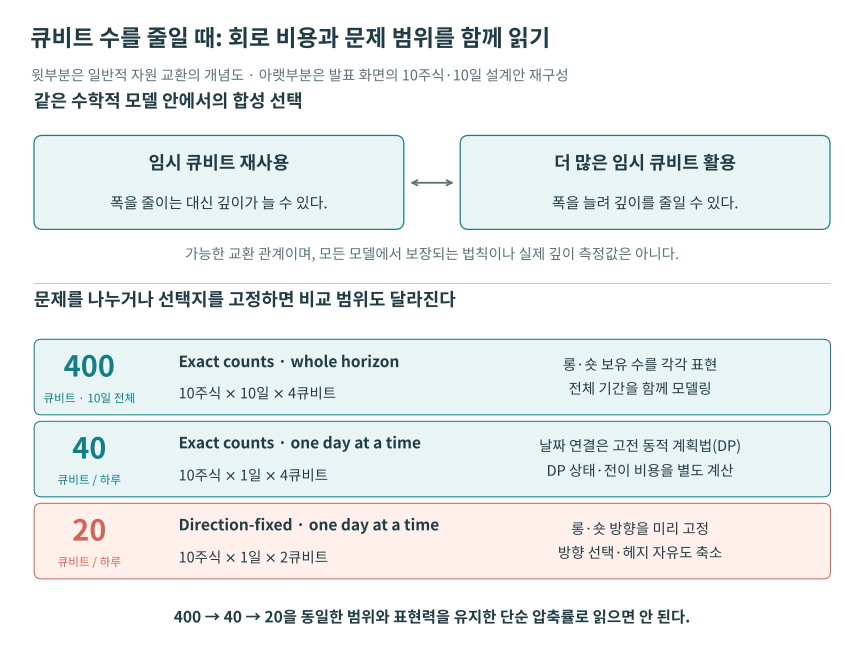

# 보충 해설 문제에서 회로와 결과로

이 장은 네 세션을 이해하기 위해 독립적으로 작성한 해설이다. 아래 손계산 예제는 발표의 데모를 재현한 실험 결과가 아니다. 입력을 작게 고정해 어떤 계산을 하는지 끝까지 확인하는 것이 목적이다.

## 1 자연어 요구와 계산 명세 사이에 남는 일

“수익이 높은 포트폴리오를 찾아 달라”는 문장은 아직 계산 문제가 아니다. 얼마를 투자하는지, 보유량을 정수로 제한하는지, 공매도를 허용하는지, 위험을 어떻게 평가하는지에 따라 답이 달라진다. 자연어 에이전트가 코드를 만들 때 가장 먼저 읽어야 할 것은 이 가정들이다. 컴파일러가 프로그램을 처리했다는 사실은 사용자의 경제적 의도가 정확하게 반영됐다는 보증을 대신하지 않는다.

검토 순서는 입력의 단위와 범위를 적고, 목적함수를 정의하고, 제약을 쓰고, 작은 고전 계산으로 기대 답을 만든 다음 양자 구현을 비교하는 것이다. 예를 들어 실수 보유량과 3비트 정수 보유량은 서로 다른 탐색공간이다. “최적값”이라는 말도 수학적으로 허용되는 해의 집합을 먼저 정해야 의미가 생긴다.

프로그램의 정확성에는 여러 질문이 있다. 모델이 요구를 표현하는가, 합성한 회로가 모델의 연산을 구현하는가, 측정과 디코딩이 맞는가, 얻은 해가 유용한가를 차례로 확인한다. 앞의 질문을 통과했다고 뒤의 질문에 자동으로 답해지는 것은 아니다.

## 2 가역 연산과 임시 큐비트

고전 함수 \(f(x)\)가 여러 입력을 같은 출력으로 보낸다면 입력을 지우고 출력만 남기는 연산은 일반적으로 가역적이지 않다. 양자 회로에서는 입력과 별도 출력 공간을 함께 두어

$$
U_f\lvert x\rangle\lvert y\rangle
=\lvert x\rangle\lvert y\oplus f(x)\rangle
$$

처럼 정의할 수 있다. \(\oplus\)는 비트별 XOR다. 같은 연산을 두 번 적용하면 \(f(x)\oplus f(x)=0\)이 되어 원래 상태로 돌아온다. 실제 산술 회로에는 곱셈의 부분 결과, 비교 결과, carry 등을 담는 임시 큐비트가 더 필요할 수 있다.

위상 오라클에서는 조건을 나타내는 Boolean 함수 \(f(x)\in\{0,1\}\)를 사용한다. 계산용 임시 공간에 조건값을 만들고 그 값이 1이면 위상을 바꾼 뒤, 계산을 역순으로 풀면

$$
\lvert x\rangle\lvert0\rangle
\longmapsto (-1)^{f(x)}\lvert x\rangle\lvert0\rangle.
$$

입력의 상대위상은 남고 임시 공간은 다시 0이 된다. 이 역연산을 **uncomputation**이라 한다. 임시 비트를 그냥 버리면 입력과 얽혀 있던 정보 때문에 원하는 간섭을 바꿀 수 있다. 따라서 “중간 결과가 필요 없으니 지운다”는 고전 프로그래밍 직관을 그대로 적용할 수 없다.

준비 연산을 \(V\), 그 상태에서 적용할 연산을 \(U\)라 하면, 시간 순서는 준비 \(V\) → 적용 \(U\) → 복원 \(V^\dagger\)이고 상태에 작용하는 행렬은 \(V^\dagger U V\)다. Classiq의 `within_apply`는 이런 연산 구조를 표현한다. 합성기가 이 구조와 변수의 수명을 알면 임시 공간을 재사용하는 구현을 탐색할 수 있다. [Classiq의 within_apply 공식 설명](https://docs.classiq.io/qmod-reference/language-reference/statements/within-apply)에서 준비와 역준비의 구체적 사용을 볼 수 있다.

## 3 Grover 탐색에서 부호가 확률로 바뀌는 과정

\(N\)개 후보 중 조건을 만족하는 후보가 \(M\)개이고 처음에 균등 중첩을 만들었다고 하자. 좋은 후보의 전체 초기 확률은 \(a=M/N\)이다. 좋은 후보들의 정규화된 중첩을 \(\lvert G\rangle\), 나머지를 \(\lvert B\rangle\)라 두면

$$
\lvert\psi\rangle=\sin\theta\lvert G\rangle+\cos\theta\lvert B\rangle,
\qquad \sin^2\theta=a.
$$

위상 표시와 초기 상태에 대한 반사를 한 번씩 수행하는 Grover 반복은 이 두 상태가 만드는 평면에서 진폭을 회전시킨다. 이상적 조건에서 \(r\)회 반복 후 좋은 후보를 얻을 확률은

$$
P_r=\sin^2((2r+1)\theta).
$$

손계산으로 \(N=8,M=2\)를 택하면 \(a=1/4\), \(\theta=\pi/6\)이다. 반복 전 성공확률은 1/4이고 한 번 반복하면 \(P_1=\sin^2(\pi/2)=1\)이다. 두 번 반복하면 \(P_2=\sin^2(5\pi/6)=1/4\)로 다시 내려간다. 따라서 반복 횟수를 무조건 늘릴 수는 없다. 실제 문제에서는 좋은 후보 수를 모르거나 회로가 잡음에 노출되어 이 이상적 계산과 달라진다.

질의 복잡도에서 \(O(\sqrt{N/M})\)라는 향상은 오라클 한 번의 비용과 상태 준비를 따로 세는 추상 모델의 결과다. 곱셈·금융 조건·데이터 조회로 오라클을 구현하는 비용까지 합한 시간은 별도로 평가해야 한다. [진폭 증폭과 추정의 원 논문](https://arxiv.org/abs/quant-ph/0005055)은 이러한 알고리즘 구조의 기초다.

## 4 포트폴리오를 QAOA 목적함수로 옮기는 작은 예

두 자산 중 하나를 선택하는 문제를 만들어 보자. 선택 변수 \(x_1,x_2\)는 0 또는 1이고 \(x_1+x_2=1\)이다. 교육용 입력으로 수익률 \(\mu=(0.08,0.12)\), 공분산 행렬과 목적함수를 다음처럼 둔다. 금액 배분이 아닌 이진 선택 예제이며 원영상의 정수 배분 데모와 다르다.

$$
\Sigma=\begin{pmatrix}0.04&0.01\\0.01&0.09\end{pmatrix},
\qquad C(x)=x^{\mathsf T}\Sigma x-\mu^{\mathsf T}x+(x_1+x_2-1)^2.
$$

첫 항은 위험, 두 번째는 수익을 높이는 방향, 마지막은 제약을 어기면 더하는 벌점이다. 네 경우를 직접 계산하면 다음과 같다.

| 선택 \((x_1,x_2)\) | 위험 | 수익 | 벌점 | 최소화할 비용 |
|---|---:|---:|---:|---:|
| (0,0) | 0 | 0 | 1 | 1 |
| (1,0) | 0.04 | 0.08 | 0 | -0.04 |
| (0,1) | 0.09 | 0.12 | 0 | -0.03 |
| (1,1) | 0.15 | 0.20 | 1 | 0.95 |

이 설정에서는 첫 자산만 고르는 해가 가장 작다. 수익만 비교하면 두 번째를 고르지만 위험을 함께 넣으면 결과가 달라진다. 위험과 수익을 더할 때는 계수의 단위와 척도를 정의해야 한다. 이 예에서는 입력 수치의 척도를 고정하고 위험 계수를 1로 두었다. 실제 모델에서는 위험회피 계수와 벌점 계수를 명시해야 한다.

기저 상태 \(\lvert x\rangle\)의 에너지가 \(C(x)\)가 되는 대각 연산자를 \(H_C\)로 정의한다. 이진 변수는 \(x_j=(I-Z_j)/2\)로 표현할 수 있다. QAOA는 보통 비용 연산과 비트를 섞는 연산을 번갈아 적용해 매개변수화한 상태를 만든다.

$$
\lvert\gamma,\beta\rangle=
e^{-i\beta_p H_M}e^{-i\gamma_p H_C}\cdots
e^{-i\beta_1H_M}e^{-i\gamma_1H_C}\lvert+\rangle^{\otimes n},
\qquad H_M=\sum_j X_j.
$$

고전 최적화기는 \(\langle H_C\rangle\) 등을 이용해 각도를 바꾼다. 마지막에는 샘플 비트열을 원래 변수로 디코딩하고 제약을 확인한다. **기대 비용, 가장 좋은 측정 해, 그 해의 빈도, 전체 샷 중 제약을 지킨 비율**은 서로 다른 결과다. 기대 비용이 높아도 좋은 해가 낮은 확률로 나올 수 있고, 한 번 좋은 해를 봤다고 안정적 최적화가 입증되지는 않는다.

QAOA의 깊이 \(p\), 초기값, 최적화기, 샷, 벌점과 mixer 선택은 결과에 영향을 준다. 비교할 때는 같은 시간 예산과 성공 기준으로 여러 실행을 평가해야 한다. 원 논문은 조합최적화의 근사 알고리즘을 제안했으며, 모든 금융 문제에서 고전 알고리즘보다 빠르다는 결론을 제공하지 않는다. [Farhi 등의 QAOA 논문](https://arxiv.org/abs/1411.4028).

## 5 옵션 기대값을 진폭으로 인코딩하는 방법

기대값을 알고 싶은 이산 확률변수 \(S\)가 있고, 상태 준비 회로가 \(\sum_i\sqrt{p_i}\lvert i\rangle\)를 만든다고 하자. payoff \(g_i\)를 \(0\leq g_i\leq g_{\max}\) 범위에 놓고 보조 큐비트를 조건부 회전시키면

$$
A\lvert0\rangle=
\sum_i\sqrt{p_i}\lvert i\rangle
\left(\sqrt{1-g_i/g_{\max}}\lvert0\rangle+
\sqrt{g_i/g_{\max}}\lvert1\rangle\right).
$$

보조 큐비트가 1일 확률은 \(a=\sum_i p_i g_i/g_{\max}\)이므로 원하는 기대 payoff는 \(g_{\max}a\)다. 가격을 구하려면 계약의 확률모형과 할인율도 정해야 한다. European call에서는 \(g_i=\max(S_i-K,0)\)이며, Asian option은 경로의 평균에 의존하므로 경로 생성과 평균 계산이 추가된다.

손계산 예로 가격 \((80,100,120,140)\), 확률 \((0.1,0.2,0.4,0.3)\), 행사가 \(K=110\)을 둔다. payoff는 \((0,0,10,30)\), 기대 payoff는 \(0.4\times10+0.3\times30=13\)이다. \(g_{\max}=30\)이면 \(a=13/30\)이다. 이 값은 할인 전이며 금융 예측이나 투자 조언을 위한 실제 시장 입력이 아니다.

이 회로를 독립적으로 \(N_s\)번 측정하는 단순 추정에서 보조 비트는 Bernoulli 확률변수다. 확률 추정량과 환산한 payoff의 표준오차는

$$
\operatorname{SE}(\widehat a)=\sqrt{a(1-a)/N_s},
\qquad \operatorname{SE}(\widehat g)=g_{\max}\sqrt{a(1-a)/N_s}.
$$

10,000샷에서는 각각 약 0.004955와 0.14866이다. 같은 이산 payoff 자체를 고전적으로 샘플링하면 분산은 \(310-13^2=141\)이고 표준오차는 \(\sqrt{141/10000}\simeq0.11874\)다. 확률로 바꾸기만 해서는 샘플 효율이 좋아지는 것이 아님을 이 작은 예에서 볼 수 있다.

QAE는 준비 회로와 역회로를 포함하는 증폭 연산을 일관되게 반복하여 진폭에 관한 정보를 얻는다. IQAE는 QPE 레지스터를 쓰는 표준 QAE와 달리 여러 증폭 깊이에서의 측정과 고전적 신뢰구간 갱신을 사용한다. 위상추정을 없애도 상태 준비·역준비와 긴 반복 회로의 비용은 남는다. [Grinko 등의 IQAE 논문](https://arxiv.org/abs/1912.05559)은 정확도·신뢰수준과 오라클 호출 수 사이의 관계를 분석한다.

고전 Monte Carlo의 독립 표본 평균은 유한 분산 조건에서 전형적으로 오차가 \(N_s^{-1/2}\)로 줄어든다. 따라서 오차를 1/10로 만들려면 표본을 약 100배 늘린다. QAE의 오라클 복잡도 향상과 실제 실행시간의 향상 사이에는 상태 준비, 함수 근사, 이산화, 샷, 잡음과 반복 깊이가 있다. 이 조건을 빠뜨리고 두 복잡도 식만으로 실용적 우위를 선언할 수 없다.

## 6 하이브리드 계산에서는 반복 밖으로 뺄 수 있는 일을 찾는다

양자 커널을 반복 호출하는 작업은 상태 준비·회로 실행 외에도 모델 작성, 합성, 코드 변환, JIT 컴파일, 데이터 이동, 고전 최적화가 필요하다. 전체 시간을 비교할 때는 적어도

$$
T_{\rm total}=T_{\rm model}+T_{\rm synth}+T_{\rm convert}
+T_{\rm JIT}+\sum_{k=1}^{K}
(T_{{\rm transfer},k}+T_{{\rm run},k}+T_{{\rm post},k})
$$

처럼 무엇을 한 번 하고 무엇을 반복하는지 구별한다. 실제 QPU를 사용하면 대기열과 작업 제출 지연도 포함된다. CPU/GPU 시뮬레이터의 상태 생성 방식과 측정 샘플링 방식도 총비용을 바꿀 수 있다.

교육용 가정으로 컴파일 2초, 실행 0.3초, 후처리 0.2초, 반복 100회를 두자. 매번 컴파일하면 \(100(2+0.3+0.2)=250\)초이고 컴파일을 한 번 재사용하면 \(2+100(0.3+0.2)=52\)초다. 약 4.81배의 차이가 생겨도 회로 자체가 빨라졌다는 의미는 아니다. 이러한 개선은 실용적이지만, 어떤 항을 줄였는지를 설명해야 다른 문제에 적용할 수 있다.

CUDA-Q의 `sample`은 측정 분포를 얻고 `observe`는 지정한 관측량의 기대값을 구하는 API다. 타깃이 CPU 시뮬레이터인지 GPU 시뮬레이터인지 실제 QPU인지는 별도로 지정한다. `observe`라는 함수명을 봤다는 것만으로 실제 장치의 유한 샷 측정을 수행했다고 판단하지 않는다. [NVIDIA 실행 문서](https://nvidia.github.io/cuda-quantum/latest/using/basics/run_kernel.html).

## 7 회로 폭과 깊이를 동시에 읽어야 하는 이유

폭은 회로가 사용하는 큐비트 수이며 깊이는 동시에 할 수 있는 연산을 묶었을 때의 순차 단계 수다. 더 많은 임시 큐비트로 병렬 연산을 늘리면 깊이가 줄 수 있다. 반대로 임시 공간을 반복 재사용하면 폭을 줄이는 대신 게이트와 깊이가 늘 수 있다. 합성의 목표를 바꾸는 실험은 같은 수학적 모델이 서로 다른 비용의 회로를 낳는다는 것을 보여준다.

밀집 상태벡터 시뮬레이션은 \(n\)큐비트에 \(2^n\)개 복소 진폭을 저장한다. 복소수 하나를 16바이트로 저장한다면 상태벡터만 필요한 메모리는 \(16\cdot2^n\)바이트다. 30큐비트는 16 GiB, 40큐비트는 16 TiB이고 큐비트 두 개가 늘면 4배다. 임시 버퍼 등은 제외한 계산이다. 다른 정밀도, tensor network, stabilizer 방식은 다른 비용 구조를 가지므로 이 식을 모든 시뮬레이터에 적용하지 않는다.

QPU에서는 최종 타깃의 네이티브 게이트와 연결성으로 변환한 후의 2큐비트 게이트 수, 깊이, 보정된 오류율과 샷이 중요하다. 논리적 회로에서 깊이를 줄인 비율이 장치 실행시간이나 결과 정확도의 같은 비율 개선을 뜻하지는 않는다. 오류정정 자원 추정은 물리적 큐비트·코드 거리·주기·실패확률 가정을 더 포함하는 별도 단계다.

다음 그림은 같은 모델 안에서 합성 선택을 바꾸는 경우와, 시간 범위·선택 자유도를 바꾸어 문제를 다르게 구성하는 경우를 나눈다. 이 두 경우를 구별해야 “적은 큐비트”가 어떤 의미인지 판단할 수 있다.

그림 5-1. **회로 비용의 교환과 문제 범위의 변경.** 위는 임시 공간 재사용에 따른 일반적인 폭·깊이 교환 가능성이다. 아래는 [새 플랫폼 발표 50:10](https://www.youtube.com/watch?v=QtKbkvWgncQ&t=3010s)의 10주식·10일 설계를 한국어로 재구성했다. 400은 전체 기간, 40과 20은 하루 기준이며, 일별 고전 DP 비용과 방향 고정의 헤지 자유도 손실을 함께 읽는다. 같은 문제의 성능을 재측정한 그림이 아니다.

## 8 데모에서 다음 실험으로 넘어가는 기준

작은 문제는 전수열거로 최적값과 모든 제약을 먼저 확인한다. 중간 규모에서는 문제에 맞는 고전 최적화기와 Monte Carlo·분산감소·준 Monte Carlo 등을 비교 후보로 정한다. 선택한 오차와 신뢰수준, 시간·메모리 예산에서 비교하고, 전처리와 상태 준비를 포함한다. 데이터나 회로의 특정 구조에만 유리하면 그 조건을 함께 적는다.

AI 에이전트가 만든 회로에는 입력 가정·참조 문서·SDK 버전·목적함수·실행 타깃과 결과를 보관한다. 사람이 확인할 핵심은 생성된 코드의 길이보다 문제 명세, 작은 기준 답, 유효한 출력의 비율과 전체 실행 비용이다. 이 네 가지가 있어야 다음 사용자가 데모를 다시 실행하고 차이의 원인을 찾을 수 있다.
