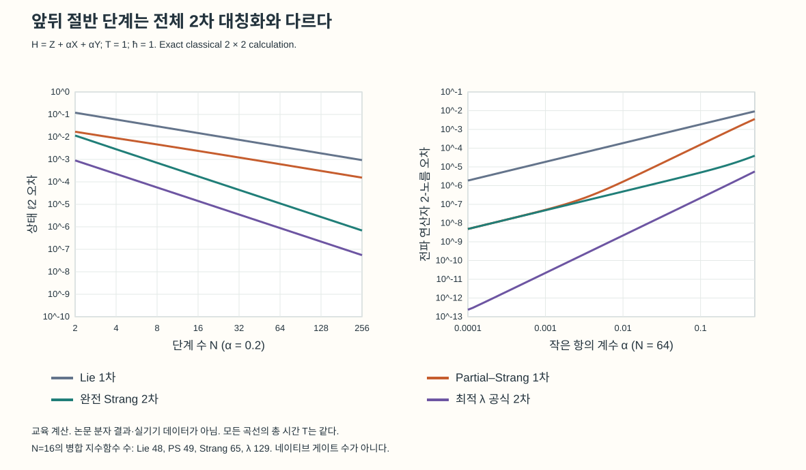
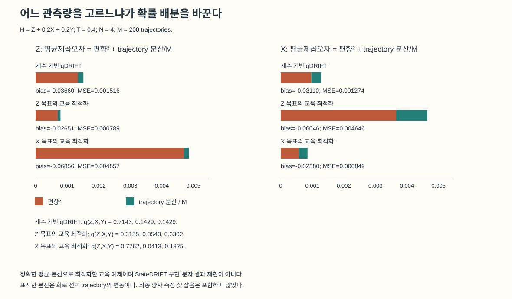
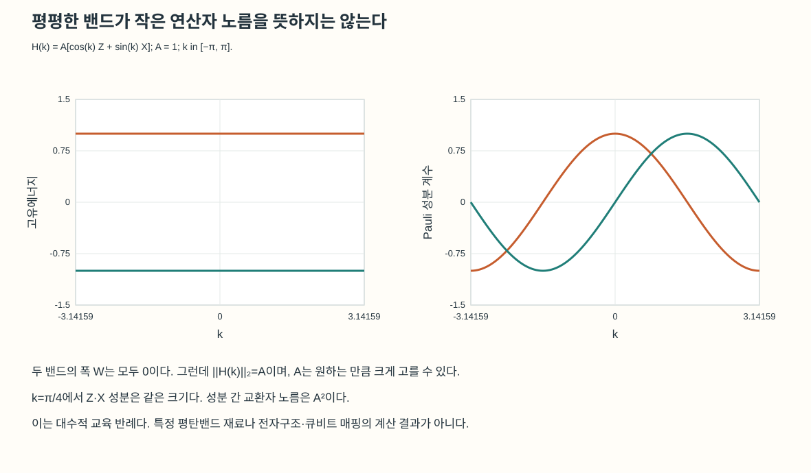

# 관측량과 항의 크기에 맞춘 양자 동역학 계산

책임 편집 김현중 · AI 보조 OpenAI Codex · 근거 기준일 2026-10-26

같은 Hamiltonian으로 계산하더라도 우리가 알고 싶은 값은 다를 수 있다. 모든 초기상태의 시간발전을 정확히 근사해야 하는 경우가 있는가 하면, 한 초기상태에서 특정 점유량이 얼마나 바뀌는지만 필요한 경우도 있다. 후자의 질문에 전자의 모든 조건을 요구하면 불필요하게 긴 회로를 만들 수 있다. 반대로 특정 관측량에 맞춰 만든 근사를 다른 관측량에 그대로 재사용하면 계산의 정확도가 나빠질 수 있다.

10월 24일 DQB의 StateDRIFT와 10월 26일의 norm-aware product formula는 이 선택을 서로 다른 위치에서 한다. 하나는 초기상태·관측량에 맞춰 무작위 시간발전 항의 선택 확률을 바꾸고, 다른 하나는 큰 항과 작은 항을 배치하는 결정론적 곱 공식을 바꾼다. 각 방법이 줄이는 오차와 요구하는 입력을 정하고, 같은 목표 정확도에서 필요한 연산을 비교할 수 있다.[1,2]

## 기존 측정 비용 리뷰에서 한 단계 더 들어가기

기존 VQE·CASH-QSE·혼합 추정량 리뷰는 준비된 상태에서 에너지를 읽는 법과 반복 측정의 배분을 다뤘다. 이번에는 **시간발전을 만드는 근사 자체**가 대상이다. 관측량에 반복 측정을 더 하는 것과, 어떤 Hamiltonian 항의 회전을 더 자주 수행하는 것은 다른 설계 변수다.

ħ=1로 두고 H의 정확한 시간발전을 U(T)=exp(−iHT)라 쓰자. 모든 입력 상태를 통제하려면 전파 연산자의 노름 오차 ||U−Ũ||를 볼 수 있다. 초기상태 |ψ₀⟩를 이미 정했다면 두 출력 상태의 거리도 볼 수 있다. 물리적으로 읽을 O까지 정했다면 목표는 다음 기대값이다.

```math
f(T) = <ψ₀| U†(T) O U(T) |ψ₀>
```

전파 연산자를 잘 근사하면 관측량 오차의 상계를 얻을 수 있지만, 관측량 하나가 잘 맞는다는 사실로 모든 상태·모든 관측량의 정확성을 역으로 결론 낼 수는 없다. 특히 무작위 회로를 평균한 출력은 일반적으로 혼합상태여서, 단일한 근사 유니터리의 오차와 같은 숫자로 다룰 수도 없다.

## 큰 항을 반씩 감싸면 왜 도움이 되는가

Hamiltonian이 H=H₀+α(H₁+H₂)이고 세 H의 노름이 비슷하며 |α|가 작다고 하자. δ=T/N은 한 단계의 시간이다. 가장 단순한 Lie 곱과 dominant 항을 감싼 Partial–Strang 곱을 비교할 수 있다.

```math
L(δ) = e^(-iH₀δ) e^(-iαH₁δ) e^(-iαH₂δ)
P(δ) = e^(-iH₀δ/2) e^(-iαH₁δ) e^(-iαH₂δ) e^(-iH₀δ/2)
```

이 식은 쓰인 순서의 행렬곱이며 상태에는 오른쪽 인자부터 작용한다. P는 양 끝의 H₀를 대칭화하지만 가운데 H₁·H₂는 역순으로 되감지 않는다. 따라서 일반적으로 **1차 공식**이다. 가운데까지 대칭화하는 완전 Strang 2차 공식과 구별해야 한다.

큰 항과 작은 항의 교환에서 생기는 leading 기여를 억제하는 것이 이 배치의 목적이다. 그러나 국소 오차를 α²δ² 하나로 끝내면 중요한 조건을 잃는다. 고정한 항과 노름에 의존하는 상수 C₁,C₂를 두면 관련 두 기여는 다음처럼 읽을 수 있다.

```math
한 단계:  C₁ α² δ² + C₂ |α| δ³ + 더 높은 항
고정 T의 N단계 상계:  C₁ α² T²/N + C₂ |α| T³/N² + 더 높은 항
```

α를 고정해 단계를 짧게 하는 극한과, 단계 길이를 고정해 α만 작게 하는 극한은 다르다. 후자에서는 선형 α 잔차가 지배할 수 있다. 원 논문 Appendix B도 이 교차를 구별한다. ‘작은 항이 있으니 언제나 α²로 좋아진다’는 설명보다, 어떤 항이 목표 정밀도를 제한하는지 확인하는 편이 계산에 직접 도움이 된다.[2]

논문의 다섯 분자 비교에서 보고한 4.5–8배는 STO-3G 기저·T=1 au·N=100에서 궤도 회전을 가한 Hartree–Fock 초기상태 10개를 사용한 평균 **상태 전파 ℓ2 오차** 감소다. dominant 연산을 한 번 더 배치하는 비용도 실제 궤도 회전·native gate로 내리면 별도 계산이 필요하다. operator-norm 보장과 특정 상태의 수치 오차, 장치 실행시간은 각각 다른 척도다.

## 정확한 한 큐비트 계산에서 확인한 차수와 비용

독립 교육 계산은 H=Z+0.2X+0.2Y, T=1에서 수행했다. 초기상태는 cos(1.05/2)|0⟩+exp(0.38i)sin(1.05/2)|1⟩다. 이는 분자나 두 논문의 benchmark를 재현한 결과가 아니다. 일반 비가환 합의 동작을 정확한 2×2 행렬로 확인하는 예다.

| 공식 | N=16에서 상태 ℓ2 오차 | 인접 같은 항을 병합한 지수함수 개수 |
|---|---:|---:|
| Lie 1차 | 0.01485170 | 48 |
| Partial–Strang 1차 | 0.00238632 | 49 |
| 완전 Strang 2차 | 0.00017549 | 65 |
| 논문의 최적 λ 2차 공식 | 0.00001408 | 129 |



*그림 1. 독립적인 한 큐비트 교육 계산. 왼쪽은 α=0.2·T=1에서 상태 ℓ2 오차와 분할 수 N의 관계, 오른쪽은 N=64·T=1에서 operator 2-norm 오차와 α의 관계다. 비교 축의 오차 정의가 다르다. 지수함수 개수는 장치의 게이트 수나 실행시간이 아니다.*

N=32–256의 log–log 기울기는 Lie와 Partial–Strang에서 약 −1, 두 2차 공식에서 약 −2였다. 양 끝을 반씩 감싼 P를 잘못 2차라고 부르면 이 결과를 설명할 수 없다. 표의 같은 N에서 정확도가 더 높더라도 지수함수 수가 늘어나므로, 실제 알고리즘 선택에는 목표 오차를 맞춘 비용 비교가 필요하다. 이 한 큐비트에서는 상태 거리와 operator 2-norm 값이 우연히 같지만, 두 척도의 일반적 동일성을 뜻하지 않는다.

## StateDRIFT는 실행할 항의 확률을 바꾼다

H=ΣⱼcⱼPⱼ에서 Pⱼ는 Pauli 문자열, cⱼ는 그 계수다. 보통의 qDRIFT는 qⱼ∝|cⱼ|로 항을 뽑는다. 선택된 항은 exp(−icⱼδPⱼ/qⱼ)만큼 회전한다. 확률을 바꾸면 회전각도 함께 바꿔야 한다. StateDRIFT는 초기상태와 목표 관측량의 응답·교환자 정보를 사용해 이 분포를 조정한다.[1]

이 변화는 측정 기저의 선택과도, 같은 최종 회로에 샷을 더 배정하는 것과도 다르다. 유한 깊이에서 무작위로 생성할 회로의 앙상블 자체를 바꾸기 때문이다. 초기상태에서 거의 중요하지 않은 항도 나중의 동역학에는 영향을 줄 수 있어, 논문은 계수 기반 분포를 섞어 항의 확률이 함부로 사라지지 않게 한다.

무작위 회로를 M번 독립적으로 뽑아 각 회로의 기대값을 정확히 안다고 가정하면, 평균 추정의 평균제곱오차(MSE)는 bias²+V/M으로 나눌 수 있다. bias는 정확한 시간발전 기대값과 앙상블 평균의 차이, V는 회로를 뽑을 때 생기는 기대값의 분산이다. 실제 장치에서는 각 회로의 양자 측정 샷 잡음이 추가된다. 아래 계산의 M은 이 마지막 샷 수가 아니라 **회로 trajectory 수**다.

## Z를 잘 맞춘 분포가 X에도 좋은가

같은 H와 초기상태에서 T=0.4, N=4, M=200을 고정했다. 여기서 만든 분포 탐색은 정확한 전체 동역학을 알고 MSE를 평가하는 **교육용 oracle 탐색**이다. StateDRIFT처럼 저차 교환자 정보와 편향의 절단 전개를 사용해 분포를 고르는 구현은 아니며, 전역 최적성도 주장하지 않는다. 이 구분을 둔 채로 관측량 맞춤 설계의 의미를 검산할 수 있다.

| 표본분포 q(Z,X,Y) | Z 기대값 MSE | X 기대값 MSE |
|---|---:|---:|
| 계수 기반 (0.714286, 0.142857, 0.142857) | 0.00151577 | 0.00127419 |
| Z 목표 탐색 (0.315497, 0.354291, 0.330211) | 0.00078901 | 0.00464612 |
| X 목표 탐색 (0.776217, 0.041251, 0.182531) | 0.00485711 | 0.00084950 |



*그림 2. 같은 모형에서 구한 정확 앙상블 평균과 분산. MSE의 두 성분을 같은 선형 축에 나타냈다. 유한 샷의 측정 잡음·상태 준비·분포 탐색 비용은 포함하지 않았다. 논문 StateDRIFT의 성능 도표가 아닌 독립 교육 계산이다.*

Z를 겨냥한 분포는 Z의 MSE를 줄였지만 X의 MSE는 늘렸다. X를 겨냥하면 반대 방향의 교환이 생겼다. 따라서 관측량 하나에 맞춰 만든 계산을 여러 관측량의 공용 결과로 사용할 때에는 재평가가 필요하다. 이 예는 계수 크기만으로 정한 분포와 관측량별 분포가 다를 수 있다는 사실, 그리고 맞춤화의 범위를 함께 보여준다.

평균은 ΣqⱼUⱼ라는 행렬을 거듭제곱해서 구하지 않았다. 밀도행렬 채널 𝓔(ρ)=ΣqⱼUⱼρUⱼ†를 반복하고, 같은 회로 선택을 공유하는 두 복사본의 채널로 2차 모멘트를 계산했다. 제작 코드의 직접 trajectory 열거와 별도로, root가 Bloch 구의 SO(3) 회전·1차 및 2차 모멘트 행렬로 다시 계산했을 때 최대 차이는 1.06×10⁻¹⁵ 이하였다. 서로 다른 표현으로 같은 수치를 확인한 것이며 실제 장치의 오차 검증은 아니다.

## 실제 계산으로 옮길 때 남는 질문

StateDRIFT에서 필요한 초기상태 정보가 저렴한 고전 surrogate나 classical shadow로 얻어지는지, 그 오차가 선택 확률을 얼마나 바꾸는지 확인해야 한다. 시간과 관측량을 바꾸며 분포를 재사용할 때의 이득도 별도다. 실용적인 4차 절단의 타당성 지표를 엄밀한 모든 조건의 성능 보장으로 쓰면 안 된다. 논문 Appendix I에는 시간 조건에 따라 qDRIFT보다 불리해지는 예도 있다.[1]

분자 BeH₂의 11,201→983은 vanilla qDRIFT 대비 예상 두 큐비트 게이트 수다. 14큐비트·STO-3G/Jordan–Wigner·T=1 au에서 가중 점유량 변화의 절반을 구별하는 편향 기준을 썼다. Appendix J는 두 기하의 Hartree–Fock 궤도를 서로 정합하지 않은 quench를 방법 benchmark로 명시한다. 물질 동역학에 사용하려면 Hamiltonian·초기상태·관측량을 같은 기저에서 일관되게 정의하는 단계부터 필요하다.

## 평탄밴드는 이 알고리즘의 가정을 자동으로 만족하지 않는다

밴드가 평평하면 전자 상호작용이 중요해질 수 있지만, 그것만으로 Hamiltonian 항 사이에 작은 노름 비 α가 생기는 것은 아니다. 교육 반례 H(k)=A[cos(k)Z+sin(k)X]를 보면 모든 k에서 에너지는 ±A이고 각 밴드의 폭은 0이다. 그러나 k=π/4에서 두 성분의 노름은 |A|/√2로 같고, 교환자 노름은 A²이다.



*그림 3. 독립 두 궤도 Bloch 모형의 대수적 반례. 오른쪽 주황 곡선은 A cos(k), 청록 곡선은 A sin(k)이다. 분자 적분·다체 Hamiltonian의 Jordan–Wigner 변환이나 ReAg₂Cl₆의 계산이 아니다.*

평탄밴드 연구와 시간발전 알고리즘 연구를 연결하려면 먼저 투영한 Hamiltonian, 상호작용, 분해의 단위와 목표 관측량을 정해야 한다. 그다음 큰 항·작은 항의 노름과 교환자를 평가하고, 관측량 맞춤 표본분포가 필요한 정보를 감당할 수 있는지 묻는 순서가 적절하다. 물리적 밴드폭, 전파 연산자 오차, 특정 관측량의 통계 오차는 이 순서에서 각각 다른 역할을 한다.

## 출처와 검토 범위

1. Coyle et al., [Problem-aware sampling for bias and variance reduction in randomised Hamiltonian simulation](https://arxiv.org/abs/2610.31515v1), 2026-10-22 제출. [본문](https://arxiv.org/html/2610.31515v1) §II–VI·Appendix I/J. 동료평가 전 프리프린트.
2. Piñeiro Moreno, Krause, Bande, [Norm-Aware Product Formulas for Hamiltonian Simulations](https://arxiv.org/abs/2610.31070v1), 2026-10-22 제출, 원고 표지 날짜 10-21. [본문](https://arxiv.org/html/2610.31070v1) §II·III.2·Appendix B. 동료평가 전 프리프린트.

새 교육 계산은 `artifacts/compare_dynamics.py`, 독립 검산은 `artifacts/verify_dynamics_bloch.py`에 있다. 소스·수치 JSON·한영 SVG를 함께 보존한다. 원 논문의 분자 계산·StateDRIFT allocator·QPU를 재현한 결과는 없다. 제작자 `dqb_today_algorithm_sources`는 원문·수식·새 NumPy 교육 계산·도표를, `root`는 집필과 SO(3) 독립 검산을 맡았다. 정확한 모델 식별자는 미보존이며 사람의 문장별 감수·독자 이해도 평가는 수행하지 않았다. 편집 기준은 AI Tech Review Editorial Harness 2026.08 및 과학 설명 준칙 1.0이다. 원고·검산을 마친 단계이며 정식 표지·영문 전문·최종 PDF와 공개 게재는 이 단계에 포함하지 않는다.
